## 第 20 章：使用变体管理器创建产品配置器

本章解释了如何创建产品配置器，这是一种工业中用于吸引消费者关注特定产品的应用程序类型。你将学习如何使用变体管理器面板和变体集来定义产品配置器。产品配置器模板是研究各种蓝图概念的绝佳资源。我们将分析 BP_Configurator 蓝图，该蓝图使用带有变体集的 UMG 小部件蓝图动态创建用户界面。

本章涵盖的主题包括：

- 产品配置器模板
- 变体管理器面板和变体集
- BP_Configurator 蓝图
- UMG 小部件蓝图

本章结束时，你将知道如何使用产品配置器模板、变体管理器面板和变体集来创建产品配置器。你将了解 BP_Configurator 蓝图和 UMG 小部件蓝图的工作原理，以便能够将它们调整为适合你的应用程序。

### 产品配置器模板

产品配置器应用程序背后的主要思想是让用户在不同产品选项之间切换并实时可视化它们-

实时3D体验。这类应用在行业中越来越常见。

虚幻引擈拥有一个产品配置器模板，可用作制作您自己产品配置器的起点。请按照以下步骤使用产品配置器模板：

- 1. 在新建项目面板中，选择 AUTOMOTIVE PRODUCT DESIGN & MANUFACTURING 类别，然后选择产品配置器模板：

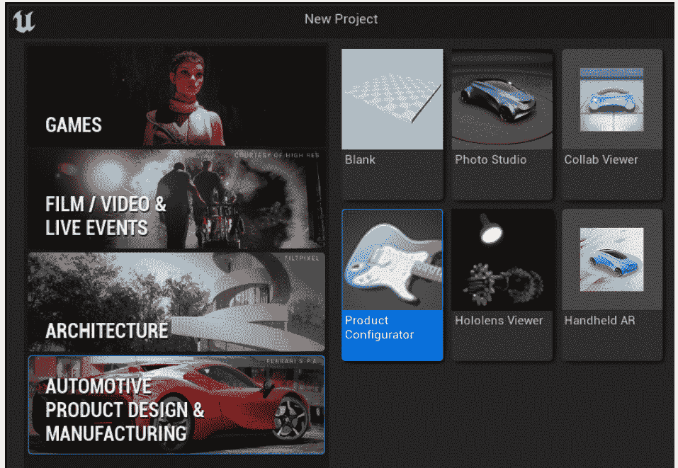

图 20.1 – 选择产品配置器模板

- 2. 为项目选择文件夹和名称，然后单击 **Create** 按钮。

- 3. 虚幻编辑器加载项目后，单击 **Play** 按钮运行模板。下一张截图显示了随产品配置器模板附带的吉他示例的主界面：

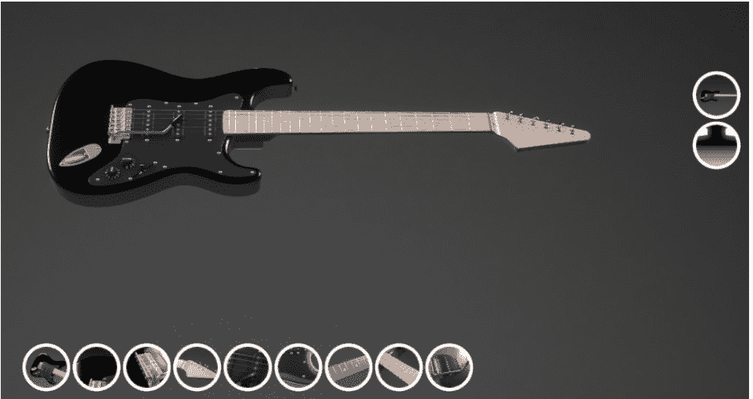

图 20.2 – 产品配置器模板的吉他示例

- 4. 右侧的两个按钮允许您更改相机和环境照明。单击按钮时，会显示其他按钮以选择组的当前选项。单击相机按钮并选择另一个相机：

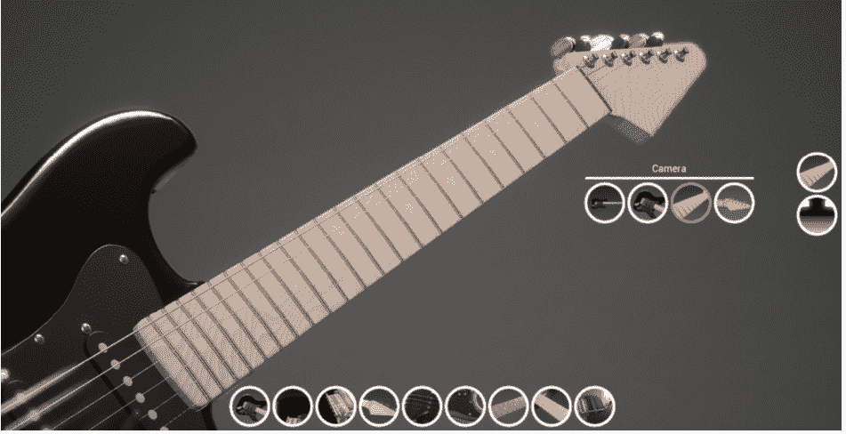

图 20.3 – 选择另一个相机

- 5. 底部的按钮允许您更改吉他的各个部分。尝试每个按钮，以查看产品配置器的潜力：

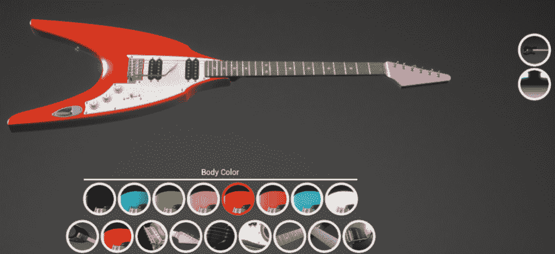

图 20.4 – 选择车身颜色

现在我们已经了解了如何使用产品配置器模板，可以分析产品配置器中使用的工具了。

### 变体管理器面板和变体集

产品配置器背后的主要工具是 **变体管理器**。我们使用变体管理器面板来编辑 **Level Variant Sets** 资产，这允许我们修改关卡中 Actor 的属性。产品每个部件的每种配置都是一个 **变体**，我们可以将变体分组为 **变体集**。

在产品配置器模板中，启动应用程序时出现在屏幕上的每个按钮都代表一个变体集。单击这些变体集按钮之一时，会显示其他按钮，这些按钮代表属于当前变体集的 **变体**。

以下是使用变体管理器面板的步骤：

- 1. 双击位于 `Content > ProductAssets` 文件夹中的 `VariantSet` 资产，以打开变体管理器面板：

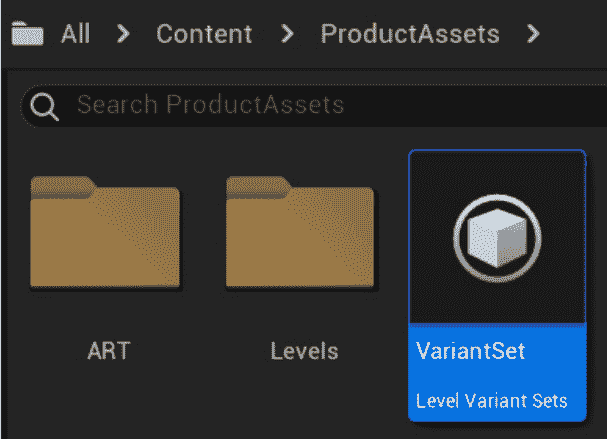

图 20.5 – 模板的关卡变体集

- 2. 变体集和变体在左侧列出。在下一张截图中，我们可以看到 **Body Shape** 是一个带有三个变体的变体集：**Strat Type**、**I Type** 和 **V Type**。单击 **I Type** 以查看其属性：

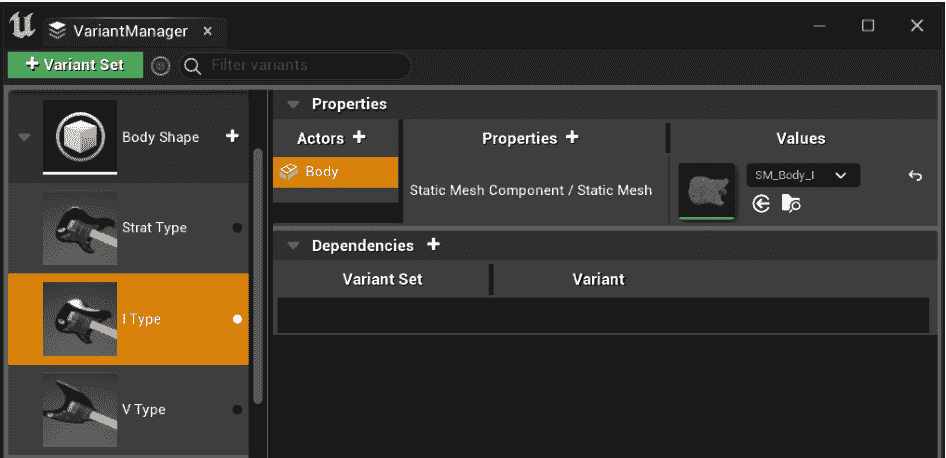

图 20.6 – 变体管理器面板

- 3. 对于每个变体，我们可以添加关卡中将由变体修改的 Actor。在上一张截图中，**Body** 是一个 `StaticMeshActor`，其静态网格由变体修改。

- 4. 使用 **+Variant Set** 按钮添加变体集，并使用变体集名称右侧的 + 按钮添加变体集中的变体。

- 5. 双击变体以激活它。更改会立即应用到关卡中。

- 6. 表示吉他部件的静态网格 Actor 在关卡中由名为 **GuitarRoot** 的 Actor 分组，因此您可以将它们一起移动。以下截图来自关卡编辑器中的 **大纲视图** 面板：

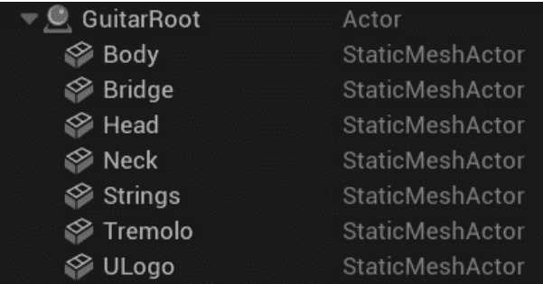

图 20.7 – 吉他的静态网格 Actor

为了能够在运行时更改变体，`VariantSet` 资产被放置到关卡中以创建 `Level Variant Sets Actor`。

产品配置器模板非常灵活。您只需学习使用变体管理器面板并导入您的静态网格，即可创建自己的产品配置器。

在下一节中，我们将分析 `BP_Configurator` 蓝图。您不需要知道它的工作原理即可使用产品配置器，但这是观察高级蓝图技术实际应用的绝佳机会。

### BP_Configurator 蓝图

产品配置器模板有一个名为 `BP_Configurator` 的蓝图，它使用关卡变体集的数据通过 UMG 部件蓝图创建界面。这是一个非常值得研究的蓝图，因为我们将看到多个蓝图概念一起使用。

关卡中有一个 `BP_Configurator` 实例，您可以在 **大纲视图** 面板中选择它。在 **详细信息** 面板中，在 **默认** 类别下，有两个可编辑实例的变量。`LVSActor` 变量是对 **关卡变体集 Actor** 的引用，而 `Camera Actor` 是用于可视化产品的相机的引用：

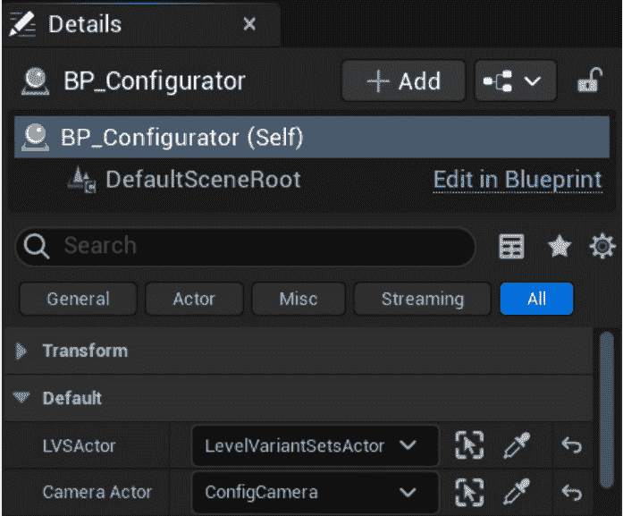

图 20.8 – BP_Configurator 可编辑实例变量

在打开 BP_Configurator 蓝图之前，让我们先看看位于 `Content > ProductConfig > Blueprints` 文件夹中的 **STRUCT_VarSet**：

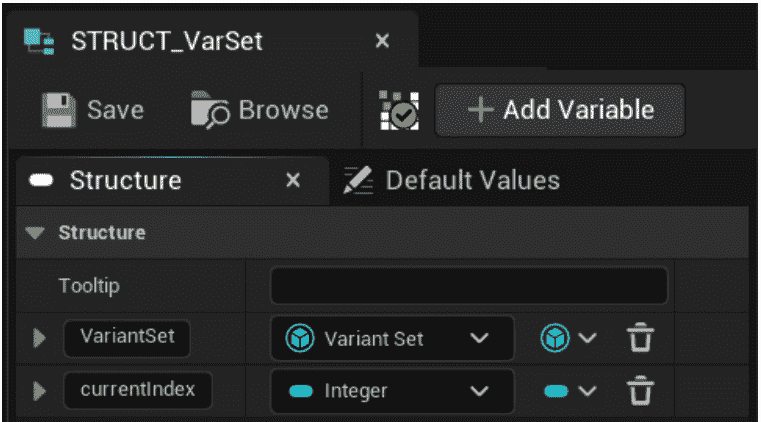

图 20.9 – STRUCT_VarSet 变量

该结构体有两个变量。**VariantSet** 是对 **变体集** 的引用，而 **currentIndex** 是一个整数变量，用于存储所选变体在变体集中的索引。

打开位于 `Content > ProductConfig > Blueprints` 文件夹中的 `BP_Configurator` 蓝图。让我们先从查看 **我的蓝图** 面板中的变量开始：

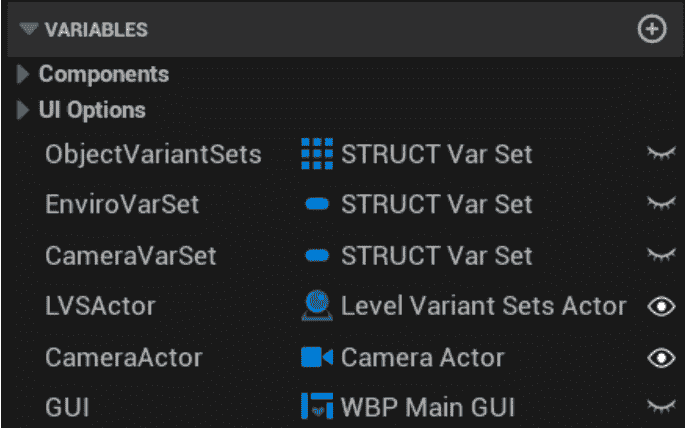

图 20.10 – BP_Configurator 变量

每个变量的作用如下：

- **ObjectVariantSets**：存储产品所有变体集的 **STRUCT_VarSet** 数组
- **EnviroVarSet**：**STRUCT_VarSet** 类型的变量，用于存储环境照明的变体集
- **CameraVarSet**：**STRUCT_VarSet** 类型的变量，用于存储相机变体集
- **LVSActor**：对 **关卡变体集 Actor** 的引用
- **CameraActor**：对用于可视化产品的相机的引用
- **GUI**：对主 UMG 部件蓝图的引用。请注意，**UI 选项** 类别中有几个变量可用于修改产品配置器的外观。这些变量可编辑实例，因此您可以修改关卡中所在实例的这些变量。

现在，让我们看看函数：

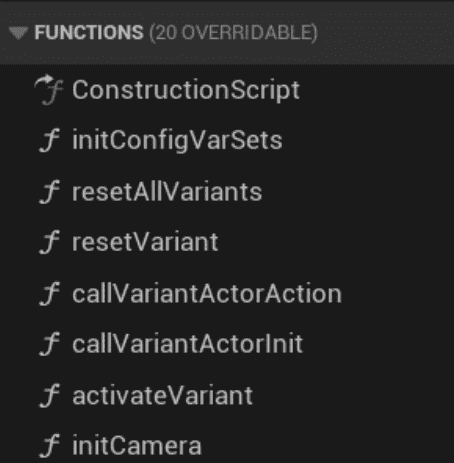

图 20.11 – BP_Configurator 函数

每个函数的作用如下：

- **initConfigVarSets**：它获取关卡变体集 Actor 的变体集，并将它们存储在 `ObjectVariantSets` 数组、`EnviroVarSet` 变量和 `CameraVarSet` 变量中。
- **resetAllVariants**：为 `EnviroVarSet`、`CameraVarSet` 和 `ObjectVariantSets` 数组的每个元素调用 **resetVariant** 函数。
- **resetVariant**：通过激活变体集中的第一个元素来重置变体集。
- **callVariantActorAction**：为当前变体使用的所有实现 `BPI_RuntimeAction` 接口的 Actor 和组件调用 `Variant Switched On` 函数。这样，当变体激活时，Actor 就可以运行脚本。
- **callVariantActorInit**：为当前变体使用的所有实现 BPI_RuntimeAction 接口的 Actor 和组件调用变体初始化函数。
- **activateVariant**：激活给定变体集中的一个变体。
- **initCamera**：初始化相机。

**Event BeginPlay** 具有一个带有三个输出的 **Sequence** 节点。第一个输出线连接到将 **BP_Configurator** 引用存储在 **BP_ConfigGameMode** 中的节点，以便其他蓝图可以通过访问游戏模式来获取 **BP_Configurator** 引用：

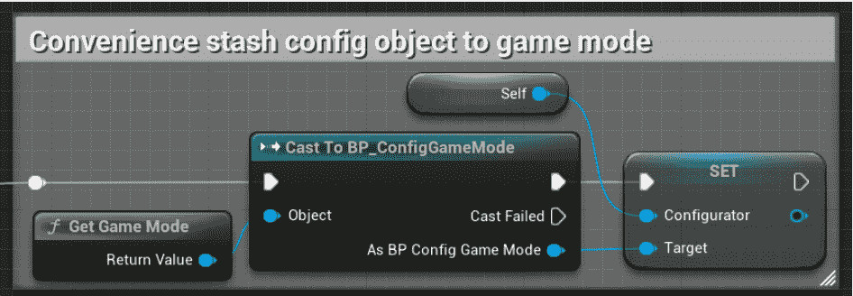

图 20.12 – 将 BP_Configurator 引用存储在游戏模式中

第二个输出线连接到初始化函数，这些函数存储变体集、初始化相机，并将所有变体集重置为第一个（默认）变体：

### 图 20.13 – 初始化函数

On the second output wire, there are also nodes that create an instance of the WBP Main GUI widget and store the reference in the GUI variable. The widget is added to the Viewport, and the input mode is set to Game and UI:

在第二个输出线上，还有节点用于创建 WBP Main GUI 小部件的实例，并将引用存储在 GUI 变量中。该小部件会添加到 Viewport，并且输入模式设置为 Game and UI：

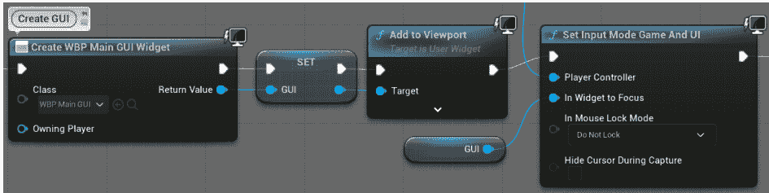

### 图 20.14 – 配置用户界面

The third output wire connects to nodes that perform the GUI event bindings. This is where the magic happens. We will see in the next section that the WBP Main GUI Widget Blueprint has an event dispatcher named Variant Selected. The nodes on the next screenshot bind a Custom Event named GUIVariantSelected to the Variant Selected event dispatcher:

第三个输出线连接到执行 GUI 事件绑定的节点。这就是奇迹发生的地方。我们将在下一节中看到，WBP Main GUI Widget Blueprint 具有一个名为 Variant Selected 的事件分派器。下一张截图中的节点将名为 GUIVariantSelected 的自定义事件绑定到 Variant Selected 事件分派器：

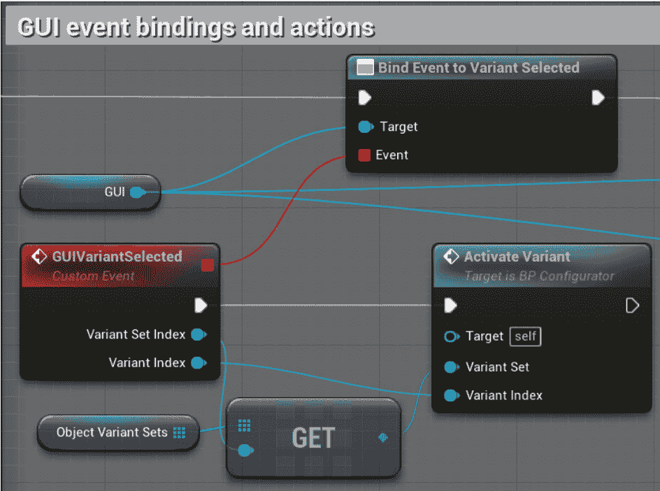

图 20.15 – GUI 事件绑定

When the user clicks on a button to activate a Variant, **WBP Main GUI** calls the **Variant Selected** event dispatcher. The **GUIVariantSelected** Custom Event will execute because it is bound to the **Variant Selected** event dispatcher.

当用户单击按钮以激活 Variant 时，**WBP Main GUI** 会调用 **Variant Selected** 事件分派器。**GUIVariantSelected** 自定义事件将会执行，因为它已绑定到 **Variant Selected** 事件分派器。

For more information about event dispatchers and bindings, see *Chapter 4, Understanding Blueprint Communication*.

有关事件分派器和绑定的更多信息，请参见 *第 4 章，了解蓝图通信*。

The **GUIVariantSelected** Custom Event calls the **Activate Variant** function, using the selected **Variant Set** and **Variant Index** parameters. The **Switch On** function of the Variant is used to activate the Variant:

**GUIVariantSelected** 自定义事件调用 **Activate Variant** 函数，使用选定的 **Variant Set** 和 **Variant Index** 参数。Variant 的 **Switch On** 函数用于激活 Variant：

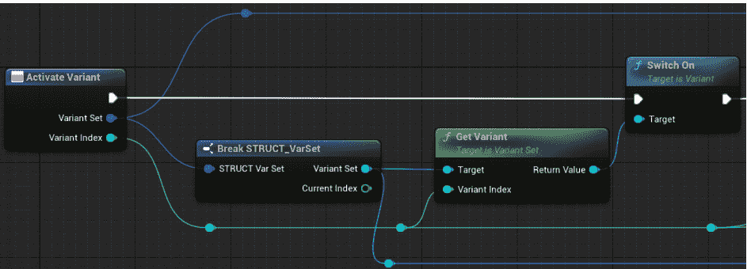

图 20.16 – Activate Variant 函数

The dynamic interface is created by some UMG Widget Blueprints that work together and use the variables from **BP_Configurator**.

动态界面由一些协同工作的 UMG 小部件蓝图创建，并使用来自 **BP_Configurator** 的变量。

### UMG 小部件蓝图

There are five UMG Widget Blueprints used in the Product Configurator interface. For more information about UMG, see <u>Chapter 7, Creating Screen UI Elements</u>.

产品配置器界面中使用了五个 UMG 小部件蓝图。有关 UMG 的更多信息，请参见 <u>第 7 章，创建屏幕 UI 元素</u>。

These are the UMG Widget Blueprints:

以下是这些 UMG 小部件蓝图：

- **WBP_MainGUI**: The main Widget Blueprint that contains the other widgets.
- **WBP_MainSelector**: This is the Widget responsible for reading the Level Variant Sets and creating the corresponding buttons.
- **WBP_VariantRibbonSelector**: This Widget is used to show the Variant options of the selected Variant Set.
- **WBP_PopupSelector**: This Widget is similar to **WBP_VariantRibbonSelector**, but it is used for camera and environment lighting.
- **WBP_Button**: This Widget represents the button used to select a Variant or a Variant Set.

- **WBP_MainGUI**: 包含其他小部件的主 Widget Blueprint。
- **WBP_MainSelector**: 此 Widget 负责读取 Level Variant Sets 并创建相应的按钮。
- **WBP_VariantRibbonSelector**: 此 Widget 用于显示所选 Variant Set 的 Variant 选项。
- **WBP_PopupSelector**: 此 Widget 与 **WBP_VariantRibbonSelector** 类似，但用于相机和环境光照。
- **WBP_Button**: 此 Widget 表示用于选择 Variant 或 Variant Set 的按钮。

The next screenshot shows the relationship between some of the Widgets:

下一张截图显示了一些 Widget 之间的关系：

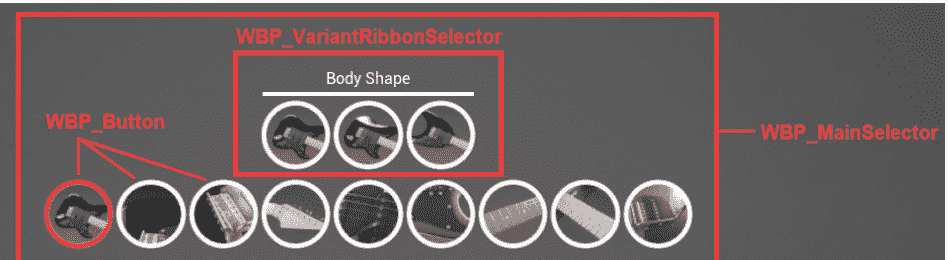

图 20.17 – Widget 之间的关系

The Widget Blueprints are located in the `Content > ProductConfig > UMG` folder. Let's start by looking at **WBP_MainGUI**. The following screenshot is from its **Hierarchy** panel:

Widget Blueprint 位于 `Content > ProductConfig > UMG` 文件夹中。让我们先查看 **WBP_MainGUI**。以下截图来自其 **Hierarchy** 面板：

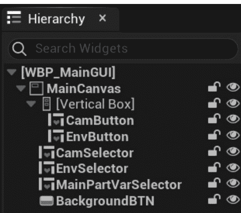

图 20.18 – WBP_MainGUI Hierarchy 面板

**WBP_MainGUI** uses two **WBP_Button** Widgets and two **WBP_PopupSelector** Widgets to manage the camera and environment lighting options. **MainPartVarSelector** is a **WBP_MainSelector** Widget that manages the Variants of the product.

**WBP_MainGUI** 使用两个 **WBP_Button** 小部件和两个 **WBP_PopupSelector** 小部件来管理相机和环境光照选项。**MainPartVarSelector** 是一个管理产品 Variants 的 **WBP_MainSelector** 小部件。

The buttons of the Variant Sets and each Variant are created in **Event Construct** of the **WBP_MainSelector** Widget. The **Populate Options** function creates the buttons using the thumbnails from the Level Variant Sets:

Variant Set 和每个 Variant 的按钮在 **WBP_MainSelector** 小部件的 **Event Construct** 中创建。**Populate Options** 函数使用 Level Variant Sets 的缩略图创建按钮：

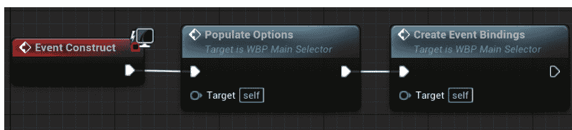

图 20.19 – WBP_MainSelector 的 Event Construct

All five Widget Blueprints have event dispatchers. The first event dispatcher is triggered when the user clicks on **WBP_Button**:

所有五个 Widget Blueprint 都有事件分派器。当用户单击 **WBP_Button** 时，将触发第一个事件分派器：

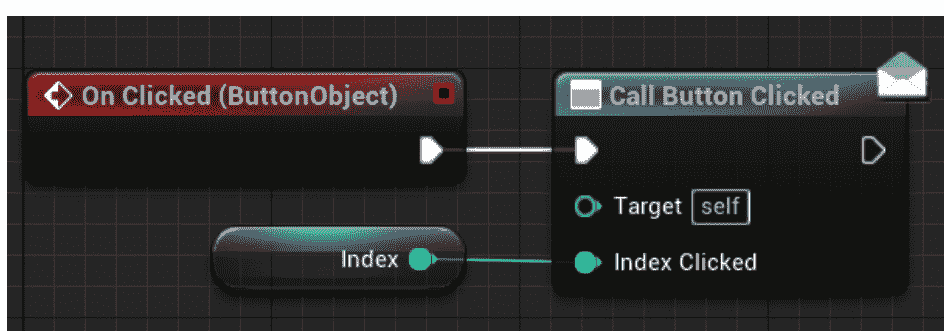

图 20.20 – WBP_Button 的 On Clicked 事件

**WBP_VariantRibbonSelector** binds an event to the **Button Clicked** event dispatcher of **WBP_Button**. The new event triggers the **Ribbon Option Selected** event dispatcher:

**WBP_VariantRibbonSelector** 将一个事件绑定到 **WBP_Button** 的 **Button Clicked** 事件分派器。新事件将触发 **Ribbon Option Selected** 事件分派器：

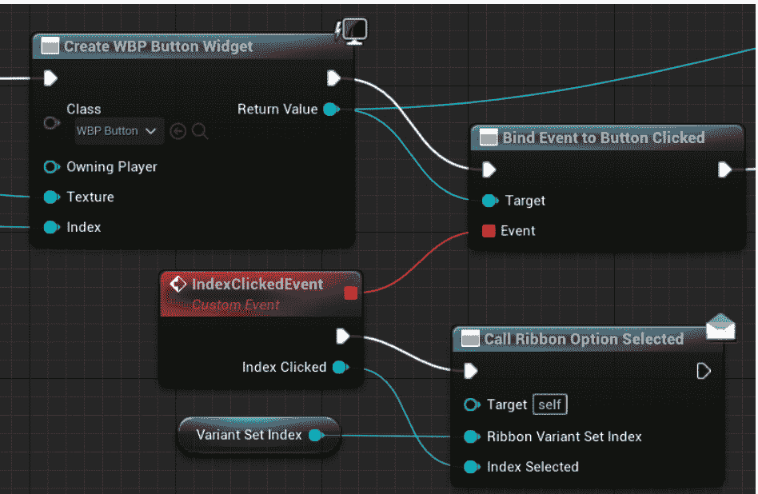

图 20.21 – WBP_VariantRibbonSelector 将事件绑定到 Button Clicked

**WBP_MainSelector** has the **PartSelectedEvent** Custom Event to trigger the **Part Selected** event dispatcher:

**WBP_MainSelector** 具有 **PartSelectedEvent** 自定义事件，用于触发 **Part Selected** 事件分派器：

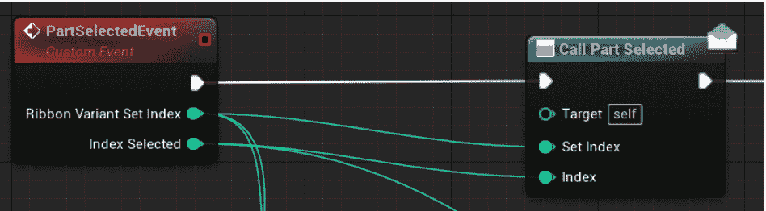

图 20.22 – WBP_VariantRibbonSelector 将事件绑定到 Button Clicked

The binding of **PartSelectedEvent** to the **Ribbon Option Selected** event dispatcher is done in the **Create Event Bindings** function using the **Create Event node:**

将 **PartSelectedEvent** 绑定到 **Ribbon Option Selected** 事件分派器的操作在 **Create Event Bindings** 函数中使用 **Create Event 节点** 完成：

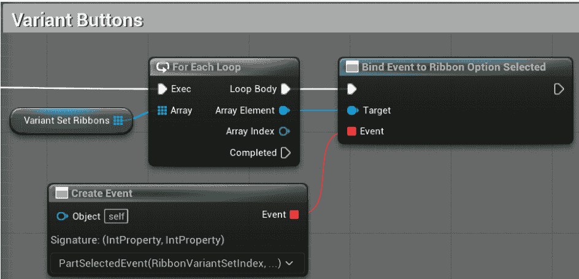

图 20.23 – 使用 Create Event 节点绑定事件

To use the **Create Event** node, drag a wire from the **Event** input pin of a **Bind Event** node and select **Create Event**:

要使用 **Create Event** 节点，请从 **Bind Event** 节点的 **Event** 输入引脚拖出一根线，并选择 **Create Event**：

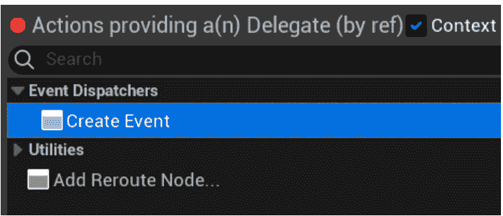

图 20.24 – 使用 Create Event 节点绑定事件

In the **Create Event** node, you will be able to select an event that has the same type of input parameters as the event dispatcher.

在 **Create Event** 节点中，您可以选择一个与事件分派器具有相同输入参数类型的事件。

The last event dispatcher is from **WBP_MainGUI**, which binds a Custom Event to the **Part Selected** event dispatcher of **WBP_MainSelector**:

最后一个事件分派器来自 **WBP_MainGUI**，它将一个自定义事件绑定到 **WBP_MainSelector** 的 **Part Selected** 事件分派器：

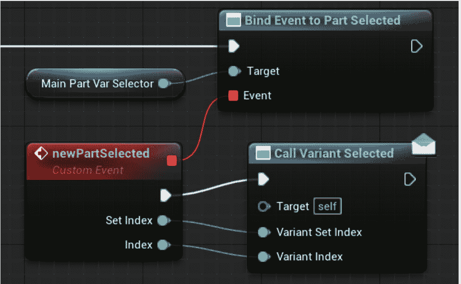

图 20.25 – WBP_MainGUI 将事件绑定到 Part Selected

The **Variant Selected** event dispatcher is the one that is bound in the **BP_Configurator** Blueprint.

**Variant Selected** 事件分派器是在 **BP_Configurator** Blueprint 中绑定的那个。

In this section, we saw how UMG Widget Blueprints can be used together to create a dynamic and configurable interface.

在本节中，我们了解了如何将 UMG 小部件蓝图协同使用，以创建动态且可配置的界面。

### 摘要

In this chapter, we explained what a Product Configurator is, and we showed how to use the Product Configurator template. We learned how to use the Variant Manager panel to create Variants and Variant Sets.

在本章中，我们解释了什么是产品配置器，并展示了如何使用产品配置器模板。我们学习了如何使用 Variant Manager 面板来创建 Variants 和 Variant Sets。

We also learned how the **BP_Configurator** Blueprint stores all the information of the Level Variant Sets Actor needed to create a dynamic interface. We had an overview of the **BP_Configurator** functions and saw how to activate a Variant in a Blueprint.

我们还了解了 **BP_Configurator** Blueprint 如何存储创建动态界面所需的 Level Variant Sets Actor 的所有信息。我们概览了 **BP_Configurator** 函数，并了解了如何在 Blueprint 中激活 Variant。

Then, we saw how the **WBP_MainGUI** Widget uses the other UMG Widget Blueprints to create a user interface and saw how several event dispatchers were used to make the **BP_Configurator** act when a button was clicked.

接着，我们了解了 **WBP_MainGUI** 小部件如何使用其他 UMG 小部件蓝图来创建用户界面，以及如何使用多个事件分派器，使 **BP_Configurator** 在单击按钮时做出反应。

# 尾声

I can't believe we have reached the end of the book. This was an extensive project, and I consider this book as my definitive work on Blueprints. It's been a long journey since I started programming games in the C language in 1993, when I was 14 years old. My first games were in text mode, and they looked like the game ZZT by Tim Sweeney, founder of Epic Games.

简直不敢相信我们已经走到了本书的终点。这是一个庞大的项目，我认为这本书是我关于蓝图的权威之作。从 1993 年我 14 岁时开始用 C 语言编写游戏以来，这已经是一段漫长的旅程了。我的第一批游戏是文本模式的，看起来就像 Epic Games 创始人 Tim Sweeney 的游戏 ZZT。

In 1999, I started the first game development company in the state of Pará, northern Brazil. The company name was RH Games. In 2001, I developed the MRDX, which is a framework for 2D game programming using the C/C++ languages. In 2002, I presented the MRDX at the first Brazilian Games Workshop. In 2003, I founded a local group called Beljogos, with the goal of encouraging the development of games in northern Brazil.

1999 年，我在巴西北部帕拉州创办了该州第一家游戏开发公司。公司名为 RH Games。2001 年，我开发了 MRDX，这是一个使用 C/C++ 语言进行 2D 游戏编程的框架。2002 年，我在第一届巴西游戏研讨会上展示了 MRDX。2003 年，我创立了一个名为 Beljogos 的当地小组，旨在鼓励巴西北部的游戏开发。

In 2011, I started a blog named Romero UnrealScript, with the goal of teaching game programming with UnrealScript. Because of this blog, in June 2013, Epic Games invited me to be part of the Unreal Engine 4 closed beta program so I could have early access to Unreal Engine 4. I started the blog Romero Blueprints in March 2014, when Unreal Engine 4 was launched.

2011 年，我开设了一个名为 Romero UnrealScript 的博客，旨在教授使用 UnrealScript 进行游戏编程。正是因为这个博客，2013 年 6 月，Epic Games 邀请我加入 Unreal Engine 4 封闭测试计划，以便我可以提前接触 Unreal Engine 4。2014 年 3 月，当 Unreal Engine 4 发布时，我开设了 Romero Blueprints 博客。

In August 2015, Epic Games awarded me an Unreal Engine Educational Dev Grant for the work that I had done in the Romero Blueprints blog to help people learn Unreal Engine 4 scripting. In 2016, I wrote the Blueprints Compendium for Epic Games, which was distributed to the public at the **Game Developer Conference (GDC)**. In June 2017, I finished writing the third volume of the Blueprints Compendium.

2015 年 8 月，Epic Games 因我在 Romero Blueprints 博客上为帮助人们学习 Unreal Engine 4 脚本所做的工作，而授予我 Unreal Engine 教育开发者补助金。2016 年，我为 Epic Games 编写了 Blueprints Compendium，该文档在 **游戏开发者大会 (GDC)** 上向公众分发。2017 年 6 月，我完成了 Blueprints Compendium 第三卷的编写。

In 2018, Epic Games hired me to write the official Blueprint Instructor Guide. In 2019, I wrote the book Blueprints Visual Scripting for Unreal Engine – Second Edition, published by Packt. In 2020, my project to teach C++ programming in Unreal Engine was selected for the Epic MegaGrants program. In August 2020, Epic Games invited me to a live stream named Teaching & Learning Blueprints with Marcos Romero, which is available on Unreal Engine's YouTube channel.

2018 年，Epic Games 聘请我编写官方的 Blueprint 教师指南。2019 年，我编写了由 Packt 出版的书籍《蓝图可视化脚本用于 Unreal Engine – 第二版》。2020 年，我在 Unreal Engine 中教授 C++ 编程的项目入选了 Epic MegaGrants 计划。2020 年 8 月，Epic Games 邀请我参加名为“与 Marcos Romero 一起教学与学习蓝图”的直播，该直播可在 Unreal Engine 的 YouTube 频道上观看。

我很荣幸有机会撰写这本书，希望它能帮助下一代虚拟引擎开发者的旅程。

## 测验

- 1. 产品配置器模板允许用户修改产品、相机和环境照明的部分内容。
  - a. 正确
  - b. 错误

- 2. 在**变体管理器**面板中所做的更改仅在运行时在关卡中可见。
  - a. 正确
  - b. 错误

- 3. 变体组织为变体集，每个集中只能有一个激活的变体。
  - a. 正确
  - b. 错误

- 4. `BP_Configurator` 在数组中存储产品变体集。
  - a. 正确
  - b. 错误

- 5. 产品配置器模板的用户界面仅在一个 UMG 小部件蓝图中定义。
  - a. 正确
  - b. 错误

# 您可能还喜欢的其他图书

如果您喜欢这本书，可能对 Packt 的这些其他图书感兴趣：

## 虚幻引擎游戏开发项目

Hammad Fozi, Gonçalo Marques, David Pereira 和 Devin Sherry

ISBN: 978-1-80020-922-0

- 创建功能完整的第三人称角色和敌人
- 使用键盘、鼠标、游戏手柄和触控控件构建导航
- 使用碰撞和粒子效果编程逻辑和游戏机制
- 使用黑板和行为树探索游戏 AI
- 使用动画蓝图和蒙太奇构建角色动画

## 虚幻引擎 4 游戏开发快速入门指南

使用虚拟引擎 4 编程专业 3D 游戏

Rachel Cordone

## 虚幻引擎 4 游戏开发快速入门指南

Rachel Cordone

ISBN: 978-1-78995-068-7

- 使用项目模板为您的游戏抢占先机
- 创建自定义蓝图和 C++ 类并从 Epic 的基类扩展
- 使用 UMG 为您的游戏创建菜单和 HUD
- 使用动画蓝图创建更具动态性的角色
- 学习如何使用行为树创建复杂的 AI

## Packt 正在寻找像您这样的作者

如果您有兴趣成为 Packt 的作者，请访问 authors.packtpub.com 并立即申请。我们与成千上万的开发者和技术专业人士（就像您一样）合作，帮助他们将见解分享给全球技术社区。您可以提交通用申请，申请我们正在招募作者的特定热门话题，或提交您自己的创意。

嗨！

我是 Marcos Romero，《虚拟引擎 5 蓝图可视化脚本》的作者。我真的希望您喜欢阅读这本书，并发现它对提高您在蓝图中的生产力和效率很有用。

如果您能在 Amazon 上留下评论分享您对本书的看法，这将对我的很大帮助（其他潜在读者也是！）。

请访问下方链接留下您的评论：

https://packt.link/r/180181158X

您的评论将帮助我们了解本书中哪些方面做得好，哪些方面可以在未来版本中改进，因此我们非常感谢。

祝好，

## Marcos Romero

# 测验答案

以下是各章节的所有测验问题答案：

- **第 1 章**，探索蓝图编辑器：1-a；2-b；3-b；4-b；5-c。
- **第 2 章**，使用蓝图编程：1-c；2-b；3-a；4-c；5-a。
- **第 3 章**，面向对象编程与游戏性框架：1-b；2-b；3-a；4-b；5-c。
- **第 4 章**，理解蓝图通信：1-a；2-b；3-a；4-b；5-a。
- **第 5 章**，蓝图对象交互：1-b；2-a；3-a；4-b；5-a。
- **第 6 章**，增强玩家能力：1-a；2-b；3-a；4-a；5-b。
- **第 7 章**，创建屏幕 UI 元素：1-b；2-a；3-b；4-a；5-a。
- **第 8 章**，创建约束和游戏性目标：1-b；2-a；3-a；4-b；5-a。
- **第 9 章**，使用人工智能构建智能敌人：1-c；2-b；3-a；4-a；5-b。
- **第 10 章**，升级 AI 敌人：1-b；2-a；3-a；4-b；5-a。
- **第 11 章**，游戏状态与最终润色：1-a；2-c；3-b；4-a；5-a。
- **第 12 章**，构建与发布：1-a；2-b；3-a；4-c；5-a。
- **第 13 章**，数据结构与流程控制：1-b；2-a；3-b；4-a；5-b。
- **第 14 章**，数学与追踪节点：1-a；2-a；3-b；4-b；5-a。
- **第 15 章**，蓝图技巧：1-b；2-a；3-a；4-b；5-a。
- **第 16 章**，VR 开发简介：1-b；2-a；3-a；4-b；5-a。
- **第 17 章**，动画蓝图：1-a；2-b；3-a；4-b；5-a。
- **第 18 章**，创建蓝图库和组件：1-a；2-b；3-b；4-a；5-b。
- 第 19 章，程序化生成：1-b；2-b；3-a；4-b；5-a。
- 第 20 章，使用变体管理器创建产品配置器：1-a；2-b；3-a；4-a；5-b。

# 为什么订阅？

- 与来自 4,000 多名行业专业人士的实用电子书和视频一起，花更少的时间学习，更多的时间编码
- 使用专为您构建的技能计划改善您的学习
- 每月获赠一本免费电子书或视频
- 全文可搜索，方便轻松访问重要信息
- 复制和粘贴、打印以及加书签内容

您知道吗？Packt 为每本出版的图书都提供电子书版本，可供下载 PDF 和 ePub 文件。您可以在 packt.com 升级到电子书版本，作为印刷图书客户，您有权享受电子书副本的折扣。如需更多详情，请通过 customercare@packtpub.com 与我们联系。

在 www.packt.com，您还可以阅读一系列免费技术文章，订阅各种免费通讯，并获取 Packt 图书和电子书的独家折扣和优惠。
