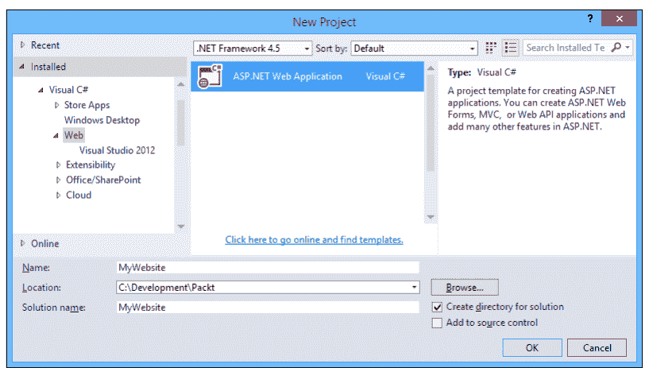
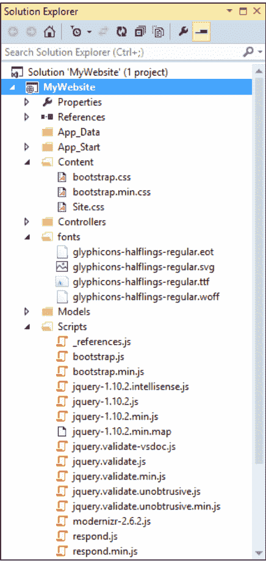
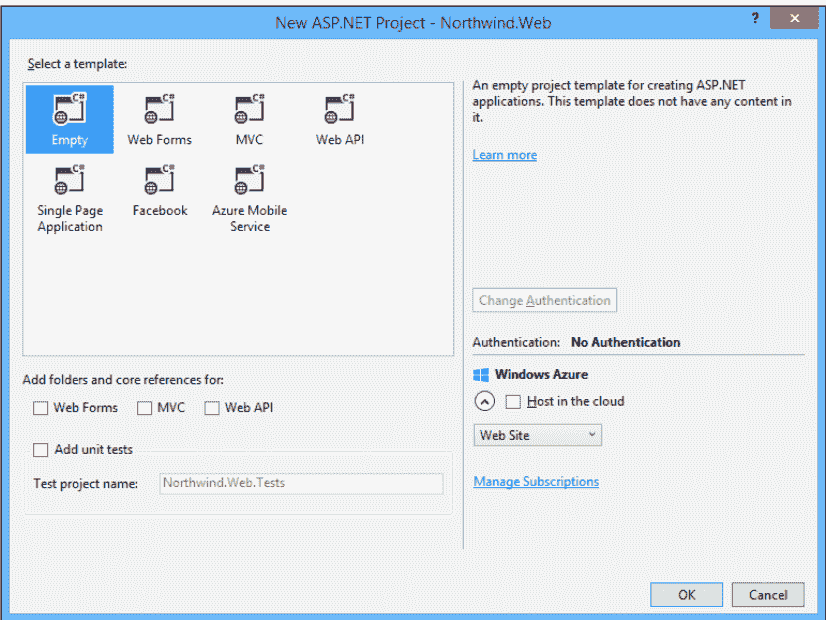
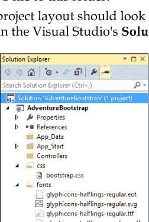
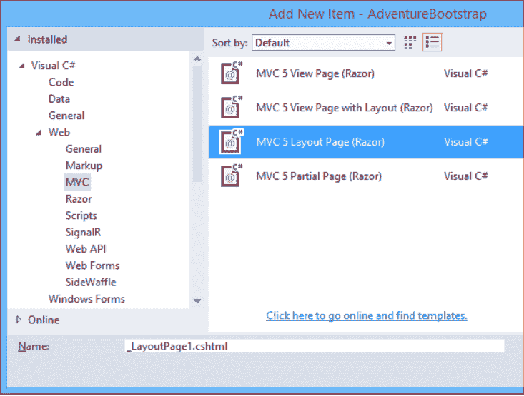
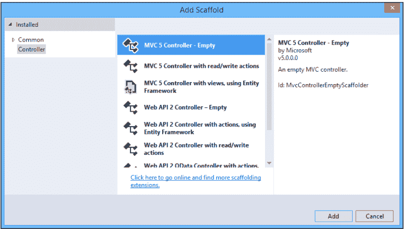
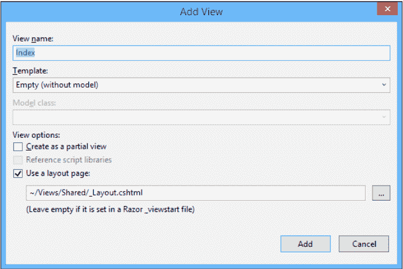
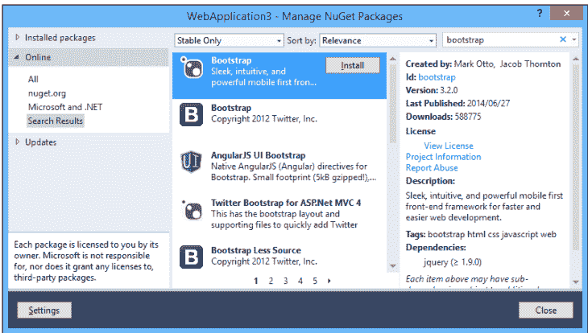
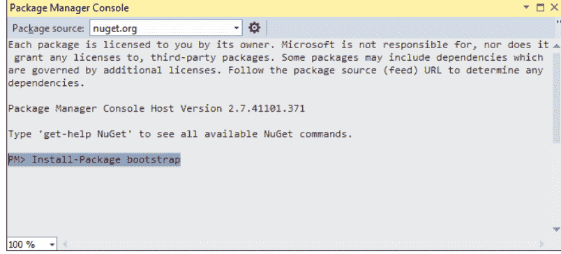

# 使用 ASP.NET MVC 和 Bootstrap 入门

作为开发者，我们在使用 HTML 和 CSS 从头创建美观的用户界面时可能会感到困难。当开发者拥有多年 Windows Forms 应用开发经验时，这尤其困难。微软推出了 Web Forms，以抽象化构建网站的复杂性，让 Windows Forms 开发者更容易从 Windows Forms 转向 Web。这反过来又使得 Web Forms 开发者很难转向 ASP.NET MVC，对 Windows Forms 开发者来说则更难。

Twitter Bootstrap 是一组经过样式化的组件、插件和布局网格，可承担繁重的工作。微软自 2013 年起将 Bootstrap 包含在所有 ASP.NET MVC 项目模板中。在示例项目中，我们将通过使用标准 Visual Studio MVC 项目模板创建新的 ASP.NET MVC 项目，或从空的 MVC 项目开始并在需要时添加必要文件来开始。

在本章中，我们将涵盖以下主题：

- Bootstrap 分发中包含的文件
- 如何使用标准 Visual Studio 项目模板和 Bootstrap 创建 ASP.NET MVC 网站
- 如何创建空的 ASP.NET MVC 网站并手动添加 Bootstrap 文件
- 如何创建引用 Bootstrap 文件的布局文件
- 使用 NuGet 添加 Bootstrap 文件
- 使用捆绑和压缩改进网站性能

### Bootstrap JavaScript 文件（js 文件夹）

js 文件夹包含两个文件。所有 Bootstrap 插件都包含在 bootstrap.js 文件中。bootstrap.min.js 文件只是上述文件的压缩版本。在将文件包含到项目中之前，请确保您已引用 jQuery 库，因为所有 Bootstrap 插件都需要 jQuery。

默认项目模板会自动将 jQuery 库添加到您的项目中并为其创建捆绑包。如果您的视图中包含以下代码行，jQuery 捆绑包将被包含在您的页面中：

```
@Scripts.Render("~/bundles/jquery")
```

### 下载示例代码

您可以从 http://www.packtpub.com 的账户下载我们所有 Packt 书籍的示例代码文件。如果您在其他地方购买了本书，您可以访问 http://www.packtpub.com/support 并注册以便将文件直接发送到您的电子邮件。

### Bootstrap 文件夹结构

解压后的 Bootstrap 文件夹结构将如下所示：

```
bootstrap/
├── css/
│   ├── bootstrap.css
│   ├── bootstrap.min.css
│   ├── bootstrap-theme.css
│   └── bootstrap-theme.min.css
├── js/
│   ├── bootstrap.js
│   └── bootstrap.min.js
└── fonts/
    ├── glyphicons-halflings-regular.eot
    ├── glyphicons-halflings-regular.svg
    ├── glyphicons-halflings-regular.ttf
    └── glyphicons-halflings-regular.woff
```

### 使用标准 Visual Studio 项目模板创建的站点使用 Bootstrap

从 Visual Studio 2013 开始，创建 ASP.NET 项目时，您只有一个可选择的项目模板，即 ASP.NET Web Application 项目模板，如下图所示：



### 检查默认 MVC 项目布局

默认项目模板添加了我们之前讨论过的所有必要 Bootstrap 文件，尽管它使用的文件夹命名约定与默认 Bootstrap 分发不同。默认项目布局将类似于以下截图：



### Content 文件夹

Content 文件夹包含 bootstrap.css 和 bootstrap.min.css 文件以及一个名为 Site.css 的样式表。此文件用于在 Bootstrap 提供的默认样式之上应用任何额外样式，并且还用于指定 ASP.NET MVC 用于表单验证的 jQuery 验证插件的样式。例如，以下 CSS 会以红色高亮显示任何输入元素，并在该字段验证失败时在元素周围绘制边框：

```
.field-validation-error {
    color: #b94a48;
}

.field-validation-valid {
    display: none;
}

input.input-validation-error {
    border: 1px solid #b94a48;
}

input[type="checkbox"].input-validation-error {
    border: 0 none;
}

.validation-summary-errors {
    color: #b94a48;
}

.validation-summary-valid {
    display: none;
}
```

### fonts 文件夹

fonts 文件夹包含 Glyphicons 字体以及所有必要的格式。

### Scripts 文件夹

Scripts 文件夹包含许多脚本。最值得注意的是，本书中它包含 bootstrap.js 和 bootstrap.min.js JavaScript 文件。默认 ASP.NET MVC 项目模板还为以下 JavaScript 库和插件添加了压缩和普通文件：

- jQuery
- jQuery 验证插件
- 用于无侵入式验证的 jQuery 和 jQuery 验证支持库
- Modernizr
- Respond.js

Visual Studio 通过将 _references.js 文件添加到 Scripts 文件夹，为 jQuery、Bootstrap、Modernizr 以及 Respond.js 启用 IntelliSense。这在使用 JavaScript 时非常有用，在使用 Bootstrap 组件时也非常值得使用。

这些库和文件中的大多数超出了本书的范围，但我们在进展过程中会涉及其中一些。

### 创建空的 ASP.NET MVC 站点并手动添加 Bootstrap

默认项目布局是任何 ASP.NET MVC 项目的良好起点，但对于我们将在本书中构建的示例项目，我们将创建一个空的 ASP.NET MVC 站点并手动添加必要的文件。这是通过执行以下步骤完成的：

1. 首先在 Visual Studio 中创建一个新的 ASP.NET Web 应用程序项目，并将项目命名为 Northwind.Web。
2. 这次，在新建 ASP.NET 项目对话框中选择 Empty 模板，并确保选中 MVC 复选框，如下图所示：

   

3. 将为您创建一个空的项目布局，您会注意到我们没有 Content、Fonts 或 Scripts 文件夹——我们将自己添加它们！

### 添加 Bootstrap 样式表

要将 Bootstrap 样式表文件添加到项目中，请完成以下步骤：

1. 通过在 Visual Studio 的解决方案资源管理器中右键单击新项目的名称并导航到 Add | New Folder 来创建新文件夹，将新文件夹命名为 css。
2. 接下来，右键单击新创建的 css 文件夹并从上下文菜单中导航到 Add | Existing Item...。
3. 浏览到您已解压 Bootstrap 分发文件的文件夹并选择位于 css 文件夹中的 bootstrap.css 文件。


## 添加 Bootstrap 字体

通过执行以下步骤添加所需的 Bootstrap 字体：

- 1. 与样式表一样，创建一个名为 `fonts` 的新文件夹。
- 2. 接下来，浏览到您已解压 Bootstrap 下载的位置，并将 `fonts` 文件夹中的所有文件添加到 Visual Studio 中的 `fonts` 文件夹。
- 3. 总共应有四个文件，每个文件都命名为 `glyphicons-halflings-regular`，但具有以下不同的文件扩展名：
  - `.eot`
  - `.svg`
  - `.ttf`
  - `.woff`

## 添加 Bootstrap JavaScript 文件

我们需要的最后一个 Bootstrap 文件是 `bootstrap.js`。要添加它，请执行以下步骤：

- 1. 在将 `bootstrap.js` 文件添加到 Visual Studio 项目之前，创建一个名为 `js` 的新文件夹。
- 2. 将 `bootstrap.js` 文件添加到此文件夹。
- 3. 完成后，项目布局应类似于 Visual Studio Solution Explorer 中的以下屏幕截图：



## 创建站点布局文件

为了在我们站点的页面之间保持一致的外观，我们将使用布局文件。此布局文件最初将使用基本的 Bootstrap HTML 模板，我们将在本书的后续内容中在此基础上进行构建。要创建此文件，请完成以下步骤：

- 1. 通过在 Visual Studio 的 **Solution Explorer** 中右键单击 Views 文件夹并导航到 **Add | New Folder** 来创建新的布局文件。将新文件夹命名为 Shared。
- 2. 接下来，右键单击 Shared 文件夹并导航到 **Add | New Item...** 选择 **MVC 5 Layout Page (Razor)** 项目模板，将新项目命名为 `_Layout.cshtml` 并单击 **Add**，如下图所示：



- 3. 在新文件添加到项目后，打开它并用以下 HTML 标记替换其内容：

```html
<!DOCTYPE html>
<html lang="en">
<head>
    <meta charset="utf-8">
<meta http-equiv="X-UA-Compatible" content="IE=edge">
<meta name="viewport" content="width=device-width,
initial-scale=1">
<title>@ViewBag.Title</title>
<!-- Bootstrap -->
<link href="@Url.Content("~/css/bootstrap.css")" rel="stylesheet">
<!--[if lt IE 9]>
<script src="https://oss.maxcdn.com/libs/html5shiv/3.7.0/html5shiv.js"></script>
<script src="https://oss.maxcdn.com/libs/respond.js/1.4.2/respond.min.js"></script>
<![endif]-->
</head>
<body>
@RenderBody()
<script src="https://ajax.googleapis.com/ajax/libs/jquery/1.11.0/jquery.min.js"></script>
<script src="@Url.Content("~/js/bootstrap.js")"></script>
</body>
</html>
```

在前面的标记中，我们将视口的 width 属性设置为设备的宽度，并将 initial-scale 值设置为 1。这将使我们的站点适应用户查看它的设备的屏幕尺寸。

接下来，我们通过使用 Url.Content 辅助方法引用 Bootstrap 样式表。此辅助方法将虚拟或相对路径转换为绝对路径，确保在打开网页时样式表能够正确加载。

然后我们检查访问该站点的浏览器是否为 Internet Explorer 9 或更早版本；如果是，我们将包含 HTML5shiv 解决方法，该解决方法可在 Internet Explorer 9 及更早版本中启用对 HTML5 元素的样式设置。我们还包含了适用于 IE9 及更早版本的 Respond JS 库版本。

在文件结束的 </body> 标签之前，我们包含了 jQuery 库和 bootstrap JavaScript 库。


> 请注意，HTML5shiv 解决方法、Respond JS 和 jQuery 文件是从内容分发网络 (CDN) 加载的。当引用大多数广泛使用的 JavaScript 库时，这是一种很好的方法。如果用户之前访问过使用相同 CDN 上的相同库的站点，这应该可以让您的站点加载更快，因为该库将被缓存在其浏览器中。

## 创建带有 Bootstrap 主题视图的首页控制器

目前，我们创建的站点在运行项目时将返回一条错误消息，指出请求的资源无法找到。我们首先需要添加一个新的首页控制器并为其默认操作关联一个视图，以避免任何错误。要添加新控制器，请执行以下步骤：

- 1. 在 **Solution Explorer** 部分中右键单击 `Controllers` 文件夹并导航到 **Add | Controller**....
- 2. 在 **Add Scaffold** 对话框中，选择 **MVC 5 Controller - Empty** 项目，如下图所示：



- 3. 在提示时，在 **Add Controller** 对话框中输入 `HomeController` 作为新的控制器名称并单击 **Add**。
- 4. 在控制器添加后，在空的 **Index** 方法内部右键单击并选择 **Add View**。如果方法中只有 `return View()` 语句，则认为该方法为空。
- 5. 在 **Add View** 对话框中，保持所有字段为默认值并选择我们之前添加的布局页面。单击 **Add** 继续，如下图所示：



- 6. 将生成一个空视图，您会注意到 `ViewBag.Title` 属性以及此视图要使用的布局页面已添加到视图顶部。请考虑以下示例：

```cshtml
@{
    ViewBag.Title = "Index";
    Layout = "~/Views/Shared/_Layout.cshtml";
}
```

视图中还将有一个 `<h2>` 元素，您可以保留原样。如果运行项目，您应该会看到视图显示，并且 `<h2>` 元素已应用默认的 Bootstrap 样式。

# 使用 NuGet 添加 Bootstrap 文件

到目前为止，我们创建了两个使用 Bootstrap 前端框架的 ASP.NET MVC 项目。第一个默认包含 Bootstrap 资源，因为我们使用标准的 ASP.NET MVC Visual Studio 项目模板创建了它。第二个，我们创建了一个空的 ASP.NET MVC 项目并手动添加了 Bootstrap 文件。

NuGet 是 .NET 框架的包管理器，可用于自动向 Visual Studio 项目添加文件和引用。NuGet 库站点上存在一个 Bootstrap 包，可让您自动将 Bootstrap 资源添加到项目中。

请记住，尽管 Bootstrap NuGet 包假定您希望 Bootstrap 文件位于 Content 和 Scripts 文件夹中，并且会相应地创建文件夹和文件，但它还会自动检查您是否已引用 jQuery 库，如果没有，则会按设计添加它。

> NuGet 是 Microsoft 开发平台的包管理器，可轻松添加对现有库的引用。您可以在 https://www.nuget.org/ 上阅读更多相关信息。

### 使用对话框添加 Bootstrap NuGet 包

将 Bootstrap NuGet 包添加到项目的选项之一是使用 **Manage NuGet Packages** 对话框。要访问 **Manage NuGet Packages** 对话框并添加 Bootstrap NuGet 包，请执行以下步骤：

- 1. 在 **Solution Explorer** 部分中右键单击 **References** 节点并选择 **Manage NuGet Packages**。单击 **Online** 选项卡并在搜索框中输入 `bootstrap` 然后按 *Enter*，如下图所示：



- 2. 单击 **Install** 按钮将 Bootstrap 文件添加到项目。

### 使用程序包管理器控制台添加 Bootstrap NuGet 包

将 NuGet 包添加到 Visual Studio 项目的第二种方法是通过 **Package Manager Console** 并完成以下步骤：

- 1. 在 Visual Studio 中，从 **Tools** 菜单导航到 **Library Package Manager | Package Manager Console**。这将打开 **Package Manager Console** 窗口。
- 2. 要安装 Bootstrap NuGet 包，请输入 `Install-Package bootstrap`，如下图所示：




3. 这将创建 Content、fonts 和 Scripts 文件夹，并在每个文件夹中添加必要的 Bootstrap 文件。

# 使用捆绑和压缩提高网站性能

捆绑和压缩是 ASP.NET 中的一项功能，可让你提高网站加载速度。这是通过将 CSS 和 JavaScript 文件合并为一个大文件，从而限制站点需要发出的 CSS 和 JavaScript 文件请求数量，并从文件中删除所有不必要的字符，例如注释、空白和换行符来实现的。

> 大多数现代浏览器每个主机名最多有六个并发连接的限制。这意味着如果你在页面上引用超过六个 CSS 或 JavaScript 文件，浏览器将一次只下载六个文件，其余文件排队等待。限制 CSS 和 JavaScript 文件的数量始终是一个好主意。

StyleBundle 对象用于向捆绑中添加样式表，而 ScriptBundle 对象用于添加 JavaScript 文件。BundleCollection 对象的 Add 方法接受这两种类型的对象。StyleBundle 和 ScriptBundle 对象接受一个字符串参数，该参数指定文件的虚拟路径，因此你应使用 Include 方法来指定要包含在捆绑中的文件的路径。

> 切勿在捆绑中包含文件名中带有 `.min` 的文件，例如 `bootstrap.min.css` 或 `bootstrap.min.js`。编译器会忽略这些文件，因为它们已经过压缩。

### 在 ASP.NET 布局中包含捆绑

要在布局文件中包含我们之前创建的捆绑，请执行以下步骤：

1. 打开 Shared 文件夹中的 `_Layout.cshtml` 文件，并将其标记更改为以下内容（更改已突出显示）：

```
<!DOCTYPE html>
<html lang="en">
<head>
    <meta charset="utf-8">
    <meta http-equiv="X-UA-Compatible" content="IE=edge">
    <meta name="viewport" content="width=device-width, initial-scale=1">
    <title>@ViewBag.Title</title>
    @Styles.Render("~/bootstrap/css")
    <!--[if lt IE 9]>
    <script src="https://oss.maxcdn.com/libs/html5shiv/3.7.0/html5shiv.js"></script>
    <script src="https://oss.maxcdn.com/libs/respond.js/1.4.2/respond.min.js"></script>
    <![endif]-->
</head>
<body>
    @RenderBody()
    <script src="https://ajax.googleapis.com/ajax/libs/jquery/1.11.0/jquery.min.js"></script>
    @Scripts.Render("~/bootstrap/js")
</body>
</html>
```

2. 如果 Visual Studio HTML 编辑器提示它找不到 Scripts 或 Styles 对象（即这些词被高亮显示），这意味着 Views 文件夹中的 `Web.config` 文件缺少引用。

3. 为此，请向该 `Web.config` 文件中的命名空间列表添加对 `System.Web.Optimization` 的引用。考虑以下示例：

```
<namespaces>
    <add namespace="System.Web.Mvc" />
    <add namespace="System.Web.Mvc.Ajax" />
    <add namespace="System.Web.Mvc.Html" />
    <add namespace="System.Web.Routing" />
    <add namespace="AdventureBootstrap" />
    <add namespace="System.Web.Optimization" />
</namespaces>
```

### 测试捆绑和压缩

要启用捆绑和压缩，请打开项目根目录中的 `Web.config` 文件，并将 compilation 元素的 debug 属性更改为 true，如下所示：

```
<system.web>
    <compilation debug="true" targetFramework="4.5" />
    <httpRuntime targetFramework="4.5" />
</system.web>
```

也可以通过将 `BundleTable` 对象的 `EnableOptimizations` 属性设置为 true 来实现。此语句可以添加到 `Global.asax` 文件的 `Application_Start` 方法中，也可以添加到 `BundleConfig` 类的 `RegisterBundles` 方法中，如下所示：

```
BundleTable.EnableOptimizations = true;
```

在布局文件中添加对捆绑的引用并将 debug 属性或 `EnableOptimizations` 属性设置为 true 后，构建并运行你的项目。网站在浏览器中打开后，查看其源代码。你应该会看到类似于以下内容的标记：

```
<!DOCTYPE html>
<html lang="en">
<head>
    <meta charset="utf-8">
    <meta http-equiv="X-UA-Compatible" content="IE=edge">
    <meta name="viewport" content="width=device-width, initial-scale=1">
    <title>Index</title>
    <link href="/bootstrap/css?v=Tmp0-oSKW9MFWr7qyt2LfyMD1tap2GokH7z1W2bhfgY1" rel="stylesheet"/>
    <!--[if lt IE 9]>
    <script src="https://oss.maxcdn.com/libs/html5shiv/3.7.0/html5shiv.js"></script>
    <script src="https://oss.maxcdn.com/libs/respond.js/1.4.2/respond.min.js"></script>
    <![endif]-->
</head>
<body>
    <h2>Index</h2>
    <script src="https://ajax.googleapis.com/ajax/libs/jquery/1.11.0/jquery.min.js"></script>
    <script src="/bootstrap/js?v=raqa-So7giLQpXYq5LQiW8D-yNoxOAJeW88VXtgFHfE1"></script>
</body>
</html>
```

请注意，高亮的行包含我们在捆绑中指定的相对路径，并且当点击例如 `/bootstrap/js` 链接时，浏览器将打开 Bootstrap JavaScript 文件的压缩版本。你可以看到它已被压缩，因为大多数空白和换行符已被删除。代码还将是 Bootstrap JavaScript 文件以及我们可能已添加到捆绑中的任何其他 JavaScript 文件的组合。

### 摘要

在本章中，你了解了 Bootstrap 下载的内容以及如何在自己的 ASP.NET MVC 项目中包含这些文件。我们还介绍了包含这些文件的各种技术以及如何使用捆绑和压缩提高网站性能。

在下一章中，我们将深入探讨 Bootstrap 的 CSS 和 HTML 元素内部结构，以及如何使用它们来设计网站的布局。
