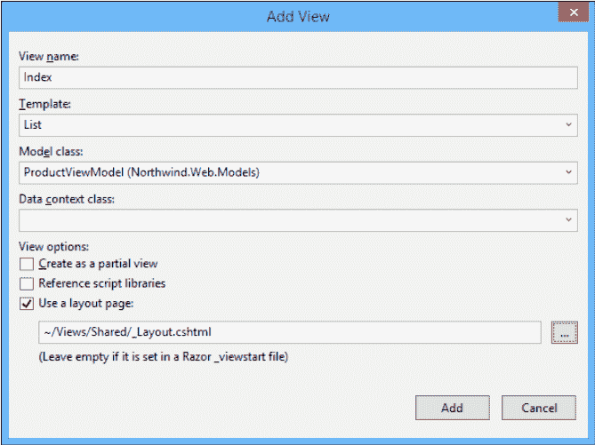
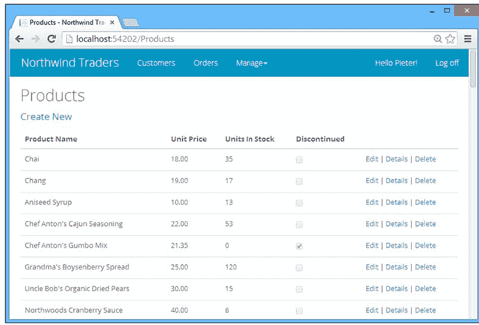
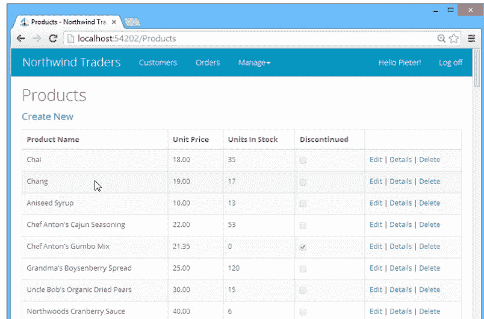
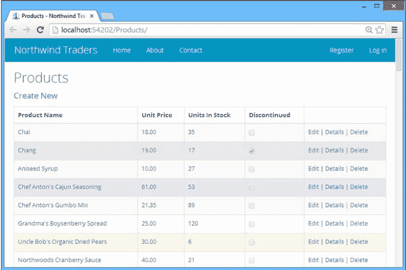
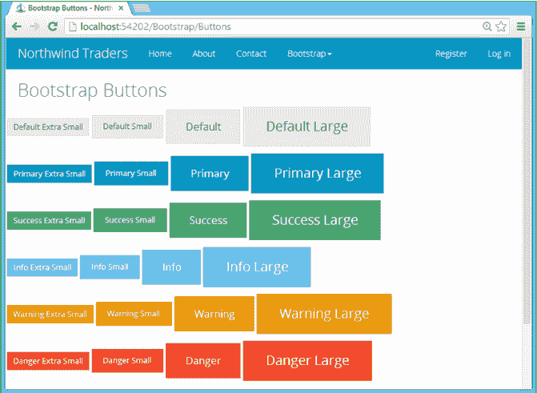
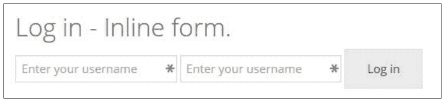
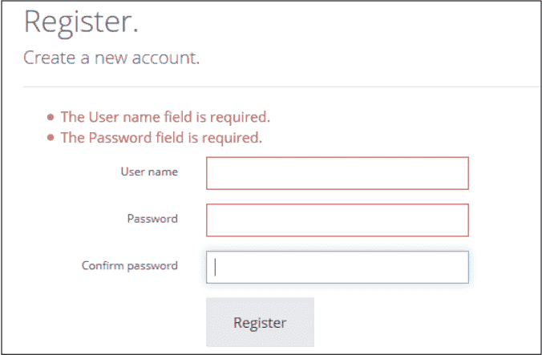

# 使用 Bootstrap CSS 和 HTML 元素

Bootstrap 提供了一系列 HTML 元素和 CSS 设置，以及一个先进的网格系统来帮助布局网页设计。这些设置和元素包括用于排版、代码格式、表格和表单布局等的实用工具。

所有 CSS 设置和 HTML 元素，结合移动优先的流式网格系统，使开发人员能够快速轻松地构建直观的 Web 界面，而无需担心为较小的设备屏幕启用响应式功能和样式用户界面元素的细节。

在本章中，我们将涵盖以下主题：

- Bootstrap 网格系统
- Bootstrap 表格和按钮
- 布局不同的 Bootstrap 表单
- 使用 Bootstrap 的验证样式进行表单验证
- 使用编辑器模板控制表单元素的 HTML 输出
- 在 Bootstrap 中使用图像并配置图像以实现响应式

### Bootstrap 网格系统

许多网站报告移动流量不断增加，预计在未来几年这一趋势将继续增长。Bootstrap 网格系统采用移动优先设计，这意味着它旨在针对具有较小显示器的设备，然后随着显示器尺寸的增加而扩展。

幸运的是，这不是你需要过于担心的事情，因为 Bootstrap 处理了大部分繁重的工作。

### Bootstrap 网格选项

Bootstrap 3 引入了许多预定义的网格类，以便指定设计中列的大小。这些类名在下表中列出：

| 类名 | 设备类型 | 分辨率 | 容器宽度 | 列宽 |
|---|---|---|---|---|
| col-xs-* | 手机 | <768 px | Auto | Auto |
| col-sm-* | 平板电脑 | ≥768 px | 750 px | 60 px |
| col-md-* | 桌面 | ≥992 px | 970 px | 78 px |
| col-lg-* | 高分辨率桌面 | ≥1200 px | 1170 px | 95 px |

Bootstrap 网格分为 12 列。在布局网页时，请记住所有列的总和应为 12。为了说明这一点，请考虑以下 HTML 代码：

```
<div class="container">
    <div class="row">
        <div class="col-md-3" style="background-color:green;">
            <h3>green</h3>
        </div>
        <div class="col-md-6" style="background-color:red;">
            <h3>red</h3>
        </div>
        <div class="col-md-3" style="background-color:blue;">
            <h3>blue</h3>
        </div>
    </div>
</div>
```


## Bootstrap 表格

Bootstrap 为 HTML 表格提供了默认样式，并提供了一些选项来自定义其布局和行为。默认的 ASP.NET MVC 脚手架在生成列表视图时会自动为表格元素添加表格类名。

要亲眼看到此效果，请完成以下步骤：

- 1. 在我们项目的 Models 文件夹中创建一个新的视图模型类，名为 `ProductViewModel.cs`。该类将包含六个属性，其代码如下所示：

```csharp
public class ProductViewModel
{
    public int ProductID { get; set; }
    public string ProductName { get; set; }
    public decimal? UnitPrice { get; set; }
    public int? UnitsInStock { get; set; }
    public bool Discontinued { get; set; }
    public string Status { get; set; }
}
```

- 2. 接下来，我们将添加一个空的 ProductsController 类，并只向其添加一个名为 Index 的 action result：

```csharp
public class ProductsController : Controller
{
    private readonly ApplicationDbContext _context;
    private readonly ICurrentUser _currentUser;

    public ProductsController(ApplicationDbContext context,
    ICurrentUser currentUser)
    {
        _context = context;
        _currentUser = currentUser;
    }

    public ActionResult Index()
    {
        var models = _context.Products.Project().
        To<ProductViewModel>().ToArray();
        return View(models);
    }
}
```

前面的代码使用依赖注入获取对 Entity Framework `DbContext` 对象的引用。Index 方法然后从数据库检索产品集合并使用 AutoMapper 将其映射到 `ProductViewModel` 对象。列表随后传递给视图。

> 我们使用 `StructureMap` 来执行项目的依赖注入和控制反转。我们还使用了一个名为 AutoMapper 的工具来自动将我们的领域模型映射到项目的视图模型。两个库都可通过 NuGet 获得，您可以在其各自的网站 `www.structuremap.net` 和 `www.automapper.org` 上阅读更多关于每个库的信息。

使用 AutoMapper，我们为 `ProductViewModel` 类的 Status 属性创建了一个条件映射。如果产品已停产，我们将 Status 属性设置为 danger；如果 UnitPrice 超过 50，则 Status 属性设置为 info；如果 UnitsInStock 属性小于 20，则 Status 属性设置为 warning。执行此逻辑的代码如下所示：

```csharp
Mapper.CreateMap<Product, ProductViewModel>()
    .ForMember(dest => dest.Status,
        opt => opt.MapFrom
            (src => src.Discontinued ? "danger" : src.UnitPrice > 50 ?
                "info" : src.UnitsInStock < 20 ? "warning" : ""));
```

要生成包含 Bootstrap 表格的视图，请完成以下步骤：

- 1. 右键单击 `Index` 方法内部并从上下文菜单中选择 **Add View...**。在 **Add View** 对话框窗口中，从 **Template** 下拉菜单中选择 **List**，并从 **Model class** 下拉菜单中选择 `ProductViewModel` 类。

- 2. 单击 **Add** 按钮创建新视图，如下图所示：



- 3. 默认的 ASP.NET MVC 脚手架将生成一个带有类名 `table` 的基本 `<table>` 元素。我们将通过添加表格头元素 (`<thead>`) 来更改默认生成的标记，该元素将用于定义表格的列标题。

- 4. 该元素后面将跟一个表格主体元素 (`<tbody>`)。表格主体元素将包含实际的行数据。 resulting 标记将如下所示的代码：

```html
<table class="table">
    <thead>
        <tr>
            <th>
                Product Name
            </th>
            <th>
                Unit Price
            </th>
            <th>
                Units In Stock
            </th>
            <th>
                Discontinued
            </th>
            <th></th>
        </tr>
    </thead>
    <tbody>
    @foreach (var item in Model)
    {
        <tr class="@item.Status">
            <td>
                @Html.DisplayFor(modelItem => item.ProductName)
            </td>
            <td>
                @Html.DisplayFor(modelItem => item.UnitPrice)
            </td>
            <td>
                @Html.DisplayFor(modelItem => item.UnitsInStock)
            </td>
            <td>
                @Html.DisplayFor(modelItem => item.Discontinued)
            </td>
            <td>
                @Html.ActionLink("Edit", "Edit", new { /* id=item.PrimaryKey */ }) |
                @Html.ActionLink("Details", "Details", new { /* id=item.PrimaryKey */ }) |
                @Html.ActionLink("Delete", "Delete", new { /* id=item.PrimaryKey */ })
            </td>
        </tr>
    }
    </tbody>
</table>
```

在前面的标记中，请注意 `<table>` 元素的类名设置为 table。当您运行项目并打开此视图时，您的表格应使用 Bootstrap 表格样式进行样式设置，如下图所示：



### 样式化 Bootstrap 表格

Bootstrap 提供了额外的类，您可以用它们进一步样式化表格。要创建带边框的表格，将 `table-bordered` 添加到其类名中，如下所示：

```html
<table class="table table-bordered">
```

要创建每个奇数行以另一种颜色高亮显示的表格，将表格的类名更改为 `table table-striped`，如下所示：

```html
<table class="table table-striped">
```

最后，Bootstrap 还为您提供了在表格上启用悬停状态的选项。这意味着用户将光标悬停其上的行将被高亮显示。要实现此目的，将表格类更改为 `table table-hover`，如下所示：

```html
<table class="table table-hover">
```

所有不同的类名可以组合起来创建一个带斑马条纹、带边框并带悬停效果的表格，如以下标记所示：

```html
<table class="table table-striped table-bordered table-hover">
```

结果将在浏览器中看起来类似于以下屏幕截图：



### Bootstrap 上下文表格类

Bootstrap 提供了额外的类，您可以用它们样式化表格的行或单元格。将以下类中的一个添加到 HTML 表格的 `<td>` 或 `<tr>` 元素将以灰色、绿色、蓝色、橙色或红色高亮显示它，分别代表以下内容：

- Active
- Success
- Info
- Warning
- Danger

当然，我们也可以在 ASP.NET MVC 视图中动态应用这些样式。在我们的 ProductViewModel 视图模型中，我们有一个 Status 属性，它可以是五个上下文 Bootstrap 类之一。通过将 `<tr>` 元素的类设置为此属性，我们可以根据其数据动态更改表格中行的颜色，如以下标记所示：

```cshtml
<tbody>
    @foreach (var item in Model)
    {
        <tr class="@item.Status">
            <td>
                @Html.DisplayFor(modelItem => item.ProductName)
            </td>
            <td>
                @Html.DisplayFor(modelItem => item.UnitPrice)
            </td>
            <td>
                @Html.DisplayFor(modelItem => item.UnitsInStock)
            </td>
            <td>
                @Html.DisplayFor(modelItem => item.Discontinued)
            </td>
            <td>
                @Html.ActionLink("Edit", "Edit", new { /* id=item.PrimaryKey */ })
                @Html.ActionLink("Details", "Details", new { /* id=item.PrimaryKey */ })
                @Html.ActionLink("Delete", "Delete", new { /* id=item.PrimaryKey */ })
            </td>
        </tr>
    }
</tbody>
```

在前面的代码中，您会注意到表格行的类被设置为 `@item.Status`。这将导致行根据我们为 Status 属性指定的映射进行高亮显示，如下图所示：




## Bootstrap 按钮

Bootstrap 提供了种类繁多的按钮，具有多种颜色和尺寸。核心按钮提供五种颜色和四种尺寸的选择。按钮的颜色和尺寸通过其 class 属性应用。用于设置按钮尺寸的类列表如下：

- `btn btn-default btn-xs`
- `btn btn-default btn-sm`
- `btn btn-default`
- `btn btn-default btn-lg`

# 使用 Bootstrap CSS 和 HTML 元素

要创建从特小到大的四个白色/默认按钮，你需要实现以下 HTML 标记：

```html
<div class="row">
    <!-- 标准按钮 -->
    <button type="button" class="btn btn-default btn-xs">Default Extra Small</button>
    <button type="button" class="btn btn-default btn-sm">Default Small</button>
    <button type="button" class="btn btn-default">Default</button>
    <button type="button" class="btn btn-default btn-lg">Default Large</button>
</div>
```

按钮颜色同样通过类名指定。以下是可用的颜色类名列表：

- `btn-default`
- `btn-primary`
- `btn-success`
- `btn-info`
- `btn-warning`

按钮的范围如下图所示：



在之前的截图中，按钮的边缘是方形的，而不是默认 Bootstrap 捆绑包中的圆角。这是因为示例站点使用了自定义的 Bootstrap 样式。你可以从 http://bootswatch.com/ 下载各种不同的 Bootstrap 样式。

## 表单布局与元素

表单构成了大多数业务线应用程序的很大一部分；因此，为 Web 应用程序中的所有表单应用统一样式，不仅在视觉上令人愉悦，还能为用户提供更友好的界面。Bootstrap 提供了一系列 CSS 样式，使你能够创建视觉上吸引人的表单。

### 水平表单

用于 ASP.NET MVC 脚手架生成的默认创建和编辑模板会生成水平样式的 Bootstrap 表单。这是通过自动将 `form-horizontal` 类名添加到 `<form>` 元素来实现的。在以下代码示例中，使用 `Html.BeginForm` 辅助方法创建了一个水平登录表单；该表单包含两个文本框和一个提交按钮：

```
@using (Html.BeginForm("Login", "Account", FormMethod.Post, new {
@class = "form-horizontal", role = "form" }))
{
    <div class="form-group">
        @Html.LabelFor(m => m.UserName, new { @class = "col-md-2 control-label" })
        <div class="col-md-10">
            @Html.TextBoxFor(m => m.UserName, new { @class = "form-control" })
            @Html.ValidationMessageFor(m => m.UserName)
        </div>
    </div>
    <div class="form-group">
        @Html.LabelFor(m => m.Password, new { @class = "col-md-2 control-label" })
        <div class="col-md-10">
            @Html.PasswordFor(m => m.Password, new { @class = "form-control" })
            @Html.ValidationMessageFor(m => m.Password)
        </div>
    </div>
}
```

```
@Html.LabelFor(m => m.UserName, new { @class = "sr-only" })
@Html.TextBoxFor(m => m.UserName, new { @class = "form-control", placeholder = "Enter your username" })
@Html.ValidationMessageFor(m => m.UserName)
</div>
<div class="form-group">
    @Html.LabelFor(m => m.Password, new { @class = "sr-only" })
    @Html.PasswordFor(m => m.Password, new { @class = "form-control", placeholder = "Enter your username" })
    @Html.ValidationMessageFor(m => m.Password)
</div>
<div class="form-group">
    <input type="submit" value="Log in" class="btn btn-default" />
</div>
}
```

这将在浏览器中渲染以下表单：



### Bootstrap 验证样式

默认的 ASP.NET MVC 项目模板支持不显眼的验证，并自动将所需的 JavaScript 库添加到项目中。但是，你会注意到默认验证不使用 Bootstrap 特定的 CSS 样式。当输入元素验证失败时，jQuery 验证插件会将其类名更改为 `input-validation-error`。该类名在 `Site.css` 文件中声明，并且仅在无效输入元素周围绘制红色边框，如下面的截图所示：



然而，Bootstrap 的验证样式会将无效输入元素关联的标签字体粗细设置为粗体，并在元素周围绘制红色边框。jQuery 验证插件无法与 Bootstrap 验证样式配合工作的原因是，Bootstrap 并不将验证样式应用于输入元素，而是将 `has-error` 类名添加到父元素上：

```html
<div class="form-group has-error">
    <label class="control-label" for="name">Name</label>
    <input type="text" class="form-control" id="name">
</div>
```

在此代码中，父 `<div>` 元素的类被更改为 `form-group has-error`。

为了使我们的表单在不直接修改 jQuery 验证插件的情况下使用 Bootstrap 验证类，我们首先需要向 Scripts 文件夹添加一个名为 `jquery.validate.bootstrap.js` 的新 JavaScript 文件。

以下代码将通过调用 `setDefaults` 函数修改 jQuery 验证插件的默认设置。然后我们使用 `highlight` 函数指定无效元素应如何突出显示。在此函数中，我们告诉验证插件应找到具有 `.form-group` 类的最接近的元素，并将 `has-error` 类添加给它。在 `unhighlight` 函数中，我们移除 `has-error` 类，如下所示：

```javascript
$.validator.setDefaults({
    highlight: function (element) {
        $(element).closest('.form-group').addClass('has-error');
    },
    unhighlight: function (element) {
        $(element).closest('.form-group').removeClass('has-error');
    }
});
```


> 你可以从其项目站点 `http://jqueryvalidation.org/` 了解更多关于 jQuery 验证插件及其各种设置的信息。

接下来，我们需要将新的 JavaScript 文件添加到 `jqueryval` 捆绑包中，该捆绑包在 `BundleConfig.cs` 文件中指定。当前的 `jqueryval` 捆绑包使用通配符将所有以 `jquery.validate` 开头的文件添加进来。我们需要更改这一点，以明确指定每个文件，因为通配符捆绑是按字母顺序排列的，而 `jquery.validate.bootstrap.js` 文件应在 jQuery 验证库之后加载。以下代码将把所有必需的验证库和文件添加到我们的捆绑包中：

```csharp
bundles.Add(new ScriptBundle("~/bundles/jqueryval").Include(
    "~/Scripts/jquery.validate.js",
    "~/Scripts/jquery.validate.unobtrusive.js",
    "~/Scripts/jquery.validate.bootstrap.js"));
```

在构建和运行项目时，你现在应该会看到 Bootstrap 验证样式应用于无效的表单元素，如下面的截图所示：

## 为原始类型创建编辑器模板

编辑器模板用于根据对象属性的数据类型自动生成表单输入元素。ASP.NET MVC 包含许多标准编辑器模板，但开发人员也可以创建自己的模板。编辑器模板类似于分部视图，但分部视图是按名称渲染的，而编辑器模板是按类型渲染的。

当使用 Visual Studio 的默认脚手架功能为模型创建编辑视图时，它会使用 `EditorFor` HTML 辅助方法生成文本输入元素，如下所示：

```
@Html.EditorFor(model => model.CategoryName)
```

`EditorFor` 辅助方法根据模型属性的数据类型渲染其 HTML。对于字符串值，生成的标记将类似于以下内容：

```
<input type="text" name="CategoryName" id="CategoryName" data-val-required="The Category Name field is required." data-val="true" class="text-box single-line">
```

在此生成的标记中，输入元素的类为 `text-box single-line`。为了使文本元素使用 Bootstrap 样式正确渲染，输入元素的类应设置为 `form-control`。

为了使 `EditorFor` 辅助方法生成具有正确类的输入元素，我们需要通过完成以下步骤来创建编辑器模板：

1. 首先，在 Shared 文件夹内创建一个名为 EditorTemplates 的新文件夹。
2. 接下来，向 EditorTemplates 文件夹添加一个名为 string.cshtml 的新文件，并向其中添加以下代码：

```
@model string
@Html.TextBox("", ViewData.TemplateInfo.FormattedModelValue, new {
@class = "form-control"})
```

在前面的代码中，我们创建了一个文本框，并向其传递了一个空字符串作为文本框的名称。这将使 ASP.NET MVC 使用模型的属性名称作为文本框的名称。通过使用 `TemplateInfo` 的 `FormattedModelValue` 属性来指定文本框中显示的值。最后，我们指定元素的 HTML 属性；在这种情况下，我们将其 class 属性设置为 `form-control`。

现在，当使用 `EditorFor` 辅助方法渲染文本框时，生成的 HTML 标记将如下所示：

```
<input type="text" name="CategoryName" id="CategoryName" data-val-required="The Category Name field is required." data-val="true" class="form-control">
```

## 为非原始类型创建编辑器模板

ASP.NET MVC 使开发人员能够为自定义数据类型创建编辑器模板。例如，在下面的截图中，我们有一个包含一个文本框和一个多行文本框的表单：


## Bootstrap 图片类

可以通过将 `class` 属性设置为 `img-responsive` 来使图片响应式。这样会根据其父元素按比例缩放图片，将其最大 `width` 设置为 100%，`height` 设置为 auto。

你也可以通过圆角、圆形或外边框来塑造图片。这是通过将 `` 元素的 class 设置为以下 Bootstrap 类之一来实现的：

- `img-rounded`
- `img-circle`
- `img-thumbnail`

在下面的屏幕截图中，我们展示了一份员工及其照片的列表。员工列表从数据库中检索并传递给视图：


实现上述结果的代码如下（可在随附的示例项目中查看）：

```cshtml
@model Northwind.Web.Models.EmployeeViewModel[]
<div class="container">
    <div class="row">
        <h2>About Us.</h2>
        <p>Northwind Traders are a premier supplier of various food products,</p>
    </div>
    <div class="row">
        <h3>Our Team</h3>
        @foreach (var item in Model)
        {
            <div class="col-md-4">
                
                <h3>
                    @item.FirstName @item.LastName <small>@item.Title</small>
                </h3>
                <p>@item.Notes</p>
            </div>
        }
    </div>
</div>
```

在这段代码中，我们遍历模型中的每个员工项并使用 `EmployeeID` 属性作为文件名渲染一个 `` 元素。每个 `` 元素的 class 属性都设置为 `img-circle`，这将使图片以圆形显示。

## 摘要

在本章中，我们探讨了如何使用 Bootstrap 网格和表单类来布局各种元素。我们还解决了使用标准 Bootstrap 验证类而不是 jQuery 验证类进行表单验证的问题，以及使用 ASP.NET 的编辑器模板简化表单元素的创建。

在下一章中，我们将探讨各种 Bootstrap 组件，包括 Bootstrap 导航栏、输入组、进度条和警告，以及如何在 ASP.NET MVC 项目中实现它们。
