# 使用 Bootstrap 组件

Bootstrap 提供了十多个组件来提供输入组、下拉菜单、导航、警告以及图标。使用这些组件在你的 Web 应用程序中，你可以为用户提供一致且易于使用的界面。

Bootstrap 组件本质上是通过组合各种现有的 Bootstrap 元素、添加一些唯一的类名，并表示许多网站上常用的隐喻而构成的。

在本章中，我们将涵盖以下主题：

- 使用 Bootstrap 导航栏
- 实现上下文敏感的搜索栏
- 使用列表组、徽章和媒体对象
- 实现页面标题和面包屑
- 使用 PagedList 库创建分页列表
- 如何使用警告、输入组和按钮下拉菜单
- 实现一个使用 SignalR 报告实时进度的进度条

### Bootstrap 导航栏

Bootstrap 导航栏是使用 Bootstrap 框架的大多数网站上使用的组件之一。在 Visual Studio 中创建 ASP.NET MVC 网站时，默认模板会生成标准导航栏所需的所有 HTML 标记。Bootstrap 导航栏如下图所示：

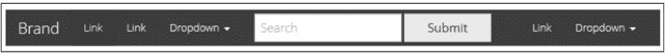

以下 `_Layout.cshtml` 文件中的代码创建了一个固定在顶部的响应式导航栏。当网站在屏幕尺寸较小的设备上打开时，它会显示一个带有三条杠的按钮，点击后会垂直显示菜单：

```cshtml
<div class="navbar navbar-inverse navbar-fixed-top">
    <div class="container">
        <div class="navbar-header">
            <button type="button" class="navbar-toggle" data-toggle="collapse" data-target=".navbar-collapse">
                <span class="icon-bar"></span>
                <span class="icon-bar"></span>
                <span class="icon-bar"></span>
            </button>
            @Html.ActionLink("Northwind Traders", "Index", "Home", null, new { @class = "navbar-brand" })
        </div>
        <div class="navbar-collapse collapse">
            @Html.Partial("_BackendMenuPartial")
            @Html.Partial("_LoginPartial")
        </div>
    </div>
</div>
```

请注意，我们使用两个局部视图根据当前用户是否已登录来生成其余的导航栏。当用户登录时，我们将向导航栏添加全局搜索功能；它将根据用户当前访问的页面返回结果。

首先，将以下代码添加到 `_BackendMenuPartial` 视图；这将在导航栏内生成一个搜索框：

```cshtml
@using (Html.BeginForm("Index", "Search", FormMethod.Post, new { @class = "navbar-form navbar-left", role = "search" }))
{
    <div class="form-group">
        @Html.TextBox("searchquery", "", new { @id = "searchquery", @class = "form-control input-sm", placeholder = "Search" })
        @Html.Hidden("fromcontroller", ViewContext.RouteData.Values["controller"], new { @id = "fromcontroller" })
    </div>
    <button type="submit" class="btn btn-default btn-xs">GO</button>
}
```

你会注意到在上面的代码中，我们有一个名为 `fromcontroller` 的隐藏字段，其中包含当前控制器的名称。我们从 `ViewContext` 上的 `RouteData` 对象获取此信息。此信息将用于根据当前页面返回搜索结果。

表单将以 HTTP `POST` 方法向 `Search` 控制器的 `Index` 动作发送请求；这反过来会检查请求来自哪个控制器名称并返回适当的数据和视图。执行搜索的代码如下：

```csharp
[HttpPost]
public ActionResult Index(string searchquery, string fromcontroller)
{
    switch (fromcontroller)
    {
        case "Products":
            return RedirectToAction("SearchProductsResult", new {
                query = searchquery });

        case "Customers":
            return RedirectToAction("SearchCustomersResult", new {
                query = searchquery });

        case "Employees":
            return RedirectToAction("SearchEmployeesResult", new {
                query = searchquery });
    }
    return View();
}

public ActionResult SearchCustomersResult(string query)
{
    ViewBag.SearchQuery = query;
    var results = _context.Customers.Where(p => p.CompanyName.Contains(query)
        || p.ContactName.Contains(query)
        || p.City.Contains(query)
        || p.Country.Contains(query)).ToList();
    return View(results);
}
```

### 列表组

列表组是灵活的组件，可以显示简单的元素列表，也可以与其他元素组合以创建具有自定义内容的复杂列表。我们的搜索将在用户搜索产品时将我们重定向到 SearchProductsResult 视图。此视图使用列表组来显示找到的产品项。检索数据库中产品的操作方法如下：

```csharp
public ActionResult SearchProductsResult(string query)
{
    ViewBag.SearchQuery = query;
    var results = _context.Products.Where(p => p.ProductName.Contains(query)).ToList();
    return View(results);
}
```

视图的 Razor 标记表示如下：

```cshtml
@model IEnumerable<Northwind.Data.Models.Product>
@{
    ViewBag.Title = "Product Search Results";
    Layout = "~/Views/Shared/_Layout.cshtml";
}
<div class="container">
    <div class="page-header">
        <h1>Product Results <small>Results for your search term: "@ViewBag.SearchQuery"</small></h1>
    </div>
    <ul class="list-group">
        @foreach (var item in Model)
        {
            <a href="@Url.Action("Edit", "Products", new { id = item.ProductID })" class="list-group-item">@item.ProductName <span class="badge">@item.UnitsInStock</span></a>
        }
    </ul>
</div>
```

在此标记中，产品项被加载到无序列表 `<ul>` 元素中作为锚点 `<a>` 元素。每个锚点元素的类名应设置为 `list-group-item`。视图在浏览器中应如下图所示：


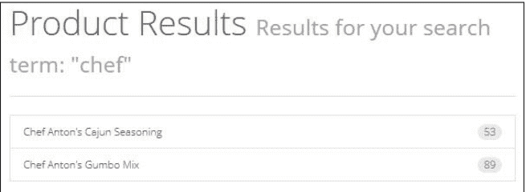

## 徽章

徽章用于突出显示项目。你通常会看到徽章用来指示新项或未读项的数量，具体取决于应用类型。我们在产品的搜索结果页面上使用了以下徽章来指示当前库存数量：

```
<a href="@Url.Action("Edit","Products", new { id=@item.ProductID })" class="list-group-item">@item.ProductName <span class="badge">@item.UnitsInStock</span></a>
```

向元素添加徽章就像添加一个 `<span>` 元素并将其类名设置为 `badge` 一样简单。

## 媒体对象

媒体对象组件可用于构建层级样式的列表，例如博客评论或推文。在我们的示例应用中，当用户搜索员工时，我们使用媒体对象来返回搜索结果视图。由于 Northwind 数据库包含一个 `ReportsTo` 字段，用来指示其他员工向哪名员工汇报，因此媒体对象组件非常适合以可视方式呈现这种关系。用于搜索员工并将结果返回视图的方法如下：

```
public ActionResult SearchEmployeesResult(string query)
{
    ViewBag.SearchQuery = query;
    var results = _context.Employees.Where(p => p.FirstName.Contains(query)
        || p.LastName.Contains(query)
        || p.Notes.Contains(query)).ToList();
    return View(results);
}
```

员工搜索结果的视图使用媒体对象组件来设置员工信息的样式并显示员工照片，如下所示：

```
@model IEnumerable<Northwind.Data.Models.Employee>
@{
    ViewBag.Title = "Employees Search Results";
    Layout = "~/Views/Shared/_Layout.cshtml";
}
<div class="container">
    <div class="page-header">
        <h1>Employees Results <small>Results for your search term: @ViewBag.SearchQuery</small></h1>
    </div>
    @foreach (var item in Model)
    {
        <div class="media">
            <a class="pull-left" href="@Url.Action("Edit", "Employees", new { id = @item.EmployeeID })">
                
            </a>
            <div class="media-body">
                <h4 class="media-heading">@item.FirstName @item.LastName</h4>
                @item.Notes
                @foreach (var emp in @item.ReportingEmployees)
                {
                    <div class="media">
                        <a href="#" class="pull-left">
                            
                        </a>
                        <div class="media-body">
                            <h4 class="media-heading">@emp.FirstName @emp.LastName</h4>
                            @emp.Title
                        </div>
                    </div>
                }
            </div>
        </div>
    }
</div>
```

媒体对象组件由一组带有 `media`、`media-heading` 和 `media-body` 类名的元素组合而成。`media-object` 类名用于表示图像、视频或音频等媒体对象。最终视图应类似于以下截图：


## 页面页眉

Bootstrap 页面页眉用于向用户清晰地表明，页面由一个标题组成，该标题向用户介绍他们正在访问的页面。页面页眉本质上是一个 `<h1>` 元素，外层包裹着一个类名为 `page-header` 的 `<div>` 元素。你还可以利用 `<small>` 元素向用户提供关于该页面的额外信息。Bootstrap 还会在页面页眉下方添加一条水平线，以便在视觉上与页面其余部分分隔开。

以下 HTML 标记创建一个页面页眉：

```
```html
<div class="page-header">
    <h1>Categories <small>Add, edit and delete product categories</small></h1>
</div>
```
```

*使用 Bootstrap 组件*

此标记将在浏览器中生成以下截图：

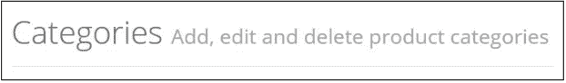

## 面包屑导航

面包屑导航是 Web 设计中常用的一种隐喻，用于向用户表明他们当前在导航树中的位置。它类似于 Windows 资源管理器中的文件路径。面包屑导航非常适合具有多级子导航的站点，并允许用户在各类父级和子级页面之间导航。

在下面的标记中，我们将结合 Razor 和 HTML 构建一个面包屑导航组件，用户可以通过它导航回主页或管理页面：

```
```html
<ol class="breadcrumb">
    <li>@Html.ActionLink("Home", "Index", "Home")</li>
    <li>@Html.ActionLink("Manage", "Index", "Manage")</li>
    <li class="active">Categories</li>
</ol>
```
```

前面的标记包含一个类名为 `breadcrumb` 的有序列表 `<ol>` 元素。面包屑导航的每个子元素都作为列表项 `<li>` 元素添加。为了向用户表明面包屑导航的最后一个层级是当前活动页面，我们将其 `<li>` 元素的类名设置为 `active`。访问该页面时，上述代码的结果将类似于以下截图：

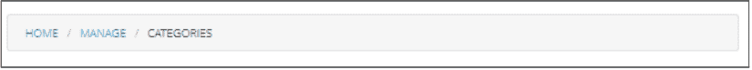

## 分页

分页用于将内容（通常是列表）划分为多个独立页面。例如，在搭建列表视图时，默认的脚手架模板会生成一个表格，其中为你传入视图的集合中的每个项生成一行。对于少量数据来说这没问题，但如果列表包含数百个项，你的页面将需要很长时间才能加载。理想情况下，我们希望将列表视图拆分为每页仅显示五个项的可管理视图。在下面的截图中，我们将**产品**页面的表格改为使用分页：

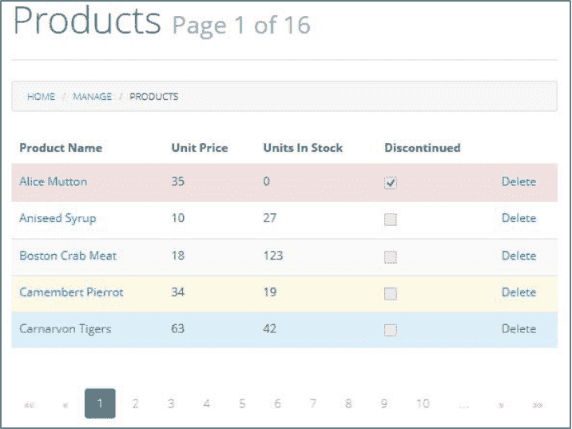

上述视图是使用 PagedList.Mvc NuGet 包并完成以下步骤实现的：

- 1. 要安装它，请在 Visual Studio 的**包管理器控制台**中运行以下命令：
- 
- `Install-Package PagedList.Mvc`
- 2. 此命令会将必要的依赖项添加到你的项目中。接下来，打开你的控制器操作，并将其代码更改为以下内容：

```
public ActionResult Index(int? page)
{
    var models = _context.Products.Project()
        .To<ProductViewModel>().OrderBy(p => p.ProductName);
    int pageSize = 5;
    int pageNumber = (page ?? 1);
    return View(models.ToPagedList(pageNumber, pageSize));
}
```

在前面的代码中，我们将操作方法改为接受一个名为 `page` 的整数参数。此参数用于指示用户当前正在查看列表的哪一页。然后，我们从数据库中检索产品列表，并使用 `ProductName` 属性进行排序。

`pageSize` 变量用于设置每页应显示的项数。然后，我们将产品项作为 `PagedList` 返回。`PagedList` 对象属于我们之前通过 NuGet 安装的 PagedList.Mvc 库的一部分。

3. 接下来，打开关联的视图，并将以下代码添加到文件顶部：

```
@using PagedList.Mvc;
@model PagedList.IPagedList<Northwind.Web.Models.ProductViewModel>
```

4. `using` 语句告诉视图引用 PagedList 库。然后，我们将视图的模型设置为 `ProductViewModel` 对象的 `PagedList` 表示形式。

5. 你无需更改现有标记中的任何内容；但是，若要指示当前页码，请将以下代码添加到页面中：

```
Page @(Model.PageCount < Model.PageNumber ? 0 : Model.PageNumber)
of @Model.PageCount
```

6. 上述代码将显示当前页码和总页数。若要向页面添加符合默认 Bootstrap 样式的分页元素，请在 `<table>` 元素的结束标签正下方添加以下代码：

```
@Html.PagedListPager(Model, page => Url.Action("Index", new { page }), PagedListRenderOptions.ClassicPlusFirstAndLast)
```

在前面的代码中，我们使用了 PagedList 库中包含的 `PagedListPager` HTML 帮助器来显示分页元素；该元素包含所有页码，以及用于跳转到第一页和最后一页的按钮。你会注意到，`PagedListPager` 帮助器的最后一个参数支持九种不同的分页布局。它们如下：

- Classic
- ClassicPlusFirstAndLast
- Minimal
- MinimalWithItemCountText
- MinimalWithPageCountText
- OnlyShowFivePagesAtATime
- PageNumbersOnly
- TwitterBootstrapPager
- TwitterBootstrapPagerAligned


将参数设置为 `PagedListRenderOptions.TwitterBootstrapPagerAligned` 将显示两个按钮，标题为 **Older** 和 **Newer**。它们与容器的边缘对齐，如以下屏幕截图所示：

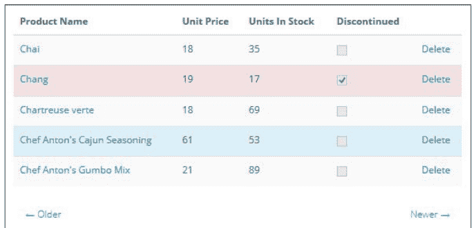

将参数设置为 `PagedListRenderOptions.TwitterBootstrapPager` 将在表格下方居中添加 **Previous** 和 **Next** 按钮：

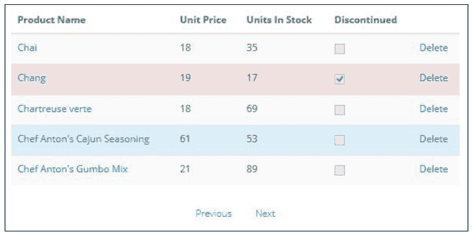

`PagedList` 库开箱即支持默认的 Bootstrap 样式；这意味着您无需执行任何特定操作即可启用正确的样式。

## 输入组

输入组是向用户提供有关您期望他们在特定表单元素中输入的数据的额外信息的一种方法。Bootstrap 提供类可在输入元素之前或之后添加部分。这些部分可以包含文本或 Bootstrap 中包含的 200 个 Glyphicons 中的任何一个。

> Bootstrap 预装了 200 个 Glyphicon Halfling 图标。通常，设置的 Glyphicon Halfling 图标不是免费的，但其创建者将其免费提供给 Bootstrap。您可以在 http://getbootstrap.com/components/ 上阅读有关它们的更多信息。

要创建文本输入元素以提示用户需要在字段中输入电话号码，我们将使用以下标记：

```html
<div class="form-group">
    @Html.LabelFor(model => model.Phone, new { @class = "control-label col-md-2" })
    <div class="col-sm-4 input-group">
        <span class="input-group-addon">
            <span class="glyphicon glyphicon-phone-alt"></span>
        </span>
        @Html.EditorFor(model => model.Phone)
        @Html.ValidationMessageFor(model => model.Phone)
    </div>
</div>
```

此标记的结果将是左侧带有灰色区域的文本输入元素，其中包含电话图像，如以下屏幕截图所示：

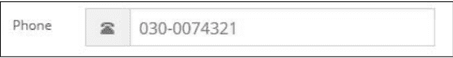

我们还可以创建在文本输入右侧对齐并包含文本而不是图像的输入组。例如，以下标记创建了一个文本输入字段，提示用户我们只需要电子邮件地址的第一部分，最后部分将自动附加：

```html
<div class="form-group">
    @Html.LabelFor(model => model.Email, new { @class = "control-label col-md-2" })
    <div class="col-sm-4 input-group">
        @Html.EditorFor(model => model.Email)
        <span class="input-group-addon">@@northwind.com</span>
    </div>
</div>
```

前述标记的结果将在浏览器中看起来像以下屏幕截图：

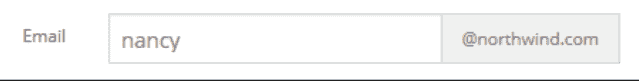

您还可以使用以下代码创建两侧都有灰色区域的文本输入：

```html
<div class="form-group">
    @Html.LabelFor(model => model.UnitPrice, new { @class = "col-sm-2 control-label" })
    <div class="col-sm-2 input-group">
        <span class="input-group-addon">$</span>
        @Html.TextBoxFor(model => model.UnitPrice, new { @class = "form-control" })
        <span class="input-group-addon">.00</span>
        @Html.ValidationMessageFor(model => model.UnitPrice)
    </div>
</div>
```

结果将在浏览器中看起来像以下屏幕截图：

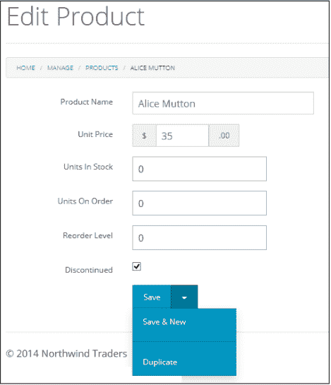

## 警告

警报组件用于向用户提供视觉反馈。这可用于向用户提供记录已保存的确认消息、发生错误时的警告消息，或基于系统事件的信息消息。

Bootstrap 提供四种不同样式的警报。例如，以下标记生成绿色、蓝色、橙色和红色警报框：

```html
<div class="alert alert-success"><strong>Success. You have successfully saved the file.</strong></div>
<div class="alert alert-info"><strong>Info. Something has just happened.</strong></div>
<div class="alert alert-warning"><strong>Warning! The file size is too big.</strong></div>
<div class="alert alert-danger"><strong>Danger! The file could not be saved.</strong></div>
```

警报框在浏览器中应与以下屏幕截图类似：

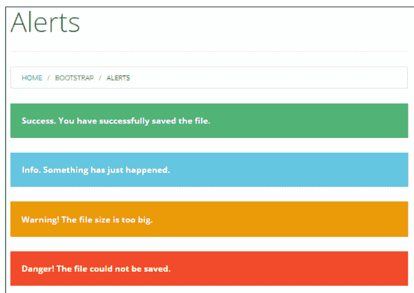

可关闭警报是用户可以通过单击其右上角的小 X 图标关闭的警报。为了创建可关闭警报，您可以使用 alert-dismissible 类名，如下所示：

```html
<div class="alert alert-warning alert-dismissible" role="alert">
<button type="button" class="close" data-dismiss="alert"><span aria-hidden="true">&times;</span><span class="sr-only">Close</span></button>
<strong>Alert!</strong> This is a dismissible alert.
</div>
```

> 您可参考本书附带的示例项目，了解如何直接从 ASP.NET MVC 控制器显示特定样式的警报。这些警报改编自 Matt Honeycutt 在 GitHub 上的示例：https://github.com/MattHoneycutt/Fail-Tracker。

## 进度条

进度条是与传统桌面以及 Web 开发一起使用的隐喻，用于向用户提供任务或操作的进度视觉反馈。Bootstrap 提供多种不同样式的进度条。

### 基础进度条

基础 Bootstrap 进度条显示一个纯蓝色进度条。添加带有 `sr-only` 类名的 `<span>` 元素是良好做法，以便屏幕阅读器可以读取进度百分比。以下标记生成带有标题的基础进度条：

```html
<h4>Basic Progressbar</h4>
<div class="progress">
    <div class="progress-bar" role="progressbar" aria-valuenow="80" aria-valuemin="0" aria-valuemax="100" style="width: 80%;">
        <span class="sr-only">80% Complete</span>
    </div>
</div>
```

此标记的结果如以下屏幕截图所示：

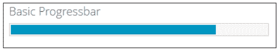

您还可以通过在其 `<div>` 元素内添加文本来为进度条显示内联标签：

```html
<h4>Basic Progressbar with label</h4>
<div class="progress">
    <div id="progressbarTitle" class="progress-bar" role="progressbar" aria-valuenow="60" aria-valuemin="0" aria-valuemax="100" style="width: 60%;">
        60%
    </div>
</div>
```

此代码的结果如以下屏幕截图所示：

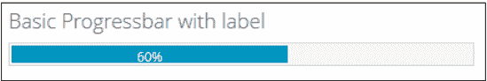

### 上下文进度条

您可以使用相同的按钮和警报样式类生成不同颜色的进度条。这是通过将进度条的类名设置为以下之一来实现的：

- `progress-bar-success`
- `progress-bar-info`
- `progress-bar-warning`
- `progress-bar-danger`

结果如以下屏幕截图所示：

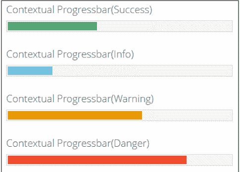

### 条纹和动画进度条

要生成具有渐变条纹效果的进度条，请向进度条的父 `<div>` 元素添加类名 `progress-striped`：

```html
<h4>Striped Progressbar (Danger)</h4>
<div class="progress progress-striped">
    <div class="progress-bar progress-bar-danger" role="progressbar" aria-valuenow="80" aria-valuemin="0" aria-valuemax="100" style="width: 80%">
        <span class="sr-only">80% Complete (danger)</span>
    </div>
</div>
```

此结果如以下屏幕截图所示：

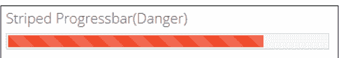

要添加动画效果，使进度条上的条纹看起来在移动，只需向其父 `<div>` 元素添加 `active` 类即可：

```html
<div class="progress progress-striped active">
    <div class="progress-bar progress-bar-danger" role="progressbar" aria-valuenow="80" aria-valuemin="0" aria-valuemax="100" style="width: 80%">
        <span class="sr-only">80% Complete (success)</span>
    </div>
</div>
```

### 动态更新进度条的百分比

进度条只有在实际提供特定任务进度的反馈时才有价值。要使用 ASP.NET MVC 动态更新进度条，请执行以下步骤：

1. 通过在 Visual Studio 程序包管理器控制台中运行以下命令，将 SignalR NuGet 包添加到我们的项目中：`Install-Package Microsoft.AspNet.SignalR`


## 使用 Bootstrap 组件

> SignalR 是一个用于 ASP.NET 的库；这个库让向应用程序添加实时功能和反馈变得非常容易。你可以在 www.signalr.net 上了解更多信息。

2. 接下来，在你的项目中添加一个名为 `Hubs` 的新文件夹，并向该文件夹添加一个名为 `ProgressbarHub.cs` 的新类。将它的代码改为以下代码：

```csharp
using System.Threading;
using Microsoft.AspNet.SignalR;

namespace Northwind.Web.Hubs
{
    public class ProgressbarHub : Hub
    {
        public void SendProgress()
        {
            for (int i = 0; i <= 100; i++)
            {
                Thread.Sleep(50);
                Clients.Caller.sendMessage(i + "%");
            }
        }
    }
}
```

3. 在上述代码中，我们的类继承自 SignalR 的 Hub 类，并且只包含一个名为 `SendProgress` 的方法，该方法会递增一个变量，并通过 `sendMessage` 方法将值发送给任何 SignalR 客户端。

4. 接下来，我们添加对 SignalR 虚拟路径的引用。打开 `_Layout.cshtml` 文件，并在文件底部添加以下一行：

```html
<script src="~/signalr/hubs"></script>
```

5. 我们还要在现有的 bundle 中添加对 SignalR JavaScript 库的引用。打开位于 `App_Start` 文件夹中的 `BundleConfig.cs` 文件，并按如下方式修改 jquery bundle，使其包含 SignalR 库：

```csharp
bundles.Add(new ScriptBundle("~/bundles/jquery").Include(
    "~/Scripts/jquery-{version}.js",
    "~/Scripts/jquery.signalR-2.0.3.js"));
```

6. 最后，在包含进度条的页面上，在 Scripts 节中添加以下脚本：

```csharp
@section scripts
{
    <script type="text/javascript" language="javascript">
        $("#start").click(function () {
            $(".progress-bar").width('0%');
            var progressNotifier = $.connection.progressbarHub;
            progressNotifier.client.sendMessage = function (message) {
                updateProgress(message);
            };

            $.connection.hub.start().done(function () {
                progressNotifier.server.sendProgress();
            });
        });

        function updateProgress(message) {
            $(".progress-bar").width(message);
            $("#progressbarTitle").html(message + ' Complete');
        }
    </script>
}
```

上述代码将在用户单击 ID 为 start 的按钮时执行。它首先会将页面上所有进度条的宽度设置为 0，并初始化与服务器的连接。然后我们设置服务器端要调用的函数名。在此场景中，JavaScript 函数名为 `updateProgress`。

最后，我们建立与服务器的连接，并启动服务器端操作。如你所见，我们调用了 `sendProgress` 函数——这是在 `ProgressbarHub` 类中声明的方法名。

执行该代码后，你会看到页面上所有进度条的值都会从 0 增加到 100。

## 总结

在本章中，我们探索了许多不同的 Bootstrap 组件，并学习了如何在你的 ASP.NET MVC 项目中使用它们。我们还了解了使用 NuGet 包来帮助你创建分页列表和动态更新进度条。

在下一章中，我们将更深入地研究 Bootstrap 组件，探讨如何使用 Bootstrap JavaScript 插件为你的网站添加更多交互性。
