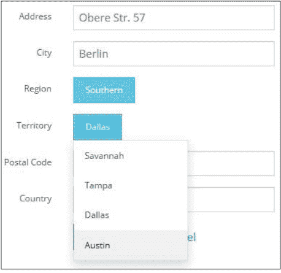
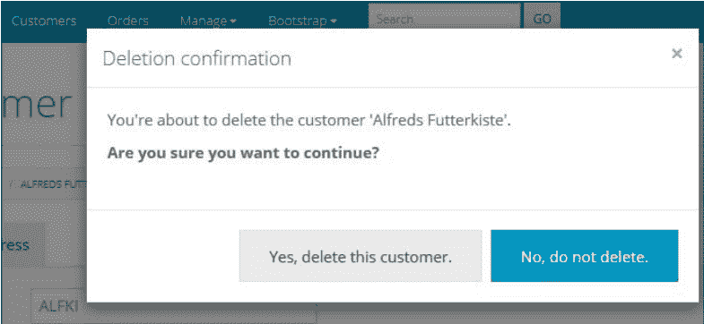
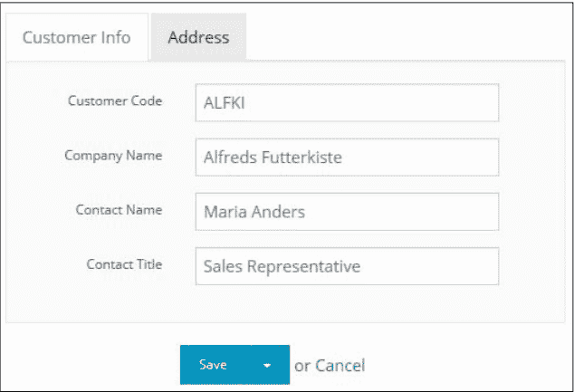
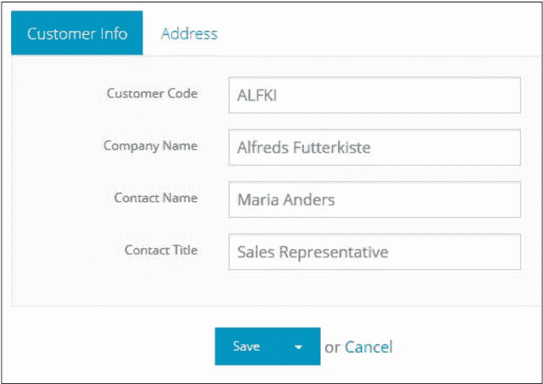
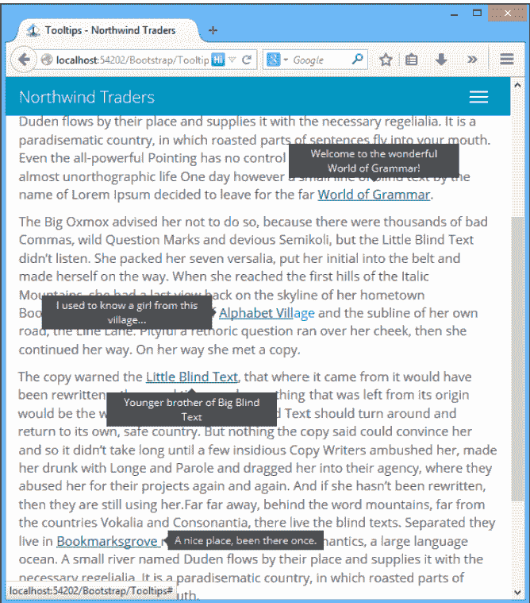
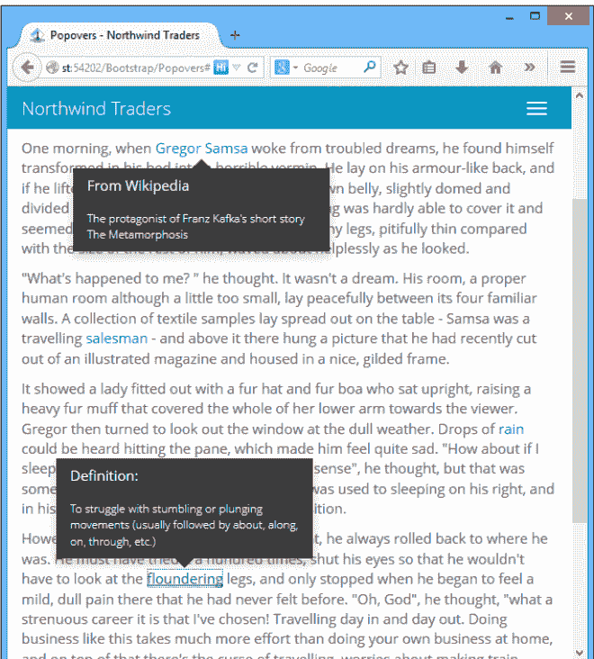
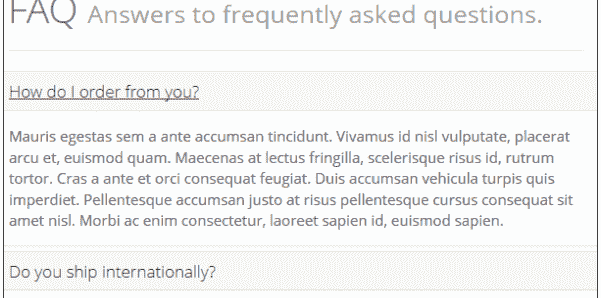

# 使用 Bootstrap JavaScript 插件

为了使用 Bootstrap 插件，我们需要在项目中包含 `bootstrap.js` 或 `bootstrap.min.js` 文件。该文件包含所有 Bootstrap 插件，但如果你不打算在项目中使用每一个插件，最好自定义 `bootstrap.js` 文件中要包含的组件。这将减小 Bootstrap 库的体积，并让网站加载得更快。要访问这些插件，请访问 http://getbootstrap.com/customize/ 并选择你将在项目中使用的插件。

### 数据属性与编程式 API

Bootstrap 让你可以完全通过 HTML 标记来使用其插件。这意味着，使用大多数插件时，你不需要编写一行 JavaScript。使用数据属性是推荐的方法，并且应该是你使用 Bootstrap 插件时的首选。

例如，要让 `alert` 元素可以关闭，你需要将 `data-dismiss="alert"` 属性添加到 `button` 或 `anchor` 元素上，如下面的代码所示：

```html
<div class="alert alert-danger">
  <button data-dismiss="alert" class="close" type="button">×</button>
  <strong>Warning</strong> Shuttle launch in t-minus 10 seconds.
</div>
```

你也可以选择通过 JavaScript 使用编程式 API 执行相同的操作。下面的代码在用户单击按钮时使用 jQuery 关闭特定的 `alert` 元素：

```html
<button class="close" type="button" onclick="$('#myalert').alert('close')">×</button>
```

### 级联下拉菜单

你可以使用 dropdown 插件为几乎任何 Bootstrap 组件添加下拉菜单。级联下拉菜单是一种根据另一个下拉菜单中所选值来更新其数据的下拉菜单。要添加级联下拉菜单，请执行以下步骤：

1. 我们将为两个按钮添加下拉菜单，以列出从数据库中检索到的地区（Region）和区域（Territory）数据。当用户选择一个地区（Region）时，区域（Territory）下拉列表将会更新，仅显示与所选地区关联的那些区域（Territory）。下面的截图展示了最终结果：



2. 这两个下拉菜单将用于我们的 Edit Customer 视图。为了让区域（Territory）和地区（Region）列表可以在视图中访问，我们首先使用以下代码将它们添加到 ViewBag 对象：

```csharp
public ActionResult Edit(int id)
{
    var model = _context.Customers.First(c => c.CustomerId == id);
    ViewBag.RegionId = new SelectList(_context.Regions,
    "RegionId", "RegionDescription", model.RegionId);
    ViewBag.TerritoryId = new SelectList(_context.Territories.Where(t => t.RegionId == model.RegionId), "TerritoryId",
    "TerritoryDescription", model.TerritoryId);
    return View(model);
}
```

在这段代码中，我们首先从数据库中加载了所请求的客户，然后将数据库中的地区（Region）和区域（Territory）列表添加到 ViewBag 对象。你会注意到，我们只检索了所选客户所在地区（Region）内的区域（Territory）。

3. 接下来，我们向视图添加 Razor 标记，以创建两个带有下拉菜单的按钮。在下面的代码中，我们将创建两个新的 Bootstrap 表单组，其中包含地区（Region）和区域（Territory）属性的标签，以及用于携带所选地区 ID 和区域 ID 的隐藏元素。我们遍历通过 ViewBag 对象传递给视图的地区和区域，并构建菜单项。

```html
<div class="form-group">
    @Html.LabelFor(model => model.RegionId,
        new { @class = "control-label col-md-2" })
    @Html.HiddenFor(model => model.RegionId)
    <div class="col-md-10">
        <div id="regiondropdown" class="dropdown">
            <button id="regionbutton" class="btn btn-sm btn-info"
                    data-toggle="dropdown">@Model.Region.RegionDescription</button>
            <ul class="dropdown-menu">
                @foreach (var item in ViewBag.RegionId)
                {
                    <li><a href="#" tabindex="-1" data-value="@item.Value">@item.Text</a></li>
                }
            </ul>
        </div>
    </div>
</div>
<div class="form-group">
    @Html.LabelFor(model => model.TerritoryId, new { @class =
        "control-label col-md-2" })
    @Html.HiddenFor(model => model.TerritoryId)
    <div class="col-md-10">
        <div id="territorydropdown" class="dropdown">
            <button id="territorybutton" class="btn btn-sm btn-info" data-toggle="dropdown">@Model.Territory.TerritoryDescription</button>
            <ul id="territories" class="dropdown-menu">
                @foreach (var item in ViewBag.TerritoryId)
                {
                    <li><a href="#" tabindex="-1" data-value="@item.Value">@item.Text</a></li>
                }
            </ul>
        </div>
    </div>
</div>
```


> 请注意，我们将菜单中锚元素<a>的tabindex项设置为-1。这样做是为了防止该元素成为Tab键顺序的一部分。

- 接下来，向你的项目中添加一个名为Territories.cshtml的新分部视图。我们将使用此分部视图在用户每次更改区域时加载地区。为了加载该分部视图，我们需要向CustomerController添加一个返回PartialViewResult的新方法。此方法的代码如下：

```
public PartialViewResult Territories(int regionId)
{
    ViewBag.TerritoryId = new SelectList(_context.Territories.Where(t => t.RegionId == regionId), "TerritoryId", "TerritoryDescription");
    return PartialView();
}
```

此方法接收一个区域ID作为参数，然后将该区域关联的地区加载到ViewBag对象中。最后，该方法返回我们之前创建的Territories分部视图。

- 最后，为了在用户选择不同区域时加载关联的地区，我们需要向页面添加一点JavaScript。为此，在视图中创建一个新的section，并向其中添加以下JavaScript代码：

```
@section scripts{
<script type="text/javascript">
    $('#regiondropdown li a').click(function () {
        var $this = $(this);
        var region = $this.data('value');
        var regionName = $this.text();
        $('#RegionId').val(region);
        $.get("/Customers/Territories", { regionId: region })
            .done(function (data) {
                $('#regionbutton').text(regionName);
                $('#territorybutton').text('Select Territory');
                $('#territories').html(data);
            });
    });

    $('body').on("click", '#territories li a', function () {
        var $this = $(this);
        var territory = $this.data('value');
        var territoryName = $this.text();
        $('#TerritoryId').val(territory);
        $('#territorybutton').text(territoryName);
    });
</script>
}
```

上述JavaScript为区域下拉元素创建了一个点击处理程序，并将所选区域ID保存到一个变量中。然后，该变量被传递给jQuery的get方法，该方法进而向CustomerController中的Territories方法发起请求。Territories方法返回一个分部视图，其中包含区域ID与接收参数匹配的地区列表。

该代码还使用jQuery的on方法，为ID为territories的元素的所有锚点子元素附加事件处理程序。然后，事件处理程序将所选地区ID保存到我们之前创建的表单内的隐藏字段中。

## 模态对话框

模态框用于提供一种弹出式对话框样式的元素，可用于向用户提供信息，甚至允许用户在模态框内完成表单。Bootstrap模态框基本上由三部分组成：头部、主体和底部。你可以将任何标准HTML标记放在模态框的body元素内，包括标准文本，甚至嵌入的YouTube视频。

作为一般规则，始终将模态框的标记放在视图内的顶层位置——视图的顶部或底部是放置模态框标记的最佳位置。

使用以下HTML和Razor标记，我们将创建一个模态框，提示用户是否要继续从数据库中删除某个客户记录。我们将在模态框的body内声明一个<form>元素，并使用在模态框的footer元素内创建的按钮来提交表单。我们还将创建一个用户可以点击以关闭模态框的按钮。这是通过向按钮添加data-dismiss="modal"属性来实现的，如下所示：

```
<div class="modal fade" id="deleteConfirmationModal" tabindex="-1" role="dialog" aria-hidden="true">
    <div class="modal-dialog">
        <div class="modal-content">
            <div class="modal-header">
                <button type="button" class="close" data-dismiss="modal" aria-hidden="true">&times;</button>
                <h4 class="modal-title">Deletion confirmation</h4>
```

为了显示模态框，我们不需要编写任何JavaScript。只需给锚点或按钮元素添加data-toggle="modal"属性，当用户点击它时就会显示模态框，如下代码所示：

```
<a href="#" data-toggle="modal" data-target="#deleteConfirmationModal">Delete</a>
```

为了指示要显示哪个模态框，我们在data-target属性中指定模态框的ID。

上述代码的结果将显示一个模态框，类似于以下截图所示：



你也可以选择不使用data- API来显示模态框，而是使用jQuery来显示和隐藏模态框。以下JavaScript在页面加载时显示ID为deleteConfirmationModal的模态框：

```
$(document).ready(function () {
  $('#deleteConfirmationModal').modal('show');
});
```

你也可以使用同样的函数来隐藏模态框：

```
$('#deleteConfirmationModal').modal('hide');
```

## 选项卡

选项卡提供了一种将内容拆分为独立页面的选项。当你有一个特别大的表单并希望将其拆分为逻辑分组时，这是一个理想的组件。例如，在编辑客户记录时，你可能希望将联系详情和地址详情分开，如下面的截图所示：



Bootstrap选项卡分为两部分。首先，你需要指定选项卡名称，以及当用户点击选项卡时要显示的对应<div>元素的ID。这是通过创建一个标准的无序列表<ul>元素来实现的，其中选项卡名称作为子列表项<li>。<ul>元素的class必须设置为`nav nav-tabs`或`nav nav-pills`，如下脚本所示：

```html
<ul class="nav nav-tabs">
    <li class="active"><a href="#info" data-toggle="tab">Customer Info</a></li>
    <li><a href="#address" data-toggle="tab">Address</a></li>
</ul>
```

你可以通过将<li>元素的data-toggle属性设置为tab或pill，并将<ul>元素的class设置为nav-pills，来使用选项卡或胶囊式导航。结果在浏览器中将如下面的截图所示：



要指定选项卡的内容，请创建一个新的<div>元素并将其class设置为tab-content。在父级<div>元素内为每个选项卡创建一个<div>元素，并将每个选项卡的<div>元素的class设置为tab-pane，如下所示：

```
<div class="tab-content well">
    <div class="tab-pane active" id="info">
        Info Tab Content goes here
    </div>
    <div class="tab-pane" id="address">
        Address Tab Content goes here
    </div>
</div>
```

在上述标记中，我们创建了两个选项卡，并通过将info选项卡的class设置为active，将其设为活动选项卡。

你还可以使用jQuery激活特定页面。要在页面加载时立即激活address选项卡，请使用以下代码：

```
$(document).ready(function () {
  $('.nav-tabs a[href="#address"]').tab('show');
});
```

## 工具提示

Bootstrap的工具提示插件是Jason Frame的jQuery.tipsy插件的更新版本。工具提示可用于向用户提供有关页面特定内容的附加信息标签，或提供对表单元素中预期输入的说明。

工具提示可用于多种元素；例如，以下标记在用户悬停在锚点<a>元素上时显示工具提示：

```
<a data-toggle="tooltip" data-placement="top" data-original-title="Welcome to the wonderful World of Grammar!" href="#">World of Grammar</a>
```

要在任何元素上使用工具提示，请向其添加data-toggle="tooltip"属性。你可以通过将data-placement属性设置为以下值之一来指定工具提示的位置：

- top
- bottom
- left
- right

最后，设置data-original-title属性的值，以指定工具提示内应显示的文本。

工具提示的一个注意事项是，出于性能考虑，data- API是选择加入的，这意味着你必须手动初始化插件。为此，请向页面添加以下JavaScript：

```
<script type="text/javascript">
  $(document).ready(function () {
    $('[data-toggle="tooltip"]').tooltip();
  });
</script>
```


## 使用 Bootstrap JavaScript 插件

前面的代码会查找所有 data-toggle 属性设置为 tooltip 的元素，并为这些元素初始化 tooltip 插件。在浏览器中，结果将与下面的截图类似：



## 弹出框（Popovers）

弹出框与工具提示类似，因为它们都能向用户提供有关某个元素的附加信息，但弹出框被设计为显示更多内容，因为弹出框还允许显示标题。

弹出框的定义方式与你定义弹出窗口的方式类似：向元素添加 `data-toggle`、`data-placement`、`data-original-title` 和 `data-content` 属性。当用户点击锚点 `<a>` 元素时，以下标记会显示一个弹出窗口：

```
```html
<a data-content="The protagonist of Franz Kafka's short story The Metamorphosis" data-placement="bottom" title="" data-toggle="popover" href="#" data-original-title="From Wikipedia">Gregor Samsa</a>
```
```

将 `data-toggle` 属性设置为 `popover`，即向插件指定它需要显示一个弹出框。`data-content` 属性包含将显示在弹出框中的内容，`data-original-title` 属性设置弹出框的标题。`data-placement` 属性表示弹出框的位置，支持四个值：top、bottom、left 和 right。

你还可以通过设置 `data-trigger` 属性的值来指定触发弹出框的方式。当用户点击或悬停在元素上，或元素获得焦点时，都可以触发弹出框。你也可以指定手动触发。`data-trigger` 属性的四个选项是 click、hover、focus 和 manual。

与工具提示一样，data- API 是选择加入（opt-in）机制，因此你需要手动初始化弹出框插件。在下面的代码中，我们将使用 jQuery 查找页面中所有 `data-toggle` 属性设置为 `popover` 的元素，并为每个元素初始化弹出框插件：

```
```html
<script type="text/javascript">
    $(document).ready(function () {
        $('[data-toggle="popover"]').popover();
    });
</script>
```
```

在浏览器中，弹出框插件的效果类似于下面的截图：



## 手风琴组件

手风琴组件最常用于常见问题（FAQ）页面，或需要将大量内容分成易于管理部分的页面。手风琴由多个面板组组成，每个面板组又包含标题元素和正文元素。要在项目中使用手风琴组件，请执行以下步骤：

- 1. 要使用户点击标题时面板能够折叠，我们需要在 `panel` 标题元素内的锚点 `<a>` 元素上添加 `data-toggle` 属性，并将其值设置为 `collapse`。
- 2. 我们还需要通过将 `data-parent` 属性的值设置为父面板组的 ID，来指定面板的父元素。接下来，将锚点元素的 `href` 属性设置为包含内容的 `<div>` 元素的 ID。
- 3. 最后，我们还需要将面板正文元素的 class 设置为 `panel-collapse collapse`。在下面的代码中，我们将创建一个包含两个面板组的手风琴组件。第一个面板组在页面加载时会自动可见，因为我们会将其 class 设置为 `panel-collapse collapse in`：

```
```html
<div class="panel-group" id="accordion">
    <div class="panel panel-default">
        <div class="panel-heading">
            <h4 class="panel-title">
                <a data-toggle="collapse" data-parent="#accordion"
                   href="#questionOne">
                    How do I order from you?
                </a>
            </h4>
        </div>
        <div id="questionOne" class="panel-collapse collapse in">
            <div class="panel-body">
                Mauris egestas sem a ante accumsan tincidunt.
                Vivamus id nisl vulputate, placerat arcu et.
                sapien.
            </div>
        </div>
    </div>

    <div class="panel panel-default">
        <div class="panel-heading">
            <h4 class="panel-title">
                <a data-toggle="collapse" data-parent="#accordion"
                   href="#questionTwo">
                    Do you ship internationally?
                </a>
            </h4>
        </div>
        <div id="questionTwo" class="panel-collapse collapse">
            <div class="panel-body">
                Integer aliquet ligula eget elit faucibus, quis
                pretium justo iaculis. Quisque quis dolor
                volutpat, varius tellus eget, luctus nibh.
                Cras tempus tincidunt.
            </div>
        </div>
    </div>
</div>
```
```

4. 手风琴的效果应该类似于下面的截图：



## 轮播组件

轮播组件是一种用户界面元素，你会在许多网站上看到它。它本质上是一个幻灯片，循环展示不同的元素，通常是图片。轮播组件应包含在一个 class 为 carousel、data-ride 属性值为 carousel 的 `<div>` 元素中。要在项目中使用轮播组件，请执行以下步骤：

- 1. 轮播组件由一个有序列表元素 `<ol>` 组成，该元素在浏览器中渲染为小圆点，并指示当前激活的是哪一张幻灯片。该元素的标记如下：

```
<ol class="carousel-indicators">
    <li data-target="#myCarousel" data-slide-to="0" class="active"></li>
    <li data-target="#myCarousel" data-slide-to="1"></li>
    <li data-target="#myCarousel" data-slide-to="2"></li>
</ol>
```

- 2. 接下来，需要创建另一个 class 为 `carousel-inner` 的 `<div>` 元素。该元素将包含实际的幻灯片及其内容。以下标记创建了一个带有一张幻灯片的此类元素：

```
<div class="carousel-inner">
    <div class="item active">
```

```
```html

<div class="container">
    <div class="carousel-caption">
        <h1>Unto all said together great in image.</h1>
        <p>Won't saw light to void brought fifth was brought god abundantly for you waters life seasons he after replenish beast. Creepeth beginning.</p>
        <p><a class="btn btn-lg btn-primary" href="#" role="button">Read more</a></p>
    </div>
</div>
</div>
</div>
</div>
```
```

- 3. 最后，要在轮播两侧添加箭头，以提示用户可以导航到下一张幻灯片，请将以下标记添加到父级 `<div>` 元素中：

```
```html
<a class="left carousel-control" href="#myCarousel" data-slide="prev"><span class="glyphicon glyphicon-chevron-left"></span></a>
<a class="right carousel-control" href="#myCarousel" data-slide="next"><span class="glyphicon glyphicon-chevron-right"></span></a>
```
```

- 4. 每张幻灯片应显示的时长可以通过 `data-interval` 属性设置。在以下标记中，我们将幻灯片之间的间隔设置为 10 秒：

```
```html
<div id="myCarousel1" class="carousel" data-ride="carousel" data-interval="10000">
```
```

- 5. 与所有其他插件一样，你也可以选择使用 JavaScript 初始化插件并设置其选项。在下面的代码中，我们将初始化轮播组件，并将幻灯片之间的间隔设置为 10 秒：

```
```javascript
$('#myCarousel1').carousel({
    interval: 10000
})
```
```

## 总结

在本章中，我们研究了各种 Bootstrap JavaScript 插件、如何初始化它们，以及如何使用 `data-` API 或编程式 JavaScript 方法来设置它们的选项。

在下一章中，我们将探讨如何创建自己的 ASP.NET MVC 辅助方法，以减少在创建大量 Bootstrap 元素和组件时需要编写的 HTML 标记量。


