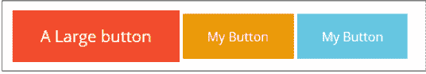
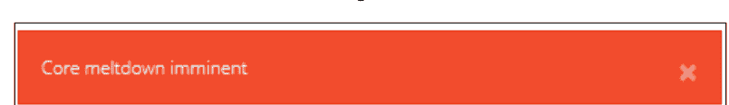
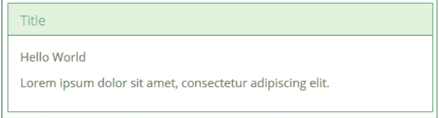

# 创建 ASP.NET MVC Bootstrap 助手

ASP.NET MVC 允许开发者通过创建静态或扩展方法来创建自己的 HTML 助手方法。本质上，HTML 助手只是一个返回 HTML 字符串的方法。

HTML 助手使你能够在多个页面上使用相同的常用标记块，并使页面中的代码和标记更易于阅读和维护。这促进了可重用代码的使用，开发者也可以对助手方法进行单元测试。

在本章中，我们将涵盖以下主题：

- 内置 ASP.NET MVC HTML 助手的概述
- 使用 @helper 语法创建助手
- 使用静态方法创建 HTML 助手
- 创建 HTML 助手扩展方法
- 创建流畅 HTML 助手
- 创建自关闭助手

## 内置 HTML 助手

HtmlHelper 是一个在视图中渲染 HTML 内容的方法。其目的是允许开发者在多个页面中重用常见的 HTML 标记块。

ASP.NET MVC 提供了多种标准开箱即用的 HTML 助手。例如，要生成以下带有 ID 和 name 属性为 CustomerName 的文本框的 HTML，请使用以下代码：

```
<input type="text" name="CustomerName" id="CustomerName">
```

你应该使用如下所示的 TextBox 助手：

```
@Html.TextBox("CustomerName")
```

大多数内置 HTML 助手都提供了多个重载版本。例如，要创建文本框并显式设置其 name 和 value 属性，你应该使用以下重载的 TextBox 助手方法：

```
@Html.TextBox("CustomerName", "Northwind Traders")
```

大多数内置助手还提供了指定由元素生成的 HTML 属性的选项，通过传递匿名类型。在下面的示例中，我们将创建一个文本框并使用其中一个重载方法设置其 style 属性：

```
@Html.TextBox("CustomerName","Northwind Traders", new {
style="background-color:Blue;" })
```

> 你可以在 http://bit.ly/MVCFormHelpers 阅读更多关于 ASP.NET MVC 中可用的标准 HTML 助手的信息。

## 创建自定义助手

由于 Bootstrap 提供了各种不同的组件，因此非常适合使用助手。ASP.NET MVC 中最简单的助手形式是你可以使用 @helper 语法创建的助手。自定义助手可以包含任何 HTML 甚至 Razor 标记。要创建生成 Bootstrap 按钮的简单助手方法，请完成以下步骤：

- 1. 在网站根文件夹内创建一个名为 App_Code 的新文件夹。
- 2. 在新创建的 App_Code 文件夹内创建一个名为 BootstrapHelpers.cshtml 的新文件。
- 3. 向 BootstrapHelper.cshtml 文件添加以下代码：

```
@helper PrimaryButtonSmall(string id,string caption)
{
    <button id="@id" type="button" class="btn btn-primary btn-sm">@caption</button>
}
```

此代码使用 @helper 语法创建一个名为 PrimaryButtonSmall 的新助手。助手接受两个参数以指定按钮元素的 id 属性以及按钮的 caption 元素。我们已向按钮元素添加了适当的 Bootstrap 类以渲染蓝色主按钮。任何自定义助手必须位于 App_Code 文件夹内，以便 ASP.NET MVC 在你的视图中识别它。

## 在视图中使用助手

让我们在前一节中创建的助手中使用它。为此，打开站点中的一个视图，并将以下代码添加到页面中：

```
@BootstrapHelpers.PrimaryButtonSmall("myButton","My New Button")
```

当你运行站点并查看使用助手页面的源代码时，你会看到助手生成了正确的 HTML 标记以创建以下主 Bootstrap 按钮：

```
<button class="btn btn-primary btn-sm" type="button" id="myButton">My New Button</button>
```

你会注意到，尽管这种方法有效，但它并不实用，因为这意味着我们必须为每种样式和尺寸的按钮创建 HTML 助手。解决此问题的可能方案是更改我们的助手代码，以便接受一个参数，开发者可以用它指定按钮应具有的样式和尺寸。要实现此目的，请执行以下步骤：

- 1. 打开位于 App_Code 文件夹中的 BootstrapHelpers.cshtml 文件。
- 2. 用以下代码替换文件中的代码：
- ```csharp
@helper Button(string style, string size, string caption, string id)
{
    <button id="@id" type="button" class="btn btn-@style btn-@size">@caption</button>
}
```
- 3. 打开使用助手的视图并添加以下标记：
- ```csharp
@BootstrapHelpers.Button("danger","lg","A Large button","myLargeButton")
```

在前一步中，我们已更新助手以接受两个字符串参数来指定 Bootstrap 按钮的大小和样式。此方法的问题在于，开发者仍然需要知道样式和大小的名称才能渲染正确的按钮。

## 使用静态方法创建助手

创建助手使用我们之前提到的 @helper 语法最简单的替代方法是创建仅返回包含 HTML 标记的字符串的静态方法。

为此，我们需要完成以下步骤：

- 1. 在项目根文件夹内创建一个名为 Helpers 的新文件夹。
- 2. 向此文件夹添加一个名为 Enums.cs 的新类。此文件将包含我们项目的枚举器。
- 3. 向 Enums.cs 文件添加以下代码：
- 4. 在 Helpers 文件夹中创建一个名为 ButtonHelper.cs 的新类。
- 5. 向 ButtonHelper 类添加一个名为 Button 的方法，并向其中添加以下代码：

```
public class Enums
{
    public enum ButtonStyle
    {
        Default,
        Primary,
        Success,
        Info,
        Warning,
        Danger,
        Link
    }

    public enum ButtonSize
    {
        Large,
        Small,
        ExtraSmall,
        Normal
    }
}
```

```
public static MvcHtmlString Button(string caption, Enums.ButtonStyle style, Enums.ButtonSize size)
{
    if (size != Enums.ButtonSize.Normal)
    {
        return new MvcHtmlString(string.Format("<button type=\"button\" class=\"btn btn-{0} btn-{1}\">{2}</button>", style.ToString().ToLower(), ToBootstrapSize(size), caption));
    }
```

```
}
return new MvcHtmlString(string.Format("<button type=\"button\" class=\"btn btn-{0}\">{1}</button>", style.ToString().ToLower(), caption));
}
```

- 6. 最后，添加另一个名为 ToBootstrapSize 的方法：

```
private static string ToBootstrapSize(Enums.ButtonSize size)
{
    string bootstrapSize = string.Empty;
    switch (size)
    {
        case Enums.ButtonSize.Large:
            bootstrapSize = "lg";
            break;

        case Enums.ButtonSize.Small:
            bootstrapSize = "sm";
            break;

        case Enums.ButtonSize.ExtraSmall:
            bootstrapSize = "xs";
            break;
    }
    return bootstrapSize;
}
```

我们之前创建的 Button 方法接受三个参数以设置按钮的 caption、大小和样式。我们使用在 Enums.cs 文件中声明的枚举值来列出按钮可用的大小和样式——这使开发者无需记住每个 Bootstrap 类名。

Button 方法返回一个 MvcHtmlString 对象，该对象在 .NET 4 中引入。MvcHtmlString 对象表示一个 HTML 编码的字符串，无需再次编码。如果我们仅返回一个普通字符串对象，实际的 HTML 将在视图中呈现，而不是按钮。

ToBootstrapSize 方法基本上将 ButtonSize 值转换为表示按钮大小的有效 Bootstrap 类名。结果在浏览器中看起来类似于以下屏幕截图：




## 在视图中使用静态方法助手

为了使用我们之前创建的静态方法助手，请打开你打算使用它的视图，并向其中添加以下 Razor 标记：

```csharp
@ButtonHelper.Button("My Button", Enums.ButtonStyle.Warning, Enums.ButtonSize.Normal)
```

为了使用该助手，你需要在视图顶部添加对其命名空间的引用，方法是添加以下 using 语句：

```csharp
@using Northwind.Web.Helpers
```

## 使用扩展方法创建助手

如果我们希望助手的行为方式类似于 ASP.NET MVC 内置的 HTML 助手，就需要创建一个扩展方法。扩展方法是一种用于向现有类添加新方法的技术。

> 扩展方法是一种非常强大且直观的方法，可以为现有类添加额外功能，并在很多方面为你提供帮助。你可以在 MSDN 上阅读更多关于扩展方法的内容，网址为 http://bit.ly/ExtMethods。

我们将通过完成以下步骤，为 HtmlHelper 类（由视图的 HTML 属性表示）创建一个扩展方法：

1. 首先，在项目根目录的 `Helpers` 文件夹中添加一个名为 `ButtonExtensions.cs` 的新类文件。
2. 将类类型更改为 `static`。扩展方法需要在静态类中声明。
3. 向类中添加一个名为 `BootstrapButton` 的新方法。方法的第一个参数指明该扩展所扩展的类，并且必须以 `this` 关键字作为前缀。
4. 其余参数将用于指定按钮的标题、样式和大小。该方法的代码如下：

```csharp
public static MvcHtmlString BootstrapButton(this HtmlHelper helper, string caption, Enums.ButtonStyle style, Enums.ButtonSize size)
{
    if (size != Enums.ButtonSize.Normal)
    {
        return new MvcHtmlString(string.Format("<button type=\"button\" class=\"btn btn-{0} btn-{1}\">{2}</button>", style.ToString().ToLower(), ToBootstrapSize(size), caption));
    }
    return new MvcHtmlString(string.Format("<button type=\"button\" class=\"btn btn-{0}\">{1}</button>", style.ToString().ToLower(), caption));
}
```

`BootstrapButton` 方法与我们之前创建的 `ButtonHelper` 类中的 `Button` 方法相同，只不过它是 `HtmlHelper` 对象的扩展方法。

## 在视图中使用扩展方法助手

由于 `BootstrapButton` 方法是一个扩展方法，使用它时需要打开视图并向其中添加以下标记：

```csharp
@Html.BootstrapButton("My Button", Enums.ButtonStyle.Info, Enums.ButtonSize.Normal)
```

请注意，我们使用标准的 HTML 助手来调用 `BootstrapButton` 方法。

## 创建流畅的 HTML 助手

流畅接口是软件开发中使用的一种技术，用于实现面向对象的 API，从而提供更易读的代码，并且通常通过方法链来实现。

> “流畅接口”一词最初由 Eric Evans 和 Martin Fowler 使用。如果你想了解更多关于流畅接口的信息，可以阅读 Martin Fowler 的博客文章，网址为 http://bit.ly/FluentInterfaces。

我们将创建一个 HTML 助手，帮助我们仅用一行代码渲染 Bootstrap 警报。该助手将采用流畅接口的方式，这意味着我们可以使用下面一行代码渲染一个可关闭的警告警报框：

```csharp
@Html.Alert("This is a warning").Warning().Dismissible()
```

要创建流畅的 HTML 助手，请完成以下步骤：

1. 在项目中的 `Helpers` 文件夹内创建一个名为 `Alerts` 的新子文件夹。
2. 向 `Alerts` 文件夹中添加一个名为 `IAlertFluent` 的新接口。该接口应实现 `IHtmlString` 接口。
3. 向接口添加一个名为 `Dismissible` 的 `IAlertFluent` 属性。`IAlertFluent` 接口的代码应如下所示：

   ```csharp
   public interface IAlertFluent : IHtmlString
   {
       IAlertFluent Dismissible(bool canDismiss = true);
   }
   ```

4. 接下来，向 `Alerts` 文件夹中添加一个名为 `IAlert` 的新接口，并添加四个名为 `Danger`、`Info`、`Success` 和 `Warning` 的 `IAlertFluent` 属性。这四个属性将用于设置 `Alert` 样式，如下所示：

   ```csharp
   public interface IAlert : IAlertFluent
   {
       IAlertFluent Danger();
       IAlertFluent Info();
       IAlertFluent Success();
       IAlertFluent Warning();
   }
   ```

5. 接下来，我们需要添加一个实现 `IAlert` 接口的类。向 `Alerts` 文件夹中添加一个名为 `Alert.cs` 的新类。
6. 在我们实现 `Alert` 类上的方法之前，我们需要创建一个实现 `IAlertFluent` 接口的类。现在，向 `Alerts` 文件夹中添加一个名为 `AlertFluent.cs` 的新类。
7. `IAlertFluent` 接口只指定了一个方法，因此我们将在 `AlertFluent` 类中实现它，并创建一个接受 `Alert` 对象作为参数的构造函数，如下所示：

   ```csharp
   public class AlertFluent : IAlertFluent
   {
       private readonly Alert _parent;

       public AlertFluent(Alert parent)
       {
           _parent = parent;
       }

       public IAlertFluent Dismissible(bool canDismiss = true)
       {
           return _parent.Dismissible(canDismiss);
       }

       public string ToHtmlString()
       {
           return _parent.ToHtmlString();
       }
   }
   ```

8. 打开 `Enum.cs` 文件，并添加一个名为 `AlertStyle` 的新枚举：

   ```csharp
   public enum AlertStyle
   {
       Danger,
       Info,
       Success,
       Warning,
   }
   ```

9. 打开 `Alert.cs` 文件，并添加一个名为 `_style` 的 `AlertStyle` 枚举局部字段、一个名为 `_dismissible` 的布尔字段，以及一个名为 `_message` 的字符串。

10. 接下来，实现 `IAlert` 接口指定的每个方法。每个方法都将设置 `_style` 属性，并返回一个 `AlertFluent` 对象的新实例。对 `Alert` 类的引用作为参数传递给 `AlertFluent` 构造函数。每个方法的代码如下所示：

    ```csharp
    public IAlertFluent Danger()
    {
        _style = Enums.AlertStyle.Danger;
        return new AlertFluent(this);
    }

    public IAlertFluent Info()
    {
        _style = Enums.AlertStyle.Info;
        return new AlertFluent(this);
    }

    public IAlertFluent Success()
    {
        _style = Enums.AlertStyle.Success;
        return new AlertFluent(this);
    }

    public IAlertFluent Warning()
    {
        _style = Enums.AlertStyle.Warning;
        return new AlertFluent(this);
    }
    ```

11. `Dismissible` 方法的工作方式类似；它设置局部 `_dismissible` 字段，并返回一个 `AlertFluent` 对象的新实例：

    ```csharp
    public IAlertFluent Dismissible(bool canDismiss = true)
    {
        this._dismissible = canDismiss;
        return new AlertFluent(this);
    }
    ```

12. 最后，我们需要实现 `ToHtmlString` 属性。该属性在 `IHtmlString` 接口中指定。我们将使用 `TagBuilder` 对象为 Bootstrap Alert 类构造 HTML 标记。`ToHtmlString` 方法的代码如下：

    ```csharp
    public string ToHtmlString()
    {
        var alertDiv = new TagBuilder("div");
        alertDiv.AddCssClass("alert");
        alertDiv.AddCssClass("alert-" + _style.ToString().ToLower());
        alertDiv.InnerHtml = _message;

        if (_dismissible)
        {
            alertDiv.AddCssClass("alert-dismissible");
            alertDiv.InnerHtml += AddCloseButton();
        }

        return alertDiv.ToString();
    }
    ```

13. 上述代码创建了一个新的 `<div>` 元素，并向其添加必要的 Bootstrap Alert 类。然后，它检查警报是否应可关闭，如果是，则添加相应的类，并通过调用 `AddCloseButton` 方法生成 HTML 以显示关闭按钮：

    ```csharp
    private static TagBuilder AddCloseButton()
    {
        var closeButton = new TagBuilder("button");
        closeButton.AddCssClass("close");
    ```


```
closeButton.Attributes.Add("data-dismiss", "alert");
closeButton.InnerHtml = "&times;";
return closeButton;
}
```

14. AddCloseButton 方法还使用 TagBuilder 对象来构建必要的 HTML，以便在 Bootstrap Alert 类内部渲染一个关闭按钮。

## 在视图中使用流畅的 HTML 帮助器

为了在视图中使用流畅的 HTML 帮助器，我们需要向 Alerts 文件夹中添加最后一个名为 AlertHelper.cs 的文件。这个类将向 HtmlHelper 对象添加一个扩展方法，以便渲染 Bootstrap Alert 类。向类中添加一个名为 Alert 的新方法。此方法应返回一个 Alert 对象，并且它将接受两个参数。第一个参数必须以 this 关键字开头，用于指示扩展将扩展哪个类。第二个参数将是在 Bootstrap Alert 类内部显示的实际文本。

Alert 类的代码如下：

```
public static class AlertHelper
{
    public static Alert Alert(this HtmlHelper html,string message)
    {
        return new Alert(message);
    }
}
```

打开一个视图，并添加以下标记，以渲染一个可关闭的 Bootstrap 警告框，该警告框将显示危险样式的消息：

```
@Html.Alert("Core meltdown imminent").Danger().Dismissible()
```

该警告框在浏览器中的显示效果类似于以下截图：



## 创建自闭合帮助器

自闭合帮助器是可以包含 HTML 和 Razor 标记的帮助器。内置的 @Html.BeginForm() 帮助器就是这类帮助器的一个示例。

为了创建此类 HTML 帮助器，我们需要创建一个实现 IDisposable 接口的帮助器类。利用 IDisposable 接口，我们可以在对象被释放时编写元素的结束标签。

Bootstrap Panel 组件是此类帮助器的绝佳候选。要创建该帮助器，我们需要完成以下步骤：

- 1\. 在项目的 Helpers 文件夹中创建一个名为 Panels 的新子文件夹。
- 2\. 打开 Enums.cs 文件，并添加一个名为 PanelStyle 的新项：
- 3\. 向 Panels 文件夹添加一个名为 Panel.cs 的新类文件。
- 4\. 向类中添加一个名为 _writer 的私有只读字段。
- 5\. 为 Panel 类创建一个构造函数，该构造函数接受三个参数。第一个参数是对 HtmlHelper 对象的引用，第二个参数指定面板的标题，第三个参数指示面板的样式。
- 6\. 向 Panel 类的构造函数添加以下代码：

```
public enum PanelStyle
{
    Default,
    Primary,
    Success,
    Info,
    Warning,
    Danger
}
```

```
public Panel(HtmlHelper helper, string title, Enums.PanelStyle style = Enums.PanelStyle.Default)
{
    _writer = helper.ViewContext.Writer;

    var panelDiv = new TagBuilder("div");
    panelDiv.AddCssClass("panel-" + style.ToString().ToLower());
    panelDiv.AddCssClass("panel");

    var panelHeadingDiv = new TagBuilder("div");
    panelHeadingDiv.AddCssClass("panel-heading");
```

```
var heading3Div = new TagBuilder("h3");
heading3Div.AddCssClass("panel-title");
heading3Div.SetInnerText(title);

var panelBodyDiv = new TagBuilder("div");
panelBodyDiv.AddCssClass("panel-body");

panelHeadingDiv.InnerHtml = heading3Div.ToString();

string html = string.Format("{0}{1}{2}", panelDiv.ToString(TagRenderMode.StartTag), panelHeadingDiv, panelBodyDiv.ToString(TagRenderMode.StartTag));
_writer.Write(html);
}
```

在这段代码中，我们将 _writer 字段设置为 HtmlHelper 对象的 ViewContext 属性的 Writer 属性。通过使用此属性，我们将能够向当前视图写入 HTML。

然后，我们使用 TagBuilder 对象构建面板元素的 HTML 标记，最后将结果发送到 _writer 对象以进行输出。请注意，我们使用了 TagBuilder 的重载 ToString 方法，以指定它只应生成 `<div>` 元素的开始标签。

两个类名为 panel 和 panel-body 的 `<div>` 元素将在 Panel 类的 Dispose 方法中关闭，该方法的实现方式如下：

```
public void Dispose()
{
    _writer.Write("</div></div>");
}
```

## 在视图中使用自闭合帮助器

为了在我们创建的视图中使用该帮助器，我们将使用 C# 的 using 关键字。using 关键字限制了对象的作用域，因此与 IDisposable 接口配合得很好。实际上，一旦帮助器完成其 HTML 输出的渲染，Dispose 方法将被自动调用，从而关闭最后两个 `<div>` 元素标签。

要在视图中使用该帮助器，请使用以下标记：

```
@using (Html.Panel("Title", Enums.PanelStyle.Success))
{
    <p>Hello World</p>
    <p>Lorem ipsum dolor sit amet, consectetur adipiscing elit.</p>
}
```

帮助器将生成所需的 HTML，以在浏览器中显示以下面板：



## 总结

在本章中，我们探讨了如何使用 HTML 帮助器减少视图中的标记数量。我们还了解了如何编写帮助器，使不熟悉 Bootstrap 框架的开发人员能够使用帮助器为其视图添加样式化组件。

在下一章中，我们将深入探讨如何使用 Bootstrap 样式和布局生成正确样式的脚手架视图。
