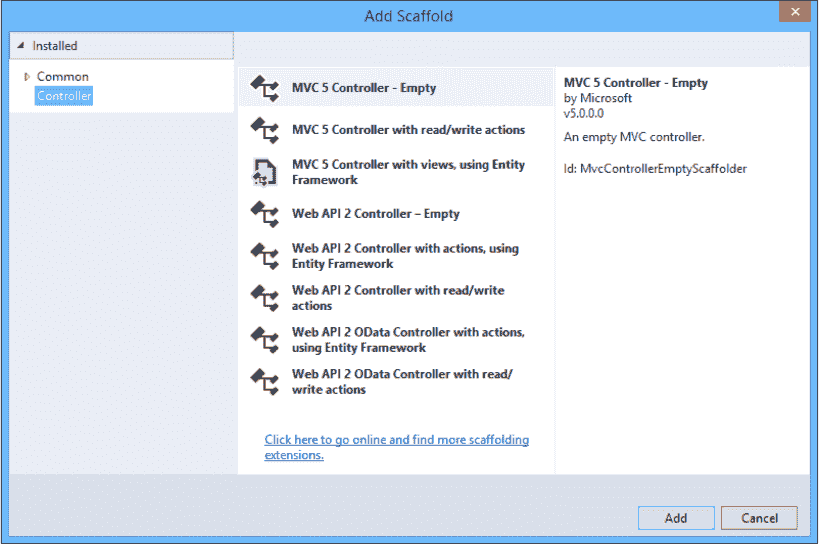
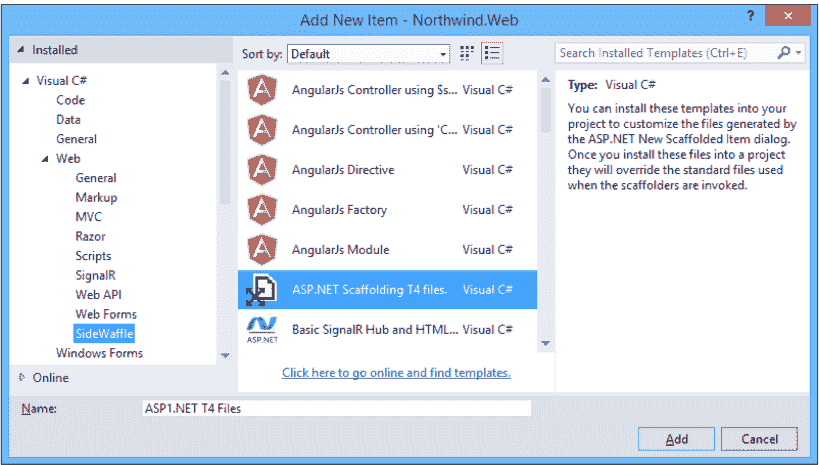
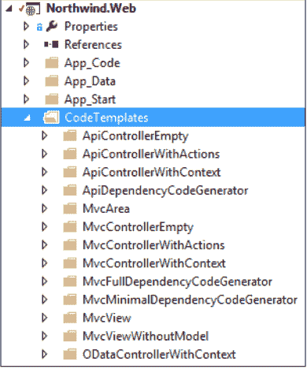
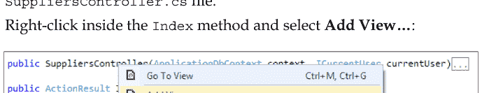
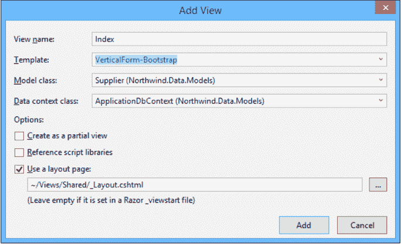
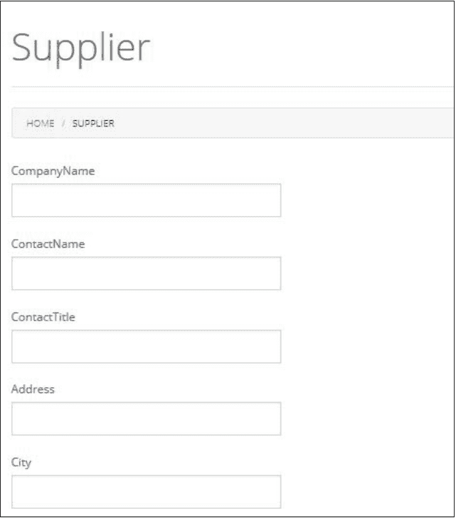
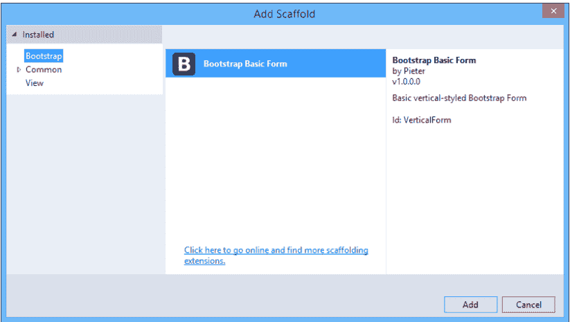
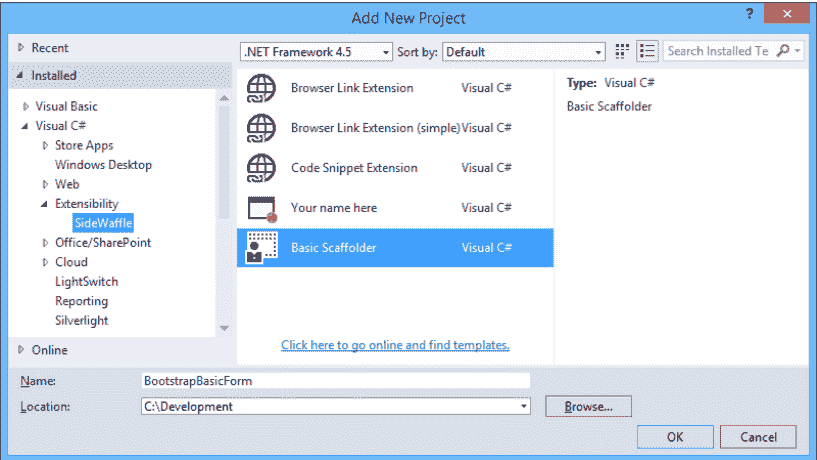
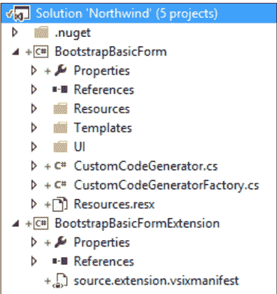
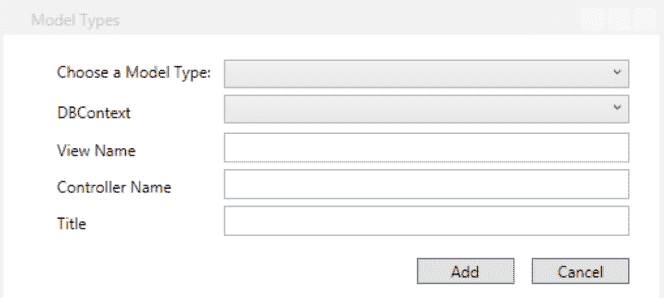

# 创建 T4 模板以生成 Bootstrap 视图脚手架

Visual Studio 2013 已经包含用于 ASP.NET MVC 和 Web API 项目的代码生成器，使用这些内置的脚手架模板可以大幅减少你在创建标准视图和控制器操作上花费的时间。在 Visual Studio 2013 中向 ASP.NET MVC 项目添加标准控制器时，你已经在使用脚手架，这一点可以通过用于添加新控制器的对话框标题为 **添加脚手架** 来体现：



## T4 模板

T4 代表 Text Template Transformation Toolkit（文本模板转换工具包），是微软基于模板的文本生成框架。T4 是控制逻辑和文本块的组合，可以生成任何类型的文本文件，包括 C# 或 VB 源文件。

T4 代码生成器内置于 Visual Studio 中，用于生成内置的 ASP.NET MVC 模板，包括标准的 MVC 和 Web API 控制器模板。

> Oleg Sych 撰写了许多关于如何使用 T4 模板以及如何在您自己的开发项目中使用它获得最佳结果的非常有价值的博客文章。要了解更多信息，您可以访问他的博客 `http://bit.ly/OlegSychT4`。

不幸的是，Visual Studio 在编辑 T4 模板时不提供语法高亮或 IntelliSense 支持，但有可用的免费工具可以将这些功能添加到 Visual Studio 中。

## T4 工具

由于 Visual Studio 默认不提供 T4 IntelliSense，我们需要安装第三方扩展来为我们启用此功能。幸运的是，有两个免费的替代方案可用。如下所示：

- 用于 Visual Studio 的 Devart T4 编辑器（`http://bit.ly/DevArtT4`）
- tangible T4 编辑器（`http://bit.ly/TangibleT4`）

这两个扩展都提供类似的功能，但对于本书中的 T4 示例，我们将使用 tangible T4 编辑器。

另一个对于简化 T4 模板创建至关重要的免费扩展是用于 Visual Studio 的 **SideWaffle** 扩展。SideWaffle 将向 Visual Studio 添加许多极其有用的项模板，我们将使用这些模板来构建自己的 ASP.NET MVC 脚手架视图。您可以从 `http://www.sidewaffle.com/` 下载 SideWaffle。

> SideWaffle 不仅为 T4 提供项模板，还提供一系列项目和项模板，以及许多非常有用的代码片段。它是 GitHub 上一个积极维护的开源项目，对于任何 .NET 开发人员来说都是不可或缺的工具。

## T4 语法

T4 模板有一种非常特殊的语法，乍一看可能令人生畏，但一旦习惯了，它就相对容易理解和使用。T4 使用三个不同的标签来表示代码块。


第一种代码块是 `<#= #>`，用于执行标签内的代码并返回文本结果。例如，在下面的标记中，代码将返回 T4 模板中 `ViewName` 变量的值：

```
<#= ViewName #>
```

`<# #>` 代码块执行标签内的代码并返回 void 结果。例如，下面的标记遍历集合中的每一项，并生成该项的 `Total` 属性，后跟一个回车符：

```
<#foreach(var item in Orders) { #>
    <#= item.Total + Environment.NewLine #>
<# } #>
```

`<#+ #>` 代码块用于定义可重复使用的方法，可在 T4 模板内部调用。例如，下面的标记定义了一个名为 `TypeName` 的方法，并返回对象的完整名称：

```
<#+ public string TypeName(object obj) { return obj.GetType().FullName; } #>
```

要使用该方法，只需在模板文件中调用它，如下列代码所示：

```
<#= TypeName(myObj) #>
```

## 自定义为控制器生成的代码

在向 ASP.NET MVC 项目添加新的控制器类时，会显示“添加新搭建基架的项目”对话框，你可以从三种不同类型的控制器中选择要添加的类型：

- MVC 5 控制器 - 空
- 具有读写操作的 MVC 5 控制器
- 使用 Entity Framework 的带视图的 MVC 5 控制器

这些项都会生成样板代码，你可以稍后自定义。但是，假设我们所有项目的控制器类都需要一个接受参数的构造函数。使用标准项时，我们将不得不手动为项目中的每个控制器添加构造函数。

幸运的是，我们可以覆盖为控制器生成的输出，因为本质上它们不过是 T4 模板。

要自定义“MVC 5 控制器 - 空”项的输出，请执行以下步骤：

1. 在 Visual Studio 中右键单击 ASP.NET MVC 项目的名称，然后导航到“添加” | “新项”。

2. 导航到 Visual C# | Web | SideWaffle，选择“ASP.NET Scaffolding T4 files”项模板，然后单击“添加”：

    

## 创建 T4 模板以搭建 Bootstrap 视图

3. 项模板会在项目中添加一个名为 `CodeTemplates` 的文件夹。在此文件夹中，它将创建 13 个子文件夹，其中包含 `.t4` 文件，如下面的屏幕截图所示：

    

4. 双击 `MvcControllerEmpty` 文件夹中的 `Controller.cs.t4` 文件。

5. 空的 MVC 5 控制器的 T4 模板将在 Visual Studio 中打开。你会注意到它包含 C# 代码和 T4 标记的组合。

6. 保持模板中的标记不变，但在 `Index` 方法上方添加以下代码：

    ```
    private readonly ApplicationDbContext _context;
    private readonly ICurrentUser _currentUser;

    public <#= ControllerName #>(ApplicationDbContext context,
    ICurrentUser currentUser)
    {
        _context = context;
        _currentUser = currentUser;
    }
    ```

```
private readonly ICurrentUser _currentUser;

public SuppliersController(ApplicationDbContext context, ICurrentUser currentUser)
{
    _context = context;
    _currentUser = currentUser;
}

//
// GET: /Suppliers/
public ActionResult Index()
{
    return View();
}
}
```

## 自定义为视图生成的代码

与控制器一样，视图的脚手架也可以自定义。在本书中使用的示例项目中，我们的视图遵循一致的外观。每个页面都有一个页头，后跟一个面包屑组件，以向用户指示当前正在查看哪个页面。

在向网站添加新页面时，我们始终希望遵循这种设计，而实施这种设计的一种方法是覆盖视图的默认脚手架或添加我们自己的脚手架。我们将创建一个 T4 模板，该模板将生成一个标准的垂直 Bootstrap 表单，其中已包含页头和面包屑组件。为此，请执行以下步骤：

1. 打开 `CodeTemplates` 文件夹中的 `MvcView` 文件夹。

2. 右键单击 `Create.cs.t4` 文件，然后选择“复制”。

3. 右键单击 `MvcView` 文件夹，然后选择“粘贴”。

4. 该文件将复制为 `Create.cs - Copy.t4`；将其重命名为 `VerticalForm-Bootstrap.cs.t4`。

5. 双击 `VerticalForm-Bootstrap.cs.t4` 将其打开。

6. 在 `@using (Html.BeginForm())` 行之前添加以下 HTML 标记：

    ```
    <div class="container">
        <div class="page-header">
            <h1><#= ViewDataTypeShortName #> </h1>
        </div>
    <ol class="breadcrumb">
        <li>@Html.ActionLink("Home", "Index", "Home")</li>
        <li class="active"><#= ViewDataTypeShortName #></li>
    </ol>

    <div class="row clearfix">
        <div class="col-md-12">
    ```

7. 前面的标记将在表单上方呈现页头和面包屑组件。表单将位于 Bootstrap 行的 `<div>` 元素内的网格列中。请注意，我们使用了 `ViewDataTypeShortName` 变量，该变量包含用作视图模型对象的短名称。

8. 接下来，删除 `<div class="form-horizontal">` 行以及 `<div>` 下方行中的 `<h4>` 和 `<hr>` 元素。

9. 从模板中删除所有 `<div class="form-group">` 和 `<div class="col-md-10">` 元素。确保同时删除它们所有对应的闭合 `</div>` 标签。

10. 从所有 `@Html.LabelFor` 方法中删除 `new { @class = "control-label col-md-2" }` HTML 属性设置。

11. 最后，我们需要关闭所有添加到模板顶部的 `<div>` 元素。在最后一个 `@Html.ActionLink` 行之后添加三个闭合 `</div>` 标签。

模板标记就绪后，我们可以通过完成以下步骤，基于此创建一个新的搭建视图：

1. 打开一个控制器类。在此示例中，我们将使用 `SuppliersController.cs` 文件。

2. 右键单击 Index 方法内部，然后选择“添加视图...”：

    

3. 这将显示 **添加视图** 对话框。

4. 输入视图名称，然后从 **模板** 组合框的模板列表中选择 **VerticalForm-Bootstrap** 模板。你创建的任何自定义 T4 模板都将自动列在模板列表中。

5. 选择你的模型类。在此示例中，我们将使用 **Supplier** 模型。

6. **数据上下文类** 字段应自动选中；如果没有，请从数据上下文类列表中选择它。单击 **添加**：

    

7. Visual Studio 将使用我们的自定义模板来搭建视图，该视图将包含我们之前添加的所有标记。

8. 结果应是一个垂直或标准的 Bootstrap 视图，如下面的屏幕截图所示：

    

## 创建自定义脚手架扩展

如果你需要更精细地控制视图或控制器代码的搭建方式，则需要为 Visual Studio 创建新的脚手架扩展。这种可扩展性使开发人员能够将自己的脚手架项添加到“添加脚手架”对话框中，如下面的屏幕截图所示：



要创建这样的自定义脚手架，我们将创建一个新的基本脚手架项目。此项目模板由 SideWaffle 扩展安装，并添加了创建自定义脚手架所需的所有文件。

执行以下步骤来创建你自己的自定义脚手架项目：

1. 在 Visual Studio 中创建一个新项目。

2. 导航到 Extensibility | SideWaffle，选择“Basic Scaffolder”项目模板，如下面的屏幕截图所示：

    

3. 项目模板将创建两个新项目：BootstrapBasicForm 和 BootstrapBasicFormExtension。一个包含扩展的代码，另一个包含项目的 .vsixmanifest 文件：

    


- 4. 打开 **BootstrapBasicFormExtension** 项目，并双击 `source.extension.vsixmanifest` 文件。

- 5. Visual Studio 将在视觉编辑器中打开该文件，你可以在其中设置扩展的一系列属性。在本示例中，保持所有设置不变。

- 6. 在 **BootstrapBasicForm** 项目中打开 `CustomCodeGeneratorFactory.cs` 文件。

- 7. 在该类的顶部，声明了一个名为 `_info` 的新 `CodeGeneratorInformation` 对象。将其更改为以下代码：

```csharp
private static CodeGeneratorInformation _info = new CodeGeneratorInformation(
    displayName: "Bootstrap Basic Form",
    description: "Basic vertical-styled Bootstrap Form",
    author: "Pieter",
    version: new Version(1, 0, 0, 0),
    id: typeof(CustomCodeGenerator).Name,
    icon: ToImageSource(Resources._TemplateIconSample),
    gestures: new[] { "View" },
    categories: new[] { Categories.MvcView, "Bootstrap" });
```

- 8. `gestures` 参数用于指示自定义脚手架项何时显示。如果该设置设为 `View`，则只有当用户在 Visual Studio 中添加新视图时，才会显示我们的自定义模板。

- 9. `categories` 参数用于设置模板在 **添加脚手架** 对话框中的显示位置。类别显示在 **添加脚手架** 对话框的左侧。你可以添加自己的类别，或使用内置类别。

- 10. 这就是我们在 `CustomCodeGeneratorFactory` 类中需要做的全部工作。创建一个名为 `ServiceProviderExtensions.cs` 的新类，并向其中添加以下代码：

```csharp
internal static class ServiceProviderExtensions
{
    public static TService GetService<TService>(this IServiceProvider provider) where TService : class
    {
        if (provider == null)
        {
            throw new ArgumentNullException("provider");
        }
        return (TService)provider.GetService(typeof(TService));
    }

    public static bool IsServiceAvailable<TService>(this IServiceProvider provider) where TService : class
    {
        if (provider == null)
        {
            throw new ArgumentNullException("provider");
        }
        return GetService<TService>(provider) != null;
    }
}
```

- 11. 保存并关闭该文件，然后打开 CustomViewModel.cs 文件。该文件位于 UI 文件夹内，用于在 UI 之间传递数据，用户将在此处选择设置，我们的代码也会使用这些数据。

- 12. 向其中添加一个名为 ProjectDbContexts 的新属性。该属性将返回项目中所有有效的 DbContext 对象。此属性的代码如下：

```csharp
public IEnumerable<ModelType> ProjectDbContexts
{
    get
    {
        ICodeTypeService codeTypeService =
            (ICodeTypeService)Context
                .ServiceProvider.GetService(typeof(ICodeTypeService));

        return codeTypeService
            .GetAllCodeTypes(Context.ActiveProject)
            .Where(codeType =>
                codeType.IsValidDbContextType())
            .Select(codeType => new ModelType(codeType));
    }
}
```

- 13. 接下来，向该类添加三个属性：Title、ControllerName 和 ViewName：

```csharp
public string Title { get; set; }
public string ControllerName { get; set; }
public string ViewName { get; set; }
```

- 14. 最后，添加一个名为 SelectedDbContext 的 ModelType 属性：

```csharp
public ModelType SelectedDbContext { get; set; }
```

- 15. 保存并关闭文件。

## 创建 T4 模板以搭建 Bootstrap 视图

- 16. 双击 `SelectModelWindow.xaml` 文件以打开 XAML 窗体设计器。

- 17. 此窗体将用于提示用户选择要用于搭建视图的模型和 `DbContext`，并输入页面标题、视图名称和控制器名称。

- 18. 该窗体的 XAML 如下所示：

```xml
<Window x:Class="BasicScaffolder1.UI.SelectModelWindow"
        xmlns="http://schemas.microsoft.com/winfx/2006/xaml/presentation"
        xmlns:x="http://schemas.microsoft.com/winfx/2006/xaml"
        xmlns:mc="http://schemas.openxmlformats.org/markup-compatibility/2006"
        xmlns:d="http://schemas.microsoft.com/expression/blend/2008"
        mc:Ignorable="d" Height="233" Width="511" Title="Model Types">
    <Grid>
        <Label Content="Choose a Model Type:"
               HorizontalAlignment="Left" Margin="36,15,0,0"
               VerticalAlignment="Top"/>
        <ComboBox HorizontalAlignment="Left"
                  Margin="169,19,0,0"
                  VerticalAlignment="Top"
                  ItemsSource="{Binding ModelTypes}"
                  DisplayMemberPath="DisplayName"
                  SelectedItem="{Binding SelectedModelType,
                  Mode=OneWayToSource}"
                  Width="311" TabIndex="1"/>
        <Button Content="Add" IsDefault="True"
                HorizontalAlignment="Left" Margin="317,171,0,0"
                VerticalAlignment="Top" Width="75"
                RenderTransformOrigin="-0.187,0.75"
                Click="Button_Click" TabIndex="5"/>

        <Button Content="Cancel" IsCancel="True"
                HorizontalAlignment="Left" VerticalAlignment="Top"
                Width="75" Margin="405,171,0,0" TabIndex="6"/>

        <TextBox x:Name="ControllerNameTextbox"
                 HorizontalAlignment="Left" Height="23"
                 Margin="169,103,0,0" TextWrapping="Wrap"
                 Text="{Binding ControllerName}"
                 VerticalAlignment="Top" Width="311" TabIndex="3"/>

        <Label Content="View Name"
               HorizontalAlignment="Left" Margin="36,75,0,0"
               VerticalAlignment="Top"
               RenderTransformOrigin="-0.342,0.269" Width="98"/>
        <TextBox x:Name="TitleNameTextbox"
        HorizontalAlignment="Left" Height="23"
        Margin="169,131,0,0" TextWrapping="Wrap"
        VerticalAlignment="Top" Width="311" Text="{Binding Title}" TabIndex="4"/>

        <Label Content="Controller Name"
        HorizontalAlignment="Left" Margin="36,103,0,0"
        VerticalAlignment="Top"
        RenderTransformOrigin="0.211,-0.154"/>

        <TextBox x:Name="ViewNameTextbox" Text="{Binding ViewName}" HorizontalAlignment="Left" Height="23"
        Margin="169,75,0,0" TextWrapping="Wrap"
        VerticalAlignment="Top" Width="311" TabIndex="2"/>

        <Label Content="Title" HorizontalAlignment="Left"
        Margin="36,131,0,0" VerticalAlignment="Top"/>

        <ComboBox HorizontalAlignment="Left"
        Margin="169,46,0,0" VerticalAlignment="Top"
        Width="311" ItemsSource="{Binding ProjectDBContexts}" SelectedItem="{Binding SelectedDbContext, Mode=OneWayToSource}"
        DisplayMemberPath="DisplayName"/>

        <Label Content="DBContext"
        HorizontalAlignment="Left" Margin="36,46,0,0"
        VerticalAlignment="Top" Width="128"/>

    </Grid>
</Window>
```

- 19. 前面的 XAML 标记会将窗体控件绑定到 CustomViewModel 类。窗体的最终设计应类似于以下屏幕截图：



- 20. 再次打开 CustomCodeGenerator.cs 文件，并将 GenerateCode 方法替换为以下代码：

```csharp
public override void GenerateCode()
{
    var codeType = _viewModel.SelectedModelType.CodeType;
    var title = _viewModel.Title;
    var controllerName = _viewModel.ControllerName;
    var viewName = _viewModel.ViewName;
    IEntityFrameworkService efService =
        Context.ServiceProvider.GetService<IEntityFrameworkService>();
    ModelMetadata efMetadata =
        efService.AddRequiredEntity(Context, _viewModel.SelectedDbContext.TypeName, codeType.FullName);

    var parameters = new Dictionary<string, object>()
    {
        {
            "ModelType", codeType
        },
        {
            "ControllerName", controllerName
        },
        {
            "ViewName", viewName
        },
        {
            "Title", title
        },
        {
            "ModelMetadata",efMetadata
        }
    };

    ProjectItem folder = Context.ActiveProjectItem;
    if (folder.Kind ==
        EnvDTE.Constants.vsProjectItemKindPhysicalFolder)
    {
        var folderName = folder.Name;
        var path = "Views\\" + folderName + "\\" + viewName;
        AddFileFromTemplate(Context.ActiveProject, path,
            "CustomTextTemplate",
```


```
parameters,
skipIfExists: false);
}
}
```

+   21. 在前面的代码中，我们将用户在表单中捕获的值添加到 `parameters` 集合中。我们还通过使用 `IEntityFrameworkService` 收集了所选对象的全部元数据。该服务期望其 `AddRequiredEntity` 方法的参数之一为上下文类型名称，因此我们将传入用户在表单上选择的 `DbContext` 对象的名称。
+   
+   22. 然后我们将检查用户是否将生成的项目添加到文件夹中，并做出一个小的假设，即所选文件夹的父文件夹将是 Views 文件夹。然后我们将调用 `AddFileFromTemplate` 方法。
+   
+   23. 在 UI 和视图模型就绪后，打开 `CustomTextTemplate.cs.t4` 文件。
+   
+   24. 模板文件的顶部部分指定了模板语言，在本例中为 C#，以及模板需要输出的扩展名。由于我们要生成一个视图，这应为 `.cshtml`。
+   
+   25. 我们还将在顶部声明将传递到模板的所有变量名。以下内容应添加到模板文件的顶部：

```
<#@ template language="C#" #>
<#@ output extension=".cshtml" #>
<#@ assembly name="System.Core" #>
<#@ assembly name="EnvDTE" #>
<#@ include file="Imports.include.t4" #>
<#@ parameter name="ModelType" type="EnvDTE.CodeType" #>
<#@ parameter name="Title" type="System.String" #>
<#@ parameter name="ControllerName" type="System.String" #>
<#@ parameter name="ViewName" type="System.String" #>
<#@ parameter name="ModelMetadata" type="Microsoft.AspNet.Scaffolding.Core.Metadata.ModelMetadata" #>
```

+   26. 模板其余部分的 T4 标记如下：

```
@model <#= ModelType.Namespace.FullName #>.<#= ModelType.Name #>

@{
    ViewBag.Title = "<#= Title #>";
}
```

## 创建 T4 模板以生成 Bootstrap 视图

```
Layout = "~/Views/Shared/_Layout.cshtml";
}

<div class="container">
    <div class="page-header">
        <h1><#= Title #></h1>
    </div>

    <ol class="breadcrumb">
        <li>@Html.ActionLink("Home", "Index", "Home")</li>
        <li class="active"><#= Title #></li>
    </ol>

    <div class="row clearfix">
        <div class="col-md-12">
            @using (Html.BeginForm("<#= ViewName #>", "<#= ControllerName #>", FormMethod.Post, new { role = "form" }))
            {
                @Html.AntiForgeryToken()
                @Html.ValidationSummary(true)

                <#
                    foreach (PropertyMetadata property in ModelMetadata.Properties)
                    {
                    #>
                        <div class="form-group">
                            @Html.LabelFor(model => model.<#= property.PropertyName #>)
                        </div>
                    <#
                    }
                #>
        </div>
    </div>
</div>
```
