# 将 Bootstrap HTML 模板转换为可用的 ASP.NET MVC 项目

使用 Bootstrap 的主要好处之一是互联网上可用的资源种类繁多。Web 开发社区接受了 Bootstrap，你会发现大量有价值的模板、代码片段以及使用 Bootstrap 的建议。

通过结合预设计的 Bootstrap 模板和 ASP.NET MVC，你可以节省大量时间，而无需担心网站布局或设计。

在本章中，我们将涵盖以下主题：

+   - 为什么我们使用预建的 HTML 模板以及它们如何节省时间
+   - 构建主布局
+   - 添加特定的页面视图
+   - 在视图中包含图表

# 使用预建的 HTML 模板

众所周知，大多数开发人员不一定是优秀的设计师。我们更喜欢在后端工作，构建性能卓越且智能的软件，有时我们倾向于把用户界面视为事后才考虑的事情。

通过使用预设计的 HTML Bootstrap 模板，我们可以为用户提供直观且设计精良的用户界面，该界面由专业设计师设计。如果设计基于 Bootstrap，开发人员已经熟悉大部分 CSS 类名、组件和插件，无需重新学习任何东西。

Web 提供了各种免费和付费的 Bootstrap 模板。ThemeForest（www.themeforest.net）提供了令人眼花缭乱的各种付费网站样式和设计。

在本章的示例中，我们将使用 Start Bootstrap（www.startbootstrap.com）设计的免费 SB Admin 2 模板。SB Admin 2 模板是一个使用 Bootstrap 3 的管理主题，非常适合后端管理或更复杂风格的 Web 应用程序。该主题如下图所示：

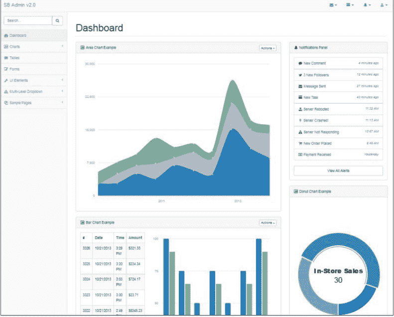

在我们使用该模板构建 ASP.NET MVC 网站之前，我们需要通过完成以下步骤下载源文件：

+   1. 导航到 `http://startbootstrap.com/sb-admin-v2` 并单击 **Download** 按钮，以下载包含所有必要 HTML、CSS 和 JavaScript 文件的 zip 归档。
+   2. 将文件提取到本地硬盘上的文件夹；你会注意到归档包含熟悉的 Bootstrap 文件夹：
+      - `css`
+      - `font-awesome`
+      - `fonts`
+      - `js`
+   3. 归档还包含许多 HTML 文件，展示了模板的各种页面和组件布局，如下图所示：

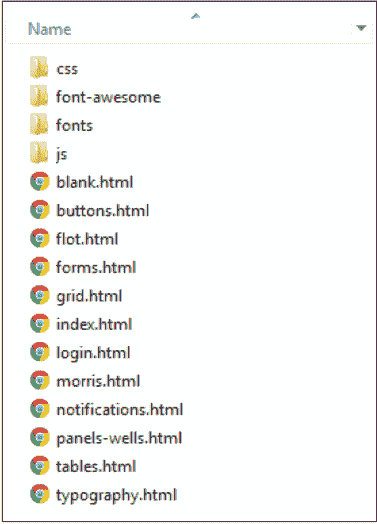

# 创建 ASP.NET MVC 项目

要创建新的 ASP.NET MVC 项目，请执行以下步骤：

+   1. 在 Visual Studio 中，创建新的 **ASP.NET Web Application** 项目，如下图所示：

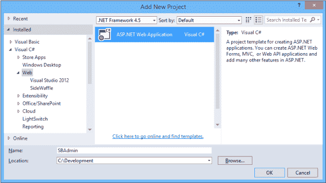

+   2. 在 **New ASP.NET Project** 对话框中，选择 **Empty** 模板，勾选 **MVC** 复选框，然后单击 **OK** 按钮。

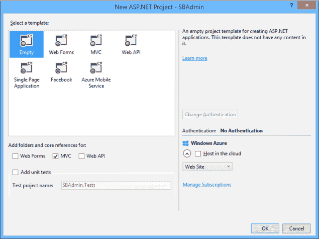

+   3. Visual Studio 将创建一个默认的空 MVC 项目。右键单击项目名称并导航到 Add | New Folder。创建以下四个文件夹：
+       - css
+       - font-awesome
+       - fonts
+       - js
+   4. 将 SB Admin 源 css 文件夹中的以下 .css 文件添加到项目中的 css 文件夹：
+       - bootstrap.css
+       - sb-admin.css

5. 将 SB Admin 源 font-awesome\css 文件夹中的 font-awesome.css 文件添加到项目中的 css 文件夹。

6. 将 SB Admin 源 fonts 和 font-awesome\fonts 文件夹中的所有文件添加到项目中的 fonts 文件夹。

+   7. 将 SB Admin 源 js 文件夹中的以下文件添加到项目中的 js 文件夹：
+       - bootstrap.js
+       - sb-admin.js

# 创建主布局

我们已添加创建项目主布局文件所需的 CSS、JavaScript 和字体文件。接下来，我们需要创建一个 home 控制器以及一个主布局文件。为此，完成以下步骤：

+   1. 右键单击 Controllers 文件夹并导航到 Add | Controller....
+   2. 从 Add Scaffold 对话框窗口中选择 MVC 5 Controller - Empty，然后单击 Add。

3. 在 Add Controller 对话框窗口的 Controller name 文本框中输入 HomeController，然后单击 Add。

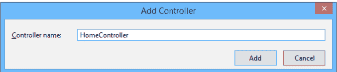

4. 接下来，右键单击项目中的 Views 文件夹并导航到 Add | New Folder。将文件夹命名为 Shared。

5. 右键单击新创建的 Shared 文件夹并导航到 Add | MVC 5 Layout Page (Razor)。

6. 在 Specify Name for Item 对话框中，在 Item name 文本框中输入 _Layout，然后单击 OK。

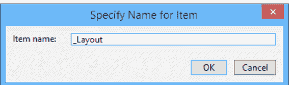

7. 打开 SB Admin 源文件中的 blank.html 文件并将其内容复制到 _Layout.cshtml 文件。

8. 将 <head> 标签更改为以下代码：

```
<head>
    <meta charset="utf-8">
    <meta name="viewport" content="width=device-width, initial-scale=1.0">
    <title>Start Bootstrap - SB Admin Version 2.0 :: @ViewBag.Title</title>
    <link href="@Url.Content("~/css/bootstrap.css")" rel="stylesheet">
    <link href="@Url.Content("~/css/font-awesome.css")" rel="stylesheet">
    <link href="@Url.Content("~/css/sb-admin.css")" rel="stylesheet">
</head>
```


9. 在前面的标记中，我们使用 Url.Content 辅助方法将虚拟路径映射到项目中的 .css 文件。

10. 在结束 </body> 标签上方添加以下代码：

```
<script src="//ajax.googleapis.com/ajax/libs/jquery/1.11.1/jquery.min.js"></script>
<script src="@Url.Content("~/js/bootstrap.js")"></script>
<script src="@Url.Content("~/js/sb-admin.js")"></script>
@RenderSection("scripts", false)
```

11. 在前面的代码中，我们添加了对托管在 Google 内容分发网络（CDN）上的 jQuery 库的引用。我们还再次使用 Url.Content 辅助方法将虚拟路径映射到所需的 JavaScript 文件，并使用 @RenderSection 辅助方法指定了一个名为 scripts 的节。

12. 接下来，你会注意到页面被划分为三个不同的元素：

- 一个 ID 设置为 wrapper 的 <div> 元素
- 一个 <nav> 元素
- 一个 ID 为 page-wrapper 的 <div> 元素

13. 保持 <nav> 和 <div id="wrapper"> 元素不变，并将 <div id="page-wrapper"> 元素内的所有标记替换为 @RenderBody() 方法。

14. 主布局现已完成；接下来，我们需要为 home 控制器上的 Index 操作添加一个视图。

## 为 home 控制器添加视图

我们需要为 home 控制器的 Index 操作创建一个视图，以测试我们的模板。完成以下步骤：

- 1. 打开 HomeController.cs 文件，在 Index 方法内右键单击，然后从上下文菜单中选择“添加视图...”。

- 2. 在“添加视图”对话框中，将“视图名称”文本框设置为 Index，将“模板”组合框设置为“空（无模型）”。

## 将 Bootstrap HTML 模板转换为可用的 ASP.NET MVC 项目

- 3. 勾选**使用布局页**复选框，并选择我们之前创建的 `_Layout.cshtml` 文件作为布局页。单击**添加**。

- 4. 将在 Views\\Home 文件夹内创建一个 Index.cshtml 文件。

- 5. 向视图添加以下标记：

```
```cshtml
@{
    ViewBag.Title = "Index";
    Layout = "~/Views/Shared/_Layout.cshtml";
}
<div class="row">
    <div class="col-lg-12">
        <h1 class="page-header">Blank</h1>
    </div>
</div>
```
```

- 6. 运行你的项目，你应该会在浏览器中看到首页视图和布局。请注意，左侧菜单将展开显示所有项目，如下图所示：

- 5. 通过在 </body> 结束元素上方添加以下行来引用 metisMenu 插件：
+   <script src="@Url.Content("~/js/plugins/metisMenu/jquery.metisMenu.js")"></script>
- 6. 当运行你的项目时，左侧菜单现在应该正确显示了。

## 添加不同的页面视图

SB Admin 模板带有多种不同的页面样式，可用于构建我们自己的视图。我们将通过完成以下步骤，创建一个自定义视图，该视图显示两个面板，一个包含简单的 Bootstrap 表单，另一个显示图像：

- 1. 向你的项目添加一个新的空 MVC 5 控制器，名为 FormsController。
- 2. 为控制器的 Index 方法添加一个新的空视图，并选择我们之前创建的布局页作为其布局页。
- 3. 打开 Views\Forms 文件夹中的 Index.cshtml 文件。
- 4. 向视图添加以下标记：

```
@{
    ViewBag.Title = "Index";
    Layout = "~/Views/Shared/_Layout.cshtml";
}

<div class="row">
    <div class="col-lg-12">
        <h1 class="page-header">Forms</h1>
    </div>
</div>
<div class="row">
    <div class="col-lg-6">
        <div class="panel panel-primary">
            <div class="panel-heading">
                First Panel with simple form
            </div>
            <div class="panel-body">
                <div class="row">
                    <div class="col-lg-6">
                        <form role="form">
```

```
<div class="form-group">
    <label>Full name</label>
    <input class="form-control"
placeholder="Your full name">
    </div>
    <div class="form-group">
        <label>Bio</label>
        <textarea class="form-control"
rows="3"></textarea>
    </div>

    <div class="form-group">
        <label>Subject</label>
        <label class="checkbox-inline">
            <input type="checkbox">Math
        </label>
        <label class="checkbox-inline">
            <input type="checkbox">Science
        </label>
        <label class="checkbox-inline">
            <input type="checkbox">History
        </label>
    </div>
    <button type="submit" class="btn btn-primary">Save</button>
</form>
</div>
</div>
</div>
</div>
</div>
<div class="col-lg-6">
    <div class="panel panel-danger">
        <div class="panel-heading">
            Second Panel
        </div>
        <div class="panel-body">
            <div class="row">
                <div class="col-lg-6">
                    <p>This is a second panel on the page</p>
                    
```

```
```html
</div>
</div>
</div>
</div>
</div>
</div>
```
```

5. 上述代码将渲染两个面板，一个蓝色和一个红色，如下图所示：

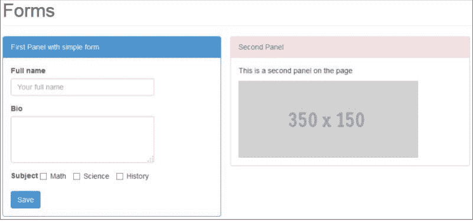

最后，我们需要更改左侧导航菜单，以包含指向我们刚刚添加的视图的链接。为此，完成以下步骤：

- 1. 打开 `Views\Shared` 文件夹中的 `_Layout.cshtml` 文件。
- 2. 在文件中找到以下代码行：

      ```html
      <a href="tables.html"><i class="fa fa-table fa-fw"></i> Tables</a>
      ```

- 3. 将上述行替换为以下内容：

      ```html
      <a href="@Url.Action("Index","Forms")"><i class="fa fa-table fa-fw"></i> Forms</a>
      ```

- 4. 我们使用 `@Url.Action` 辅助方法将用户导航到 forms 控制器的 Index 操作。当用户点击**Forms**菜单项时，他们将看到我们之前创建的表单视图。

## 向视图添加图表

在 SB Admin 模板中，Dashboard 页面包含各种吸引人的图表，你可以使用它们以交互方式向用户显示数据。我们将通过完成以下步骤，将 SB Admin 模板中包含的 Dashboard 页面及其功能添加到我们的项目中：

- 1. 在 js\plugins 文件夹内创建一个名为 morris 的新文件夹。
- 2. 将 SB Admin 源文件中的以下两个文件添加到该文件夹：
  - raphael-2.1.0.min.js
  - morris.js
- 3. 将 dashboard-demo.js 文件添加到 js 文件夹。
- 4. 将 morris-0.4.3.min.css 文件添加到项目的 css 文件夹。
- 5. 接下来，打开 _Layout.cshtml 文件，并将以下代码添加到 <head> 元素中：
  @RenderSection("styles",false)
- 6. 通过添加上一行，我们可以为每个视图向布局页注入额外的 CSS 样式。
- 7. 打开 Views\Home 文件夹中的 Index.cshtml 文件。
- 8. 将以下代码添加到文件顶部，即布局声明下方：
  @section styles{
    <link href="@Url.Content("~/css//morris-0.4.3.min.css")" rel="stylesheet">
  }
- 9. 上述代码会将 morris 图表组件的样式注入到我们的视图中。
- 10. 向视图添加以下标记：
  <div class="row">
    <div class="col-lg-12">
      <h1 class="page-header">Dashboard</h1>
    </div>
  </div>
  <div class="row">
    <div class="col-lg-12">
      <div class="panel panel-default">

```
<div class="panel-heading">
    <i class="fa fa-bar-chart-o fa-fw"></i> Area Chart
Example
    <div class="pull-right">
        <div class="btn-group">
            <button type="button" class="btn btn-default btn-xs dropdown-toggle" data-toggle="dropdown">Actions
                <span class="caret"></span>
            </button>
            <ul class="dropdown-menu pull-right" role="menu">
                <li>
                    <a href="#">Action</a>
                </li>
                <li>
                    <a href="#">Another action</a>
                </li>
                <li>
                    <a href="#">Something else here</a>
                </li>
                <li class="divider"></li>
                <li>
                    <a href="#">Separated link</a>
                </li>
            </ul>
        </div>
    </div>
</div>
<div class="panel-body">
    <div id="morris-area-chart"></div>
</div>
</div>
</div>
```

11. 接下来，将以下 section 声明添加到文件底部，该声明会将必要的 JavaScript 文件注入到视图中，用于图表组件：

```
@section scripts{
    <script src="@Url.Content("~/js/plugins/morris/raphael-2.1.0.min.js")"></script>
```


```cshtml
<script src="@Url.Content("~/js/plugins/morris/morris.js")"></script>
<script src="@Url.Content("~/js/dashboard-demo.js")"></script>
}
```

12. 最后，打开 _Layout.cshtml 文件并找到以下行：

    ```html
    <a href="index.html"><i class="fa fa-dashboard fa-fw"></i> Dashboard</a>
    ```

13. 将找到的行更改为以下行：

    ```cshtml
    <a href="@Url.Action("Index","Home")"><i class="fa fa-dashboard fa-fw"></i> Dashboard</a>
    ```

14. 保存并关闭所有文件并运行你的项目。

15. 当你导航到 **Dashboard** 页面时，你应该会看到一个图表渲染，类似于以下截图。

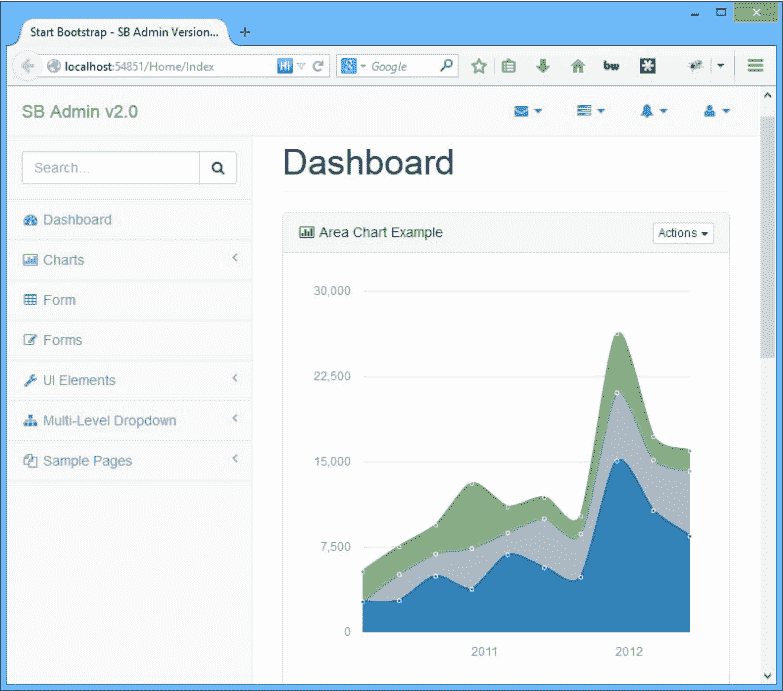

## Summary

在本章中，你学习了如何将预设计的 HTML 模板转换为可用的 ASP.NET MVC 项目。本章中展示的技术可以应用于几乎任何 HTML 模板，让你能够在无需自行设计布局的情况下构建专业设计的 Web 应用程序。

在下一章中，我们将探讨如何在自己的 ASP.NET MVC 项目中包含和使用 jQuery DataTables 插件。

## Using the jQuery DataTables Plugin with Bootstrap

jQuery DataTables 插件允许开发者为任何 HTML 表格添加创新交互控件。

jQuery DataTables 插件支持多种选项和丰富的扩展。ASP.NET MVC 开发者也可以将其包含在自己的项目中。本章的目的不仅是向你展示如何使用 DataTables 插件，还说明了如何将几乎任何开源 JavaScript 和 CSS 插件或框架与 ASP.NET MVC 一起使用。

在本章中，我们将涵盖以下主题：

- An overview of jQuery DataTables
- Including the jQuery DataTables plugin in your ASP.NET MVC project
- Loading and displaying data with jQuery DataTables and ASP.NET MVC
- Using some of the extensions

### jQuery DataTables

DataTables 是一个免费的、开源的 jQuery JavaScript 库插件，由一家名为 SpryMedia Ltd 的公司设计和创建。该插件使为任何标准 HTML 表格添加排序、过滤、分页和搜索等功能变得非常容易实现。它还提供各种扩展，可实现类似 Excel 的功能、内联编辑和固定列等。DataTables 网站提供有良好文档的示例、博客和论坛，你可以在 www.datatables.net 上找到。

jQuery DataTables 插件可以通过两种方式添加到你的 ASP.NET MVC 项目中，DataTables NuGet 包或 **Content Delivery Network (CDN)**。

### Adding DataTables to your ASP.NET MVC project

要添加 DataTables 插件的基本功能，需要以下两个文件：

- 第一个是 `jquery.dataTables.css`，它包含表格的默认 CSS 样式
- 第二个是 `jquery.dataTables.js`，它包含用于渲染 DataTables 插件并添加必要功能的 JavaScript 逻辑

这两个文件都可在 DataTables CDN 上获得，链接如下：

- //cdn.datatables.net/1.10.0/css/jquery.dataTables.css
- //cdn.datatables.net/1.10.0/js/jquery.dataTables.js

### Using the DataTables NuGet package

你也可以使用 NuGet 添加使用 jQuery DataTables 所需的所有 CSS 和 JavaScript 文件以及扩展的所有 CSS 和 JavaScript 文件。按照以下步骤使用 NuGet 添加 jQuery DataTables：

1. 在 Visual Studio 中，通过导航到 **Tools | Library Package Manager | Package Manager Console** 打开 **Package Manager Console** 窗口。
2. 在 **Package Manager Console** 窗口中，输入以下命令：`Install-Package jquery.datatables`
3. NuGet 包将在 `Content` 文件夹内添加一个 `DataTables-1.10.0` 文件夹，其中包含 DataTables 插件所需的 `css`、`images` 和 `swf` 文件。
4. 它还将在你的项目中向 `Scripts` 文件夹添加一个 `DataTables-1.10.0` 文件夹。该文件夹将包含 DataTables 插件的 JavaScript 文件以及所有扩展的 JavaScript 文件。

### Using the CDN

你可以从上述位置保存文件或将它们添加到项目中，或者更推荐的做法是添加对托管在 CDN 上的文件的引用，这将有助于提高你网站的性能。

要从 CDN 引用，请完成以下步骤：

1. 在 Visual Studio 中，打开本书附带的示例项目并打开位于 `Views\Shared` 文件夹中的 `_Layout.cshtml` 文件。

2. 在 `_Layout.cshtml` 文件的 `<head>` 元素内，通过插入以下标记行添加对 jQuery DataTables 样式表的引用：

    ```html
    <link rel="stylesheet" type="text/css" href="//cdn.datatables.net/1.10.0/css/jquery.dataTables.css">
    ```

3. 打开你需要 DataTables 功能的视图，并在视图底部添加对 JavaScript 库的引用，添加以下代码：

    ```cshtml
    @section scripts{
        <script type="text/javascript" language="javascript" src="//cdn.datatables.net/1.10.0/js/jquery.dataTables.min.js"></script>
    }
    ```

### Adding Bootstrap styling to DataTables

前一节中提到的步骤将向视图和布局文件添加生成 jQuery DataTables 基础样式和功能所需的最小文件。然而，默认的 DataTables CSS 样式在 Bootstrap 网站中看起来可能有些格格不入。

幸运的是，DataTables 项目团队创建了专门针对 Bootstrap 的 CSS 样式和 JavaScript 库，以匹配你网站的外观和感觉。这两个文件也可在 DataTables CDN 上获得：

- `//cdn.datatables.net/plug-ins/be7019ee387/integration/bootstrap/3/dataTables.bootstrap.css`
- `//cdn.datatables.net/plug-ins/be7019ee387/integration/bootstrap/3/dataTables.bootstrap.js`

这两个文件以与普通 DataTables CSS 和 JavaScript 文件相同的方式添加。请记住，当在视图中包含特定于 Bootstrap 的 DataTables JavaScript 文件时，你需要同时引用默认的 DataTables JavaScript 文件以及特定于 Bootstrap 的文件，如以下标记所示：

```html
<script type="text/javascript" language="javascript" src="//cdn.datatables.net/1.10.0/js/jquery.dataTables.min.js"></script>
<script type="text/javascript" language="javascript" src="//cdn.datatables.net/plug-ins/be7019ee387/integration/bootstrap/3/dataTables.bootstrap.js"></script>
```

### Loading and displaying data in jQuery DataTables

为了实现 jQuery DataTables 插件，我们首先需要创建一个新的视图，用于在 HTML 表格中列出数据。对于此示例，我们将创建一个列出 Northwind Traders 数据库中客户的视图。为此，完成以下步骤：

1. 在 Visual Studio 中，添加一个名为 CustomersController.cs 的新控制器类。

2. 我们在项目中实现了依赖注入，因此我们将向该类添加一个构造函数，该构造函数将自动使用以下代码设置对数据库上下文的引用：

    ```csharp
    public CustomersController(ApplicationDbContext context)
    {
        _context = context;
    }
    ```

3. _context 对象是在类内部声明的本地字段，如下所示：

    ```csharp
    private readonly ApplicationDbContext _context;
    ```

4. 向控制器添加一个名为 Index 的新方法。此方法向控制器返回一个 ActionResult 对象。向其中添加以下代码，该代码将客户对象列表传递给视图：

    ```csharp
    public ActionResult Index()
    {
        var model = _context.Customers;
        return View(model);
    }
    ```

```cshtml
<h1>Customers <small>Our Customers</small></h1>
</div>

<ol class="breadcrumb">
    <li>@Html.ActionLink("Home", "Index", "Home")</li>
    <li class="active">Customers</li>
</ol>
<table class="table table-striped table-hover">
    <thead>
        <tr>
            <th>
                @Html.DisplayNameFor(model => model.
                CustomerCode)
            </th>
            <th>
                @Html.DisplayNameFor(model => model.
                CompanyName)
            </th>
            <th>
                @Html.DisplayNameFor(model => model.
                ContactName)
            </th>
            <th>
                @Html.DisplayNameFor(model => model.City)
            </th>
            <th>
                @Html.DisplayNameFor(model => model.Country)
            </th>
            <th>
                @Html.DisplayNameFor(model => model.Phone)
            </th>
        </tr>
    </thead>
    <tbody>
        @foreach (var item in Model)
        {
            <tr>
                <td>
                    @Html.ActionLink(item.CustomerCode,
                    "Edit", new { id = item.CustomerId })
                </td>
                <td>
                    @Html.DisplayFor(modelItem => item.
                    CompanyName)
                </td>
                <td>
                    @Html.DisplayFor(modelItem => item.
                    ContactName)
                </td>
                <td>
```


## 使用 jQuery DataTables 插件与 Bootstrap

```html
$('.table').dataTable();
});
</script>
}
```
```

- 5. 在前一步中，我们添加了对 DataTables 样式表以及 JavaScript 文件的必要引用。我们创建了一个 jQuery 事件处理程序，当页面加载后，它将对所有类名为 `table` 的 HTML 元素启用 DataTable 功能。

当你运行项目并导航到 customers 视图时，你会看到客户列表会自动分页为每组十条，并且你可以搜索和排序表格内的数据，如下面的截图所示。Bootstrap 默认的表格样式也会被正确应用：

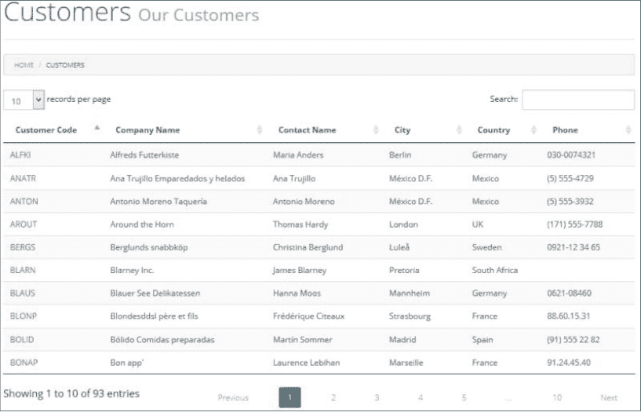

## DataTables 扩展

jQuery DataTables 插件提供了多种多样的扩展，可以显著增强插件的功能。

### ColReorder 扩展

ColReorder 扩展允许用户通过点击并将列标题拖拽到他们喜欢的位置来重新排列表列。要为你的 DataTables HTML 表格启用列重新排序，请完成以下步骤：

- 1. 打开 _Layout.cshtml 文件，并添加对 dataTables.colReorder.css 文件的引用：
- ```
<link rel="stylesheet" type="text/css" href="//cdn.datatables.net/colreorder/1.1.1/css/dataTables.colReorder.css">
```
- 2. 打开视图的 .cshtml 文件，并添加对 DataTables、DataTables Bootstrap 和 ColReorder 扩展 JavaScript 文件的引用：
- ```
<script type="text/javascript" language="javascript" src="//cdn.datatables.net/1.10.0/js/jquery.dataTables.min.js"></script>
<script type="text/javascript" language="javascript" src="//cdn.datatables.net/plug-ins/be7019ee387/integration/bootstrap/3/dataTables.bootstrap.js"></script>
<script type="text/javascript" language="javascript" src="//cdn.datatables.net/colreorder/1.1.1/js/dataTables.colReorder.min.js"></script>
```
- 3. 最后，使用 jQuery 添加一个事件处理程序，在页面加载完成后初始化 DataTables 插件和 ColReorder 扩展：
- ```
<script type="text/javascript">
$(document).ready(function () {
$(".table").DataTable({
"dom": 'Rlfrtip'
});
});
</script>
```

4. 当导航到该页面时，你现在应该能够拖拽并重新排列表中的列。拖拽列时会显示一条蓝线，如下图所示：

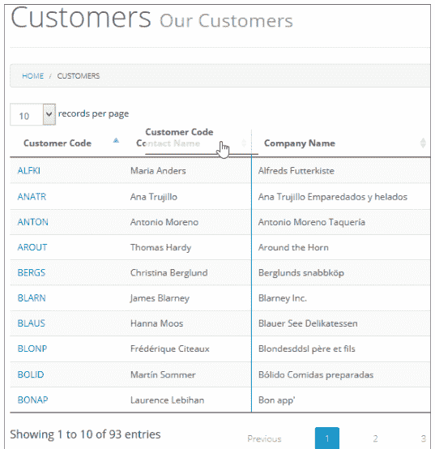

> 注意，我们从 DataTables CDN（可在 cdn.datatables.net 获取）引用了所有扩展所需的样式表和 JavaScript 文件。

### ColVis 扩展

ColVis 扩展会在 DataTable 顶部添加一个按钮，点击该按钮时，会显示表格中列名的列表，每列旁边有一个复选框。然后，用户可以取消选择他们不想在网格中看到的列名。

要启用列可见性扩展，请执行以下步骤：

- 1. 打开 _Layout.cshtml 文件，并添加对 dataTables.colVis.css 文件的引用：

```
<link rel="stylesheet" type="text/css" href="//cdn.datatables.net/colvis/1.1.0/css/dataTables.colVis.css">
```

- 2. 打开视图的 .cshtml 文件，并添加对 DataTables、DataTables Bootstrap 和 ColVis 扩展 JavaScript 文件的引用：

```
<script type="text/javascript" language="javascript" src="//cdn.datatables.net/1.10.0/js/jquery.dataTables.min.js"></script>
<script type="text/javascript" language="javascript" src="//cdn.datatables.net/plug-ins/be7019ee387/integration/bootstrap/3/dataTables.bootstrap.js"></script>
<script type="text/javascript" language="javascript" src="//cdn.datatables.net/colvis/1.1.0/js/dataTables.colVis.min.js"></script>
```

- 3. 最后，使用 jQuery 添加一个事件处理程序，在页面加载完成后初始化 DataTables 插件和 ColVis 扩展：

```
<script type="text/javascript">
    $(document).ready(function () {
        $('table').DataTable({
            "dom": 'C<"clear">lfrtip'
        });
    });
</script>
```

- 4. 导航到 Customers 页面时，你应该会在搜索框旁边看到一个按钮，通过该按钮可以显示或隐藏表格中的列，如下面的截图所示：

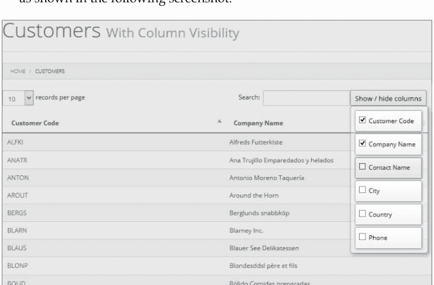

### TableTools 扩展

jQuery DataTables 的 TableTools 扩展在表格顶部添加了一个工具栏，用户可以通过它复制到剪贴板、导出为 CSV 以及将 DataTable 中的数据打印为 PDF。这是为你的用户提供数据导出功能的一种非常简单的方法。

要使用 TableTools 扩展，请执行以下步骤：

- 1. 在项目根目录下创建一个名为 `swf` 的新文件夹。
- 2. 将 `copy_csv_xls_pdf.swf` 文件添加到 `swf` 文件夹中。该 `.swf` 文件包含在 DataTables 插件下载中。
- 3. 打开 `_Layout.cshtml` 文件，并添加对 `dataTables.tableTools.css` 文件的引用：
- ```html
<link rel="stylesheet" type="text/css" href="//cdn.datatables.net/tabletools/2.2.1/css/dataTables.tableTools.css">
```
- 4. 打开视图的 `.cshtml` 文件，并添加对 DataTables、DataTables Bootstrap 和 TableTools 扩展 JavaScript 文件的引用：

```html
<script type="text/javascript" language="javascript" src="//cdn.datatables.net/1.10.0/js/jquery.dataTables.min.js"></script>
<script type="text/javascript" language="javascript" src="//cdn.datatables.net/tabletools/2.2.1/js/dataTables.tableTools.min.js"></script>
<script type="text/javascript" language="javascript" src="//cdn.datatables.net/plug-ins/be7019ee387/integration/bootstrap/3/dataTables.bootstrap.js"></script>
```

- 5. 最后，使用 jQuery 添加一个事件处理程序，在页面加载完成后初始化 DataTables 插件和 TableTools 扩展：

```javascript
<script type="text/javascript">
    $(document).ready(function () {
        var table = $('.table').dataTable();
        var tt = new $.fn.dataTable.TableTools(table);
        $(tt.fnContainer()).insertBefore('div.dataTables_wrapper');
    });
</script>
```

6. 上面突出显示的代码用于初始化 TableTools 扩展，并将 Bootstrap 样式应用于 TableTools 工具栏按钮。当打开带有 DataTable 的视图时，你应该会在 DataTable 上方看到 TableTools 按钮工具栏，如下面的截图所示：

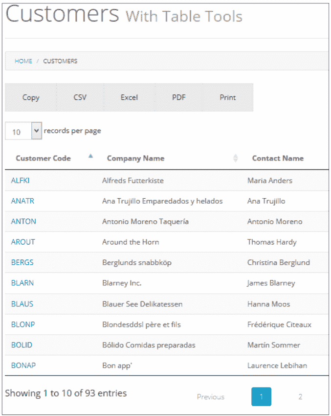

## 总结

在本章中，我们使用 jQuery DataTables 插件实现了一个可排序、可搜索且可扩展的 HTML 表格。我们还探讨了如何指定插件使用默认的 Bootstrap 样式。本章还应让你有信心探索其他开源插件，并将它们整合到你自己的 ASP.NET MVC 项目中。

在下一章也是最后一章中，我们将了解 `TwitterBootstrapMVC` 库，以及如何在你自己项目中使用它。

流式实现还在 Visual Studio 中提供了 IntelliSense，使开发人员能够轻松发现 Bootstrap 配置选项。该库已不再是开源或免费的，但你仍然可以在 GitHub 上查看原始项目：`https://github.com/DmitryEfimenko/TwitterBootstrapMvc`。

该库的商业版本可在 `https://www.twitterbootstrapmvc.com/` 获取。

## 在项目中引入 TwitterBootstrapMVC

你可以通过以下两种方式之一在项目中引入 `TwitterBootstrapMVC` 库。第一种也是推荐的方式是使用 NuGet 包，第二种方式是下载 `.dll` 文件并手动添加引用。

### 使用 NuGet 添加 TwitterBootstrapMVC

要使用 NuGet 在项目中引入 `TwitterBootstrapMVC` 库，请执行以下步骤：

- 1. 在 Visual Studio 中，通过**工具 | 库程序包管理器 | 程序包管理器控制台**菜单打开**程序包管理器控制台**窗口。
- 2. 在**程序包管理器控制台**窗口中，输入以下命令并按 *回车*：
- ```
Install-Package TwitterBootstrapMVC5
```
- 3. 接下来，导航到 `https://www.twitterbootstrapmvc.com/Download`，下载试用版或购买个人或商业许可证。
- 4. 下载许可证文件，该文件应名为 `TwitterBootstrapMvcLicense.lic`，并将其添加到 Visual Studio 中项目的根目录。
- 5. 打开 Views 文件夹中的 `Web.config` 文件，并将以下代码添加到 `<namespaces>` 元素中：
- ```xml
<add namespace="TwitterBootstrapMVC" />
<add namespace="TwitterBootstrap3" />
```
- 6. 最后，打开项目根目录中的 `Global.asax` 文件，并将以下代码行添加到 `Application_Start` 方法中：
- ```csharp
Bootstrap.Configure();
```

```
Install-Package TwitterBootstrapMVC5
```

```
<add namespace="TwitterBootstrapMVC" />
<add namespace="TwitterBootstrap3" />
```

```
Bootstrap.Configure();
```


## 使用 .dll 文件添加 TwitterBootstrapMVC

你不需要通过 NuGet 添加 TwitterBootstrapMVC 库，你也可以使用 .dll 文件来添加它。为此，请完成以下步骤：

1. 在浏览器中，导航到 `https://www.twitterbootstrapmvc.com/Home/Installation`，并下载位于 **选项 2：下载 .dll** 标题下的 zip 压缩包。
2. 下载 zip 文件后，将文件解压到本地驱动器上的一个文件夹中。
3. 在 Visual Studio 中，右键单击 **解决方案资源管理器** 窗口中的 **引用** 节点，然后从上下文菜单中选择 **添加引用...**。
4. 浏览到解压 zip 压缩包的文件夹，然后选择 `TwitterBootstrapMVC5.dll` 文件。
5. 接下来，导航到 `https://www.twitterbootstrapmvc.com/Download`，下载试用版或购买个人或商业许可证。
6. 下载许可证文件，它应该被命名为 `TwitterBootstrapMvcLicense.lic`，并将其添加到 Visual Studio 中项目的根目录。
7. 打开 Views 文件夹中的 Web.config 文件，并将以下代码添加到 `<namespaces>` 元素中：

   ```xml
   <add namespace="TwitterBootstrapMVC" />
   <add namespace="TwitterBootstrap3" />
   ```

8. 最后，打开项目根目录中的 Global.asax 文件，并将以下代码行添加到 Application_Start 方法中：

   ```csharp
   Bootstrap.Configure();
   ```

## 使用 TwitterBootstrapMVC 辅助方法

TwitterBootstrapMVC 库提供了多种 Bootstrap 辅助方法，所有这些方法都使用流畅的语法，支持方法链式调用。这些辅助方法可以减少你创建 Bootstrap 组件所需的 HTML 标记数量。库中的方法链遵循以下模式：

```csharp
@Html.Bootstrap().TextBoxFor(m => m.PostalCode).Value("1.23").
    Size(InputSize.Large).Placeholder("Enter Postal Code").
    Format("{0:0.00}").Prepend("US")
```

## 表单和输入元素

TwitterBootstrapMVC 为大多数表单和输入元素提供了流畅的辅助方法。

### 输入元素

TwitterBootstrapMVC 为所有 HTML 输入元素提供了 ASP.NET MVC 辅助方法；这些组件中的大多数都共享相同的链式方法。这些方法列在下表中：

| 方法名 | 描述 |
|---|---|
| .Label() | 将一个标签元素添加到该元素前面。 |
| .Tooltip() | 向组件添加带有指定消息的工具提示。 |
| .HelpText() | 在元素旁边添加帮助文本。 |
| .Id() | 设置元素的 id 属性。 |
| .Class() | 设置元素的 class HTML 属性。 |
| .ReadOnly() | 向元素添加 readonly="readonly"。 |
| .HtmlAttributes() | 向元素添加指定的 HTML 属性。 |
| .Data() | 其工作方式与 .HtmlAttributes() 方法类似，但会在属性前添加 data- 前缀。 |
| .Disabled() | 向元素添加 disabled="disabled"。 |
| .DisabledDependsOn() | 根据另一个元素的值，有条件地禁用某个元素。 |
| .VisibleDependsOn() | 根据另一个元素的值，有条件地隐藏某个元素。 |
| .ShowValidationMessage() | 设置当元素验证失败时是否显示验证消息。 |

### 表单

使用以下代码，你可以生成一个简单的垂直 Bootstrap 表单，其中包含三个文本框和一个提交按钮。前两个文本框还调用了 Placeholder 方法，向空文本框添加占位符文本；最后一个文本框还有一个名为 HelpText 的方法，用于在文本框底部添加帮助文本。

```csharp
@using (var form = Html.Bootstrap().Begin(new Form()))
{
    @form.FormGroup().TextBoxFor(m => m.CompanyName).Placeholder("Enter the company name.")
    @form.FormGroup().TextBoxFor(m => m.ContactName).Placeholder("Enter the name of contact person.")
    @form.FormGroup().TextBoxFor(m => m.Address).HelpText("Short address for customer.")
    @Html.Bootstrap().SubmitButton()
}
```

生成的表单在浏览器中应该类似于以下截图：

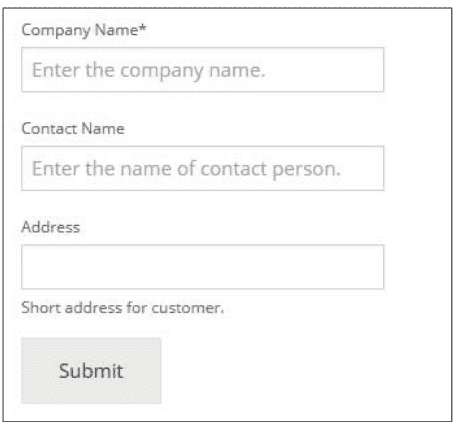

你还会注意到，如果该值是必填的，FormGroup 辅助方法会自动在字段标签上添加一个星号 (*)。

要生成内联或垂直形式的相同表单，只需在 Form 对象上调用 Type 方法，并将布局作为参数传递给 Type 方法即可。该参数是一个枚举（enum）值，启用 IntelliSense 后会列出所有可用选项：

```csharp
@using (var form = Html.Bootstrap().Begin(new Form().Type(FormType.Inline)))
{
    @form.FormGroup().TextBoxFor(m => m.CompanyName).Placeholder("Enter the company name.")
    @form.FormGroup().TextBoxFor(m => m.ContactName).Placeholder("Enter the name of contact person.")
    @form.FormGroup().TextBoxFor(m => m.Address)
    @Html.Bootstrap().SubmitButton()
}
```

生成的表单将类似于以下截图：

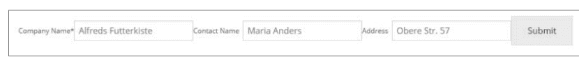

Textbox 辅助方法提供了以下扩展方法，用于向文本框元素添加额外的格式或功能：

| 方法名 | 描述 |
|---|---|
| .Value() | 设置文本框的值。 |
| .Size() | 设置文本框的大小。此方法也接受 InputSize 枚举。 |
| .Placeholder() | 指定文本框的占位符文本。 |
| .Format() | 用于指定文本框的数据格式。 |
| .Append() | 将指定的字符串追加到文本框的末尾。此方法还会创建一个输入组。 |
| .AppendIcon() | 将图标附加到文本框的末尾。 |
| .Prepend() | 与 .Append() 方法相反。此方法将指定的字符串添加到文本框的前面，并创建一个输入组。 |
| .PrependIcon() | 将指定的图标添加到文本框的前面。 |
| .TypeAhead() | 为文本框启用 TypeAhead 功能。 |

在以下示例中，我们将为模型的 `PostalCode` 属性创建一个文本框，将其值设置为 1.23，并将其大小设置为 Large。然后，我们将指定占位符文本和格式，最后在文本框前面添加一个字符串：

```csharp
@Html.Bootstrap().TextBoxFor(m => m.MinimumTransactionValue).
    Value("1.23").Size(InputSize.Large).Placeholder("Enter Postal Code").
    Format("{0:0.00}").Prepend("US")
```

生成的文本框在浏览器中应类似于以下截图：

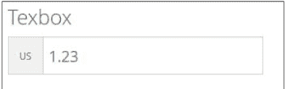

要使用 `TwitterBootstrapMVC` 库创建文本区域输入，可以使用 `TextAreaFor` 辅助方法。该辅助方法支持另外两个方法，你可以用它们来指定文本区域的列数和行数。在以下示例中，我们将为模型的 `Address` 属性创建一个文本区域，并将其列数设置为 10，行数设置为 5：

```csharp
@Html.Bootstrap().TextAreaFor(m => m.Address).Columns(10).Rows(5)
```

文本区域在浏览器中的渲染效果应类似于以下截图：

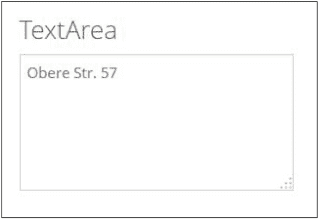

## 按钮和链接

`TwitterBootstrapMVC` 库为 Bootstrap 按钮和链接提供了流畅的辅助方法。按钮和链接的辅助方法都共享以下扩展方法：

| 方法名 | 描述 |
|---|---|
| .AppendIcon() | 将指定的图标附加到按钮或链接上。 |
| .PrependIcon() | 将指定的图标添加到按钮或链接的前面。 |
| .Disabled() | 向按钮或链接添加 `disabled` 类。 |

在以下代码示例中，我们将创建一个简单的提交按钮，其前面和后面都有图标。请注意使用 `glyphicon` 类名来指定要使用的图标。

```csharp
@Html.Bootstrap().Button().AppendIcon("glyphicon glyphicon-pencil").
    PrependIcon("glyphicon glyphicon-music")
```

上述标记将在浏览器中渲染为以下截图：

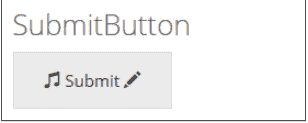

`ActionLinkButton`、`Button` 和 `SubmitButton` 辅助方法共享以下扩展方法：

| 方法名 | 描述 |
|---|---|
| .Text() | 设置按钮的标题/文本。 |
| .Name() | 指定 HTML name 属性。 |
| .Value() | 设置 value HTML 属性。 |
| .Size() | 指定按钮的大小。此方法也接受 `ButtonSize` 枚举作为参数。 |
| .Style() | 设置按钮的样式。此方法也接受 `ButtonStyle` 枚举作为参数。 |
| .ButtonBlock() | 将按钮扩展到容器的整个宽度。 |


| 方法名称 | 描述 |
|---|---|
| `.LoadingText()` | 这会在按钮被点击后设置应显示的文本。 |
| `.DropDownToggle()` | 这会将 dropdown-toggle 类名应用到按钮上。 |

以下代码使用 `TwitterBootstrapMVC` 流畅助手语法生成一个大号的绿色 Bootstrap 按钮并设置其标题：

```csharp
@Html.Bootstrap().Button().Text("Buy Now").Size(ButtonSize.Large).Style(ButtonStyle.Success)
```

该按钮在浏览器中应类似于以下截图：

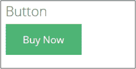

`ActionLinkButton` 和 `ActionLink` 助手共享以下扩展方法：

| 方法名称 | 描述 |
|---|---|
| `.Protocol()` | 这指定了 URL 的协议，例如 http 或 https |
| `.HostName()` | 这设置了 URL 的主机名 |
| `.Fragment()` | 这设置了 URL 的锚点名称 |
| `.RouteName()` | 这指定了路由名称 |
| `.RouteValues()` | 这设置了路由值 |
| `.Title()` | 这设置了 title HTML 属性 |

在以下代码中，我们将创建一个 `ActionLinkButton` 对象。请注意我们如何将 `.Style` 和 `.PrependIcons` 方法与 `ActionLinkButton` 方法结合使用：

```csharp
@Html.Bootstrap().ActionLinkButton("Go to Buttons", "Buttons").Protocol("http").Title("Buttons Link").Style(ButtonStyle.Link).PrependIcon("glyphicon glyphicon-film")
```

结果将在浏览器中渲染一个带有图标的链接，如以下截图所示：

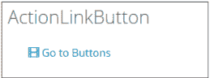

## 折叠面板和面板

TwitterBootstrapMVC 提供的折叠面板和面板助手都应使用可释放的 Begin 方法。

折叠面板方法还有另一个名为 `BeginPanel` 的方法，用于在折叠面板组件内部指示一个新的面板。以下代码将生成一个包含两个面板的折叠面板。请注意两个面板也是可释放的。

```csharp
@using (var accordian = Html.Bootstrap().Begin(new Accordion("FAQ")))
{
    using (accordian.BeginPanel("Question 1"))
    {
        <p>Etiam luctus nunc ipsum, sed facilisis velit.</p>
    }
    using (accordian.BeginPanel("Question 2"))
    {
        <p>Duis volutpat iaculis nisl, ut porttitor.</p>
    }
}
```

折叠面板在浏览器中应类似于以下截图：

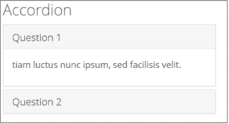

面板助手包含三个子方法，`BeginHeading`、`BeginBody` 和 `BeginFooter`。这些方法也可以通过调用 Heading、Body 或 Footer 方法使用简写表示法进行调用。

使用以下代码，我们将生成一个带有标题和页脚的面板。我们还将通过在 Panel 对象上调用共享的 Style 方法来指定面板的样式。

```csharp
@using (var panel = Html.Bootstrap().Begin(new Panel().Style(PanelStyle.Danger)))
{
    @panel.Heading("Panel Heading")

    using (panel.BeginBody())
    {
        <p>Proin mattis lacus ac enim aliquam, eu malesuada tortor pretium.</p>
    }
    @panel.Footer("Panel Footer")
}
```

此代码将在浏览器中渲染以下截图：

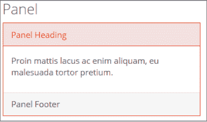

## 标签页和模态框

标签页和模态框组件也提供流畅助手。新的标签页组件应使用可释放的 Begin 方法创建。标签页组件内的每个标签页必须使用 Tab 扩展方法声明，并且每个标签页的内容应位于 BeginPanel 方法内部。

在以下示例中，我们将创建一个包含两个标签页的标签页组件。请注意 Tab 方法上 AppendBadge 扩展方法的使用。

```csharp
@using (var tabs = Html.Bootstrap().Begin(new Tabs("TabComponent")))
{
    @tabs.Tab("Tab One")
```

## 总结

在本章中，您了解了 TwitterBootstrapMVC 库，并看到了如何使用该库减少视图的标记量。这也是本书的最后一章，到目前为止，您应该对在自己的 ASP.NET MVC 项目中使用 Bootstrap 感到相当熟练，甚至可以准备好编写自己的代码生成工具和助手。

请务必从 Packt Publishing 网站下载随本书附带的示例项目，以查看本书中提到的示例的实际效果。

感谢您的阅读。下次见，继续编码！

## Bootstrap 资源

Bootstrap 社区是一个充满活力和庞大的社区。以下各节按任意顺序列出了互联网上可用的 Bootstrap 资源。

### 主题

以下表格列出了基于 Bootstrap 的免费和付费 HTML 主题的下载 URL：

| URL | 描述 |
|---|---|
| http://startbootstrap.com/ | 该 URL 提供免费的 HTML 起始模板和 Bootstrap 主题。 |
| https://wrapbootstrap.com/ | 这是 Bootstrap 付费主题和模板的市场。 |
| http://bit.ly/ThemeForestHtml | ThemeForest 有超过 5,000 个付费 HTML 模板。其中许多基于 Bootstrap。 |
| http://www.prepbootstrap.com/ | 该 URL 提供免费的 Bootstrap 主题、模板和其他小部件，并附带完整的代码示例。 |
| http://bootstrapzero.com/ | 该 URL 提供开源 Bootstrap 主题和模板。 |
| http://bootswatch.com/ | 该 URL 提供 Bootstrap 的免费主题。 |

### 插件

以下表格列出了 Bootstrap 的额外插件、插件和组件的 URL：

| URL | 描述 |
|---|---|
| `http://bit.ly/FuelUX` | FuelUX 为 Bootstrap 提供额外的控件和增强功能，如日期选择器、微调器、树和表单向导。 |
| `http://bit.ly/JasnyBootstrap` | Jasny Bootstrap 对现有组件提供了一些增强功能，如标签按钮和锚定警告。 |
| `http://bit.ly/BootstrapNotify` | Bootstrap notify 使向用户显示警报样式通知变得更容易。 |
| `http://bootstrapformhelpers.com/` | Bootstrap Form Helpers 是一个插件，可帮助增强您的表单。它包括颜色选择器、滑块等。 |
| `http://www.bootstrap-switch.org/` | 此插件将您的复选框转换为 iOS 风格的开关控件。 |
| `http://bit.ly/BSAppWiz` | 此插件使用 Bootstrap Application Wizard 为您的表单添加多步骤、类似向导的界面。 |
| `http://tableclothjs.com/` | 此插件使用 jQuery 使您的 Bootstrap 表格可排序和可搜索。 |
| `http://bit.ly/TypeAhead` | 此插件由 Twitter 提供。它还为您的表单添加自动完成功能。 |

### 编辑器和生成器

以下表格列出了帮助您设计和构建 Bootstrap 网站的工具的 URL：

| URL | 描述 |
|---|---|
| `http://www.bootstrapbundle.com/` | 该 URL 提供 ASP.NET MVC Bootstrap 项目和 Visual Studio 2013 的项目项模板。 |
| `http://www.layoutit.com/` | 该 URL 提供 Bootstrap 的拖放界面构建器。 |
| https://www.easel.io/ | 这与 LayoutIt 类似。它提供可视化拖放界面来构建您的 Bootstrap UI。 |
| https://jetstrap.com/ | 该 URL 提供 Bootstrap 的可视化界面构建工具。 |
| http://www.bootply.com/ | 该 URL 提供可视化编辑器，用于快速构建 Bootstrap 界面。 |
| http://www.divshot.com/ | 该 URL 提供 Bootstrap 构建器和静态网站托管工具。 |
| http://bit.ly/BSMagic | Bootstrap Magic 轻松创建您自己的 Bootstrap 主题。 |
| http://paintstrap.com/ | 该 URL 提供使用 COLOURlovers 配色方案生成 Bootstrap 主题的工具。 |
| http://www.bootstrapdesigner.com/ | 该 URL 提供生成 Bootstrap 网站或模板的工具。 |
