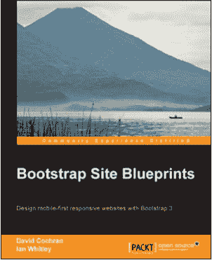
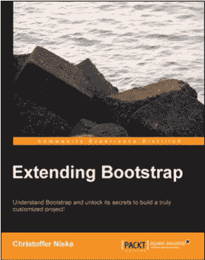
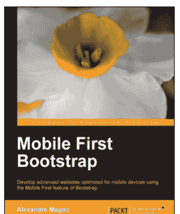
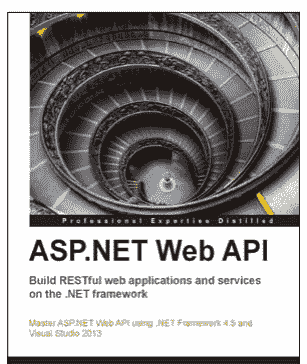

## 索引

### 符号

- _BackendMenuPartial 视图 54
- .dll 文件
  - 用于添加 TwitterBootstrapMVC 库 161
- @helper 语法
  - 使用 94
- @Html.BeginForm() 助手 104

### A

- 折叠面板和面板助手 168
- 折叠面板组件
  - 关于 88
  - 使用 88-90
- 折叠面板方法 168
- Add 方法 25
- 插件
  - URL 174
- 警告组件
  - 关于 67, 68
  - 可 dismiss 警告 68
- 动画进度条 71
- ASP.NET 布局
  - 捆绑包添加 25, 26
- ASP.NET MVC
  - 关于 93
  - 内置 HTML 助手 93
  - 添加 DataTables 146
  - 项目创建 132, 133
- ASP.NET MVC 网站
  - 添加 Bootstrap 字体 16
  - 添加 Bootstrap JavaScript 文件 16
  - 添加 Bootstrap 样式表 15
  - 创建 14, 15

### B

- 徽章组件 57
- 基础进度条 69, 70
- Bootstrap
  - URL 8, 130
  - 与标准 Visual Studio 项目模板一起使用 10, 11
- BootstrapButton 方法 99
- Bootstrap 按钮
  - 关于 39, 40
  - btn btn-default btn-lg 类 40
  - btn btn-default btn-sm 类 39
  - btn btn-default btn-xs 类 39
  - btn btn-default 类 40
- Bootstrap 组件
  - 关于 53
  - 警告 67
  - 徽章 57
  - 面包屑 60
  - 按钮下拉菜单 66
  - 输入组 64, 65
  - 列表组 56
  - 媒体对象 57-59
  - 导航栏 53-55
  - 页面标题 59
  - 分页 60-63
  - 进度条 69
- Bootstrap 分发
  - 关于 8
  - Bootstrap 文件夹结构 9
  - Bootstrap 字体 8
  - Bootstrap JavaScript 文件 9
  - Bootstrap 样式表 8
- Bootstrap 文件
  - 使用 NuGet 添加 21

Bootstrap folder structure 9
Bootstrap fonts
about 8
adding, to ASP.NET MVC site 16
formats 8
Bootstrap forms
about 41
horizontal forms 41, 42
inline forms 43
vertical/basic forms 42, 43
Bootstrap grid system
about 30
grid classes 30
grid options 30, 31
Bootstrap HTML elements
about 31
buttons 39
forms 41
images 50
tables 32
Bootstrap image classes
about 50, 51
img-circle 50
img-responsive 50
img-rounded 50
img-thumbnail 50
Bootstrap JavaScript files
about 9
adding, to ASP.NET MVC site 16
Bootstrap navigation bar
about 53-55
fixed-top navigation bar 54
Bootstrap NuGet package
adding, dialog used 21, 22
adding, Package Manager Console used 22, 23
Bootstrap plugins
URL 76
Bootstrap project
bundling, adding 24, 25
Bootstrap resources
add-ons 174
editors and generators 174
themes 173
Bootstrap styles
URL 41
Bootstrap style sheets
about 8
adding, to ASP.NET MVC site 15
Bootstrap styling
adding, to DataTables 147
Bootstrap tables
about 32
contextual table classes 37, 38
default styling 32, 33
styling 36
view, generating 33-36
Bootstrap-themed view
used, for creating home controller 19, 20
Bootstrap validation styles 44-46
breadcrumb 60
built-in HTML helpers
TextBox helper 94
bundles
adding, to ASP.NET layout 25, 26
bundling
adding, to Bootstrap project 24, 25
bundling and minification
about 23
testing 26, 27
button dropdowns
about 66
creating 66
Button method 97
buttons and links helpers
.AppendIcon() method 166
.ButtonBlock() method 166
.Disabled() method 166
.DropDownToggle() method 167
.Fragment() method 167
.HostName() method 167
.LoadingText() method 167
.Name() method 166
.PrependIcon() method 166
.Protocol() method 167
.RouteName() method 167
.RouteValues() method 167
.Size() method 166
.Style() method 166
.Text() method 166
.Title() method 167
.Value() method 166

### C

carousel component
about 90
using 90, 91
CDN
using 147
charts
adding, to views 141, 142
ColReorder extension
about 153, 154
using 153
ColVis extension
about 154
using 154
Content Delivery Network (CDN) 18, 135, 146
Content folder, default MVC project layout 13
contextual progress bars
about 70
class name, setting 70
custom helper
creating 94, 95
using, in view 95
custom scaffolder extension
creating 118-127

### D

data attributes
versus, programmatic API 76
data-content attribute 87
data-original-title attribute 87
DataTables. See jQuery DataTables
DataTables CDN
reference links 146
URL 154
DataTables NuGet package
using 146
data-toggle attribute 87
data-trigger attribute 87
default MVC project layout
about 12
Content folder 13
fonts folder 13
Scripts folder 14

Devart T4 editor, for Visual Studio
URL 109
dialog
used, for adding Bootstrap NuGet package 21, 22
dismissible alert 68
dropdowns
cascading 77-80

### E

editor templates
about 47
creating, for nonprimitive types 48, 49
creating, for primitive types 47, 48
EOT font format 8
extension method helper
using, in view 99
extension methods
about 98
URL 98
used, for creating helpers 98, 99

### F

fluent HTML helpers
creating 99-103
using, in view 103
fluent interfaces
about 99
URL 99
Font Awesome 8
fonts folder, default MVC project layout 13
forms. See Bootstrap forms

### G

generated code, for controllers
customizing 110-113
generated code, for views
customizing 114-117
Glyphicon Halflings icons
URL 64
grid classes
col-lg-* 30
col-md-* 30
col-sm-* 30
col-xs-* 30

H
helpers
creating, extension methods used 98
creating, static methods used 96, 97
home controller
creating, with Bootstrap-themed view 19, 20
view, creating 135, 136
horizontal forms 41, 42
HtmlHelper method 93
HTML helpers 93

I
inline forms 43
input element
.Class() method 162
.Data() method 162
.DisabledDependsOn() method 162
.Disabled() method 162
.HelpText() method 162
.HtmlAttributes() method 162
.Id() method 162
.Label() method 162
.ReadOnly() method 162
.ShowValidationMessage() method 162
.Tooltip() method 162
.VisibleDependsOn() method 162
input groups
about 64, 65
text input element, creating 64

J
jQuery DataTables
about 145
adding, to ASP.NET MVC project 146
data, displaying 148-152
data, loading 148
URL 146
jQuery DataTables, adding to ASP.NET MVC project
Bootstrap styling, adding 147, 148
CDN, using 147
DataTables NuGet package, using 146
jQuery DataTables extensions
about 153
ColReorder extension 153
ColVis extension 154
TableTools extension 156
jQuery validation plugin
URL 46

L
list groups component 56

M
master layout
creating 133-135
media-object class name 59
media object component 57-59
menu plugin library
adding 137, 138
Microsoft.AspNet.Web.Optimization NuGet package
installing 24
Modal class
.BackdropOff() method 170
.Closeable() method 170
.FadeOff() method 170
.KeyboardOff() method 170
.Remote() method 170
.ShowOff() method 170
modal dialogs
using 80-82
MvcHtmlString object 97

N
nonprimitive types
editor templates, creating for 48, 49
Northwind database 57
NuGet
about 21
URL 21
used, for adding Bootstrap 21
used, for adding TwitterBootstrapMVC library 160

P
Package Manager Console
used, for adding Bootstrap NuGet package 22, 23
PagedList library 62
PagedList.Mvc NuGet package 61
PagedListPager HTML helper
about 62
pagination layouts 62
page header 59
page views
adding 138, 140
pagination 60-63
panel helper
about 168
BeginBody method 168
BeginFooter method 168
BeginHeading method 168
popovers
about 87
using 87
prebuilt HTML templates
working with 130, 131
primitive types
editor templates, creating for 47, 48
progress bars
animated progress bars 71
basic progress bar 69, 70
contextual progress bars 70
striped progress bars 71
updating dynamically 71-73
S
scaffolding 107
ScriptBundle object 25
Scripts folder, default MVC project layout 14
SearchProductsResult view 56
self-closing helpers
about 104
creating 104, 105
using, in view 105
SideWaffle
about 109
URL 109
SignalR
about 72
URL 72
site Layout file
creating 17, 18
site performance
improving, with bundling and minification 23
standard HTML helpers, ASP.NET MVC
URL 94
static method helper
using, in view 98
static methods
creating 96
used, for creating helpers 96, 97
striped progress bars 71
StyleBundle object 25
T
T4 code generator 108
T4 syntax 109, 110
T4 templates
about 108
URL 109
T4 tools 109
TableTools extension
about 156
using 156
tabs
about 83
using 83, 84
textbox element
.AppendIcon() method 164
.Append() method 164
.Format() method 164
.Placeholder() method 164
.PrependIcon() method 164
.Prepend() method 164
.Size() method 164
.Typeahead() method 164
.Value() method 164
TextBox helper 94, 164
ThemeForest
URL 130

+   **themes**
+     URLs, for downloading 173
+   **ToBootstrapSize method 97**
+   **tools, for design**
+     URLs 174, 175
+   **tooltips**
+     about 85
+     using 85, 86
+   **TTF 8**
+   **TwitterBootstrapMVC helpers**
+     accordion and panel helpers 168
+     buttons and links helpers 166, 167
+     forms element 163-165
+     inputs element 162
+     tab and modal components 169
+     using 161
+   **TwitterBootstrapMVC library**
+     about 159
+     adding 160
+     adding, .dll file used 161
+     adding, NuGet used 160
+     helpers 161
+     reference links 160
+     URL, for commercialized version 160
+   
+   **V**
+   **vertical/basic forms 42, 43**
+   **view**
+     creating, for home controller 135, 136
+     custom helper, using in 95
+     extension method helper, using in 99
+     fluent HTML helper, using in 103
+     self-closing helper, using in 105
+     static method helper, using in 98

# Thank you for buying
# Bootstrap for ASP.NET MVC

# About Packt Publishing

Packt, pronounced 'packed', published its first book "Mastering phpMyAdmin for Effective MySQL Management" in April 2004 and subsequently continued to specialize in publishing highly focused books on specific technologies and solutions.

Our books and publications share the experiences of your fellow IT professionals in adapting and customizing today's systems, applications, and frameworks. Our solution based books give you the knowledge and power to customize the software and technologies you're using to get the job done. Packt books are more specific and less general than the IT books you have seen in the past. Our unique business model allows us to bring you more focused information, giving you more of what you need to know, and less of what you don't.

Packt is a modern, yet unique publishing company, which focuses on producing quality, cutting-edge books for communities of developers, administrators, and newbies alike. For more information, please visit our website: www.packtpub.com.

# About Packt Open Source

In 2010, Packt launched two new brands, Packt Open Source and Packt Enterprise, in order to continue its focus on specialization. This book is part of the Packt Open Source brand, home to books published on software built around Open Source licenses, and offering information to anybody from advanced developers to budding web designers. The Open Source brand also runs Packt's Open Source Royalty Scheme, by which Packt gives a royalty to each Open Source project about whose software a book is sold.

# Writing for Packt

We welcome all inquiries from people who are interested in authoring. Book proposals should be sent to author@packtpub.com. If your book idea is still at an early stage and you would like to discuss it first before writing a formal book proposal, contact us; one of our commissioning editors will get in touch with you.

We're not just looking for published authors; if you have strong technical skills but no writing experience, our experienced editors can help you develop a writing career, or simply get some additional reward for your expertise.

## Bootstrap Site Blueprints

ISBN: 978-1-78216-452-4		Paperback: 304 pages

Design mobile-first responsive websites
with Bootstrap 3

- 1. Learn the inner working of Bootstrap 3 and create web applications with ease.
- 2. Quickly customize your designs working directly with Bootstrap's LESS files.
- 3. Leverage Bootstrap's excellent JavaScript plugins.

## Extending Bootstrap

ISBN: 978-1-78216-841-6		Paperback: 88 pages

Understand Bootstrap and unlock its secrets to build
a truly customized project!

- 1. Learn to use themes to improve your user experience.
- 2. Improve your workflow with LESS and Grunt.js.
- 3. Get to know the most useful third-party Bootstrap plugins.

## [PACKT] open source
PUBLISHING
community experience distilled

## Mobile First Bootstrap

ISBN: 978-1-78328-579-2      Paperback: 92 pages

Develop advanced websites optimized for mobile devices using the Mobile First feature of Bootstrap

- 1. Get to grips with the essentials of mobile-first development with Bootstrap.
- 2. Understand the entire process of building a mobile-first website with Bootstrap from scratch.
- 3. Packed with screenshots that help guide you through how to build an appealing website from a mobile-first perspective with the help of a real-world example.

## ASP.NET Web API

### Build RESTful web applications and services on the .NET framework

ISBN: 978-1-84968-974-8      Paperback: 224 pages

Master ASP.NET Web API using .NET Framework 4.5 and Visual Studio 2013

- 1. Clear and concise guide to the ASP.NET Web API with plentiful code examples.
- 2. Learn about the advanced concepts of the WCF-windows communication foundation.
- 3. Explore ways to consume Web API services using ASP.NET, ASP.NET MVC, WPF, and Silverlight clients.

Please check www.PacktPub.com for information on our titles

