## 1 Grid Control、BPEL 和 OSB 概述

硬件、软件和应用程序组件的管理很重要。在经济不景气时期，最大化软件和硬件投资回报至关重要，为此企业需要健全的管理策略。管理解决方案不仅有助于提高现有投资的回报，还能控制拥有这些投资的成本。当今企业若没有这样的解决方案就无法成功。

在 SOA 世界中，管理更为关键，因为它管理着分布式服务和服务基础设施。如果没有健全的管理策略，就无法实现 SOA 投资的价值。在大多数企业中，运营管理正成为 SOA 治理框架的核心。如果生产环境缺乏可见性和控制，SOA 项目成本将超过累积收益。管理不能在实施后才作为附加项；它必须是整体解决方案的战略组成部分。在前期就开始思考管理策略并与 SOA 集成一起实施是有益的。此外，需要分析管理的各个方面，并为企业中的 SOA 集成实施合适的方面。一些关键管理领域包括基础设施监控、合成监控、配置管理、部署自动化和业务流程执行监控。所有这些都需要考虑以确保 SOA 项目的成功。

在本章中，我们将简要介绍本书中将涵盖的以下产品：

- Grid Control
  - Overview
  - Architecture and deployment
  - Download and install
  - Home page
- Oracle BPEL Process Manager overview
- Oracle SOA Suite overview
- Oracle Service Bus overview

### Grid Control

Enterprise Manager Grid Control 提供单一界面，用于管理数千个不同的目标，例如操作系统、数据库、应用服务器和打包应用程序。它确定整体目标健康状况，跟踪目标清单，自动化目标部署并管理服务级别。所有历史监控信息都存储在数据库中，并随时间聚合。这辅以报表和仪表板框架，为管理员和 IT 经理提供摘要。Grid Control 支持各种硬件、软件和应用程序的监控和管理，确实是 Oracle 产品的首选工具。它还具有监控第三方产品的能力，无论是原生方式还是通过插件和连接器。Grid Control 框架可通过插件或连接器进行扩展。这得益于随 Grid Control 一起提供的软件开发工具包。一个插件的良好示例是，如果您想监控 Grid Control 不支持的特定硬件组件，您可以扩展框架并添加逻辑来监控您的特定硬件组件。另一方面，连接器可用于将 Grid Control 与其他系统集成，例如事件管理系统（如 Remedy Helpdesk 或 Oracle 业务活动监控（Oracle BAM））。

本书的大多数章节涵盖 Grid Control 的多个版本。例如服务级别管理、基础设施管理、服务级别仪表板、Web 应用程序管理和配置管理等概念在多个 Grid Control 版本中保持一致。尽管如此，本书将重点关注 Grid Control 版本 10.2.0.5，也称为 10gR5。该版本于 2009 年 2 月在 Linux 平台上发布，并在当年余下时间移植到其他平台。大多数章节同样适用于之前的 Grid Control 10.2.0.4（或 10gR4）版本。显著的例外是处理 Oracle Service Bus 管理的第三部分。用于管理 BPEL Process Manager 的 Enterprise Manager 功能是 Grid Control 10.2.0.3 及以上版本的一部分。Oracle Service Bus 管理功能是在 Grid Control 10.2.0.5 中引入的。

### 架构和部署

Grid Control 采用三层架构。主要组件包括 Oracle 管理服务器（OMS）、管理代理（Agent）和 Oracle 管理存储库（OMR）。中央基于 Web 的控制台可通过流行浏览器访问。组件详细说明如下：

- **Oracle Management Server (OMS):** 这是中央引擎，汇总来自所有分布式管理代理的信息。它为基于 Web 的控制台提供数据，并将数据持久化到管理存储库中。此外，OMS 还执行告警规则逻辑和通知逻辑，以及向代理发送用于部署等管理任务的指令。
- **Management Agent:** 代理是在服务器或主机上运行的轻量级 C 程序。该程序通常收集主机以及该主机上的其他目标（如数据库、应用服务器、SOA 套件等）的所有监控和配置信息。代理还适用于通过脚本在主机级别运行操作。此功能对于采取纠正措施（当阈值被违反时）或执行复杂的修补或其他部署任务非常有用。还可以选择使用远程代理，唯一的缺点是不会收集主机指标。
- **Oracle Management Repository (OMR):** 存储库是随 Grid Control 打包的预配置 Oracle 数据库。OMR 不需要单独的许可证。OMS 包含来自各个代理的当前和历史监控及配置信息。它带有预建的模式以及用于在不同时间段聚合数据的 PL/SQL 过程和函数。
- **Central web console:** Web 控制台为 OMR 中的所有丰富信息提供窗口。每个目标类型（例如，应用服务器）都有一个主页，其中包含监控、告警、配置和其他特定信息。主页在多个目标之间显示汇总信息。报表和仪表板可用于创建自定义视图。

本书避免深入讨论产品文档或白皮书已涵盖的部署问题。假设读者具备安装和配置 Grid Control 组件的基础知识。有关架构和部署最佳实践的更多信息可在 Oracle 技术网络（OTN）上的 Enterprise Manager 页面找到，网址为：http://www.oracle.com/technology/products/oem/ent_mgr/arch_dep.html

下面的简单架构图显示了 Grid Control 主要组件及其关系：

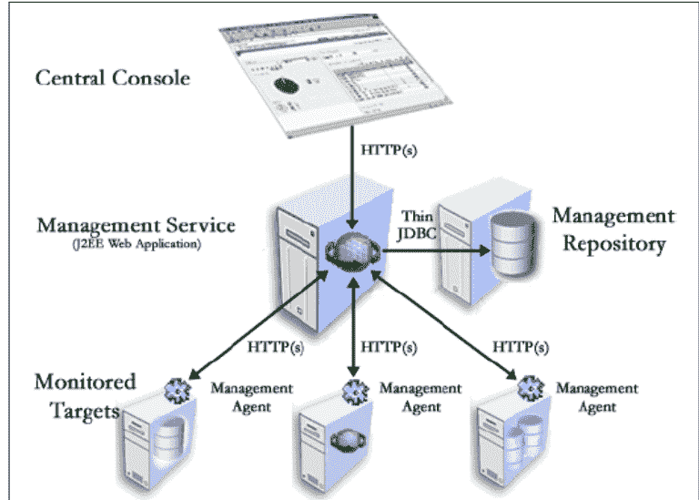


## 安装 Grid Control

Grid Control 的最新版本可以从 OTN 下载，网址为：
http://www.oracle.com/technology/software/products/oem/index.html

Grid Control 文档包括安装、配置、部署模式等，可以在以下位置找到： http://download.oracle.com/docs/cd/B16240_01/doc/nav/portal_booklist.htm

Grid Control 安装并配置后，可以添加与 SOA 相关的目标。先决条件是在托管 SOA Suite 的服务器上安装管理代理（Agent）。有关使用 Grid Control 进行 SOA 管理入门的更多详细信息，请访问 Oracle 技术网络（OTN）网站： http://download.oracle.com/docs/cd/B16240_01/doc/em.102/e12650/toc.htm

## 主页

下载并安装 Grid Control 后，首要任务是查看 Grid Control 的主页。要在本地浏览器中查看 Grid Control 主页：

- 1. 导航到 http://<your_server_name>:<server_port>/em.
- 2. 以 sysman.sysman 登录。使用安装期间设置的密码。

以下是 Enterprise Manager 10g Grid Control 的入口点或主页。主页汇总了所有重要信息（从左上角开始）：

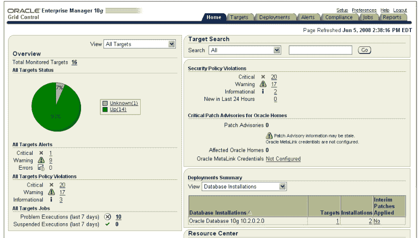

- **所有目标状态**：本节显示受监控的 Oracle 目标总数。饼图显示其整体 SLA 可用性和相应的未解决警报。此摘要页面可针对任何目标类型进行汇总。

单击 **查看** 下拉菜单并观察此企业中的不同目标类型。这是 Grid Control 支持的目标类型的子集。

- **所有目标警报**：对受监控目标的所有指标阈值的违规，按 **严重** 和 **警告** 类别划分。
**错误** 是与代理相关的问题（代理无法访问、无法上传、指标收集错误等）。

- **所有目标策略违规**：超过 300 条 Oracle 最佳实践（例如，Application Server 上的开放端口）已作为策略编码在 Grid Control 中。代理每天检查这些策略并标记违规行为。

- **目标搜索**：只需输入目标名称的一部分即可快速访问任何目标。

- **Oracle 主目录的关键补丁 advisory**：推送对系统至关重要的任何安全警报。设置到 MetaLink 的连接并自动下载受监控 Oracle 主目录的补丁信息。

- **部署摘要**：Enterprise Manager 收集有关您整个配置的信息，包括软件、补丁（操作系统和 Oracle 软件级别）、硬件等。这是您企业中所有主机、软件和操作系统（OS）的汇总。

## Oracle BPEL Process Manager 概述

*业务流程执行语言（BPEL），简称为 Web 服务业务流程执行语言（WS-BPEL），是一种用于指定与 Web 服务交互的可执行语言。业务流程执行语言中的流程通过专门使用 Web 服务接口来导出和导入信息。来源：http://en.wikipedia.org/wiki/Business_Process_Execution_Language*

主要厂商如 Oracle、Microsoft 和 IBM 都支持 BPEL 标准，该标准已成为首选的编排标准。Oracle 于 2005 年收购了名为 Collaxa 的小型公司，该公司拥有 BPEL 标准的实现，随后将产品更名为 BPEL Process Manager，并使其成为 SOA Suite 的基础。这也成为 Fusion Middleware 伞下以及 Fusion Applications 伞下的战略技术产品。Oracle Applications Unlimited（E-Business Suite、PeopleSoft、Siebel、Retek 等）使用多种不同的工作流技术，如 Oracle Workflow，但所有这些工作流技术的路线图都是要收敛到基于 Oracle BPEL Process Manager 产品的通用 BPEL 标准。简而言之，这项技术不仅对整体中间件市场，而且对打包应用市场都有巨大的影响。Oracle 在这两个市场都拥有庞大的装机基础，尤其是在 2008 年收购 BEA 之后，专注于在其客户群中扩大 BPEL 的已有大规模采用。

BPEL Process Manager 10.1.2 是 Collaxa 收购后的首个发布版本。目前，该产品作为 Oracle SOA Suite 10.1.3.x 的一部分提供。这是产品相当成熟的版本，并在有兴趣实施 SOA 战略的客户中获得了广泛采用。这也是下一代 Oracle Fusion Applications 的基础。

## Oracle SOA Suite 概述

Oracle SOA Suite 10.1.3.x 由三个组件组成 – Oracle BPEL Process Manager、**Oracle 企业服务总线 (OESB)** 和 **Oracle Web 服务管理器 (OWSM)**。此外，它还包括 **Oracle 服务总线 (OSB)**、**Oracle 业务活动监控 (BAM)** 和规则引擎。

Oracle 构建了企业服务总线（OESB）作为管道层来前端化基于 BPEL 的业务流程。服务总线用作中间层，将不同格式的消息转换为通用规范格式，并路由到后端 BPEL 流程或其他服务。它是相对于点对点 **企业应用集成 (EAI)** 方法论的提升，该方法论涉及在集成两端频繁更改。

Oracle SOA Suite 10.1.3.x 是一个单一的可安装包，并且使用 Oracle JDeveloper 极易安装和配置。作为开发基于 BPEL 的业务流程和基于 OESB 的服务的通用 IDE，它为开发人员和架构师实施 SOA 项目提供了良好的平台。

## Oracle Service Bus 概述

> *Oracle Service Bus 是一种经过验证的、轻量级且可扩展的 SOA 集成平台，可为高容量、任务关键型 SOA 环境提供低成本、基于标准的集成。它旨在连接、调解和管理异构服务、遗留应用、打包应用以及企业级服务网络中多个企业服务总线（ESB）实例之间的交互。Oracle Service Bus 是 Oracle SOA Suite 中的核心组件，是 SOA 消息传递的骨干。来源：http://www.oracle.com/technologies/soa/service-bus.html*

在收购 BEA 后，AquaLogic Service Bus（ALSB）也加入了 Oracle 阵营。收购后，ALSB 被更名为 Oracle Service Bus（OSB）。2008 年 7 月 1 日，Fusion Middleware 高级副总裁 Thomas Kurian 宣布了 Oracle 中间件和 BEA 产品的战略路线图。他宣布 OSB 将成为今后的战略服务总线，凭借其广泛的客户采用率和先进的产品功能。

## 摘要

通过单一的管理解决方案来管理 SOA 服务、基础设施和产品，Grid Control 降低了 SOA 环境的复杂性。Grid Control 是一种企业级解决方案，因此必须谨慎将其打造为战略产品。安装和部署并非一项简单的任务。然而，设置满足企业需求的管理框架是至关重要的。

Grid Control 传统上被视为数据库管理解决方案，但本书将强调在 SOA 环境中使用该解决方案的必要性。

在本章中，我们研究了一些目标产品以及管理解决方案的基本概念。特别是，我们讨论了 Enterprise Manager Grid Control 作为重要的管理解决方案。简要地，我们讨论了 Grid Control 的安装、文档和架构。然后我们讨论了 SOA 产品 BPEL PM 和 OSB。我们介绍了这两个产品的基本概念，以及各自的简要背景。

这只是这些产品的概述。优秀的管理员应具备 Oracle BPEL PM、SOA Suite 和 Service Bus 的基本操作知识。本书将重点关注下一步，即从 Grid Control 管理这些产品。

接下来的几章将通过动手练习指导设置和执行管理任务。


## 2
## 发现 BPEL PM

管理解决方案需要定位并识别其需要管理的对象。此过程称为发现，即管理解决方案定位并识别所有目标。这通常使用部署在包含需要管理目标的服务器上的管理代理来完成。目标的发现使管理员能够了解环境概览以及需要管理的各个组件。

对于小型、中型或大型企业而言，挑战在于从单个控制台管理多个不同的目标。传统的硬件和软件组件，如服务器、存储设备、操作系统、数据库、中间件和应用程序，一直由系统管理解决方案进行管理。然而，一种新型的基于 BPEL 的应用程序和基础设施带来了新的问题。首先，它们需要与现有硬件和软件一起进行管理。其次，随着 BPEL 项目在企业中 proliferate，基础设施团队面临着管理这些项目日益增加的问题。第三，对于刚接触 BPEL 的管理员来说，在生产环境中支持这些环境会带来未知挑战。最后，IT 管理员希望避免随着 BPEL 项目的增加而聘用新的管理员。

Grid Control 提供了一种发现 BPEL 组件的方法，无论是在生产环境中还是其他环境中。对于基础设施团队来说，这是一种从一个控制台管理多个安装的便捷方式。一旦在托管 BPEL PM 的每台服务器上安装了代理，即可从控制台启动发现过程。

在本章中，我们将讨论如何发现和配置 BPEL Process Manager 目标。发现 BPEL PM 目标是在执行其他管理任务之前的第一步。此外，创建基础设施服务是管理 BPEL 流程和相关基础设施的强制性步骤。本章涵盖以下内容：

- 支持管理 BPEL PM
- BPEL PM 目标发现
  - 导航到应用服务器
  - 发现 BPEL PM 目标
  - 导航到 BPEL PM 目标主页
  - 配置 BPEL PM 目标

### 支持管理 BPEL PM

BPEL PM 产品附带一个控制台，可用于管理活动，例如打开或关闭流程、删除实例、检查实例的流程等等。但是，它无法提供诸如监控服务器、流程的可用性和健康状况、配置管理以及批量部署等管理功能。

Grid Control 在 2007 年 1 月发布的 10.2.0.3（或 10gR3）版本中引入了 BPEL 管理功能。第一个版本提供了用于监控 BPEL 基础设施（包括 BPEL PM 服务器）的大部分功能。此外，它还具有流程级监控、错误实例管理和服务级管理。

2007 年 11 月在 Linux 平台上发布的 10.2.0.4（10gR4）版本带来了管理 BPEL PM 的额外新功能。配置管理、部署自动化和适配器监控是该版本的主要功能。2009 年 2 月在 Linux 平台上发布的 10.2.0.5（10gR5）版本增加了用于跟踪麻烦的 BPEL 实例的报告功能。

### BPEL PM 目标发现

这组逐步练习将演示 BPEL PM 目标的发现以及为目标设置监控配置。

### 导航到应用服务器

由于 SOA Suite 和 BPEL Process Manager 服务器托管在应用服务器上（例如 Oracle Application Server、Oracle WebLogic Server），第一步是访问应用服务器主页：

- 1. 导航到 http://<Grid_Control_server_name>:<server_port>/em。
- 2. 以 sysman 身份登录。使用安装期间设置的密码。
- 3. 点击“目标”选项卡。
- 4. 点击“中间件”子选项卡。


> 这是企业内所有受监控应用服务器（Oracle AS、BEA WebLogic 等）的视图。对于每个目标，都会汇总状态摘要、详细信息、警报、策略违规以及主机上的 CPU 使用率和内存使用率。

### 发现 BPEL PM 目标

管理员需要通知 Grid Control 明确发现应用服务器以及相关目标，如 BPEL PM。在尝试发现之前，必须在安装了应用服务器软件的主机上安装 Grid Control Agent（10.2.0.3 或更高版本）。请注意，也可以使用远程代理来发现应用服务器。使用远程代理的唯一缺点是不会采集应用服务器机器的主机和操作系统指标。

- 1. 如以下屏幕截图所示，从右侧的下拉列表中添加一个 Oracle Application Server 目标。点击“Go”。

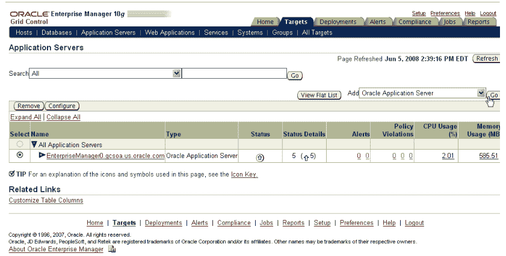

- 2. 在“添加应用服务器”页面上：
  - 点击放大镜图标选择主机。
  - 在弹出窗口中，选择主机的单选按钮并点击“Select”，如以下屏幕截图所示：

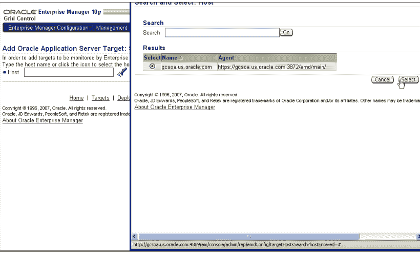

- 3. 在 **添加应用服务器** 页面上，右侧点击 **继续**。
- 4. 在 **发现应用服务器：结果** 页面上，点击 **确定**。
- 5. 在很短的时间内，您应该会得到一个确认页面。点击 **确定**。
- 6. 在 **应用服务器** 页面上，点击 **展开全部** 并查看您的应用服务器。

> 请注意此应用服务器的组件。请注意两个 OC4J 目标以及 Oracle BPEL Process Manager 目标。

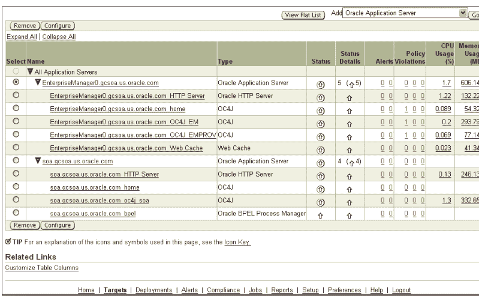

### 导航到 BPEL PM 目标主页

BPEL PM 目标是应用服务器目标的子目标。有多种方法可以导航到 BPEL PM 目标的主页；最常见的方法是点击 Oracle BPEL Process Manager 目标名称超链接。

> 在 Oracle BPEL Process Manager 主页上，您将看到“状态”标签，其中显示 BPEL PM 服务器的可用性状态、可用性（%）（最近 24 小时）、Oracle 主目录和主机。

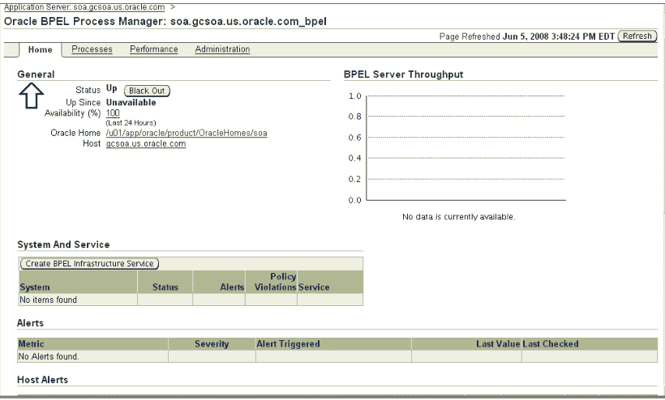

### 配置 BPEL PM 目标

一旦发现 BPEL PM 目标，管理员需要为目标提供基本配置信息。这使得 Grid Control 中的 BPEL 目标能够与 BPEL PM 服务器通信。这种通信是必要的，因为 BPEL 目标通过 API 轮询 BPEL PM 服务器来收集开箱即用的监控指标数据。

- 1. 在底部 **相关链接** 部分下，点击 **监控配置**。
- 2. 将 BPEL Process Manager 的管理员用户名输入为 **oc4jadmin**。
- 3. 将管理员密码输入为 *welcome1*。
- 4. 将 **初始上下文工厂** 输入为 **com.evermind.server.rmi.RMIInitialContextFactory**。
- 5. 将 **上下文提供程序 URL** 输入为 **opmn:ormi://<Application_Server_Host_Name>:6003:oc4j_soa/orabpel**。
- 6. 将其他字段留空并点击“确定”，如以下屏幕截图所示：

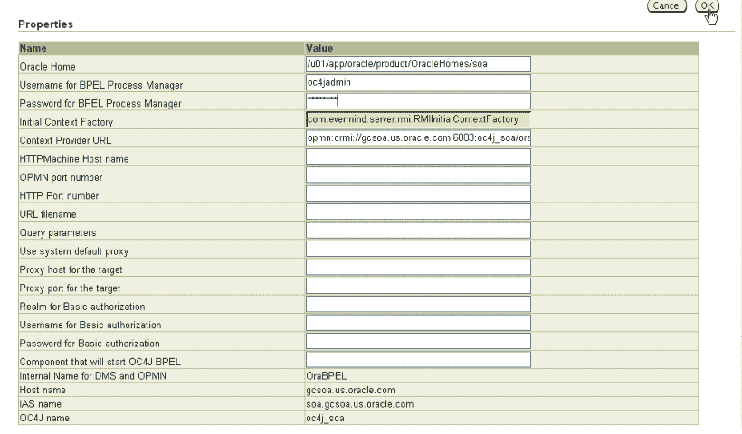

这完成了在 Oracle Application Server 上部署的 BPEL PM 目标的发现和配置。

### 摘要

发现是企业中管理目标的第一步。从单个控制台发现和管理多个目标是一种强大的方法，可以在保持标准化管理平台的同时快速掌握新项目。这避免了为增加受管目标数量的新项目聘用新的管理员。

在本章中，我们研究了如何发现和配置 BPEL PM 目标。

这些是启用后续管理任务的强制性步骤。我们通过发现应用服务器（在本例中为 Oracle Application Server）间接发现了 BPEL PM 目标。请注意，发现过程对于发现安装在 WebLogic 和 WebSphere 应用服务器上的 BPEL PM 目标是相似的。有关基于 WebLogic 和 WebSphere 应用服务器的 BPEL PM 的详细发现信息（包括 10.2.0.4 补丁）列在 Oracle Technology Network 上的以下文档中：

```
http://download.oracle.com/docs/cd/B16240_01/doc/em.102/e12650/toc.htm.
```

接下来的几章将演示动手练习，以设置并执行对已发现的 BPEL PM 目标的额外管理任务。


## 3
## BPEL 流程监控
了解 BPEL 流程的复杂性非常重要，这带来了对主动运营监控的额外需求。BPEL 流程是工作流的新一代。它们支持 SOA，这意味着它们使用通用的 **Web 服务调用框架 (WSIF)** 来编排不同系统之间的交互。WSIF 使 BPEL 能够构建外观以与任何支持 Web 服务的系统进行交互。在 BPEL 框架中，Web 服务交互被称为“partner links”。这对于编排涉及新系统和遗留系统的复杂业务流程非常强大。它为 IT 提供了企业范围业务流程的自动化框架。监控 BPEL 流程对于业务分析师和管理员维护业务可见性并快速解决问题非常重要。本章介绍查看已部署的 BPEL 流程及其构成的 partner links。此外，还介绍了使用指标和合成测试的组合来监控 BPEL 流程和 partner links。

Grid Control 提供了通过服务测试来监控关键 BPEL 流程、partner links 和 Web 服务的手段，以确定可用性和响应时间。Grid Control 还提供了衡量容器上部署的每个 Web 服务实际请求的关键指标的手段。通过结合最终用户和请求的视角，Grid Control 可以确定所有受监控服务的服务可用性。

- 挑战
- 解决方案
- 分步练习：
  - 导航到 BPEL PM 目标主页
  - 导航到 BPEL 流程主页
  - 创建 BPEL 流程聚合服务
  - 创建 SOAP 测试以监控 partner link
  - 创建 SOAP 测试以监控 BPEL 流程
  - 测试 SOAP 测试

### 挑战
一旦 BPEL 流程部署到暂存、预生产或生产环境中，管理员就会发现很难跟踪这些关键流程的健康状况。BPEL 领域缺乏工具和运营技能，因此在遇到问题时，很难理解该看哪里以及看什么。这些流程经常是关键业务功能的自动化表示，并且需要按预期工作。每个流程每天可能产生数百或数千个实例。如果任何流程在可用性或性能方面未按预期执行，管理员需要介入并解决问题。管理员需要尽快解决问题，通常花费大部分时间对问题进行分类，以了解潜在的根本原因。此外，在大多数情况下，最终用户会报告这些问题，无论是通过互联网的消费者还是关键业务合作伙伴。如果是这种情况，企业已经损失了收入或信誉，或两者兼有。

### 解决方案
Grid Control 提供了通过服务测试来监控关键 BPEL 流程、partner links 和 Web 服务的手段，以确定可用性和响应时间。Grid Control 还提供了衡量容器上部署的每个 Web 服务实际请求的关键指标的手段。Grid Control 可以利用其主动最终用户监控功能来确定所有受监控服务的服务可用性。

### 分步练习
这组分步练习将介绍 BPEL 流程主页的发现过程，以及为流程和 partner links 设置监控。

### 导航到 BPEL PM 目标主页
Grid Control 可以监控多种类型的目标。第一个任务是进入 BPEL PM 目标主页。所有 BPEL 特定的监控视图都可以在目标主页中查看。

1. 导航到 Grid Control 主页。
2. 在右侧的 **Target Search** 区域中，单击 **Search** 下拉菜单。
3. 向下滚动以定位并单击 **BPEL Process Manager target** 类型。
4. 单击 **Go** 按钮。
5. 显示已发现的 BPEL Process Manager 目标列表。单击所选的目标名称。这会带您进入 BPEL PM 目标主页。

> 如果只发现一个 BPEL Process Manager 目标，Go 按钮将自动带您进入该目标的主页。

### 导航到 BPEL 流程主页
BPEL 目标主页主要是基础设施视图。目标主页中有一个部分可用于查看 BPEL 流程列表及其监控指标。

1. 从 BPEL 目标主页单击 Processes 选项卡。

> 在此处发现并显示服务器上部署的所有 BPEL 流程。请注意，流程在它们部署的域内显示。表中还显示了汇总的流程实例吞吐量信息。这些指标默认情况下以预设的轮询频率（收集间隔）从 BPEL PM 服务器收集。可以轻松更改默认轮询频率，并为这些开箱即用的指标设置阈值，以便触发警报和通知（使用通知规则）。

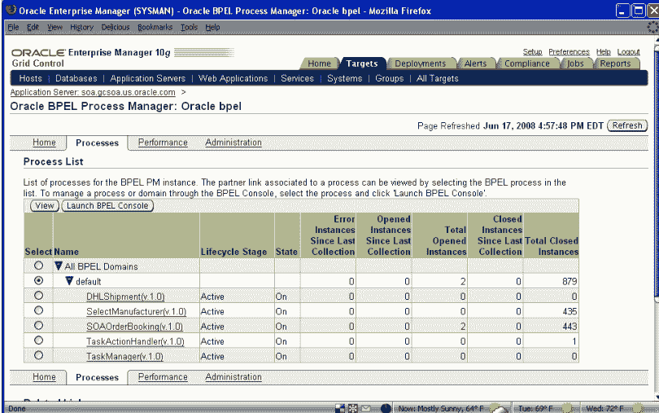

3. 单击默认域下的 BPEL 流程名称，例如 **SOAOrderBooking(v1.0)**。

> 这是单个 BPEL 流程页面。请注意流程特定的实例吞吐量图。在底部，请注意 BPEL 流程的所有 partner links（在底部）连同端口类型、操作和 WSDL 信息一起被发现。
> 
> 创建 BPEL 流程聚合服务。请注意，在尝试创建 BPEL 流程聚合服务之前，您需要创建 BPEL Infrastructure Service。有关如何执行此操作的说明在 *第 4 章* 中提供。

4. 从 BPEL 流程页面单击 **Create Service** 按钮，如以下屏幕截图所示：

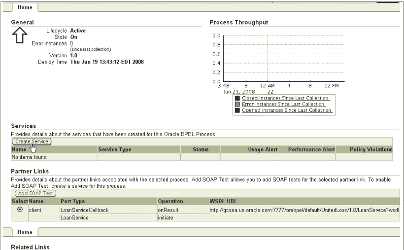

5. 观察聚合服务创建的确认消息。

> 创建的聚合服务列在 **Services** 部分下。之前创建的基础设施服务已自动与聚合服务关联。在 **Services** 部分，从左侧开始，您可以看到服务名称、服务类型、状态和其他警报。顶级服务是聚合服务。下一个服务是基础设施服务——聚合服务的子服务。

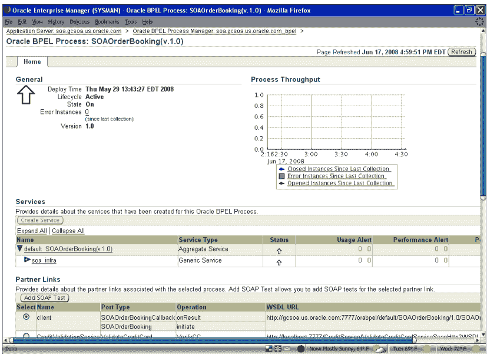

### 创建 SOAP 测试以监控 partner link
合成事务是一种主动方式，用于模拟最终用户（或客户端）行为并在最终用户（或客户端）之前发现问题。BPEL 流程通常通过 partner link 框架调用一个或多个 Web 服务，通常通过 SOAP。用于测试 BPEL partner link 可用性和性能的合成检查是发现服务消费者之前问题的绝佳方式。

1. 向下滚动并从单选按钮列表中选择一个 partner link 名称，例如 **SelectService**。

2. 单击 **Add SOAP Test** 按钮为该 partner link 创建 SOAP 测试。

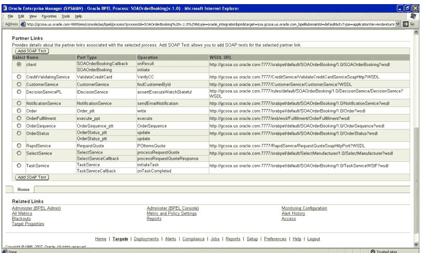

3. 将 SOAP 测试名称输入为 **SelectService_test**。
4. 将 **Collection Frequency (minutes)** 的测试间隔输入为 **15**。
5. 从 **Port Types** 下拉列表中选择 Web 服务端口为 **SelectServiceCallbackPort**。
6. 在 HTML 输入字段中输入输入参数，例如 **SupplierPrice {String}** 为 **12345**，**SupplierName [String]** 为 **2**。
7. 将 **Basic Authentication Credentials** 部分留空。
8. 在 **Create SOAP Test** 页面上的字段按以下屏幕截图所示填写后单击 **OK** 继续：

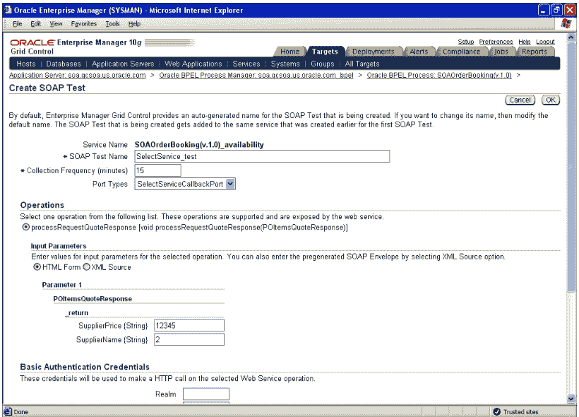

9. 添加一个信标。单击 Add 按钮。
10. 从弹出窗口中检查并选择可用的信标，如下一屏幕截图所示：


> Beacon 是已配置为发出合成测试以测试网站、Web 服务、邮件服务器、FTP 站点等的主机。Beacon 通常安装在防火墙外部，用户从该位置访问网站或 Web 服务。因此 Beacon “模拟” 终端用户行为并主动通知管理员网站或 Web 服务的任何问题。您可以在 Oracle Technology Network 上的 Grid Control 文档中阅读有关 Beacon 和服务管理的更多信息—http://otn.oracle.com。

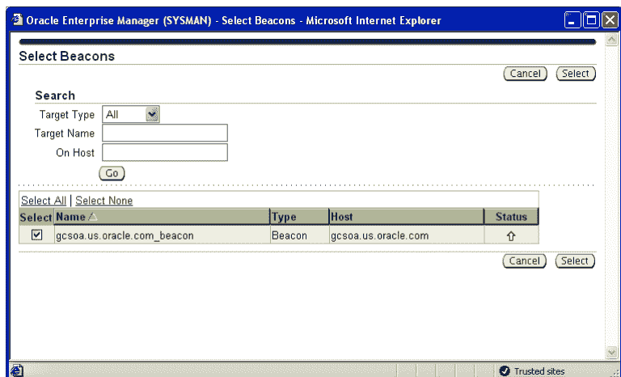

- 11. 单击 **确定** 以保存 SOAP 测试和 Beacon 设置。
- 12. 验证可用性流程创建并查看 SOAP 测试。在 BPEL 流程主页上，注意自动创建的可用性通用服务。
- 13. 展开流程可用性服务。例如，**SOAOrderBooking(v1.0)_availability**，并验证您刚刚创建的 SOAP 测试，例如 **SelectService_test**，是否已添加。

> BPEL 流程的可用性服务是在创建第一个 SOAP 测试时形成的。请注意每个测试的状态，以及如何汇总（可配置）以确定流程可用性。SOAP 测试的状态显示需要一些时间，具体取决于为测试设置频率。

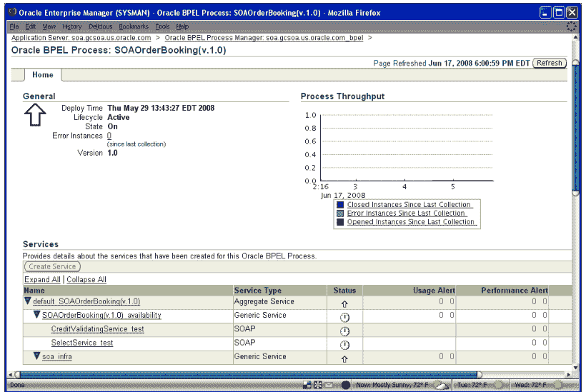

## 创建 SOAP 测试以监控 BPEL 流程

与通过合成检查监控合作伙伴链接类似，整体 BPEL 流程也可以以相同方式进行监控。BPEL 流程通常由 SOAP 客户端调用。可以按所需频率对其进行测试，以确保客户端始终可以实例化 BPEL 流程：

- 1. 转到 BPEL 流程主页。
- 2. 向下滚动并在 Partner Links 部分中找到客户端的单选按钮。

## BPEL 流程监控

- 3. 单击 **添加 SOAP 测试** 以为客户端创建 SOAP 测试，如以下屏幕截图所示：

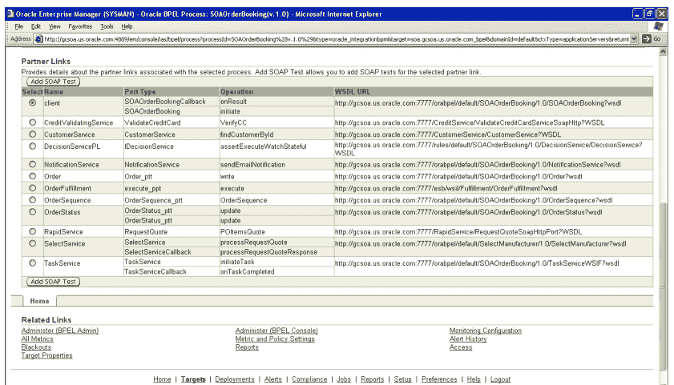

- 4. 将所需端口类型选择为 **SOAOrderBookingPort**。
- 5. 将输入参数的单选按钮选择为 **XML 源**。
- 6. 输入 SOAP 信封，包括任何头信息。您可以从现有的 BPEL 实例（来自 BPEL Control）复制此 SOAP 信封。复制并粘贴输入 XML 源中提供的 SOAP 有效负载。

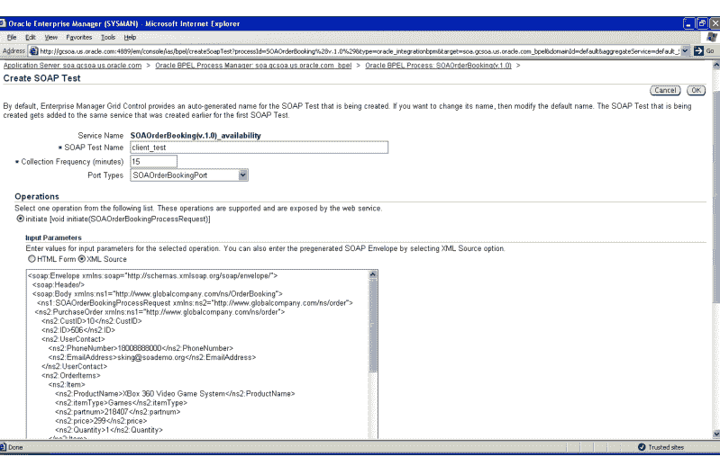

- 7. 单击 **确定** 完成客户端测试的创建。
- 8. 查看确认消息。
- 9. 展开可用性服务以查看 SOAP 测试。

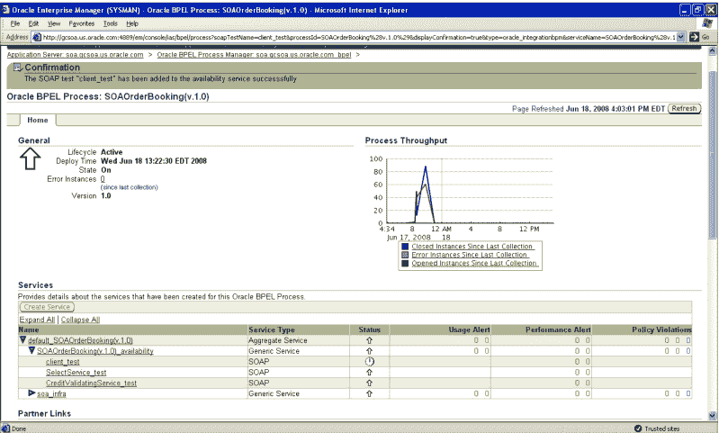

## 测试 SOAP 测试

应该有一种方法来跟踪 SOAP 测试的历史可用性和性能，并在通过阈值偏离正常行为时发出警报。当警报触发时，值班人员必须测试报告的问题是否仍然存在。即时按需测试是实现此目标的好方法。

- 1. 单击您创建的其中一个 SOAP 测试。测试页面显示测试可用性、运行此测试的 Beacon 以及与此测试关联的警报。以下图表显示了来自 Beacon 的测试响应时间：
- 2. 单击“验证服务测试”按钮。
- 3. 单击“执行测试”以即时运行测试并查看结果。

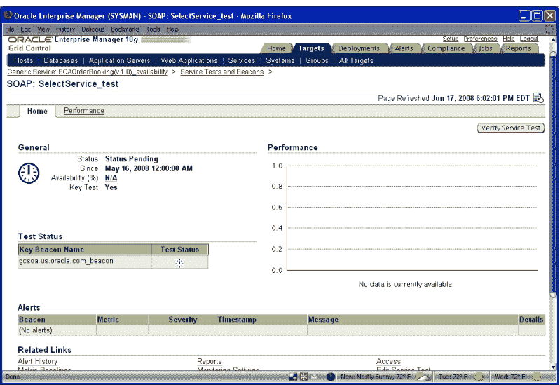

> 可以使用一个或多个 Beacon 来测试服务，可能来自模拟用户群的多个地理位置。这对于衡量终端用户体验的可用性和响应时间很有用。它可用于主动以及被动地复制用户报告的问题。

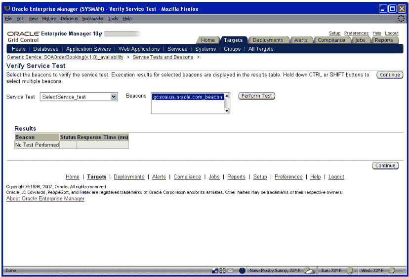

这完成了从 Grid Control 设置和查看 BPEL 流程监控的分步练习。

## 摘要

监控是保证企业关键业务流程健康的关键。在本章中，我们研究了如何使用合成测试监控合作伙伴链接和 BPEL 流程。特别是，我们研究了监控 BPEL 流程相关的挑战，以及 Grid Control 提供的解决方案。

我们研究了开箱即用的基本 BPEL 流程监控。此外，我们能够设置特定的主动检查来测试 BPEL 流程的可用性和性能。这些合成检查能够根据预设阈值通知管理员。此外，管理员能够按需运行这些合成检查并查看结果。

主动监控可以避免与这些业务流程交互的终端用户失去信任。有时防火墙内部一切正常，但终端用户仍无法访问这些流程。在这种情况下，必须在防火墙外部放置一个代理，以确保用户行为可以频繁复制，并且管理员可以收到通知。在大多数情况下，这些代理会在终端用户之前通知管理员。

下一章将逐步介绍动手练习，以设置并执行 BPEL 基础设施的额外管理任务，例如 BPEL 流程管理器服务器、应用服务器、数据库和主机。

## 4

## BPEL 基础设施管理

BPEL 安装涉及多个软件组件。对于基本单节点安装，有四个组件。第一个是脱水数据库，它持久保存 BPEL 元数据和 BPEL 实例信息，包括当前正在执行的实例（“in-flight” 实例）。第二个组件是为 BPEL 提供平台的应用服务器。BPEL 支持 Oracle WebLogic Server、Oracle Application Server、IBM WebSphere 和 JBoss。应用服务器由各种组件组成，例如 **Java 虚拟机** (**JVM**) 和 Web 服务器。最新的应用服务器平台认证列表可在以下位置找到：

```
http://www.oracle.com/technology/software/products/ias/files/oracle_soa_certification_101310.html.
```

第三个组件是 BPEL PM 服务器本身，它从根本上是一个 Java 应用程序。该应用程序作为 SOA Suite 安装的一部分与 Oracle Application Server 打包在一起。最后一个组件是托管应用服务器和数据库的硬件服务器和操作系统。

作为集成产品，BPEL 协调驻留在其他基础设施（不同于其自身基础设施）上的服务。这为负责支持 BPEL 编排及其相关故障的管理员带来了噩梦。

监控 BPEL 和扩展的基础设施对于 IT 保持可见性、收到通知并快速解决问题非常重要。本章讨论通过监控、查看配置更改和最佳实践策略违规来管理 BPEL 基础设施。具体来说，本章讨论：

- 挑战
- 解决方案
- 分步练习：
  - 创建 BPEL 基础设施服务
  - 查看 BPEL 基础设施服务
  - 查看系统警报和策略
  - 查看配置更改
  - 查看关键系统指标
  - 查看管理任务
  - 查看系统组件
  - 查看系统仪表板

## 挑战

关键业务流程通常会因依赖的基础设施故障而中断。管理员很难同时管理 BPEL 基础设施和其他现有基础设施系统。由于 BPEL 流程通过在数据库中不断存储状态来脱水，因此数据库中的任何中断或性能问题都会影响 BPEL 的脱水和再水合。还有其他基础设施组件，例如 Web 服务器、应用服务器和主机，这些组件需要正常运行才能使 BPEL 流程顺利运行。没有 BPEL 知识或培训的管理员可能不了解关键的基础设施组件是什么或如何管理它们。此外，与基础设施组件相关的最佳实践可能未知或难以实施。SOX 和 COBIT 标准已成为 IT 管理员必须了解、实施和监控的重要标准。


## 解决方案

Grid Control 监控 BPEL 基础设施组件的可用性。目标（如 BPEL PM 服务器）的当前和历史可用性都会被记录下来以便进行故障排除和根本原因分析。BPEL 基础设施系统和服务的可用性也会被记录。管理员可以在任何组件宕机时收到通知，或事后通过拓扑图进行故障排除，以了解导致服务故障的组件。通过允许管理员“集中管理”，大量组件的管理得以显著简化。通过将 BPEL 相关目标组合到系统中，管理员可以受益于丰富的系统管理功能，例如通过系统监控仪表板主动监控可用性的能力。管理员可以查看有助于 SOX 和 COBIT 合规性的运营最佳实践策略违规情况。

## 分步练习

本套分步练习将演示 BPEL 进程主页的发现过程，以及为进程和合作伙伴链接设置监控。

## 创建 BPEL 基础设施服务

创建基础设施组件的逻辑表示是设置有效监控的第一步。Grid Control 帮助管理员了解基础设施组件之间的关系。

- 1. 在 BPEL 目标页面上，单击“创建 BPEL 基础设施服务”按钮。
- 2. 在“创建服务”页面上，输入服务名称并单击“确定”，如下图所示：

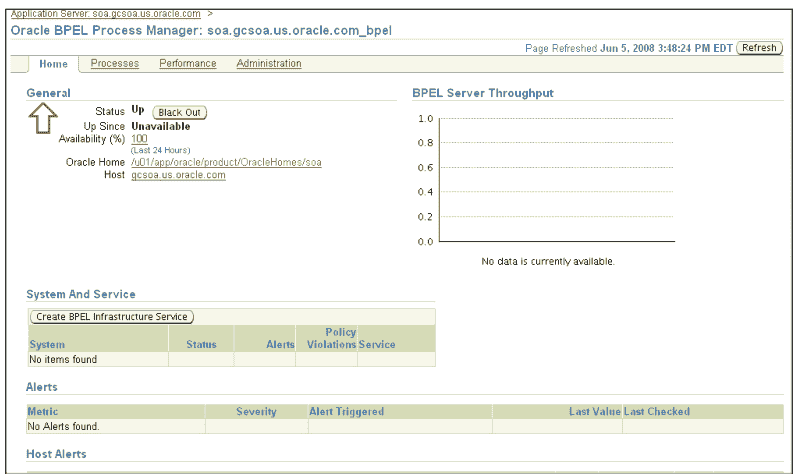

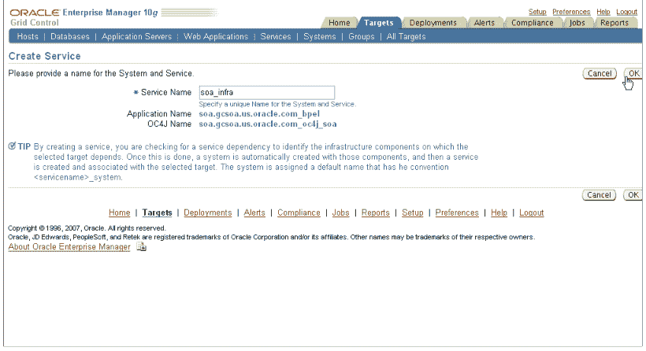

- 3. 您应收到一条确认消息。单击“确定”。

> 观察新创建的系统和服务、系统和服务状态、警报以及策略违规情况。

## 查看 BPEL 基础设施服务

基础设施服务创建后，查看并了解服务的底层组件很有用。

- 1. 导航到 BPEL 目标主页。
- 2. 在“系统和服务”部分下，单击“系统”。

> 这是系统主页。请注意显示系统组件状态的饼图。请注意右侧的警报、策略违规和安全策略违规。这些已汇总到所有系统组件。请观察依赖于此系统的服务、其状态、警报、违规等。在底部，请观察系统组件的最新配置更改。

## 查看系统警报和策略

Grid Control 监控各个系统组件并跟踪组件的所有警报以及不同类型的策略违规。

- 1. 在系统主页上，单击“警报历史记录”按钮。请注意每个系统组件的警告和严重警报历史记录。

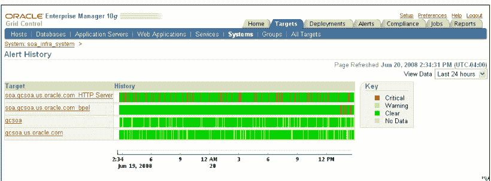

## BPEL 基础设施管理

- 2. 单击“系统”面包屑返回系统主页。
- 3. 单击当前的严重（红色叉号）或警告（黄色三角形）数字。

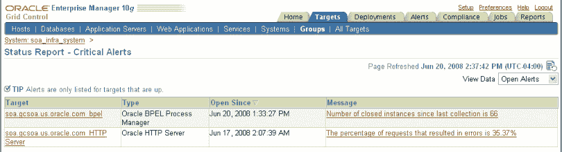

- 4. 请注意不同目标类型的警报。请注意下拉菜单，可用于查看当前警报以及历史警报。
- 5. 查看系统的策略（最佳实践）。

> Enterprise Manager 策略是一种运营最佳实践，可确保基于 Oracle 最佳实践对 Oracle 目标进行适当监控。数据库安全策略的一个例子是 SYSTEM 密码必须每三个月更改一次。如果未执行此操作，代理将标记违反此策略的数据库目标。开箱即用的 Grid Control 监控了超过 300 条针对数据库、应用服务器和应用程序的策略。在 Grid Control 10.2.0.5 中，还可以将自定义策略添加到库中并附加到目标。

- 6. 使用面包屑导航到系统主页。
- 7. 在“策略违规”部分下，单击违规计数。
- 8. 请注意系统组件的不同 Oracle“最佳实践”违规情况。

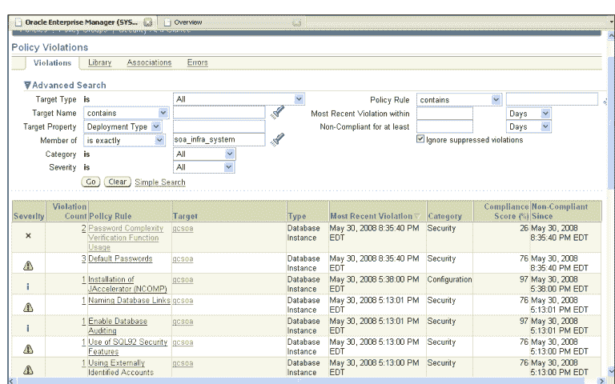

- 9. 单击策略规则以获取有关“最佳实践”的更多信息。
- 10. 使用浏览器后退按钮两次导航到系统主页。
- 11. 在“策略违规”部分下，单击“策略趋势概览”。
- 12. 请注意三个策略类别的趋势概览数据。

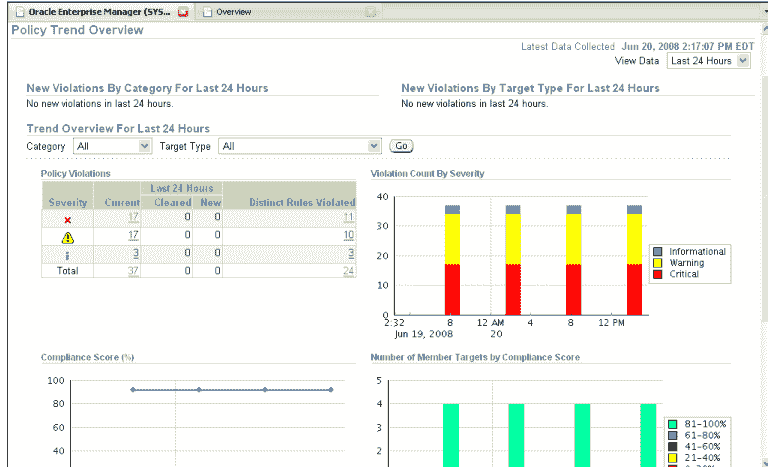

## 查看配置更改

Grid Control 为其所有受管目标收集配置信息。这对管理员理解和排查与基础设施更改相关的问题非常有帮助。

- 1. 单击 *系统* 面包屑前往系统主页。
- 2. 在 **配置更改** 部分下，单击 **所有目标类型**。
- 3. 查看所有系统组件的 **配置历史记录** 部分。

> 请注意所有系统组件的更改；深入到特定目标类型以查看更改。稍后有专门的配置管理章节。

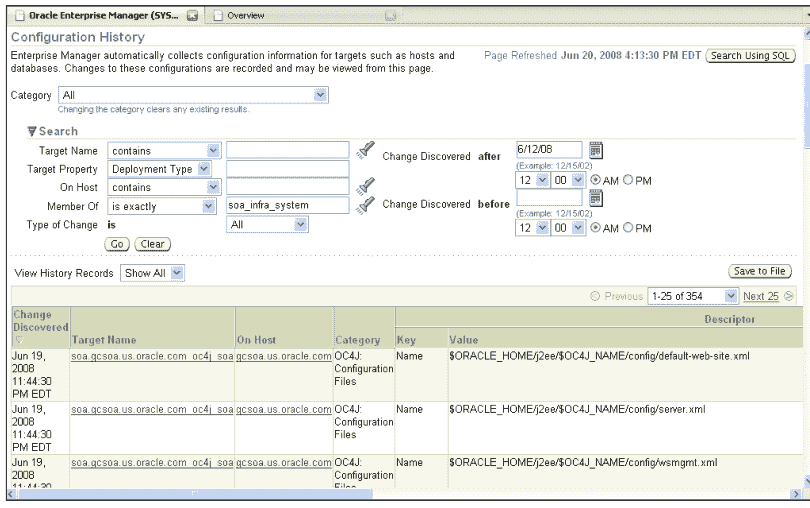

## 查看关键系统指标

Grid Control 的默认系统视图捕获系统的关键指标并将其显示给管理员。

- 1. 单击 Web 浏览器上的后退按钮返回系统主页。
- 2. 单击“图表”子选项卡。

> 请注意本页上绘制的系统组件的关键指标。提供了一个下拉菜单来更改图表的时间范围。本页上显示的指标集是可配置的。

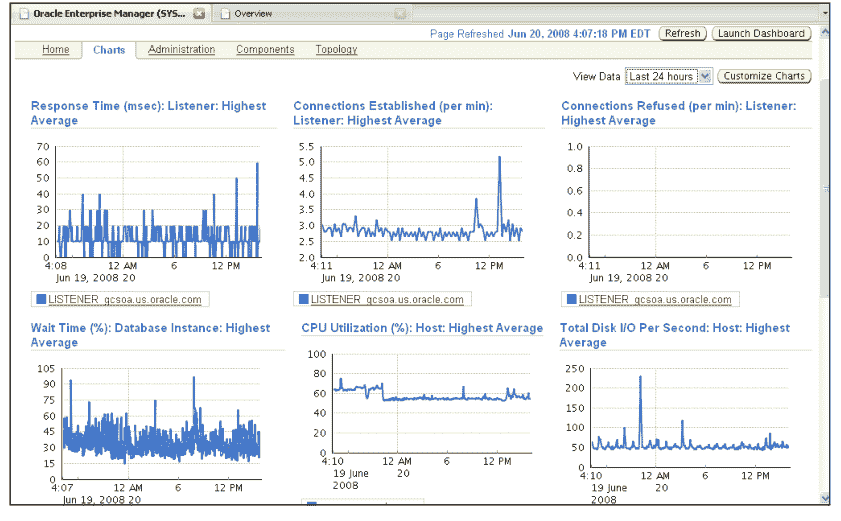

## 查看管理任务

管理员可以从 Grid Control 启动其他多个管理任务。

- 1. 单击“管理”选项卡。

> 请注意系统组件的 **作业活动**，以及可直接从本页启动的其他管理任务。

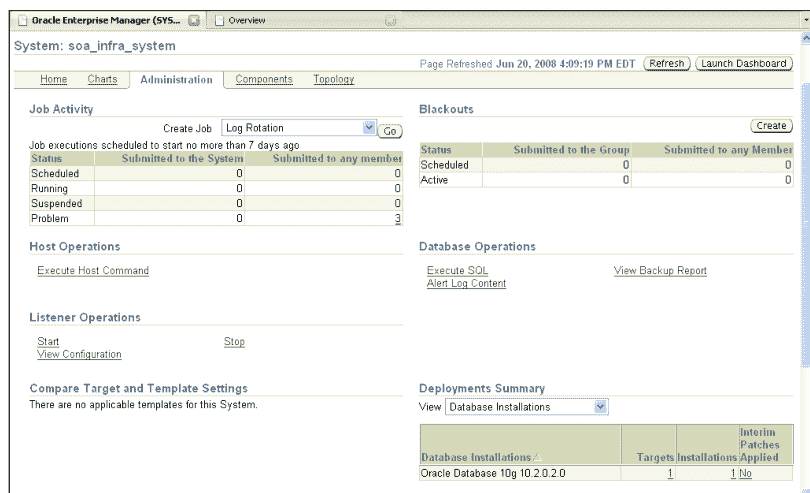

## 查看系统组件

查看系统组件可让管理员确定系统的一部分是什么，以及什么会影响系统的整体可用性。

- 1. 单击 **组件** 选项卡。

> 本页显示此系统的所有组件。系统组件可用性之间的“与”或“或”关系决定了系统本身的可用性。

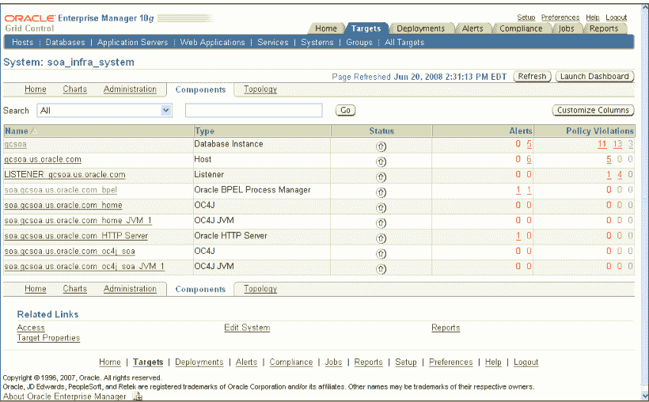

## 查看系统仪表板

系统仪表板是网络操作中心分析师查看系统组件当前状态及其关键指标的有用工具。

- 1. 单击右上角的 **启动仪表板**。

> 系统仪表板一目了然地显示系统组件的状态和关键指标。如果有任何警报，也会显示在底部。这对于有兴趣查看关键系统组件、其状态和停机信息的 IT 经理来说是一个有用的视图。

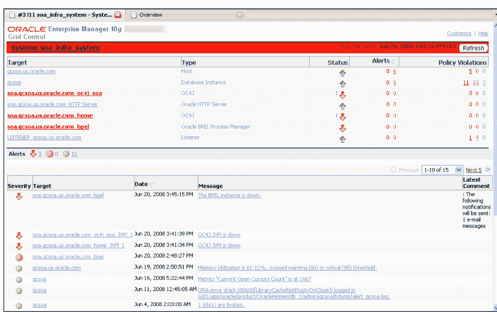

## 总结

有效监控 BPEL 基础设施对于 SOA 项目的成功至关重要。Enterprise Manager 提供了使用现有基础设施组件有效监控 BPEL 基础设施组件的方法。我们研究了基本挑战、解决方案以及解决不同领域的分步练习。特别是，我们创建了 BPEL 基础设施服务并查看了该服务、其底层系统和组件，以及警报、指标和配置更改。最后，我们在系统仪表板中查看了系统组件。

了解关键组件并创建系统来表示它们是实现系统管理的第一关键步骤。这使 IT 部门能够监控、管理更改并实施最佳实践策略以符合 SOX 和 COBIT 标准。

接下来的几章将逐步介绍动手练习，以设置并执行 BPEL 进程和 BPEL 基础设施的额外服务级管理任务。


## 5

## BPEL 服务级别管理

服务提供商面临着要求日益提高的消费者，他们希望服务更快、可用性更高、性能更好。越来越多的关键业务服务（如电子邮件、存储、服务器和数据库）以服务形式使用，因此消费者无需担心拥有和维护软件和硬件。消费者期望无论是内联网还是互联网服务都获得高可用性和高性能。服务停机可能导致服务提供商和消费者收入损失，并对双方的信誉造成损害。此外，若干服务提供商必须遵守诸如 **信息技术基础设施库（ITIL）**、**信息及相关技术控制目标（COBIT）** 和 **审计准则公告第70号（SAS 70）** 等 IT 框架。这些框架要求 IT 衡量服务可用性和性能，以满足审计、合同义务和客户满意度的需求。

在服务不仅大量存在而且相互交互的环境中，治理服务可用性和质量变得异常困难。BPEL 环境涉及多个正在被编排的服务。所有参与的服务都需要在合同使用条款范围内进行管理。这对于企业对企业（或合作伙伴）合同以及企业对消费者合同都极其重要。大多数服务提供商在合同中提供退款保证，如果服务质量低于双方约定的可用性和性能预期，消费者可以行使该保证。

使用统一的服务级别期望监控 BPEL 流程和合作伙伴链接，对于 IT 监控服务期望并解决问题以确保服务级别协议得到满足非常重要。本章讨论通过设置和监控服务级别来管理 BPEL 流程和合作伙伴链接的期望。具体而言，本章讨论：

- 挑战
- 解决方案
- 分步练习：
  - 查看 BPEL 流程可用性服务
  - 添加服务性能指标
  - 设置服务级别期望（可用性）
  - 查看服务可用性定义
  - 查看 BPEL 基础设施服务
  - 添加基础设施性能指标
  - 添加基础设施使用指标
  - 设置服务级别期望（基础设施）
  - 查看基础设施可用性定义
  - 查看 BPEL 流程聚合服务
  - 查看聚合服务可用性定义
  - 添加聚合服务性能和使用指标
  - 设置服务级别期望（聚合服务）

## 挑战

在日益服务导向的环境中，服务和系统可用性以及响应时间对提供商和消费者的最终收益有直接且切实的影响。BPEL 业务流程、网上银行、在线商店和在线股票交易都是需要被监控并对合作伙伴和终端用户保持可用的业务应用示例。通常，在使用这些服务时，管理员面临的一些常见问题是：

- 保证服务的可用性
- 服务的性能以及是否符合终端用户的期望

应用程序和基础设施性能不佳可能导致业务成本，包括客户忠诚度和销售机会的丧失。

## 解决方案

Grid Control 通过自动定义一个或多个代表企业中运行的业务流程的服务模型来解决这些问题。当为合作伙伴链接创建了一个或多个服务测试（SOAP 测试）时，会创建覆盖业务流程的自动化服务模型。使用这些服务测试（模拟终端用户功能），管理员可以衡量关键合作伙伴链接或外部 Web 服务的性能和可用性，在出现问题时接收警报，识别常见问题并诊断故障原因。监控服务有助于确保运营目标和服务级别协议得到满足。

## 分步练习

这组分步练习将指导如何为 BPEL 流程设置服务级别，并设置可用性和性能指标以监控 BPEL 流程及其相关可用性、基础设施和聚合服务的服务级别。列出了一些关键服务定义：

- **通用服务**：这是 Grid Control 对提供给消费者的任何服务的表示。Web 应用有专门的服务。对于 Web 服务和 BPEL 流程，通用服务用作包装器以继承 Grid Control 服务功能。
- **可用性服务**：这是 Grid Control 中 BPEL 流程的表示，用于衡量流程的运营可用性和响应时间。可以在服务级别进一步设置和衡量服务级别目标。
- **系统**：这是一组相关的基础设施组件，如数据库、应用服务器、JVM、BPEL PM 等。
- **基础设施服务**：将系统建模为服务表示，以便为整个系统设置和衡量服务级别目标。
- **聚合服务**：这是一个更高级别的服务，由一个或多个通用服务组成。
- **服务级别协议（SLA）**：这是提供商和消费者之间的合同协议。通常，它包括可用性（例如，每季度 99.99% 服务正常运行时间）和性能（例如，登录页面应在三秒内返回）指标。SLA 合同中经常有退款保证，当面临服务可用性和性能不佳时，消费者可以行使该保证。
- **服务测试：** Grid Control 服务可以使用模拟终端用户的合成检查来测试可用性和性能。由于 SLA 通常从终端用户角度衡量，服务测试非常有用，并在 SLA 中广泛使用。

### Viewing the BPEL process availability service

Grid Control 会自动创建 BPEL 流程的内部服务表示。这很有用，因为可以应用正常的 Grid Control 服务功能。第一步是导航到 BPEL 流程可用性服务：

1. 在 BPEL 目标页面上，单击 **BPEL 流程** 选项卡。
2. 在默认域下单击 BPEL 流程名称 `<process_name>`，即 **SOAOrderBooking(v1.0)**。

> 聚合服务、可用性服务、通用服务和基础设施服务可能已经创建。如果没有，请按照前几章中的步骤创建这些服务。

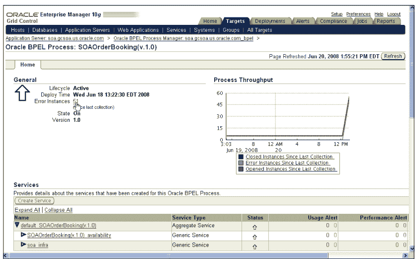

3. 单击 `<process_name_availability>` 服务名称——**SOAOrderBooking(v1.0)_availability**。

> 这是服务主页。请注意该服务过去 24 小时的 **可用性（%）**、**实际服务级别（%）** 和 **预期服务级别（%）**。请注意该服务的 **关键测试摘要** 详情。先前章节中 instrumented 的 SOAP 测试会显示在此处。

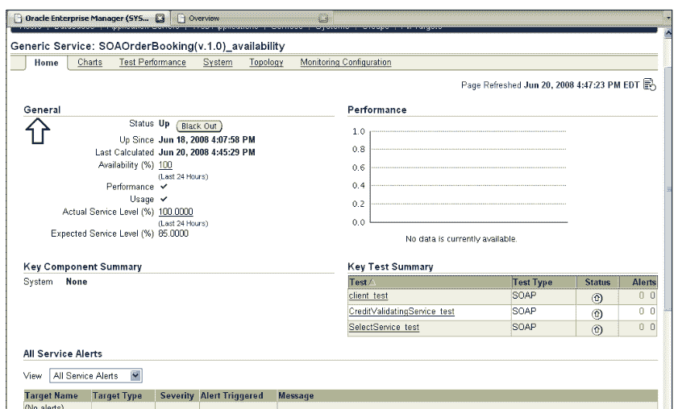

### Adding service performance metrics

Grid Control 服务不仅可以按可用性衡量，还可以按性能衡量。响应时间等性能指标对于衡量和告警（基于阈值）很有用，以便在消费者投诉之前运营人员就能收到警报。

1. 在服务主页上，单击 **监控配置** 选项卡。
2. 单击 **性能指标** 链接。
3. 添加基于服务测试的性能指标 **基于服务测试**，然后单击 **Go**。


4. 对于第一个下拉列表中的每个 **服务测试**，从第二个下拉列表中选择 **响应时间（毫秒）** 作为指标，如以下屏幕截图所示：

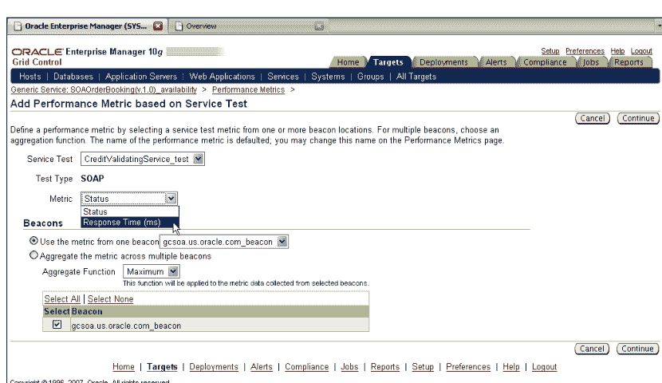

5. 单击 **继续**。

6. 将指标名称从 **Service_Test 响应时间（毫秒）** 编辑为 **信用验证响应时间（毫秒）**。

7. 输入 **警告阈值** 和 **严重阈值** 时间（毫秒），即分别为 **3000** 和 **5000**。单击 **确定**，如以下屏幕截图所示：

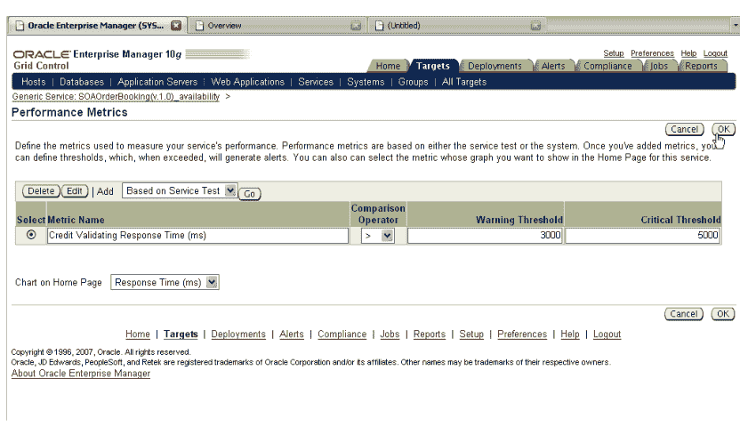

8. 重复步骤 3-7，根据需要为其他服务测试的响应时间添加性能指标。

## 设置服务级别期望（可用性）

对于服务提供商，Grid Control 提供了一种设置服务级别期望并据此进行衡量的方法。服务级别期望可以根据一段时间内可用性和性能基准来定义。

- 1. 从底部的 **相关链接** 部分单击 **编辑服务级别规则**。
- 2. 将 **预期服务级别** 从默认值更改为此服务所需的数值，即 **99.0**。
- 3. 查看 **实际服务级别** 部分中的默认值。
- 4. 在 **营业时间** 部分，将 **开始时间** 和 **结束时间** 更改为与消费者讨论过或消费者期望的所需业务窗口；例如，**开始时间 08:00** 和 **结束时间 18:00**。
- 5. 将默认的 **可用性标准** 更改为符合业务标准。考虑计划停机（停电）以及它们在计算中是否被视为正常运行时间。
- 6. 在 **性能标准** 下，从 **可用性能指标** 中选择一个或多个指标。
- 7. 单击 **确定**，如以下屏幕截图所示：

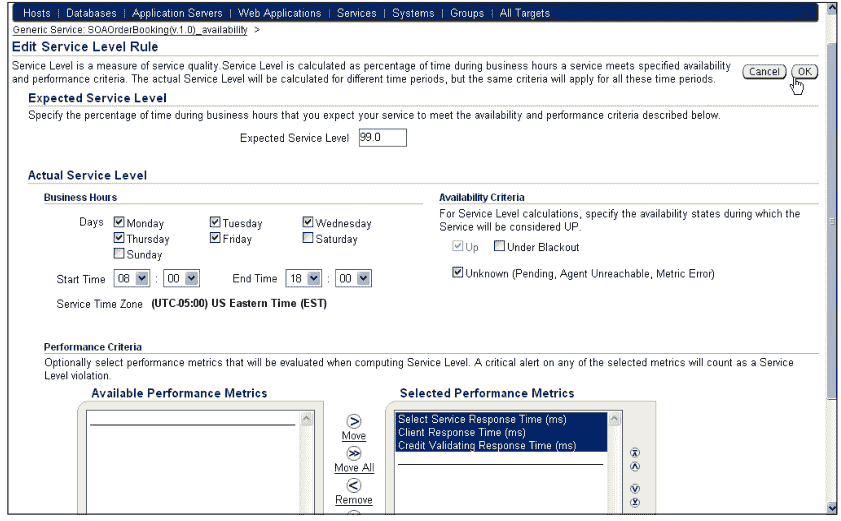

## 查看服务可用性定义

可用性定义可以基于一个或多个关键测试来定义，例如登录测试和响应时间测试。它取决于提供商和消费者之间的合同。Grid Control 具有灵活性，允许提供商根据合同要求编写任何公式。

- 1. 单击 **监控配置** 选项卡。
- 2. 单击 **可用性定义**。

> 请注意基于服务测试确定可用性的依据。默认情况下，所有服务测试均设置为“关键”服务测试。“关键”测试用于确定可用性。非关键测试数据也会被历史收集，但不用于可用性判定。

- 3. 单击 **取消**。

## 查看 BPEL 基础设施服务

BPEL 基础设施服务封装了运行 BPEL 流程所需的基础设施组件。

- 1. 单击 **目标服务** 选项卡。
- 2. 找到上一章中创建的基础设施服务（通用服务）。
- 3. 单击基础设施服务以进入服务主页。

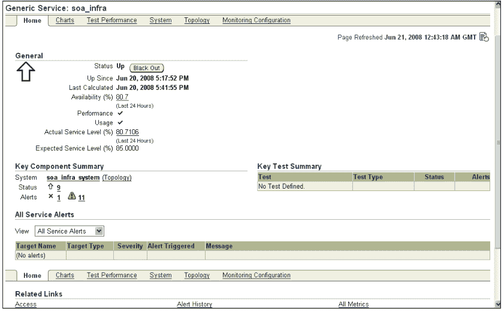

## 添加基础设施性能指标

服务测试指标很重要，但基础设施指标也可以用来表示服务中断。

- 1. 单击 **监控配置** 选项卡。
- 2. 单击 **性能指标** 链接。

3. 如下一屏幕截图所示，对于已列出的默认性能指标，输入以下部分指标的 **警告阈值** 和 **严重阈值**：

- OC4J 实例 – 请求处理时间（秒）：3 和 5
- 事务数（每秒）：20 和 50
- 活动线程最高数量 [默认]：5 和 10
- CPU 利用率（%）：80 和 95
- 平均同步进程延迟（毫秒）[默认]：3000 和 5000
- 平均异步进程延迟（毫秒）[默认]：3000 和 5000

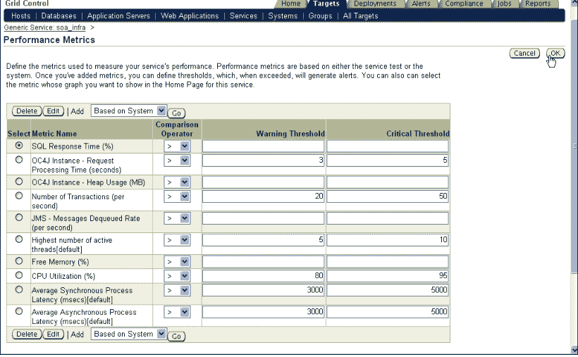

4. 将主页上的图表下拉菜单更改为显示 CPU 利用率。

5. 单击 **确定** 并在确认屏幕上单击 **是**。

## 添加基础设施使用指标

使用指标不计入可用性，但对于评估服务的增长很有用。性能和使用通常是并排查看的指标。

- 1. 单击 使用指标 链接。
- 2. 对于已列出的默认使用指标，输入以下部分指标的警告阈值和严重阈值：
- 自上次收集以来打开的实例 [默认]：20 和 50
- OC4J 实例 – 活动会话：5 和 10
- OC4J 实例 – 活动请求：20 和 50
- 自上次收集以来关闭的实例 [默认]：20 和 50
- 3. 将主页上的图表下拉菜单更改为显示 OC4J 实例 – 活动请求，如以下屏幕截图所示：

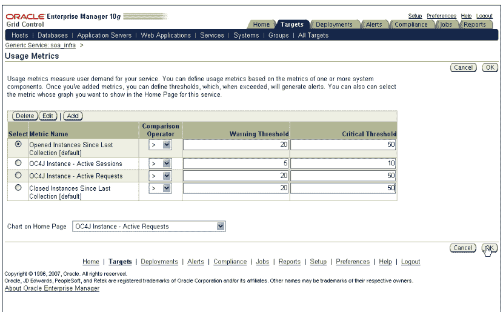

4. 单击 确定 并在确认屏幕上单击 是。

## 设置服务级别期望（基础设施）

与为服务设置和衡量期望的方式类似，也可以对一组逻辑基础设施组件进行期望和衡量。

- 1. 从底部的 **相关链接** 部分单击 **编辑服务级别规则**。
- 2. 将 **预期服务级别** 从默认值更改为此服务所需的数值，即 **99.0**。
- 3. 查看 **实际服务级别** 部分中的默认值。
- 4. 在 **营业时间** 部分，将开始和结束时间更改为与消费者讨论过或消费者期望的所需业务窗口；例如，**开始时间** 为 **08:00**，**结束时间** 为 **18:00**。
- 5. 将默认的 **可用性标准** 更改为符合业务标准。考虑计划停机（停电）以及它们在计算中是否被视为正常运行时间。
- 6. 在 **性能标准** 下，从 **可用性能指标** 中选择一个或多个指标。
- 7. 参考以下屏幕截图完成上述步骤并单击 **确定**。

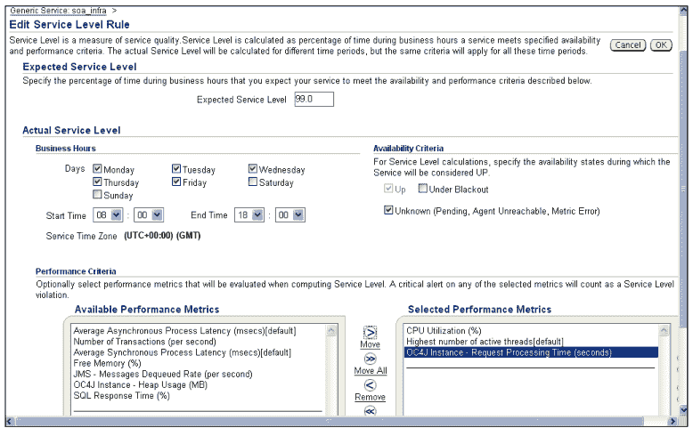

## 查看基础设施可用性定义

这与查看服务可用性定义类似，只是底层组件可用性用于衡量可用性，而不是服务测试。

- 1. 单击 **监控配置** 选项卡。
- 2. 单击 **可用性定义**。

> 请注意基于系统组件确定可用性的依据。默认情况下，所有组件均设置为“关键”组件。“关键”组件用于确定可用性。非关键组件数据也会被历史收集，但不用于可用性判定。

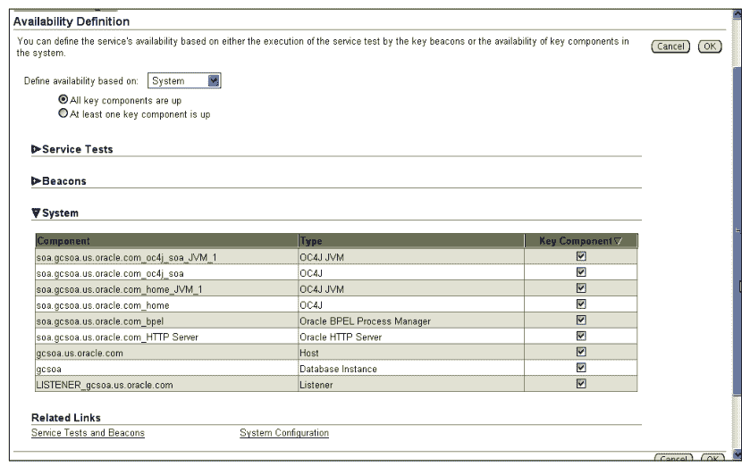

3. 单击 **取消**。

## 查看 BPEL 流程聚合服务

聚合服务是可用性服务和基础设施服务的集合。当企业中存在许多服务时，这种逻辑分组使得查看和监控这些服务变得容易。

- 1. 单击 目标 | 服务 选项卡。
- 2. 找到之前创建的聚合服务。
- 3. 单击聚合服务以进入服务主页。

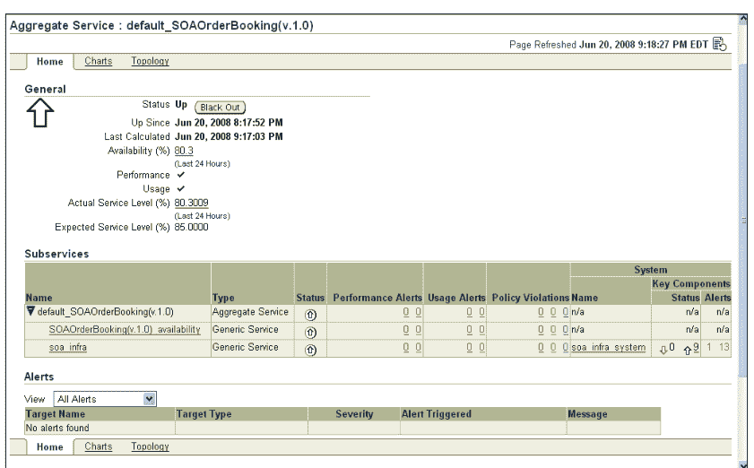

## 查看聚合服务可用性定义

聚合服务的可用性定义取决于底层组件服务。

- 1. 在底部的相关链接下，单击 编辑服务。

> 请注意此聚合服务对子服务的依赖关系。请注意基于两个子服务 AND 关系的可用性定义。

## 添加聚合服务性能和使用指标

底层服务指标可以提升到聚合服务级别，以确保关键指标对网络运营控制管理员以及高管可见。

- 1. 在 **编辑服务** 模式下单击 **性能** 选项卡。
- 2. 单击 **添加** 按钮以提升子服务指标。
- 3. 选择 **基于多个服务的统计聚合** 选项。
- 4. 将 **函数** 下拉菜单设置为 **最大值**。
- 5. 为 **子服务** 添加行，即 **SOAOrderBooking(v.1.0)_availability（通用服务）**。
- 6. 如以下屏幕截图所示，为所选 **子服务** 指标选择 **指标名称**；例如，**客户端响应时间（毫秒）**、**选择服务响应时间（毫秒）** 和 **信用验证响应时间（毫秒）**。

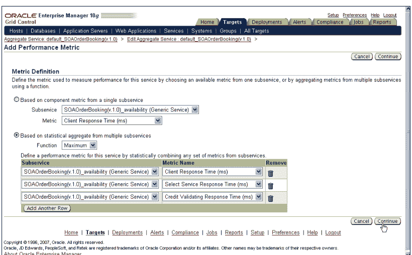

- 7. 单击 **继续**。
- 8. 将 **指标名称** 编辑为合适的名称，即 **平均 BPEL 响应时间（毫秒）**。


- 9. 输入适当的警告和严重阈值；例如，**3000** 和 **5000**。
- 10. 添加另一个性能指标。点击 **添加** 按钮。
- 11. 从 **子服务** 下拉菜单中选择基础设施服务。
- 12. 选择相关的基础设施指标，即 **CPU 利用率 (%)**。
- 13. 点击 **继续**，如下图所示：

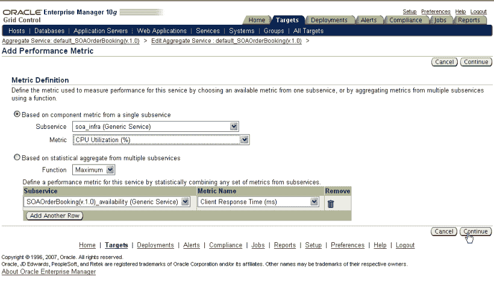

- 14. 注意警告和严重阈值已从子服务继承。保持在同一级别或根据需要修改。
- 15. 点击 **确定**。

## 设置服务等级期望（聚合服务）

这与为其他服务设置的期望类似。

- 1. 从底部 **相关链接** 部分，点击 **编辑服务等级规则**。
- 2. 将 **预期服务等级** 从默认值更改为此服务所需的数值，例如 **99.0**。
- 3. 查看 **实际服务等级** 部分中的默认值。
- 4. 在 **营业时间** 部分，将开始和结束时间更改为与消费者讨论过或消费者期望的所需业务窗口，即 **开始时间** 为 **08:00** 且 **结束时间** 为 **18:00**。
- 5. 将默认的 **可用性标准** 更改为符合业务标准。考虑计划停机（黑屏）以及它们是否被视为计算中的正常运行时间。
- 6. 在 **性能标准** 下，从 **可用性能指标** 中选择一个或多个指标。
- 7. 点击 **确定**，如下图所示：

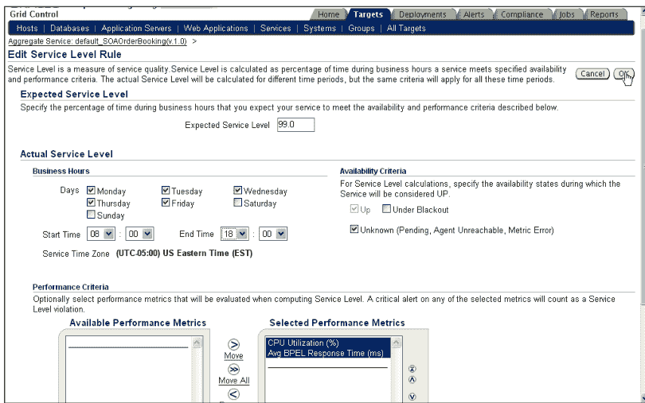

- 8. 从聚合服务主页，点击 **图表** 选项卡。

> 注意本页图表中跟踪的已提升性能指标，并在图表上显示阈值。

## 摘要

有效监控 BPEL 服务对于监控消费者期望和保持信誉至关重要。Grid Control 提供了通过基础设施服务及其关联有效监控 BPEL 服务的方法。

在本章中，我们讨论了 Grid Control 如何围绕 BPEL 流程和 BPEL 基础设施设置服务模型。内置的服务等级期望和利用可用性和性能指标进行的测量使得监控这些服务变得容易。此外，指标可以基于服务测试或基础设施指标。

将关键服务组件与基础设施组件关联起来，并从一个集成视图监控它们，对于管理员设置和控制消费者期望至关重要。

接下来的几章将逐步介绍动手练习，以设置服务仪表板来监控为企业配置的服务。

## 6

## BPEL 服务仪表板

大多数 IT 部门都有服务台或帮助台，作为客户的单一联系点。服务台团队负责作为记录客户报告事件的第一线沟通。服务台分析师负责记录客户事件、验证服务健康状况和可用性，并通知相关 IT 部门有关新问题。

BPEL 流程经常负责关键业务功能，例如计费、费用报告和订单履行。对于公司范围的服务，服务台需要跟踪这些关键流程。当用户因这些流程而向服务台投诉时，分析师需要查看一个通用仪表板以验证每个流程的状态。分析师需要了解流程不可用或性能不佳的时间有多长，以及预设的 **服务等级协议 (SLAs)** 是否已被违反。他们需要迅速采取行动，确保新事件由 IT 管理员及时记录并纠正。本章讲述创建仪表板以监控关键 BPEL 流程并监控每个流程的关键指标和 SLA。特别地，本章讲述：

- 挑战
- 解决方案
- 分步练习：
  - 导航到 **报表** 选项卡
  - 创建 SOA 服务仪表板
  - 查看 SOA 服务仪表板

### 挑战

服务台需要一个通用仪表板来监控关键 BPEL 流程。大多数企业缺乏有效的仪表板会导致服务提供商和消费者之间沟通不畅。此外，没有通用仪表板，SLA 无法有效监控。缺乏透明度导致信任缺失，服务提供商的信誉受损，即使流程可用性和性能符合 SLA。

### 解决方案

Grid Control 通过服务仪表板显示关键服务的可用性和关键指标。服务台分析师、IT 管理员以及 IT 高管可以通过使用这些仪表板跟踪当前和历史服务等级。自上而下的服务仪表板使 IT 组织能够从最终用户服务角度进行管理。通过例外管理，支持人员可以在客户投诉或 SLA 违规之前深入研究问题服务，以确定故障的根本原因。

### 分步练习

这组分步练习将逐步介绍创建服务仪表板以监控关键 BPEL 流程的过程。

### 导航到报表选项卡

Grid Control 具有创建、发布和查看标准和自定义报表的能力。这些报表作为存储在 Grid Control 仓库中的监控和配置数据的窗口。

- 1. 从 Grid Control 主页，点击 **报表** 选项卡。
- 2. 搜索 **服务监控仪表板**。


> Grid Control 为监控、安全和合规提供多个开箱即用的报表。这些报表由服务仪表板补充，服务台可以使用这些仪表板监控关键服务。

### 创建 SOA 服务仪表板

仪表板是众多报表类型之一。与其他 Grid Control 报表一样，有许多可配置方面，例如源或目标、要显示的内容以及显示的时间段。仪表板可以在不同的时区显示，具有自动刷新功能，并能够显示一个或多个有趣的时间窗口，例如最近一天、最近一周和最近一个月。

- 1. 选择 **服务监控仪表板** 旁边的单选按钮。
- 2. 点击 **创建类似**，如下图所示：

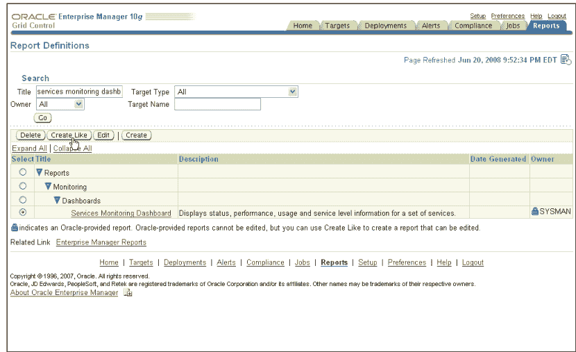

- 3. 输入 **标题** 为 **SOA 服务仪表板**。
- 4. 将其他字段保持为默认值。

### BPEL 服务仪表板

- 5. 如以下截图所示，在 **目标** 部分下，选择 **使用指定的目标** 单选按钮。
- 6. 点击 **元素** 选项卡。

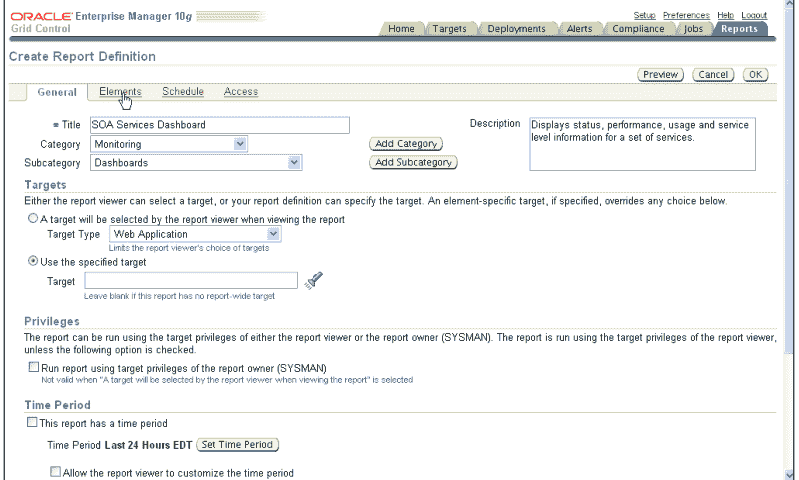

- 7. 点击 **设置参数**。
- 8. 编辑标题为 **SOA 服务仪表板**。
- 9. 更改与您地理位置相关的时区。例如，**(UTC-08:00) 美国太平洋时间 (PST)**。
- 10. 在 **服务** 部分，选择所有 SOA 相关服务（除 EM 服务外）。
- 11. 将 default_SOAOrderBooking(v.1.0) 聚合服务移动到所选列表的顶部，如下图所示：

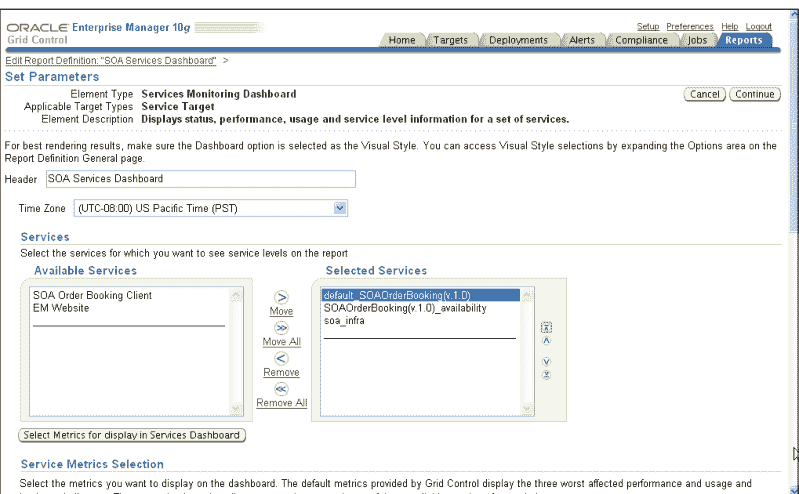

- 12. 点击 继续。
- 13. 点击 确定 以保存仪表板设置。

### 查看 SOA 服务仪表板

一旦仪表板创建完成，您可以查看它并查看关键服务的状态和健康状况。每个服务都有红色、黄色和绿色指示器，这可以很好地鸟瞰所有服务。

- 1. 导航到报表选项卡。
- 2. 搜索标题 SOA 并点击 转到。


3. 单击 SOA Services Dashboard 链接。

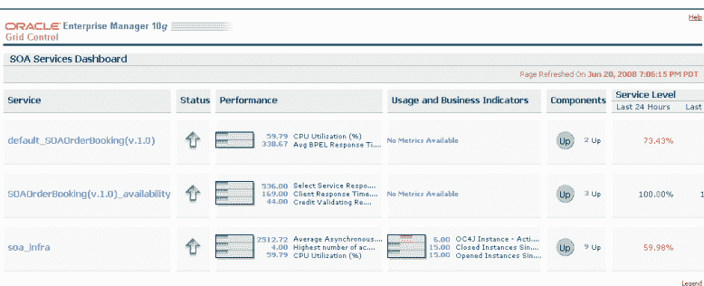

> 查看关键 SOA 服务的性能和使用指标。服务仪表板可以根据系统管理员的需求进行自定义。

4. 单击 SOAOrderBooking(v.1.0)_availability 的箭头。展开可用性服务以查看底层服务测试及其各自的可用性。

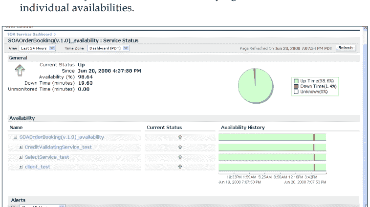

5. 单击 **返回**，返回到 SOA 服务仪表板。单击基础设施服务的箭头。注意所有组件以及组件的汇总统计信息。

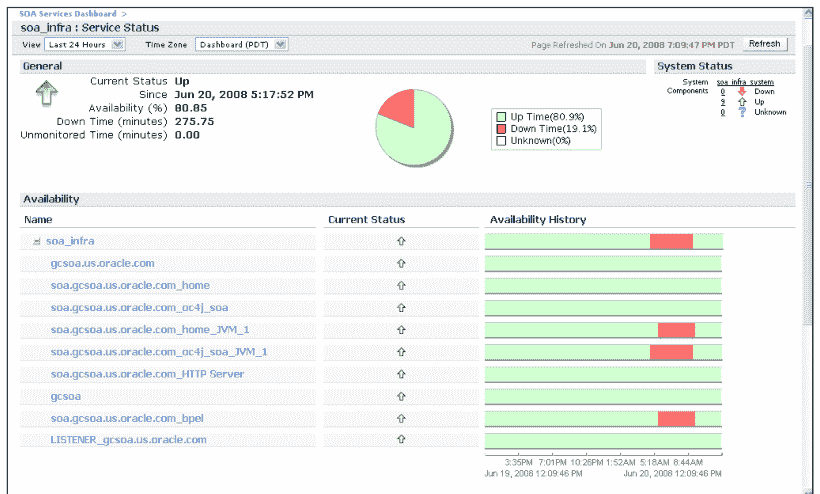

## 摘要

服务仪表板对于向内部或外部用户提供服务的任何组织都至关重要。Grid Control 允许服务台分析师、IT 管理员和 IT 高管通过服务仪表板可视化关键服务方面。

在本章中，我们讨论了报告作为配置和监控数据的可视化工具的价值。我们创建了一个包含关键 SOA 服务的新仪表板，然后查看该仪表板以了解服务的状态和健康状况。

请注意，这些服务仪表板可以公开，供所有员工查看服务健康状况和可用性的统一来源。这在大型企业中很常见，用于查看电子邮件服务、ERP 和 CRM 服务以及关键 BPEL 流程的状态。这类似于一种程序正义方法，其中提供者和消费者都了解共同的 SLA 目标以及对这些目标的遵守程度。

接下来的几章将逐步介绍动手练习，以部署 BPEL 流程并管理 BPEL 环境的配置。
