## 7 BPEL 部署自动化

在大多数中大型企业中，应用程序开发人员编写代码，然后将其“抛过墙”给运维团队。运维团队现在负责在预发布和生产环境中部署和维护此代码。开发和运维团队通常隶属于不同的管理链，两者之间缺乏协调。

BPEL 流程开发和部署遵循相同的 methodology。管理员必须处理多个可能相互依赖的 BPEL 流程“suitcases”。通常，BPEL 流程部署应遵循企业现有的 methodology。运维团队应集中维护部署工件，并且该位置应与开发团队使用的位置不同。部署本身应是一个定义明确的流程，具有一系列可重复的步骤。此外，企业最佳实践集应在部署时被调用。本章介绍以标准化方式将多个 BPEL 流程 suitcases 部署到多个 BPEL 环境。具体来说，本章讨论：

- 挑战
- 解决方案
- 逐步练习：
  - 查看软件库
  - 上传 BPEL suitcases 到软件库
  - 查看 BPEL 流程配置部署流程
  - 安排 BPEL suitcase 部署
  - 查看计划部署的状态
  - 查看已部署的流程

### 挑战

在生产环境中部署应用程序是一项挑战。管理员必须在固定的时间窗口内将多个应用程序文件部署到多个目标。这耗时且需要对这些应用程序的专业知识。在 BPEL 环境中，当管理员必须手动处理 *ant 脚本* 以在生产环境中部署 BPEL suitcases 时，挑战更大。*Ant* 对于开发人员在开发机器上处理部署时来说是一个很棒的实用工具，但管理员并没有真正具备定制或构建生产级部署实用工具的专业知识。集中控制 suitcases 是第一个挑战，管理员必须跟踪 suitcases 以遵守变更和发布管理指南。接下来，部署本身就是一个挑战，因为管理员需要在指定的顺序中部署流程、调用可能需要的任何自定义脚本，并遵守计划的维护窗口。

### 解决方案

使用 Grid Control，管理员可以使用软件库和部署流程框架将多个 BPEL 流程 suitcases 部署到多个 BPEL PM 域。管理员收集部署信息的工作由 Grid Control 简化，后者已发现目标并知道目标的大多数关键属性，例如主机名、应用程序服务器名称、端口等。第一步是将 BPEL 流程 suitcases 上传到软件库以进行集中跟踪和部署。软件库还允许运维团队跟踪 suitcases 的成熟度和使用情况，以及其他软件组件，例如操作系统映像、数据库和应用程序服务器主目录。然后，五步访谈流程让用户选择源 suitcase 文件、选择目标 BPEL PM 和域、设置凭据，并使用作业系统安排未来的部署。

### 分步练习

这组逐步练习将介绍上传和部署 BPEL 流程 suitcases 的过程。

### 查看软件库

Grid Control 软件库是一个运行时版本控制系统。开发人员完成业务流程开发后，工件可以传递给（或由）软件库进行运营跟踪和部署。

1. 从 Grid Control 主页单击 Deployments 选项卡。
2. 单击 Provisioning 子选项卡。
3. 展开 Components 以显示不同的组件类型。

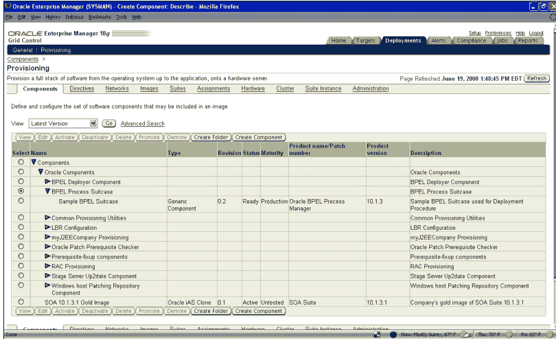

> 软件库包含多个对象，例如操作系统映像、数据库和应用程序服务器的 Oracle 主目录、BPEL 的部署工件等。库用于跟踪这些组件在各种受监控目标上的使用成熟度。

4. 展开 Oracle Component | BPEL Process Suitcase。

> BPEL suitcase 是 BPEL 流程部署单元。它是一个 jar 文件，封装了 BPEL 流程的所有组件，例如 .bpel、一个或多个 .xsd 以及一个或多个 .wsdl 文件。

5. 查看软件库的一部分的示例 BPEL suitcase。

### 上传 BPEL suitcases 到软件库

BPEL 流程项目被打包成“BPEL suitcase”，这是一个自包含的部署工件。管理员可以使用此工件部署到各种环境。

1. 为 **BPEL Process Suitcase** 选择单选按钮。
2. 单击 **Create Component** 按钮。
3. 在 **Describe** 步骤中输入以下值：
   - 将 **Type** 选择为 **Generic Component**。
   - 名称为 **ParallelFlow**。
   - 描述为 **Parallel Flow Sample**。
   - 将其他字段留空。
4. 单击 **Next**，如下图所示：

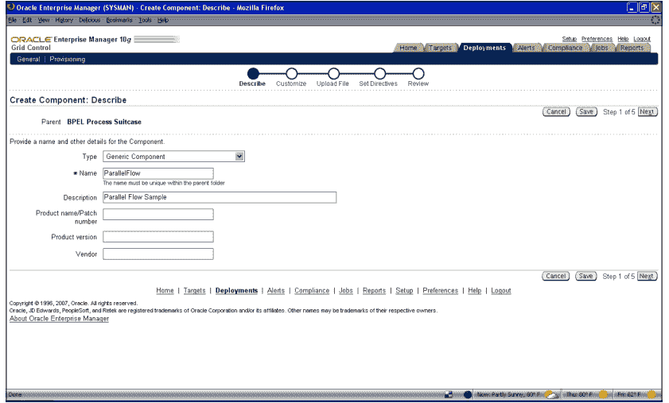

5. 在 **Customize** 步骤中，保留默认值并单击 **Next**。

6. 在 **Upload File** 步骤中：
   - 选择 **Upload from Local Machine**。
   - 单击 **Browse...** 按钮。
   - 找到 BPEL suitcase jar 文件夹。
   - 对于当前示例，选择 `bpel_parallel_flow.jar`。

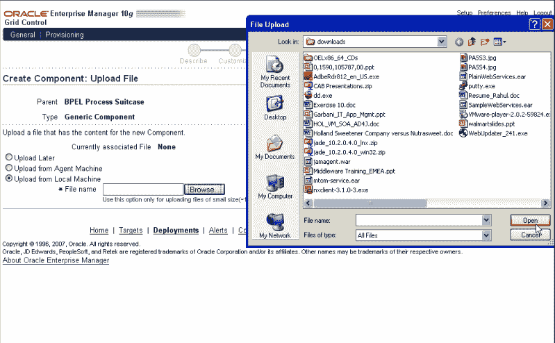

7. 单击 **Next**。
8. 在 **Set Directives** 步骤中，选择 **Stage** 并单击 **Next**。
9. 在 **Review** 步骤中，注意详细信息，然后单击 **Finish**。
10. 注意确认消息以及新添加的 BPEL suitcase。

11. 重复上述步骤以向软件库添加其他 BPEL suitcases。

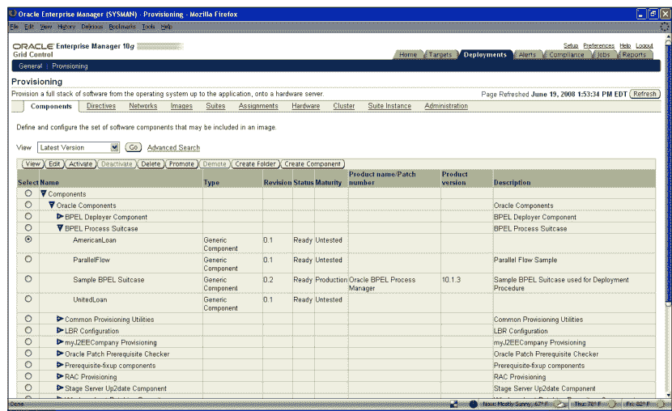

### 查看 BPEL 流程配置部署流程

Grid Control 包含多个部署流程，用于自动化各种管理活动。

1. 从 Grid Control 主页单击 **Deployments** 选项卡。
2. 向下滚动以找到 **Deployment Procedure Manager** 部分。
3. 单击 **Deployment Procedures** 链接。

> 部署流程是一系列逻辑步骤，用于自动化与 Oracle 产品相关的关键管理任务。这些复杂的管理任务大多列在“Enterprise Deployment Guide”中。请注意开箱即用的各种部署流程——数据库配置、RAC 扩展、应用程序服务器配置等。这些部署流程也可以自定义。

4. 单击 **BPEL Process Provisioning** 链接。

5. 注意该流程下的步骤：

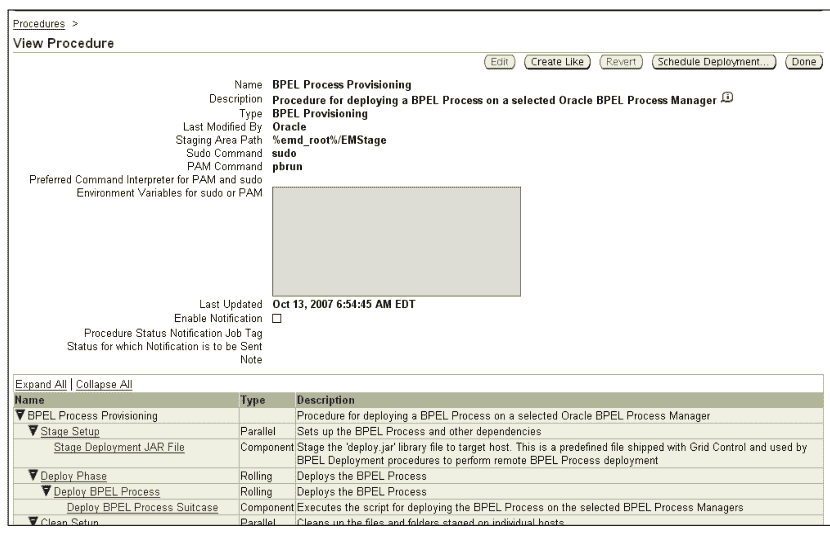

## 安排 BPEL suitcase 部署

管理员的主要任务是安排开箱即用的部署流程一次性运行，或按计划运行。

- 1. 从上一步继续，点击 **Schedule Deployment** 按钮。
- 2. 在 **Source Selection** 步骤中：
  - 点击 **Add** 选择源 suitcase 捆绑包。

> 这些捆绑包在实际部署前存储在 Grid Control 软件库中。

## BPEL 部署自动化

- 从现有的 suitcases 中，您可以选择一个或多个进行部署。例如，选择 **ParallelFlow**、**UnitedLoan** 和 **AmericanLoan**。
- 点击 **Select** 继续。

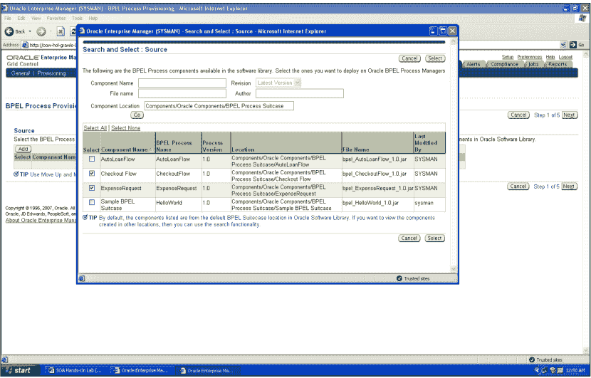

- 使用 **Move Up** 和 **Move Down** 按钮来排序部署。

> 在 BPEL 环境中，部署顺序至关重要，其中 partner links 通常在调用它们的 BPEL 流程之前部署。

- 点击 **Next** 继续。

3. 在 **Target Selection** 步骤中，按下一截图所示执行以下步骤：

- 点击 **Add** 从受管 BPEL 目标列表中选择一个或多个目标；例如，选择 **gcsoa.us.oracle.com_bpel**。
- 点击 **Select** 继续。

- 对于每个 BPEL 目标，从 **BPEL Domain** 下拉菜单中选择 **default**。
- 点击 **Next** 继续，如以下截图所示：

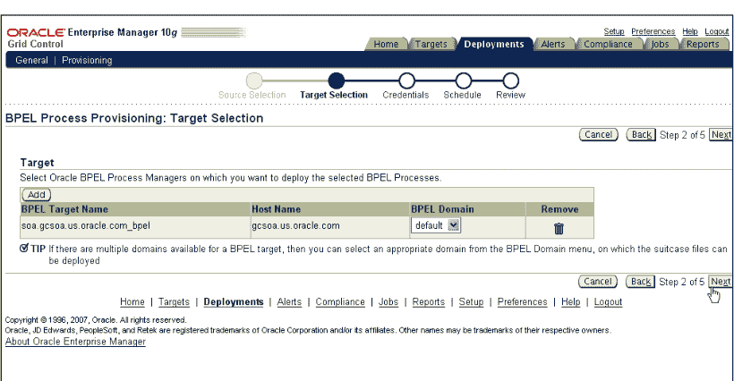

4. 在 **Credentials** 步骤中，按下一截图所示执行以下步骤：

- 在 **Application Server Credentials** 下提供主机凭据；即 **Username** 为 **oracle** 且 **Password** 为 *welcome1*。
- 点击 **Next** 继续。
- 在 **BPEL Process Manager Credentials** 下，提供域级访问；即 **Username** 为 **oc4jadmin** 且 **Password** 为 *welcome1*。

这些主机和 BPEL Process Manager 的凭据可以存储在 Grid Control “Preferred Credentials” 页面中并重复使用。

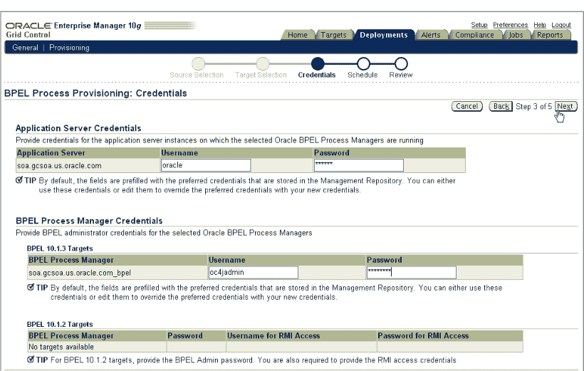

点击 Next。

5. 在 Schedule 步骤中，按下一截图所示执行以下步骤：

- 点击 One Time (Later) 并选择开始日期（例如，2008 年 6 月 23 日），开始时间可以是几分钟后。
- 在 Instance Name 字段中输入 BPEL Process Provisioning。
- 点击 Next 继续，如下一截图所示：

部署可以立即安排或安排在未来时间，通常在客户维护窗口期间。Grid Control 作业系统负责作业调度和管理。

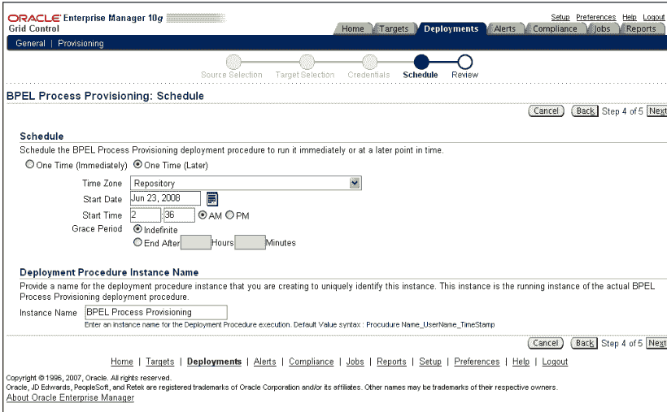

- 6. 在 Review 步骤中：
  - 在提交部署作业之前查看所有信息。

在准备就绪时点击 **Finish**，如以下截图所示：

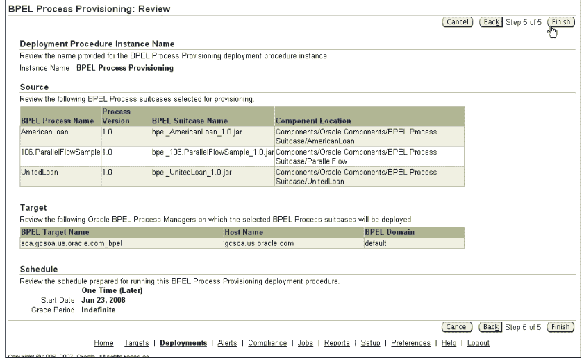

## 查看已安排部署的状态

Grid Control 提供了从其作业页面观察整体部署状态和各个步骤状态的手段。

- 1. 从上一步继续，从 **Procedure Completion Status** 选项卡中找到 **BPEL Process Provisioning** 作业。
- 2. 点击 **BPEL Process Provisioning** 作业查看详情，如以下截图所示：

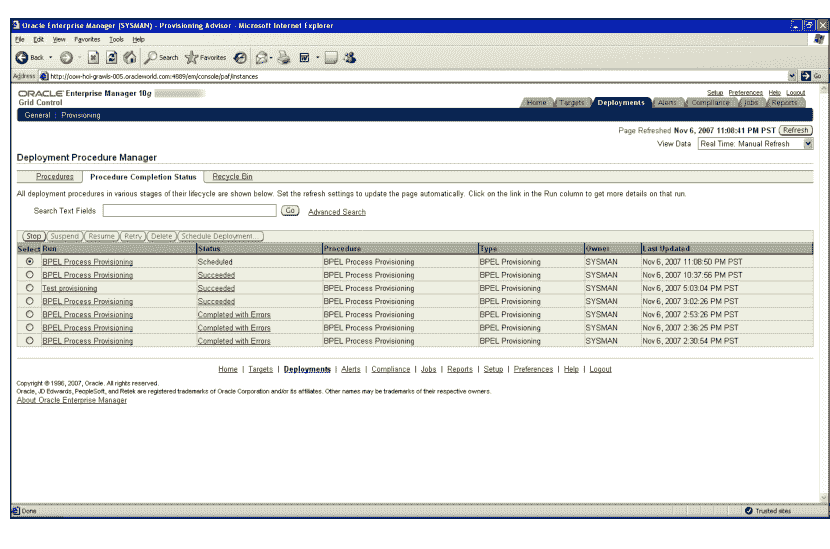

作业状态页面显示已安排作业的详细信息，包括经过的时间和如有错误消息。

- 3. 使用右上角的 **Refresh** 按钮查看进度。
- 4. 等待作业成功完成。
- 5. 注意 **Status** 和 **Completed Date** 值。

## 查看已部署的流程

一旦部署成功完成，您可以在 BPEL 控制台上验证新流程：

- 1. 导航到 BPEL 目标主页。
- 2. 点击 **Processes** 选项卡。
- 3. 点击右上角的 **Refresh** 按钮。
- 4. 在列表中注意新部署的流程。

## 摘要

部署是运营管理员的关键任务。借助 Grid Control 软件库和部署流程功能，管理员可以管理 BPEL suitcases，并安排和自动化部署。

在本章中，我们讨论了如何利用 Grid Control 的开箱即用部署功能。管理员可以查看部署流程，选择合适的流程，安排部署并观察部署过程。这是一个强大的自动化框架，可用于在多个环境中重复部署并同时进行。还有其他部署变体可能有用，例如在部署结束后再运行自定义脚本。

在 Grid Control 版本 10gR5 中，还支持部署计划（随 BPEL 10.1.3.4 引入）方法。换句话说，包含测试、暂存和生产环境 partner links 详细信息的部署计划文件可以上传到软件库。在安排部署时可以使用此文件，partner link 更改将自动完成。客户通常会复制开箱即用的部署流程，并添加几个自定义步骤，使用自研脚本在部署之前或之后执行。

接下来的几章将通过动手练习介绍如何管理 BPEL 环境的配置。
