## 8 BPEL 配置管理

在企业中管理软件和硬件资产的配置很重要，原因有几个。“了解你拥有什么”使 IT 管理员能够做出关于未来投资和淘汰旧资产的决策，标准化现有资产，在整个企业中管理变更，并排查与配置相关的性能问题。

当今大多数配置管理解决方案都符合 **IT Infrastructure Library (ITIL)** 框架所规定的最佳实践。所有资产都存储在称为 **Configuration Management Database (CMDB)** 的中央存储库中。配置参数例如数据库的 `init.ora` 参数，或 WebLogic 应用服务器的 `startup` 参数，或 HTTP 服务器的端口号都存储在 CMDB 中。对这些参数的任何更改也会被跟踪。然后可以轻松地审计特定资产的更改，将资产相互比较（例如 database1 和 database2），比较同一资产的不同版本，将参考配置保存到 CMDB，并用其在整个企业中标准化。本章讨论管理 BPEL 环境的配置。具体来说，本章讨论：

- 挑战
- 解决方案
- 分步练习：
  - 导航到 BPEL 目标配置管理：
    - 查看最后收集的配置
    - 将配置快照保存到存储库
- 导航到 Oracle Application Server 配置管理：
  - 查看最后收集的配置
  - 将配置快照保存到存储库
- 对 BPEL 环境进行更改
- 对 Oracle Application Server 环境进行更改
- 将当前 BPEL 配置与已保存的基线进行比较
- 比较同一流程的 BPEL 流程版本
- 将当前 Oracle Application Server 配置与已保存的基线进行比较
- 查看与已保存基线进行比较的应用服务器目标比较结果

## 挑战

跟踪所有 IT 系统的配置很困难。IT 部门经常求助于 Excel 电子表格来存储关键的 IT 系统信息。这使得 IT 部门在进行更改、衡量影响以及识别因配置错误导致的性能问题方面变得缓慢，并增加了管理数据中心的成本。对于 BPEL 环境，很难对工作配置进行基线化并将其与不工作的配置进行比较。在将它们推出生产之前，没有好的方法来比较连续的 BPEL 流程版本。

## 解决方案

借助 Grid Control，BPEL PM 服务器和流程的关键配置指标会被收集并存储在 Grid Control 配置管理数据库中。这是存放监控信息的同一数据库存储库。管理员可以查看 BPEL 环境中历史配置更改。他们还可以通过将其保存到存储库中来对工作配置进行基线化。BPEL PM 服务器和域的配置参数可以与其他服务器和域进行比较。最后，还可以比较 BPEL 流程版本以观察连续部署之间的更改。

## 分步练习

这套逐步练习将演示如何管理 BPEL 和应用服务器目标的配置。

### 导航至 BPEL 目标配置管理

Grid Control 为其所有受管目标（如数据库、应用服务器、BPEL PM 等）提供了丰富的配置管理功能。

- 1. 导航到 BPEL 目标主页。
- 2. 单击 Administration 选项卡。
- 3. 注意与目标配置管理相关的链接。

> Grid Control 配置管理框架每天收集 BPEL 的关键配置参数。这些参数存储在 Grid Control 仓库中。关键配置任务可从此处访问。

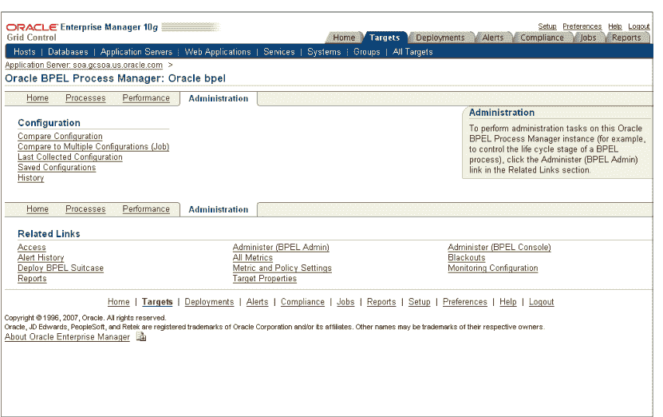

### 查看最后收集的配置

Grid Control 代理按固定间隔（默认 24 小时一次）收集配置指标并上传到配置管理仓库。这使 Grid Control 能够跟踪受管目标的配置历史。有多种方式查看配置历史，其中之一是最后收集的配置。

- 1. 单击 **Last Collected Configuration** 查看配置参数。
- 2. 在 **Last Collected Configuration** 页面查看配置设置。
- 3. **Process Manager** 选项卡显示有关服务器的通用信息，包括 URLs、dehydration store 和 cluster 参数。

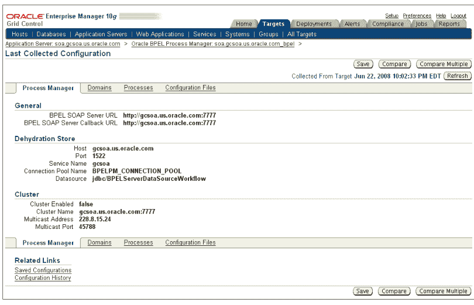

- 4. 单击 **Domains** 子选项卡。**Domains** 选项卡列出 BPEL 域以及每个域的重要配置参数。

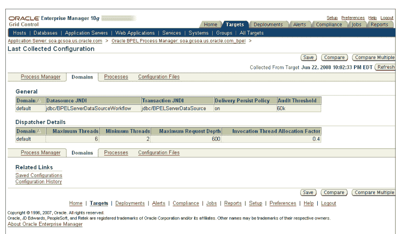

- 5. 单击 **Processes** 子选项卡。**Processes** 选项卡显示已部署流程的列表，其中包含版本信息、底层文件和最后修改时间。

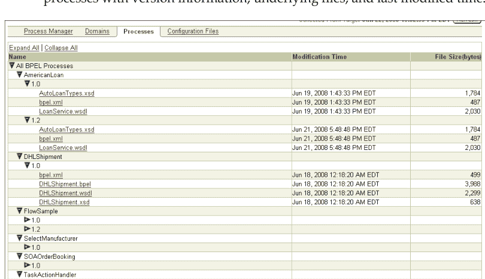

### BPEL 配置管理

- 6. 单击 **Configuration Files**。BPEL 服务器的关键配置文件现已存储在 Grid Control 仓库中并在此选项卡上显示。您可以单击文件以只读模式查看其内容。

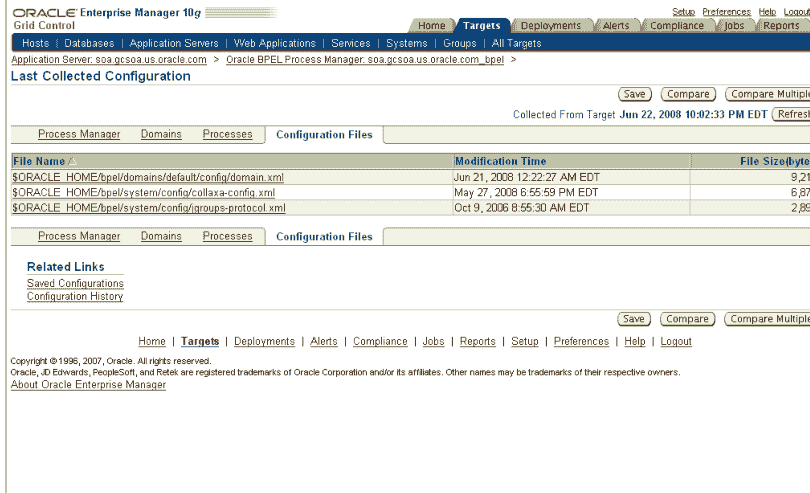

### 将配置快照保存到仓库

在大型企业中，跨目标类型标准化配置非常重要。这有助于维护简便，也对合规性很重要。为了标准化配置，Grid Control 提供了基于现有目标配置创建“gold”配置的方法，然后可将其用于与其他目标进行标准化：

- 1. 单击右上角的 **Save** 按钮。
- 2. 选择 **Save to EM Repository** 选项。

- 3. 输入描述，例如 GCSOA_<date>_BPEL_Baseline，如以下屏幕截图所示：

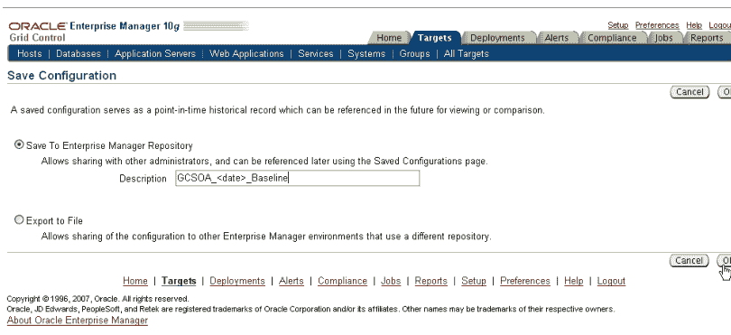

- 4. 单击 OK 将当前配置保存到 Grid Control 仓库。

- 5. 注意确认消息以及带有时间戳、名称、描述、保存日期和所有者的已保存配置。

### 导航至 Oracle 应用服务器配置管理

由于 BPEL 由应用服务器托管，因此查看 Oracle 应用服务器配置也很有用：

- 1. 从 Grid Control 主页单击 Targets 选项卡。
- 2. 选择 Application Servers 子选项卡。
- 3. 单击应用服务器的名称，例如 soa.gcsoa.us.oracle.com。

- 4. 这会带您进入应用服务器的主页。

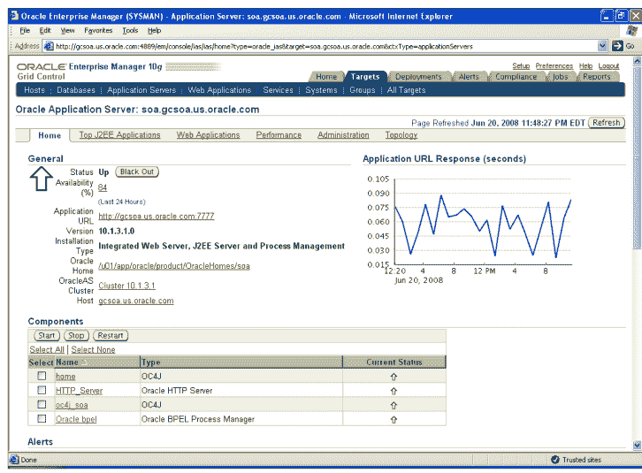

- 5. 单击 Administration 选项卡。

> Grid Control 配置管理框架每天收集所有 Oracle 应用服务器目标以及各个组件（web server、OC4J、BPEL PM 等）的关键配置参数。这些参数存储在 Grid Control 仓库中。

### 查看最后收集的配置

通常，管理员最想看到的就是目标的当前配置。这通常对应于 Grid Control 中的“last collected configuration”，并且可以刷新以启动按需收集以获取最新信息。

- 1. 选择 Last Collected Configuration 链接，如以下屏幕截图所示：

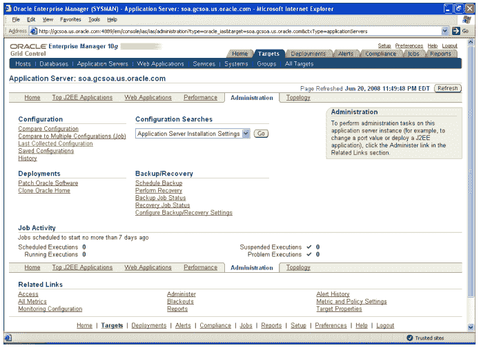

- 2. 显示应用服务器的当前配置。General 选项卡显示应用服务器的关键组件以及一些关键配置参数，如以下屏幕截图所示：

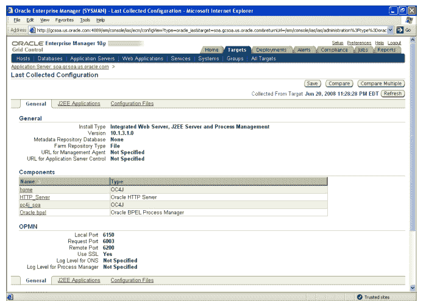

- 3. 单击 J2EE Applications 选项卡以查看部署在此应用服务器上的所有 J2EE 应用程序。

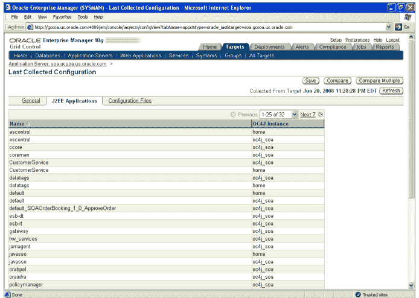

- 4. 单击 Configuration Files 选项卡以查看关键配置文件。您可以单击文件以查看文件的只读版本。

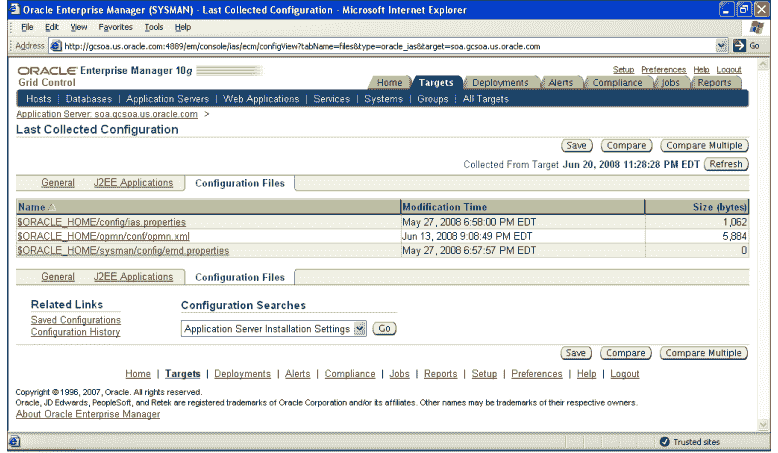

### 将配置快照保存到仓库

与 BPEL 配置快照类似，应用服务器配置也可以保存到 Grid Control 仓库，以便在整个企业中进行标准化：

- 1. 单击 Save 按钮保存当前配置。
- 2. 选择 Save to the EM Repository 选项。
- 3. 提供描述，例如 GCSOA_<date>_AS_Baseline。
- 4. 选择保存所有应用服务器组件配置的复选框，如以下屏幕截图所示：

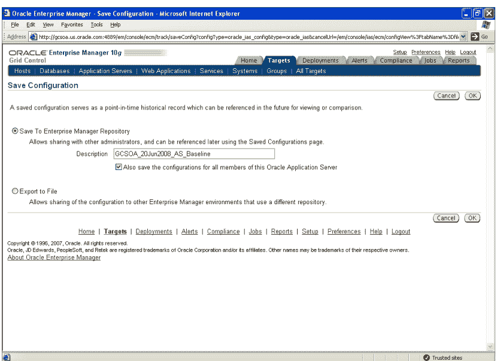

- 5. 单击 OK 将当前配置保存到 Grid Control 仓库。

- 6. 注意确认消息，以及带有目标名称、类型和时间戳的已保存配置。

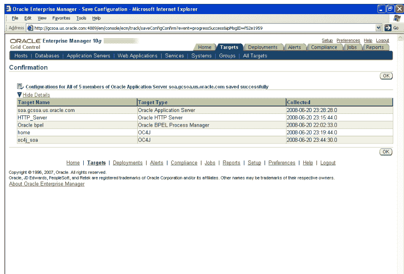

### 修改 BPEL 环境

Grid Control 控制台是一个或多个 BPEL PM 以及其他目标类型的管理界面。对于启动/停止、更改配置属性等管理功能，管理员需要使用产品控制台，在本例中为 BPEL 控制台。

- 1. 导航到 BPEL 目标主页。
- 2. 在 **Related Links** 下，单击 **Administer (BPEL Console)**。
- 3. 使用 **Username** 为 **oc4jadmin** 和 **Password** 为 *welcome1* 登录。
- 4. 单击 **Manage BPEL Domain** 链接。
- 5. 这会带您进入 BPEL 的管理页面，您可以在此设置域级参数。选择 **Configuration** 选项卡。

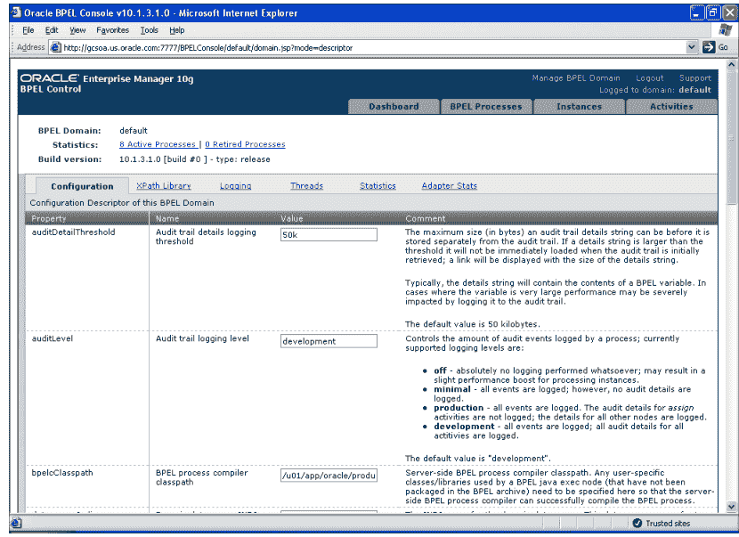

- 6. 更改以下属性：
  - AuditDetailThreshold to 60k
  - dspMaxThreads to 6
  - dspMinThreads to 2
  - LargeDocumentThreshold to 60k

- 7. 单击 Apply 按钮保存更改。

- 8. 选择 **Logging** 选项卡并选择下拉菜单将所有日志级别更改为 **Warn**。warn 的调试级别表示会记录到某些日志的警告消息，但应用程序能够在没有问题的情况下继续运行。

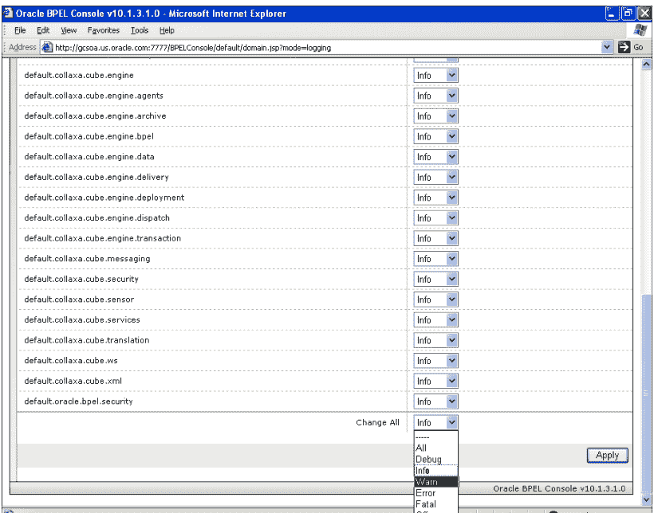

- 9. 单击 **Apply** 保存更改。

- 10. 选择 **Logout** 退出 BPEL Control。

### 修改 Oracle 应用服务器环境

与 BPEL 控制台类似，应用服务器也自带自己的管理控制台以进行配置更改。

- 1. 从 Grid Control 主页单击 **Targets** 选项卡。
- 2. 选择 **Application Servers** 子选项卡。

- 3. 单击应用服务器的名称—soademo.gcsoa.us.oracle.com。
- 4. 这会带您进入应用服务器的主页。
- 5. 在 Related Links 部分底部单击 Administer 链接。
- 6. 使用用户名为 oc4jadmin 和密码为 welcome1 登录 AS Control 控制台。
- 7. 单击 oc4j_soa 链接以进入此 oc4j 实例的主页，如以下屏幕截图所示：

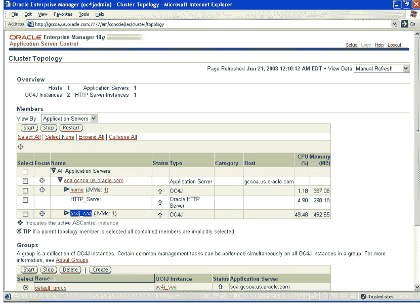

- 8. oc4j_soa 主页显示此 oc4j 实例的关键可用性和性能指标。

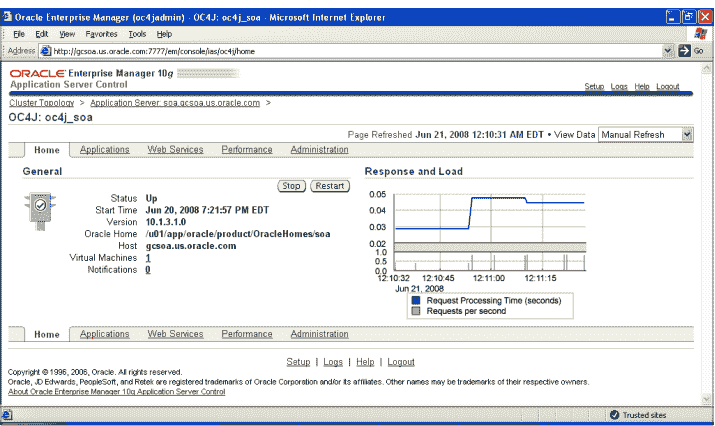

- 9. 单击“管理”选项卡。

- 10. 单击“服务器属性”任务名称旁边的“转到任务”按钮，如以下屏幕截图所示：

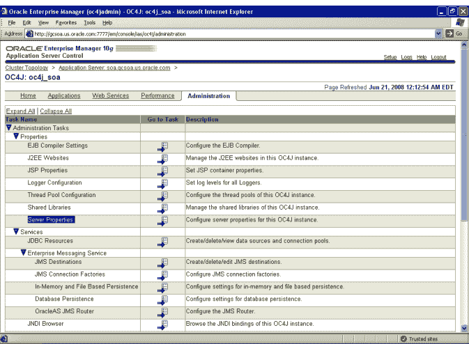

- 11. 将 MaxPermSize 值从 126M 改为 256M。

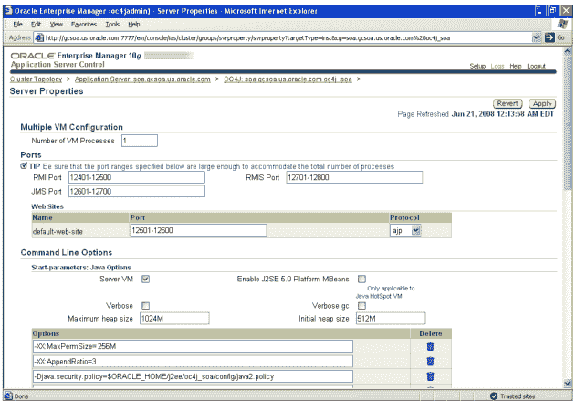

- 12. 单击“应用”以保存更改。注意确认消息。
- 13. 单击“集群拓扑”面包屑。
- 14. 选中 oc4j_soa 旁边的复选框。
- 15. 单击“重启”按钮以重启此 oc4j 容器，使更改永久生效。

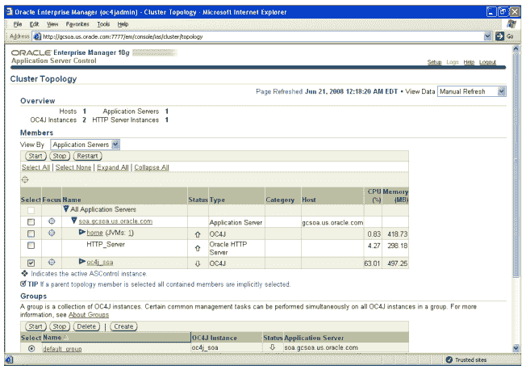

- 16. 单击**是**以重启 oc4j_soa。注意确认消息。
- 17. 重启完成后退出 EM Application Server 控制。您现在已成功对应用服务器属性进行了一些更改。

## 与已保存的基线比较当前的 BPEL 配置

比较是检测两个或多个目标之间配置差异的有用方法。观察配置的相似性很有用，更重要的是，在出现性能问题或为标准化目的时观察差异。

- 1. 导航到 BPEL 目标主页。
- 2. 单击**管理**选项卡。
- 3. 单击**上次收集的配置**。
- 4. 单击**刷新**按钮以获取最新的配置更新并等待一段时间。
- 5. 单击**比较**按钮，开始对 BPEL 目标的当前配置与已保存的（生产基线）配置进行比较。

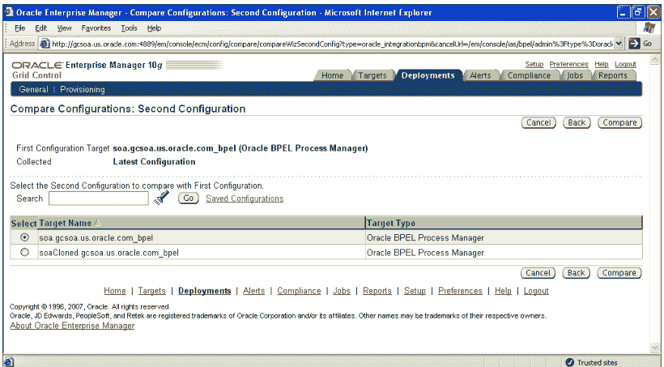

- 6. 单击**已保存的配置**链接。

- 7. 选择 GCSOA_<date>_BPEL_Baseline 进行比较。
- 8. 单击比较以生成比较结果。

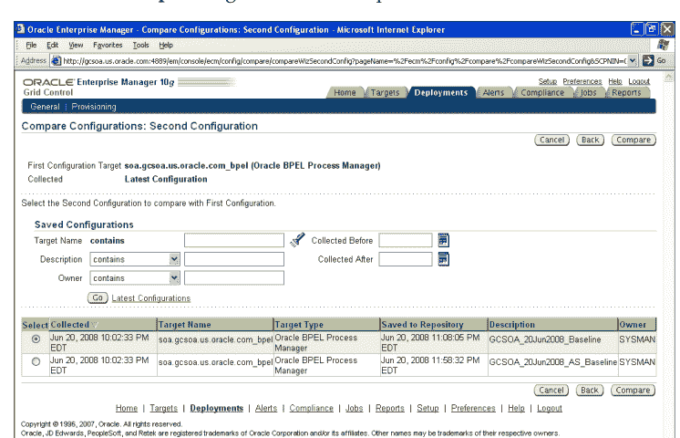

- 9. 查看与已保存基线的 BPEL 目标比较结果。
- 10. BPEL 目标之间的比较结果分为四个类别显示。摘要选项卡列出了四个类别的状态。

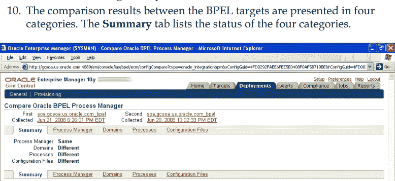

## BPEL 配置管理

- 11. 单击“流程管理器”选项卡。流程管理器选项卡列出了目标的一般参数的差异或相似性，包括脱水存储和集群参数。

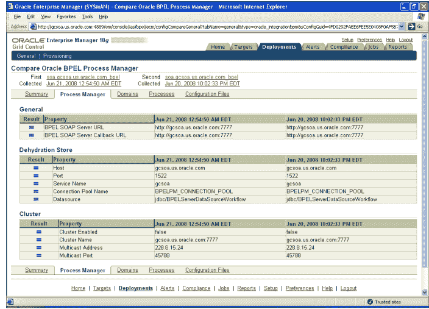

- 12. 单击“域”选项卡。域选项卡列出了两个目标中的各个域。

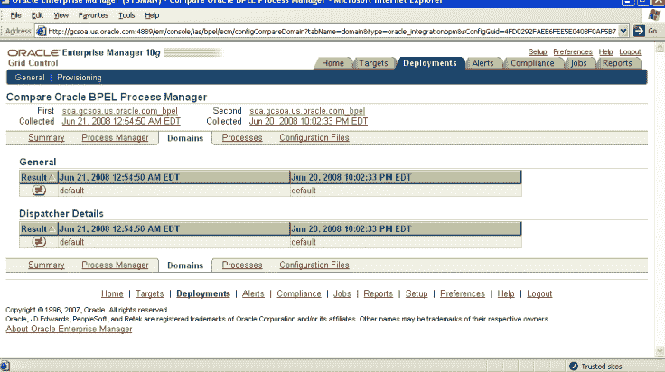

- 13. 单击“结果”列中的不等号以查看差异。

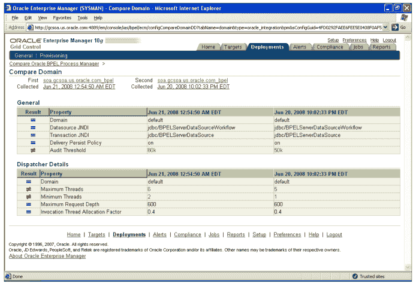

- 14. 单击“比较 BPEL 流程管理器”面包屑。

- 15. 单击“流程”选项卡。流程选项卡比较所有已部署的流程。流程内的底层文件将被比较。

- 16. 单击“配置文件”选项卡，其中列出了文件比较的结果。

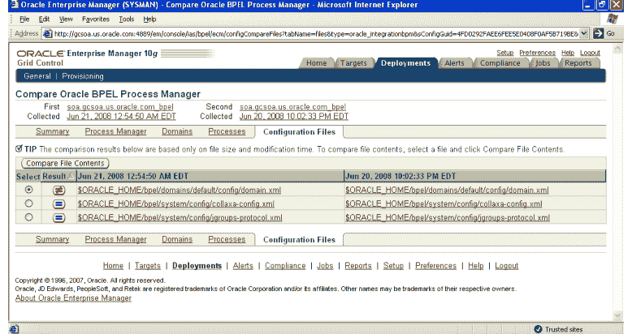

## BPEL 配置管理

- 17. 单击“结果”列中的不等号以查看文件大小和修改时间的差异。

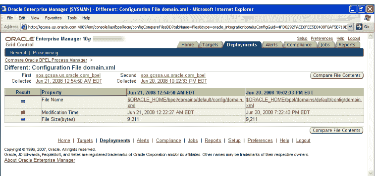

- 18. 单击浏览器的“后退”按钮。

- 19. 单击“比较文件内容”。

- 20. 在比较文件内容页面上查看文件之间的差异。

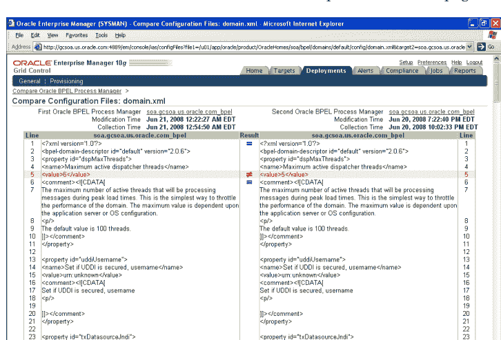

## 比较同一流程的 BPEL 流程版本

Grid Control 可以为不同类型的目标提供目标比较。BPEL 世界中更有趣的比较之一是比较 BPEL 流程的连续版本，或不同环境中的类似 BPEL 流程。Grid Control 使管理员或开发人员能够做到这一点，从而协助变更管理和影响分析。

- 1. 在当前场景中，我们将在同一服务器上比较同一 BPEL 流程的两个版本。
- 2. 单击“比较 BPEL 流程管理器”面包屑。
- 3. 单击“流程”选项卡。

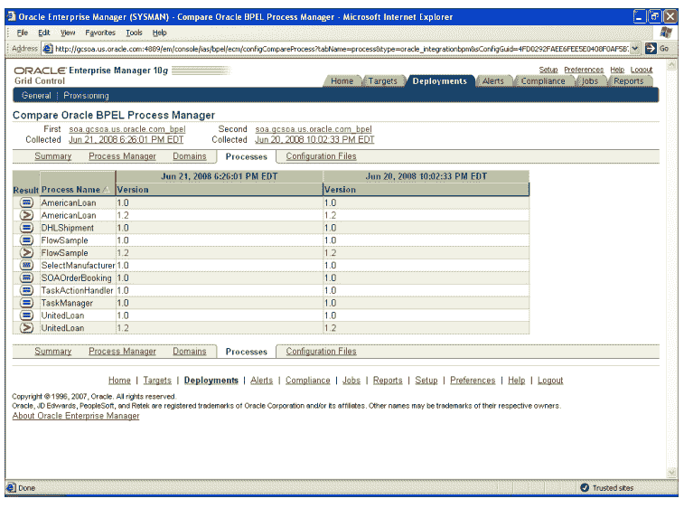

> 注意两个目标之间流程的差异。您可以看到 FlowSample、AmericanLoan 和 UnitedLoan 的 BPEL 流程有更新的版本。

- 4. 单击 FlowSample 流程的大于号。
- 5. 这会带您进入比较流程页面，您可以在此比较流程的不同版本。

## BPEL 配置管理

- 6. 从“版本”下拉列表中为同一流程选择两个不同的版本。
- 7. 单击“比较文件内容”，如下图所示：
- 8. 注意这些流程底层文件的差异。

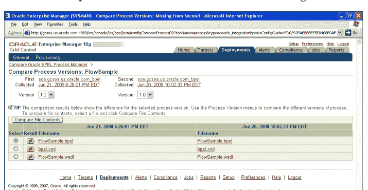

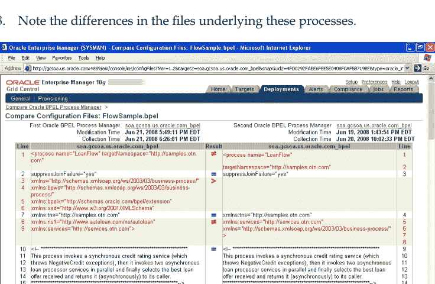

- 9. 通过向下滚动，您可以看到流程的 1.2 版本中添加了一个额外部分。

## 与已保存的基线比较当前的 Oracle 应用服务器配置

同样的方法也可以用于 Oracle 应用服务器目标：

- 1. 导航到 Oracle Application Server 目标的主页。
- 2. 选择**目标**选项卡，然后选择**应用服务器**子选项卡。
- 3. 单击应用服务器名称的链接，例如 **soademo.gcsoa.us.oracle.com**，以进入应用服务器主页。
- 4. 单击**管理**选项卡。
- 5. 单击**上次收集的配置**。
- 6. 单击**刷新**按钮以获取最新的配置更新。
- 7. 单击**比较**按钮，开始对应用服务器目标的当前配置与已保存的（生产基线）配置进行比较。

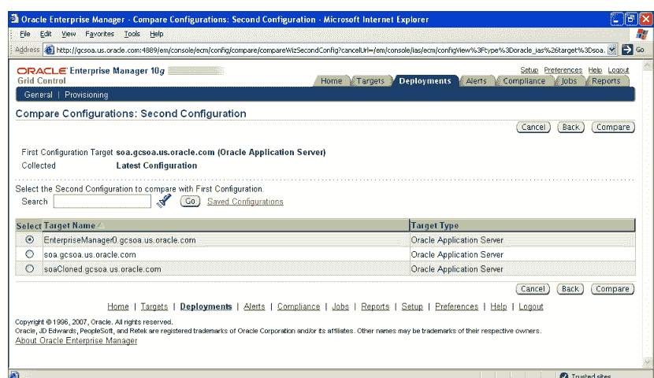

- 8. 单击**已保存的配置**链接。
- 9. 选择 **GCSOA_<date>_AS_Baseline** 进行比较。

- 10. 单击**比较**以生成比较结果。

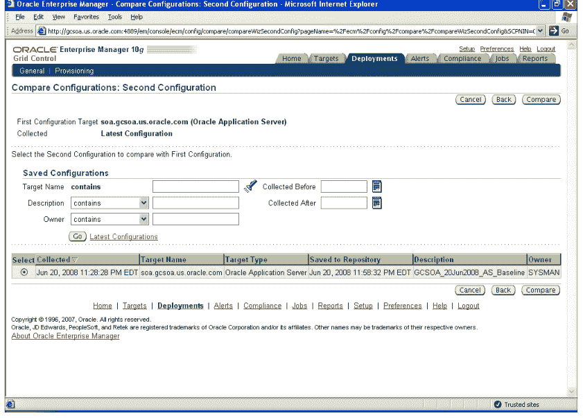

## 查看与已保存基线的应用服务器目标比较结果

一旦启动比较，相似之处和差异就可以在 Grid Control 用户界面上观察到：

- 1. 应用服务器目标之间的比较结果分为四个类别呈现。**摘要**选项卡列出了四个类别的状态。

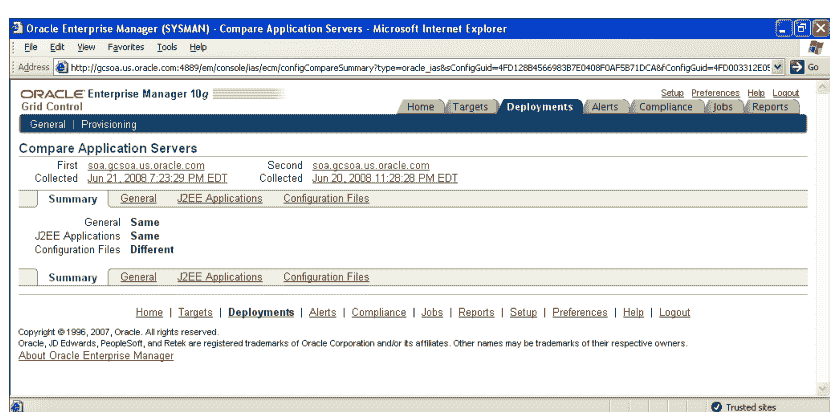

- 2. 单击“常规”选项卡以查看关键参数值以及与基线的更改。

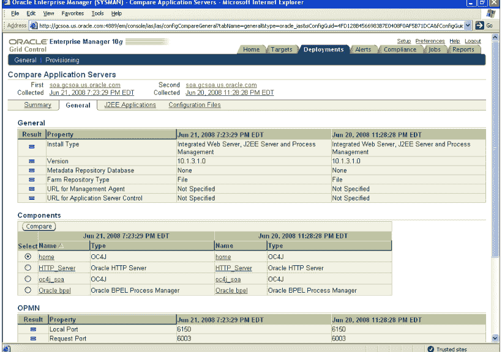

- 3. 单击“J2EE 应用程序”选项卡以查找任何更改。

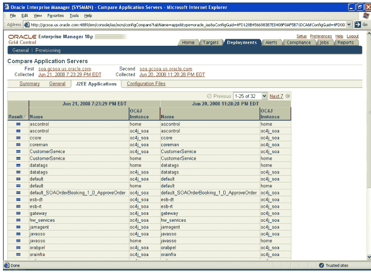

- 4. 单击“配置文件”选项卡以查找配置文件的关键更改。

- 5. 单击不等号旁边的单选按钮。

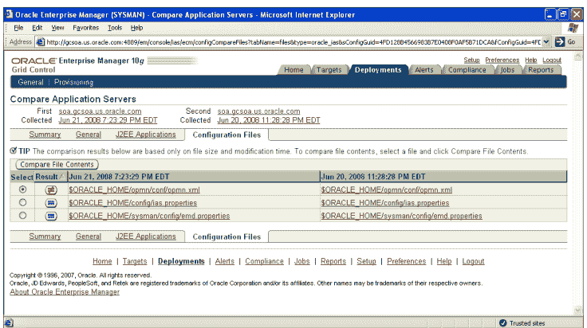

- 6. 单击**比较文件内容**以查看与基线版本的实际更改。

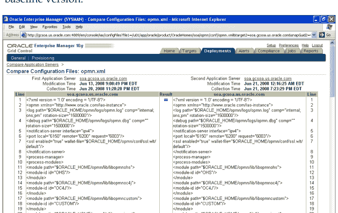

- 7. 观察 **MaxPermSize** 的更改。

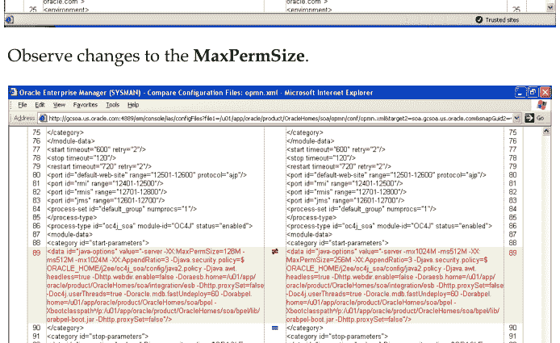

## 摘要

配置管理对于管理员控制环境中的变更以及排除与配置更改相关的故障至关重要。借助 Grid Control 的配置管理功能，管理员可以管理变更并减少排除故障所需的时间。

在本章中，我们讨论了配置管理以及它如何应用于 BPEL PM 和应用服务器目标。我们讨论了两种目标类型的配置概述，查看了最新的配置信息，并将参考“黄金”配置快照保存到 Grid Control 仓库。然后，我们通过各个产品控制台进行了一些配置更改。在 Grid Control 中观察这些更改以及将其与“黄金”标准进行比较是相当简单的。此外，比较 BPEL 流程版本并注意连续版本之间的更改也很有用。

配置管理已通过 Enterprise Manager 收购了两个新产品而得到扩展，即 **配置更改控制台 (CCC)** 和 **应用程序更改控制台 (ACC)**。借助这两个产品，管理员可以主动查看发生的更改，以及回滚和向前回滚到所需的配置。

接下来的几章将介绍 SOA Suite 的配置和克隆。

## 9

## SOA Suite 克隆

软件维护通常占总体成本的 70%，其中包括许可费用。企业必须担心软件维护工作，其中包括产品更新、安全更新、硬件更新和环境刷新。这些都是耗时的工作，需要在多个领域具备人力专业知识。随着软件老化，企业仍需为遗留软件维持这种人力专业知识，而遗留软件虽然对业务至关重要，但可能代价高昂，有时还会通过增加拥有成本来抵消整体业务价值。

越来越多的企业转向自动化生命周期管理工具，以帮助完成与软件生命周期维护相关的繁重工作。制定维护计划时拥有正确的策略非常重要。维护应是整体策略的一部分，而非事后考虑。

本章涵盖：
- 挑战
- 解决方案
- 分步练习：
  - 将 Oracle Application Server 集群添加到 Grid Control
  - 停止应用服务器进程
  - 在 Grid Control 软件库中创建组件
  - 克隆 Oracle Application Server 和 SOA 应用
  - 验证新创建的集群

### 挑战

在当今的数据中心，服务通常需要在短时间内进行配置。这些服务可能由复杂的分层配置组成，例如 Oracle Application Server 和 SOA 应用软件。管理员必须经过多个步骤才能将 SOA Suite 从一个安装克隆到另一个安装。这些步骤包括克隆复制的文件、配置它们，并进行更改以反映新的安装。一些 Oracle 管理员具备数据库克隆技能，但大多数人并不具备克隆应用服务器的专业知识，更不用说 SOA Suite 了。这种服务的手动安装通常耗时且容易出错。

### 解决方案

Grid Control 提供了将测试过的镜像克隆到多个主机的灵活且可扩展的方式。具体来说，Grid Control 提供了一个预定义的、完全可定制的用于克隆 Oracle Application Server 和 SOA 应用的流程。该流程使管理员能够基于现有的参考应用服务器或集群创建新的 Oracle Application Server 实例或 Oracle Application Server 集群；从而自动化常见的 IT 任务，例如基于测试或暂存环境创建生产 SOA Suite 环境，或扩展现有的 Oracle Application Server 集群以适应负载增加。

### 分步练习

本套分步练习将演示如何克隆部署在 Oracle Application Server 10.1.3.x 上的 Oracle SOA Suite 10.1.3.x。

### 将 Oracle Application Server 集群添加到 Grid Control

第一步是创建应用服务器集群目标，以便以后进行克隆。

> 为了通过克隆创建新集群，Grid Control 必须知道一个已安装的现有集群以供克隆。

1. 在 Grid Control 主页上，单击 Targets | Middleware 选项卡。

在表中，您应该至少看到两个 Oracle Application Server 目标：一个托管 Grid Control 应用，另一个托管 SOA Suite，如前几章所述。虽然托管 SOA Suite 的 Oracle Application Server 实例已在 Enterprise Manager 中被发现，但它所属的集群尚未被发现。

2. 从 Add 下拉菜单中选择 Oracle Application Server Cluster 并单击 Go，如以下屏幕截图所示：

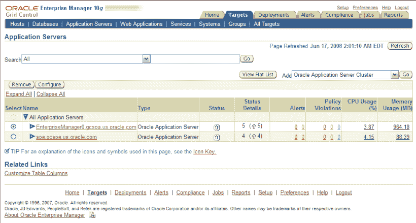

3. 出现一个提示输入现有集群信息的页面。为集群提供一个名称，例如 Cluster 10131。

4. 要指定集群成员的应用服务器实例，请单击手电筒图标。

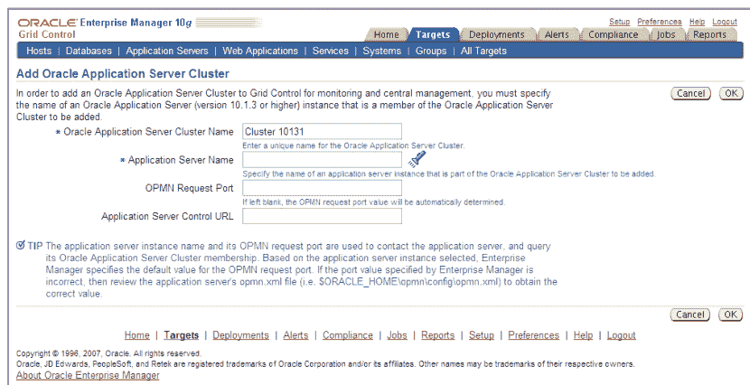

5. 在 Search and Select: Targets 页面上，选择集群成员的应用服务器实例的名称并单击 Select 按钮，如以下屏幕截图所示：

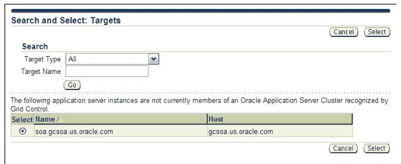

6. Add Oracle Application Server Cluster 页面上的剩余字段将根据您的选择自动填充，如下一屏幕截图所示。单击 OK。

### 添加 Oracle Application Server 集群

为了将 Oracle Application Server 集群添加到 Grid Control 以进行监控和集中管理，您必须指定要添加的 Oracle Application Server 集群成员的 Oracle Application Server（版本 10.1.3 或更高）实例的名称。

Oracle Application Server 集群名称 Cluster 10.1.3.1
应用服务器名称 soa.gcsoa.us.oracle.com
OPMN 请求端口 6003
应用服务器控制 URL http://gcsoa.us.oracle.com:7777/em

提示 应用服务器实例名称及其 OPMN 请求端口用于联系应用服务器，并查询其 Oracle Application Server 集群成员资格。根据所选的应用服务器实例，Enterprise Manager 指定 OPMN 请求端口的默认值。如果 Enterprise Manager 指定的端口值不正确，则请查看应用服务器的 opmn.xml 文件（即 $ORACLE_HOME/opmn/conf/opmn.xml）以获取正确的值。

7. 屏幕顶部出现确认消息，确认集群已成功添加到 Enterprise Manager，并且 Cluster 10.1.3.1 作为新目标出现在表中，其中 soa.gcsoa.us.oracle.com 应用服务器显示为该集群的成员，如以下屏幕截图所示：

### 确认

Oracle Application Server 集群 Cluster 10.1.3.1 已成功添加，现在正由 Grid Control 进行监控。

### 应用服务器

| 选择名称 | 类型 | 状态 | 状态详情 | 警告 | 策略违规 | CPU 使用率 (%) | 内存使用量 (MB) |
|---|---|---|---|---|---|---|---|
| 所有应用服务器 |  |  |  |  |  |  |  |
| Cluster 10.1.3.1 | Oracle Application Server 集群 | n/a | 4 (↑4) | 0 0 | 0 0 0 |  |  |
| soa.gcsoa.us.oracle.com | Oracle Application Server |  | 4 (↑4) | 0 0 | 0 0 0 | 4.15 | 88.39 |
| EnterpriseManager() gcsoa.us.oracle.com | Oracle Application Server |  | 5 (↑5) | 0 0 | 0 0 0 | 3.87 | 964.18 |

提示 有关本页所用图标和符号的说明，请参阅 Icon Key。

### 相关链接

自定义表列

> 现在 Oracle Application Server 集群已添加到 Grid Control，您可以使用该集群作为执行各种操作的参考或源。为本次练习的目的，我们将使用已发现的集群在 Grid Control 软件库中创建“gold image”组件，然后使用库中的 gold image 组件创建新的 Oracle Application Server 集群目标。

### 停止应用服务器进程

建议停止应用服务器进程以便复制数据和配置。

> 在创建 gold image 组件或通过克隆创建新集群之前，您应先停止机器上已运行的现有已安装应用服务器进程。

要停止 Oracle Application Server 进程，请按照以下步骤操作：
- 1. 在 Linux 或 Windows 机器上以应用服务器所有者身份登录（例如，oracle）。
- 2. 导航到 bin 目录，即 `cd /u01/app/oracle/product/OracleHomes/soa/opmn/bin`。
- 3. 使用以下命令停止应用服务器进程：`./opmnctl stopall`。
- 4. 从应用服务器主页，您可以验证实例的所有组件是否已停止。

> 如果应用服务器实例状态仍显示为 Up，请单击页面上的 Refresh 图标。

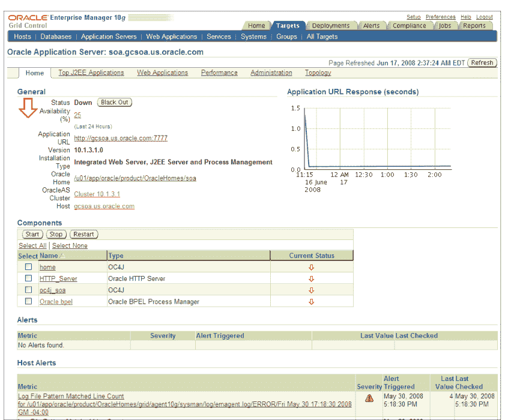

## 在 Grid Control 软件库中创建组件

Grid Control 允许您直接从现有安装基线克隆 Oracle Application Server 软件，或从软件库中存储的组件克隆。在本练习中，我们将从软件库中存储的组件进行克隆。

> 在软件库中创建组件之前，您必须先配置软件库。有关如何在练习之外配置软件库的信息，请参阅发布在 Oracle 技术网络上的《Oracle Enterprise Manager 高级配置 10g Release 4》指南中的第 18.7 节“使用 Oracle Enterprise Manager 设置和配置软件库”。

1. 导航到 **Deployments** 选项卡并点击 **Provisioning** 子选项卡。

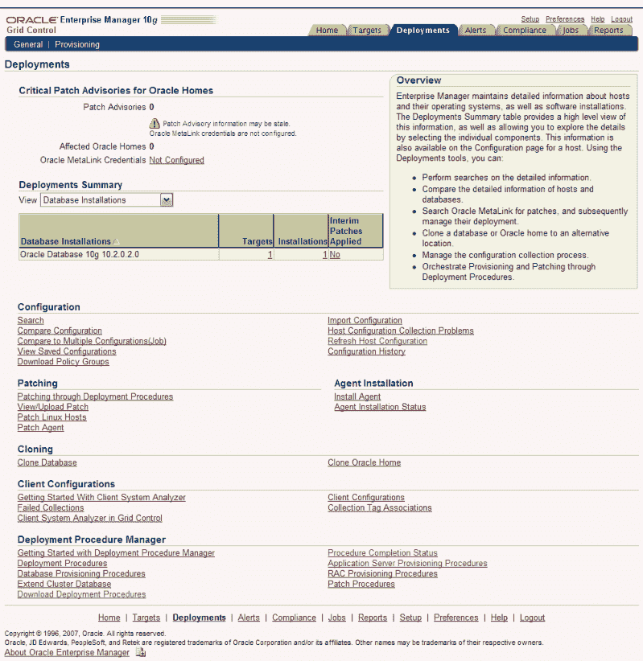

2. 在 **Components** 属性页面上，点击表格最右侧上方直接的 **Create Component** 按钮，如以下屏幕截图所示：

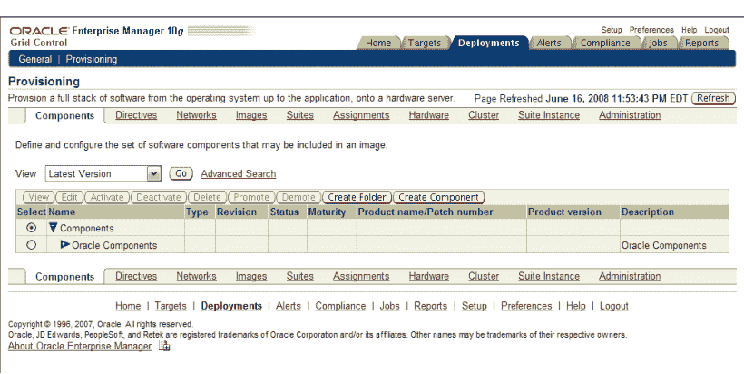

3. **Create Component** 向导出现并显示 **Describe** 页面。确保在 **Type** 下拉菜单中选择的组件为 **Oracle iAS Clone**，并为要创建的组件提供名称，例如 **SOA 10.1.3.1 Gold Image**。其余字段为可选。点击 **Next**，如以下屏幕截图所示：

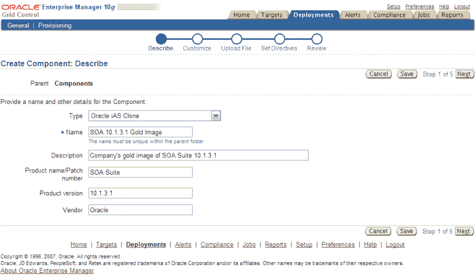

4. **Create Component** 向导的 **Configure** 页面出现。点击 *手电筒* 图标以选择已安装现有软件的主机名。

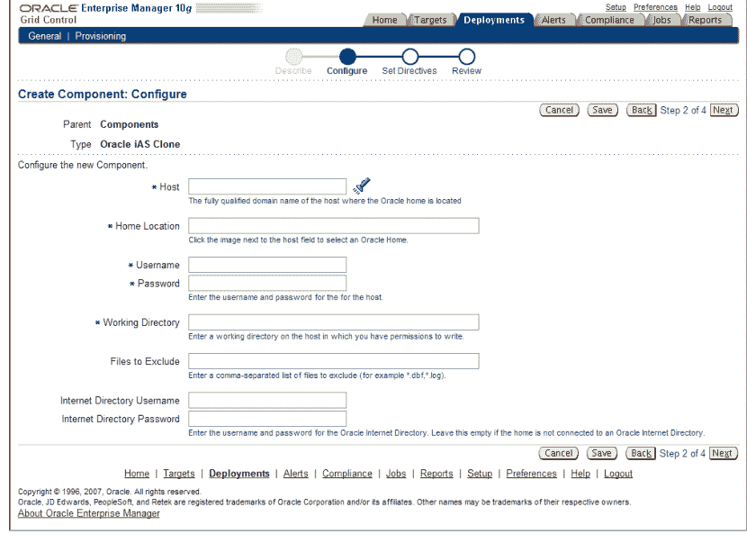

5. 在 **Select Clone Source** 页面上，选择已安装 Oracle Application Server SOA Suite 10.1.3.1.0 产品的主机。这将是源 Oracle home，将被压缩并存储在软件库中。它将在后续的动手实验中用作克隆的黄金参考映像。点击 **OK**。

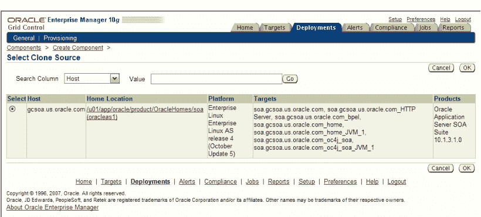

6. 在向导的 Configure 页面上提供以下信息：
**Username:** oracle
**Password:** welcome1
**Working Directory:** /tmp

7. 除非您使用的是 Oracle Internet Directory，否则请将 Internet Directory Username 和 Internet Directory Password 字段留空。点击 Next，如以下屏幕截图所示：

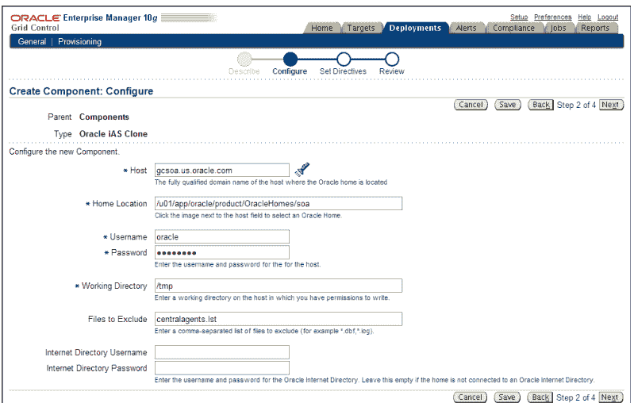

8. 在 Create Component 向导的 Set Directives 页面上无需输入或编辑。点击 Next，如以下屏幕截图所示：

9. 查看向导 Review 页面上的内容以确保输入的数据准确。点击 Finish，如下一屏幕截图所示：

## 创建组件：审核

父组件
类型 Oracle IAS Clone

请审核组件的配置。如果此组件关联了作业，则点击 Finish 按钮将保存组件并触发作业，而 Save 按钮仅保存组件。如果此组件未关联作业，则两个按钮的行为相同。

### 描述

类型：Oracle IAS Clone
名称：SOA 10.1.3.1 Gold Image
描述：公司的 SOA Suite 黄金映像
状态：
成熟度：未测试
产品名称/补丁号：SOA Suite
产品版本：10.1.3.1
供应商：Oracle
上次修改：
上次修改者：

### 配置

主机：gcsoa.us.oracle.com
Oracle home 所在主机的完全限定域名
主目录位置：/u01/app/oracle/product/OracleHomes/soa
点击主机字段旁的图像以选择 Oracle home。
用户名：oracle
工作目录：/tmp
输入您在主机上具有写入权限的工作目录。
要排除的文件：centralagents.lst
输入要排除的文件的逗号分隔列表（例如 *.dbf、*.log）。
NAME_OID用户名

### 设置指令

选择指令
选择参与此组件的指令。

| 名称 | 库路径 | 修订版 | 成熟度 | 状态 |
|---|---|---|---|---|
| 阶段 |  |  |  |  |
| 预安装 |  |  |  |  |
| 安装 |  |  |  |  |
| 后安装 |  |  |  |  |

主页 | 目标 | 部署 | 警报 | 合规性 | 作业 | 报告 | 设置 | 首选项 | 帮助 | 注销

版权所有 © 1998, 2007, Oracle。保留所有权利。
Oracle、JD Edwards、PeopleSoft 和 Retek 是 Oracle Corporation 及/或其附属公司的注册商标。其他名称可能是其各自所有者的商标。
关于 Oracle Enterprise Manager

## SOA Suite 克隆

10. 页面顶部将出现一条确认消息，表明已提交作业以在 Grid Control 软件库中创建 Oracle Application Server 10.1.3.1 SOA Suite 组件。要跟踪作业进度，请点击确认消息中标识作业执行 ID 的链接。

11. Job Run 页面的 Summary 向导出现。确保作业成功完成。根据 Oracle Application Server 配置的性质，这可能需要几分钟时间。

12. 使用 Web 浏览器的刷新按钮刷新作业状态，直到看到作业状态从 Running 变为 Succeeded。

## SOA Suite 克隆

13. 返回 Deployments 选项卡下的 Provisioning 子选项卡，以在软件库表中查看新创建的组件。为了在克隆操作期间使用该组件，您必须激活该组件。在表中选择新创建的 Oracle Application Server 10.1.3.1 SOA Suite 组件，然后点击表格顶部的 Activate 按钮。

> 现有的集群的活动黄金映像组件现在已在软件库中，因此可作为创建新应用服务器实例和集群的源映像。

## 克隆 Oracle Application Server 和 SOA 应用

现在我们准备使用开箱即用的部署流程克隆具有底层 SOA 应用的 Oracle Application Server：

- 1. 从 Deployments 选项卡下导航到 General 子选项卡。点击页面底部 Deployment Procedure Manager 部分中的 Application Server Provisioning Procedures 链接。
- 2. 出现一份开箱即用的与应用服务器相关的部署流程列表。选择名为 Application Server Deployment 10.1.3.1 SOA 的流程并点击 Schedule Deployment。

3. 出现一个多步骤向导，指导您安排克隆操作。如前所述，克隆 Oracle Application Server 时，您可以选择从已安装并在 Enterprise Manager 环境中发现的源克隆，或从存储在软件库中的源克隆。由于我们在练习中早些时候在软件库中创建了黄金映像组件，请选择 **Select from Software Library** 选项。由于我们在软件库中创建的唯一组件是应用层，因此在本动手实验中我们将仅从软件库克隆应用层。点击与 **Source for App Tier** 部分关联的 *手电筒* 图标。

4. 在 **Select Component for Application Tier** 页面上，将 **Component Name** 选择为我们之前创建的那个（推荐名称为 **SOA 10.1.3.1 Gold Image**），然后点击 **Select** 按钮，如以下屏幕截图所示：

5. 然后您将被返回到向导的 Source Selection 页面，其中 Source for App Tier 的详细信息已自动为您填充。点击 Next，如以下屏幕截图所示：

6. 在向导的 **目标列表** 页面上，单击 **添加** 按钮，如以下屏幕截图所示：

7. 在 **为应用层选择目标** 页面上，选择 **主机名**（例如，gcsoa.us.oracle.com）作为克隆集群的目标机器。单击 **选择** 按钮，如下一张屏幕截图所示：

8. 然后您将被返回到向导的 **目标列表** 页面，**应用层主机** 的详细信息将自动为您填充。单击 **下一步**，如下图所示：

9. 在向导的凭据/计划页面上，指定有关目标机器主机凭据的以下信息：

主机凭据：所有 Oracle 主页相同

用户名：oracle

密码：welcome1

10. 由于部署过程利用了企业管理器作业系统，您可以立即或在未来某个日期和时间安排克隆操作。为本练习的目的，请将默认选择保持为一次性（立即），如下一张屏幕截图所示。单击下一步。

11. 在向导的 **应用层和 Web 层** 页面上，指定以下信息，如下一张屏幕截图所示：

- **集群详细信息** 部分：
  - **集群名称：** myJ2EECluster
  - **应用层安装基目录：** `/u01/app/oracle/product/OracleHomes/soa_clone`
  - **多播地址：** 227.0.0.1
  - **多播端口：** 6789

> 在本练习中，源和目标 Oracle 主页位于同一台机器上。但是，您需要确保指定的应用层安装基目录是唯一的。现有安装的目录 `/u01/app/oracle/product/OracleHomes/soa` 被指定为默认值。因此，您必须更改默认值以使其唯一。

- **实例详细信息** 部分：
  - **应用层实例名称：** soaCloned
  - **源 OC4J 管理员密码：** welcome1
  - **OC4J 管理员密码：** *welcome1*
  - **确认 OC4J 管理员密码：** *welcome1*

- **端口详细信息** 部分：
  - **端口：** 8888

在 **附加参数** 部分，将 **应用层** 字段留空。

在 **身份管理配置** 部分，选择 **无** 选项。

12. 单击 **下一步**。

13. 在向导的库步骤属性页面上，提供有关将与新的克隆应用服务器实例关联的脱水存储的以下信息：

- 数据库厂商：oracle
- 数据库用户名：sys
- 数据库密码：<输入您的数据库系统密码>
- 数据库主机名和端口：gcsoa.us.oracle.com:1522
- 服务名称：gcsoa

> 要成功克隆，指定 "sys" 作为数据库用户名不是必需的。但是，所提供的数据库用户名必须已被授予 DBA 角色。此用户用于确保数据库有效（可以连接到它，版本正确，版本正确，并且相关的 SOA 相关模式存在）。

14. 单击 **下一步**。

15. 查看向导的 **审核** 页面上显示的内容，以确保输入已正确提供。单击 **完成**。

## Oracle 企业管理器 10g Grid Control

## 应用服务器部署 10.1.3.1 SOA：审核

在下面显示的摘要中审核您的选择。

## 源选择

应用层源
名称：SOA 10.1.3.1 Gold Image
组件位置：Components/SOA 10.1.3.1 Gold Image

## 目标列表

应用层主机

| 主机名 | 版本 | 平台 | 状态 |
|---|---|---|---|
| gcsoa.us.oracle.com | Enterprise Linux AS release 4 (October Update 5) | Linux x86 | ↑ |

## 应用层和 Web 层

集群详细信息
集群名称：myJ2EECluster
应用层安装基目录：/u01/app/oracle/product/OracleHomes/soa_clone
多播地址：227.0.0.1
多播端口：6789

实例详细信息
应用层实例名称：soaCloned
OC4J 实例名称：home

端口详细信息
应用服务器控制端口：8888

## 库步骤属性

全部展开 | 全部折叠

| 库步骤 | 属性值 |
|---|---|
| 所有库步骤 | |
| 安装 | |
| * 数据库厂商 | oracle |
| * 数据库用户名 | sys |
| * 数据库密码 | ****** |
| * 数据库主机名和端口 | gcsoa.us.oracle.com 1522 |
| * 服务名称 | gcsoa |

## 凭据/计划

## 目标主机凭据

| 产品 | 主机名 | Oracle 主页 | 用户名 |
|---|---|---|---|
| 应用层 | gcsoa.us.oracle.com | /u01/app/oracle/product/OracleHomes/soa_clone | oracle |

计划
开始日期：一次性（立即）
宽限期：无限期

主页 | 目标 | 部署 | 警报 | 合规性 | 作业 | 报告 | 设置 | 首选项 | 帮助 | 注销

版权所有 © 1996, 2007, Oracle。保留所有权利。
Oracle、JD Edwards、PeopleSoft 和 Retek 是 Oracle Corporation 及其附属公司的注册商标。其他名称可能是其各自所有者的商标。
关于 Oracle 企业管理器

16. **部署程序管理器** 页面上的 **程序完成状态** 属性页面出现。这显示了刚刚提交的作业运行，用于基于存储在软件库中的金像组件创建新的 Oracle 应用服务器。单击已提交的作业运行的链接。

17. 此作业运行的 **状态** 页面将出现，显示部署程序中每个步骤的状态。为了跟踪克隆操作的进度，将 **查看数据** 下拉列表中的刷新间隔更改为 **实时：30 秒刷新**。页面将自动刷新以显示更新的状态。

程序完成状态 >

## 状态

### 一般信息

运行 myJ2EECluster_2008-06-16_05-17-53PM
程序 应用服务器部署 10.1.3.1 SOA
程序版本 4.1
错误处理模式 停止于错误
状态 运行中
所有者 SYSMAN
创建于 Jun 16, 2008 5:17:55 PM EDT
安排于 Jun 16, 2008 5:17:59 PM EDT
开始日期 Jun 16, 2008 5:17:59 PM EDT
最后更新 Jun 16, 2008 5:19:44 PM EDT
完成日期
经过时间 362 秒

### 状态详细信息

步骤 作业详细信息 OMS 日志
全部展开 | 全部折叠

| 名称 | 状态 | 类型 | 描述 | 运行权限 | 运行命令模式 | 错误处理 |
|---|---|---|---|---|---|---|
| 应用服务器部署 10.1.3.1 SOA | 运行中 | | 此程序为多层应用服务器拓扑安装或克隆并配置标准的 Web 和应用层。 | | | 停止于错误 |
| 初始化 | 成功 | 计算 | 初始化运行时。不要禁用或删除此步骤。 | | | 停止于错误 |
| 验证应用层系统要求 | 成功 | 并行 | | | | 停止于错误 |
| 验证应用层系统要求 | | 组件 | 验证应用层的系统要求 | 正常 | | 停止于错误 |
| 验证并修复应用层系统要求 | 成功 | 组件 | 验证并修复应用层的系统要求（需要以 root 身份使用 sudo 权限） | sudo | | 停止于错误 |
| 验证 Windows 的应用层系统要求 | 成功 | 并行 | | | | 停止于错误 |
| 验证应用层系统要求 | 已跳过 | 组件 | 验证应用层的系统要求 | 正常 | | 停止于错误 |
| 验证 Web 层系统要求 | 已跳过 | 并行 | | | | 停止于错误 |
| 验证 Web 层系统要求 | | 组件 | 验证 Web 层的系统要求 | 正常 | | 停止于错误 |
| 验证并修复 Web 层系统要求 | | 组件 | 验证并修复 Web 层的系统要求（需要以 root 身份使用 sudo 权限） | sudo | | 停止于错误 |
| ... | ... | ... | ... | ... | ... | ... |

## SOA Suite 克隆

18. 当状态刷新为 Succeeded 时，克隆操作已完成。在本练习中，这大约需要 21 分钟。

## 验证新创建的集群

部署过程完成后，我们需要验证新创建的应用服务器实例。为本练习的目的，我们将验证新的 Oracle Application Server 目标是否出现在 Enterprise Manager 中，然后登录到 BPEL 控制台：

- 1. 导航到 Targets | Middleware 子标签页。
- 2. 新创建的 Oracle Application Server 目标名为 soaCloned.gcsoa.us.oracle.com 会出现在表格中。点击该名称，如以下屏幕截图所示：

- 3. 新实例的 Oracle Application Server 主页出现。确保 Components 表中出现的组件与源 Oracle Application Server 目标中存在的组件相同（即 home、HTTP_Server、oc4j_soa、Oracle bpel）。点击 Oracle bpel 组件，如下一屏幕截图所示：

- 4. Oracle BPEL Process Manager 主页出现。在页面底部的 Related Links 部分，点击 Administer (BPEL Console)，如以下屏幕截图所示：

- 5. 在 BPEL 控制台登录页面，提供以下信息：
**Username:** oc4jadmin
**Password:** welcome1

您也可以使用 BPEL Admin 管理域列表：
转到 BPEL Admin

- 6. BPEL 控制台出现，页面上列出了多个 **Deployed BPEL Processes**。确保目标服务器上的这些进程与源服务器上的进程相同。

## 摘要

管理软件和服务的生命周期是一项耗时且容易出错的任务。管理员可能花费数天数周来规划和实施配置和修补任务。Grid Control 大大简化了这些复杂任务，使管理员能够专注于更具战略性的领域，企业也能更灵活地管理软件和服务的生命周期。

本章讨论了克隆 Oracle Application Server 和 SOA Suite 的步骤。具体而言，我们讨论了将 Oracle Application Server 集群添加到 Grid Control、停止应用服务器进程、复制应用服务器并将其存储在 Grid Control 软件库中、克隆应用服务器和 SOA Suite，以及最后验证新创建的集群。需要注意的是，Grid Control 会将数据和配置从源集群复制到目标集群。配置和克隆解决方案得到了修补解决方案的补充。新功能包括在 BEA 收购后对 Oracle WebLogic 服务器上的 SOA Suite 的类似覆盖范围，这为管理员管理 WebLogic 服务器上的 SOA 部署提供了便利。

## 10

## Web 应用监控

衡量和管理终端用户的性能变得越来越重要，以确保客户满意度。虽然服务和基础设施在数据中心防火墙内可能健康且可用，但消费者通过互联网外部访问服务时仍可能遇到问题。这就变成了一个猜测游戏，以确定问题是出在客户的互联网服务提供商还是提供商的故障服务上。此外，在 Twitter 和 Facebook 时代，提供商面临分布式拒绝服务类攻击的风险日益增加。如今许多提供商，如 Amazon、Google 和 Salesforce.com，都提供有关其服务当前和历史状态的公开信息。

越来越多的服务等级协议与终端用户使用服务的体验挂钩。如果终端用户无法访问服务，那么在 Twitter 上的一条简单的“tweet”可能导致用户投诉的连锁反应迅速蔓延，很快成为提供商负面宣传的来源。在当今世界，当消费者面临不可用或性能不佳的服务时，提供商无处可藏。在某些情况下，这可能导致基于合同义务的退款请求。

本章讨论：

- 挑战
- 解决方案
- 分步练习：
  - 创建 Web 应用
  - 将 Web 事务记录为 Service Test
  - 添加 Beacons 以运行 Service Test
  - 添加性能和使用指标
  - 查看 Web 事务回放

## 挑战

Web 应用管理员希望更好地了解终端用户所看到的可用性或性能。管理员希望密切关注一系列“始终预期保持活跃和响应”的关键 URL，或从不同区域、域或特定访客组监控 Web 应用的性能，以确保消费者获得最佳性能。了解性能问题影响的能力至关重要。了解受性能问题影响的页面、访客、域和区域也很重要。

## 解决方案

Grid Control 具有事务记录功能，可让您记录模拟终端用户的 Web 事务。Grid Control 跟踪所有访问过您应用的访客的所有 URL 的所有响应时间。Grid Control 不仅可以模拟 Web 流量，还可以模拟 tnsping、IMAP、SQL 和其他几种协议。通过监控点击次数结合性能指标，并按 URL、域、区域、访客和 Web 服务器分析响应时间，您可以清楚地评估性能下降问题对用户群的影响。进一步的下钻可提供 Web 服务器响应时间和负载分布信息，帮助您高效平衡服务器资源。

## 分步练习

这组分步练习将指导您管理 Web 应用。

## 创建 Web 应用

Web 应用是 Grid Control 中的一种特定目标类型，用于监控一个或多个 URL 的可用性、性能和 SLA 报告。

请仅在 Internet Explorer 上执行此练习。您需要连接到互联网以便在此练习中下载 Web 事务记录器的 Microsoft 库。

- 1. 从 Grid Control 主页，点击 Targets | Web Applications 选项卡。
- 2. 点击 Add 按钮添加新的 Web 应用，如下一屏幕截图所示。

> Web 应用是 Grid Control 中的一种特殊服务。还有其他服务类型，如通用服务、聚合服务等。

- 3. 在 General 步骤中，如以下屏幕截图所示：
  - 将 Web 应用名称输入为 SOA Order Booking Client。
  - 选择 Time Zone 为 Use System Time Zone。
  - 将 Homepage URL 输入为 http://gcsoa.us.oracle.com:7777/soademo。

## Web 应用监控

- 点击 **Select System**。
- 在弹出窗口中为 **soa_infra_system** 选择单选按钮。
- 点击 **Select**，如下一屏幕截图所示：

> System 是 Grid Control 中目标的集合。在基于该 System 创建 Web 应用（或其他服务）之前，必须从 Systems 选项卡创建 System。

- 查看 System 的关键组件。您可以取消选中 SOA Order Booking Client 不依赖的某些组件。
- 点击 Next，如以下屏幕截图所示：

- 4. 在 Availability 步骤中：
  - 选择基于 Service Test 定义可用性。
  - 点击 Next，如下一屏幕截图所示：

> 可用性可基于 Service Test 或 System 定义。此外，可用性可基于上下线状态以及使用指标定义。基于 Service Test 的可用性可定义为一个或多个记录的 Web 事务的状态，由一个或多个代理（Beacons）测试。基于 System 的可用性取决于底层系统组件的状态——根据需求，全部或一个组件可以处于上线状态。

## 将 Web 事务记录为服务测试

一旦 Web 应用程序目标类型已创建，我们就可以使用内置记录器开始记录端用户类型的 Web 事务：

- 1. 在 **Service Test** 步骤中，如下一张屏幕截图所示填写以下字段：
- 选择服务测试名称为 **Order Submission Test**。
- 选择 **Record a transaction** 的单选按钮。
- 单击 **Go**。

- 将下载一个记录器。请单击 **Install**。

> 如果 Active X 设置设置为高安全性，则下载不会发生。要更改 Internet Explorer 中的与 ActiveX 相关的设置，请转到 Tools | Internet Options | Security | Custom level... 并找到并将所有与 ActiveX 相关的设置更改为 Enable 或 Prompt。

- 安装后，您将被带到记录主页面。

- 2. 单击 Record 按钮开始记录事务。这会打开一个浏览器窗口，用于记录事务。使用该浏览器窗口的用户操作将被捕获并添加到事务中。
- 3. 在浏览器窗口中输入 URL 为 http://gcsoa.us.oracle.com:7777/soademo。
- 4. 输入 Email 为 sking@soademo.org，Password 为 welcome1，然后单击 Login，如以下屏幕截图所示：

- 5. 登录成功后，您将看到以下屏幕截图中的屏幕：

- 6. 单击 **Browse products and create a new order**，然后单击 **Playstation2** 的单选按钮。单击 **View Details.**

- 7. 选择数量为 1 并单击 Add to Cart，如以下屏幕截图所示：

- 8. 单击 Go To Shopping Cart。

- 9. 单击 Place Order 按钮。单击 Orders 选项卡以查看已提交的订单。单击注销链接并返回登录页面后，关闭浏览器窗口。

- 10. 在 Record Web Transaction 页面上，单击 Continue，因为您已完成事务的记录，如以下屏幕截图所示：

- 11. 您将被带到 Success Strings Suggestion 页面。

## 添加 Beacon 以运行服务测试

一旦 Web 事务已创建，我们需要设置代理或 Beacon 来触发这些事务，以便 Grid Control 可以记录并报告事务指标：

- 1. 单击 **Continue** 以查看服务测试。

- 2. 再次单击 **Continue**。

- 3. 单击 Next 以现在选择 Beacon。

> Beacon 是配置为通过运行已记录的服务测试来模拟端用户行为的 Grid Control 代理。通常，这些部署在防火墙之外，以从端用户角度测试应用程序。Beacon 部署在用户所在的位置，通常每个地理区域一个。Beacon 有助于将端用户时间分解为网络时间和服务器时间，这有助于隔离与用户相关的问题。

- 4. 单击 Add 然后选择 Beacon，如以下屏幕截图所示：

- 5. 单击 Select。

## 添加性能和使用指标

由于 Grid Control 会为 Web 事务收集多个指标，您可以指定要包含在性能和使用桶中的特定指标：

- 1. 从上一步继续，单击 Next 以现在定义性能指标。

- 2. 选择 Add 为 Based on Service Test 并单击 Go。

- 3. 选择 Metric 为 Transfer Rate (KB per second) 并单击 Continue，如以下屏幕截图所示：

- 4. 输入警告阈值为 6000，严重阈值为 12000。您可以类似地添加其他指标。然后单击 Next，如以下屏幕截图所示：

- 5. 您现在将被带到 Usage Metrics 屏幕，如下一张屏幕截图所示。使用指标衡量用户对服务的需求。您可以根据一个或多个系统组件的指标定义使用指标。添加指标后，您可以定义阈值，超出时将生成警报。您还可以选择要在该服务的主页中显示其图形的指标。

- 6. 您可以从多种目标类型中进行选择。对于每种目标类型，您可以从大量可用指标中进行选择。

- 7. 例如让我们选择目标类型为 Oracle HTTP Server 并选择指标 Percentage of Requests that Were Failures

- 8. 单击对象的手电筒，然后选择挂载点为 /soademo。

## Web 应用程序监控

- 9. 单击 Select 后，您将看到以下屏幕截图中显示的页面：

- 10. 单击 Continue 然后提供警告阈值为 10，严重阈值为 20。

- 11. 单击 Next 以查看迄今为止所做的所有选择，然后单击 Finish。

- 12. 您现在已成功添加 Web 应用程序，其中包含适当的已记录服务测试以及性能和使用指标。

## 查看 Web 事务回放

记录事务后，查看已记录的内容以进行验证很有用。

- 1. 要查看已记录的服务测试事务，请单击 **Targets**，然后单击 **Web Applications** 选项卡。
- 2. 单击 **SOA OrderBooking Client** 应用程序。

- 3. 在 **Key Test Summary** 部分，单击 **Order Submission Test**。观察端用户体验到的 **SOA OrderBooking** Web 应用程序提交订单的历史性能。现在单击 **Play** 以运行已记录的事务。

- 4. 在弹出窗口中观察已记录的事务。

## Web 应用程序监控

- 5. 观察测试结果以及每个组件的时间分解。

## 摘要

记录和监控关键的端用户路径是提高端用户满意度的积极方法。在全球经济中，企业需要确保用户能够随时随地获得所需的信息。没有合成监控策略的管理解决方案是不完整的。

在本章中，我们讨论了如何创建 Web 应用程序、记录 Web 事务以及为性能和使用目的使用特定指标。此外，我们还讨论了如何配置从各种代理或 Beacon 运行这些合成事务。最后，我们讨论了如何查看 Web 事务以查看和验证所有步骤。

Grid Control 中的合成服务测试监控由被动的真实用户监控补充。Enterprise Manager 的 Real User Experience Insight（来自 Moniforce 收购）是该领域的优秀工具。有关 Real User Experience Insight 的更多信息可在 Oracle Technology Network 上找到。

## 11
## WebLogic 和 OSB 目标的发现

在 10.2.0.5（或 10gR5）版本发布后，Grid Control 引入了用于管理 **Oracle 服务总线（OSB）** 的新功能，**Oracle 服务总线（OSB）** 前身为 **AquaLogic 服务总线（ALSB）**。在 10.2.0.5 之前，Grid Control 已支持异构应用服务器。具体来说，Grid Control 对 **WebLogic 服务器（WLS）** 的监控功能可追溯至 7.x 版本。OSB 管理的引入补充了 WLS 管理功能，并在很大程度上增强了 Grid Control 的中间件管理能力。

在 10.2.0.5 版本中，Grid Control 提供了多个 OSB 管理功能，例如发现 OSB 组件、监控 OSB 代理和业务服务、监控扩展的 WebLogic 和底层基础设施、部署自动化、配置管理和服务级别管理。

本章讨论 WebLogic Server 和 OSB 实例的发现。发现 WebLogic 和 OSB 是执行其他管理任务之前的第一步。本章涵盖以下内容：

- 挑战
- 解决方案
- 分步练习：
  - 添加 WebLogic 域目标
  - 导航到 OSB 目标主页

### 挑战

对于任何小型、中型或大型企业而言，挑战在于从单个控制台管理多个不同的应用、中间件和数据库目标。传统的硬件和软件组件，如服务器、存储设备、操作系统、数据库、中间件和应用程序，一直由系统管理解决方案进行管理。随着 BPEL 和 OSB 等集成软件的兴起，应用程序和基础设施带来了新的问题。首先，它们需要与现有硬件和软件一起管理。其次，随着 WebLogic 域和 OSB 项目在企业中不断 proliferate，基础设施团队面临着管理这些项目日益增加的问题。第三，对于刚接触 OSB 的管理员来说，在生产环境中支持这些环境会带来未知挑战。最后，随着 OSB 项目的增加，IT 管理员希望避免聘用新的管理员。

### 解决方案

Grid Control 提供了一种在开发、测试、预生产或生产环境中发现 WebLogic 和 OSB 组件的方法。对于基础设施团队而言，这是一种从一个控制台管理多个安装的便捷方式。前提条件是在托管 WebLogic 管理服务器的服务器上安装 Grid Control 代理。一旦安装了 Grid Control 代理，即可从控制台启动发现过程。

### 分步练习

这组分步练习将指导如何发现 WebLogic 和 OSB 目标。

### 添加 WebLogic 域目标

管理 WebLogic 和 OSB 环境的第一步是发现 WebLogic 目标——管理、集群和托管服务器：

- 1. 从 Grid Control 主页，单击 **目标** | **中间件**。
- 2. 单击 **配置** 子选项卡。

> 这是一个显示企业中所有受监控中间件组件的视图。Grid Control 可以发现和管理多种类型的应用服务器，例如 Oracle Application Server、WebLogic、WebSphere 和 JBoss。每个被发现和管理的中间件都有一个或多个目标类型和一个或多个目标。对于每个目标，都会汇总状态摘要、详细信息、警报、策略违规、主机 CPU 使用率和内存使用率。

3. 从右侧的下拉菜单中，添加一个 Oracle WebLogic Server 域目标。单击 Go，如以下屏幕截图所示：

4. 在主机步骤中，如下一屏幕截图所示填写字段：

- 从手电筒中选择管理服务器主机。
- 版本为 10.x（支持 WebLogic Server 7.x 及以上版本）。
- 端口为 7021（这是默认的管理端口）。
- 管理服务器用户名为 weblogic。
- 密码为 `<Your WebLogic admin password>`
- 选中“保存为首选凭据”复选框。
- 管理服务器主目录为 `/u01/homes/osb_wls/wlserver_10.3/server/lib`。
- 将其他字段留空。
- 单击下一步。

### WebLogic 和 OSB 目标的发现

5. 在主机凭据步骤中：

- 主机用户名为 oracle。
- 密码为 <Your WebLogic admin password>。
- 选中“保存为首选凭据”复选框。
- 单击下一步。

6. 在选择托管服务器步骤中：

- 选中已发现的管理/托管服务器和 Oracle 服务总线目标的域。
- 单击下一步，如下一屏幕截图所示：

- 在“审核”步骤中，单击“完成”。
- 在中间件页面上，观察确认消息。查看新发现的 WebLogic 域、托管服务器和 OSB 目标。

### 导航到 OSB 目标主页

一旦发现 WebLogic 和 OSB 组件，有用的是访问 OSB 目标主页并观察有用的监控相关信息。

- 单击 **Oracle 服务总线目标名称** 超链接。

> 在 Oracle 服务总线目标主页上，您将看到 OSB 服务器的可用性状态、可用性 %（过去 24 小时）、Oracle WebLogic Server 域、版本和主机。

### 摘要

发现是企业中管理目标的第一步。从单个控制台发现和管理多个目标是快速掌握新项目同时保持标准化管理平台的强大方式。这避免了为增加受管目标数量的新项目聘用新的管理员。

在本章中，我们研究了如何发现 WebLogic Server 和 OSB 目标。特别是，我们讨论了定位和识别 WebLogic 和 OSB 组件的强制性发现过程。数据中心中管理多个组件存在若干挑战。Grid Control 提供单一界面来发现和管理这些不同的组件。在练习中，我们逐步介绍了发现 WebLogic 和 OSB 组件的简单步骤。最后，我们查看了 OSB 目标主页上的关键监控区域。

WebLogic 服务器发现是强制性的，其结果是 OSB 会自动被发现。这些是启用 WebLogic 或 OSB 上后续管理任务的强制性步骤。接下来的几章将指导动手练习，以设置并执行对已发现目标的额外管理任务。

## 12
## OSB 部署自动化

在大多数中大型企业中，集成开发人员必须处理跨多个部门的多个计划的管理。在 WebLogic 和 Oracle 服务总线（OSB）领域，这转化为多个 WebLogic/OSB 项目分布在多个 WebLogic 域中。通常，集成开发人员负责项目开发和测试，而 WebLogic 管理员负责部署和运营支持。由于开发和运营组织中不同的工具和流程，这种交接并不完全顺畅。

WebLogic 管理员必须处理多个 OSB 项目。通常，OSB 项目部署应遵循企业中现有的方法论。运营团队应集中维护部署工件，并且该位置应与开发团队使用的位置不同。部署本身应是一个定义良好的流程，具有一系列可重复的步骤。此外，企业最佳实践集应在部署时被调用。本章讨论以标准化方式将多个 OSB 项目部署到 OSB 环境。特别是，本章讨论：

- 挑战
- 解决方案
- 分步练习：
  - 查看软件库
  - 将项目上传到软件库
  - 查看项目部署流程
  - 安排项目部署

## 挑战

在生产环境中部署应用程序是一项挑战。SOA 应用程序开发人员构建新项目或现有项目的新版本，并将它们“跨墙”交给运维团队。管理员必须在固定的时间窗口内将多个应用程序文件部署到多个目标。从测试到预发布再到生产的过程中，这一过程会重复进行。这会消耗时间，并需要对这些应用程序具备专业知识。集中控制 WebLogic 项目是第一个挑战，管理员必须跟踪项目版本以符合变更和发布管理规范。接下来部署本身也是一个挑战，因为管理员需要使用特定的自定义配置部署项目并遵守计划的维护窗口。总体而言，鉴于运营环境的限制，管理员需要处理太多手动任务。

## 解决方案

使用 Grid Control，管理员可以将多个 OSB 项目部署到域部署流程框架中。五步访谈流程让用户可以选择源项目、选择目标 OSB 服务器和域、设置凭据、指定配置和自定义文件，并使用作业系统安排未来的部署。

- 在企业软件库中存储 OSB 部署工件
- 从实时 OSB 服务器导出 OSB 部署工件
- 跟踪 OSB 部署工件的成熟度和使用情况
- 将 OSB 项目从测试部署到预发布再到生产
- 在未来的维护窗口中部署

## 分步练习

这套分步练习将指导管理 OSB 项目的部署。

## 查看软件库

第一步是查看 Grid Control 中的操作存储或软件库。这是管理员查看库存、添加项目或更改现有项目的起点。

1. 在 Grid Control 主页上，单击 **部署** 选项卡。
2. 单击 **配置** 子选项卡。
3. 展开 **组件** 以显示组件类型。

> 软件库包含多个对象，例如操作系统映像、数据库和应用服务器的 Oracle 主目录，以及 BPEL、OSB 等的部署工件。库用于跟踪这些组件在各种受监控目标上的使用成熟度。

## 将项目上传到软件库

在此特定场景中，管理员已获得 OSB 项目的副本，并需要部署它。在部署之前，管理员需要将项目上传到 Grid Control 软件库以进行跟踪、操作版本控制并启用部署：

1. 将 OSB 项目上传到软件库
2. 选择 **Oracle 组件** 的单选按钮。

3. 单击创建组件按钮。

4. 在描述步骤中输入以下值，如下一屏幕截图所示：

- 将类型选择为通用组件。
- 名称为 OSB 项目。
- 将其他字段留空。
- 单击下一步。

5. 在自定义步骤中，保留默认值并单击下一步。

6. 在 **上传文件** 步骤中：

- 选择 **从代理机器上传**。
- 单击 **选择目标** 按钮。
- 将 **主机名** 选择为 gcsoa.us.oracle.com。
- 单击 **选择文件** 按钮。
- 选择 `sbconfig.jar` 的位置，该文件来自 OSB 服务器上的现有项目，已压缩并存储在本地机器上；例如：`/u01/homes/osb_wls/projects/sbconfig.jar`。

> 请注意，您可以在部署过程中直接从实时 OSB 服务器导出项目。这将是部署流程最常见的用法。不过在此研讨会中，导出 jar 已提前创建。此导出 jar 包含从另一台 OSB 服务器提取的多个项目。

单击 **下一步**。

7. 在 **设置指令** 步骤中，单击 **下一步**。

8. 在 **审核** 步骤中，注意详细信息，然后单击 **完成**。

9. 注意确认消息，以及已添加的新 **OSB 项目** 通用组件。

10. 激活 OSB 项目以供使用：

- 选择 **OSB 项目** 的单选按钮。
- 单击 **激活**，如以下屏幕截图所示：

## 查看项目部署流程

Grid Control 附带开箱即用的流程，可部署包括 OSB 项目在内的 Oracle 组件。这些流程通过自动化手动步骤简化管理员的工作，从而节省时间并减少人为错误。

1. 查看 **Oracle Service Bus 资源配置** 部署流程：

- 在 Grid Control 主页上，单击 **部署** 选项卡。
- 向下滚动以找到 **部署流程管理器** 部分并单击 **部署流程** 链接。

部署流程是一系列逻辑步骤，用于自动化与 Oracle 产品相关的关键管理任务。这些复杂的管理任务大多列在“Enterprise Deployment Guide”中。请注意开箱即用的各种部署流程——数据库配置、RAC 扩展、应用服务器配置等等。这些部署流程也可以自定义。

- 搜索 "service" 以找到 OSB 部署流程。
- 单击 Oracle Service Bus 资源配置 链接。

- 注意流程下的步骤以及步骤的编排。

请注意，您可以通过在任何位置添加步骤来自定义此流程。您可以使用 Create Like 按钮来实现此操作。

## 安排项目部署

现在我们熟悉了 OSB 项目部署流程，下一步是启动部署。这可以通过简单的访谈流程完成：

1. 安排 OSB 项目部署。
2. 从上一步继续，单击 **安排部署** 按钮。
3. 在 **选择源** 步骤中，按以下步骤操作：
   - 选择 **Oracle 软件库** 单选按钮。
   - 单击 *组件* 搜索灯以从库中定位 jar 文件。
   - 找到之前上传的 OSB 项目。
   - 单击 **选择** 以选择源 suitcase 捆绑包。
   - 将密码短语字段留空。
   - 单击 **下一步** 继续。
4. 在 **选择目标** 步骤中：
   - 从搜索灯中选择相关的 WebLogic 域。
   - 指定 BEA 主目录，例如：`/u01/homes/osb_wls`。

> 这些捆绑包在实际部署前存储在 Grid Control 软件库中。

- 将 **高级选项** 部分保持原样。
- 将 **自定义文件** 选项保持原样。

> 您可以在部署期间指定高级选项以及上传自定义文件。自定义文件可以上传到软件库，并在开发、预发布、测试和生产部署中重复使用。

单击 **下一步** 继续，如以下屏幕截图所示：

5. 在 **设置凭据** 步骤中：

- 提供 OSB 域的凭据。如果在目标发现期间选中了 **存储首选凭据** 复选框，则 **用户名** 和 **密码** 字段将自动为您填充。
- 提供主机的凭据。如果在目标发现期间选中了 **存储首选凭据** 复选框，则 **用户名** 和 **密码** 字段再次自动为您填充。

点击 **下一步** 继续操作，如以下截图所示：

6. 在 **计划** 步骤中，按以下步骤操作：

- 选择 **一次性（立即）**。
- 将 **宽限期** 保留为 **无限**。
- 为 **实例名称** 字段保留默认名称 **OSB Resource Provisioning_1235085922548**，或指定新名称
- 点击 **下一步** 继续操作，如以下截图所示：

> 部署可以立即安排或安排在未来某个时间，通常是在客户维护窗口期间。Grid Control 作业系统负责作业调度和管理。

7. 在审阅步骤中：

- 在提交部署作业之前，查看所有信息。
- 准备就绪时，点击 **完成**。

8. 查看已计划部署的状态：

- 从上一步继续，从确认屏幕中点击部署作业。

- 作业状态页面显示已计划作业的详细信息，包括经过的时间以及如有错误消息。
- 使用右上角的 **刷新** 按钮查看进度。

- 等待作业成功完成。
- 注意 **状态** 和 **完成日期** 值。

9. 在 Grid Control 中查看已部署的项目：
- 导航到 OSB 目标主页。
- 点击 **OSB 服务** 选项卡。
- 点击右上角的 **刷新** 按钮。
- 在列表中注意新部署的项目。

## 摘要

部署是 WebLogic 管理员的一项关键任务。借助 Grid Control 软件库和部署流程功能，管理员可以管理 WebLogic 和 OSB 项目，并安排和自动化部署。

在本章中，我们介绍了处理应用程序代码部署（如 OSB 项目部署）的各种管理挑战。Grid Control 为管理员自动化部署流程，从而节省时间并减少人为错误。首先我们查看了 Grid Control 软件库，然后将新的 OSB 项目上传到该库，然后启动了实际的部署流程。最后，我们查看了部署流程作业的执行情况，并通过 OSB 控制台验证了完成和成功部署。

接下来的几章将介绍管理 OSB 中的其他领域，例如监控服务、管理配置和服务级别。

## 13

## OSB 代理和业务服务监控

Oracle Service Bus 是市场上领先的 **企业服务总线 (ESB)** 系统之一。它遵循典型的 ESB 范式，即验证、丰富和转换（VET）。通常，OSB 作为一个或多个消费者业务关键服务的提供者。

监控提供可见性以及衡量可用性和性能的手段，从而评估提供者和消费者之间的服务水平协议。本章介绍监控 OSB 代理和业务服务。具体来说，本章介绍：

- 挑战
- 解决方案
- 分步练习：
  - 创建 OSB 基础设施服务
  - 导航到 OSB 代理服务主页
  - 创建 OSB 代理聚合服务
  - 创建 SOAP 测试以监控 OSB 代理服务端点
  - 创建 SOAP 测试以监控 OSB 业务服务端点
  - 测试 SOAP 测试

### 挑战

对于任何小型、中型或大型企业来说，从单个控制台监控多个不同的应用程序、中间件和数据库目标都是一个挑战。传统的硬件和软件组件，如服务器、存储设备、操作系统、数据库、中间件和应用程序，一直由系统管理解决方案进行监控。随着 BPEL 和 OSB 等集成软件的兴起，应用程序和基础设施带来了新的问题。首先，它们需要与现有硬件和软件一起进行监控。其次，随着 WebLogic 域和 OSB 项目在企业中不断扩展，基础设施团队面临着管理这些项目日益增加的问题。第三，对于刚接触 OSB 的管理员来说，在生产环境中支持这些环境带来了未知挑战。最后，IT 管理员希望避免随着 OSB 项目的增加而聘用新的管理员。

### 解决方案

Grid Control 为 WebLogic 和 OSB 组件提供监控功能，无论是在开发、测试、预生产还是生产环境中。对于基础设施团队来说，这是一种从一个控制台监控多个安装的便捷方式。一旦在托管 WebLogic 管理服务器的服务器上安装了 Grid Control 代理，即可从控制台启动发现过程。发现后，基础设施组件和 OSB 服务可以从 Grid Control 进行监控。

### 分步练习

这组分步练习将介绍监控代理和业务服务。

### 创建 OSB 基础设施服务

OSB 基础设施服务提供了一个有用的分组，用于整体监控相关的 OSB 和 WebLogic 组件。Grid Control 会负责识别基础设施组件之间的关系并将它们放在一个组中。

1. 从 Grid Control 主页，点击 **目标** | **中间件**。
2. 展开您选择的 WebLogic Server 域目标并点击 OSB 目标。
3. 从 OSB 目标主页，点击 **创建基础设施服务** 按钮。

4. 在创建服务页面，输入服务名称，例如 osb_infra，然后点击确定，如以下截图所示：

5. 您应该会收到确认消息。点击确定。

> 基础设施服务封装了 OSB 实例的关键底层逻辑组件。为了使 OSB 实例和服务顺利运行，底层基础设施也必须顺利运行。观察新创建的系统和服务、系统和服务状态、警报以及策略违规。

### 导航到 OSB 代理服务主页

代理服务为 OSB 执行繁重的工作。它们用于验证、丰富和转换进入服务总线的消息。管理员对 OSB 代理服务具有可见性和理解非常重要。

1. 从 OSB 目标主页，点击 OSB 服务选项卡。

> 服务器上部署的所有 OSB 服务都会在此自动发现并显示。表中还显示了汇总吞吐量进程实例信息。这些指标值以由“Collection Interval”控制的频率直接从 OSB 服务器收集并存储在 Grid Control 指标存储库中。可以深入查看任何指标，以查看特定时间范围内不同功能的趋势，例如最小值、最大值或平均值。

2. 点击项目中任何已部署的代理服务，例如 MortgageBroker 项目下的 loanGateway3 代理服务。

> 这是单个 OSB 代理服务页面。请注意代理特定的实例吞吐量图。在底部，请注意代理的所有引用都已发现，包括业务服务、端点、协议、负载平衡算法、权重等。

### 创建 OSB 代理聚合服务

聚合服务是 Grid Control 中一个有用的结构实体，用于在 OSB 代理、业务和基础设施服务之间提供关系和层次结构。在排除问题时，了解代理服务的状态以及支持基础设施的状态都很有用。

1. 从 OSB 代理页面，在 EM 服务下点击创建服务按钮。
2. 注意确认消息以及已添加的聚合服务。

> 请注意，已创建的聚合服务列在 Services 部分下。之前创建的基础设施服务已自动与聚合服务关联。在 Services 部分，从左侧开始，您可以看到服务名称、服务类型、状态和其他警报。顶级服务是聚合服务。下一个服务是基础设施服务——聚合服务的子服务。

## 创建 SOAP 测试以监控 OSB 代理服务端点

从客户端或终端用户角度监控代理服务对于运维团队非常重要。这有助于团队在客户端或终端用户报告错误之前就收到警报。

> SOAP（Simple Object Access Protocol，简单对象访问协议）测试是一种检查具有 SOAP 接口的 Web 服务可用性和性能的方法。此远程合成检查会调用 Web 服务中 WSDL（Web Service Description Language，Web 服务描述语言）定义的某个操作，并测量 HTTP 响应代码和延迟。

- 1. 滚动到 References 部分，并从单选按钮列表中选择 loanGateway3。

## OSB 代理和业务服务监控

- 2. 点击 Add SOAP Test 按钮为该服务创建 SOAP 测试。

- 3. 对于 Collection Frequency 字段，输入 3 分钟。

- 4. 在 Input Parameters 下，点击 XML Source。

- 5. 输入代理服务负载。这是代理服务执行其业务所需的 XML 输入。

> 代理服务负载可以通过通过 OSB 控制台对代理进行简单测试来生成。输入在测试页面中输入后，控制台会生成可作为 SOAP 测试输入使用的 XML 负载。

- 6. 将 Basic Authentication Credentials 部分留空。

- 7. 点击 Continue，如以下屏幕截图所示：

- 8. 要添加 Beacon，请点击 Add 按钮。

- 9. 从弹出窗口中，勾选一个或多个可用的 Beacons 并点击 Select，如以下屏幕截图所示：

- 10. 点击 OK 保存 SOAP 测试和 Beacon 设置。

- 11. 在 OSB 代理主页上，注意自动创建的通用可用性服务。

> OSB 代理的可用性服务是在创建第一个 SOAP 测试时形成的。请注意每个测试的状态，以及如何汇总（可配置）以确定流程可用性。

- 12. 展开 loanGateway3_availability 并验证之前步骤中创建的 SOAP 测试是否已添加。

> 请注意，SOAP 测试的状态显示需要一些时间，具体取决于为测试设置的频率。

## 创建 SOAP 测试以监控 OSB 业务服务端点

业务服务为代理服务提供端点外观。使用与代理服务监控类似的 SOAP 测试监控它们非常重要。

- 1. 创建业务服务 SOAP 测试以监控业务服务端点。
- 2. 转到 loanGateway3 代理页面。
- 3. 滚动向下并选择其中一个业务服务端点，例如 normalLoanProcessor 业务服务下的 localhost:7021 单选按钮。
- 4. 点击 Add SOAP Test 为业务服务创建 SOAP 测试。

- 5. 将收集频率更改为所需分钟数，例如 3。
- 6. 保留已选择的默认端口。
- 7. 在 Input Parameters 下，点击 XML Source。
- 8. 输入之前保存的业务服务负载。
- 9. 将 Basic Authentication Credentials 部分留空。

- 10. 点击 OK 完成服务测试的创建。
- 11. 观察确认消息。

- 12. 展开可用性服务以查看业务服务端点的 SOAP 测试。

## 测试 SOAP 测试

一旦创建了 SOAP 测试，Grid Control 提供了按需运行任何 SOAP 测试的功能，以测试底层服务的可用性和性能。

- 1. 点击您创建的其中一个 SOAP 测试。

> 测试页面显示测试可用性、运行此测试的 Beacons 以及与此测试关联的警报。图表显示来自 beacon 的测试响应时间。请注意，测试指标在测试主页上显示需要一些时间。一个或多个 Beacons 可用于测试服务，可能来自模拟用户群体的多个地理位置。

- 2. 点击 **Verify Service Test** 按钮。
- 3. 点击 **Perform Test** 立即运行测试并查看结果，如以下屏幕截图所示：

## 摘要

监控 OSB 代理和业务服务对于保证企业关键业务流程健康以及维护提供者到消费者的关系至关重要。在本章中，我们研究了如何使用基于代理的监控和合成测试来监控 OSB 代理和业务服务。为了监控 OSB 服务，必须创建适当的 Grid Control 服务映射。我们创建了 OSB 基础设施服务，访问代理服务主页以查看发现的服务，并创建了 OSB 代理聚合服务。Grid Control 服务设置完成后，我们创建了 SOAP 测试以监控代理和业务服务端点。最后，我们测试了创建的 SOAP 测试。

接下来的几章将逐步介绍动手练习，以对 Oracle Service Bus 执行额外的管理任务。
