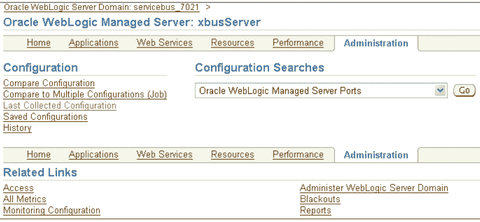
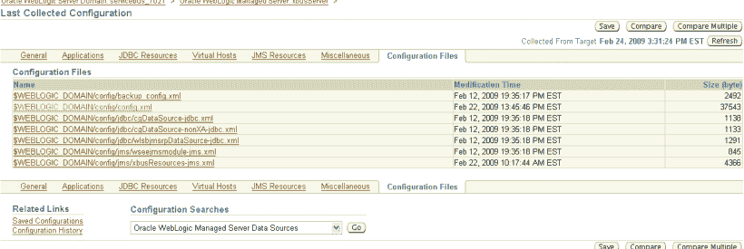
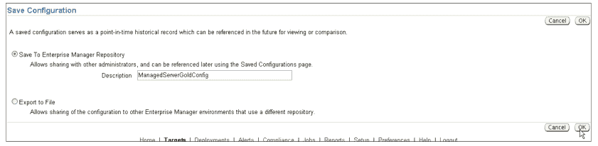
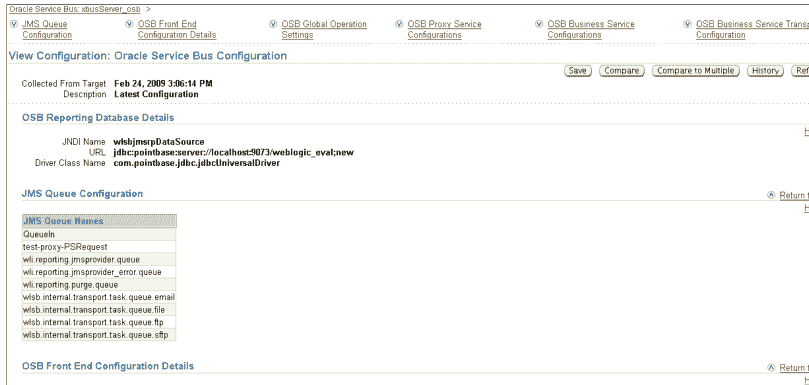
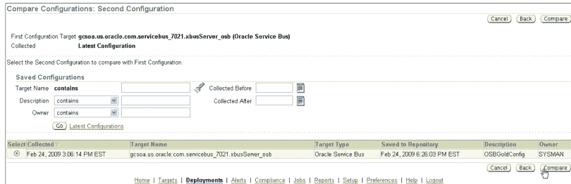
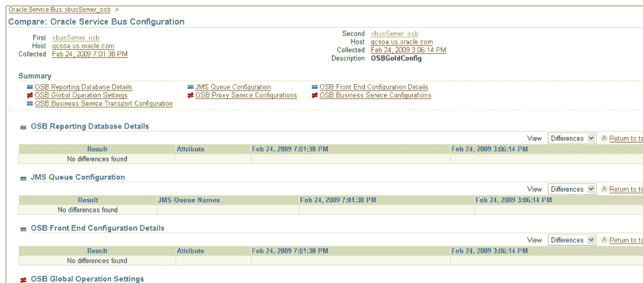
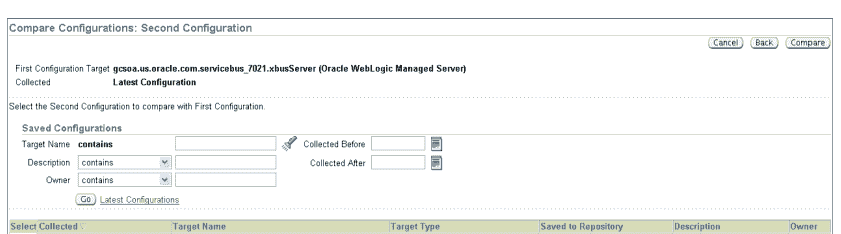
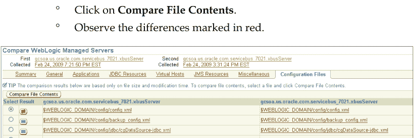

## 14 WebLogic 和 OSB 配置管理

管理中间件环境的配置对于中小型和大型企业来说是一个困难的命题。“了解你拥有什么”使 IT 管理员能够就未来投资和淘汰旧资产做出决策，标准化现有资产，在整个企业中管理变更，并排除与配置相关的性能问题。

大多数配置管理解决方案今天都符合 **IT 信息库 (ITIL)** 框架规定的最佳实践。所有资产都存储在称为 **配置管理数据库 (CMDB)** 的中央存储库中。配置参数（如数据库的实例参数、WebLogic 应用服务器的启动参数或 HTTP 服务器的端口号）存储在 CMDB 中。对这些参数的任何更改也会被跟踪。然后很容易审计特定资产的更改，将资产相互比较（例如，托管服务器 1 和托管服务器 2），比较同一资产的不同版本，将参考配置保存到 CMDB，并用它在整个企业中进行标准化。本章讨论 WebLogic 和 OSB 环境的配置管理。具体来说，本章讨论：

- 挑战
- 解决方案
- 逐步练习：
  - 查看 WebLogic 托管服务器配置
  - 保存托管服务器配置快照
  - 查看和保存 OSB 配置
  - 将当前 OSB 配置与保存的基线进行比较
  - 将当前托管服务器配置与保存的基线进行比较

## 挑战

很难跟踪所有 IT 系统的配置。通常，IT 部门会求助于 Excel 电子表格来存储关键的中间件配置信息。这使得 IT 部门在进行更改、衡量影响、识别因配置不正确导致的性能问题方面变得缓慢，并增加了管理数据中心的成本。对于 WebLogic 和 OSB 环境，很难维护多个域以及底层配置的配置。对于中大型 WebLogic 安装，基线化一个工作配置并将其与非工作配置进行比较以进行部门或企业范围的定制非常重要。对于 OSB，跨不同项目版本维护代理和业务服务配置的额外挑战。在缺乏对配置的控制的情况下，很难评估新项目版本对生产的影响，以及可能与配置更改相关的生产问题的故障排除。

## 解决方案

使用 Grid Control，WebLogic 和 OSB 服务器进程的关键配置指标被收集并存储在 Enterprise Manager 存储库中。管理员可以查看 WebLogic 和 OSB 环境中历史配置更改。他们还可以通过将配置保存在存储库中来基线化工作配置。WebLogic Admin、托管服务器和 OSB 服务器配置参数可以与其他服务器进行比较。最后，还可以比较 OSB 项目版本以观察更改并评估连续部署中的影响。

## 分步练习

这组逐步练习将逐步介绍 WebLogic 和 OSB 服务器目标的配置管理。

## 查看 WebLogic 托管服务器配置

在响应式故障排除练习中（通常与监控警报相关），管理员问的第一个问题之一是“发生了什么变化？”在查看更改之前，有用的是查看系统的当前配置，以确定是否有任何明显的错误设置：

- 1. 导航到 **Targets | Middleware** 选项卡。
- 2. 点击 **Oracle WebLogic Managed Server** 链接。


- 3. 这会带您进入托管服务器主页。
- 4. 单击管理标签页。
- 5. 注意目标相关的配置管理链接。

> Grid Control 配置管理框架每天都会收集 WebLogic 组件（包括托管服务器和管理员服务器）的关键配置参数。这些参数存储在 Grid Control 仓库中。关键配置任务可从此处访问。



- 6. 请注意，您可以从此处启动配置搜索，用于数据源、应用程序、J2EE 模块、端口等。

- 7. 查看托管服务器的最后收集配置：
- 单击 **最后收集的配置** 以查看配置参数。
- 在 **最后收集的配置** 页面上查看配置设置。
- **通用** 选项卡显示有关服务器的通用信息，包括端口、资源使用情况、调优参数、JVM 信息和集群参数。
- **应用程序** 选项卡列出已部署的应用程序以及路径。它还显示模块、类型、URL 映射和会话超时信息。
- **JDBC 资源** 显示连接池和数据源的列表。
- **JMS 资源** 指定队列、配置时最大/最小字节大小、JNDI 名称等。
- **虚拟主机** 显示配置时主机列表。
- **杂项** 显示启动/关闭类、Jolt 连接池和工作管理器信息。
- **配置文件** 显示托管服务器的关键配置文件的列表。
- 深入配置一个配置文件以查看其内容。



## 保存托管服务器配置快照

标准化托管服务器配置对于确保多个安装之间具有可预测的行为非常重要。标准化的第一步是在 Grid Control 仓库中保存一个现有且可信的配置，以便将其用作与其他配置进行比较的基线：

- 1. 深入配置一个配置文件以查看其内容
- 2. 单击右上角的 **保存** 按钮。
- 3. 选择 **保存到企业管理器存储库** 选项。
- 4. 输入类似 **ManagedServerGoldConfig** 的描述，如以下屏幕截图所示：



- 5. 单击确定以将当前配置保存到 EM 仓库。
- 6. 注意确认消息以及带有时间戳、名称、描述、保存日期和所有者的已保存配置。

## 查看和保存 OSB 配置

与 WebLogic 托管服务器目标类似，我们也可以查看 OSB 目标的最新配置，并将已知且可信的配置保存到 Grid Control 仓库中：

- 1. 导航到 OSB 目标的配置管理部分：
  - 导航到 OSB 目标主页。
  - 在底部，在配置下，单击查看配置选项卡。
- 2. 查看 OSB 目标的最后收集配置：
  - 显示 OSB 服务器的当前配置。
  - 注意 JMS 队列信息（特定于 OSB 的队列）。
  - OSB 前端配置和全局操作设置捕获在 OSB 控制台上设置的关键参数。

每个已部署服务的代理和业务服务配置都会显示。



- 3. 将配置快照保存到仓库：
  - 单击保存按钮以保存当前配置。
  - 选择保存到 EM 仓库选项。
  - 提供类似 OSBGoldConfig 的描述。
  - 单击确定以将当前配置保存到 EM 仓库。
  - 注意确认消息以及带有目标名称、目标类型和时间戳的已保存配置。

## 将当前 OSB 配置与已保存的基线进行比较

一旦 OSB 配置快照已保存在 Grid Control 中，它就可以用作与其他 OSB 目标进行比较的标准。通常，有用的是将静态可信快照与最新配置进行比较，以便查看与已知可信状态的偏差。

> 要查看配置更改，您必须在尝试本节之前在 OSB 控制台上进行一些更改。例如，登录到 OSB 控制台，并更改“全局设置”以及一些业务和代理服务配置。然后您可以尝试本节以查看 Grid Control 中捕获的更改。

- 1. 更新最新配置：
  - 导航到 OSB 目标主页。
  - 单击底部的查看配置链接。
  - 单击刷新按钮以获取最新配置更新。
  - 等待一分钟。Grid Control 代理与 OSB 服务器交互以获取最新信息并在页面上显示。
- 2. 启动配置比较：
  - 单击比较按钮开始在 OSB 目标的当前配置与已保存的（“OSBGold Config”）配置之间进行比较。
  - 单击已保存配置链接。
  - 选择 OSBGoldConfig 进行比较。



- 3. 单击比较以生成比较结果。



- 4. 使用已保存基线查看 OSB 目标比较结果：
  - OSB 目标之间的比较结果在所有类别中呈现。**摘要** 选项卡列出类别的状态。
  - 注意各种参数用红色 *不等号* 标记的差异。

## 将当前托管服务器配置与已保存的基线进行比较

正如我们将 OSB 服务器配置与已保存快照进行比较一样，我们也可以将 WebLogic 托管服务器目标与已保存快照进行比较。这将使我们能够在 WebLogic 级别识别配置差异。

> 要查看配置更改，您必须在尝试本节之前在 WebLogic 管理控制台上进行一些更改。例如，登录到管理控制台，并更改相关托管服务器的一些设置。然后您可以尝试本节以查看 Grid Control 中捕获的更改。

- 1. 更新最新配置：
  - 导航到托管服务器目标主页。
  - 单击 **管理** 选项卡。
  - 单击 **最后收集的配置** 按钮以获取最新配置更新。
  - 单击 **刷新** 以更新最新配置。
  - 等待一分钟。
- 2. 启动配置比较：
  - 单击 **比较** 按钮开始在托管服务器目标的当前配置与已保存的（**ManagedServerGoldConfig**）配置之间进行比较。
  - 单击 **已保存配置** 链接。
  - 选择 **ManagedServerGoldConfig** 进行比较。

- 3. 查看当前与已保存配置之间的差异：
  - 单击 **配置文件**。
  - 选择 **config.xml**。
  - 单击 **比较文件内容**。
  - 观察标红的差异。





```
<!-- XML diff excerpt lines 12-26 -->
12 <sec-role-mapper ...>...</sec-role-mapper>
13 <sec-authorizer ...>...</sec-authorizer>
14 <sec-adjudicator ...>...</sec-adjudicator>
15 <sec-credential-mapper ...>...</sec-credential-mapper>
16 <sec-cert-path-provider ...>...</sec-cert-path-provider>
17 <sec-cert-path-builder>WebLogicCertPathProvider</sec-cert-path-builder>
18 <sec-name>myrealm</sec-name>
19 <realm>...</realm>
20 <default-realm>myrealm</default-realm>
21 <credential-encrypted>{3DES}...</credential-encrypted>
22 <code-manager-username>...</code-manager-username>
23 <node-manager-password-encrypted>{3DES}...</node-manager-password-encrypted>
24 </security-configuration>
25 <server>
26 <name>xbusServer</name>
<!-- differences marked in red appear below line 26 in the right pane -->
```


## 摘要

配置管理对于管理员控制环境中的变更以及排查与配置更改相关的故障至关重要。借助 Grid Control 的配置管理功能，管理员可以管理变更并减少排查问题所需的时间。

本章中，我们讨论了企业中与配置相关的挑战。我们讨论了如何查看 WebLogic 托管服务器和 OSB 目标的最新配置。然后，我们在 Grid Control 仓库中保存了一个已知且可信的配置的快照，以便将其用作比较的基线。然后我们将保存的基线与最新配置进行比较并查看了漂移情况。我们讨论了如何利用 Grid Control 配置功能用于 WebLogic 托管服务器和 OSB 目标。

配置管理已通过 Enterprise Manager 收购两款新产品而得到扩展，即 **配置变更控制台 (CCC)** 和 **应用变更控制台 (ACC)**。借助这两款产品，管理员可以实时查看变更的发生情况，并能够回滚和前进到期望的配置。
