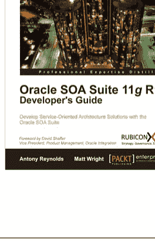
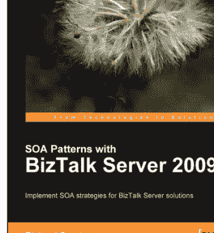
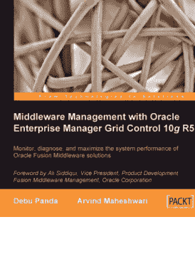
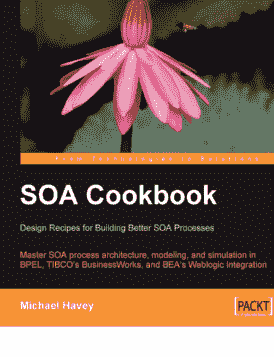

## Index
## Symbols

.bpel 文件 83
.wsdl 文件 83
.xsd 文件 83

## A

ACC 124
激活按钮 140
添加 SOAP 测试按钮 32
管理任务
  查看 49
聚合服务，BPEL 流程
  可用性定义，查看 68
  性能，添加 69, 70
  服务级别期望，设置 70
  使用指标，添加 69, 70
  查看 68
警报历史按钮 45
ALSB 16, 183
应用变更控制台。参见 ACC
应用服务器
  主页，URL 19
AquaLogic 服务总线。参见 ALSB
可用性定义
  关于 163
  查看 62
可用性级别期望
  设置，步骤 61, 62

## B

BAM 15
信标
  添加，以运行服务测试 170-172
BPEL 14

## BPEL Configuration Management

应用服务器目标比较结果，查看 120-123
BPEL 环境，修改 106-108
导航至 BPEL 目标配置管理 97
挑战 96
当前 BPEL 配置，比较 112-116
当前 Oracle 应用服务器配置，比较 119
导航至 Oracle 应用服务器配置管理 101, 102
Oracle 应用服务器环境，修改 108-112
解决方案 96
步骤 97-120
版本，比较 117-119

## BPEL deployment

BPEL suitcase 部署，调度 87-92
BPEL suitcases，上传到软件库 84, 85, 86
挑战 82
流程，查看 86, 87
流程，查看 93
调度部署状态，查看 92, 93
软件库，查看 83
解决方案 82
步骤 82-93

## BPEL infrastructure

挑战 42
服务，创建 43
解决方案 43

BPEL 基础设施服务
  管理任务，查看 49
  配置更改，查看 48
  创建 43, 45
  关键系统指标，查看 49
  策略，查看 45, 46
  系统警报，查看 45, 46
  系统组件，查看 50
  系统仪表板，查看 51
  查看 45, 63
BPEL PM
  关于 18
  挑战 28
  导航至流程主页 29, 30
  服务仪表板，创建 74
  SOAP 测试，创建以监控 BPEL 流程 35-37
  SOAP 测试，创建以监控合作伙伴链接 31-34
  SOAP 测试，测试 38
  解决方案 28
  步骤 28-39
  目标，发现 18
  导航至目标主页 28, 29
BPEL PM 目标
  导航至应用服务器 19
  配置 23, 24
  发现 19, 20
  导航至主页 22, 23
BPEL 流程聚合服务
  查看 68
BPEL 流程可用性服务
  查看 58, 59
BPEL 流程管理器
  概述 15
BPEL 服务仪表板
  挑战 74
  解决方案 74
BPEL 服务级别管理
  挑战 56
  解决方案 57
导航至 BPEL 目标配置管理
  配置快照，保存到仓库 100, 101
  最后收集的配置，查看 98-100
  步骤 97

业务流程执行语言。参见 BPEL
业务服务，监控。参见代理，监控

## C
CCC 124
CMDB 95, 215
COBIT 55
配置变更控制台。参见 CCC
配置更改
  查看 48
配置管理
  挑战 216
  用于 OSB 215
  用于 WebLogic 215
  解决方案 216
配置管理数据库。参见 CMDB
信息技术相关控制目标。参见 COBIT
创建类似按钮 195

## D
发现 17
下载
  Grid Control 13

## E
EAI 15
企业应用集成。参见 EAI
企业服务总线。参见 ESB
ESB 203

## G
Grid Control
  关于 27
  BPEL 管理功能 18
  组件 11
  下载 13
  安装 13
  概述 10
Grid Control，组件
  架构图 12

中央 Web 控制台 12
管理代理 11
OMR 11
OMS 11
Grid Control 软件库
组件，创建 131-134
配置页面 134, 135
创建组件向导 133
创建 131
刷新按钮 139
审核页面 136
设置指令页面 136
摘要向导 138

## H

Grid Control 主页
关于 14
所有目标警报 14
所有目标策略违规 14
所有目标状态 14
部署摘要 14
目标搜索 14

## I

信息技术基础设施库。参见 ITIL
基础设施可用性定义
查看 67
基础设施性能指标
添加 63
基础设施使用指标
添加 65
设置 66
安装
Grid Control 13
ITIL 55, 95
IT 信息库。参见 ITIL

## J

jar 文件 83
Java 虚拟机。参见 JVM
JVM 41

## K

关键系统指标，BPEL 基础设施服务
查看 49

## M

管理代理 11
托管服务器主页 217
指标 173
挂载点 175

## N

新创建的集群
验证 153
新创建的集群，验证
BPEL 控制控制台 156
Oracle 应用服务器主页 154
步骤 153-156

## O

OESB 15
OMS 11
Oracle 应用服务器克隆，使用的 SOA 应用
应用和 Web 层页面 146
凭据/计划页面 145
库步骤属性页面 147
流程完成状态属性页面 150
审核页面 148
选择应用层组件页面 142
选择应用层目标页面 144
源选择页面 143
状态页面，作业运行 150, 152
步骤 141
目标列表页面 144
导航至 Oracle 应用服务器配置管理
配置快照，保存到仓库 105
最后收集的配置，查看 102-104

Oracle BAM 10
Oracle BPEL 流程管理器主页 155
Oracle 业务活动监控。参见 BAM
Oracle 企业服务总线。参见 OESB
Oracle 服务总线。参见 OSB
OSB
  概述 16
Oracle SOA Suite
  概述 15
Oracle 技术网络。参见 OTN
Oracle Web 服务管理器。参见 OWMSM
OSB
  关于 15, 189
  挑战 184
  解决方案 184
  导航至目标主页 187
OSB 配置
  与保存的基线比较 220-222
  托管服务器配置，与保存的基线比较 222, 223
  保存 219, 220
  查看 219, 220
OSB 部署自动化
  挑战 190
  解决方案 190
创建 OSB 基础设施服务
  步骤 204, 205
OSB 项目部署
  管理，步骤 190-196
  流程，查看 194, 195
  项目，上传到软件库 191-194
  调度 196-201
  软件库，查看 190, 191
OSB 代理
  聚合服务，创建 206, 207
  服务端点，监控 207-209
  导航至服务主页 205
OTN
  URL 12
OWSM 15

## P
代理，监控
  挑战 204
  创建 OSB 基础设施服务 204, 205
  创建 OSB 代理聚合服务 206, 207
  导航至 OSB 代理服务主页 205, 206
  SOAP 测试，创建 207
  SOAP 测试创建，用于业务服务端点测试 210-212
  SOAP 测试创建，用于代理服务端点监控 207-210
  SOAP 测试，测试 212
  解决方案 204

## R
刷新按钮 93
响应时间测试 62
请求处理时间 64
审核步骤 91

## S
SAS 70 55
服务，BPEL
  聚合服务 57
  聚合服务可用性定义，查看 68
  聚合服务级别期望，设置 70, 71
  聚合服务性能，添加 69, 70
  可用性定义，查看 62
  可用性级别期望，设置 61, 62
  可用性服务 57
  BPEL 基础设施服务，查看 63
  BPEL 流程聚合服务，查看 68
  BPEL 流程可用性服务，查看 58, 59

基础设施可用性定义，
    查看 67
基础设施性能指标，添加
    63, 64
基础设施服务 57
基础设施服务等级期望，
    设置 66
基础设施使用指标，添加 65
性能指标，添加 59-61
服务测试 58
SLA 57
系统 57
使用指标，添加 69, 70
服务仪表板，创建
SOA 服务仪表板 75-77
SOA 服务仪表板，创建 75
SOA 服务仪表板，查看 77-79
步骤 74-79
服务等级协议。参见 SLAs
服务性能指标
    添加，步骤 59-61
简单对象访问协议。参见 SOAP
SLAs 73
SOAP 207
SOA Suite 克隆
    应用程序服务器进程，停止 130
    挑战 126
    组件，在 Grid Control 软件库中创建 131-140
    新创建的集群，验证 153
    Oracle Application Server，添加到 Grid Control 126-130
    Oracle Application Server 克隆，使用的 SOA 应用程序 141
    解决方案 126
软件库
    项目，上传 191-194
    查看 190, 191
审计准则声明 70。参见 SAS 70
系统组件
    查看 50
系统仪表板
    查看 51

## T
三层架构，Grid Control
    中央 Web 控制台 12
    管理代理 11
    OMR 11
    OMS 11
## U
使用指标屏幕 65, 174
## V
验证服务测试按钮 38
## W
Web 应用程序
    挑战 160
    解决方案 160
Web 应用程序管理
    Beacons，添加 170-172
    创建 161-163
    性能指标，添加 172, 173
    已记录的 Web 事务回放，查看 178-180
    步骤 161, 164, 170, 172, 178
    使用指标，添加 174-177
    Web 事务，记录为服务测试 164-171
WebLogic
    挑战 184
    解决方案 184
WebLogic 配置管理
    受管服务器配置快照，保存 218, 219
    受管服务器配置，查看 216-218
WebLogic Server。参见 WLS
Web 服务描述语言。参见 WSDL

Web 服务调用框架。参见 WSIF

Web 服务业务流程执行语言。参见 WS-BPEL

WLS 183

WS-BPEL 14

WSDL 207

WSIF 27

## Z
区域，网站创建

使用系统时区 161

## 感谢购买

## 使用 Oracle Enterprise Manager 10g Grid Control 进行 BPEL PM 和 OSB 运营管理

## 关于 Packt Publishing

Packt，发音为 'packed'，于 2004 年 4 月出版了首本图书 "Mastering phpMyAdmin for Effective MySQL Management"，随后继续专注于出版针对特定技术和解决方案的高度聚焦的书籍。

我们的书籍和出版物分享了您同行的 IT 专业人士在适应和定制当今系统、应用程序和框架方面的经验。我们的基于解决方案的书籍为您提供定制正在使用的软件和技术的知识和能力，以完成工作。与您过去看到的 IT 书籍相比，Packt 书籍更具体、更少泛泛而谈。我们独特的商业模式使我们能够提供更集中的信息，让您了解更多所需的内容，减少不必要的内容。

Packt 是一家现代而独特的出版公司，专注于为开发人员、管理员和新手等社区生产优质、前沿的书籍。如需了解更多信息，请访问我们的网站：www.packtpub.com。

## 关于 Packt Enterprise

2010 年，Packt 推出了两个新品牌 Packt Enterprise 和 Packt Open Source，以继续专注于专业化。本书是 Packt Enterprise 品牌的一部分，该品牌汇集了有关企业软件的书籍——由主要厂商（包括但不限于 IBM、Microsoft 和 Oracle）创建的软件，通常用于其他公司。其标题将为该软件的各类用户提供相关信息，包括管理员、开发人员、架构师和终端用户。

## 为 Packt 撰稿

我们欢迎所有有兴趣撰稿的人的咨询。图书提案请发送至 author@packtpub.com。如果您的图书想法仍处于早期阶段，并且您希望在撰写正式的图书提案之前先进行讨论，请联系我们；我们的其中一位约稿编辑将与您联系。

我们不仅寻找已出版的作者；如果您具备强大的技术技能但缺乏写作经验，我们经验丰富的编辑可以帮助您发展写作事业，或为您提供专业知识的额外回报。

## Oracle SOA Suite 11g R1
开发者指南

ISBN: 978-1-849680-18-9      平装：720 页

使用 Oracle SOA Suite 开发面向服务的架构解决方案

- 1. 一本关于在交付真实世界 SOA 应用程序中使用和应用 Oracle SOA Suite 的实践、最佳实践指南
- 2. 对 Oracle Service Bus、BPEL PM、规则、Human Workflow、事件传递网络和业务活动监控的详细覆盖
- 3. 掌握在 SOA 解决方案实施中使用和组合这些不同组件的最佳方式

## SOA Patterns with BizTalk Server
2009

ISBN: 978-1-847195-00-5      平装：400 页

为 BizTalk Server 解决方案实施 SOA 策略

- 1. 讨论 SOA 的核心原则并展示它们在 BizTalk 解决方案中的应用
- 2. 对 BizTalk 和 WCF 集成的最全面考察，涵盖任何可用书籍
- 3. 对新的 WCF SQL Server 适配器、UDDI 服务版本 3 和 ESB Guidance 2.0 的领先见解

## 使用 Oracle Enterprise Manager Grid Control 10g R5 进行中间件管理

ISBN: 978-1-847198-34-1      平装：350 页

监控、诊断并最大化 Oracle Fusion Middleware 解决方案的系统性能

- 1. 使用 Oracle Enterprise Manager Grid Control 有效高效地管理您的 Oracle Fusion Middleware 和非 Oracle 中间件应用程序
- 2. 实施主动监控以最大化应用程序性能
- 3. 一个实践教程，详细说明 Oracle Enterprise Manager Grid Control 对中间件的管理

## SOA Cookbook

ISBN: 978-1-847195-48-7      平装：268 页

在 BPEL、TIBCO 的 BusinessWorks 和 BEA 的 Weblogic Integration 中掌握 SOA 流程架构、建模和仿真

- 1. 课程包括如何建模编排、如何构建动态流程、如何在长时间运行的流程中管理状态，以及许多其他内容
- 2. 讨论的 BPEL 工具包括 BPEL 模拟器、BPEL 编译器和 BPEL 复杂度分析器
- 3. BPEL、TIBCO 的 BusinessWorks、BEA 的 Weblogic Integration 中的示例
