本游戏开发书籍采用从零开始构建完整游戏的实践方法。您将了解如何使用 Flame 库入门并构建一个简单的动画示例来测试 Flame。然后，您将发现如何在 Flutter 游戏中组织和加载图片和音频。随着深入，您将了解游戏循环并将其设置为快速高效的处理。本书还指导您使用 Tiled 创建地图，向玩家可以与之交互的地图中添加精灵，并了解如何使用瓦片地图碰撞为玩家创建可行走的路径。最后，您将学习如何使用人工智能 (AI) 使敌人更加智能。

读完本书，您将有信心使用 Flutter 构建有趣的跨平台游戏。

## 本书适合谁阅读

如果您是一名希望将 Flutter 编程技能应用于游戏开发的 Flutter 开发人员，那么本书适合您。具备基本的 Dart 知识将有助于理解所涵盖的概念。

## 本书内容概要

第 1 章，Flutter 游戏入门，解释了为何使用 Flutter/Dart 进行游戏编程。您将了解 Flutter 和 Dart 为何能实现跨平台游戏的快速开发，并掌握游戏编程涉及的关键概念。

第 2 章，使用 Flame 引擎，概述了本书中用于构建游戏的 Flame 引擎。

第 3 章，构建游戏设计，介绍了我们将要构建的游戏及其设计。我们将在整本书中构建的游戏是“淘金热”，我们将了解如何规划游戏的内容和屏幕以制定游戏计划。

第 4 章，绘制和动画化图形，详细介绍了如何在屏幕上绘制和动画化图形。您将了解什么是精灵，如何在屏幕上移动它们，学习如何为精灵制作逼真的动画，并了解如何检测屏幕上的精灵何时相互碰撞。

第 5 章，使用输入移动图形，详细介绍了如何使用触摸事件和屏幕按钮移动图形。通过绘制屏幕摇杆，我们展示了如何根据用户对摇杆的控制在屏幕上移动精灵，并了解如何使用触摸屏移动精灵。

第 6 章，播放音效和音乐，详细介绍了如何响应游戏事件播放音乐和声音。

第 7 章，设计自己的关卡，解释了如何创建游戏关卡并在它们之间导航。

第 8 章，为 Web 和桌面缩放游戏，详细介绍了如何通过为不同屏幕分辨率缩放图形，使同一游戏在不同平台上运行，以及由于手机缺乏物理按键，计算机与手机之间的导航可能有何不同。

第 9 章，实现高级图形效果，解释了如何使用强大的粒子和图层效果增强游戏图形。

第 10 章，使用 AI 制作智能敌人，介绍了使用 AI 为游戏添加智能。您将了解如何使用 AI 让敌人在玩家靠近时追击玩家，从而表现得更加智能，以及如何让玩家在导航地图时避开障碍物。

第 11 章，完成游戏，向您展示了如何向游戏添加额外屏幕并在它们之间导航。它还解释了您还可以学习什么以及在哪里寻求帮助。

## 如何充分利用本书

您需要具备一些 Flutter 和 Dart 知识，但无需游戏开发知识。本书不教授 Flutter 或 Dart。

假设您对自己选择的开发工具（例如 Visual Studio Code）有良好的了解。

| 涵盖的软件/硬件 | 操作系统要求 |
|---|---|
| Flutter v3.0.0 | Windows、macOS 或 Linux |
| Flame v1.0.0 | |
| Dart v2.17.0 | |

如果您使用的是本书的数字版，我们建议您亲自输入代码或从本书的 GitHub 仓库中获取代码（下一节中提供了链接）。这样做可以帮助您避免与复制和粘贴代码相关的潜在错误。

本书的代码是使用 Visual Studio Code 开发的，但同样适用于 Android Studio 和其他编辑器。

## 下载示例代码文件

您可以从 GitHub 下载本书的示例代码文件：https://github.com/PacktPublishing/Building-Games-with-Flutter。如果代码有更新，将在 GitHub 仓库中更新。

我们还提供来自丰富图书和视频目录的其他代码包，可在 https://github.com/PacktPublishing/ 上查看。请查看！

## 下载彩色图片

我们还提供一个包含本书中使用的截图和图表彩色图像的 PDF 文件。您可以在此处下载：https://static.packt-cdn.com/downloads/9781801816984_ColorImages.pdf

## 本书使用的约定

本书中使用了多种文本约定。

### 文本中的代码

表示文本中的代码词、数据库表名、文件夹名、文件名、文件扩展名、路径名、虚拟 URL、用户输入和 Twitter 账号。示例：“现在，您已完成 pubspec.yaml 文件的更新，请保存更改。”

代码块设置如下：

```
void main() async {
final goldRush = GoldRush();
WidgetsFlutterBinding.ensureInitialized();
await Flame.device.fullScreen();
await Flame.device.setPortrait();
runApp(
GameWidget(game: goldRush)
);
}
```

当我们希望引起您对代码块特定部分的注意时，相关行或项目将以粗体显示：

```
cd build/web/
python3 -m http.server 8000 &
```

任何命令行输入或输出均按以下方式编写：

```
flutter pub get
```

### 粗体

表示新术语、重要单词或屏幕上可见的单词。例如，菜单或对话框中的单词以 **粗体** 显示。示例：当游戏中的玩家死亡并返回游戏菜单时，将显示 **“游戏结束!!”** 屏幕。

### 提示或重要说明

显示如下。

## 联系我们

我们始终欢迎读者的反馈。

### 一般反馈

如果您对本书的任何方面有疑问，请发送电子邮件至 **customercare@packtpub.com**，并在邮件主题中注明书名。

### 勘误

尽管我们已尽全力确保内容的准确性，但错误难免发生。如果您在本书中发现错误，我们将不胜感激若能将其报告给我们。请访问 [www.packtpub.com/support/errata](www.packtpub.com/support/errata) 并填写表格。

### 盗版

如果您在互联网上以任何形式发现我们作品的非法副本，我们将不胜感激若能向我们提供位置地址或网站名称。请使用指向材料的链接联系我们：[copyright@packt.com](copyright@packt.com)。

### 如果您有兴趣成为作者

如果您在某个主题上有专业知识，并有兴趣编写或参与编写图书，请访问 [authors.packtpub.com](authors.packtpub.com)。


## 第 1 部分：游戏基础

本部分将向您介绍 Flutter 和 Flame 游戏引擎，以及本书中将构建的游戏（通过描述游戏设计来介绍）。

本部分包含以下章节：

- 第 1 章，Flutter 游戏入门
- 第 2 章，使用 Flame 引擎
- 第 3 章，构建游戏设计

## 第 1 章：Flutter 游戏入门

欢迎阅读《使用 Flutter 构建游戏》！

我们将向您展示如何使用 Google 的 **Flutter** 框架来构建可在移动端和 Web 平台上运行的可扩展游戏。Flutter 最初看起来可能是构建游戏的一个奇怪选择，因为存在更成熟的游戏开发框架，例如 Unity 或 Unreal Engine，但其中许多工具非常复杂，难以学习，并且需要很长时间才能开始使用它们制作游戏。

在您现有的 Flutter 和 **Dart** 知识基础上，我们将带您完成构建可在所有支持平台上运行的 2D 游戏所需的步骤。从基础开始，我们将在此知识基础上逐步深入更高级的游戏主题。读完本书后，您将能够制作包含以下内容的 2D 游戏：

- 在屏幕上动画化图形
- 播放音效和音乐
- 使用键盘、摇杆或手势控制玩家
- 检测图形碰撞
- 创建游戏关卡地图并在其中导航
- 设计游戏
- 在不同平台上缩放游戏
- 高级图形效果
- 智能敌人

我们将通过示例介绍核心概念，并在此基础上逐章构建，最终打造一个可在不同设备上运行的完整游戏。每一章都将包含代码示例，帮助您学习游戏开发的基础模块，并提供代码、图像和声音资源来构建我们的完整游戏。该游戏涉及玩家在地图上导航，躲避敌人，同时尽可能多地收集金币。

在本章中，我们希望深入了解 Flutter 和 Dart 以及它们具有哪些特性，使其成为游戏开发的绝佳选择。这将让您了解为什么 Flutter 和 Dart 可以用于在许多平台上运行快速、流畅的游戏。

在本章中，我们将介绍以下主题：

- 使用 Flutter
- 使用 Dart
- 总结本书
- 创建简单示例动画

我们有很多内容要讲，那就开始吧！

### 技术要求

在本章中，您应该已设置好代码编辑器，并安装了最新版本的 Flutter 和 Dart。本书基于 Flutter v3.0.0、Dart 2.17.0 和 Flame v1.0.0。

本书的所有源代码均可从 Git 仓库下载：https://github.com/PacktPublishing/Building-Games-with-Flutter.git。

本章特有的源代码可在此处找到：https://github.com/PacktPublishing/Building-Games-with-Flutter/tree/main/chapter01。

### 使用 Flutter

您可能之前使用过 Flutter 来构建应用程序或网站，并可能在疑惑 Flutter 是否足够好用于制作出色的游戏。Flutter 是游戏编程的绝佳选择，原因如下：

- Flutter 具有非常快的渲染时间，且可在多个平台上扩展。
- Flutter 游戏旨在以每秒 60 帧 (FPS) 的速度绘制以实现流畅动画，或者在支持更高刷新率的设备上以 120 FPS 绘制。
- Flutter 代码使用单一代码库来简化维护，并使代码能够在许多设备上运行。
- Flutter 核心使用 C++ 编写，这使游戏以原生速度运行。
- Flutter 是开源的，因此成本效益高（企业喜欢 Flutter，因为他们不必像使用某些其他框架那样为昂贵的许可证付费）。

与其他框架不同，Flutter 不使用原生组件，而是绘制自己的组件，所有组件均使用闪电般快速的 Skia 图形引擎绘制。Skia 是一个开源图形库，可在各种硬件和软件平台上运行，它抽象掉了每个平台上不同的特定于平台的图形 API。这些 API 提供绘制形状、文本和图像的功能。

现在我们已经解释了 Flutter，让我们深入了解 Flutter 使用的语言 Dart。

### 使用 Dart

在本节中，我们将讨论 Dart 及其使其非常适合游戏开发的语言特性。我们将讨论 Dart 如何编译，以及它如何使用线程和垃圾回收。我们还将讨论一些出色的特性，例如热重载如何帮助我们快速开发代码。

### 编译类型

计算机编程语言可以是静态或动态的。静态语言会在运行前编译为机器码，例如 C++。动态语言由解释器执行，因此在运行前不需要编译（例如 JavaScript）。

随着编程语言的发展，虚拟机被发明出来，这使得将语言移植到新硬件平台变得更加容易。代码被转换为字节码，然后在虚拟机上运行。Java 是一种使用字节码的语言示例。

虚拟机在软件中模拟硬件，并可以移植到不同的硬件平台上运行，从而使代码可移植。

随着编译器技术的发展，**即时编译器**（**JIT**）被发明出来，通过即时编译代码来提高在虚拟机上运行的代码的性能。

将程序在运行前编译为机器码被称为**预编译**（**AOT**）编译。Dart 的独特之处在于它同时支持 JIT 和 AOT 编译类型，这为开发人员提供了巨大的优势。开发人员可以分发使用 AOT 编译的应用程序以获得最大速度和性能，这有助于游戏流畅运行。

当以 JIT 编译模式运行时，Flutter 和 Dart 有一个称为**有状态热重载**（stateful hot reload）的惊人功能，可以缩短开发时间。

### 热重载

Flutter 使用 JIT 编译器，让您在不到一秒钟的时间内重新加载并运行代码。这样您可以更改代码并立即在模拟器或 Web 浏览器中看到更改，同时保留游戏的内部状态。

这对游戏开发非常有帮助，因为您可以修改代码并立即看到更改效果，极大地加快了开发速度。这就像用代码作画！

例如，您可能将图形重新定位几个像素或更改颜色。在传统开发中，您需要重新构建代码（可能需要很多分钟）才能看到更改，但在 Flutter 中，这是即时的。

### 原生桥接

例如 JavaScript 这样的动态语言通过桥与平台上的原生代码通信，这非常缓慢。它们这样做是为了绘制其运行平台的原生组件等操作。

**原生桥接**用于为所有代码提供动态代码和原生代码之间的接口，发送**用户界面（UI）**组件的状态信息。

在 Flutter 中，情况并非如此，Skia 在画布上绘制所有组件（并使它们看起来和感觉像原生组件），因此它绕过了对原生桥接的需求。

这一点非常重要，因为如果使用原生桥接，您还需要在绘制之前传递 UI 组件的状态，这会减慢一切速度，并可能导致 UI 跳过帧，而不是保持动画流畅。

### 垃圾回收

Dart 使用先进的垃圾回收系统，可以快速处理内存中的短生命周期对象。

由于 Flutter 每帧都会重新构建 widget 树，因此它会丢弃旧对象并重新创建新对象。在 Java 等语言中，这会引起问题，但 Dart 针对此进行了优化，可以非常快速地处理。

大多数语言都需要使用锁来访问共享内存，但 Dart 大多数时候可以在不使用锁的情况下执行垃圾回收。这种快速的垃圾回收带来了非常流畅的图形性能，极大地增强了我们的游戏。

### 线程控制

由于线程的实现方式，开发人员在 Dart 中对代码执行有更多控制权。因为 Dart 通常不需要像大多数其他语言那样使用锁来访问共享内存，所以我们对代码执行有更多控制权。

没有锁，我们就避免了一种称为竞态条件的调用，当单独的线程想要访问共享资源（在此例中为内存）但无法访问时会发生这种情况，因为另一个线程已锁定访问权限，必须先释放锁，其他线程才能访问它。

在本节中，我们讨论了 Dart 语言的特性如何帮助我们编写快速游戏。在下一节中，我们将总结您在本书中将学到的内容。

### 总结本书

在以下小节中，让我们开始看看每一章将探讨什么。

### Flame

在下一章（第 2 章，使用 Flame 引擎）中，我们将介绍如何使用 Flame 引擎库设置游戏循环的基础知识，以及如何组织资源以实现高效加载。

### 设计游戏


提前规划非常重要，这样在游戏开发过程中，你就有蓝图可供参考。

在 *第3章，构建游戏设计* 中，我们将讨论如何规划和设计游戏，我会在全书中持续引用这个示例。

### 图形

除了文本游戏，所有游戏都有图形。在决定是否购买或游玩你的游戏时，图形是人们首先看到的内容，因此如果你想出售游戏，让图形看起来漂亮至关重要。

在 *第4章，绘制和动画化图形* 中，我们将向你展示如何在屏幕上绘制图形，以及如何为其添加动画使其看起来真实。我们还会展示如何检测图形之间的碰撞，例如子弹击中敌人，这可用于触发另一个动画，例如敌人爆炸。

### 输入

所有游戏都需要某种输入，无论是触摸屏幕、按键还是移动虚拟摇杆来控制角色。

在 *第5章，使用输入移动图形* 中，我们将解释控制角色的多种方法，使输入和动画同步，并感觉流畅且响应迅速。

### 声音

音效和音乐在游戏中扮演着重要角色，以增强玩家的体验。背景音乐在任何游戏中也起着重要作用；在游戏过程中，音乐可以改变以突出游戏中的重要内容，或改变游戏的氛围。

在 *第6章，播放音效和音乐* 中，我们将讨论如何响应游戏事件同步播放音效，例如当子弹与敌人碰撞时播放爆炸音效。

### 关卡设计

大多数游戏并非在单屏上进行，需要精心考虑每个关卡的设计方式。

在第7章，设计你自己的关卡中，我们将解释如何加载当前关卡所需的图形、声音和关卡数据，以确保不会遇到内存或性能问题，这在为移动电话等低端设备开发游戏时可能是一个真正的问题。

我们还将解释如何制作大于物理屏幕的地图，以及如何在屏幕上导航你的玩家，并在玩家移动时滚动地图。

### 跨平台游戏

使用 Flutter 和 Dart 的关键优势之一是其跨平台功能，可使游戏在多种设备上运行。我们将在第8章，为 Web 和桌面端缩放游戏中更详细地讨论此主题。

### 高级图形效果

如前所述，图形是用户首先看到的内容，因此必须看起来令人印象深刻。

在第9章，实现高级图形效果中，我们讨论高级图形效果以及可以采取什么措施让你的游戏看起来惊艳。

我们将使用粒子效果来增强现有图形，使游戏真正脱颖而出。

我们还将讨论如何利用图形层在屏幕上有大量动画时更高效地绘制图形。

### 游戏 AI

当游戏更加逼真时会更有趣，我们可以通过 **人工智能（AI）** 来实现这一点。

在第10章，使用 AI 制作智能敌人中，我们将向你展示如何制作能够从一个位置移动到另一个位置、避开障碍物，并在看到你时追赶你的敌人。

### 完成游戏

在第11章，完成游戏中，我们将讨论完成游戏所需的一些内容。这将包括大多数游戏都有的其他屏幕，例如用于品牌展示的启动屏幕和用于游戏选项（例如控制音乐音量）的设置屏幕。

我们将讨论如何在应用商店出售你的游戏，以及如何通过应用内购买增加游戏销量。

最后，到本书这里为止，我们将教你游戏编程的基础知识，但你还有更多可以学习的内容。我们将讨论如果你想制作更高级的游戏，还应该学习什么，以及在制作游戏时遇到困难可以去哪里寻求帮助。

现在我们已对全书将要涵盖的章节做了概述，在下一节中，我们将通过一个简单的动画示例，向你展示在 Flutter 中开始游戏编程是多么容易。

### 创建一个简单的示例动画

下面是一个你可以运行的代码示例，展示如何轻松地绘制和动画化一个简单的形状。

要运行此示例，请执行以下步骤：

- 1. 首先，通过运行以下命令在命令行中创建一个新项目：

```
flutter create goldrush
```

- 2. 在代码编辑器中打开 Flutter 创建的 `goldrush` 文件夹，然后打开 `pubspec.yaml` 文件。

- 3. 将 description 更新为以下内容：

```
description: Flutter game from Building Games with Flutter
```

- 4. 将环境 SDK 更新为以下内容：

```
sdk: ">=2.17.0 <3.0.0"
```

这是撰写本书时的最新 SDK 版本，支持 Flutter 和 Dart 的最新功能。

- 5. 在 dependencies 部分，我们需要添加一个名为 Flame 的库（我们将在下一章中详细介绍）：

```
cupertino_icons: ^1.0.2
flame: 1.0.0
```

Flame 是一个很棒的库，为我们提供了使用 Flutter 和 Dart 构建游戏所需的大量功能。

- 6. 现在我们已完成对 `pubspec.yaml` 文件的更新，请保存更改。

- 7. 保存更改后，你的代码编辑器应该会下载新的依赖项。如果没有更新，你可以在项目所在目录的命令行中手动运行以下命令：

```
flutter pub get
```

- 8. 接下来，打开 lib/main.dart 文件并删除所有样板代码。

- 9. 然后，我们需要设置此示例所需的导入：

```
import 'dart:ui';
import 'package:flame/flame.dart';
import 'package:flame/palette.dart';
import 'package:flutter/material.dart';
import 'package:flame/game.dart';
```

- 10. 在这之下，我们需要添加 main 函数来初始化游戏和屏幕：

```
void main() async {
final goldRush = GoldRush();
WidgetsFlutterBinding.ensureInitialized();
await Flame.device.fullScreen();
await Flame.device.setPortrait();
runApp(
GameWidget(game: goldRush)
);
}
```

在这里，我们设置了 `GoldRush` 游戏对象（我们将在下一节定义），并告诉 Flame 我们希望以全屏和竖屏模式运行游戏。
我们还运行了应用，传递了 `GameWidget`。

- 11. 接下来，让我们设置游戏小部件以及游戏中将使用的一些变量：

```
class GoldRush with Loadable, Game {
static const int squareSpeed = 250;
static final squarePaint =
BasicPalette.green.paint();
static final squareWidth = 100.0, squareHeight =
100.0;
late Rect squarePos;
int squareDirection = 1;
late double screenWidth, screenHeight, centerX,
centerY;
}
```

### 让我们分解一下这里所做的操作：

- 在这里，我们将正方形的动画速度设置为 250；你可以将其调整为更高的数字来加快动画速度，或调整为更低的数字来减慢动画速度。
- 我们将方框的颜色设置为绿色。
- 方框的宽度和高度设置为固定的 100 像素大小。
- 因为我们将调整方框的位置，所以我们使用 `Rect` 表示正方形位置，它将在 `onLoad` 中初始化，一旦我们计算出屏幕中心作为起始位置。
- 我们将方向设置为正值，这将增加 `x` 值并将方框向右移动。
- 最后，我们设置了屏幕宽度和高度以及屏幕中心的变量。

- 12. 在 `onLoad` 函数中，我们将根据屏幕尺寸计算方框的中心起始位置：

```
@override
Future<void> onLoad() async {
  super.onLoad();
  screenWidth =
      MediaQueryData.fromWindow(window).size.width;
  screenHeight =
      MediaQueryData.fromWindow(window).size.height;
  centerX = (screenWidth / 2) - (squareWidth / 2);
  centerY = (screenHeight / 2) - (squareHeight / 2);
  squarePos = Rect.fromLTWH(centerX, centerY,
      squareWidth, squareHeight);
}
```

- 13. 接下来，我们将定义 render 函数，它在屏幕上方框当前位置绘制方框：


```
@override
void render(Canvas canvas) {
  canvas.drawRect(squarePos, squarePaint);
}
```

- 14. 接下来，根据正方形的速度和方向，再加上自上一帧以来经过的时间，每帧更新正方形的位置。

然后，如果正方形的位置已到达屏幕边缘，我们可以翻转正方形的方向：

```
@override
void update(double deltaTime) {
  squarePos = squarePos.translate(squareSpeed * squareDirection * deltaTime, 0);
  if (squareDirection == 1 && squarePos.right > screenWidth) {
    squareDirection = -1;
  } else if (squareDirection == -1 && squarePos.left < 0) {
    squareDirection = 1;
  }
}
```

- 15. 现在，我们可以运行示例，看到我们简单的绿色正方形从左向右动画，当碰到屏幕边缘时反转方向。

现在，我们已经完成了一个简单的动画示例，展示入门有多么容易，并让你体会使用Flutter进行游戏编程的感觉。

请随意修改代码，比如更改正方形的颜色或在不同位置添加更多正方形。在下一章中，我们将深入研究这段代码。

### 摘要

本章解释了为什么Flutter和Dart非常适合多平台游戏开发。我们解释了书中各部分将重点关注的游戏构建块。最后，我们向你展示了一个可供尝试的简单代码示例。

在下一章中，我们将开始使用Flame，这是与Flutter配合使用以添加与游戏编程相关功能的游戏引擎库。

### 问题

- 1. Flutter绘制的最小恒定帧率是多少？
- 2. Flutter使用的图形引擎名称是什么？
- 3. 我们可以用Flutter支持哪些平台？
- 4. 什么是Skia，它用于什么？
- 5. Dart支持哪些类型的编译，为什么它们有好处？
- 6. 为什么有状态热重载对快速游戏开发有好处？
- 7. Dart的垃圾回收为什么对游戏中使用的平滑动画有好处？

## 第2章：使用Flame引擎

**Flame**是一个作为库添加到你的Flutter项目中的游戏引擎。它为我们提供模块，允许构建游戏。这些包括对图像和精灵、动画、音频、碰撞检测的支持，以及更高级的2D物理和瓦片地图模块。

在本章中，我们将重点介绍如何开始使用Flame并了解游戏引擎的基础知识，包括其资源、游戏循环和组件。了解所有这些很重要，这样你才能很好地理解该库以及所有内容如何组合在一起以使用Flame制作游戏。

一旦你熟悉Flame的基础知识，就可以在本书后面学习更高级的主题。

在本章中，我们将涵盖以下主题：

- 组织游戏中的资源
- 添加游戏循环
- 使用组件

### 技术要求

要查看本章中提到的源代码，可以在 https://github.com/PacktPublishing/Building-Games-with-Flutter/tree/main/chapter02 下载。

Flame项目发展非常迅速，因此有关任何更改或新功能，请参阅 https://flame-engine.org/docs/#/ 上的最新文档。撰写本文时，最新版本为1.0.0，已与Flutter v3.0.0及更高版本集成。

要将最新版本安装到你的项目中，请将以下内容添加到你的 `pubspec.yaml` 文件中：

```
dependencies:
flame: 1.0.0
```

保存文件后，依赖项将被下载，Flame模块将变得可用。如果你遵循了上一章末尾的示例，那么你已经完成了此设置，请确保已这样做。

Flame的最新版本始终可以在 https://pub.dev/packages/flame/install 的 `pub` 存储库中找到。

### 组织游戏中的资源

你的游戏将包含许多资源，例如图像、音频、字体、地图和游戏数据。

与Flutter一样，Flame支持资源的异步加载和缓存。但是，它还在此功能基础上构建了针对图像和音频的有用功能，以帮助有效地使用和管理这些资源。例如，如果你有一个包含许多动画帧的精灵表，你可以非常轻松地加载它们并将其拆分为单独的精灵。这在第4章“绘制和动画化图形”中有更深入的介绍。

你的所有资源都放在Flutter的 `assets` 文件夹下。我推荐以下文件夹结构来保持一切井井有条：

```
assets
--- audio
-------- music
----------- music_menu.mp3
-------- sounds
------------- sound_shoot.mp3
-- images
-------- sprites
----------- sprite_player.png
----------- sprite_enemy.png
-- fonts
-------- font_highscore.ttf
-- maps
-------- map_level.tmx
```

如果存储在 `assets` 文件夹内，Flutter和Flame允许你按喜好组织资源。

在你的 `pubspec.yaml` 文件中，前面的资源应该如下所示：

```
flutter:
- assets/audio/music/music_menu.mp3
- assets/audio/sound/sound_shoot.mp3
- assets/images/sprites/player.png
- assets/images/sprites/enemy.png
- assets/fonts/font_highscore.ttf
- assets/maps/map_level.tmx
```

我建议在资源类型前加前缀，以便非常清楚地知道资源是什么。例如，你可能有一个播放器声音和一个播放器精灵，所以将它们命名为 `sound_player.mp3` 和 `sprite_player.png` 可以更清楚地表明它们代表的内容。

此外，你应该在游戏或关卡开始时预先加载当前屏幕或关卡的任何游戏资源。Flame有一个 `onLoad()` 函数可用于覆盖此操作，我们将在下一节中进一步讨论。

Flame有一些辅助函数来加载不同的资源类型：

```
await Flame.images.load('player.png');
await FlameAudio.audioCache.load('explosion.mp3');
```

这里，`load` 函数将资源加载到Flutter的内部内存缓存中以便更快地访问。另外，使用async/await很重要，因为资源是异步加载的，因此我们需要等待资源加载完成后再继续。

现在我们了解了如何将资源添加到游戏中，让我们来谈谈Flame如何根据当前游戏状态不断重绘屏幕。

### 添加游戏循环

**游戏循环**控制游戏状态的任何更新，然后在屏幕上绘制图形以反映当前游戏状态。

例如，玩家可能会将他们控制的角色向右移动，这将在游戏状态更新期间增加玩家精灵的 _x_ 位置。既然游戏状态已更改，玩家将在新位置绘制。

在更复杂的游戏中，数百个敌方精灵也可能在移动。因此，这些精灵的状态也需要计算。

这在一个循环中继续，当前屏幕上的任何内容都会被更新并重绘。每次重绘称为 **游戏帧**。

每秒绘制的帧数反映了游戏的流畅程度。在Flutter中，应用和游戏以每秒60 **帧（FPS）** 重绘，以允许非常流畅的重绘。

在Flame中，有两个我们可以重写的函数来控制游戏状态的更新和绘制：

```
void update (double deltaTime)
void render (Canvas canvas)
```

让我们更详细地看看这些函数。

### 更新

在 `update` 函数中，传递了一个名为 `deltaTime` 的参数，它告诉我们自上一帧绘制以来经过的时间。我们需要这个值来确保我们的精灵在不同设备上以一致的速度运行。设备的运行速度取决于处理能力，因此如果我们忽略delta值并仅以最大速度运行所有内容


### 渲染

`render` 函数具有一个 Canvas 对象参数，它是一个我们绘图的空白画布。`canvas` 类具有许多函数，可直接在画布上绘制形状和图像，如下所示：

```
canvas.drawRect(squarePos, squarePaint);
```

在此，我们使用精灵的位置和绘制对象的颜色来在画布上绘制矩形，以应用绘图样式。绘制对象代表类似于 Web 中 CSS 的样式，通过将样式应用于正方形。在此示例中，位置是通过固定量手动更新的；但是，在 [第 5 章，使用输入移动图形] 中，我们将详细介绍如何根据用户输入来控制位置。

在 Flame 中，我们通过扩展某个基类来实现游戏循环，该基类会自动持续调用我们的 `update` 和 `render` 函数。在来自 [第 1 章，Flutter 游戏入门] 的第一个示例中，我们使用了 `Game` 混入。这使我们能够覆盖 `update` 和 `render` 函数。这让我们对整个过程有很多控制权，但一旦开始绘制和更新大量精灵，就会变得非常繁琐。然后，当你开始添加输入控件和碰撞检测时，一切都会很快变得难以维护和跟踪。

幸运的是，Flame 提供了类来帮助处理这些问题，随着游戏的增长，我们将在下一节中进一步讨论。

### 使用组件

与任何不断增长的代码库一样，拥有一个结构很重要。这样，随着我们为游戏添加更多功能，代码就易于维护。

目前，我们的代码包含一个在屏幕上呈现和更新正方形的简单示例，使用 `Game` 混入来覆盖这些函数。使用 `Game` 混入让我们对代码有很大的控制权，但随着游戏的增长，我们将不得不编写大量额外代码来支持游戏。当你对 Flame 和游戏编程更加熟悉并需要这种控制级别时，这很好。但是，开始时，最好从 `FlameGame` 类扩展。

组件为我们提供了一种结构化的方式来组织游戏，随着游戏复杂性的增加。

### FlameGame

`FlameGame` 类基于 `Game` 混入，并添加了许多有用功能，以帮助我们管理随着游戏增长而增加的复杂性。这包括以下内容：

- Flame 组件系统
- 碰撞检测跟踪
- `render` 和 `update` 的默认实现

Flame 组件系统允许我们将游戏的一部分拆分为组件（类），这些组件表示游戏中的实体，例如玩家。例如，我们可以拥有一个 `SpriteComponent` 组件来封装与玩家精灵相关的所有内容，以管理玩家碰撞到的任何对象的绘制和更新，或任何其他专门与玩家相关的状态。

`FlameGame` 类维护游戏中所有组件的列表，并且可以根据需要动态地将这些组件添加到游戏中；例如，我们可能会将多个敌人 `SpriteComponent` 组件添加到游戏中，然后在玩家消灭敌人时将它们从游戏中移除。然后，`FlameGame` 类将遍历这些组件，指示每个组件更新并呈现自身。

Flame 组件系统有多种不同类型的组件，可帮助管理游戏的不同部分。以下是一些最常见组件的列表：

- `SpriteComponent`: 用于管理游戏中的任何精灵
- `JoystickComponent`: 用于管理输入的虚拟摇杆
- `TextComponent`: 我们在屏幕上绘制的文本，例如得分
- `ParticleComponent`: 粒子图形效果

组件系统的完整层次结构可在 https://docs.flame-engine.org/1.0.0/components.html 查看。

正如你从 Flame 网站顶部的组件图中所见，有许多组件用于处理不同的事情，但大多数有趣的组件都继承自 `PositionComponent`。

`PositionComponent` 组件代表屏幕上的一个对象，该对象具有用于跟踪组件位置、大小和角度方向的变量。

`SpriteComponent` 继承自 `PositionComponent`，因此它默认获得这些变量，因为我们将需要定位和设置精灵的大小。

然后它添加了一些更特定于精灵的额外变量，例如 `renderFlipX` 和 `renderFlipY` 变量，用于反转绘制到画布上的任何内容。如果你有一个角色从左向右行走的图像，这很有用；通过将 `renderFlipX` 设置为 `true`，它将反向绘制精灵图像，使其看起来像是从右向左行走。

添加到 `FlameGame` 类中的任何组件也可以进行碰撞检测跟踪，一旦我们设置了组件的边界框。设置好此功能后，我们将在我们覆盖的 `onCollision` 函数中获得一个回调。这告诉我们我们的组件与哪些组件发生了碰撞。这使得原本相当难以跟踪的事情变得简单得多。我们将稍后更深入地讨论碰撞检测。

### 将我们的代码转换为使用组件

在本节中，我们将把之前的代码转换为使用组件，以提高代码的可读性和可维护性。为此，请执行以下步骤：

- 在我们的 `lib` 目录下创建一个名为 `components` 的新目录来存储组件。你可以在 Visual Studio Code 中通过右键单击 `lib` 文件夹并选择 **新建文件夹** 来执行此操作。或者，你可以在 `lib` 目录的命令行中执行此操作：

```
mkdir components
```

- 在新的 `components` 目录中，创建一个名为 `player.dart` 的新文件，我们将在其中添加新的玩家组件代码。

- 打开文件，让我们开始定义我们的玩家 `PositionComponent`。在文件顶部，从 Flame 库导入组件包：

```
import 'dart:ui';
import 'package:flame/components.dart';
import 'package:flame/geometry.dart';
import 'package:flame/palette.dart';
import 'package:flutter/material.dart';
```

- 接下来，我们通过覆盖 `update` 和 `render` 函数来定义 `Player` 类的轮廓：

```
class Player extends PositionComponent {
  @override
  void update(double deltaTime) {
```


```
super.update(deltaTime);
}
@override
void render(Canvas canvas) {
    super.render(canvas);
}
}
```

- 5. 重写组件的一个要求是，我们必须为 update 和 render 函数都使用 super 调用基类。

在 update 和 render 函数中，让我们将 GoldRush 游戏类中的代码复制到 Player 类中，放在对基类的 super 调用之后：

```
@override
void update(double deltaTime) {
  super.update(deltaTime);
  squarePos = squarePos.translate(squareSpeed *
      squareDirection * deltaTime, 0);
  if (squareDirection == 1 &&
      squarePos.right > screenWidth) {
    squareDirection = -1;
  } else if (squareDirection == -1 &&
      squarePos.left < 0) {
    squareDirection = 1;
  }
}
@override
void render(Canvas canvas) {
  super.render(canvas);
  canvas.drawRect(squarePos, squarePaint);
}
```

- 6. 在你的代码编辑器中，square 变量现在可能会被高亮显示为红色；这是因为我们尚未在这个类中定义这些变量。因此，要做到这一点，让我们从 GoldRush 类中移动它们，并将以下内容添加到 Player 类的顶部：

```
static const int squareSpeed = 250;
static final squarePaint =
    BasicPalette.green.paint();
static final squareWidth = 100.0,
    squareHeight = 100.0;
late Rect squarePos;
int squareDirection = 1;
late double screenWidth, screenHeight, centerX,
    centerY;
```

- 7. 要计算初始 square 位置、屏幕尺寸和屏幕中心，让我们将 `onLoad` 函数从 `GoldRush` 类移动到我们的 `Player` 组件内部，放在定义变量的位置下方：

```
@override
Future<void> onLoad() async {
  super.onLoad();

  screenWidth =
      MediaQueryData.fromWindow(window).size.width;
  screenHeight =
      MediaQueryData.fromWindow(window).size.height;
  centerX = (screenWidth / 2) - (squareWidth / 2);
  centerY = (screenHeight / 2) - (squareHeight / 2);
  squarePos = Rect.fromLTWH(centerX, centerY,
      squareWidth, squareHeight);
}
```

- 8. 现在，在 `GoldRush` 类中，你可以移除已移动到 `Player` 类的变量以及 `render`、`update` 和 `onLoad` 函数。

- 9. 接下来，让我们修改类定义，使用 `FlameGame` 类而不是 `Game` mixin：

```
class GoldRush extends FlameGame {
```

- 10. 在 `GoldRush` 类的导入中，你可以清理此类中不再需要的用于 `palette` 和 UI 的任何导入。

现在我们将把 `Player` 组件添加到我们的 `FlameGame` 类中，以便它可以跟踪此组件用于绘制和更新目的。让我们将 `Player` 组件添加到 `GoldRush` 的 `onLoad` 函数中：

```
@override
Future<void> onLoad() async {
  super.onLoad();
  add(Player());
}
```

- 11. 然后，更新导入以添加 `Player` 组件：

```
import 'components/player.dart';
```

- 12. 现在，如果你运行游戏，你会看到一切如常运行，绿色正方形从左向右动画并弹回两侧。

因为我们将 `Player` 组件添加到了 `onLoad` 函数中，`FlameGame` 类现在正在跟踪该组件并调用其自身的 `onLoad` 函数来初始化精灵。然后，它会持续调用精灵的 `update` 和 `render` 函数来为正方形制作动画。

如前所述，使用 `FlameGame` 类的另一个绝佳功能是，一旦我们初始化了组件的边界框，就会为每个已注册组件提供碰撞检测跟踪。那么，让我们接下来做这件事。

- 13. 在 `GoldRush` 类中，首先，我们按如下方式添加 `HasCollidables` mixin：

```
class GoldRush extends FlameGame with HasCollidables {
```

这告诉 `FlameGame` 类开始跟踪我们想要跟踪的任何可碰撞对象。

- 14. 在 `onLoad` 函数中，我们现在要添加一种特殊的可碰撞对象类型，叫做 `ScreenCollidable`，我们想要检查它。如果我们将 `ScreenCollidable` 添加到要跟踪的可碰撞组件列表中，每当我们的弹跳正方形碰到屏幕边缘时，都会收到通知：

```
@override
Future<void> onLoad() async {
  super.onLoad();
  add(Player());
  add(ScreenCollidable());
}
```

- 15. 此外，让我们导入 `package:flame/components.dart`，`ScreenCollidable` 就在那里，如下所示：

```
import 'package:flame/components.dart';
```

- 16. 现在，在我们的 `Player` 类中，在定义类的那一行，我们需要添加 `HasHitboxes` 和 `Collidable` mixins：

```
class Player extends PositionComponent with
    HasHitboxes, Collidable {
```

这将允许我们在与屏幕边缘发生碰撞时，在 `onCollision` 函数中接收回调，我们将在下一步实现该函数。

- 17. 通过添加以下内容来实现 `onCollision` 函数：

```
@override
void onCollision(Set<Vector2> points,
    Collidable other) {
  if (other is ScreenCollidable) {
    if (squareDirection == 1) {
      squareDirection = -1;
    } else {
      squareDirection = 1;
    }
  }
}
```

在这里，当我们收到 `onCollision` 回调以告知我们与哪个组件发生了碰撞时，我们检查是否与 `ScreenCollidable` 发生了碰撞，如果是，我们只需翻转正方形正在移动的方向。

- 18. 既然我们现在使用内置的碰撞跟踪系统，就必须正确设置精灵的位置以便设置边界框，因此我们将使用从 `PositionComponent` 组件继承的内置 position 变量。

首先，你可以删除或注释掉 `squarePos` 矩形，因为我们不再需要它：

```
// late Rect squarePos;
```

- 19. 然后，在 onLoad 函数中，删除或注释掉以下行：

```
// squarePos = Rect.fromLTWH(centerX, centerY,
//     squareWidth, squareHeight);
```

- 20. 在此下方，我们将设置内部变量 `position` 和 `size`：

```
position = Vector2(centerX, centerY);
size = Vector2(squareWidth, squareHeight);
```

在这里，我们基于现有变量设置位置和大小，这些变量用于计算屏幕中心，并为宽度和高度提供固定值。

- 21. 接下来，我们需要为 `Hitbox` mixin 添加一个形状，否则它将无法检测到与任何东西的碰撞。根据你的精灵形状以及你希望用于碰撞检测的精灵点，你可以使用几种内置形状。最常见的是，你的精灵将是矩形/正方形，因此你可以使用 `HitboxRectangle` 作为形状。但是，如果你的精灵是一个球，你会改用 `HitboxCircle`。你也可以创建自定义形状，但在大多数情况下，这是不必要的。

我们的形状是一个正方形，所以让我们在刚刚设置好位置和大小的地方添加用于碰撞跟踪的形状，如下所示：

```
addHitbox(HitboxRectangle());
```

- 22. 我们的 `onLoad` 函数现在应该如下所示：

```
@override
Future<void> onLoad() async {
  super.onLoad();

  screenWidth =
      MediaQueryData.fromWindow(window).size.width;
  screenHeight =
      MediaQueryData.fromWindow(window).size.height;
  centerX = (screenWidth / 2) - (squareWidth / 2);
  centerY = (screenHeight / 2) - (squareHeight / 2);
  position = Vector2(centerX, centerY);
  size = Vector2(squareWidth, squareHeight);
  addHitbox(HitboxRectangle());
}
```

- 23. 既然我们已移除了 squarePos 矩形，就需要更新 render 和 update 函数以使用内部 position 值：

```
@override
void render(Canvas canvas) {
  super.render(canvas);
  renderHitboxes(canvas, paint: squarePaint);
}
```

因为我们已经设置了一个形状相同并使用 PositionComponent 组件的位置和大小的 HitBox mixin，所以可以使用名为 renderHitboxes 的内置函数来绘制我们的形状。请注意，我们传入了 squarePaint 对象以保持外观一致。

在 update 函数中，我们可以移除大量代码，因为更新位置现在变得简单得多，而方向变化已经由碰撞跟踪处理：

```
@override
void update(double deltaTime) {
  super.update(deltaTime);
  position.x +=
      squareSpeed * squareDirection * deltaTime;
}
```

现在我们的代码看起来更好了，Player 类正在处理更新其位置和渲染，以及处理任何碰撞。


### 摘要

在本章中，您了解了 Flame，这是一个用于使用 Flutter 构建游戏的出色库。此外，您还学习了如何设置 Flame 并组织资源。我们介绍了游戏循环，以及 `render` 和 `update` 函数为什么重要。最后，我们介绍了组件，并将现有代码转换为使用组件，以便随着游戏扩展而获得更有序的结构。

在下一章中，我们将讨论如何使用设计模板来设计游戏，我们将为自己的游戏：金矿热！使用该模板。

### 问题

- 1. 传递给 `update` 函数的 `deltaTime` 值代表什么？
- 2. Flame 组件系统如何有益于您的代码？
- 3. 检测与方形精灵碰撞时应使用什么形状？

## 第 3 章：构建游戏设计

现在我们已经讨论了 Flame 并展示了一些基本动画，我们想讨论一下在本书剩余部分中将要构建的游戏。

该游戏将命名为 Gold Rush，并具有以下目标：

- 避免受到僵尸和骷髅的攻击。
- 探索地图，在死亡前收集尽可能多的金币。

这将是一个简单的游戏，但通过添加大多数游戏中包含的许多常见功能，它将教您很多技能，包括以下内容：

- 绘制精灵图形
- 检测精灵之间的碰撞
- 使用虚拟摇杆、触摸或键盘控制玩家
- 播放音乐和音效
- 绘制并移动比屏幕更大的地图
- 绘制粒子和阴影等高级图形效果
- 创建智能敌人
- 在障碍物周围导航
- 在游戏画面之间导航

我们将逐一介绍这些主题，逐步构建出一个完整的游戏。在本章中，我们将介绍以下主题：

- 规划游戏

### 规划游戏

让我们首先为我们的游戏定义一个概要，我们可以使用它来推广游戏，并向玩家简要说明他们为什么可能想玩这个游戏。以下是概要：

_In Gold Rush, you play as an explorer who must travel across the land in search of wealth by collecting any gold coins you can find. Beware, though: the path ahead won't be easy. You must avoid the zombies and skeletons that roam the land in search of your blood!_

一个简洁明了的摘要，告诉玩家游戏的目标是什么，以及他们必须做什么才能成功（收集尽可能多的金币），同时避免输掉游戏（通过避免被僵尸和骷髅攻击）。

在大多数游戏中，您有一个代表您自己的主角。在我们的游戏中，这是 George。


图 3.1 – 我们的主角，George

George 将由玩家通过触摸屏幕上的位置、控制屏幕上的摇杆或使用物理键盘上的按键来控制，在游戏地图中移动。

George 可以奔跑以试图逃离追逐他的敌人。他的健康值以百分比计算，初始为 100%，每次被僵尸或骷髅抓住时减少 25%。一旦 George 的健康值达到 0，游戏就结束了。

游戏中有两种类型的敌人——僵尸和骷髅。

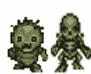

图 3.2 – 我们的游戏敌人，僵尸和骷髅

当 George 附近且在敌人的视线范围内时，敌人会追逐他。当他们抓住 George 时，他们会在撞击时爆炸并死亡，使 George 的健康值减少 25%。

George 将冒被僵尸和骷髅杀死的风险，因为他可以通过避开敌人并收集散布在地图周围的金币而变得非常富有。


图 3.3 – George 收集以变得更富有的金币

每次 George 收集一个旋转的金币时，他的得分增加 20 分。

George 有一个广阔的游戏世界可供探索，随着他的探索，游戏世界将在屏幕上滚动。

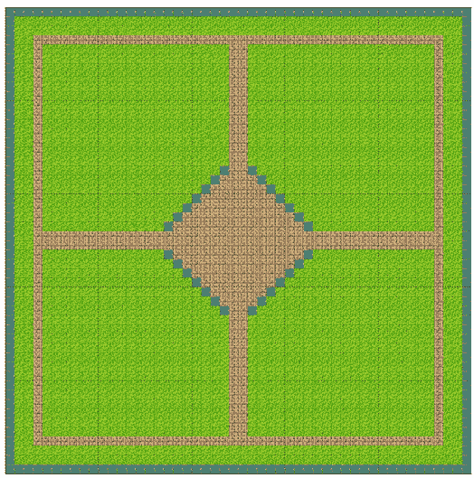

图 3.4 – George 可以探索的游戏世界

游戏世界大部分是草地，但有 George 可以遵循的路径。地图被水包围，George 无法越过水域。有一个中央钻石区域，是地图的焦点，并作为装饰被水包围。

游戏世界由使用 **Tiled** 应用程序制作的地图块组成，这使我们能够有效地重复使用较小的地图块来制作较大的地图。以下图像用于创建我们的游戏世界地图（可在 https://opengameart.org 获得），最初由 Luis Zuno 创建：

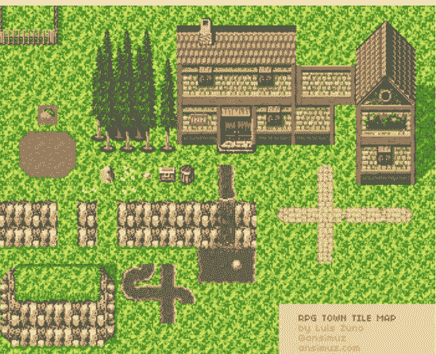

图 3.5 – 用于创建我们游戏世界地图的地图块图

游戏将使用音乐和音效来增强游戏体验。游戏进行时会播放背景音乐，其音量可以在游戏设置中更改。

游戏过程中将使用三种音效：

- George 移动 – George 移动时会持续播放的奔跑声。
- 敌人死亡 – 每次敌人攻击 George 时，它会死亡并发出此声音。
- 金币 – 每次 George 收集一枚金币时，此声音将播放。

如果游戏在移动设备上被放入后台，声音将停止播放。

现在我们已经讨论了游戏内容，让我们讨论一下游戏画面的设计以及如何在它们之间导航。

### 设计游戏画面

现在我们已经讨论了游戏的元素，让我们讨论一下游戏中将使用的画面以及玩家将如何在它们之间导航。

以下是一个基本大纲，用于说明游戏画面的流程：

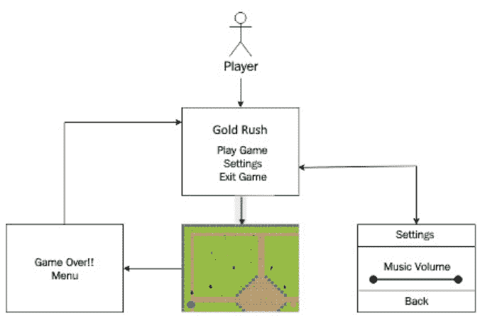

图 3.6 – Gold Rush 游戏画面流程

在这里，我们可以看到玩家在开始时会看到游戏菜单，他们可以在其中开始游戏、进入设置画面或退出游戏。

如果他们选择 **开始游戏**，游戏将加载并开始运行。

如果他们选择 **设置**，他们可以调整音乐，然后返回游戏菜单。

当玩家在游戏中死亡时，将显示 **游戏结束!!** 画面，然后他们可以返回游戏菜单。

让我们来看看这些画面的最终设计和外观。

以下屏幕截图显示了游戏菜单画面：

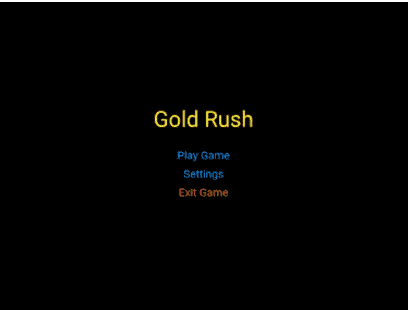

图 3.7 – Gold Rush 的游戏菜单画面

以下是 **设置** 画面的外观：

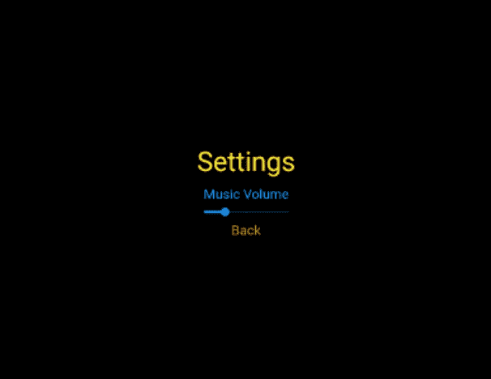

图 3.8 – Gold Rush 的设置画面

图 3.9 显示了游戏结束时的画面：

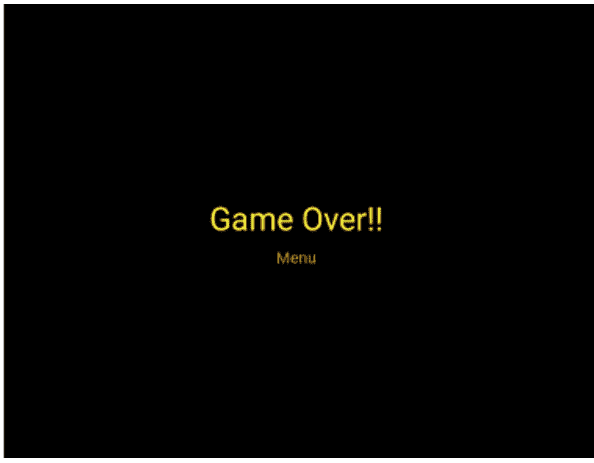

图 3.9 – Gold Rush 的 **游戏结束!!** 画面

以下屏幕截图显示了 Gold Rush 中的 George、敌人、地图和虚拟控件：

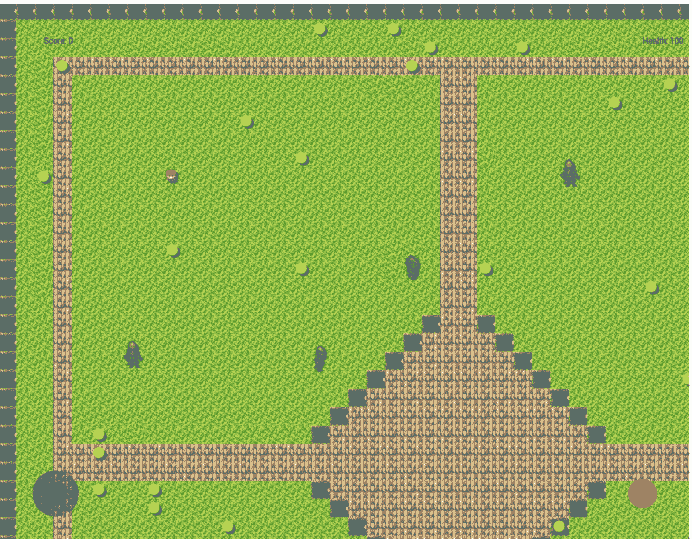

图 3.10 – 显示 George、敌人、地图和虚拟控件的游戏画面

在本节中，我们介绍了游戏画面的外观以及如何在它们之间导航。

### 摘要

在本章中，我们讨论了游戏的目标以及精灵和画面的外观。

在规划游戏时，尝试像本章中讨论的那样制定一份游戏设计文档，因为它将是您打算构建的游戏的有用蓝图，可在游戏开发过程中参考。

尝试思考您想要添加的内容，即使您还不知道它最终的样子。如果您还没有决定使用哪些精灵，甚至可以画简单的火柴人来表示精灵。

在下一章中，我们将开始构建游戏，从绘制和动画制作精灵开始。

### 问题

- 1. 为您的游戏编写概要是个好主意吗？
- 2. 当敌人攻击 George 时，他会损失多少生命值？
- 3. George 收集一枚金币能获得多少分？
- 4. 地图上的水有什么用途？


## 第2部分：图形与声音

在本书的这一部分中，我们将演示如何使用Flame库的媒体功能来动画化图形并播放声音。我们还将讨论如何根据玩家输入来动画化图形。最后，我们将讨论关卡设计以及如何将游戏扩展到多个平台。

本部分包含以下章节：

- 第4章，绘制和动画化图形
- 第5章，使用输入移动图形
- 第6章，播放音效和音乐
- 第7章，设计您自己的关卡
- 第8章，为Web和桌面扩展游戏

## 第4章：绘制和动画化图形

在本章中，我们将超越绘制简单形状，讨论如何绘制和动画化大多数游戏中常见的像素图形。这将使我们的游戏看起来好得多，并随着角色在屏幕周围动画化而让游戏栩栩如生。

在游戏编程中，绘制到屏幕上的图形或图像称为精灵，它可以是从单个非动画图像、带有多个动画帧的玩家角色，甚至是绘制在屏幕上其他图形后面的背景图像等任何东西。

我们将首先展示如何加载和绘制一个简单的精灵来代替我们的方形，然后动画化精灵以显示移动。接下来，我们将在屏幕上移动精灵，动画将根据精灵当前移动的方向而变化。

最后，我们将创建一个敌人精灵，让玩家精灵与其碰撞，在此基础上扩展我们的碰撞检测知识。

因此，我们将涵盖以下主题：

- 在屏幕上绘制
- 使用精灵动画
- 在屏幕上移动精灵
- 与其他精灵碰撞

让我们通过设置本章将使用的资源来开始。

### 技术要求

要查看本章的源代码，可以从 https://github.com/PacktPublishing/Building-Games-with-Flutter/tree/main/chapter04 下载。

本章还需要下载一些图片用于动画。

另外，我使用了从以下链接下载的精灵表：

- 对于我们的玩家角色，我们将使用位于 https://github.com/PacktPublishing/Building-Games-with-Flutter/blob/main/chapter04/assets/images/george.png 的精灵表图片。
- 对于敌人，我们将使用位于 https://github.com/PacktPublishing/Building-Games-with-Flutter/blob/main/chapter04/assets/images/zombie_n_skeleton.png 的精灵表图片。

现在，我们将按照以下步骤将图片添加到游戏中：

1. 打开文件管理器，进入项目的 `goldrush` 文件夹。
2. 在 `goldrush` 文件夹中创建一个名为 `assets` 的文件夹。
3. 进入 `assets` 文件夹，再创建一个名为 `images` 的文件夹。
4. 将我们下载的两张图片移动到 `images` 文件夹中。

如果一切设置正确，您的目录结构将如下所示：

```
goldrush
--- assets
----- images
--------- george.png
--------- zombie_n_skeleton.png
```

5. 接下来，打开项目文件夹中的 `pubspec.yaml` 文件。
6. 通过删除此行开头的 `#` 符号来取消 `assets` 行的注释：

```
### assets:
```

7. 接下来，在 `asset` 行下方添加以下几行（注意缺少 #）：

```
assets:
  - assets/images/george.png
  - assets/images/zombie_n_skeleton.png
```

8. 如果您现在保存 `pubspec.yaml` 文件，它将检查文件中的更改以确认设置正确。如果没有发生这种情况，您可以从终端手动运行以下命令：

```
flutter pub get
```

在本节中，我们下载并设置了本章将使用的精灵。

在下一节中，我们将看到如何加载包含多个动画帧的精灵表并将精灵绘制到屏幕上。

### 在屏幕上绘制

既然我们已经熟悉在上一章中介绍的在屏幕上绘制基本形状，我们将扩展知识并开始绘制在游戏中更常见的精灵。

让我们为我们的角色George创建一个新的 `SpriteComponent` 并加载精灵表：

1. 在 `components` 文件夹中，创建一个名为 `george.dart` 的新文件。
2. 打开文件，在文件顶部添加以下导入：

```
import 'package:flame/components.dart';
import 'package:flame/flame.dart';
import 'package:flame/sprite.dart';
import 'package:flutter/material.dart';
import 'dart:ui';
```

3. 创建一个名为 George 的类，它扩展 `SpriteComponent`：

```
class George extends SpriteComponent {
}
```

4. 在类顶部，让我们为精灵、屏幕尺寸和精灵大小定义一些变量：

```
late double screenWidth, screenHeight, centerX,
centerY;
late double georgeSizeWidth = 48.0, georgeSizeHeight
= 48.0;
```

由于精灵表的大小为 192 x 192 像素，包含四行和四列，这意味着每个单独的帧宽度和高度为 `192 / 4 = 48` 像素，这正是我们将 `georgeSizeWidth` 和 `georgeSizeHeight` 的值设置为的内容。

5. 接下来，我们将重写 `onLoad` 函数，设置屏幕变量，加载精灵表，并设置精灵的位置和大小：

```
@override
Future<void> onLoad() async {
super.onLoad();
screenWidth =
MediaQueryData.fromWindow(window).size.width;
screenHeight =
MediaQueryData.fromWindow(window).size.height;
centerX =
(screenWidth / 2) - (georgeSizeWidth / 2);
centerY =
(screenHeight / 2) - (georgeSizeHeight / 2);
var spriteImages =
await Flame.images.load('george.png');
final spriteSheet = SpriteSheet(image:
```

```
spriteImages, srcSize: Vector2(georgeSizeWidth,
georgeSizeHeight));
sprite = spriteSheet.getSprite(0, 0);
position = Vector2(centerX, centerY);
size = Vector2(georgeSizeWidth, georgeSizeHeight);
}
```

在这里，我们使用 Flame 辅助类来加载精灵表图片并设置精灵。

目前，我们将获取第一个精灵帧并只显示该帧。我们获取的第一帧在精灵表中的位置是 0, 0：

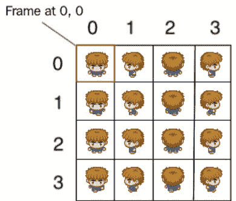

图 4.1 – 位于 0, 0 的精灵

6. 现在，让我们切换到 `main.dart` 文件，以便可以添加 George 组件并在屏幕上看到它。在 `onLoad` 函数中，我们可以删除添加 `Player` 和 `ScreenCollidable` 组件的行，并添加 `George` 组件，如下所示：

```
@override
Future<void> onLoad() async {
super.onLoad();
add(George());
}
```

7. 我们现在可以删除用于显示绿色方块的 `Player` 和 `ScreenCollidable` 组件的以下导入，我们在第2章“使用Flame引擎”中使用过它：

```
import 'components/player.dart';
import 'package:flame/components.dart';
```

8. 并且，由于我们不再使用 `Player` 组件，我们还可以删除包含 `Player` 组件的 `player.dart` 文件，该文件已不再需要。

9. 由于我们已添加 `George` 组件，需要在文件顶部与其他导入一起添加该类的导入：

```
import 'package:goldrush/components/george.dart';
```

如果您现在运行游戏，将看到一个显示George在黑色背景上的单帧。

然而，在黑色背景上很难看清，因此让我们创建一个 `Background` 组件并更改背景颜色，它将在George之前绘制，以便我们可以更清楚地看到精灵。

10. 在 `components` 文件夹中，创建一个名为 `background.dart` 的新文件。打开文件并输入以下导入和代码：

```
import 'package:flame/components.dart';
import 'package:flame/palette.dart';
import 'package:flutter/material.dart';
import 'dart:ui';
class Background extends PositionComponent {
 static final backgroundPaint =
 BasicPalette.white.paint();
 late double screenWidth, screenHeight;
 @override
 Future<void> onLoad() async {
 super.onLoad();
 screenWidth = MediaQueryData.fromWindow(window).size.width;
 screenHeight =
 MediaQueryData.fromWindow(window).size.height;
 position = Vector2(0, 0);
 size = Vector2(screenWidth, screenHeight);
 }
 @override
 void render(Canvas canvas) {
```


```
super.render(canvas);
canvas.drawRect(Rect.fromPoints(position.toOffset(),
size.toOffset()), backgroundPaint);
}
}
```

在 `onLoad` 函数中，我们将 `backgroundPaint` 设置为白色，以使 George 精灵更加可见。我们还将位置设置为 0, 0，将大小设置为屏幕的完整宽度和高度，因此当我们在 render 函数中绘制白色时，它将覆盖整个屏幕。

### 11. 回到 `main.dart` 文件，让我们在文件顶部添加 `import`，并将 `Background` 组件添加到 `onLoad` 函数中：

```
import 'components/background.dart';

@override
Future<void> onLoad() async {
  super.onLoad();
  add(Background());
  add(George());
}
```

请注意，我们在 `George` 组件之前添加 `Background` 组件，以便它先被绘制。

如果运行此代码，您现在将看到 George 在白色背景上绘制，这更容易看到：

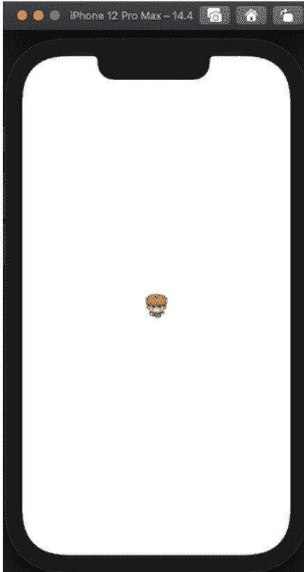

图 4.2 – 白色背景上的 George

在下一节中，我们将讨论如何为 George 制作动画，而不是仅显示单帧。

### 使用精灵动画

让我们修改 `George` 类，使其播放动画序列而不是仅显示单帧，具体操作是更改类：

- 1. 首先，将类定义更改为继承自 `SpriteAnimationComponent`，而不是 `SpriteComponent`：

```
class George extends SpriteAnimationComponent {
```

- 2. 因为我们将在 SpriteAnimationComponent 中设置动画，可以删除对 georgeSprite 的引用，因为这将由类管理。因此，让我们删除或注释掉以下行：

```
// late Sprite georgeSprite;
// georgeSprite = spriteSheet.getSprite(0, 0);
```

现在您也可以删除或注释 render 函数，因为绘制将由类管理：

```
// @override
// void render(Canvas canvas) {
//   super.render(canvas);
//   georgeSprite.render(canvas);
// }
```

- 3. 要从我们设置的精灵表中创建动画，SpriteSheet 类有一个 createAnimation 辅助函数，允许我们设置动画应从哪一行创建。如果您仔细查看我们的 george.png 文件，会发现我们的动画位于列中，而不是行中。在撰写本文时，Flame createAnimation 库的当前版本适用于行而非列，因此我们将使用 Dart 扩展向 SpriteSheet 类添加一个也适用于列的 createAnimation 变体。在 george.dart 中 SpriteAnimationComponent 的类定义之后，添加以下内容：

```
extension CreateAnimationByColumn on SpriteSheet {
  SpriteAnimation createAnimationByColumn({
    required int column,
    required double stepTime,
    bool loop = true,
    int from = 0,
    int? to,
  }) {
    to ??= columns;
    final spriteList = List<int>.generate(to - from,
    (i) => from + i)
            .map((e => getSprite(e, column))
            .toList();
        return SpriteAnimation.spriteList(
        spriteList,
        stepTime: stepTime,
        loop: loop,
        );
        }
        }
```

此扩展将基于列创建精灵列表，然后从精灵列表创建 `SpriteAnimation`。

- 4. 现在，我们可以使用精灵列表创建动画，并将其分配给我们的 `SpriteAnimationComponent` animation 字段。在 `onLoad` 函数的末尾，添加以下代码：

```
animation = spriteSheet.createAnimationByColumn(
 column: 0, stepTime: 0.2);
```

在这里，我们调用新的 `createAnimationByColumn` 扩展函数，为第一列动画传递 `0`，并将 `stepTime` 动画速度设置为 `0.2`，这使动画看起来像正常的步行速度。

现在，我们通过绘制多个帧来扩展精灵，以创建动画。

在下一节中，我们将为 George 的每个方向设置动画，并在屏幕上移动他，每隔几秒钟更改方向，并更改动画以匹配他移动的方向。

### 在屏幕上移动精灵

既然 George 精灵已经可以动画，我们将在此基础上继续，根据行进方向更改动画：

- 1. 让我们在 `George` 类顶部添加一些变量，以存储动画和方向信息：

```
late SpriteAnimation georgeDownAnimation,
 georgeLeftAnimation, georgeUpAnimation,
 georgeRightAnimation;
 double elapsedTime = 0.0;
 double georgeSpeed = 40.0;
 int currentDirection = down;
 static const int down = 0, left = 1, up = 2,
 right = 3;
```

- 2. 在 `onLoad` 函数下方，定义一个名为 `changeDirection` 的新函数，我们将每 3 秒调用一次，以随机更改 George 的方向：

```
void changeDirection() {
 Random random = Random();
 int newDirection = random.nextInt(4);
 switch (newDirection) {
 case down:
 animation = georgeDownAnimation;
 break;
 case left:
 animation = georgeLeftAnimation;
 break;
 case up:
 animation = georgeUpAnimation;
 break;
 case right:
 animation = georgeRightAnimation;
 break;
 }
 currentDirection = newDirection;
}
```

在这里，我们生成 0 到 3 之间的随机数，映射到我们的列。然后，我们将 `animation` 类字段设置为使用动画，我们将稍后初始化这些动画。最后，我们将当前方向设置为新方向，以后可以用它来移动精灵。

- 3. 在 `onLoad` 函数底部，删除设置类字段 animation 的行，因为我们现在在 `changeDirection` 函数中执行此操作，并用以下行替换它以初始化动画：

```
georgeDownAnimation =
spriteSheet.createAnimationByColumn(column: 0,
stepTime: 0.2);
georgeLeftAnimation =
spriteSheet.createAnimationByColumn(column: 1,
stepTime: 0.2);
georgeUpAnimation =
spriteSheet.createAnimationByColumn(column: 2,
stepTime: 0.2);
georgeRightAnimation =
spriteSheet.createAnimationByColumn(column: 3,
stepTime: 0.2);
changeDirection();
```

- 4. 现在我们已经设置好动画，让我们添加一个 `update` 函数，每 3 秒更改一次方向，并使精灵沿动画面向的相同方向移动。在 `changeDirection` 函数下方，添加以下 `update` 函数代码：

```
@override
void update(double deltaTime) {
 super.update(deltaTime);
 elapsedTime += deltaTime;
 if (elapsedTime > 3.0) {
 changeDirection();
 elapsedTime = 0.0;
 }
 switch (currentDirection) {
 case down:
 position.y += georgeSpeed * deltaTime;
 break;
 case left:
 position.x -= georgeSpeed * deltaTime;
 break;
 case up:
 position.y -= georgeSpeed * deltaTime;
 break;
 case right:
 position.x += georgeSpeed * deltaTime;
 break;
 }
}
```

- 5. 最后，让我们通过在文件顶部添加以下行来修复 `Random` 类的 import：

```
import 'dart:math';
```

如果您现在运行代码，将看到 George 移动 3 秒钟，然后随机更改方向，如果随机数与前 3 秒相同，则偶尔会继续沿同一方向移动。如果运行一段时间，您可能会看到 George 从屏幕一侧消失，因为我们目前没有检测他是否与屏幕边缘发生碰撞。

在下一节中，我们将让 George 在碰到屏幕边缘时反转方向，并添加在屏幕上移动的僵尸和骷髅，如果 George 与它们碰撞，它们就会死亡。

### 与其他精灵碰撞

让我们修复上一节末尾看到的 George 离开屏幕边缘的问题，如果他碰到屏幕边缘则反转方向。为此，请执行以下步骤：

- 1. 在 `main.dart` 的 `onLoad` 函数中，让我们在函数底部添加 `ScreenCollidable` 组件，以便我们可以检测 George 与屏幕边缘之间的碰撞：

```
add(ScreenCollidable());
```

- 2. 在 `george.dart` 文件中，更改类定义以添加 `HasHitBoxes` 和 `Collidable` 混入：

```
class George extends SpriteAnimationComponent with
HasHitBoxes, Collidable {
```

- 3. 在 `onLoad` 函数底部，添加 `HitboxRectangle` 形状用于碰撞检测：


```
addHitbox(HitboxRectangle());
```

- 4. 在文件顶部添加以下 import 以解析对 HitboxRectangle 的引用：

```dart
import 'package:flame/geometry.dart';
```

- 5. 在此类文件底部，在 update 函数定义之后，添加以下 onCollision 函数定义：

```dart
@override
void onCollision(Set<Vector2> points,
    Collidable other) {
  if (other is ScreenCollidable) {
    switch (currentDirection) {
      case down:
        currentDirection = up;
        animation = georgeUpAnimation;
        break;
      case left:
        currentDirection = right;
        animation = georgeRightAnimation;
        break;
      case up:
        currentDirection = down;
        animation = georgeDownAnimation;
        break;
      case right:
        currentDirection = left;
        animation = georgeLeftAnimation;
        break;
    }
    elapsedTime = 0.0;
  }
}
```

在这里，如果 George 与屏幕边缘发生碰撞，我们会翻转 currentDirection 和 animation；例如，如果 George 正在向右移动，他现在将向左移动，动画将变为 georgeLeftAnimation。我们还将 elapsedTime 重置为 0.0，以便我们的 3 秒计数器重新开始。

如果你现在运行游戏，你会看到过一段时间后，当 George 碰到屏幕侧边时，他会翻转方向并且动画会更新。
你可以更改 `georgeSpeed` 变量的值来加快此过程（如果你喜欢）。

接下来，让我们向游戏中添加僵尸和骷髅！

如果你查看僵尸和骷髅的精灵图表，你会注意到两者都在同一个精灵图表中，两者都按行和列组织，并且每行都有一个僵尸和一个骷髅。因此，在构建动画时，我们必须指定 `from` 和 `to` 字段，以指示精灵图表的哪部分构成动画。

例如，对于使僵尸向左行走的动画，它位于第 1 行，从第 0 列到第 2 列。精灵图像宽 192 像素，高 256 像素，水平方向包含六帧，垂直方向包含四帧，因此计算精灵大小的方法如下：

```
192 / 6 = 32
256 / 4 = 64
```

因此，我们的精灵大小为宽 32 像素，高 64 像素：

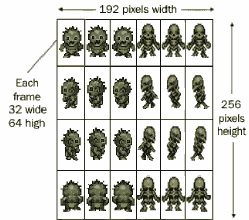

图 4.3 – 敌人精灵，显示每帧的大小

如果我们为僵尸和骷髅创建一个类，代码将非常类似于 `George` 类，因为我们需要加载精灵、将它们组织成动画、根据方向更新动画，并且如果碰到屏幕边缘则翻转方向。

为了避免大量不必要的代码重复，我们将为所有精灵创建一个基类来实现此通用功能。然后，单独的类将更小，以保持代码简洁且易于阅读。

首先，我们将 `George` 类中的大量代码移动到一个新的基类中，我们将其命名为 `Character`。在此过程中，我们将使变量名更具通用性，例如将 `georgeSpeed` 重命名为 `speed`，并添加一个构造函数来传递位置、大小和速度等值，以使其更具灵活性。

- 6. 在 `components` 文件夹中，创建一个名为 `character.dart` 的新文件，并添加以下类定义：

```dart
import 'dart:math';
import 'package:flame/components.dart';
import 'package:flame/sprite.dart';
class Character extends SpriteAnimationComponent with
HasHitboxes, Collidable {
}
```

- 7. 接下来，我们添加一个构造函数来传递位置、大小和速度，以及一些用于动画和方向信息的变量：

```dart
Character({required Vector2 position,
required Vector2 size, required double speed}) {
this.position = position;
this.size = size;
this.speed = speed;
}

late SpriteAnimation downAnimation, leftAnimation,
upAnimation, rightAnimation;
late double speed;
double elapsedTime = 0.0;
int currentDirection = down;
static const int down = 0, left = 1, up = 2,
right = 3;
```

如你所见，此基类中的变量命名现在更具通用性。

- 8. 接下来，我们将三个函数（changeDirection、update 和 onCollision）从 George 类迁移到 Character 类中。

首先，我们将添加 changeDirection 函数：

```dart
void changeDirection() {
Random random = new Random();
int newDirection = random.nextInt(4);
switch (newDirection) {
case down:
    animation = downAnimation;
    break;
case left:
    animation = leftAnimation;
    break;
case up:
    animation = upAnimation;
    break;
case right:
    animation = rightAnimation;
    break;
}
currentDirection = newDirection;
}
```

现在我们已经添加了 changeDirection，让我们添加 update 函数：

```dart
@override
void update(double deltaTime) {
super.update(deltaTime);
elapsedTime += deltaTime;
if (elapsedTime > 3.0) {
    changeDirection();
    elapsedTime = 0.0;
}
switch (currentDirection) {
case down:
    position.y += speed * deltaTime;
    break;
case left:
    position.x -= speed * deltaTime;
    break;
case up:
    position.y -= speed * deltaTime;
    break;
case right:
    position.x += speed * deltaTime;
    break;
}
}
```

接下来，让我们添加 onCollision 函数：

```dart
@override
void onCollision(Set<Vector2> points,
    Collidable other) {
    if (other is ScreenCollidable) {
    switch (currentDirection) {
    case down:
    currentDirection = up;
    animation = upAnimation;
    break;
    case left:
    currentDirection = right;
    animation = rightAnimation;
    break;
    case up:
    currentDirection = down;
    animation = downAnimation;
    break;
    case right:
    currentDirection = left;
    animation = leftAnimation;
    break;
    }
    elapsedTime = 0.0;
    }
}
}
```

从这三个函数可以看出，它们与 `George` 类中的功能相同，但我们现在将变量命名得更具通用性，这对于基类来说更好。

因为我们为 `George` 类创建了一个按列创建动画的扩展函数，我们也将其带到 `character.dart` 文件中。该函数将可供我们所有精灵使用，以便我们可以按列或按行创建动画。

在 `Character` 基类的类定义之后，以及 `character.dart` 文件的底部，添加 `createAnimationByColumn` 的扩展代码：

```dart
extension CreateAnimationByColumn on SpriteSheet {
  SpriteAnimation createAnimationByColumn({
    required int column,
    required double stepTime,
    bool loop = true,
    int from = 0,
    int? to,
  }) {
    to ??= columns;
    final spriteList =
        List<int>.generate(to - from, (i) => from + i)
        .map((e) => getSprite(e, column))
        .toList();
    return SpriteAnimation.spriteList(
      spriteList,
      stepTime: stepTime,
      loop: loop,
    );
  }
}
```

现在我们已设置好 `Character` 基础组件，这使得 `George` 类简单得多。

- 9. 在 `George` 类中，删除所有代码并替换为以下内容：

```dart
import 'package:flame/components.dart';
import 'package:flame/flame.dart';
import 'package:flame/geometry.dart';
import 'package:flame/sprite.dart';
import 'package:goldrush/components/character.dart';
class George extends Character {
  George({
    required Vector2 position,
    required Vector2 size, required double speed}):
      super(position: position, size: size,
      speed: speed);
  @override
  Future<void> onLoad() async {
    super.onLoad();
    var spriteImages =
    await Flame.images.load('george.png');
    final spriteSheet = SpriteSheet(image:
    spriteImages, srcSize: Vector2(width, height));
    downAnimation =
    spriteSheet.createAnimationByColumn(column: 0,
    stepTime: 0.2);
    leftAnimation =
    spriteSheet.createAnimationByColumn(column: 1,
    stepTime: 0.2);
    upAnimation =
    spriteSheet.createAnimationByColumn(column: 2,
    stepTime: 0.2);
    rightAnimation =
    spriteSheet.createAnimationByColumn(column: 3,
    stepTime: 0.2);
    changeDirection();
    addHitbox(HitboxRectangle());
  }
}
```

如你所见，我们只需要加载精灵图表并设置动画即可。代码量大大减少，现在它从基类继承了方向、移动和碰撞代码，因此更加简洁。

- 10. 现在，让我们为僵尸设置一个类。在 `components` 文件夹中，创建一个名为 `zombie.dart` 的新文件并添加以下代码：

```dart
import 'package:flame/components.dart';
import 'package:flame/flame.dart';
import 'package:flame/geometry.dart';
import 'package:flame/sprite.dart';
import 'package:goldrush/components/character.dart';
class Zombie extends Character {
  Zombie({required Vector2 position, required Vector2 size, required double speed}) : super(position: position, size: size, speed: speed);

  @override
  Future<void> onLoad() async {
    super.onLoad();
    var spriteImages = await
```


```
Flame.images.load('zombie_n_skeleton.png');
final spriteSheet = SpriteSheet(image:
spriteImages, srcSize: size);
downAnimation = spriteSheet.createAnimation(
row: 0, stepTime: 0.2, from: 0, to: 2);
leftAnimation = spriteSheet.createAnimation(
row: 1, stepTime: 0.2, from: 0, to: 2);
upAnimation = spriteSheet.createAnimation(
row: 3, stepTime: 0.2, from: 0, to: 2);
rightAnimation = spriteSheet.createAnimation(
row: 2, stepTime: 0.2, from: 0, to: 2);
changeDirection();

addHitbox(HitboxRectangle());
}
}
```

同样，代码量很小，只是在 onLoad 函数中设置动画。由于它继承自 Character 类，因此获得了与 George 相同的所有代码。

这里的主要区别在于，我们使用精灵表自带的 createAnimation 函数，而不是我们的扩展函数，因为这个精灵表是按行排列而不是按列。对于僵尸，动画帧位于第 0 列到第 2 列，因此我们在 createAnimation 调用中也添加了这些参数。

- 11. 现在，让我们设置骷髅敌人。在 components 文件夹中，创建一个名为 skeleton.dart 的新文件，并添加以下代码：

```
import 'package:flame/components.dart';
import 'package:flame/flame.dart';
import 'package:flame/geometry.dart';
import 'package:flame/sprite.dart';
import 'package:goldrush/components/character.dart';
class Skeleton extends Character {
Skeleton({required Vector2 position, required
Vector2 size, required double speed}) : super(
position: position, size: size, speed: speed);
@override
Future<void> onLoad() async {
super.onLoad();
var spriteImages = await
Flame.images.load('zombie_n_skeleton.png');
final spriteSheet = SpriteSheet(
 image: spriteImages, srcSize: size);
 downAnimation = spriteSheet.createAnimation(
 row: 0, stepTime: 0.2, from: 3, to: 5);
 leftAnimation = spriteSheet.createAnimation(
 row: 1, stepTime: 0.2, from: 3, to: 5);
 upAnimation = spriteSheet.createAnimation(
 row: 3, stepTime: 0.2, from: 3, to: 5);
 rightAnimation = spriteSheet.createAnimation(
 row: 2, stepTime: 0.2, from: 3, to: 5);
 changeDirection();

 addHitbox(HitboxRectangle());
 }
}
```

与僵尸代码一样，它简洁且从 `Character` 组件继承了大部分功能。由于精灵表图像的设置方式，我们将 `from` 和 `to` 字段分别设置为 3 到 5，以获取骷髅的正确动画帧。

现在我们已经设置好了僵尸和骷髅，让我们向 `George` 类添加一些额外的碰撞代码，以便每当 `George` 精灵与僵尸或骷髅碰撞时，就会从屏幕上删除敌人，就像敌人被消灭了一样。

- 12. 在 `George` 类的底部，添加以下 `onCollision` 函数：

```
@Override
void onCollision(Set<Vector2> points,
Collidable other) {
super.onCollision(points, other);
if (other is Zombie || other is Skeleton) {
other.removeFromParent();
}
}
```

- 13. 接下来，在 `George` 文件顶部添加 `Zombie` 和 `Skeleton` 类的导入语句：

```
import 'package:goldrush/components/skeleton.dart';
import 'package:goldrush/components/zombie.dart';
```

- 14. 最后，让我们将刚才添加到 George 文件中的相同导入语句添加到 main.dart 文件中。然后，在 onLoad 函数中，让我们添加以下代码来添加一些僵尸和骷髅，并更新 George 以传递位置、大小和速度：

```
add(George(position: Vector2(200, 400),
size: Vector2(48.0, 48.0), speed: 40.0));
add(Zombie(position: Vector2(100, 200), size:
Vector2(32.0, 64.0), speed: 20.0));
add(Zombie(position: Vector2(300, 200), size:
Vector2(32.0, 64.0), speed: 20.0));
add(Skeleton(position: Vector2(100, 600), size:
Vector2(32.0, 64.0), speed: 60.0));
add(Skeleton(position: Vector2(300, 600), size:
Vector2(32.0, 64.0), speed: 60.0));
```

如果现在运行代码，你会看到一些僵尸、骷髅和 George 在四处游荡，每隔几秒钟随机改变方向，并且在碰到边缘时也会改变方向。如果 George 与敌人碰撞，敌人将从屏幕上移除。

以下是游戏目前的样子：

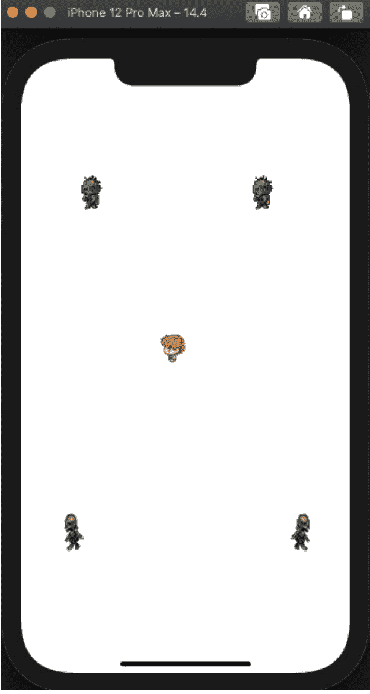

图 4.4 – George 和敌人精灵

在本节中，我们向游戏添加了敌人精灵和碰撞代码，以检测 George 何时与敌人碰撞。我们将移动和动画更改的通用代码提取到名为 `Character` 的基类中，然后使用它构建了精灵类。

### 总结

在本章中，我们向你展示了如何从精灵表加载图形并提取和播放动画。然后，我们向你展示了如何移动精灵并更改动画以匹配移动方向。最后，我们向你展示了如何独立动画多个精灵，并检测它们何时相互碰撞或与屏幕边缘碰撞。

在下一章中，我们将通过学习如何使用虚拟摇杆和按钮控制玩家角色来增加更多交互性。我们还将探讨其他输入控制方法，包括检测屏幕上的触摸事件并使用它们来控制玩家角色。

### 问题

- 1. 什么是精灵？
- 2. 初始化动画的代码应该使用哪些函数？
- 3. 使用 `SpriteAnimationComponent` 有哪些好处？
- 4. 应该在 `createAnimation` 函数中设置哪些参数来指定精灵表中的范围？
- 5. 为所有精灵创建基类有什么好处？

## 第 5 章：使用输入移动图形

在本章中，我们将控制自己的角色，并使用虚拟摇杆和触摸事件在屏幕上移动他们，以便玩家可以选择将角色移动到哪里。

我们将首先探讨如何绘制屏幕上的控件，使其表现得像 PlayStation 控制器上的摇杆，并带有用于攻击和跳跃等操作的动作按钮。接下来，我们将虚拟控件与我们的 George 精灵连接，并让他在屏幕上移动。最后，我们将讨论虚拟控件的替代方案或补充方案，即通过触摸事件（例如点击屏幕并将 George 移动到点击位置）来控制 George。

因此，我们将涵盖以下主题：

- 绘制屏幕上的控件
- 使用屏幕上的控件移动我们的角色
- 使用触摸移动我们的角色

### 技术要求

要查看本章的源代码，可以从 https://github.com/PacktPublishing/Building-Games-with-Flutter/tree/main/chapter05 下载。

你可以在在线文档 https://docs.flame-engine.org/1.0.0/gesture-input.html 和 https://docs.flame-engine.org/1.0.0/other-inputs.html 中找到关于 Flame 输入的更多信息。

在下一节中，我们将首先添加屏幕上的控件并将它们绘制在屏幕上。

### 绘制屏幕上的控件

在本节中，我们将向屏幕添加一个摇杆和一个按钮，以便控制角色，并添加一些文本来显示玩家的得分。这三个组件将构成我们的 **抬头显示器** (**HUD**)，它是用户界面的一部分，显示绘制在游戏其他图形之上并保持固定位置的游戏信息。此类信息可能是玩家的生命值、剩余生命数量，或者在我们的例子中，就是游戏得分。

我们将把 HUD 封装为一个单一组件，这使得显示或隐藏它更加容易。HUD 组件将包含 `JoyStickComponent`，用于控制 George 移动的方向；摇杆的工作原理是在你想要移动的方向拖动屏幕上的圆圈，使其在较大的圆圈内移动。HUD 还将包含 `HudButtonComponent`，这是一个屏幕上的按钮，玩家可以按下它来加倍 George 的行走速度，使他奔跑。

我们将在下一节中连接 HUD 组件，但现在，让我们先将它们绘制在屏幕上：

- 1. 首先，在 components 文件夹内创建一个名为 `hud` 的文件夹来保存我们的组件。
- 2. 在 `hud` 文件夹内，创建四个名为 `hud.dart`、`joystick.dart`、`run_button.dart` 和 `score_text.dart` 的文件。
- 3. 在 `run_button.dart` 文件中，添加以下导入语句和类定义：

```
import 'package:flame/components.dart';
import 'package:flame/input.dart';
import 'package:flutter/material.dart';
class RunButton extends HudButtonComponent {
}
```


- 4. 接下来，我们将在类定义中添加构造函数；这将包括我们需要通过调用 `super` 传递给 `HudButtonComponent` 基类的值：

```dart
RunButton({
  required button,
  buttonDown,
  EdgeInsets? margin,
  Vector2? position,
  Vector2? size,
  Anchor anchor = Anchor.center,
  onPressed,
}) : super(
  button: button,
  buttonDown: buttonDown,
  margin: margin,
  position: position,
  size: size ?? button.size,
  anchor: anchor,
  onPressed: onPressed
);
```

- 5. 在此构造函数下方，让我们添加一个布尔变量来跟踪该按钮是否被按下，默认值为 `false`：

```dart
bool buttonPressed = false;
```

- 6. `HudButtonComponent` 有一个名为 `Tappable` 的 mixin，它允许我们检测屏幕上何时按下此按钮，并重写 `onTapUp`、`onTapDown` 和 `onTapCancel` 回调，我们将使用这些回调来更新 `buttonPressed` 布尔值。让我们在 `buttonPressed` 定义之后添加这些函数：

```dart
@override
bool onTapDown(TapDownInfo info) {
  super.onTapDown(info);
  buttonPressed = true;
  return true;
}

@override
bool onTapUp(TapUpInfo info) {
  super.onTapUp(info);
  buttonPressed = false;
  return false;
}

@override
bool onTapCancel() {
  super.onTapCancel();
  buttonPressed = false;
  return true;
}
```

我们将在 hud.dart 文件的 HUD 组件中使用 RunButton，但目前，让我们继续为我们的分数定义 TextComponent。

- 7. 打开 score_text.dart 文件并添加以下导入和类定义：

```dart
import 'package:flame/components.dart';
import 'package:flame/input.dart';
import 'package:flame/palette.dart';
import 'package:flutter/cupertino.dart';
class ScoreText extends HudMarginComponent {
}
```

请注意，ScoreText 类继承自 HudMarginComponent 而非 TextComponent。这是因为我们希望在 TextComponent 周围放置带有边距的组件。我们将在此类内部创建 TextComponent，将其作为 HudMarginComponent 的子组件添加，并通过构造函数将边距传递到该类中，我们将在下一步添加该构造函数。

- 8. 在类中添加以下构造函数以将边距传递到该类：

```dart
ScoreText({EdgeInsets? margin}) : super(margin: margin);
```

- 9. 在构造函数下方，添加用于分数和 TextComponent 子组件的以下变量：

```dart
int score = 0;
String scoreText = "Score: ";
late TextPaint _regularPaint;
late TextComponent scoreTextComponent;
```

- 10. 在这些变量下方，让我们添加 `onLoad` 函数，该函数在组件首次使用时调用，用于设置 `TextComponent`：

```dart
@override
Future<void> onLoad() async {
  super.onLoad();
  TextStyle textStyle = TextStyle(color: BasicPalette.blue.color, fontSize: 30.0);
  _regularPaint = TextPaint(style: textStyle);
  scoreTextComponent = TextComponent(text: scoreText + score.toString(), textRenderer: _regularPaint);
  add(scoreTextComponent);
}
```

在此，我们将文本颜色设置为蓝色，并将 `scoreTextComponent` 作为子组件添加到 `ScoreText`。

- 11. 最后，对于 `TextComponent`，我们希望公开一个用于更新分数的函数，每当 George 与某个敌方精灵碰撞时都会更新该分数。因此，让我们在 `onLoad` 函数下方添加 `setScore` 函数：

```dart
setScore(int score) {
  this.score += score;
  scoreTextComponent.text = scoreText + this.score.toString();
}
```

- 12. 接下来，我们将添加一个简单的 `JoystickComponent` 用于控制 George 的移动。为此，打开 `joystick.dart` 文件并添加以下代码：

```dart
import 'package:flame/components.dart';
import 'package:flutter/material.dart';
class Joystick extends JoystickComponent {
  Joystick({required PositionComponent knob, PositionComponent? background, EdgeInsets? margin}) : super(knob: knob, background: background, margin: margin);
}
```

目前我们将保持简单，但值得将 JoystickComponent 放在其自己的文件中，以防您以后想要使用自定义图像而不是颜色来为摇杆设置更多样式。

- 13. 现在我们有了摇杆、运行按钮和分数文本组件，让我们创建一个 HUD 组件来处理这些组件的初始化。首先，打开 `hud.dart` 文件并添加以下导入和类定义：

```dart
import 'package:flame/components.dart';
import 'package:goldrush/components/hud/run_button.dart';
import 'package:goldrush/components/hud/score_text.dart';
import 'package:goldrush/components/hud/joystick.dart';
import 'package:flame/palette.dart';
import 'package:flutter/material.dart';
class HudComponent extends PositionComponent {
}
```

在此，我们从 PositionComponent 继承，从而可以控制如何使用边距排列子组件。PositionComponent 是一个允许在其中定位组件的基类。

- 14. 在 HudComponent 类顶部，让我们添加一个将 priority 设置为 20 的构造函数：

```dart
HudComponent() : super(priority: 20);
```

priority 用于指示组件绘制的顺序，默认值为 0。因此，将此设置为高于 0 将确保 HUD 绘制在其他所有内容之上。

稍后，当我们开始使用比物理屏幕更大的地图时，角色和敌人将在地图上移动，但我们希望分数停留在屏幕左上角，而地图在周围滚动。

- 15. 在此下方，我们现在定义用于保存子组件的变量：

```dart
late Joystick joystick;
late RunButton runButton;
late ScoreText scoreText;
```

- 16. 现在，在 onLoad 函数中设置这些子组件：

```dart
@override
Future<void> onLoad() async {
  super.onLoad();
  final joystickKnobPaint = BasicPalette.blue.withAlpha(200).paint();
  final joystickBackgroundPaint = BasicPalette.blue.withAlpha(100).paint();
  final buttonRunPaint = BasicPalette.red.withAlpha(200).paint();
  final buttonDownRunPaint = BasicPalette.red.withAlpha(100).paint();
  joystick = Joystick(
    knob: CircleComponent(radius: 20.0, paint: joystickKnobPaint),
    background: CircleComponent(radius: 40.0, paint: joystickBackgroundPaint),
    margin: const EdgeInsets.only(left: 40, bottom: 40),
  );
  runButton = RunButton(
    button: CircleComponent(radius: 25.0, paint: buttonRunPaint),
    buttonDown: CircleComponent(radius: 25.0, paint: buttonDownRunPaint),
    margin: const EdgeInsets.only(right: 20, bottom: 50),
    onPressed: () => {}
  );
  scoreText = ScoreText(margin: const EdgeInsets.only(left: 40, top: 60));
  add(joystick);
  add(runButton);
  add(scoreText);
  positionType = PositionType.viewport;
}
```

在此，我们为组件的颜色设置了一些 Paint 对象。

接下来，我们设置摇杆，使用圆形作为旋钮和背景，并将边距设置在屏幕左下角，即摇杆将位于的位置。

然后，我们以类似的方式设置运行按钮，其边距位于屏幕右下角，以便在摇杆的对面绘制它。

然后，我们在屏幕左上角设置带有边距的分数文本。

之后，我们添加 HUD 组件并将 `positionType` 设置为 `PositionType.viewport`。

`PositionType` 确保此组件绘制在所有内容之上，即使游戏相机移动也是如此。

请注意，对于运行按钮，它接受一个在按钮按下时调用的函数回调，但因为我们在运行按钮类中自行管理轻触处理，我们可以忽略此项并传递 {} 代替。

- 17. 让我们将我们的 `HudComponent` 添加到游戏中，以便可以看到我们的新组件。打开 `main.dart` 文件并将以下导入添加到文件顶部：

```dart
import 'package:goldrush/components/hud/hud.dart';
```

- 18. 在 `onLoad` 函数顶部，让我们添加我们的 `HudComponent`：

```dart
add(HudComponent());
```

- 19. 由于 `HudComponent` 类包含可拖动（`Joystick`）和可轻触（`RunButton`）的组件，我们必须将 `HasDraggables` 和 `HasTappables` mixin 传递给 `MyGame` 的类定义：

```dart
class MyGame extends FlameGame with HasCollidables, HasDraggables, HasTappables {
}


如果您现在运行游戏，将看到新组件与现有游戏精灵一起显示：

得分：0

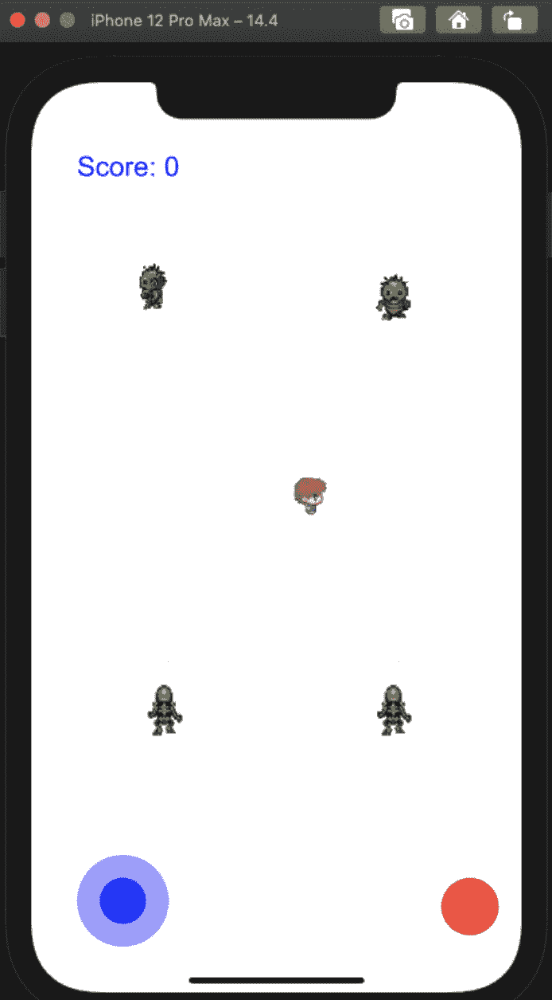

图 5.1 – 带 HUD 控件的游戏

在本节中，我们学习了如何将摇杆、按钮和分数添加到游戏中，并将它们定位在屏幕上。

在下一节中，我们将把摇杆与乔治的移动连接起来，并在按下运行按钮时让他跑得更快。当乔治与敌人碰撞时，我们还会将分数增加 10 分。

### 使用屏幕控件移动我们的角色

在本节中，我们将首先将乔治的移动与摇杆连接起来。

目前，`George` 类从基类 `Character` 继承其移动逻辑，该基类与 `Skeleton` 和 `Zombie` 类共享。由于乔治的移动代码与敌人精灵不同，让我们重构代码以允许敌人精灵的移动代码。我们将现有的移动代码移入 `EnemyCharacter` 类，该类将成为敌人精灵的新基类，并从 `Character` 类中删除此代码。

让我们开始吧：

- 1. 在 `components` 文件夹中，创建一个名为 `character_enemy.dart` 的文件。
- 2. 打开文件，并添加位于 https://github.com/PacktPublishing/Building-Games-with-Flutter/blob/main/chapter05/lib/components/character_enemy.dart 的代码。

在此代码中，`EnemyCharacter` 类扩展了我们的 `Character` 类，我们已从 `Character` 类直接复制了 `onCollision`、`update` 和 `changeDirection` 函数。

- 3. 在 `EnemyCharacter` 类的 `changeDirection` 函数中，您需要更新 `switch case` 块，以在方向前加上 Character 基类。完成后，该块将如下所示：

```
switch (newDirection) {
  case Character.down:
    animation = downAnimation;
    break;
  case Character.left:
    animation = leftAnimation;
    break;
  case Character.up:
    animation = upAnimation;
    break;
  case Character.right:
    animation = rightAnimation;
    break;
}
```

- 4. 打开 zombie.dart 和 skeleton.dart 文件，在两者中，不再从 Character 继承，而是将类定义更改为从 EnemyCharacter 继承。
- 5. 删除之前对 character.dart 的导入，并用以下内容替换：

```
import 'character_enemy.dart';
```

- 6. 打开 character.dart 类，删除我们现在已在 EnemyCharacter 类中拥有的 onCollision、update 和 changeDirection 函数。您现在也可以删除 math 包的导入。
- 7. 打开 george.dart 文件，删除 onLoad 函数中的 changeDirection 行。
- 8. 如果您现在运行游戏，会发现 George 不可见，因为我们尚未更新他并设置他的动画。让我们通过在 george.dart 文件的 onLoad 函数中添加以下代码来修复这个问题：

```
animation = downAnimation;
playing = false;
```

- 9. 接下来，我们将设置一些用于 `walkingSpeed` 和 `runningSpeed` 的变量，这些变量在按下运行按钮时会切换。在 `George` 类的顶部，构造函数下方，添加以下变量：

```
late double walkingSpeed, runningSpeed;
```

- 10. 然后，在 `onLoad` 函数的顶部，让我们将 `walkingSpeed` 设置为精灵移动的默认速度，并将 `runningSpeed` 设置为两倍速度：

```
walkingSpeed = speed;
runningSpeed = speed * 2;
```

- 11. 因为我们想要读取摇杆和运行按钮的状态，所以需要获取 `HudComponent` 的引用。因此，让我们通过构造函数传递 HUD，并将 HUD 存储在一个变量中：

```
final HudComponent hud;
```

- 12. 然后，更新构造函数以传递 HUD，以便我们可以在此类中访问 HUD 的值：

```
George({required this.hud, required Vector2 position,
required Vector2 size, required double speed}) :
super(position: position, size: size, speed: speed);
```

- 13. 接下来，我们需要添加 `HudComponent` 的导入：

```
import 'package:goldrush/components/hud/hud.dart';
```

- 14. 现在，我们将在 `onCollision` 函数下方添加 `update` 函数，并将运行按钮连接到 `speed` 变量：

```
@override
void update(double dt) {
super.update(dt);
speed = hud.runButton.buttonPressed ?
runningSpeed : walkingSpeed;
}
```

如果按下运行按钮，速度将是 `runningSpeed`；否则，速度将是 `walkingSpeed`。

- 15. 在设置行走和跑步速度的那行之后，让我们添加将摇杆与角色移动关联的代码，并根据摇杆方向设置角色的方向和动画：

```
if (!hud.joystick.delta.isZero()) {
position.add(hud.joystick.relativeDelta * speed
* dt);
playing = true;

switch (hud.joystick.direction) {
case JoystickDirection.up:
case JoystickDirection.upRight:
case JoystickDirection.upLeft:
animation = upAnimation;
currentDirection = Character.up;
break;
case JoystickDirection.down:
case JoystickDirection.downRight:
case JoystickDirection.downLeft:
animation = downAnimation;
currentDirection = Character.down;
break;
case JoystickDirection.left:
animation = leftAnimation;
currentDirection = Character.left;
break;
case JoystickDirection.right:
animation = rightAnimation;
currentDirection = Character.right;
break;
case JoystickDirection.idle:
animation = null;
break;
}
} else {
if (playing) {
stopAnimations();
}
}
```

这里，如果摇杆读数为 0，角色不移动，但如果大于 0，角色正在移动。如果摇杆在移动，我们根据摇杆的值、当前速度和 `deltaTime` 更新位置。然后，根据摇杆方向，我们设置正确的方向和动画。如果没有摇杆移动，我们检查动画是否正在播放：如果是，我们将调用 `stopAnimations`（我们将在下一节定义）。

- 16. 在类的底部，我们将创建一个名为 `stopAnimations` 的新函数，代码如下：

```
void stopAnimations() {
 animation?.currentIndex = 0;
 playing = false;
}
```

`stopAnimations` 函数通过将变量设置为 `false` 来停止动画播放，并将当前动画索引设置为 `0`；这会将动画的第一帧绘制为静态图像。这让我们有这样的印象：在使用摇杆时会对角色进行动画处理，而在停止使用摇杆时角色 George 保持静止。

- 17. 让我们每次击杀敌人时增加 10 分。在 `onCollision` 函数中，按如下方式更新函数以增加分数：

```
if (other is Zombie || other is Skeleton) {
 other.removeFromParent();
 hud.scoreText.setScore(10);
}
```

- 18. 最后，打开 `main.dart` 文件并更新 `onLoad` 函数，以便我们将 `HudComponent` 创建为其自身变量。这用于存储作为参数传递给 `George` 类的 HUD 值：

```
@override
Future<void> onLoad() async {
 var hud = HudComponent();
 add(Background());
 add (George(hud: hud, position: Vector2(200, 400),
size: Vector2(48.0, 48.0), speed: 40.0));
add (Zombie(position: Vector2(100, 200),
size: Vector2(32.0, 64.0), speed: 20.0));
add (Zombie(position: Vector2(300, 200),
size: Vector2(32.0, 64.0), speed: 20.0));
add (Skeleton(position: Vector2(100, 600),
size: Vector2(32.0, 64.0), speed: 60.0));
add (Skeleton(position: Vector2(300, 600),
size: Vector2(32.0, 64.0), speed: 60.0));
add(ScreenCollidable ());
add(hud);
}
```

如果您现在运行应用，将能够用摇杆控制 George，并在与敌人碰撞时更快地追踪并击杀他们。如果您在控制摇杆的同时按住运行按钮，您将看到 George 以跑步速度移动。

在本节中，我们添加了包含摇杆、运行按钮和分数文本的 HUD，并将其连接到游戏中以控制 George 的移动，并在 George 击杀敌人时更新分数。

在下一节中，我们将向您展示一种替代方案来控制 George，而不使用摇杆控件，即通过检测屏幕上的触摸事件，然后将 George 移动到该位置。

### 使用触摸移动我们的角色

既然我们已让 George 使用摇杆移动，让我们来看看通过屏幕触摸事件移动角色的替代方法，这在游戏中非常流行。随着现代移动设备拥有非常灵敏的高分辨率屏幕，我们可以使用触摸事件或手势将角色从当前位置移动到屏幕上被点击的位置。使用三角函数，我们可以计算原点和目标位置之间的角度，并使用该角度沿正确方向移动 George，并播放与方向匹配的正确动画。

我们已经通过 HasTappables mixin 检测运行按钮的点击事件。因此，为了检测屏幕上的触摸，我们需要添加 Tappable


将 mixin 添加到 `Background` 类并覆盖 `onTapUp` 以获取可用于计算移动的 `x` 和 `y` 位置。

因为我们需要知道 `George` 类内部的这个坐标，所以需要将 `George` 类的引用传入 `Background` 类，以便在玩家触摸屏幕时传递点击事件。

要开始，让我们修改 `Background` 类：

- 1. 打开 `background.dart` 文件。在类顶部添加以下构造函数和变量，用于保存对 `George` 类的引用。我们将使用它在玩家触摸屏幕时将事件传回 `George` 类，并调用 `George` 类上的名为 `moveToLocation` 的函数，传递点击事件：

```
Background(this.george);
final George george;
```

- 2. 使用以下 import 解析对 `George` 类的引用：

```
import 'george.dart';
```

- 3. 通过添加 `Tappable` mixin 更改 `Background` 类定义：

```
class Background extends PositionComponent with Tappable {
```

- 4. 在类底部添加以下代码以覆盖 `onTapUp` 函数，并将 `TapUpInfo` 事件传递到 `George` 类：

```
@override
bool onTapUp(TapUpInfo info) {
  george.moveToLocation(info);
  return true;
}
```

目前，`moveToLocation` 函数在 `George` 类中不存在，但我们将在更新 `George` 类时稍后添加它。因为我们将使用触摸事件，所以从该函数返回 `true` 以指示触摸事件已被处理。

- 5. 添加以下 import 以解析 `TapUpInfo` 引用：

```
import 'package:flame/input.dart';
```

- 6. 在 `main.dart` 文件的 `onLoad` 函数中，让我们将 `George` 类变成一个变量，然后我们可以将其传递给 `Background` 类构造函数。为此，请将 `onLoad` 函数的前几行更改如下：

```
@override
Future<void> onLoad() async {
  var hud = HudComponent();
  var george = George(hud: hud, position:
    Vector2(200, 400), size: Vector2(48.0, 48.0),
    speed: 40.0);
  add(Background(george));
  add (george);
}
```

请注意，这里只展示了 `onLoad` 函数的顶部部分以显示更改的行，但添加敌人、HUD 和 `ScreenCollidable` 的其余行保持不变。

在对 `George` 类进行最终更改之前，让我们创建一个数学工具类来存储一个函数，用于获取 George 位置与玩家触摸屏幕位置之间的角度。

- 7. 在 `lib` 文件夹中，创建一个名为 `utils` 的新文件夹，并在该文件夹中创建一个名为 `math_utils.dart` 的新文件。

- 8. 打开新的 `math_utils.dart` 文件并为 `getAngle` 函数添加以下代码：

```
import 'dart:math';
import 'package:flame/components.dart';

double getAngle(Vector2 origin, Vector2 target) {
  double dx = target.x - origin.x;
  double dy = -(target.y - origin.y);
  double angleInRadians = atan2(dy, dx);
  if (angleInRadians < 0) {
    angleInRadians = angleInRadians.abs();
  } else {
    angleInRadians = 2 * pi - angleInRadians;
  }
  return angleInRadians * radians2Degrees;
}
```

我们不会详细介绍 `getAngle` 函数的工作原理，但它使用了大多数高中数学课中涵盖的基本三角学。`getAngle` 函数将返回 0 到 360 之间的角度，0 度朝向右侧，90 度朝向下方，180 度朝向左侧，270 度朝向上方。

- 9. 打开 `george.dart` 文件并为数学工具类添加以下 imports：

```
import 'package:goldrush/utils/math_utils.dart';
```

- 10. 在 `George` 类中，在构造函数之后，让我们添加几个用于 `targetLocation` 向量的变量以及一个用于跟踪是否通过触摸移动的变量：

```
late Vector2 targetLocation;
bool movingToTouchedLocation = false;
```

- 11. 现在，让我们在 `Background` 组件中添加前面引用的 `moveToLocation` 函数，将 `targetLocation` 设置为传递的触摸事件，并将 `movingToTouchedLocation` 设置为 true：

```
void moveToLocation(TapUpInfo info) {
    targetLocation = info.eventPosition.game;
    movingToTouchedLocation = true;
}
```

精灵具有一个默认在 Flame 中位于精灵左上角的锚点，因此如果我们在屏幕上触摸，精灵将被移动，并且精灵的左上角将与屏幕上的触摸点对齐。将精灵围绕其中心而不是左上角居中会更自然，因此让我们将锚点更新为中心。

- 12. 在 `onLoad` 函数底部且在添加命中框之前，添加以下代码以将锚点设置在精灵中心。

```
anchor = Anchor.center;
addHitbox(HitboxRectangle());
```

- 13. 最后，我们将向 `update` 函数添加代码，将 George 移动到触摸位置。在 `update` 函数中，查找包含以下代码的 `else` 块：

```
if (playing) {
stopAnimations();
}
```

将其替换为以下代码块：

```
if (movingToTouchedLocation) {
} else {
if (playing) {
stopAnimations();
}
}
```

- 14. 在 `if` 代码块内部，添加以下代码以设置新的锚点位置：

```
position += (targetLocation - position).normalized()
* (speed * dt);
```

此代码根据 `targetLocation` 与当前 `position` 之间的差异更新 George 的位置，同时考虑当前 `speed` 和自上次调用更新以来的时间，以确保移动平滑。

- 15. 当我们到达触摸位置时，我们希望停止任何正在播放的动画并将 `movingToTouchedLocation` 设置为 `false`。

因为我们基于可能存在舍入误差的分数来移动角色，所以我们允许一个小阈值来决定 George 是否足够接近触摸位置，如果是，我们停止动画。所以，让我们继续在这个代码块内部并添加阈值检查：

```
double threshold = 1.0;
var difference = targetLocation - position;
if (difference.x.abs() < threshold &&
    difference.y.abs() < threshold) {
    stopAnimations();
    movingToTouchedLocation = false;
    return;
}
```

- 16. 最后，我们将使用之前创建的 getAngle 函数，并使用角度来决定 George 正在朝哪个方向移动以及哪个动画最接近。例如，我们只有四个动画 – 上、下、左、右 – 因此我们将通过将方向分成四个 90 度象限来近似方向，如下图所示：

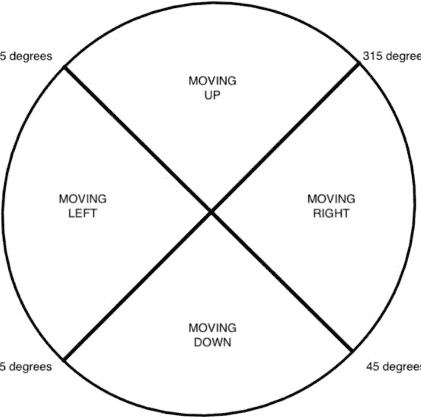

图 5.2 – 移动方向的象限映射

根据我们的图表，如果我们在 45 度到 135 度之间移动，我们大约在向下移动，因此可以将方向设置为下并使用 downAnimation 正确地为精灵设置动画。请记住，0 度指向东，我们需要两个检查来向右移动，即 315 到 360 度和 0 到 45 度之间。所以，让我们为这个逻辑添加代码，继续在同一代码块中：

```
playing = true;
var angle = getAngle(position, targetLocation);
if ((angle > 315 && angle < 360) || (angle > 0 && angle < 45)) { // Moving right
animation = rightAnimation;
currentDirection = Character.right;
}
// Moving down
else if (angle > 45 && angle < 135) {
animation = downAnimation;
currentDirection = Character.down;
}
// Moving left
else if (angle > 135 && angle < 225) {
animation = leftAnimation;
currentDirection = Character.left;
}
// Moving up
else if (angle > 225 && angle < 315) {
animation = upAnimation;
currentDirection = Character.up;
}
```

现在，如果你运行代码，可以通过触摸屏幕上的任何位置来控制 George，他会移动到那里。如果你愿意，也可以使用操纵杆。无论你更喜欢哪种移动方式，按住运行按钮仍然会让 George 跑得更快。还要注意，如果你使用触摸来移动角色，然后切换到操纵杆控制，它将中断由触摸引起的移动，允许你手动控制 George 的移动。

### 摘要

本章涵盖了大量内容，游戏真的开始成形了。我们学习了如何使用操纵杆和运行按钮为游戏创建屏幕控件，以及如何在屏幕上添加分数文本。然后，我们学习了一种替代方法来控制 George，即允许你触摸屏幕将他移动到触摸位置。

不过，游戏目前有点安静。在大多数游戏中，音乐配乐和音效用于营造氛围并使游戏生动起来。在下一章中，我们将为游戏添加一些音乐和声音以进一步增强它。


### 问题

- 1. 什么是 HUD，它在我们的游戏中有什么用途？
- 2. 我们使用哪个 mixin 来将组件转换为检测何时被触摸？
- 3. 我们使用哪个组件在屏幕上绘制文本？
- 4. 你认为 `JoystickComponent` 为什么需要 `HasDraggables` mixin？

## 第 6 章：播放音效和音乐

在本章中，我们将通过添加音效和音乐来让我们的游戏栩栩如生，从而增强游戏体验。音频是任何游戏非常重要的一部分；它可以提醒您游戏中发生的关键事件，或营造氛围。想象一下，在游戏中穿过森林，听到附近的河流或树林中鸟儿的歌唱。如果声音与您在该森林中预期听到的声音相符，就会使整个游戏更具沉浸感。

不过，如果玩家将游戏放入后台（例如查看电子邮件），我们需要停止音乐或声音播放，并且当他们返回游戏时声音应恢复播放，否则持续的声音可能会让玩家感到烦恼。为处理此问题，我们将介绍如何监听这些生命周期事件，以确保音频正确暂停和恢复。

音频还会占用内存，我们将讨论 Flame 如何使用音频缓存来加载和保存这些音频资源，以便我们在游戏中需要时随时播放。通常，音效会被多次播放，因此我们需要能够轻松访问它们，并在需要时反复播放。

因此，在本章中，我们将涵盖以下主题：

- 播放背景音乐
- 播放音效
- 控制音量

### 技术要求

要查看本章的源代码，您可以从 https://github.com/PacktPublishing/Building-Games-with-Flutter/tree/main/chapter06 下载。

您可以在在线文档 https://docs.flame-engine.org/1.0.0/audio.html 中找有关 Flame 音频的更多信息。

要开始在游戏中播放声音和音乐，我们必须下载资源文件并将它们添加到我们的 `pubspec.yaml` 文件中。我们可以在优秀的免费网站 https://freesound.org 上找到要添加的所有声音文件。

我们想要添加的音效和音乐如下：

- 贯穿整个游戏的背景音乐
- 敌人死亡时的音效
- George 移动时的音效

以下是我在浏览网站时找到的一些资源，但请随意浏览网站并找到您可能更喜欢的其他声音：

- 背景音乐 – https://github.com/PacktPublishing/Building-Games-with-Flutter/blob/main/chapter06/assets/audio/music/music.mp3
- George 移动 – https://github.com/PacktPublishing/Building-Games-with-Flutter/blob/main/chapter06/assets/audio/sounds/running.wav
- 敌人死亡 – https://github.com/PacktPublishing/Building-Games-with-Flutter/blob/main/chapter06/assets/audio/sounds/enemy_dies.wav

在以下步骤中，我们将下载一些声音用于我们的游戏：

- 1. 下载提到的音乐和音效，或在网站上找一些您自己的。
- 2. 将音乐文件重命名为 `music.mp3`，将 George 的移动声音重命名为 `running.wav`，将敌人死亡声音重命名为 `enemy_dies.wav`。
- 3. 打开 `assets` 文件夹并创建一个名为 `audio` 的新文件夹。
- 4. 在 `audio` 文件夹中，创建一个名为 `music` 的文件夹和一个名为 `sounds` 的文件夹。
- 5. 在 `music` 文件夹中，添加 `music.mp3` 文件。
- 6. 在 `sounds` 文件夹中，添加 `enemy_dies.wav` 和 `running.wav` 文件。
- 7. 接下来，打开 `pubspec.yaml` 文件，并在我们现有的精灵图像资源下方添加以下资源：

```yaml
- assets/audio/music/music.mp3
- assets/audio/sounds/enemy_dies.wav
- assets/audio/sounds/running.wav
```

- 8. 在我们添加 Flame 库的那行下方，我们将添加一行 Flame 音频库，因此您的依赖项现在应该如下所示：

```yaml
flame: 1.0.0
flame_audio: ^1.0.0
```

- 9. 保存此文件，`pub get` 将更新以验证新资源并下载 Flame 音频库。

现在我们已将音频文件设置为资源，让我们将它们添加到游戏中。

### 播放背景音乐

在本节中，我们将添加音乐播放功能，该功能将在游戏开始时加载，并在我们玩游戏时继续播放。Flame 音频库有一个名为 `Bgm`（背景音乐）的静态类，它将音乐添加到音频缓存中，并在应用程序进入后台或返回前台时暂停和恢复音乐。我们可以直接在 `Bgm` 类中获得此功能，因此只需很少的代码即可加载和播放音乐。正如您将在下一节关于播放音效的内容中看到的，我们需要做更多工作来确保音效在进入后台时暂停和恢复。不幸的是，Flame 库目前的工作方式就是这样，但希望未来版本的库会对此进行改进。

要将音乐播放添加到代码中，请执行以下操作：

- 1. 打开 `main.dart` 文件并导入 Flame 音频库：

```dart
import 'package:flame_audio/flame_audio.dart';
```

- 2. 在 `onLoad` 函数的顶部，添加以下代码以初始化库、将音乐加载到音频缓存中并播放背景音乐：

```dart
FlameAudio.bgm.initialize();
await FlameAudio.bgm.load('music/music.mp3');
await FlameAudio.bgm.play('music/music.mp3');
```

- 3. 在 `MyGame` 类中，在 `onLoad` 函数下方添加以下代码，该代码在游戏关闭时停止播放音乐并清除音频缓存：

```dart
@override
void onRemove() {
  FlameAudio.bgm.stop();
  FlameAudio.bgm.clearAll();
  super.onRemove();
}
```

如果您现在运行游戏，将能听到我们的音乐在播放。如果在移动设备上将应用放入后台，您会注意到音乐停止播放，并且当您将游戏带回前台时，音乐会恢复播放。如果您通过关闭应用来完全退出游戏，也会注意到音乐停止。

在 `onRemove` 函数中执行这些步骤很重要，以便避免内存泄漏。在下一节中，当我们移动 George 以及敌人死亡时，我们将向游戏添加音效。

### 播放音效

如前一节所述，播放音效时，我们需要处理音效的暂停和恢复，如果应用被放入后台（例如查看手机上的其他内容）时音效仍在播放，因为库目前不处理这种情况。

我们将首先更新 `Character` 类，它是我们所有精灵的顶级基类，以添加 `onPaused` 和 `onResumed` 回调，所有精灵都可以使用这些回调。

然后，我们将监听游戏中的生命周期变化事件，如果调用这些事件，我们将遍历所有精灵并传递这些事件。

最后，由于音效与 George 相关，我们将更新 `George` 类来播放声音，并在需要时暂停和恢复这些音效。让我们开始吧：

- 1. 打开 `character.dart` 文件。在 `Character` 类的底部，添加以下函数定义：

```dart
void onPaused() {}
void onResumed() {}
```

请注意，我们将保留这些函数为空，因为我们将在 `George` 类中重写它们。

- 2. 打开 `main.dart` 文件，在我们最近添加的 `onRemove` 函数下方，添加以下代码以监听和处理生命周期事件：

```dart
@override
void lifecycleStateChange(AppLifecycleState state) {
    switch(state) {
        case AppLifecycleState.paused:
            children.forEach((component) {
                if (component is Character) {
                    component.onPaused();
                }
            });
            break;
        case AppLifecycleState.resumed:
            children.forEach((component) {
                if (component is Character) {
                    component.onResumed();
                }
            });
            break;
        case AppLifecycleState.inactive:
        case AppLifecycleState.detached:
            break;
    }
}
```

在我们重写的 `lifecycleStateChange` 函数中，我们传递一个 `AppLifecycleState` 事件，它可以是 `paused`、`resumed`、`inactive` 或 `detached` 事件。由于我们只关心暂停和恢复状态，因此这些是我们在此函数中处理的唯一事件。

Flame 在名为 `children` 的变量中跟踪我们添加到游戏中的所有子组件，这是一个我们可以遍历的数据集。请不要忘记，`HudComponent` 和 `ScreenCollidable` 也是将包含在此数据集中的组件，因此在遍历数据时，我们必须检查类是否为 `Character` 类型，并忽略其他组件类型。

然后，我们可以通过 `onPaused` 和 `onResumed` 回调安全地传递暂停和恢复事件，因为我们知道这些回调可供任何使用 `Character` 作为基类的类使用，例如我们的敌人精灵或 George 精灵。

- 3. 为 `Character` 类添加以下导入：

```dart
import 'package:goldrush/components/character.dart';
```

- 4. 打开 `george.dart` 文件并添加以下导入：

```dart
import 'package:flame_audio/flame_audio.dart';
import 'package:audioplayers/audioplayers.dart';
```


- 5. 我们将播放的两个音效分别是敌人与乔治碰撞时，以及乔治通过摇杆或触摸行走或奔跑时。如果你播放过我们下载的声音，会注意到敌人死亡音效很短，而奔跑音效要长得多。挑战在于，如果乔治移动的时间超过了音效时长，我们需要通过循环播放来保持声音持续。

另外，如前文所述，如果游戏被放到后台，我们需要暂停声音，并在用户返回游戏时从同一点恢复播放。因此，我们需要存储播放长循环音频（来自奔跑音效）时返回的 AudioPlayer 引用，这意味着我们可以控制其播放。

让我们在已打开的乔治类顶部创建几个变量，用于跟踪用户是否在移动以及访问音频播放器状态：

```
bool isMoving = false;
late AudioPlayer audioPlayerRunning;
```

- 6. 在 onLoad 函数底部，让我们将音效加载到音频缓存中：

```
await FlameAudio.audioCache.loadAll(
['sounds/enemy_dies.wav', 'sounds/running.wav']);
```

我们在这行使用 await 来等待所有音效文件加载到缓存中。

- 7. 在 onCollision 函数底部（在检查 other 是否为僵尸或骷髅并设置分数的代码块之后），添加以下代码以在与敌人碰撞时播放敌人死亡音效：

```
FlameAudio.play('sounds/enemy_dies.wav');
```

- 8. 在 `George` 类底部，让我们添加两个函数，用于在应用放入后台时暂停和恢复 `AudioPlayer`：

```
@override
void onPaused() {
  if (isMoving) {
    audioPlayerRunning.pause();
  }
}
@override
void onResumed() async {
  if (isMoving) {
    audioPlayerRunning.resume();
  }
}
```

- 9. 在 `update` 函数中，我们需要做一些更改来播放长循环音频并对其进行控制。在 `update` 函数顶部的代码块中（我们已经在检查摇杆是否移动），在设置 `playing = true;` 的位置添加以下代码，使其如下所示：

```
playing = true;
movingToTouchedLocation = false;
if (!isMoving) {
  isMoving = true;
  audioPlayerRunning = await FlameAudio.loopLongAudio('sounds/running.wav');
}
```

- 10. 由于我们正在等待长循环音频，需要将函数签名更改为异步。使用以下更改：

```
@override
void update(double dt) async {
```

- 11. 在 `else` 块中，在检查 `movingToTouchedLocation` 是否为 `true` 的代码块里，我们将添加与摇杆检查中相同的代码，以启动音频播放并将 `isMoving` 标志设置为 true：

```
} else {
    if (movingToTouchedLocation) {
        if (!isMoving) {
            isMoving = true;
            audioPlayerRunning = await FlameAudio.loopLongAudio('sounds/running.wav');
        }
    }
}
```

因为我们在两个位置都添加了代码，所以无论玩家是使用摇杆还是触摸控制乔治，奔跑声音都会开始播放。

- 12. 在此 `update` 函数中更下方的位置（我们调用了 `stopAnimations` 并将 `movingToTouchedLocation` 设置为 `false` 然后 `return`），让我们停止音频并将 `isMoving` 设置为 `false`：

```
stopAnimations();
audioPlayerRunning.stop();
isMoving = false;
movingToTouchedLocation = false;
```

此代码位于检查阈值并决定乔治是否足够接近触摸位置从而停止移动的代码块中。

- 13. 在 `update` 函数底部的最终 `else` 块中，我们将添加与触摸位置检查中相同的 `isMoving` 检查。这样，当用户停止移动摇杆时，奔跑音效就会停止，因此摇杆和触摸都得到了覆盖。

函数底部的 `else` 块现在应如下所示：

```
} else {
    if (playing) {
        stopAnimations();
    }
    if (isMoving) {
        isMoving = false;
        audioPlayerRunning.stop();
    }
}
```

在本节中，我们为乔治的奔跑和与敌人碰撞添加了音效。我们还添加了正确的处理方式，当乔治停止移动或游戏被移至后台时停止长循环奔跑音效。

如果你现在运行游戏，你会听到背景音乐在播放，但由于音乐也在播放，音效可能很难同时听清。这是因为音效和音乐具有相同的默认音量，导致很难同时清晰地听到两者。

在下一节中，我们将调整音效和音乐的音量以解决此问题，使音效更容易听到。

### 控制音量

修复音乐和音效的音量非常简单，只需做一些小的更改。让我们来看看：

- 1. 打开 main.dart 文件。在 onLoad 函数中，在我们添加播放背景音乐的调用处，将此行更改为传递 volume 参数：

```
await FlameAudio.bgm.play('music/music.mp3',
volume: 0.1);
```

这里我们将音乐音量设置为 0.1，保持较低音量以便更好地听到音效。volume 参数可以是 0.0 到 1.0 之间的任何值（0.0 会完全静音音乐或音效，而 1.0 则以最大音量播放声音）。

- 2. 打开 george.dart 文件，让我们更新播放每个音效的调用以使用 volume 参数。在 onCollision 函数中，像这样更新敌人死亡音效：

```
FlameAudio.play('sounds/enemy_dies.wav', volume: 1.0);
```

- 3. 在 update 函数中，更改播放奔跑音效的两处调用，并在两处都添加 volume 参数：

```
audioPlayerRunning = await FlameAudio.loopLongAudio(
'sounds/running.wav', volume: 1.0);
```

如果你现在运行游戏，你将能够在音乐之上听到音效。

### 总结

在本章中，我们引入了音乐和音效来让游戏变得更好。我们处理了播放，并在应用处于后台时暂停声音，当玩家返回游戏时恢复声音，通过处理生命周期事件。

在下一章中，我们将超越物理屏幕的限制，学习如何制作使用可滚动地图的关卡，当我们在地图上移动时可以滚动地图。

### 问题

- 1. 我们使用哪个库来为游戏添加音频？
- 2. 将音频加载到音频缓存中有什么好处？
- 3. 为什么在组件从游戏中移除后需要清除音频缓冲区？
- 4. 当游戏被置于后台时，我们需要处理哪些生命周期变更状态？
- 5. 我们使用哪个类来保存对较长音效的引用？
- 6. 如何更改音乐或音效的默认音量？

## 第 7 章：设计您自己的关卡

到目前为止，我们的游戏已将设备屏幕的物理限制作为乔治和敌人精灵的边界。在本章中，我们将向您展示如何制作比屏幕更大的游戏关卡，以及如何使用相机滚动关卡以显示关卡的一部分。

我们将向您展示如何添加动态对象或精灵，以及如何在这些更大的关卡上处理碰撞。这是一种非常常见的技术，被大多数类型的游戏所使用，包括诸如 Sonic 之类的平台游戏，以及诸如 Ultima 或 Zelda 之类的 2D 角色扮演游戏。

我们将涵盖以下主题：

- Tiled 简介
- 加载地块图
- 将动态对象添加到地图
- 理解地图导航
- 检测地块碰撞

### 技术要求

要查看本章的源代码，您可以从 https://github.com/PacktPublishing/Building-Games-with-Flutter/tree/main/chapter07 下载，按照以下步骤操作：

- 1. 从 https://github.com/PacktPublishing/Building-Games-with-Flutter/blob/main/chapter07/assets/images/tiles.png 下载 `tiles.png` 文件，并将其移动到 `assets/images` 本地项目文件夹中。


- 2. 从 https://github.com/PacktPublishing/Building-Games-with-Flutter/blob/main/chapter07/assets/tiles/tiles.tmx 下载 `tiles.tmx` 文件。

从 https://github.com/PacktPublishing/Building-Games-with-Flutter/blob/main/chapter07/assets/tiles/tiles.tsx 下载 `tiles.tsx` 文件。

然后，创建该文件夹后，将两个文件移入 `assets/tiles` 本地项目文件夹中。

- 3. 打开 `pubspec.yaml` 文件并添加以下库依赖项：

```
flame_tiled: ^1.0.0
```

- 4. 在同一文件的 `assets` 部分中，让我们添加刚才下载的图块资源：

```
- assets/tiles/tiles.tmx
- assets/tiles/tiles.tsx
- assets/images/tiles.png
```

- 5. 保存文件并允许 `pub get` 下载此依赖项并验证资源：

```
flutter pub get
```

现在我们已经下载了所需的图块地图文件和依赖项，让我们来了解一下用于创建图块地图的软件。

### Tiled 简介

Tiled 是一款免费、开源、易于使用且灵活的关卡编辑器，可以从 [Tiled 地图编辑器](https://www.mapeditor.org/) 下载。

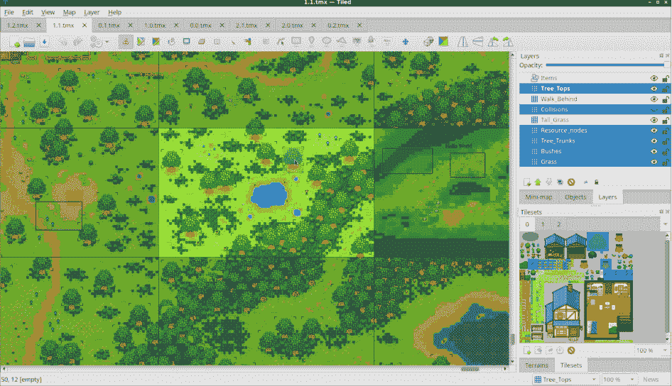

图 7.1 – 使用 Tiled 地图编辑器编辑地图

使用 Tiled 创建的关卡称为图块地图。图块地图在 2D 游戏开发中非常常见，因为它们允许我们使用固定大小的图块创建大型地图或关卡。

图块地图类似于精灵图，我们之前在第 4 章“绘制和动画图形”中用过它。数据存储在一张大图像中，我们将需要的部分提取为更小的组件。

这是一种创建大于物理屏幕尺寸地图的高性能且内存高效的方法。如果你尝试使用一张非常大的图像来实现这一点，该图像需要加载到内存中，这可能导致游戏崩溃或运行非常缓慢。

让我们来看一个图块地图中某些图形的示例及其用法。以下示例来自网站 https://opengameart.org/content/tilecraft-tile-set-ground#，由用户 GrumpyDiamond 制作。

如以下屏幕截图所示，它包含不同类型的地形，我们可以使用这些地形来创建更大的地图：

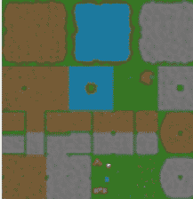

图 7.2 – 包含各种地形的图像

有时，图块地图图像还包含可在地图上使用的建筑物或树木，但在此示例中，我们看到用于制作水、草地、路径和一些植物的图块。

然后我们可以加载此图像，并将每个图像部分拆分为更小的图块，这些图块随后可用于创建更大的地图，如以下屏幕截图所示：

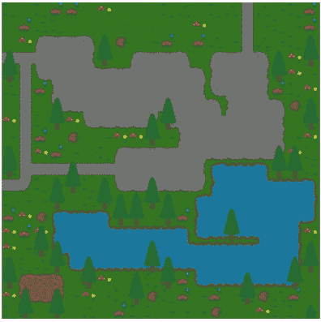

图 7.3 – 使用地形图像创建更大的地图

请注意，在图 7.3 中，通过重复使用较小的图块图像来构建更大的内容，创建了一个更大的水域区域。

Tiled 工具使创建图块地图变得非常容易，包括图像编辑等工具，允许你随意在地图上使用图块进行绘制。你可以从 Tiled 以多种格式导出地图，但 XML 和 JSON 是最常见的。

Tiled 是一个易于上手的工具，但也具有超出本书范围的高级功能，因此我们不会在此深入探讨它。相反，我们将提供现成的图块地图供我们的游戏使用，以便你可以直接使用它们，但我确实建议在你想为自己的游戏创建图块地图时花一些时间使用 Tiled。

当你从 Tiled 导出地图时，它包含大量关于地图和图块大小的信息，但地图数据部分表示为二维数组，可能如下所示：

```
[
[1, 1, 1, 1, 1, 1, 1, 1],
[1, 2, 2, 2, 2, 2, 2, 1],
[1, 2, 3, 3, 3, 3, 2, 1],
[1, 2, 2, 2, 2, 2, 2, 1],
[1, 1, 1, 1, 1, 1, 1, 1]
]
```

上述代码块中的二维数组宽 8 个图块，高 5 个图块。数组中的 1 可能代表某些山脉的图块 ID，2 可能代表一条路径，3 可能代表水。因此，在此示例中，地图中央有一个围绕湖泊的小径，外围环绕着山脉。

在游戏中，我们会加载此数据并遍历数组，根据每个图块的图块 ID 绘制每个可见图块。我们将从左上角 0, 0 开始绘制图块，然后逐行遍历图块数据，依次绘制每个图块。

现在我们已经了解了图块地图，将在下一节中将我们自己的图块地图添加到游戏中。

### 加载图块地图

在 *技术要求* 部分，我们添加了图块地图文件和 `flame_tiled` 库，该库用于加载和显示图块地图。

每个图块为 32 x 32 像素，地图宽 50 个图块，高 50 个图块，因此我们的总地图尺寸为 1,600 x 1,600 像素，即宽度和高度均为 50 * 32。

如果你想查看图块地图在 Tiled 中的外观，可以在 Tiled 中打开 `tiles.tmx` 文件，但以下是加载和绘制我们的图块地图时的屏幕截图：

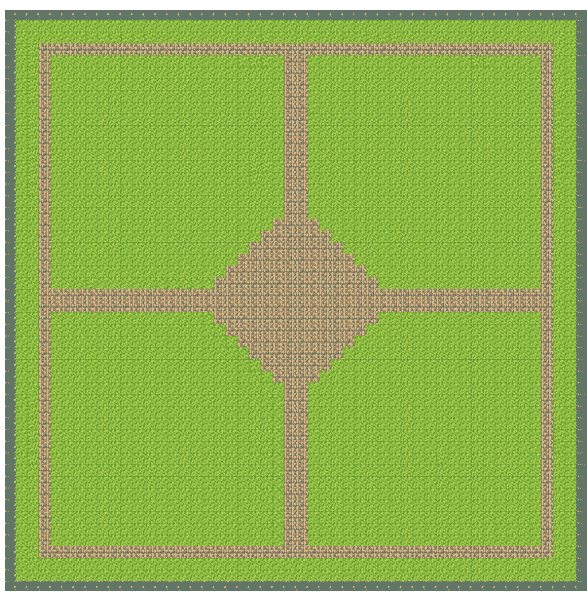

图 7.4 – 淘金热图块地图

该地图很简单，边缘有水，小径通向地图中心，地图的其他地方则长满了草地。

我们将以此为基础，向地图添加对象和敌人，并为水域添加碰撞检测，以防止乔治或敌人移出地图边缘。

让我们从加载并显示图块地图开始：

- 1. 打开 `main.dart` 文件。在 `onLoad` 函数中，我们将添加以下代码以将图块地图加载到 `TiledComponent` 并使其成为游戏组件。让我们在以下代码块中添加此内容，我们之前在此处为 `Background` 组件添加了代码：

```
add(Background(george)) ;
final tiledMap = await
    TiledComponent.load('tiles.tmx', Vector2.all(32));
add(tiledMap) ;
```

- 2. 在文件顶部添加以下导入语句：

```
import 'package:flame_tiled/flame_tiled.dart';
```

如果你现在运行游戏，将看到刚才加载的图块地图以及乔治和一些敌人。你只会看到一些敌人，因为有些敌人会绘制在屏幕外。你需要将模拟器从竖屏切换到横屏才能正确查看地图。

在下一节中，我们将删除硬编码的敌人，并开始使用地图层将敌人动态添加到地图中。

### 向地图添加动态对象

到目前为止，在游戏中，我们已经添加了几个每种敌人，但现在我们将向你展示敌人和其他对象如何动态添加到游戏中。

这在游戏中非常常见，因为你可能希望某些宝藏或敌人在地图上的特定位置生成。Tiled 有一个称为“层”的功能，可以很好地帮助我们实现这一点。最常见的两种层是图块层和对象层。我们在之前的章节 *加载图块地图* 中已经使用图块层显示了地图。对象层允许我们定义将绘制在地图顶部的对象。

在以下屏幕截图中，我们展示了在 Tiled 中打开的图块地图，你可以看到我们有两个名为 **敌人** 和 **地图** 的层。**地图** 层是我们的图块层，**敌人** 层显示了一个对象层。我们将使用这个 **敌人** 层为敌人定义生成点：

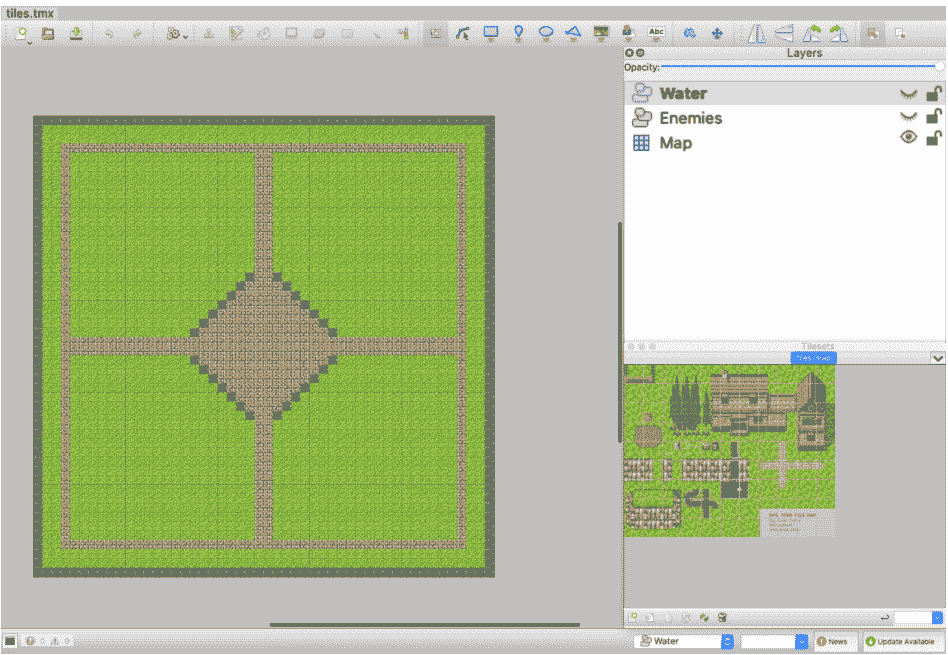

图 7.5 – 显示图块层和对象层的我们的图块地图

我们最初在地图上放置了 12 个敌人，每个象限 3 个敌人。敌人将像在 *加载图块地图* 章节中提到的那样四处游荡。当我们在游戏中加载它们时，我们将从图块地图对象层 **敌人** 中读取它们的位置。那么，让我们接下来将它们添加到游戏中：

- 1. 打开 main.dart 文件，删除我们之前在 onLoad 函数中添加敌人的四行代码：

```
add (Zombie(position: Vector2(100, 200),
size: Vector2(32.0, 64.0), speed: 20.0));
add (Zombie(position: Vector2(300, 200),
size: Vector2(32.0, 64.0), speed: 20.0));
add (Skeleton(position: Vector2(100, 600)),
size: Vector2(32.0, 64.0), speed: 60.0));
add (Skeleton(position: Vector2(300, 600)),
size: Vector2(32.0, 64.0), speed: 60.0));
```

- 2. 添加以下代码以替换刚才删除的代码：

```
final enemies =
tiledMap.tileMap.getObjectGroupFromLayer('Enemies');
enemies.objects.asMap().forEach((index, position) {
if (index % 2 == 0) {
add(Skeleton(position: Vector2(position.x,
position.y), size: Vector2(32.0, 64.0),
speed: 60.0));
} else {
add (Zombie(position: Vector2(position.x,
position.y), size: Vector2(32.0, 64.0), speed:
20.0));
}
});
```

这段代码用于从图块地图读取对象层并遍历数据，数据中包含 12 个敌人，因此我们在周围放置 6 个骷髅和 6 个僵尸。

如果你现在运行游戏，将看到我们有一些敌人。但是，目前你会看到较少的敌人，因为它们分布在地图各处。目前，我们只显示地图的左上角，但在学习如何在“了解地图导航”章节中在地图周围移动之前，让我们向地图添加一些其他对象。

如果你还记得本书前面提到的，在第 1 章“开始使用 Flutter 游戏”中，游戏的最终目标是收集金币来增加你的得分，但我们游戏中目前还没有金币。那么，让我们来解决这个问题


通过引入新的动画硬币精灵，并将它们随机放置在地图上的各个位置。当然，如果我们想要，可以将这些作为对象层添加到瓦片地图中，但既然我们已经了解了如何使用敌人添加固定对象，让我们使硬币的位置随机化，以使游戏更有趣。

- 3. 从 https://github.com/PacktPublishing/Building-Games-with-Flutter/tree/main/chapter07/assets/images/coins.png 下载硬币图片，并将图片保存到我们的 `assets/images` 项目文件夹中。

- 4. 从 https://github.com/PacktPublishing/Building-Games-with-Flutter/tree/main/chapter07/assets/audio/sounds/coin.wav 下载硬币音频文件，并将音频文件保存到我们的 `assets/audio/sounds` 项目文件夹中。

- 5. 打开 `pubspec.yaml` 文件，并在资源列表中添加以下行：

```
- assets/images/coins.png
- assets/audio/sounds/coin.wav
```

- 6. 保存文件并允许 `pub get` 验证资源：

```
flutter pub get
```

- 7. 在 `component` 文件夹中创建一个名为 `coin.dart` 的文件并打开它。然后为 `Coin` 类添加以下类定义，它加载硬币图片，创建动画，并设置硬币上的碰撞检测：

```
import 'package:flame/components.dart';
import 'package:flame/flame.dart';
import 'package:flame/geometry.dart';
import 'package:flame/sprite.dart';
class Coin extends SpriteAnimationComponent with
HasHitboxes, Collidable {
 Coin({required Vector2 position, required Vector2
 size}) : super(position: position, size: size);
 @override
 Future<void> onLoad() async {
 super.onLoad();

 var spriteImages =
     await Flame.images.load('coins.png');
 final spriteSheet =
     SpriteSheet(image: spriteImages, srcSize: size);
 animation = spriteSheet.createAnimation(row: 0,
     stepTime: 0.1, from: 0, to: 7);

 addHitbox(HitboxRectangle());
 }
 }
```

- 8. 打开 main.dart 文件，并在文件顶部添加以下导入：

```
import 'package:goldrush/components/coin.dart';
import 'dart:math';
```

- 9. 在 onLoad 函数中，在添加敌人之后添加以下代码；这将把硬币添加到地图中：

```
Random random =
    Random(DateTime.now().millisecondsSinceEpoch);
for (int i = 0; i < 50; i++) {
    int randomX = random.nextInt(48) + 1;
    int randomY = random.nextInt(48) + 1;
    double posCoinX = (randomX * 32) + 5;
    double posCoinY = (randomY * 32) + 5;
    add(Coin(position: Vector2(posCoinX, posCoinY),
        size: Vector2(20, 20)));
}
```

该代码使用当前时钟时间作为种子创建随机数生成器以初始化随机数，这将使数字真正随机。

如果您想要生成更可预测的数字序列，可以每次传递相同的固定整数。在希望创建一组始终相同但看似随机的关卡数据的游戏中，这可能很有用。

接下来，我们生成 `1` 到 `48` 之间的数字，因为我们不想在水瓷砖上绘制硬币。稍后，我们将向水瓷砖添加碰撞检测，以防止玩家或敌人在水上行走。通过生成这些范围内的数字，它将为我们提供与地图数组数据相关的地图位置。

然后我们取这些数字并将其乘以 `32`（即地图瓷砖的大小），再加上 `5` 以获取 `posCoinX` 和 `posCoinY` 值，即硬币以像素为单位的位置。

然后我们使用这些值在地图上的这个位置添加一个新的硬币组件。

请注意，我们在一个循环中完成所有这些操作，该循环向地图添加了 50 个硬币，其中一些目前在屏幕外，直到我们添加地图导航。

- 10. 既然我们已经将硬币添加到地图，让我们继续并更新 `George` 类，以便 George 可以收集硬币。

- 11. 打开 `george.dart` 文件，并在文件顶部添加以下导入：

```
import 'package:goldrush/components/coin.dart';
```

- 12. 在 `onLoad` 函数的底部，更新将音频文件加载到音频缓存的行，以加载 `coin.wav` 音频文件：

```
await FlameAudio.audioCache.loadAll(
['sounds/enemy_dies.wav', 'sounds/running.wav',
'sounds/coin.wav']);
```

- 13. 最后，在 `onCollision` 函数的底部，让我们添加一个与硬币碰撞的检查——如果我们与硬币碰撞，它将从游戏中移除硬币，将我们的得分增加 20，并播放硬币音频：

```
if (other is Coin) {
other.removeFromParent();
hud.scoreText.setScore(20);
}
FlameAudio.play('sounds/coin.wav', volume: 1.0);
}
```

如果您现在运行游戏，将看到地图上的旋转硬币，并可以稍微移动 George 来收集硬币。但是，您会注意到我们仍然局限于地图的左上角，即使尝试超出这个左上角移动也是如此。

在下一节中，我们将摆脱 George 和敌人的这一限制，允许他们通过向游戏地图添加导航来在地图上移动！

### 了解地图导航

既然我们已加载瓦片地图，并动态将敌人和硬币添加到地图中，我们可以修复导航，以便在地图上四处走动。但在此之前，让我们谈谈相机以及我们如何在游戏中使用它们。

相机允许我们改变屏幕上看到的内容，当地图大于物理屏幕时这非常有用。我们可以利用此功能执行以下操作：

  - 缩放相机以显示更多或更少的地图。
  - 显示与 George 当前在地图上的位置不同的地图部分。
  - 使用动画移动到地图的不同部分，以实现平滑过渡。
  - 将相机位置链接到跟随 George，这样当 George 在地图上移动时，相机会更新并使 George 保持可见，而地图会围绕他的位置移动。

大多数游戏使用这些方法的组合，但我们最感兴趣的是最后一点，因为我们希望相机在 George 移动时跟随他。

### 重要提示

如果您有兴趣了解其他要点，请在 Flame 文档中查找相机内容。相机文档可在 https://docs.flame-engine.org/main/camera_and_viewport.html 中找到。

让我们开始修复导航：

- 1. 打开 `main.dart` 文件，并在 `onLoad` 函数的底部添加以下代码：

```
camera.speed = 1;
camera.followComponent(george, worldBounds:
  Rect.fromLTWH(0, 0, 1600, 1600));
```

在此，我们设置相机速度，将相机设置为跟随 George，并将世界边界设置为 1,600 x 1,600，即 50 个瓦片的宽度和高度乘以每个瓦片的像素大小（32）。

如果您现在运行此代码并在地图上导航，可能会注意到几个问题：

- a. 敌人不会移动超过原始屏幕尺寸。
- b. 您只能在原始屏幕尺寸内触摸移动。

让我们逐个修复这些问题。

- 2. 敌人无法在地图上移动的原因是它们与在屏幕为固定大小时添加的 `ScreenCollidable` 发生碰撞。由于我们将在下一节中处理此碰撞，我们可以只删除 `onLoad` 函数底部添加 `ScreenCollidable` 文件的那一行：

```
add(ScreenCollidable());
```

- 3. 您只能在物理屏幕边界内触摸的原因是触摸事件在 `Background` 类中捕获，且 `Background` 类的大小目前基于屏幕的物理尺寸。

另外，现在我们正在绘制地图，背景仅用于检测并将触摸事件传递给 George，因此我们可以从 Background 类中删除大部分绘制代码。打开 background.dart 文件，更改类中的所有代码并添加精简后的代码，如下所示：

```
import 'package:flame/components.dart';
import 'package:flame/input.dart';
import 'george.dart';
class Background extends PositionComponent with
  Tappable {
  Background(this.george);
  final George george;
  @override
  Future<void> onLoad() async {
    super.onLoad();
    position = Vector2(0, 0);
    size = Vector2(1600, 1600);
  }
  @override
  bool onTapUp(TapUpInfo info) {
    george.moveToLocation(info);
    return true;
  }
}
```

除了精简此类中的代码外，主要更改是在 onLoad 函数底部，我们将大小设置为 1,600 x 1,600，即地图大小，而不是我们之前在第 5 章“使用输入移动图形”的“绘制屏幕控件”部分中使用的屏幕大小。

如果您现在运行游戏，将看到这些问题已修复，我们可以四处导航并收集硬币。不幸的是，现在我们已移除 ScreenCollidable，George 和敌人可以走出屏幕边缘。

在下一节中，我们将通过将地图周围的水设为可碰撞对象来修复此问题，以便在移动时进行检查，


detecting whether we collide with the water and preventing George or the enemies from moving over it.

### 检测方块碰撞

到目前为止，在我们的游戏中，我们使用组件级碰撞检测来检测 George 与金币和敌人之间的碰撞。当你使用地图关卡时，通常会在地图上添加其他作为障碍物的对象，例如水、建筑物或树木。当玩家在包含这些物品的地图上导航时，我们要确保 George 和敌人都不会穿过这些物体。

在 *了解地图导航* 部分，我们删除了 `ScreenCollidable` 组件以允许敌人在地图上自由移动，但现在敌人和 George 都可能走出地图。

在本节中，我们将添加一个围绕地图的水障碍。我们将检查碰撞，以防止 George 和敌人离开地图。我们将从对象层读取水在地图上的位置，并创建新的 `Water` 组件。我们将使这些组件可碰撞并将它们添加到游戏中，这样 Flame 就会检查与水的碰撞，我们就可以阻止 George 或敌人在水面上移动。

这带来了一些有趣的挑战，因为在我们之前的碰撞检查中，当 George 与敌人或金币碰撞时，我们只需将其移除，而 George 可以继续向他旅行的方向移动，但现在我们必须在碰撞水时阻止移动。在深入探讨之前，我们先多谈谈 Flame 检查碰撞时发生了什么。

### 了解碰撞

当我们将组件设置为可碰撞时，我们在对象周围添加了一个形状。然后，Flame 可以使用这些形状来计算一个形状是否与另一个形状相交，如果发生这种情况，则触发碰撞检测。

随着游戏的发展，我们不断添加更多可碰撞的物品，此过程的问题是每在游戏中添加一个可碰撞物品，就需要进行一次碰撞检查。碰撞检查越多，处理器处理背后所有数学所需的努力就越大。最终，如果碰撞检查太多，游戏性能会下降，你会注意到游戏开始变慢。

让我们来看看迄今为止游戏中的一些数学，以便了解这一点：

- 游戏中有 12 个敌人，6 个僵尸和 6 个骷髅。
- 游戏中有 50 枚金币。
- 我们将在地图边缘添加边界，由于每条边都有 50 个方块，地图周围有 4 条边，因此可能会有大约 200 个水组件。
- 我们还有我们的玩家 George。

游戏中共有 263 个可碰撞对象。目前，这些可碰撞对象中的每一个都需要与游戏中其他所有可碰撞对象进行碰撞检查。因此，那就是 263 * 263 = 69,169 次碰撞检查。这将近 70,000 次碰撞检查，而且每帧都在发生！

这是一个令人生畏的碰撞检查数量，我们的游戏竟然还能运行，真是令人惊讶！

想看看，这些检查中大部分完全是浪费，因为金币彼此之间无法碰撞，它们都分布在地图各处，并且不会移动。我们将要添加的水对象也是如此。此外，水对象也不能与金币碰撞，因为它们位于不同的位置。

幸运的是，Flame 提供了一个很好的解决方案，允许我们在可碰撞组件上设置 `collidableType`，以告诉 Flame 是否应该针对该对象执行检查。

三种可碰撞类型如下：

- Active：活动可碰撞对象会与活动或被动类型的其他可碰撞对象发生碰撞。如果未为所有可碰撞对象设置值，这是默认的可碰撞类型。
- Passive：被动可碰撞对象会与活动类型的其他可碰撞对象发生碰撞，但不会与其他被动可碰撞对象发生碰撞。
- Inactive：非活动可碰撞对象不会与其他可碰撞对象发生碰撞。

为了减少碰撞检查的数量，我们的方案是将 `Water` 和 `Coin` 对象设置为被动，并让 George 和敌人对象保持默认的活动状态。

### 实现碰撞

让我们先向游戏中添加 `Water` 对象：

1. 在项目的 `component` 文件夹中，创建一个名为 `water.dart` 的新文件并添加以下代码：

```dart
import 'package:flame/components.dart';
import 'package:flame/geometry.dart';
class Water extends PositionComponent with
    HasHitboxes, Collidable {
  Water({required Vector2 position, required Vector2 size, required this.id}) : super(position: position, size: size);

  int id;
  @override
  Future<void> onLoad() async {
    super.onLoad();

    collidableType = CollidableType.passive;

    addHitbox(HitboxRectangle());
  }
}
```

这里，我们定义了 `Water` 对象，它是一个具有位置和大小的矩形区域。

在 `onLoad` 函数中，我们将 `collidableType` 设置为 `CollidableType.passive` 类型，并添加一个命中框用于 `George` 与 `Water` 以及敌人与 `Water` 之间的碰撞检查。

2. 打开 `main.dart` 文件，在 `onLoad` 函数底部，在我们添加金币的位置下方添加以下代码：

```dart
final water =
    tiledMap.tileMap.getObjectGroupFromLayer('Water');
water.objects.forEach((rect) {
  add(Water(position: Vector2(rect.x, rect.y), size:
      Vector2(rect.width, rect.height), id: rect.id));
});
```

这里，我们将 `water` 对象作为对象组从地图中获取，并遍历这些对象，使用其中的 x、y、width 和 height 值来创建并将 `Water` 组件添加到游戏中。

如果在 Tiled 中打开地图，你可以看到 `Water` 对象层由四个简单的矩形组成，这减少了碰撞检查的次数。我们并不真正关心与哪个单独的水方块发生碰撞，因此只需检查四条边即可。

3. 在同一文件的顶部，为 `Water` 组件添加以下导入：

```dart
import 'package:goldrush/components/water.dart';
```

4. 打开 `coin.dart` 文件，向 `onLoad` 函数添加以下代码以将 `collidableType` 设置为被动：

```dart
super.onLoad();
collidableType = CollidableType.passive;
```

5. 我们先更改敌人的碰撞，因为这是一个非常快速的更改。打开 `character_enemy.dart` 文件，在 onCollision 函数顶部，使用以下代码将对象检查更改为使用 Water 对象而不是 `ScreenCollidable`：

```dart
if (other is Water) {
```

6. 接下来，我们需要在此文件顶部添加 Water 类的导入：

```dart
import 'package:goldrush/components/water.dart';
```

接下来，Flame 具有 debugMode，我们可以将其设置为 true 以查看可碰撞框的边界框（显示检测区域边界限制的框），这对于调试碰撞检测很有用。让我们添加它。

7. 打开 main.dart 文件，在 onLoad 函数顶部添加以下行：

```dart
debugMode = true;
```

如果现在运行游戏，你将看到边界框，并且可能会发现一个问题。

Skeleton 和 Zombie 精灵在精灵顶部有大量空白区域，这意味着如果 George 与这些精灵顶部碰撞，由于图像中的额外空间，碰撞会比预期更早发生。为了解决这个问题，我们可以向 HitboxRectangle 传递两个值：relation 和 relativeOffset。

relation 值定义了水平和垂直边长与边界框大小之间的关系，而 relativeOffset 值是你的形状相对于其大小从 (-1,-1) 到 (1,1) 的位置。

为了修复敌人精灵类顶部的空间问题，请打开 zombie.dart 和 skeleton.dart 文件，并在两个类的 onLoad 函数底部，将添加命中框的行更改为以下代码：


```dart
addHitbox(HitboxRectangle(relation: Vector2(1.0, 0.7))..relativeOffset = Vector2(0.0, 0.3));
```

如果你现在运行游戏，你会发现边界框与精灵的大小紧密对齐，这将使我们在碰撞检测中获得更好的效果。

- 8. 我们还可以调整用于 George 的精灵，以进一步改进 George 精灵的边界框。打开 `george.dart` 文件，在 `onLoad` 函数底部，将添加碰撞框的行更改为以下代码：

```dart
addHitbox(HitboxRectangle(relation: Vector2(0.7, 0.7))..relativeOffset = Vector2(0.0, 0.1));
```

请注意，这些值与我们用于敌方精灵的值不同。

- 9. 现在我们已经完成了对边界框的调整，可以从 `main.dart` 文件中删除 `debugMode` 行了。

- 10. 让我们继续在 `George` 类中添加最终的碰撞检查。

在 `George` 类顶部（我们先前在其中定义类变量的地方），添加以下两个新变量，我们将使用这些变量来跟踪是否已与 `Water` 组件发生碰撞，以及碰撞时的行进方向：

```dart
int collisionDirection = Character.down;
bool hasCollided = false;
```

我们将 `collisionDirection` 设置为 `down`，因为 George 开始游戏时面向下方。

- 11. 接下来，让我们添加 `Water` 对象的导入，我们将在碰撞检查中使用它。在文件顶部的其他导入处，添加以下导入：

```dart
import 'package:goldrush/components/water.dart';
```

- 12. 在 `onCollision` 函数底部，让我们添加以下代码，以便在检测到与 `Water` 边界发生碰撞时设置碰撞变量：

```dart
if (other is Water) {
  if (!hasCollided) {
    if (movingToTouchedLocation) {
      movingToTouchedLocation = false;
    } else {
      hasCollided = true;
      collisionDirection = currentDirection;
    }
  }
}
```

我们将在接下来的几个步骤中使用这些值，以防止在与水发生碰撞时移动 George。但也要注意在上述代码中，如果已检测到碰撞且我们正在移动到触摸位置，我们现在将 `movingToTouchedLocation` 设置为 `false`，以防止 George 继续尝试移动。

- 13. 当碰撞结束时，我们还希望将 `hasCollided` 变量重新设置为 `false`，幸运的是 Flame 有一个名为 `onCollisionEnd` 的函数，我们可以重写它，当对象停止碰撞时会调用它：

```dart
@override
void onCollisionEnd(Collidable other) {
  hasCollided = false;
}
```

- 14. 接下来，我们将创建一个函数来处理所有移动代码，并且仅在未发生碰撞时才允许移动。因为我们以不同的方式计算触摸位置的移动，我们将根据是否正在移动到触摸位置，或者玩家是否使用摇杆控制移动来拆分代码：

```dart
void movePlayer(double delta) {
  if (!(hasCollided && collisionDirection == currentDirection)) {
    if (movingToTouchedLocation) {
      position.add((targetLocation - position).normalized() * (speed * delta));
    } else {
      switch (currentDirection) {
        case Character.left:
          position.add(Vector2(delta * -speed, 0));
          break;
        case Character.right:
          position.add(Vector2(delta * speed, 0));
          break;
        case Character.up:
          position.add(Vector2(0, delta * -speed));
          break;
        case Character.down:
          position.add(Vector2(0, delta * speed));
          break;
      }
    }
  }
}
```

- 15. 让我们更新 `update` 函数，并替换两个用于触摸和摇杆控制更改精灵位置的地方。

使用 `movePlayer(dt);` 替换以下行：

```dart
position.add(hud.joystick.relativeDelta * speed * dt);
```

同样，使用 `movePlayer(dt);` 替换以下行：

```dart
position += (targetLocation - position).normalized() * (speed * dt);
```

如果你现在运行应用并使用摇杆或触摸移动，你会发现你无法超出屏幕范围，因为我们现在会与水发生碰撞，并阻止玩家在水面上移动或超出屏幕边界。

### 总结

在本章中，我们了解了关于地图块的所有内容，如何创建它们以及添加动态对象，以及如何在其中导航，同时避免与碰撞对象发生碰撞。

迄今为止，我们一直在为移动端构建游戏，但 Flutter 也支持其他平台。在下一章中，我们将向你展示如何为网页和桌面构建应用，将游戏转换为支持更大的可用屏幕区域，并添加额外控件以使用键盘移动 George。

### 问题

- 1. Tiled 应用程序用于什么？
- 2. 为什么应该使用地图块而不是一张大图来制作地图？
- 3. 地图块内部的地图数据是如何存储的？
- 4. 我们可以在地图块上使用哪些不同类型的图层？
- 5. 我们如何使用相机来调整地图，以便在导航地图时保持精灵对焦？
- 6. 我们如何使用地图块添加可碰撞对象？
- 7. 三种可碰撞类型是什么？为什么需要它们？
