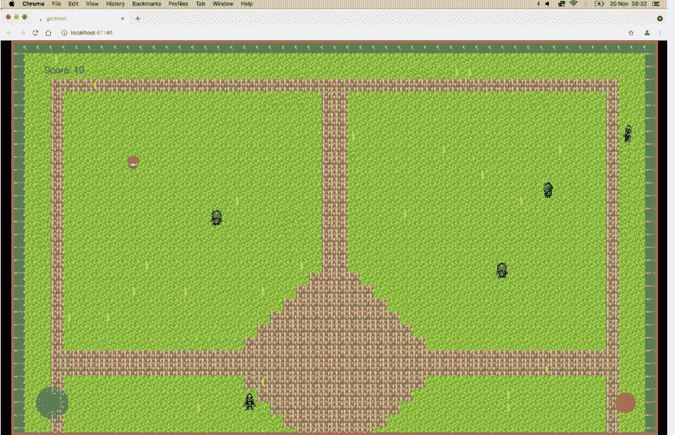
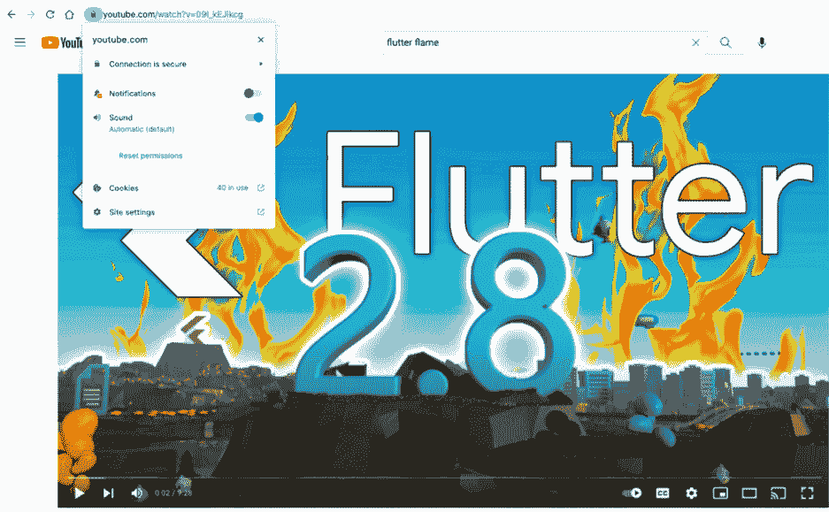

## 第 8 章：为网页和桌面端缩放游戏

在本书迄今所涉及的内容中，我们一直专注于为具有小型固定屏幕尺寸的移动设备构建游戏。当然，Flutter 的优势之一是它是一个跨平台框架，适用于移动端、网页和桌面端。

但是，在构建将在网站上运行的游戏时，会出现移动端不会遇到的问题。如果你不启动任何移动模拟器，而是在 Visual Studio Code 中选择 Chrome 浏览器作为目标平台并运行游戏，你会注意到地图和 UI 绘制不正确，没有背景音乐，且触摸事件无法正常工作。

在本章中，我们将转换游戏，使其在网页和桌面端正常工作，并确保修复这些问题。在处理调整大小的问题时，我们需要根据新的屏幕尺寸重新绘制地图并重新定位所有组件。有些屏幕分辨率非常高，且大于我们的物理地图尺寸 1,600 x 1,600，这意味着我们需要确保游戏在这些较大的屏幕上依然表现良好。

在本章中，我们将涵盖以下主题：

- 为网页和桌面端构建游戏
- 设置背景音乐
- 设置 Flutter Web 构建参数
- 使用键事件导航

### 技术要求

要查看本章的源代码，可以从 https://github.com/PacktPublishing/Building-Games-with-Flutter/tree/main/chapter08 下载。

### 为网页和桌面端构建游戏

如简介中所述，如果在 Google Chrome 中启动我们的游戏，你会注意到地图和 UI 绘制不正确，且位置错误。那么这里发生了什么呢？

调整屏幕大小时不断变化的较大屏幕尺寸会使我们的游戏困惑，游戏当前认为尺寸是固定的，并且组件的初始位置是相对于我们固定的屏幕尺寸设置的。由于这种困惑，图形可能看起来奇怪，我们先前正常工作的触摸事件现在也可能因为这个新的屏幕尺寸而混乱。

解决办法是让游戏在屏幕调整大小时通知我们，然后我们使用新的屏幕尺寸重新计算所有组件的位置。为了使这更加简单，我们将在数学上计算游戏的边界，以便我们知道地图的顶部、左侧、右侧和底部相对于新屏幕尺寸的位置，然后根据这个边界调整组件。

以下图片显示了通过修复当前用户界面问题希望达到的效果：



Figure 8.1 – 修复用户界面问题后的网页版游戏

在图 8.1 中，你可以看到当屏幕宽度大于地图宽度时，地图块组件会为空白区域绘制黑色边框。由于屏幕宽度大于地图宽度，我们在两侧看到了这些黑色边框，但高度情况并非如此。屏幕高度小于地图高度，因此顶部和底部不会绘制黑色边框。这可能会根据你的屏幕尺寸在你的屏幕上有所不同。

上图中的红色矩形显示了我们想要计算的边界，以便我们可以将其他所有内容相对于它进行调整。在本节中，我们将做到这一点。

### 设置新的屏幕边界

既然我们知道需要计算的边界，那么让我们继续将其添加到代码中：

- 1. 打开 `maths_utils.dart` 文件并添加以下函数：


Rect getGameScreenBounds(Vector2 canvasSize) {
}

- 2. 在 `getGameScreenBounds` 函数顶部，添加以下代码:

```
double left = 0, right = 0, top = 0, bottom = 0;
if (canvasSize.x > 1600) {
    left = (canvasSize.x - 1600) / 2;
}
if (canvasSize.y > 1600) {
    top = (canvasSize.y - 1600) / 2;
}
```

在这里，我们最初定义一些变量来存储我们的 `left`、`right`、`top` 和 `bottom` 值。

如果屏幕的宽度或高度小于地图大小（1,600 x 1,600），我们将默认值设置为 `0`、`0`，并且仅当屏幕的宽度或高度大于地图大小时才更新默认值。

我们将 `canvasSize` 传入函数，它是当前屏幕大小，并减去 `1600` 以获取两个值之间的总差值。然后我们将总差值除以 `2`，因为我们希望确保任何调整都会将地图居中于可用空间。

我们将在游戏开始时调用此函数，并且每当玩家通过调整窗口大小来更改屏幕大小时，我们将根据这个新屏幕大小调整所有组件，使其看起来正确。

- 3. 让我们在 `getGameScreenBounds` 函数中继续，接下来设置我们的 `right` 和 `top` 变量:

```
if (canvasSize.x < 1600) {
    right = canvasSize.x;
} else {
    right = left + 1600;
}
if (canvasSize.y < 1600) {
    bottom = canvasSize.y;
} else {
    bottom = top + 1600;
}
return Rect.fromLTRB(left, top, right, bottom);
```

在这里，我们检查屏幕的宽度是否小于 1600，如果是，则将右值设置为屏幕的宽度。否则，要获得右值，我们将左值和地图的宽度（1600）相加。

然后我们使用屏幕的高度对底部值进行相同的计算。

接下来，我们创建一个矩形来存储我们的值，并从函数中返回它。

### 重要提示

所有值都基于绝对像素值，以帮助我们计算组件的位置，尤其是 HUD，它必须紧密对齐到角落。

- 4. 最后，我们在文件顶部添加以下导入，以解决此函数中使用的 Vector2 和 Rect 类的引用:

```
import 'package:flame/extensions.dart';
```

现在我们已经理清了计算屏幕调整大小时边界的数学方法，让我们开始将此应用到我们的组件上。

### 修复精灵

我们将从 George 和敌人开始，它们的顶层基类是 Character。因此，让我们在该类中监听游戏调整大小事件:

- 1. 打开 character.dart 文件，并将以下变量添加到 Character 类中以跟踪精灵的原始位置:

```
late Vector2 originalPosition;
```

- 2. 接下来，让我们添加代码来监听游戏调整大小事件，通过重写 Component 类（所有精灵都继承自该类）的一部分 onGameResize 函数。然后我们根据 `originalPosition` 和当前游戏屏幕边界调整当前位置，如下所示:

```
@override
void onGameResize(Vector2 canvasSize) {
 super.onGameResize(canvasSize);
 Rect gameScreenBounds =
 getGameScreenBounds(canvasSize);
 position = Vector2(originalPosition.x +
 gameScreenBounds.left, originalPosition.y +
 gameScreenBounds.top);
}
```

- 3. 现在我们有了处理调整大小的代码，让我们在文件顶部添加导入:

```
import 'package:goldrush/utils/math_utils.dart';
import 'package:flame/extensions.dart';
```

有了 `Character` 基类调整大小的处理，修复 George 和敌人就非常容易了。我们只需要在构造函数中存储原始位置，当屏幕调整大小时，精灵将通过其对 `onGameResize` 的回调正确移动，该回调在其 `Character` 基类中处理。

- 4. 因此，打开 `george.dart` 文件，将构造函数更改为此:

```
George({required this.hud, required Vector2 position,
 required Vector2 size, required double speed}) :
 super(position: position, size: size, speed:
 speed) {
 originalPosition = position;
}
```

- 5. 接下来，打开 `skeleton.dart` 文件，将构造函数更改为此:

```
Skeleton({required Vector2 position, required Vector2
 size, required double speed}) : super(position:
 position, size: size, speed: speed) {
 originalPosition = position;
}
```

- 6. 然后，打开 `zombie.dart` 文件，将构造函数更改为此:

```
Zombie({required Vector2 position, required Vector2 size, required double speed}): super(position: position, size: size, speed: speed) {
 originalPosition = position;
}
```

现在我们已经修复了主要精灵，让我们修复 `Coin` 和 `Water` 组件。

### 修复 coin 和 water 组件

要开始修复 water 和 coin 组件，请执行以下步骤:

- 1. 打开 `coin.dart` 文件，更改 `Coin` 类构造函数，并像这样添加一个用于原始位置的变量:

```
Coin({required Vector2 position, required Vector2 size}):
 originalPosition = position,
 super(position: position, size: size);
late Vector2 originalPosition;
```

- 2. 将以下 `onGameResize` 函数添加到 `Coin` 类:

```
@override
void onGameResize(Vector2 canvasSize) {
 super.onGameResize(canvasSize);
 Rect gameScreenBounds =
 getGameScreenBounds(canvasSize);
 position = Vector2(originalPosition.x +
 gameScreenBounds.left, originalPosition.y +
 gameScreenBounds.top);
}
```

- 3. 最后，对于 `Coin` 类，让我们在文件顶部添加导入:

```
import 'dart:ui';
import 'package:goldrush/utils/math_utils.dart';
```

我们添加到 `Coin` 类的代码与我们添加到 `Character` 类的代码类似，在构造函数中存储 `originalPosition`，然后在游戏调整大小时，将此值与新屏幕大小一起用于计算新位置。

让我们对 `Water` 类做同样的事情。

- 4. 打开 `water.dart` 文件，更改 `Water` 类构造函数，并像这样添加一个用于原始位置的变量:

```
Water({required Vector2 position, required Vector2 size, required this.id}) :
 originalPosition = position,
 super(position: position, size: size);
late Vector2 originalPosition;
```

- 5. 将以下 `onGameResize` 函数添加到 `Water` 类:

```
@override
void onGameResize(Vector2 canvasSize) {
 super.onGameResize(canvasSize);
 Rect gameScreenBounds =
 getGameScreenBounds(canvasSize);
 position = Vector2(originalPosition.x +
 gameScreenBounds.left, originalPosition.y +
 gameScreenBounds.top);
}
```

- 6. 最后，对于 `Water` 类，让我们在文件顶部添加导入:

```
import 'package:goldrush/utils/math_utils.dart';
import 'dart:ui';
```

现在我们已经修复了精灵，让我们修复背景和瓦片地图。

### 修复背景和瓦片地图

对于我们的瓦片地图，我们目前使用 `TiledComponent`，它本身扩展自 `Component` 类。这是所有其他组件的基类，而这个类本身没有位置。这对跟踪瓦片地图的游戏边界来说是个问题。因此，解决方法是将我们的 `TiledComponent` 包装在另一个类中，我们将其命名为 `TileMapComponent`。

`TileMapComponent` 本身是一个位置组件，我们将使 `TiledComponent` 成为新 `TileMapComponent` 类的子级。通过这样做，我们可以在屏幕调整大小时自由定位这个新类。

所以，让我们继续并添加这个新的包装器类:

- 1. 在 `components` 文件夹中，创建一个名为 `tilemap.dart` 的新文件并添加以下代码:

```
import 'package:flame/components.dart';
import 'package:flame_tiled/flame_tiled.dart';
import 'package:flutter/material.dart';
import 'package:goldrush/utils/math_utils.dart';
class TileMapComponent extends PositionComponent {
  TileMapComponent(this.tiledComponent) {
    add(tiledComponent);
  }
  TiledComponent tiledComponent;
  @override
  void onGameResize(Vector2 canvasSize) {
    super.onGameResize(canvasSize);
    Rect gameScreenBounds =
      getGameScreenBounds(canvasSize);
    if (canvasSize.x > 1600) {
      double xAdjust = (canvasSize.x - 1600) / 2;
      position = Vector2(gameScreenBounds.left +
        xAdjust, gameScreenBounds.top);
    } else {
      position = Vector2(gameScreenBounds.left,
        gameScreenBounds.top);
    }
    size = Vector2(1600, 1600);
  }
}
```


在这个新类中，我们通过构造函数获取 `TiledComponent` 并将其添加为子组件，因此它将与本类位于相同的位置。然后，在 `onGameResize` 函数中，我们正在调整该组件的位置，并将其大小固定为地图大小 1600 x 1600。

接下来是 `Background` 类，在这个类中，我们想要删除 `position` 和 `size` 设置——目前这些设置发生在 `onLoad` 函数中——通过删除此函数，然后在 `onGameResize` 函数中设置 `position` 和 `size`。

- 2. 打开 `background.dart` 文件，完全删除 `onLoad` 函数，并添加以下代码：

```
@override
void onGameResize(Vector2 canvasSize) {
  super.onGameResize(canvasSize);
  Rect gameScreenBounds =
      getGameScreenBounds(canvasSize);
  if (canvasSize.x > 1600) {
    double xAdjust = (canvasSize.x - 1600) / 2;
    position = Vector2(gameScreenBounds.left +
        xAdjust, gameScreenBounds.top);
  } else {
    position = Vector2(gameScreenBounds.left,
        gameScreenBounds.top);
  }
  size = Vector2(1600, 1600);
}
```

与我们刚刚添加的 `TileMapComponent` 对象一样，这会在调整大小后，根据新的屏幕大小设置 `position` 和 `size`。

### 重要提示

请注意，当组件首次创建时，`onGameResize` 总会被调用，之后每次屏幕调整大小时也会再次调用。因此，我们不再需要在 `onLoad` 中做任何事情。

- 3. 接下来，让我们添加导入语句：

```
import 'package:goldrush/utils/math_utils.dart';
import 'dart:ui';
```

- 4. 最后，对于 `Background` 类，我们将更改构造函数以提高组件的 `priority`，以确保当前能够捕获触摸事件。请将构造函数更改为以下内容：

```
Background(this.george) : super(priority: 20);
```

在下一节中，我们将讨论如何修复 HUD 组件。

### 修复 HUD 组件

现在让我们继续修复 HUD 组件。

目前，在我们的 HUD 中，我们使用边距根据屏幕角落调整摇杆、运行按钮和分数文本的位置。目前 Flame 库在游戏屏幕调整大小时存在一些已知问题，这会导致此功能无法正常工作。

因此，我们将重写 HUD 的部分内容，使用 position 而不是边距，然后我们可以应用常用的计算方式，即获取游戏屏幕边界，并在屏幕调整大小时调整 HUD 组件的位置。

与 *修复背景和瓦片地图* 部分第 2 步中使用 `Background` 类的情况类似，我们将删除 `onLoad` 功能，并在 `onGameResize` 函数中处理调整大小操作。我们还将把这个函数分为两部分。当 `onGameResize` 第一次被调用时，我们需要创建 HUD 组件并将其作为子组件添加，根据屏幕大小调整它们的位置。之后每次调用 `onGameResize` 时，我们将只更新 HUD 组件的新位置。

为了跟踪这一点，我们将创建一个名为 `isInitialised` 的变量来跟踪是否已经设置好 HUD 组件，并根据该情况调用正确的代码：

- 1. 打开 `hud.dart` 文件并在类顶部添加 `isInitialised` 变量：

```
bool isInitialised = false;
```

- 2. 删除 `onLoad` 函数并添加以下代码：

```
@override
void onGameResize(Vector2 canvasSize) {
 super.onGameResize(canvasSize);
 Rect gameScreenBounds =
 getGameScreenBounds(canvasSize);
 if(!isInitialised) {
 } else {
 }
}
```

- 3. 在第一个检查 `isInitialised` 是否为 false 的 `if` 代码块中，添加以下代码：

```
final joystickKnobPaint =
 BasicPalette.blue.withAlpha(200).paint();
 final joystickBackgroundPaint =
 BasicPalette.blue.withAlpha(100).paint();
 final buttonRunPaint =
 BasicPalette.red.withAlpha(200).paint();
 final buttonDownRunPaint =
 BasicPalette.red.withAlpha(100).paint();
 joystick = Joystick(
 knob: CircleComponent(radius: 20.0, paint:
 joystickKnobPaint),
 background: CircleComponent(radius: 40.0, paint:
 joystickBackgroundPaint),
 position: Vector2(gameScreenBounds.left + 100,
 gameScreenBounds.bottom - 80),
 );
 runButton = RunButton(
 button: CircleComponent(radius: 25.0, paint:
 buttonRunPaint),
 buttonDown: CircleComponent(radius: 25.0, paint:
 buttonDownRunPaint),
 position: Vector2(gameScreenBounds.right - 80,
 gameScreenBounds.bottom - 80),
 onPressed: () => {}
);
scoreText = ScoreText(position: Vector2(
  gameScreenBounds.left + 80, gameScreenBounds.top +
  60));
add(joystick);
add(runButton);
add(scoreText);
positionType = PositionType.viewport;
isInitialised = true;
```

这段代码的大部分内容与我们之前的 onLoad 函数类似。然后我们使用 position 而不是边距设置 HUD 组件并将其作为子组件添加。接着将 isInitialised 变量设置为 true，这样我们就不会在每次调整游戏大小运行这段代码并不断添加更多组件。

此时你可能会注意到子组件显示错误，因为它们当前没有 position 值，但我们很快就会修复它。

- 4. 在 else 块中，请添加以下代码，这将更新在 if 块中创建的组件的位置：

```
joystick.position = Vector2(gameScreenBounds.left +
  80, gameScreenBounds.bottom - 80);
runButton.position = Vector2(gameScreenBounds.right -
  80, gameScreenBounds.bottom - 80);
scoreText.position = Vector2(gameScreenBounds.left +
  80, gameScreenBounds.top + 60);
```

- 5. 最后，对于 HudComponent 类，让我们在文件顶部添加导入语句：

```
import 'package:goldrush/utils/math_utils.dart';
```

接下来，让我们修复 Joystick 和 ScoreText 类，使其使用 positions 而不是 margin。请注意，RunButton 类的构造函数中已经有了 position 值，因此我们不需要更新 RunButton 类。

- 6. 打开 joystick.dart 文件并将构造函数更改为以下内容：

```
Joystick({
  required PositionComponent knob,
  PositionComponent? background,
  Vector2? position
}) :
  super(knob: knob, background: background,
  position: position);
```

- 7. 我们现在还可以删除未使用的导入语句：

```
import 'package:flutter/material.dart';
```

- 8. 打开 score_text.dart 文件并将构造函数更改为以下内容：

```
ScoreText({Vector2? position}) : super(position:
  position);
```

现在让我们将重点转移到通过对 main.dart 文件进行更改来整合所有这些组件更改，以使用新的游戏屏幕边界。

- 9. 打开 main.dart 文件并在文件顶部添加以下导入语句：

```
import 'package:goldrush/components/tilemap.dart';
import 'package:goldrush/utils/math_utils.dart';
```

在 onLoad 函数中，我们希望通过计算游戏屏幕边界，并利用此结果与预期位置结合，在调整屏幕大小时调整位置，从而为每个组件设置 originalPosition 变量。

- 10. 继续在 main.dart 文件中，让我们在基类中调用 onLoad 的下方添加获取游戏屏幕边界的代码：

```
@override
Future<void> onLoad() async {
  super.onLoad();
  Rect gameScreenBounds =
  getGameScreenBounds(canvasSize);
```

- 11. 接下来，让我们更新创建 `George` 类的地方，传递 `position`。我们还将更改 `George` 组件的 `priority`，以修复仅在网页上出现的加载问题：

```
var george = George(hud: hud, position:
    Vector2(gameScreenBounds.left + 300,
        gameScreenBounds.top + 300), size: Vector2(48.0,
        48.0), speed: 40.0);
add(george);
children.changePriority(george, 15);
```

- 12. 在我们创建和加载 `TiledComponent` 数据的地方，现在需要用我们的新 `TileMapComponent` 对其进行包装：

```
final tiledMap = await
    TiledComponent.load('tiles.tmx', Vector2.all(32));
add(TileMapComponent(tiledMap));
```

- 13. 接下来，让我们更改 `Skeleton` 和 `Zombie` 类的位置：

```
if (index % 2 == 0) {
    add(Skeleton(position: Vector2(position.x +
        gameScreenBounds.left, position.y +
        gameScreenBounds.top), size: Vector2(32.0,
        64.0), speed: 60.0));
} else {
    add(Zombie(position: Vector2(position.x +
        gameScreenBounds.left, position.y +
        gameScreenBounds.top), size: Vector2(32.0,
        64.0), speed: 20.0));
}
```

- 14. 接下来，让我们使用新的 `position` 修复 `Coin` 类：

```
double posCoinX = (randomX * 32) + 5 +
    gameScreenBounds.left;
double posCoinY = (randomY * 32) + 5 +
    gameScreenBounds.top;
```

- 15. 接下来，让我们修复 `Water` 类的 `position`：


add(Water(position: Vector2(rect.x +
gameScreenBounds.left, rect.y +
gameScreenBounds.top), size: Vector2(rect.width,
rect.height), id: rect.id));

- 16. 最后，针对用户界面问题，让我们更新摄像机，使其在跟随乔治时考虑新的游戏屏幕边界：

```
camera.followComponent(george, worldBounds:
Rect.fromLTWH(gameScreenBounds.left,
gameScreenBounds.top, 1600, 1600));
```

如果您之前未为 Web 设置过应用，可能需要在项目文件夹中运行以下命令以为项目创建 Web 文件夹：`flutter create`。

**注意**

所有这些更改将原地修改现有行，并在需要时使用新的游戏屏幕边界及初始位置。

既然我们已经修复了用户界面问题，让我们来看看为什么音乐无法在后台播放。

### 设置背景音乐

Chrome、Safari 和 Firefox 等现代浏览器会阻止网站在后台播放音频，直到用户与页面交互，以确保这确实是用户想要的。网站经常打开弹出式网站，用广告烦扰用户。因此，开发这些浏览器的公司添加了诸如阻止后台音频等措施，以便用户对这些烦人的弹出窗口有更多控制权。

浏览器特别不希望在首次加载页面时尝试播放背景音乐，而我们正是试图在游戏的 `onLoad` 函数中启动音乐来实现这一点。为了临时修复我们的游戏，我们可以点击网站地址左侧的锁图标，并在 Chrome 中启用任何声音权限。然后刷新页面，您将再次听到背景音乐。



图 8.2 – Chrome 浏览器中的音频权限

这对开发来说没问题，但对于可能访问您网站的玩家来说显然不太理想。在最后一章，*第 11 章，完成游戏*中，我们将向游戏添加一些设置屏幕，并允许玩家基于用户界面交互来打开背景音乐。这将允许用户根据玩家的偏好打开或关闭音乐。

在下一节中，我们将讨论可用于提升 Flutter Web 性能的构建参数。

### 设置 Flutter Web 构建参数

如果您现在使用 Chrome 作为设备运行游戏，您会发现可以调整浏览器窗口大小，页面会随之调整大小，组件也会根据此进行更新，尽管在运行游戏时性能不佳。那么，让我们讨论如何为发布编译代码，并通过 Web 服务器部署以获得更好的性能。

构建 Web 发布版本时，我们必须向 `flutter build web` 命令传递一个参数，以指示我们要从以下两个选项中选择的 Web 渲染器：

- html：如果您优先考虑下载大小而非性能，请选择此 Web 渲染器。
- canvasKit：如果您优先考虑性能和跨平台的像素级一致性，请选择此 Web 渲染器。

我们将使用 `canvaskit`，因为如今性能比下载大小更重要，但请注意，`html` 作为一个选项始终可用，以防您需要它：

- 1. 让我们运行将创建我们发布构建的命令。

在项目文件夹中打开命令行终端并键入以下内容：

```
flutter build web --release --web-renderer canvaskit
```

编译完成后，它将把 Web 代码保存在 `build/web` 文件夹中。

- 2. 接下来，让我们从 `build/web` 文件夹运行 Web 服务器：

```
cd build/web/
python3 -m http.server 8000 &
```

在此，我们移动到 Web 代码所在的文件夹并运行 Web 服务器。

我们使用的是 Python 语言免费提供的内置 Web 服务器。

如果您未安装 Python，请在运行此命令前上网从 https://www.python.org/downloads/ 安装它。

如果您有自己的 Web 主机，也可以将 build/web 文件夹的内容上传到您的 Web 主机。

- 3. 在 Web 服务器运行我们的游戏时，打开任何浏览器，并在浏览器地址栏中输入 http://localhost:8000/。

游戏将加载，您将看到它在浏览器中运行。您还会注意到，它加载和运行的速度比通过 Chrome 设备运行要快得多。

在 Web 上玩完游戏后，您应该关闭 Web 服务器。因为 Web 服务器在后台运行，我们需要先将其带到前台才能将其关闭。

- 4. 在终端中，按 Enter 键开始新行，然后键入以下内容以将 Web 服务器带到前台：

```
fg
```

- 5. 接下来，按 Ctrl + C 键停止 Web 服务器。

如果您在添加要测试的新代码片段时需要启动和停止 Web 服务器，请注意以下几点：

- 您应始终从项目文件夹编译发布构建。
- 您应始终从 build/web 文件夹运行 Web 服务器。

在本节中，我们解决了动态大小用户界面的问题，并讨论了后台音频问题的替代方案。我们还讨论了如何为 Web 创建发布构建，并在 Web 服务器上对其进行了测试。

在下一节中，我们将讨论如何使用物理按键进行导航。

### 使用按键事件导航

我们的游戏已经允许玩家角色通过摇杆或触摸事件来控制，但对于网站来说，使用键盘控制角色是更常见的方法。

在本节中，我们将添加键盘控制作为另一种选项，那么让我们开始吧。

要在游戏中监听键盘事件，我们首先必须告诉游戏，我们的一些组件将监听键盘事件：

- 1. 打开 `main.dart` 文件并修改类定义，以包含 `HasKeyboardHandlerComponents` 混入：

```
class GoldRush extends FlameGame with HasCollidables, HasDraggables, HasTappables, HasKeyboardHandlerComponents {
```

- 2. 在同一文件顶部添加以下输入导入：

```
import 'package:flame/input.dart';
```

- 3. 打开 `george.dart` 文件（我们将在其中监听键盘事件）并修改类定义以添加 `KeyboardHandler` 混入：

```
class George extends Character with KeyboardHandler {
```

- 4. 在同一文件顶部添加以下导入：

```
import 'package:flutter/services.dart';
```

- 5. 接下来，让我们添加一些变量来存储按键状态：

```
bool keyLeftPressed = false, keyRightPressed = false, keyUpPressed = false, keyDownPressed = false, keyRunningPressed = false;
```

在我们的游戏中，我们将使用以下按键映射：

- a. 左 = A 键
- b. 右 = D 键
- c. 上 = W 键
- d. 下 = S 键
- e. 奔跑 = R 键

- 6. 将以下函数覆盖到 George 类中，以监听按键事件，并在按下任何按键时正确设置步骤 5 中设置的变量：

```
@override
bool onKeyEvent(RawKeyEvent event, Set<LogicalKeyboardKey> keysPressed) {
  if (event.data.keyLabel.toLowerCase().contains('a')) {
    keyLeftPressed = (event is RawKeyDownEvent);
  }
  if (event.data.keyLabel.toLowerCase().contains('d')) {
    keyRightPressed = (event is RawKeyDownEvent);
  }
  if (event.data.keyLabel.toLowerCase().contains('w')) {
    keyUpPressed = (event is RawKeyDownEvent);
  }
  if (event.data.keyLabel.toLowerCase().contains('s')) {
    keyDownPressed = (event is RawKeyDownEvent);
  }
  if (event.data.keyLabel.toLowerCase().contains('r')) {
    keyRunningPressed = (event is RawKeyDownEvent);
  }
  return true;
}
```

在此，我们检查按键事件数据的键标签是否等于我们映射的字母，然后在按下按键时设置相应的变量。

请注意，我们将数据转换为小写，以防玩家按下了键盘上的大写锁定键，这将生成一个按键事件 S 而不是 s。

- 7. 添加以下导入以解析按键类：


```
Import 'package:flutter/services.dart';
```

- 8. 在 update 函数的顶部，位于对 `super.update(dt);` 的调用下方，让我们根据运行按钮是否被按下或 r 键是否被按下来更改速度值。此外，如果步骤 5 中的任何变量设置为 true，我们将创建一个布尔值来跟踪我们是否正在使用按键移动：

```
speed = (hud.runButton.buttonPressed ||
keyRunningPressed) ? runningSpeed : walkingSpeed;
final bool isMovingByKeys = keyLeftPressed ||
keyRightPressed || keyUpPressed || keyDownPressed;
```

- 9. 在此下方，在 update 函数中，我们有一个检查——如果摇杆不为零，意味着它正在被使用。此检查如下：

```
if (!hud.joystick.delta.isZero()) {
```

让我们在该 if 块末尾为按键移动添加一个 else if 子句，并添加以下代码，该代码将位于 if 块和 else 块之间：

```
} else if (isMovingByKeys) {
movePlayer(dt);
playing = true;
movingToTouchedLocation = false;
if (!isMoving) {
isMoving = true;
audioPlayerRunning = await FlameAudio.loopLongAudio('sounds/running.wav', volume: 1.0);
}

if (keyUpPressed && (keyLeftPressed || keyRightPressed)) {
animation = upAnimation;
currentDirection = Character.up;
} else if (keyDownPressed && (keyLeftPressed || keyRightPressed)) {
animation = downAnimation;
currentDirection = Character.down;
} else if (keyLeftPressed) {
animation = leftAnimation;
currentDirection = Character.left;
} else if (keyRightPressed) {
animation = rightAnimation;
currentDirection = Character.right;
} else if (keyUpPressed) {
animation = upAnimation;
currentDirection = Character.up;
} else if (keyDownPressed) {
animation = downAnimation;
currentDirection = Character.down;
} else {
animation = null;
}
```

这段代码的工作方式与摇杆处理移动的方式相同，即尝试移动我们的玩家，前提是它不与水发生碰撞，并播放行走脚步声。

然后根据按下的键正确设置 `animation` 和 `currentDirection` 变量。

- 10. 在 `stopAnimations` 函数中，当动画停止时，让我们重置移动键：

```
void stopAnimations() {
animation?.currentIndex = 0;
playing = false;
keyLeftPressed = false;
keyRightPressed = false;
keyUpPressed = false;
keyDownPressed = false;
}
```

如果您现在在 Chrome 设备上运行游戏，就可以使用键盘上的按键控制 George 了。

### 摘要

在本章中，我们通过修复调整浏览器窗口大小时的用户界面问题，并允许通过键盘控制移动，将游戏转换为可在网页上运行。

在接下来的几章中，我们将开始着手游戏开发中更高级的主题，从下一章开始实现高级图形效果。

我们将使用粒子效果在杀死敌人时让它们爆炸，并使用图层为我们的精灵创建酷炫的阴影效果。

### 问题

- 1. 网页首次加载时，为什么音乐不会在后台播放？

- 2. 调整游戏窗口大小为什么会导致我们的图形绘制错误？

- 3. 为什么我们需要将 `TiledComponent` 包装在另一个类中来修复其用户界面问题？

- 4. 构建网页发布版本时有哪些 Web 渲染器可用？

- 5. 我们需要使用哪个 mixin 来监听键盘事件？
