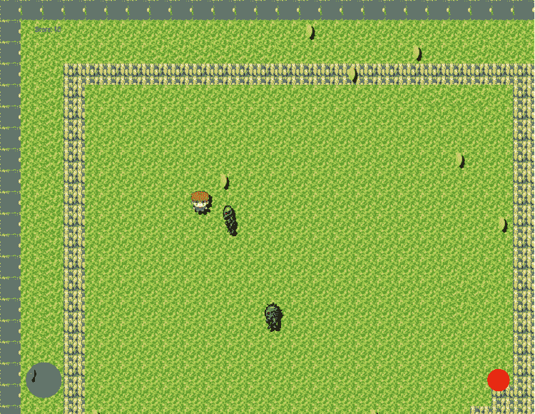

## 第 9 章：实现高级图形效果

到目前为止，在本书中，我们已使用图形来为精灵组件制作动画并绘制瓦片地图，但我们可以做更多工作来改进游戏的视觉效果。

在本章中，我们将讨论如何使用粒子和阴影来改进我们的游戏。我们将使用粒子效果，使硬币和敌人在碰撞时爆炸，并使用图层为我们的精灵添加阴影效果。这些是改进游戏视觉效果的简单而高效的方法，运行速度非常快，不会过度影响帧率，因此值得用来改进我们的游戏。

本章将涵盖以下主题：

- 什么是粒子效果？
- 使用粒子制作动画
- 使用图层创建阴影

### 技术要求

要查看本章的源代码，您可以从 https://github.com/PacktPublishing/Building-Games-with-Flutter/tree/main/chapter09 下载。

### 什么是粒子效果？

粒子效果是为我们的游戏创建火焰、烟雾、爆炸和魔法效果等动态效果的简便方法。粒子具有多种可更改的属性，包括以下内容：

- 粒子存活多长时间
- 新粒子创建的频率
- 创建粒子的位置
- 行进的角度、距离和速度
- 粒子应具有的颜色
- 物理学如何影响粒子

粒子效果的一个好例子是烟花。烟花会爆炸出各种颜色，并以不同的速度和角度行进，短时间后在天空中消失。

Flame 支持多种类型的粒子效果，您可以在 https://examples.flame-engine.org/#/Rendering_Particles 中查看示例。这些内容在 Flame 文档 https://docs.flame-engine.org/1.0.0/particles.html 中有更详细的讨论，但这里我们先总结一些不同的粒子类型供您参考：

- `MovingParticle` – 在粒子生命周期内在两点之间移动子粒子
- `AcceleratedParticle` – 对粒子应用基于物理的基本效果，例如重力或速度阻尼
- `CircleParticle` – 绘制不同大小的圆
- `SpriteParticle` – 在粒子中使用精灵图像
- `ComputedParticle` – 用于对粒子进行更高级的控制，可能需要计算值来影响粒子

在我们的游戏中，我们希望硬币向外爆炸的同时逐渐淡出 alpha 值。我们将这些粒子设为黄色，以匹配硬币颜色。对于敌人，我们将重复使用爆炸效果，但将粒子设为红色，使其看起来像血。

我们将使用前面不同粒子类型列表中的 `ComputedParticle`，因为我们希望将爆炸粒子分成 12 片。这些片段将从中心以递增的 30 度角向外移动，我们将使用基本三角函数进行计算。粒子将根据这些值生成和计算，并在基于粒子进度逐渐淡出时调整不透明度。

请记住，粒子具有我们可以设置的生命周期。因此，当粒子接近其生命周期末尾时，我们将使其淡出。

实际绘制将是一个简单的圆形，其位置、角度和不透明度均已计算。

让我们在下一节中开始编写粒子代码。

### 使用粒子制作动画

在本节中，我们将向您展示如何创建出色的粒子效果并为其制作动画。首先，我们将在 `utils` 文件夹中创建一个新文件来存储我们的效果，以便从任何位置使用：

- 1. 在 `utils` 文件夹中，创建一个名为 `effects.dart` 的新文件并打开该文件。

- 2. 添加以下代码以创建爆炸粒子：

```
Particle explodingParticle(Vector2 origin,
MaterialColor color) {
double distanceToMove = 15.0;
return Particle.generate(
lifespan: 0.8,
count: 12,
generator: (i) {
double angle = i * 30;
double xx =
origin.x + (distanceToMove * cos(angle));
double yy =
origin.x + (distanceToMove * sin(angle));
Vector2 destination = Vector2(xx, yy);
return ComputedParticle(renderer: (Canvas canvas, Particle particle) {
```


```dart
Paint paint = Paint()..color = color.withOpacity(1.0 - particle.progress);
canvas.drawCircle(Offset.zero, 1.5, paint);
})).moving(from: origin, to: destination);
});
}
```

这里，我们有 `explodingParticle` 函数，它返回 `ComputedParticle`。该函数接受一个原点位置，用于指定粒子效果应从哪里开始，以及应用于粒子的颜色。

我们希望粒子移动短距离 `15.0`，我们使用这个距离基于从原点出发的行进角度计算其目标位置。粒子在其生命周期内将到达的最终目标是通过三角函数计算得出的。

我们以 30 度角度生成 12 个粒子，总共 `12 * 30 = 360` 度，以覆盖所有向外的方向。生命周期设置为略低于一秒，即 `0.8`，因此爆炸发生迅速并逐渐消失。

最后，这被包装在 `MovingParticle` 中，它在粒子的生命周期内将粒子在原点和目标之间移动。

在 `lifespan` 时间到期后，粒子将从游戏中移除，因此我们不需要手动监控这一点，Flame 会通过从游戏中移除过期粒子来为我们处理此事。

- 3. 在 `effects.dart` 文件顶部，为粒子效果添加以下导入：

```dart
import 'package:flame/game.dart';
import 'package:flame/particles.dart';
import 'package:flutter/material.dart';
import 'dart:math';
```

让我们继续在 `George` 类中创建粒子效果，当我们的玩家与硬币或敌人碰撞时。

- 4. 打开 `george.dart` 文件并添加以下导入：

```dart
import 'package:goldrush/utils/effects.dart';
import 'package:goldrush/main.dart';
import 'package:flutter/material.dart';
```

- 5. 在 `George` 类定义中，我们需要获取 `GoldRush` 类的引用。之所以需要，是因为当我们创建粒子时，我们需要基于世界坐标设置原点位置。那么，让我们更新该代码：

```dart
class George extends Character with KeyboardHandler, HasGameRef<GoldRush> {
```

- 6. 在 `onCollision` 函数中，让我们通过我们在上一个代码块中刚刚添加的 `gameRef` 引用将粒子添加到游戏中，在这里我们检查碰撞对象是 `Zombie` 还是 `Skeleton`：

```dart
if (other is Zombie || other is Skeleton) {
  gameRef.add(ParticleComponent(explodingParticle(other.position, Colors.red)));
}
```

- 7. 接下来，让我们在检查是否与 `Coin` 对象碰撞时执行相同操作：

```dart
if (other is Coin) {
  gameRef.add(ParticleComponent(explodingParticle(other.position, Colors.yellow)));
}
```

如果你现在运行游戏，你会看到当我们与硬币碰撞时，硬币会爆炸成黄色粒子，当我们与敌人碰撞时，敌人会爆炸成红色粒子。

现在游戏中有一些漂亮的粒子效果了，让我们继续在下一节中使用层添加一些阴影。

### 使用层创建阴影

层是 Flame 的一项功能，允许我们将想要一起绘制的内容分组，或者绘制一个不怎么变化的预渲染图形。在你的游戏中，你可能有一个背景，它是由一组精灵或图像绘制一次的，然后它被用作静态图像作为背景，并在其上绘制其他移动的精灵。

如果背景不变化，不断重新创建它是低效的。因此，你可以创建一次并将其存储为层，然后在渲染其他游戏图形之前绘制该层。

在 Flame 中，有两种类型的层：

- PreRenderedLayer – 用于静态图像

- DynamicLayer – 用于移动的内容

`PreRenderedLayer` 由于其静态性质，适合用于背景。

你也可能想在层中更改某些内容并重新生成层，然后将生成的图像缓存在层中。例如，你可能希望在游戏中创建一个天气效果，其中雨滴在层上更新并重新绘制，然后将此层绘制在游戏世界之上，以营造下雨或下雪的印象。对于此类效果，`DynamicLayer` 更合适。

Flame 还提供了一种称为层处理器的东西，允许我们为整个层添加效果。当前唯一支持的层处理器称为 `ShadowProcessor`，它为整个层应用阴影。当然，你也可以通过扩展 `LayerProcessor` 类来创建自己的处理器，如果你想创建其他处理器的话。

我们可以将 `ShadowProcessor` 与我们的精灵结合使用，在每个精灵后面创建阴影，使它们在游戏中真正突出。这是通过在应用阴影处理器后将我们的精灵绘制到一个层中来实现的。

让我们通过创建我们的层类来开始：

- 1. 打开 `effects.dart` 文件，在 `Animating with particles` 部分的 `Step 2` 中我们之前添加的 `explodingParticle` 函数下方，为我们的层添加以下类定义：

```dart
class ShadowLayer extends DynamicLayer {
  final Function renderFunction;
  ShadowLayer(this.renderFunction) {
    preProcessors.add(ShadowProcessor(color: Colors.black, offset: const Offset(4, 4)));
  }

  @override
  void drawLayer() {
    renderFunction(canvas);
  }
}
```

这里，我们创建一个名为 `ShadowLayer` 的类，它是一个 `DynamicLayer`。在构造函数中，我们将阴影处理器添加到预处理器列表中，以便在绘制精灵之前应用阴影效果。请注意，这是预处理器列表，因此如果你创建自己的处理器，可以将多个效果添加到你的层中。此外，还有一个后处理器列表可用，如果你需要，它会在绘制精灵之后添加效果。

我们将阴影设置为黑色，并在精灵绘制位置偏移 4, 4 像素处绘制，以营造精灵后面的阴影效果。

在构造函数中，我们传递一个函数引用，然后在调用 `drawLayer()` 时使用它。我们这样做是因为我们想要保持对超类渲染函数的引用，以便将绘制委托给层。因此，我们的精灵会绘制到层上，阴影会应用到上面，然后我们调用超类将层绘制到游戏中，基于我们当前正在渲染的动画帧。

正因为如此，当我们在渲染函数中渲染精灵时，我们将渲染到 `ShadowLayer` 中，而不会在那里调用超类，否则会绘制两次，这既低效也不必要。

- 2. 现在，在文件顶部，让我们添加层包的导入：

```dart
import 'package:flame/layers.dart';
```

接下来，让我们先设置 `Coin` 类，并为所有硬币添加阴影，这样我们就可以在实践中看到这种委托渲染是如何工作的。

- 3. 打开 `coin.dart` 文件并在文件顶部添加以下导入：

```dart
import 'package:goldrush/utils/effects.dart';
```

- 4. 在 `Coin` 类中，在存储 `originalPosition` 的位置下方添加一个变量来存储 `ShadowLayer`：

```dart
late Vector2 originalPosition;
late ShadowLayer shadowLayer;
```

- 5. 为 `ShadowLayer` 添加以下导入：

```dart
import 'package:goldrush/utils/effects.dart';
```

- 6. 在 `onLoad` 函数底部，添加以下行以初始化阴影层：

```dart
shadowLayer = ShadowLayer(super.render);
```

在这里，我们可以看到我们正在将函数引用传递给超类渲染函数。

- 7. 在 `Coin` 类底部，添加以下 render 函数重写，它将绘制委托给 `shadowLayer`：

```dart
@override
void render(Canvas canvas) {
  shadowLayer.render(canvas);
}
```

如果你现在运行游戏，你会看到游戏中所有硬币后面都有我们的阴影效果。



### 图 9.1 – 精灵上的阴影效果

让我们继续，将相同的效果应用到我们的敌人精灵和玩家精灵 George 上。

我们将此添加到 `Character` 类，它是 George 和敌人的基类，以减少重复代码。

- 8. 打开 `character.dart` 文件并添加层包的以下导入：

```dart
import 'package:goldrush/utils/effects.dart';
```

- 9. 在 `Character` 类中，在存储 `originalPosition` 的位置下方添加一个变量来存储 `ShadowLayer`：

```dart
late Vector2 originalPosition;
late ShadowLayer shadowLayer;
```

- 10. 将以下 `onLoad` 函数添加到 `Character` 类以初始化阴影层：


```
@override
Future<void> onLoad() async {
 super.onLoad();
 shadowLayer = ShadowLayer(super.render);
}
```

- 11. 最后，将 render 函数添加到 Character 类中，以将绘制委托给 shadowLayer：

```
@override
void render(Canvas canvas) {
 shadowLayer.render(canvas);
}
```

请注意，您可能会看到关于调用超类 render 函数的消息，但我们希望避免这种情况，因为它将从我们的阴影层内部调用，因此此处省略了。

如果您现在运行游戏，会发现我们的玩家和敌人身后都有可爱的阴影效果，这真的让它们在背景中显得格外突出！

### 摘要

在本章中，我们学习了如何将高级图形效果应用到游戏中，使游戏看起来好得多。我们添加了粒子效果，使硬币和敌人在碰撞时爆炸，并在玩家、敌人和硬币身后添加了一些漂亮的阴影效果。

在下一章中，我们将讨论如何通过为玩家和敌人添加游戏人工智能（AI），使它们看起来更智能。

我们将改变敌人的行为——不再是我们攻击他们，而是他们攻击我们！当乔治靠近他们时，敌人会追击他，并且当他们撞到我们时仍然会爆炸，但我们将为乔治添加一个生命值，如果我们与爆炸的敌人碰撞，该值会减少。此外，敌人只有在面朝乔治、能看见乔治且在一定距离内时才会追击。

此外，我们将向游戏中添加一些更多障碍物，并向您展示如何使用路径查找，确保乔治在通过触摸屏幕移动时会在游戏世界中绕过障碍物。

### 问题

- 1. 粒子效果有哪些共同属性？
- 2. 为什么需要通过设置生命期将粒子从游戏中移除？
- 3. Flame 支持哪些粒子示例？
- 4. Flame 支持哪些不同类型的层？
- 5. 为什么需要将超类的渲染委托给层类？
