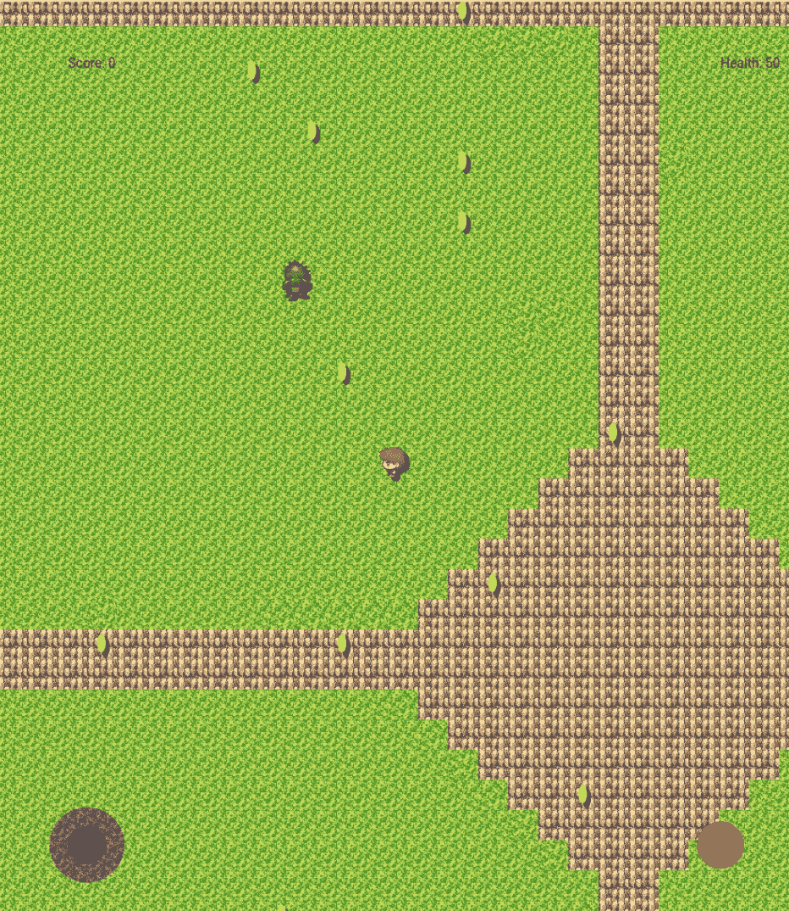

## 第 10 章：使用 AI 制作智能敌人

游戏现在进展得很顺利，但还没有真正的挑战。我们收集硬币或杀死敌人，但这一切都非常可预测且容易。

在本章中，我们将通过为玩家乔治添加生命值，并让敌人追击我们（每被一个敌人撞到就减少我们的生命值）来使游戏更具挑战性。如果生命值降至零，我们就输掉游戏。因此，目标是在躲避敌人的同时收集硬币。

为了使敌人看起来更智能，我们将使用非常简单的 **人工智能（AI）** 算法，让敌人检测乔治是否在附近，当他们能看到他时，他们的移动会从随机移动改变为朝乔治方向移动以攻击他。

然后，我们将在地图上添加一些额外的水作为障碍物，并讨论如何从起点移动到终点，避开水并绕行以到达目的地。

本章将涵盖以下主题：

- 让敌人追击玩家
- 使用路径查找绕过障碍物

### 技术要求

要查看本章的源代码，可以从 https://github.com/PacktPublishing/Building-Games-with-Flutter/tree/main/chapter10 下载。

以下步骤将向 `pubspec` 文件添加一个库以协助路径查找，并添加一些新的和更新的资源：

- 1. 在本章中，我们将使用更新版本的地图文件，因此请下载这些更新的地图文件并将它们放在 `assets/tiles` 文件夹中，覆盖现有文件：
  https://github.com/PacktPublishing/Building-Games-with-Flutter/blob/main/chapter10/assets/tiles/tiles.tmx
  https://github.com/PacktPublishing/Building-Games-with-Flutter/blob/main/chapter10/assets/tiles/tiles.tsx

- 2. 打开 `pubspec.yaml` 文件并添加以下依赖项：

```
a_star_algorithm: ^0.3.0
```

- 3. 在本章中，我们将使用角色乔治的精灵表的修改版本，因此让我们更新它。

从以下 URL 下载 `george.png` 图像，
https://raw.githubusercontent.com/PacktPublishing/Building-Games-with-Flutter/main/chapter10/assets/images/george.png，并覆盖 `assets/images` 文件夹中的文件。请注意，由于我们已在 `pubspec.yaml` 文件中为 `george.png` 引用，因此无需对其进行进一步处理。

- 4. 保存文件并允许 `pub get` 下载此依赖项并验证资源：

```
flutter pub get
```

### 让敌人追击玩家

让敌人追击玩家主要有两个需要克服的挑战，让玩家相信敌人表现出智能并正在追捕他们。具体如下：

- 首先，玩家离敌人足够近，以便敌人能看见或听到他们。你不希望敌人在地图另一边时就开始追击玩家，否则效果会丧失且不可信。
- 第二是，敌人开始追击时面朝玩家。如果敌人正朝相反方向行走，玩家可能能够悄悄绕过他们而不被敌人注意到。因此，当敌人甚至没有面朝玩家时，我们不会让他们追击。

为了克服这些挑战，我们将在每次更新时跟踪玩家和敌人之间的距离，每秒更新 60 次。如果它们之间的距离低于某个值，并且玩家与敌人之间的角度表明敌人面朝玩家，那么我们将开始让敌人追击玩家。如果玩家能逃离敌人，敌人将恢复到正常的移动模式。我们还将更改敌人的速度，使正常移动速度在追击时变为原来的三倍。

让我们开始让敌人追击玩家：

- 1. 打开 `character_enemy.dart` 文件，在类定义之外，添加以下枚举以定义我们是正在四处走动还是追击玩家：

```
enum EnemyMovementType {
  WALKING,
  CHASING
}
```

- 2. 在 EnemyCharacter 类中，在构造函数下方，添加以下变量：

```
Character playerToTrack;
EnemyMovementType enemyMovementType =
    EnemyMovementType.WALKING;
static const DISTANCE_TO_TRACK = 150.0;
double walkingSpeed, chasingSpeed;
```

在此，我们创建用于跟踪要追击角色的变量，并将敌人移动类型默认设置为行走。我们设置了一个常量用于距离检查，以检测敌人是否靠近玩家，并创建一些值来维持行走和追击速度。

- 3. 将构造函数更改为以下代码，以设置我们在 *步骤 2* 中创建的一些值：

```
EnemyCharacter({required Character player, required Vector2 position, required Vector2 size, required double speed}):
playerToTrack = player,
walkingSpeed = speed,
chasingSpeed = speed * 2,
super(position: position, size: size, speed: speed);
```

在此，我们将追击速度设置为行走速度的两倍。

- 4. 让我们导入 `math_utils.dart` 文件，以便可以使用 `getAngle` 函数来确定此敌人是否面朝玩家：

```
import 'package:goldrush/utils/math_utils.dart';
```

- 5. 接下来，让我们创建一个名为 `isPlayerNearAndVisible` 的函数，以检查玩家是否在附近且敌人面朝玩家方向可见：

```
bool isPlayerNearAndVisible() {
bool isPlayerNear = position.distanceTo(
playerToTrack.position) < DISTANCE_TO_TRACK;
bool isEnemyFacingPlayer = false;
var angle =
getAngle(position, playerToTrack.position);
if ((angle > 315 && angle < 360) || (angle > 0 &&
angle < 45) ) { // Facing right
isEnemyFacingPlayer = currentDirection ==
Character.right;
} else if (angle > 45 && angle < 135) {
// Facing down
isEnemyFacingPlayer = currentDirection ==
```


Character.down;
} else if (angle > 135 && angle < 225) {
  // Facing left
  isEnemyFacingPlayer = currentDirection ==
    Character.left;
} else if (angle > 225 && angle < 315) {
  // Facing up
  isEnemyFacingPlayer = currentDirection ==
    Character.up;
}
return isPlayerNear && isEnemyFacingPlayer;
}

在 `isPlayerNearAndVisible` 函数中，我们首先从敌人位置测量到玩家的距离，检查是否小于我们的 `DISTANCE_TO_TRACK` 值，然后根据需要将 `isPlayerNear` 值设置为 `true`。

接下来，我们使用 `getAngle` 函数获取敌人与玩家之间的角度，然后使用它来检查我们面对的角度是否与我们面对的 `currentDirection` 匹配。如果匹配，则敌人正面对玩家，我们根据需要设置 `isEnemyFacingPlayer` 标志。

如果两个值都为 `true`，我们将从该函数返回 `true`，以指示敌人足够近且能看到玩家，我们将在接下来的 `update` 函数中使用它，将 `enemyMovementType` 从步行更改为追逐。

- 6. 让我们重写 `EnemyCharacter` 类中的 `update` 函数。首先，删除现有的 `update` 函数，并用 GitHub 上的代码替换它：https://github.com/PacktPublishing/Building-Games-with-Flutter/blob/main/chapter10/lib/components/character_enemy.dart。

让我们逐一查看我们对此函数所做的更改。

如果敌人处于默认步行状态，之前的 `update` 代码现在位于 `switch/case` 块中。我们首先调用在 `步骤 4` 中创建的 `isPlayerNearAndVisible` 函数，如果玩家在附近且可见，则将当前速度设置为 `chasingSpeed`，否则设置为 `walkingSpeed`。

如果 `enemyMovementType` 为 `WALKING`，敌人将像以前一样四处走动，但当为 `CHASING` 时，敌人将以提高的速度直接朝玩家奔跑。

- 7. 现在，让我们更新 `Skeleton` 和 `Zombie` 类，使其获取玩家类 `George` 的引用（`George` 继承自 `Character` 类），并将此引用传递给 `EnemyCharacter` 基类。

打开 `skeleton.dart` 文件，并按如下方式更改构造函数：

```
Skeleton({required Character player, required Vector2 position, required Vector2 size, required double speed}) : super(player: player, position: position, size: size, speed: speed) {
```

- 8. 打开 `zombie.dart` 文件，并按如下方式更改构造函数：

```
Zombie({required Character player, required Vector2 position, required Vector2 size, required double speed}) : super(player: player, position: position, size: size, speed: speed) {
```

- 9. 添加以下导入以解析构造函数中对 `Character` 的引用：

```
import 'package:goldrush/components/character.dart';
```

- 10. 现在，让我们通过将玩家引用传递给敌人类来将所有内容整合在一起。

打开 `main.dart` 文件，并按如下方式更改添加敌人处的代码：

```
if (index % 2 == 0) {
add(Skeleton(player: george, position:
Vector2(position.x + gameScreenBounds.left,
position.y + gameScreenBounds.top), size:
Vector2(32.0, 64.0), speed: 20.0));
} else {
add (Zombie(player: george, position:
Vector2(position.x + gameScreenBounds.left,
position.y + gameScreenBounds.top), size:
Vector2(32.0, 64.0), speed: 20.0));
}
```

- 11. 此外，由于我们之前更改了 George 的图像，我们需要在 main.dart 的 onLoad 函数中创建 George 时将新大小更新为 32, 32：

```
var george = George(barrierOffsets: barrierOffsets,
hud: hud, position: Vector2(gameScreenBounds.left +
300, gameScreenBounds.top + 300), size:
Vector2(32.0, 32.0), speed: 40.0));
```

如果现在运行游戏并在敌人面对 George 时将 George 移动到敌人附近，您将看到敌人追赶 George。如果敌人捕捉到 George，您将看到敌人碰撞并爆炸，如第 9 章“实现高级图形效果”中“使用粒子进行动画”部分之前讨论的那样。

现在让我们更改此设置，为 George 设置 100% 的健康值，每次敌人攻击 George 时将减少 25%，且不会增加我们的分数。在下一章中，我们将添加一些用户界面屏幕，当 George 的健康值达到 0 时会显示“游戏结束”，但目前我们只需让机制正常工作。

- 12. 在 hud 文件夹中，创建一个名为 health_text.dart 的新文件，并在此处添加代码：https://github.com/PacktPublishing/Building-Games-with-Flutter/blob/main/chapter10/lib/components/hud/health_text.dart。

此代码块会非常眼熟，因为它与 ScoreText 组件相同，只是将所有对 score 的引用都更改为 health。

- 13. 打开 hud.dart 文件并添加以下导入：

```
import 'package:goldrush/components/hud/health_text.dart';
```

- 14. 在 `HudComponent` 类顶部，添加以下变量以显示 `HealthText` 值：

```
late HealthText healthText;
```

- 15. 在 `onGameResize` 函数中，在 `if` 块底部，按如下方式更改代码以初始化 `healthText` 值并将其添加到 HUD：

```
scoreText = ScoreText(position: Vector2(
 gameScreenBounds.left + 80, gameScreenBounds.top +
 60));
healthText = HealthText(position: Vector2(
 gameScreenBounds.right - 80, gameScreenBounds.top +
 60));
add(joystick);
add(runButton);
add(scoreText);
add(healthText);
```

- 16. 在同一函数的 `else` 块底部，添加以下行以更新 `healthText` 位置：

```
joystick.position = Vector2(gameScreenBounds.left +
 80, gameScreenBounds.bottom - 80);
runButton.position = Vector2(gameScreenBounds.right -
 80, gameScreenBounds.bottom - 80);
scoreText.position = Vector2(gameScreenBounds.left +
 80, gameScreenBounds.top + 60);
healthText.position = Vector2(gameScreenBounds.right -
 80, gameScreenBounds.top + 60);
```

- 17. 打开 `george.dart` 文件，并在顶部的变量部分添加以下代码：

```
int health = 100;
```

- 18. 在 `onCollision` 函数中，让我们更改 `if` 块以检查是否击中了 `Zombie` 或 `Skeleton`，使代码如下所示：

```
if (other is Zombie || other is Skeleton) {
  gameRef.add(ParticleComponent(explodingParticle(
    other.position, Colors.red)));
  other.removeFromParent();
  if (health > 0) {
    health -= 25;
    hud.healthText.setHealth(health);
  } else {
    // TODO: Show game over screen here
  }
  FlameAudio.play('sounds/enemy_dies.wav', volume:
    1.0);
}
```

如果现在运行代码，您将在右上角看到健康值，每次与敌人碰撞时都会减少，如下图所示：



### 图 10.1 – 被敌人击中时健康分数降低

在下一节中，我们将在地图上添加一些水障碍物，并讨论如何绕过它们。我们还将讨论如何增强敌人的 AI，这意味着如果它们被水障碍物挡住而看不到您，则不会追赶您。

### 使用路径查找绕过障碍物

在本节中，我们将讨论当道路上有障碍物时如何将角色从 A 点移动到 B 点。解决这个问题的方法有很多种，但在游戏开发中我们将使用的一种常见方法称为 A* 算法。

该算法是在 2D 网格上计算路线的一种高效方式。请记住，瓦片图是一个 2D 网格，它使用地块 ID 来表示地图上绘制的内容。我们向算法提供起始位置（George 的当前位置）和结束位置（我们在屏幕上点击的位置）的网格坐标，以及沿途任何障碍物的网格坐标列表。然后，算法将返回一个表示路径的网格偏移量列表，我们可以遵循该路径导航到触摸位置，同时避开所有障碍物！

我们面临的初始挑战是，当我们移动 George 时，使用像素来表示位置，但该算法使用网格坐标。例如，如果 George 在地图的左上角（忽略水），他的像素坐标可能是 48, 48，但他的网格坐标将是 1, 1。

让我们首先创建一个新文件，其中包含一些辅助函数，允许我们在 George 的世界坐标（像素）和网格坐标之间进行转换：

- 1. 首先，在 utils 文件夹中创建并打开一个名为 map_utils.dart 的新文件，然后添加以下代码：

```
import 'package:flame/components.dart';
import 'package:flutter/material.dart';
const int TILE_SIZE = 32;
Offset worldToGridOffset(Vector2 mapLocation) {
    double x =
    (mapLocation.x / TILE_SIZE).floor().toDouble();
    double y =
    (mapLocation.y / TILE_SIZE).floor().toDouble();
    return Offset(x, y);
}
```


```dart
Vector2 gridOffsetToWorld(Offset gridOffset) {
    double x = (gridOffset.dx * TILE_SIZE);
    double y = (gridOffset.dy * TILE_SIZE);
    return Vector2(x, y);
}
```

这里，我们有两个用于在世界坐标和网格坐标之间进行转换的函数，同时考虑到我们的瓦片大小为 32 x 32。

接下来，我们将更新 `George` 类，以便在移动到触摸位置时更新我们的代码，首先使用 A* 算法计算路径，然后沿路径导航，并在导航过程中改变面朝方向。

- 2. 打开 `george.dart` 文件并向文件中添加以下导入：

```
import 'package:goldrush/utils/map_utils.dart';
import 'package:a_star_algorithm/a_star_algorithm.dart';
```

- 3. 接下来，在类顶部添加以下变量，以跟踪障碍物偏移位置、到目标的路径以及当前路径步骤：

```
List<Offset> barrierOffsets;
List<Offset> pathToTargetLocation = [];
int currentPathStep = -1;
```

- 4. 现在，让我们更新构造函数以传入 `barrierOffsets`：

```
George({required this.barrierOffsets, required this.hud, required Vector2 position, required Vector2 size, required double speed}) : super(
    position: position, size: size, speed: speed) {
```

- 5. 接下来，让我们更新 `moveToLocation` 函数以设置新变量：

```
void moveToLocation(TapUpInfo info) {
    pathToTargetLocation = AStar(
    rows: 50,
    columns: 50,
    start: worldToGridOffset(position),
    end: worldToGridOffset(info.eventPosition.game),
    withDiagonal: true,
    barriers: barrierOffsets
).findThePath().toList();
targetLocation = info.eventPosition.game;
faceCorrectDirection();
```

由于 `pathToTargetLocation[0]` 与当前位置相同，我们将 `currentPathStep` 设置为下一步，即 1：

```
currentPathStep = 1;
targetLocation = gridOffsetToWorld(
    pathToTargetLocation[currentPathStep]);
targetLocation.add(Vector2(16, 16));
movingToTouchedLocation = true;
}
```

这里，我们将 A* 算法的结果存储在 `pathToTargetLocation` 变量中。

我们传入行数和列数，与我们的地图大小相同，即 `50 x 50`。我们将 `withDiagonal` 值设置为允许路径走捷径，这样看起来更自然。你可以在运行此代码时尝试将此值设置为 `false`，以查看差异并决定你的偏好。我们传入 `barrierOffsets`，它将通过构造函数传入。最后，我们将乔治的位置和触摸位置转换为网格偏移坐标。结果将是一条避开水障碍物到达该位置的路径。

如果你将我们在本章“_技术要求_”部分下载的更新地图加载到 Tiled 应用程序中，你会发现我们在地图中心放置了水障碍物，可以用来测试路径导航是否正常工作。

在获取 A* 结果后，我们将 `targetLocation` 设置为触摸位置，然后调用一个我们即将定义的新函数，名为 `faceCorrectDirection`。这个新函数确保当乔治开始导航到目标位置的路径时，面朝方向正确。

接下来，我们将 currentPathStep 设置为从 1 开始，而不是从列表的位置 0 开始。这是因为，当我们得到算法结果时，它会将我们当前位置插入位置 0，而由于我们已经在该位置，因此不需要移动过去！

然后，我们根据 currentPathStep 处的偏移量设置 targetLocation，并将其转换回世界坐标以供我们移动。请记住，我们需要使用网格坐标才能让算法工作，但我们需要世界坐标来以实际像素进行移动。最后，我们向 targetLocation 添加一个向量 16, 16。

这是因为，当转换为世界坐标时，我们是基于瓦片的左上角，但我们希望根据瓦片中心来移动乔治，因此我们向向量的 x 和 y 值添加 16, 16，即瓦片大小 32 的一半。

最后，在此函数中，我们将 movingToTouchedLocation 设置为 true，这将使乔治在 update 函数中开始向 targetLocation 移动。

- 6. 接下来，我们需要更改 update 函数以沿路径行走。此函数允许我们通过在每个路径步骤之间行走来更改下一个路径步骤，直到到达路径的最终点。

在上一步中，我们引用了一个名为 faceCorrectDirection 的新函数，当我们更改 update 函数时也会再次使用它，所以让我们先创建它。

在 update 函数下方，创建一个名为 faceCorrectDirection 的新函数并添加以下代码：

```
void faceCorrectDirection() {
    var angle = getAngle(position, targetLocation);
    if ((angle > 315 && angle < 360) || (angle > 0 &&
    angle < 45) ) { // Facing right
    animation = rightAnimation;
    currentDirection = Character.right;
}
else if (angle > 45 && angle < 135) {
    // Facing down
    animation = downAnimation;
    currentDirection = Character.down;
    }
    else if (angle > 135 && angle < 225) {
        // Facing left
        animation = leftAnimation;
        currentDirection = Character.left;
    }
    else if (angle > 225 && angle < 315) {
        // Facing up
        animation = upAnimation;
        currentDirection = Character.up;
    }
}
```

- 7. 最后在此步骤中，我们将更改 `update` 函数，以便在每个路径步骤采取后更改 `targetLocation`，直到到达我们的触摸位置。

由于 `update` 函数现在相当大，我们将完全重构此函数，以便更轻松地管理代码。

我们将为每种移动类型创建三个新函数，`moveByJoystick`、`moveByKeyboard` 和 `moveByTouch`。我们将 `update` 函数的相关部分移入前两个函数，但对于第三个函数，我们将进行重写，因为我们现在正在绕过障碍物使用路径。

在 `update` 函数下方，添加以下三个空函数存根以开始：

```
void moveByJoystick(double dt) async {}
void moveByKeyboard(double dt) async {}
void moveByTouch(double dt) async {}
```

- 8. 接下来，将代码（可从 https://github.com/PacktPublishing/Building-Games-with-Flutter/blob/main/chapter10/lib/components/george.dart 获取）从 `update` 函数添加到 `moveByJoystick` 函数。

- 9. 接下来，将以下代码从 `update` 函数添加到 `moveByKeyboard` 函数：

```
movePlayer(dt);
playing = true;
movingToTouchedLocation = false;
if (!isMoving) {
isMoving = true;
audioPlayerRunning = await FlameAudio.loopLongAudio(
'sounds/running.wav', volume: 1.0);
}
if (keyUpPressed && (keyLeftPressed ||
keyRightPressed)) {
animation = upAnimation;
currentDirection = Character.up;
} else if (keyDownPressed && (keyLeftPressed ||
keyRightPressed)) {
animation = downAnimation;
currentDirection = Character.down;
} else if (keyLeftPressed) {
animation = leftAnimation;
currentDirection = Character.left;
} else if (keyRightPressed) {
animation = rightAnimation;
currentDirection = Character.right;
} else if (keyUpPressed) {
animation = upAnimation;
currentDirection = Character.up;
} else if (keyDownPressed) {
animation = downAnimation;
currentDirection = Character.down;
} else {
animation = null;
}
```

- 10. 接下来，将以下代码从 update 函数添加到 moveByTouch 函数：

```
if (!isMoving) {
isMoving = true;
audioPlayerRunning = await FlameAudio.loopLongAudio(
'sounds/running.wav', volume: 1.0);
}
movePlayer(dt);
double threshold = 2.0;
var difference = targetLocation - position;
if (difference.x.abs() < threshold &&
difference.y.abs() < threshold) {
if (currentPathStep < pathToTargetLocation.length - 1) {
    currentPathStep++;
    targetLocation = gridOffsetToWorld(
        pathToTargetLocation[currentPathStep]);
    targetLocation.add(Vector2(16, 16));
} else {
    stopAnimations();
    audioPlayerRunning.stop();
    isMoving = false;
    movingToTouchedLocation = false;
    return;
}
}
playing = true;
if (currentPathStep <= pathToTargetLocation.length) {
    faceCorrectDirection();
}
}
```

在 `moveByTouch` 函数中，我们更改了一些内容——所以让我们逐一了解与前面章节讨论过的之前触摸代码不同的部分。

我们仍然检查移动玩家后的位置是否在阈值内，但我们将 `threshold` 增加到了 `2.0`，这有助于触摸移动，尤其是在角色奔跑时。如果我们到达了 `targetLocation`，我们会检查是否有更多步骤，如果还有更多步骤，则增加 `currentPathStep`，然后将 `targetLocation` 更新为新的路径位置。再次，由于路径中的每个偏移量都与网格单元的左上角相关，我们向目标位置添加 `16,16` 以使其居中。如果没有更多步骤，我们停止动画和声音。

在每个步骤更改时，我们调整角色面朝的方向，以确保角色面朝前往下一个路径步骤的方向。

- 11. 现在我们已经定义了三个移动函数，让我们重写简化的 `update` 函数。用以下使用我们新移动函数的新代码完全替换当前的 `update` 函数：


@override
void update(double dt) async {
    super.update(dt);
    speed = (hud.runButton.buttonPressed ||
    keyRunningPressed ? runningSpeed : walkingSpeed);
    final bool isMovingByKeys = keyLeftPressed ||
    keyRightPressed || keyUpPressed || keyDownPressed;
    if (!hud.joystick.delta.isZero()) {
    moveByJoystick(dt);
    } else if (isMovingByKeys) {
    moveByKeyboard(dt);
    } else {
    if (movingToTouchedLocation) {
    moveByTouch(dt);
    } else {
    if (playing) {
    stopAnimations();
    }
    if (isMoving) {
    isMoving = false;
    audioPlayerRunning.stop();
    }
    }
}
}

现在我们已经完成了对 `George` 类的更新，让我们进入主类以连接所有内容。

- 12. 打开 `main.dart` 文件，添加地图工具函数的以下导入：

```
import 'package:goldrush/utils/map_utils.dart';
```

- 13. 在 `onLoad` 函数中，在加载并播放背景音乐下方，添加以下代码以初始化水屏障，然后通过构造函数将这些内容传递给 `George` 类，以便用于路径查找：

```
FlameAudio.bgm.initialize();
await FlameAudio.bgm.load('music/music.mp3');
await FlameAudio.bgm.play('music/music.mp3', volume: 0.1);

final tiledMap = await TiledComponent.load(
'tiles.tmx', Vector2.all(32));
add(TileMapComponent(tiledMap));
List<Offset> barrierOffsets = [];
final water =
    tiledMap.tileMap.getObjectGroupFromLayer('Water');
water.objects.forEach((rect) {
if (rect.width == 32 && rect.height == 32) {
barrierOffsets.add(worldToGridOffset(Vector2(
rect.x, rect.y)));
}
add(Water(position: Vector2(rect.x +
gameScreenBounds.left, rect.y +
gameScreenBounds.top), size: Vector2(rect.width,
rect.height), id: rect.id));
});
var hud = HudComponent();
var george = George(barrierOffsets: barrierOffsets,
hud: hud, position: Vector2(gameScreenBounds.left +
300, gameScreenBounds.top + 300), size:
Vector2(32.0, 32.0), speed: 40.0);
add(george);
children.changePriority(george, 15);
```

请注意，我们已移动了初始化瓦片地图和水对象的代码，这意味着您可以在此函数中删除对此的其他引用。

如果您现在运行游戏，并使用触摸在水屏障内移动到地图中心，您将看到乔治绕着水屏障走向他的位置！

### 摘要

在本章中，我们通过让角色和敌人看起来更聪明来改进它们。敌人现在会在靠近玩家且在视线范围内时追击乔治，而乔治现在可以在避开障碍物的同时在地图上移动。

在最后一章中，我们将向游戏添加一些新屏幕，以将所有内容连接在一起。

### 问题

- 1. 我们可以调用什么函数来测量两个位置之间的距离，以检测敌人是否靠近玩家？
- 2. 我们在游戏中用于路径查找的算法名称是什么？
- 3. 如何在世界坐标和网格坐标之间转换？
- 4. 为什么要在路径查找算法中将 `withDiagonal` 设置为 `true`？
- 5. 为什么在路径查找的每个步骤中都必须调整我们面对的方向？
