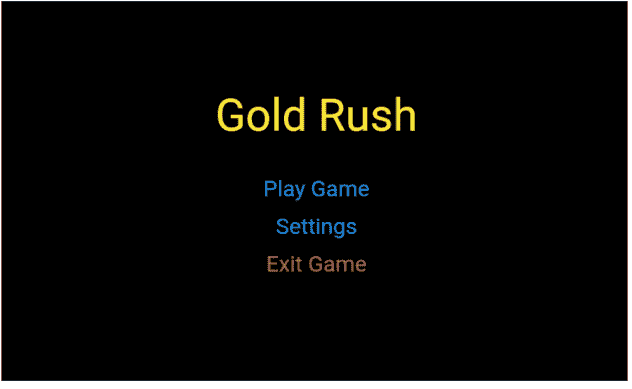
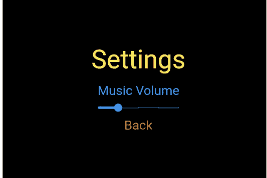
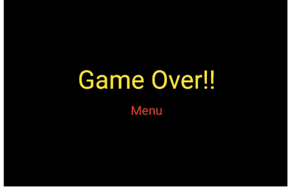
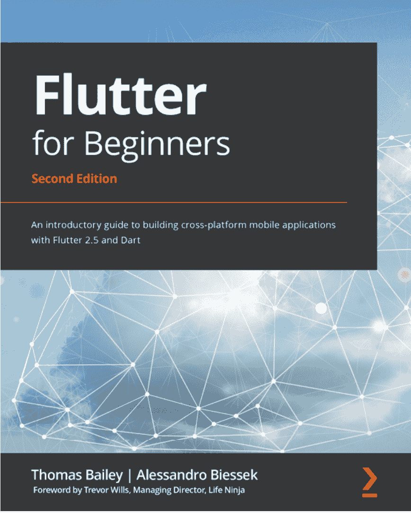

## 第 11 章：完成游戏

游戏看起来很棒，几乎完成了，但我们希望在本章中解决一些悬而未决的问题，以完成它。目前，我们只有主游戏屏幕；然而，游戏通常包含许多屏幕，例如菜单屏幕或设置屏幕。

在本章中，我们将添加更多屏幕，并向您展示如何在它们之间导航。我们将使用标准 Flutter 小部件创建这些屏幕，并向您展示如何将 Flutter 和 Flame 混合使用。具体来说，在我们的设置屏幕中，我们将添加一个控制音乐音量的选项，并持久保存用户的音乐音量偏好，然后在游戏中使用此设置。

在完成游戏代码后，我们将讨论开发游戏时需要考虑的其他一些事项，例如如何从游戏中赚钱，在继续学习游戏开发时还有什么值得学习，以及在开发游戏时遇到困难去哪里寻求帮助。

本章将涵盖以下主题：

- 完成游戏
- 游戏变现
- 我还应该学什么？
- 在哪里寻求帮助？

### 技术要求

要查看本章的源代码，可以从 https://github.com/PacktPublishing/Building-Games-with-Flutter/tree/main/chapter11 下载。

在本章中，我们将保存用户的音乐音量偏好，因此让我们在游戏中添加用于持久保存此值的库：

- 1. 打开 `pubspec.yaml` 文件，添加以下依赖项：

```
shared_preferences: ^2.0.15
```

- 2. 保存文件，并允许 `pub get` 下载此依赖项并验证资产：

```
flutter pub get
```

在下一节中，我们将讨论需要添加到游戏中的最终代码，以完成所有工作，包括游戏屏幕和导航。

### 完成游戏

在本节中，我们将添加三个新屏幕，并在它们之间进行导航。

这些屏幕如下：

- **菜单屏幕**：玩家将看到的第一个屏幕，包含玩游戏、查看设置或退出游戏的选项。
- **设置屏幕**：设置允许我们通过 `Slider` 小部件更改音乐音量，或返回菜单屏幕。
- **游戏结束屏幕**：当玩家的生命值为 0 时，我们将显示此屏幕，并允许他们返回菜单屏幕重新开始游戏。

这三个屏幕将使用标准 Flutter 小部件；我们将使用 Flutter 导航路由在这些屏幕之间导航，并使用我们的游戏小部件来运行游戏。

让我们通过添加每个屏幕来开始吧。

### 添加菜单屏幕

在本节中，我们将添加一个菜单屏幕，以帮助我们在游戏的各个屏幕之间导航，步骤如下：

- 1. 在项目的 `lib` 目录中，创建一个名为 `widgets` 的新文件夹，用于存放我们的新小部件屏幕。
- 2. 在 `widgets` 文件夹中创建三个新文件，分别名为 `screen_menu.dart`、`screen_settings.dart` 和 `screen_gameover.dart`。
- 3. 打开 `screen_menu.dart` 文件，添加以下代码：

```
import 'package:flutter/material.dart';
import 'package:flutter/services.dart';
class MenuScreen extends StatelessWidget {
  const MenuScreen({Key? key}) : super(key: key);
  @override
  Widget build(BuildContext context) {
    return Scaffold(
      backgroundColor: Colors.black,
      body: Center(
        child: Column(
          mainAxisAlignment: MainAxisAlignment.center,
          crossAxisAlignment:
          CrossAxisAlignment.center,
          children: [
            getGameTitle(),
            getGameMenu(context)
          ]
        )
      ),
    );
  }
}
Widget getGameTitle() {}
Widget getGameMenu(BuildContext context) {}
```

在这里，我们添加一个名为 `MenuScreen` 的类，它是 `StatelessWidget`，并设置布局的基本结构，在顶部有一个标题，以及菜单中可以点击的几个菜单项。

- 4. 让我们扩展 `getGameTitle` 函数，以返回标题的 `Text` 小部件：

```
Widget getGameTitle() {
  return Text('Gold Rush', style: TextStyle(color:
  Colors.yellow, fontSize: 64.0));
}
```

- 5. 接下来，我们将扩展 `getGameMenu` 函数，添加 **开始游戏**、**设置** 和 **退出游戏** 菜单选项；它们将是包装在 `GestureDetector` 小部件中的 `Text` 小部件，以便可以点击。

对于前两个选项，我们将使用导航路由移动到新屏幕，并将使用 `SystemNavigator` 函数退出游戏：

```
Widget getGameMenu(BuildContext context) {
  return Padding(
    padding: const EdgeInsets.all(40.0),
    child: Column(children: [
    Padding(
      padding: const EdgeInsets.all(8.0),
      child: GestureDetector(
        onTap: () {
          Navigator.pushNamedAndRemoveUntil(context,
          "/game", (r) => false);
        },
        child: Text('Play Game', style: TextStyle(
            color: Colors.blue, fontSize: 32.0))),
      ),
      Padding(
        padding: const EdgeInsets.all(8.0),
        child: GestureDetector(
          onTap: () {
            Navigator.pushNamedAndRemoveUntil(context,
            "/settings", (r) => false);
          },
          child: Text('Settings', style: TextStyle(
              color: Colors.blue, fontSize: 32.0))),
      ),
      Padding(
        padding: const EdgeInsets.all(8.0),
        child: GestureDetector(
          onTap: () { SystemNavigator.pop(); },
          child: Text('Exit Game', style: TextStyle(
```


color: Colors.red, fontSize: 32.0))),
                ),
            )),
        );
    }
```

Here, we have a simple widget that draws the menu, which is a simple column of menu items in the middle, with a title at the top and an exit option below the menu items. Clicking on these options tells the navigator to change to a different page.

Here, you can see how the menu screen should look:



Figure 11.1 – The game menu screen, allowing you to play the game or view the settings

Next, let's continue for now with the settings screen.

### 添加设置屏幕

In this section, we will add a settings screen to allow us to choose the volume of the background music by following these steps:

- 1. Open the `screen_settings.dart` file and add the code from here: https://github.com/PacktPublishing/Building-Games-with-Flutter/blob/main/chapter11/lib/widgets/screen_settings.dart.

In this code block, we will set up `StatefulWidget` this time, as we want to keep track of the music volume value and persist this for using the `SharedPreferences` library we added earlier in the _Technical requirements_ section.

We store the current music volume in a variable called `musicVolume`. In the `initState` function, we try and read this value from the shared preferences and set it to 25% as a default if this has not been previously set.

Let's continue and build the UI for the settings screen by completing the empty functions.

- 2. Here is the code for the `getSettingsTitle` function:

```
Widget getSettingsTitle() {
  return Padding(
    padding: const EdgeInsets.fromLTRB(0, 0, 0, 20),
    child: Text('Settings', style: TextStyle(color:
      Colors.yellow, fontSize: 64.0)),
  );
}
```

Here, we return a `Text` widget for our title, which is styled in yellow and has a font size of 64.

- 3. The following is the code for the `getMusicVolumeLabel` function:

```
Widget getMusicVolumeLabel() {
  return Text('Music Volume', style: TextStyle(color:
    Colors.blue, fontSize: 32.0));
}
```

Here, we return a `Text` widget for our volume label, which is styled in blue and has a font size of 32.

The following is the code for the `getVolumeSlider` function:

```
Widget getVolumeSlider() {
  return SizedBox(
    width: 250.0,
    child: Slider(
      value: musicVolume,
      min: 0.0,
      max: 100.0,
      label: '${musicVolume.round()}',
      divisions: 4,
      onChanged: (double newMusicVolume) {
        SharedPreferences.getInstance().then((prefs)
          => prefs.setDouble('musicVolume',
          newMusicVolume));
        setState(() => musicVolume = newMusicVolume);
      }),
  );
}
```

Here, we return a Slider widget wrapped around a fixed SizedBox widget that has values for the music volume between 0 and 100. Whenever the slider value is changed, we set the musicVolume value in the widget and save this to the shared preferences.

- 4. The following is the code for the getBackLabel function:

```
Widget getBackLabel() {
  return GestureDetector(
    onTap: () { Navigator.pushNamedAndRemoveUntil(
      context, "/", (r) => false); },
    child: Text('Back', style: TextStyle(color:
      Colors.red, fontSize: 32.0))
  );
}
```

Here, we return a Text label to go back to the main menu and use Navigator to return the player to the top-level route if this is clicked.

The following screenshot shows our settings screen along with a slider to set the music volume:



Figure 11.2 – The Settings screen with the adjustable music volume

Now that the settings screen is complete, let's work on our final screen, which is the game over screen.

### 添加游戏结束屏幕

In this section, we will add a game over screen to let the user know the game has ended. To do this, open the `screen_gameover.dart` file and add the code from here: https://github.com/PacktPublishing/Building-Games-with-Flutter/blob/main/chapter11/lib/widgets/screen_gameover.dart.

In this code block, we show a simple screen to indicate that the game is over and a link to go back to the menu, where the user can play again, change the settings, or quit the game.

Here is the game over screen that is shown when George dies:



Figure 11.3 – The game over screen when George dies

Now that we have our three extra screens, let's tie these together with navigation routes and music volume.

### 使用导航路由和音乐音量编译所有屏幕

In this section, we will tie all the navigation together and also adjust the music volume, based on the settings menu choice. To do this, we will follow these steps:

- 1. Open the main.dart file and import the screens and shared preference library:

```
import 'package:goldrush/widgets/screen_gameover.dart';
import 'package:goldrush/widgets/screen_menu.dart';
import 'package:goldrush/widgets/screen_settings.dart';
import 'package:shared_preferences/shared_preferences.dart';
```

- 2. Let's rewrite the main function to use routes. Replace the existing main function with the following:

```
void main() async {
  WidgetsFlutterBinding.ensureInitialized();
  await Flame.device.fullScreen();
  await Flame.device.setLandscape();
  runApp(
    MaterialApp(
      debugShowCheckedModeBanner: false,
      title: 'Gold Rush',
      initialRoute: '/',
      routes: {
        '/': (context) => MenuScreen(),
        '/settings': (context) => SettingsScreen(),
        '/gameover': (context) => GameOverScreen(),
        '/game': (context) => GameWidget(game: GoldRush()),
      },
    ),
  );
}
```

Here, we set the screen up as full-screen landscape as we did before in Chapter 7, Designing Your Own Levels, but now we have four navigation routes defaulting, with the initial route pointing to the menu screen.

- 3. In the onLoad function of the GoldRush class, let's read the musicVolume value from shared preferences and set up the playback of the music with this value. Note that if the player has not gone into the settings and changed this value, the volume will default to 25%.

Returning to where the background audio is initialized, add the following code:

```
var musicVolume;
await SharedPreferences.getInstance()
  .then((prefs) => prefs.getDouble('musicVolume') ?? 25.0)
  .then((savedMusicVolume) => musicVolume = savedMusicVolume);
```

- 4. Next, change the line that starts playing the music to the following:

```
await FlameAudio.bgm.play('music/music.mp3', volume: (musicVolume / 100));
```

- 5. During the testing of the navigation, a bug was found where the enemies and coins were invisible when playing the game for the first time. This is due to the z-order priority being incorrect, which makes the map draw on top of the sprites. So, let's fix that now by setting the priority higher.

In the same `onLoad` function, change the initialization of the `Skeleton`, like this:

```
var skeleton = Skeleton(player: george, position:
  Vector2(position.x + gameScreenBounds.left,
  position.y + gameScreenBounds.top), size:
  Vector2(32.0, 64.0), speed: 20.0);
children.changePriority(skeleton, 15);
add(skeleton);
```

- 6. Next, update the `Zombie` initialization, like this:

```
var zombie = Zombie(player: george, position:
  Vector2(position.x + gameScreenBounds.left,
  position.y + gameScreenBounds.top), size:
  Vector2(32.0, 64.0), speed: 20.0);
children.changePriority(zombie, 15);
add(zombie);
```

- 7. And finally, for the sprites, update the `Coin` initialization, like this:

```
var coin = Coin(position: Vector2(posCoinX, posCoinY),
  size: Vector2(20, 20));
children.changePriority(coin, 15);
add(coin);
```

- 8. Now that we are done updating the navigation and music playback, let's fix one last thing.

When George's health gets to 0, we want to trigger the navigation to show the game over screen. Open the `george.dart` file and, in the `onCollision` function, change the health check code block to the following:

```
if (health > 0) {
  health -= 25;
  hud.healthText.setHealth(health);
}
if (health == 0) {
  Navigator.pushNamedAndRemoveUntil(gameRef.buildContext, "/gameover", (r) => false);
}
```

This will replace the previous else clause, where we had a to-do action to show the game over screen.

We have now the complete code for the game! If you run the game now, you can see the simple screens and navigate around them, and you can adjust the music volume from off to full volume.

When you have built your own game, it would be great to sell the game, and who knows – you may make the next successful blockbuster game, such as Angry Birds, and become very rich! In the next section, we will discuss exactly that – how to make money from your game.

### 游戏变现

Once you have developed your own game, you may want to try to make some money from the game. There are a few ways to do this, depending on the platforms you wish to support. But in this section, we will focus on the three most common ways so that you can decide what is best for you, as there are pros and cons to each way.

The three main ways to monetize your game are as follows:

- Adverts
- In-app purchases
- Purchase

In the following subsections, we will discuss each of these options.


### 广告

有众多广告提供商，每个都为 Flutter 提供自己的库。移动端推荐使用 Google 自家的 Mobile Ads SDK，Google 为此提供了官方库。这很容易集成，你可以通过在游戏中向玩家展示广告来赚钱。

请注意，过度使用广告会惹恼玩家，因此请尽量考虑用户在游戏中的体验，以便在两者之间取得平衡。

让我们来看看在游戏中使用广告的优缺点：

#### 优点：

- 易于集成。
- 来自持续收入流的重复收入。

#### 缺点：

- 对用户来说可能很烦人。
- 广告带来的收入相当低。

现在，让我们来看看另一种变现选项：应用内购买。

### 应用内购买

应用内购买可以是从游戏中赚钱的好方法。通常，对于这类游戏，你会将其免费提供，然后在游戏中收取小额微支付，这些支付通过 Google Play 或 Apple 的 App Store 进行。你购买的虚拟物品仅存在于该游戏中。例如，在我们的游戏中，你可以购买额外生命值或更好的武器，以换取真实货币。

请注意，一些使用应用内购买的现有游戏以“付费获胜”而闻名，即愿意付费购买游戏中最佳物品的用户可以轻松获胜。这具有争议性，尤其是在多人游戏中，你可以购买游戏中的成功。

从开发者的角度来看，虚拟物品提供了一种有趣的变现方式。这是因为游戏资产是虚拟的，可以多次出售给不同的玩家，并提供可靠的、可重复的收入流。

让我们来看看在游戏中使用应用内购买的优缺点：

#### 优点：

- 你可以将同一虚拟物品出售给许多不同的用户。

#### 缺点：

- 在移动开发者门户中设置可能比较繁琐。
- 如果过度使用，会让用户感到烦躁。

现在我们已经讨论了应用内购买的优缺点，让我们来看看最后一种选项：一次性购买。

### 一次性购买

一次性购买也是变现应用的另一个有效选项。你可以为游戏设定一个固定价格，用户只需支付一次。

请注意，玩家倾向于希望在游戏中看到更新的内容，例如新关卡。因此，如果你仅从固定价格中获利，那么除了更新内容可能带来的新销售外，你将免费维护游戏。

让我们来看看在游戏中使用购买的优缺点。

#### 优点：

- 无需麻烦，你只需设置一次价格。

#### 缺点：

- 没有来自现有客户的重复收入。

如果你想进一步了解变现游戏的方法，请查看 https://flutter.dev/monetization，其中有更详细的说明。

在本节中，我们讨论了变现游戏的方法。在下一节中，我们将讨论还有什么值得学习，以扩展你的游戏开发知识。

### 我还应该学什么？

现在你已经掌握了使用 Flame 进行游戏开发的基础知识，让我们来看看你还可以学习哪些更高级但非常有用的主题，以扩展你的游戏开发知识。

### Forge2d

许多游戏使用高级物理来使游戏更加逼真，例如使用重力来影响精灵的跳跃和下落，或者计算《愤怒的小鸟》中下落的鸟的轨迹。

有一个名为 Forge2d 的非常好的物理引擎可用，它基于著名的 Box2d 引擎，如果你想让游戏更加逼真，值得研究。

你可以在 https://docs.flame-engine.org/1.0.0/forge2d.html 上找到开始所需的一切。

### Nakama

单人游戏可以很有趣，但当你和朋友一起玩时，游戏会上升到一个全新的水平。多人游戏开发是一个从零开始非常复杂的主题，但它是一个值得学习的有用主题，可以大大改善你的游戏。幸运的是，Flutter 有一个好的库来处理构建多人游戏所需的所有复杂内容，并且与 Flame 配合良好。

该库称为 **Nakama**，在 https://heroic-labs.com/docs/nakama/getting-started/ 中讨论，而针对该库的 Flutter 库位于 https://github.com/obrunsmann/flutter_nakama。

Nakama 有许多功能。以下是它可以做的一些事情：

- 不同玩家之间的多人游戏
- 玩家之间的实时聊天
- 用于跟踪谁分数最高的排行榜
- 带有登录的用户账户

Nakama 覆盖了比我们在此讨论的更多多人游戏功能，因此建议你查看他们的网站（https://heroic-labs.com/docs/nakama/getting-started/）以获取更多信息。

### Rive

**Rive** 是一个跨平台动画工具，允许你导出动画并使用特定于每个平台的库进行播放。如果你熟悉旧的 Flash 动画，这很相似。

你可以在 https://rive.app/ 上阅读更多关于 Rive 的信息。针对 Rive 的 Flame 库可以在 https://pub.dev/packages/flame_rive 上找到。

### 我应该做什么游戏？

Flame 适合所有类型的 2D 游戏，所以你可以做任何你喜欢的游戏。困难在于，有些类型的游戏比其他类型更难编码。

如果你计划制作角色扮演游戏，这些游戏非常流行，请注意，这些是非常复杂的游戏，因为它们通常模拟现实世界的机制，并要求你为游戏构建大量内容。

从简单的游戏开始，例如井字棋，然后逐步过渡到推箱子或打破砖块等游戏，再过渡到玛丽奥等平台游戏。

有一篇很棒的文章在 https://gamefromscratch.com/just-starting-out-what-games-should-i-make/，可以给你更多关于做什么游戏以及按什么顺序制作它们的想法。

在下一节中，我们将讨论当你在使用 Flutter/Flame 时卡住了去哪里寻求帮助。

### 去哪里寻求帮助？

在制作游戏的过程中，有时你会卡住。你可能不知道如何实现某个功能，或者 Flame 库或 Flutter SDK 可能存在错误。

我在此整理了一份优秀资源列表，如果你卡住了可以寻求帮助：

- Flame Discord (https://discord.gg/5unKpdQD78)：在这里，你可以向 Flame 开发团队提问，并获得关于如何使用 Flame 的出色建议。

我们特别想感谢 Flame Discord 服务器上的 Spydon、Erick 和 Wolfen，在我编写本书期间他们提供的所有帮助。

- Stack Overflow：监控 Flame Discord 的同样的人也监控 Stack Overflow，你也可以在那里发帖提问。请确保为你的问题添加 #flame 标签。
- Flame 文档：Flame 文档可以在 https://pub.dev/documentation/flame/latest/ 上找到，你可以在 https://github.com/flame-engine/flame/tree/main/examples 和 https://github.com/flame-engine/awesome-flame#articles--tutorials 上找到许多 Flame 的示例和教程。
- Flutter 社区页面：如需更一般的 Flutter 帮助，请查看 https://flutter.dev/community 上的 Flutter 社区页面，你可以在那里找到 Flutter Discord 和 Slack 频道的链接。

在本节中，我们讨论了当你在使用 Flame 或 Flutter 时卡住了去哪里寻求帮助。

### 总结

在本章中，我们学习了如何将游戏小部件与其他 Flutter 小部件混合，并在屏幕之间导航以完成我们的游戏。我们还给了玩家在设置屏幕上更改音乐音量的选项。

我们讨论了变现游戏的选项以及接下来学习什么来改善你的游戏开发知识。最后，我们回顾了如果你在游戏中卡住了去哪里寻求帮助。

本书涵盖了很多内容，你现在拥有了使用 Flutter 和 Flame 构建各种 2D 游戏的知识。祝你的游戏开发之旅好运。我期待看到你创作的游戏。

### 问题


- 1. 我们应该使用什么库来持久化存储简单数据（例如音乐音量）？
- 2. 为游戏变现有哪些选项？
- 3. 用于切换屏幕的 Flutter 类是哪个？
- 4. 通过应用内购买变现的主要好处是什么？

## 您可能还喜欢的其他图书

如果您喜欢这本书，可能对 Packt 的这些其他书籍感兴趣：



### Flutter for Beginners – Second Edition

Thomas Bailey, Alessandro Biessek

ISBN: 978-1-80056-599-9

- 探索 Flutter 框架的核心概念及其在跨平台开发中的应用
- 了解 Dart 编程语言的基础知识
- 使用 Flutter 小部件并学习有状态和无状态小部件的概念
- 使用动画小部件和高级动画技术为应用添加动画
- 掌握完整的开发生命周期，包括测试和调试
- 探索向移动应用商店和 Web 发布应用的流程

### Flutter Cookbook

Over 100 proven techniques and solutions for app development with Flutter 2.2 and Dart

Simone Alessandria | Brian Kayfitz

### Flutter Cookbook

Simone Alessandria, Brian Kayfitz

- 使用 Dart 编程定制您的 Flutter 应用
- 了解如何像 Dart 程序员一样开发和思考
- 利用 Firebase 机器学习功能创建智能应用
- 创建可应用于任何类型应用的可复用架构
- 使用 Web 服务并在本地持久化存储数据
- 在用户看到问题之前对其进行调试和解决
- 使用 Future 和 Stream 进行异步编程
- 使用 Streams 和 BLoC 模式管理应用状态

### Packt is searching for authors like you

如果您有兴趣成为 Packt 的作者，请立即访问 authors.packtpub.com 并申请。我们已与数千名像你一样的开发者和技术专业人士合作，帮助他们将见解分享给全球技术社区。您可以提交通用申请、申请我们正在招募作者的特定热门话题，或提交自己的构思。

### Chapter 1

- 1. Flutter 绘制的最小恒定帧率为每秒 60 帧。
- 2. Flutter 使用的图形引擎是 Skia。
- 3. Flutter 支持 Android、iPhone、Mac、Linux、Windows 和 Web。
- 4. Skia 是一个开源图形引擎，提供用于绘制形状、文本和图像的图形 API。
- 5. Dart 支持即时编译和预先编译。即时编译在调试时提供状态热重载等出色功能，而预先编译在游戏发布时提供高性能。
- 6. 状态热重载允许你修改代码、重新加载，并立即看到变化（这就像用代码作画！）。
- 7. Dart 对短生命周期对象使用快速垃圾回收，使 Dart 能够以每秒 60 帧的速度重建小部件树，从而实现流畅的动画。

### Chapter 2

- 1. `deltaTime` 是帧之间经过的时间。用于确保在处理能力不同的设备上帧率保持恒定。
- 2. Flame 组件系统允许我们为游戏构建灵活的架构，随着游戏规模扩大，这一点至关重要。
- 3. `HitboxRectangle` 用于检测方形或矩形等形状。

### Chapter 3

- 1. 概要对游戏目标进行高层次总结，用于吸引玩家游玩。
- 2. 当敌人攻击 George 时，他的生命值将减少 25%。
- 3. 每收集一枚金币，George 的得分将增加 20 分。
- 4. 水用于定义 George 或敌人无法穿越的边界。

### Chapter 4

- 1. 精灵是可以是静态的也可以是动画的图形或图像资源。
- 2. 函数 `createAnimationByColumn` 或 `createAnimationByRow` 返回精灵动画列表。
- 3. `SpriteAnimationComponent` 减少了我们需要编写的额外代码量，因为动画在设计上已内置于组件中。
- 4. 使用 `to` 和 `from` 参数指定范围，以表示开始和结束的动画帧。
- 5. 基类允许我们设置精灵将共享的通用行为。

### Chapter 5

- 1. HUD 是抬头显示器（Heads-Up Display）。它代表我们想要绘制在游戏之上的用户界面，显示得分和生命值等内容。
- 2. 要检测触摸，我们使用 `Tappable` 混入。
- 3. `TextComponent` 用于在屏幕上绘制文本。
- 4. 摇杆有一个内部控制，需要将其拖动到外部控制以注册摇杆方向的值。

### Chapter 6

- 1. 我们使用 `flame_audio` 库为游戏添加音频。
- 2. 将音频预先加载到内存缓存中可以提高游戏性能，因为我们通常会在游戏中多次播放相同的音效。
- 3. 我们需要清除缓冲区，以防止持有资源并导致内存泄漏，这可能会使游戏崩溃。
- 4. 当游戏进入后台时，我们需要监听暂停事件；当游戏重新获得焦点时，需要监听恢复事件。
- 5. 我们需要存储返回的 `AudioPlayer` 的引用（用于较长的音效），以便在游戏暂停或恢复时控制声音。
- 6. 我们使用传递给 `FlameAudio` 的 `play` 函数的 `volume` 参数。

### Chapter 7

- 1. Tiled 应用程序允许我们创建比游戏物理屏幕大得多的瓦片地图，使用由小瓦片组成的瓦片集来表示草地或水等事物。
- 2. 瓦片地图会复用每个瓦片，这意味着它们占用的内存远少于存储一张大图。
- 3. 瓦片地图数据存储在二维数组中，以表示地图的宽度和高度。
- 4. 我们可以使用瓦片图层来表示瓦片，使用对象图层来表示我们想要绘制在地图之上的对象。
- 5. 为了在精灵移动时调整地图，我们使用相机，并设置 `followComponent` 函数，指定移动时想要聚焦的组件。
- 6. 我们可以将可碰撞对象作为对象图层添加到瓦片地图中，然后通过瓦片地图的 `getObjectGroupFromLayer` 函数读取对象，从这些对象创建组件。
- 7. 可碰撞对象可以是活动、被动或非活动状态。我们使用这些状态来减少可碰撞对象之间的碰撞检查次数，从而帮助提升游戏性能。

### Chapter 8

- 1. Web 浏览器在首次加载时需要启用音频权限，以防止网站用烦人的噪音打扰用户。
- 2. 我们的游戏根据屏幕尺寸设置了初始大小。如果尺寸发生变化，则需要重新计算一切，否则摇杆等内容可能无法正确定位。
- 3. 默认的 `TiledComponent` 不需要位置和大小。但为了修复调整大小时的问题，我们需要能够重新计算这些值。因此，我们将组件包装在 `PositionComponent` 中，以获取位置和大小值。
- 4. 我们可以使用 `canvaskit` 来优先考虑性能，或使用 `html` 来优先考虑下载大小。
- 5. 我们使用 `KeyboardHandler` 混入来监听按键事件。

### Chapter 9

- 1. `lifespan` 和 `count` 是使用粒子时常见的设置属性，分别表示粒子应显示的时长和应显示的数量。
- 2. 粒子会非常快速地创建大量对象并可能占用大量内存，因此一旦粒子不再使用，我们需要释放内存。
- 3. `MovingParticle`、`CircleParticle` 和 `ComputedParticle` 是 Flame 支持的粒子示例。
- 4. Flame 支持用于静态图像的 `PreRenderedLayer` 和用于动画图像的 `DynamicLayer`。
- 5. 我们需要将超类的渲染委托给图层类，以便图层处理器可以生成阴影图像。


### Chapter 10

- 1. 我们可以使用 `distanceTo` 函数来测量两个位置向量之间的距离。

- 2. 我们在《淘金热》中用于路径查找的算法称为 `A*`（`A Star`）。

- 3. 我们可以将 `x` 或 `y` 位置乘以或除以瓦片大小，以在世界坐标和网格坐标之间进行转换。

- 4. 将 `withDiagonal` 设置为 true 可为我们的角色提供更自然的移动，否则角色将以直角移动，看起来像机器人！

- 5. 每次更改方向时，我们都必须匹配正确的动画，否则会出现精灵似乎向后行走等问题。

### Chapter 11

- 1. 要持久化简单数据，我们使用 `shared_preferences` 库。

- 2. 要为游戏变现，我们可以使用广告、应用内购买或固定费用购买。

- 3. `Navigator` 类用于在 Flutter 中更改屏幕。

- 4. 通过应用内购买，您可以将同一数字资产转售给许多人，以获得可重复的收入流。

### 为何订阅？

- 通过来自 4,000 多名行业专家的实用电子书和视频，花更少的时间学习，花更多的时间编码。

- 通过专为您量身定制的技能规划，改善您的学习体验。

- 每月获取一本免费电子书或视频。

- 支持全文搜索，轻松获取重要信息。

- 可复制粘贴、打印和收藏内容。

你知道吗，Packt 为每本出版的图书提供电子书版本，并提供 PDF 和 ePub 文件？您可以在 [packt.com](packt.com) 升级到电子书版本，作为印刷图书客户，您有权享受电子书副本的折扣。如需更多详情，请通过 [customercare@packtpub.com](customercare@packtpub.com) 联系我们。

在 [www.packt.com](www.packt.com)，您还可以阅读一系列免费技术文章，订阅多种免费通讯，并获取 Packt 图书和电子书的独家折扣和优惠。

