## 1 数字孪生简介

数字孪生是一个近年来广受欢迎的概念。许多分析师、供应商和客户都同意，随着其价值的实现和认可，特别是在工业环境中，它有望大规模普及。

本书旨在帮助你构建第一个数字孪生原型或最小可行数字孪生。在开始探讨数字孪生的技术方面之前，了解什么是数字孪生、它是如何诞生的以及数字孪生的商业价值至关重要。此外，数字孪生的理想前景是什么，尤其是如果你刚刚起步？

本章将描述围绕数字孪生的通用概念、特征和原则，而不专注于任何特定的数字孪生技术。在后续章节中，我们将专注于示例数字孪生的技术开发，以演示如何创建你的第一个数字孪生原型。本章旨在为你提供对数字孪生、其特征及其应用方式的共同理解。这种理解将在本书后面部分使用，当你配置第一个数字孪生时。

### 数字孪生的历史

在本节中，我们将探讨数字孪生概念的起源和初衷，由最初的创作者阐述，同时为本书定义数字孪生并识别其关键特征。
数字孪生的初始目标是提供与实物孪生物理拥有所能获得的相同或更好的信息，这与基于“如果场景”预测行为的仿真和建模形成对比。

本章将涵盖以下主要主题：

- 数字孪生的历史
- 数字孪生的行业应用
- 数字孪生的价值主张
- 识别机会

我们将首先简要介绍数字孪生概念的发展历史，重点关注数字孪生的工业应用。这一历史概述将提供一些关于数字孪生初衷的见解，以及最初的思想领袖和创作者在描述第一批数字孪生时心中所想的内容。

随后，我们将定义数字孪生一词，我们将在整本书中将其作为您即将创建的孪生体的指导参考。市场上有各种定义，但我们必须对本书中所指的数字孪生有一个共同的理解。我们将扩展定义，使其包含我们视为必需或可选的一些特征。

我们还将提供一些行业用例示例，以及这些用例如何应用于数字孪生实体的整个生命周期。这些用例将为您提供将数字孪生应用于特定环境或业务的想法。这将进一步深入了解数字孪生针对不同需求的价值主张。最后，我们将提供一些关于在工业环境中识别数字孪生潜在应用的初步指导。

本书的其余部分将重点帮助您构建第一个数字孪生，并从规划您的数字孪生、为您的第一个数字孪生识别合适的候选对象开始，然后提供关于设置、构建、部署和验证数字孪生原型结果的指导。让我们从建立对概念、定义和价值的共同理解开始，以及这一切是如何产生的。

### 数字孪生概念的起源

数字孪生概念最初由密歇根大学的 Michael Grieves 博士于 2002 年 10 月在向制造工程学会的演示中描述。Grieves 最初将其命名为**镜像空间模型（Mirrored Spaces Model，MSM）**，但名称演变，他将“数字孪生”一词归因于 NASA 的 John Vickers，后者与 Grieves 合作开展复杂系统的产品生命周期管理。

Grieves 和 Vickers 观察到，物理产品和资产的技术进步使系统变得更加复杂。新技术还带来了新的功能，例如通信和计算，这些功能无法在物理（机械和电子）空间中表示。这些功能增加了系统的复杂性，并需要一种机制来通过提供关于物理产品或实体的改进信息来缓解系统复杂性：

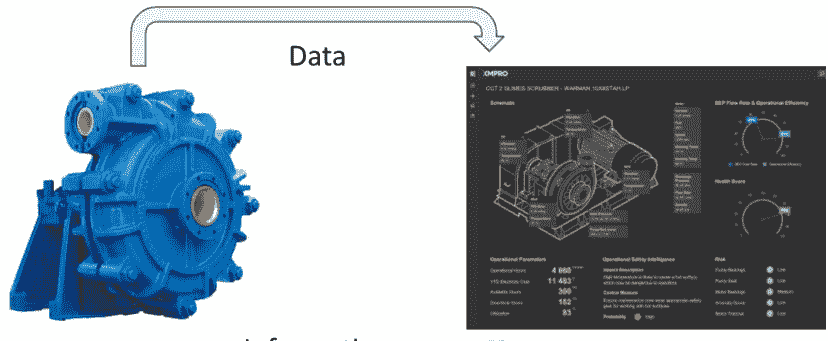

图 1.1 – 物理产品和虚拟产品结合创建数字孪生

MSM 为 Grieves 关于数字孪生如何通过数据流“镜像”物理孪生体的方法提供了一些见解，数据流从物理产品流向数字实例，然后这些信息被交换并发送回物理产品：

> “数字孪生是物理孪生体的信息构造。
> 数字孪生的意图是，它可以提供与实物拥有物理孪生体所能获得的相同或更好的信息。关键假设是，数字孪生中包含的信息的类型、粒度和数量由用例驱动。”

Grieves, Michael. (2019). Virtually Intelligent Product Systems: Digital and Physical Twins. 10.2514/5.9781624105654.0175.0200.

三个关键概念描述了这些早期的数字孪生。**数字孪生原型（Digital Twin Prototype，DTP）**是物理孪生体的“类型”或模型表示。它也被描述为“带有所有变体的设计版本”。例如，离心泵的 DTP 是特定型号泵的单一描述和信息模型。只有一个 DTP 或模型，但多个泵可能使用相同的模型描述。这引出了数字孪生实例的概念。

**数字孪生实例（Digital Twin Instance，DTI）**是基于 DTP 的每个物理实体的每个实例。在离心泵示例中，我们可能有 150 台泵，每台泵可能代表一个唯一的实例，所有这些都基于该特定型号泵的通用 DTP。有可能只有一个实例基于单个模型。建筑是这种配置的典型示例。只有一座建筑（DTI）和一个 DTP 模型。值得注意的是，对 DTP 的任何更改都将要求 DTI 进行更新，以保持实例与原型的保真度。

建筑和其他复杂产品等物理实体通常无法由单个 DTI 描述。它通常更多是不同实例的集合或组合，以构成整体建筑定义。Grieves 和 Vickers 通过引入实例聚合来解决这一挑战。下图说明了从基于物理实体的 DTP 模型的进展，以及它如何作为符合相同数字孪生原型的单个物理实体的 DTIs 进行实例化：

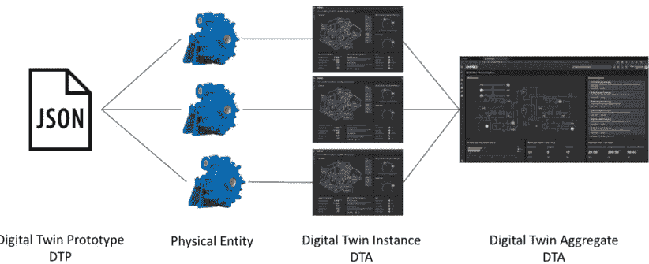

图 1.2 – 数字孪生概念之间的关系

它还展示了如何将多个 DTI 组合以创建数字孪生聚合体，我们将在下一节介绍。

**数字孪生聚合体（Digital Twin Aggregate，DTA）**是 DTI 和其他 DTA 的聚合集合，以及查询它们的机制。DTI 可以独立于其他实例存在，但 DTA 不能。单个离心泵的 DPI 可以独立存在，而一组泵的聚合体依赖于实例集合。DTA 可以提供对聚合体行为的额外洞察，这是在实例级别无法实现的。例如，我们可以监测特定处理区域浆液泵之间的压力差，这将使我们对采矿过程工厂这一部分的整体运营有不同的洞察，而不是我们可以从单个泵的 DTI 中收集的信息。

需要注意的是，DTP 及其相应的 DTI 与**计算机辅助设计（Computer-Aided Drawing，CAD）**文件不同。CAD 文件可以描述组件的物理尺寸，但它缺乏基于 CAD 文件捕获、存储和维护所有组件属性的文件结构。DTP 和 DTI 通常基于 **JavaScript Object Notation（JSON）** 或 **Extensible Markup Language（XML）** 等文件结构来管理数字孪生的扩展元数据。

多年来，基于 Grieves 和 Vickers 的这项初步工作，供应商、分析师和研究组织涌现出许多描述和定义，但它们超出了本书的范围。

2012 年，NASA 将数字孪生描述为一种多物理场、多尺度、概率性、超高保真度的仿真，它基于历史数据、实时传感器数据和物理模型，反映相应孪生体的状态。

### 什么是数字孪生？

有许多供应商和分析师对数字孪生的定义，每个定义都描述了反映作者能力或兴趣的功能。数字孪生联盟（Digital Twin Consortium）的定义提供了一个与供应商和技术无关的定义，从高层次描述了数字孪生的什么、何时、为什么和如何：

> “数字孪生是现实世界实体和进程的虚拟表示，在指定的频率和保真度下同步。”

> 数字孪生可以表示过去和现在，并模拟预测的未来。

> 数字孪生系统通过加速整体理解、最佳决策和有效行动来转变业务。

> 数字孪生由结果驱动，针对用例定制，由集成驱动，建立在数据之上，并在 IT/OT 系统中实施。”

我们为本书提出了一个更具体的数字孪生定义，它与我们将描述的过程相关，以帮助您构建第一个数字孪生。它包含您初始数字孪生所需的必要元素和共同理解：

> “数字孪生是代表实体生命周期的数字模板或模型的同步实例，足以满足一组用例的要求。”

我们的定义涵盖了数字孪生的关键元素，我们将在剩余章节中演示如何创建第一个数字孪生时需要这些元素。它强调了物理实体的原型或模板模型的要求。它认识到可能存在多个实例，代表同一类型的多个资产。它还强调了数字孪生应解决特定业务挑战或用例的要求，并且它们可能处于实体生命周期的任何阶段。

> **重要提示**
> 
> 我们区分实体的生命周期和数字孪生的生命周期。这一区别将在本章后面描述。

实体不仅限于物理资产，我们更倾向于采用 ISO 组织对实体的描述：

> “实体是具有可识别且独立存在的项目，例如，一个人、一个组织、一个设备、一个子系统或一组此类项目。”

国际标准化组织（ISO）24760-1:2011

除了数字孪生的传统物理资产视角之外，这种对实体的描述使我们能够将流程、供应链、组织和政府等的数字孪生纳入其中。它还可用于极端示例，例如应急响应用例中的飓风或丛林大火。我们将在数字孪生的行业应用部分介绍更多示例。

Grieves 和 Vickers 方法的一个关键要素是数字孪生与物理实体同步。这意味着，仅提供模拟且没有来自物理资产输入的数字模型不符合数字孪生的定义。它可以用于开始创建数字孪生的过程，因为它可能代表 DTP 或 DTA，但需要实例和数据同步才能符合数字孪生的定义。此类数字模型的示例包括 2D 和 3D CAD 设计图纸、建筑信息管理（BIM）模型、规划模拟模型以及基于设计参数的 AR 可视化。

### 实体生命周期与数字孪生开发生命周期

物理实体、产品和资产都有生命周期，从规划和设计到制造或建设、运营、维护，最后是退役或处置。资产生命周期代表物理孪生的开发和使用阶段。孪生的数字版本是一种基于软件的数字化，包括模型、数据、连接性、分析和操作。孪生的数字版本需要软件工程方法，而物理孪生则基于产品生命周期管理（PLM）等工程管理实践。

需要注意的是，我们区分资产生命周期/物理孪生与数字孪生开发生命周期，如下图所示。在本书中，我们将始终提及这两个生命周期，因此牢记这一区分非常重要：

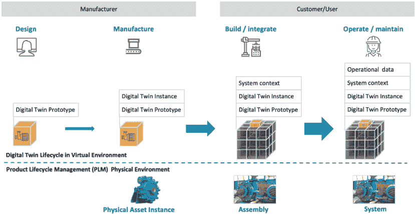

图 1.3 – 数字孪生与产品生命周期关系

开发数字孪生既需要传统工程，也需要软件开发实践，以便两者协同工作。**运营技术（OT）**与**信息技术（IT）**的这种融合对数字孪生是一种积极的发展，因为它创造了对物理和数字要求的共同理解。

本书的目的不是为物理孪生提供 PLM 指导。数字开发生命周期将在后续章节中介绍，因为我们将构建第一个 DTP。此外，本书的目的也不是为组织应遵循的数字开发方法论提供指导。

我们偏好采用基于敏捷的方法来开发本书中的初始最小可行数字孪生，但如果您更熟悉这些方法论，也可以使用其他软件工程方法，例如 V 模型和瀑布模型。V 模型方法在航空和军事领域用于设计和制造复杂系统时很受欢迎，但这超出了本书的范围。

### 数字孪生的类型

我们在此描述的数字孪生类型并非数字孪生的完整分类法或正式分类系统，但这将突出显示不同的用例具有不同类型的数字孪生。

### 离散与复合

数字孪生的范围和规模将根据其所解决的用例或问题而有所不同。选择第一个数字孪生时的一个关键考量是您的用例所需的复杂程度。更复杂的数字孪生通常是通过组装不同的离散或独立数字孪生来构建的：

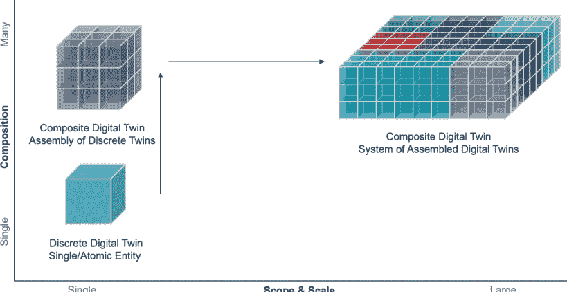

前面的图示展示了离散数字孪生与复合数字孪生之间的关系。

离散数字孪生是满足特定用例要求所需的最低抽象级别。它通常是一个单一或原子实体，将其分解为组件或部件不会增加任何价值，例如采矿球磨机的齿轮箱或电机。它不需要分解为其组件部分，因为其状态和监控过程在此实体级别进行报告。

### 1.2 数字孪生简介

复合数字孪生是多个离散数字孪生的组合，代表由多个单独组件或部件构成的实体。复合数字孪生可以是装配孪生，例如采矿球磨机，也可以是系统孪生，由多个装配孪生组成，例如加工和精炼厂。复合数字孪生是一个系统的系统，具有更复杂的生命周期管理挑战。

离散数字孪生通常是一个独立的组件或资产，可以自行运行以解决特定用例。电驱动离心泵及其电驱动是离散数字孪生的典型示例，因为监控和报告在此级别进行。离散泵数字孪生用例的示例将是基于预测分析模型预测泵故障。

复合数字孪生是多个离散数字孪生的组装，以创建新的功能性复合资产。将多个离散泵数字孪生与离散高压釜数字孪生相结合，创建了一个金加工厂的复合数字孪生，用于生产优化。

复合工厂数字孪生的预测性维护用例示例比离散泵数字孪生的预测性维护用例更广泛，尽管泵在工厂用例中被使用。

我们将在本书中设计和开发的 DTP 将遵循离散数字孪生模式。泵与金回收厂之间的差异导致了我们需要为数字孪生确定的第二种分类。

### 产品与设施

基于物理实体的工业数字孪生广泛应用于两个突出的用例。第一个是代表制造产品（如泵、电动机、手钻、X 射线机、汽车或任何其他基于资产的实体）的数字孪生。数字孪生的主要目标是监控此特定实体的使用，这可能包括故障或非最优运行的迹象。

第二种工业数字孪生用例围绕制造或生产设施，这些设施通常由单个资产的组合组成。数字孪生用于提供对设施运营的洞察。设施数字孪生将由独特产品孪生的组装组成。

离散产品数字孪生可以在复合设施数字孪生中以两种不同的方式使用；例如，当产品是设施的一部分时，如装配线上的机械臂。

第二种用例是数字孪生是制造产品的一部分，例如制造设施中的电动机、喷气发动机或风力涡轮机。

例如，智能制造用例使用产品和设施数字孪生的组合。产品数字孪生用于制造线上，以确定机器设置、工装和零件要求。

产品数字孪生目前主要用于制造场景，制造商对产品出货后的使用情况没有可见性。随着数字孪生采用率的提高，这种情况可能会发生变化。

产品制造商渴望将对产品数字孪生的访问扩展到制造点之外。制造商提供数字孪生解决方案，使他们能够收集运营和使用数据，这些数据将用于产品改进和新的基于服务的产品。

数字孪生可以提供关于产品如何被使用的洞察，这些洞察可以反馈到产品的设计中以进行改进。这些洞察将使制造商能够开发和制造更适合用途且质量更高的产品。

许多制造商的真正机会在于不仅提供产品，还提供围绕产品的维护服务。访问运行中产品的数字孪生将提供必要的洞察，以预测故障可能发生的时间，或产品何时需要维护或更换。这为许多制造商开辟了新的商业模式和新的收入来源，而没有数字孪生技术这是不可能的。

### 模拟与运营

在产品或资产生命周期的早期阶段，数字孪生用例更侧重于模拟场景。相比之下，产品生命周期后期阶段的用例更侧重于运营和维护挑战。

我们可以将数字孪生大致分为仿真孪生和运营孪生。这并不意味着仿真不能用于运营，但其主要应用是管理运营。在设计阶段，主要用例是模拟不同场景，以确定产品或设施的理想设计：

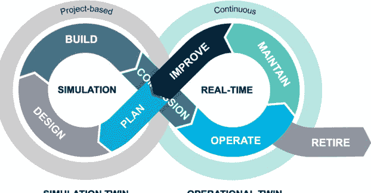

图 1.5 – 仿真和运营数字孪生类型

仿真通常更偏向于基于项目，而运营用例则在实体的运营和维护生命周期中持续进行。无限循环模型最能描述这一点，如上图所示。计划、设计、构建和调试阶段通常是数字孪生的基于项目的仿真，其同步或孪生速率非常慢。

运行、维护和改进阶段是数字孪生的连续且通常是实时的应用。改进阶段的建议可能要求我们对产品进行修改，从而导致回到规划和基于项目的设计制造周期。需要注意的是，这不是分类的合格标准，而是使用工业数字孪生时的典型模式。

### 分析与基于物理的对比

代表实体的数字模型可以基于分析和基于物理的算法。这些算法可以使用历史数据和实时数据，以实现对当前和未来状态或行为的仿真和预测：

- **基于分析的**算法是统计或数学技术，用于基于历史数据预测实体行为。这些模型最常基于 AI 或机器学习技术。使用回归模型预测离心泵等设备的剩余使用寿命是基于分析的应用示例。

- **基于物理的**算法基于物理定律，使用工程状态方程和材料属性，以提供对产品当前或预测状态的洞察。**计算流体动力学**（CFD）可以使用设计参数或实时数据，提供离心泵在特定条件下的行为洞察。有限元分析是基于物理的算法的另一个示例，用于提供产品在模拟或实时条件下的结构完整性洞察。

仿真孪生和运营孪生都可以同时使用基于分析和基于物理的模型，用于仿真或运营分析及预测。

### 数字孪生的特征

本书中描述的特征侧重于开发第一个 DTP 时所需的关键要素。在其他更复杂的用例中可能还有其他特征，但这些特征为数字孪生评估提供了很好的起点：

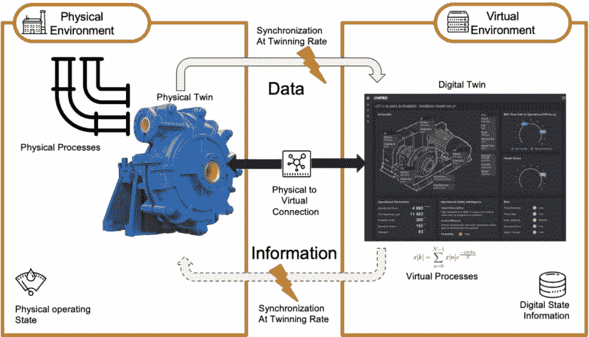

图 1.6 – 数字孪生特征

上图提供了数字孪生特征的可视化表示，这些特征基于数字孪生定义：

| 特征 | 描述 |
| --- | --- |
| 物理实体（物理孪生） | “实体是具有可辨别独立存在的项目，例如，一个人、一个组织、一个设备、一个子系统或一组此类项目” ISO/IEC 24760-1:2011 |
| 物理环境 | 物理孪生所处的现实世界环境（工厂、石油平台、医院、自然保护区等） |
| 虚拟实体（虚拟孪生） | 与物理实体以孪生速率同步的虚拟数字孪生原型（DTP）和实例 |
| 虚拟环境 | 虚拟孪生所处的基于技术的环境 |
| 同步（孪生） | 同步或更新物理孪生和虚拟孪生的状态 |
| 孪生速率 | 同步发生的速率或频率 |
| 状态 | 物理孪生和虚拟孪生在其环境中所有参数的值 |
| 物理到虚拟连接（双向） | 用于建立在规定孪生速率下同步状态的通信和数据连接或过程 |
| 物理过程 | 现实世界环境中会改变或影响物理孪生状态的过程 |
| 虚拟过程 | 虚拟环境中（例如分析或基于物理的计算）会改变或影响虚拟孪生状态的过程 |

图 1.7 – 关键特征

数字孪生保真度不一定是一种特征，而更多是模型复杂度和孪生速率的结果。随着虚拟环境中的计算能力继续按照摩尔定律呈指数级扩展，我们看到数字孪生保真度在不断提高。

计量学也是孪生的基本要求，因为它涉及准确测量状态参数。它不是一种特征，但对于确保物理状态的准确表示至关重要。

随着我们在本书中开始构建第一个 DTP，我们将继续引用这些特征。在选择理想候选者时，以这种表格格式记录数字孪生的具体方面很有用。它将提供一个初步测试，帮助确定特定用例或场景是否符合数字孪生的资格。

### 模型和数据

虚拟孪生以数字化格式存在于虚拟环境中，并依赖于不同的数据源和模型，将数据转化为信息。有多种数据源和模型提供虚拟孪生数据功能。在本书中，我们将它们简化为六个主要类别：

1. **时间或时间序列数据**：此数据通过传感器、自动化和控制以及 IoT 系统，提供物理状态数据的时间戳、实时同步。它存储并从时间序列数据库、历史数据库和 IoT 平台访问。

2. **主数据**：主数据通常是存储在系统中变化缓慢的上下文数据。它用于描述资产或实体，例如**企业资产管理系统（EAM）**和**企业资源管理系统（ERP）**，以及 Azure 数字孪生等数字孪生服务。

3. **事务数据**：运营和事务数据，例如生产记录、维护记录、供应链信息以及与数字孪生相关的其他业务记录，通常存储在 ERP、**计算机化维护管理系统（CMMS）**、**制造执行系统（MES）**、**业务流程管理（BPM）**和生产系统中。

4. **基于物理的模型**：基于物理的计算和工程计算使用实时、事务和主数据来描述或预测物理实体的状态。示例包括**有限元方法（FEM）**和**计算流体动力学（CFD）**，以及其他自然定律，例如热力学定律。

5. **分析模型**：这些是虚拟环境中的数学和统计模型，使用先前描述的相同数据源来预测物理孪生及其环境的当前和未来状态。这包括用于预测性维护和运营用例的 AI 和机器学习。

6. **可视化模型**：这些是数字化可视化建模功能，例如**计算机辅助设计（CAD）**、**增强现实（AR）**、**虚拟现实（VR）**、**建筑信息模型（BIM）**、**地理信息系统（GIS）**和地球物理模型。这些模型通常用于降低系统复杂性，并对不同数据源提供可视化分析。

所有这些不同数据源的异构性导致集成在创建数字孪生时仍然是一个重大挑战。当我们在本书的技术章节中开始构建 DTP 时，将引用这一点。集成和互操作性可能会消耗数字孪生项目的大部分资源。了解数据要求，以及将需要哪些物理和分析模型来解决数字孪生旨在解决的特定业务问题，至关重要。

### 数字线程

**数字线程**是一个与数字孪生同时流行起来的术语。它有时与数字孪生混淆或关联。数字线程可以在没有正式数字孪生的情况下存在，但数字孪生是建立在数字线程信息之上的。

数字线程源自 PLM，后者捕捉了物理产品从设计到制造的过程。数字线程为每个复合实体或产品组件及其所有组件创建带有实际数据的可追溯唯一出生记录。它在整个生命周期中捕捉其所有交互和事务，直到退役。它将生命周期记录扩展到 PLM 关注点之外，涵盖运营、维护和处置。

数字孪生关注生命周期阶段，以解决特定用例，而数字线程是跨所有生命周期阶段的数据聚合器。数字线程提供关于组件设计迭代、制造过程、测试和质量措施的可追溯性。它通常包括环境元数据，例如特定组件的制造商信息、存储温度和湿度。数字线程还可能包括组件之间关系的信息，包括**物料清单（BOM）**结构和维护记录。

一些数字孪生可能超出单个阶段或融合阶段，例如运行和维护，但不太可能跨越整个生命周期。数字孪生组件（如模型、分析和实时传感器数据）可能会被重用，但通常没有单个数字孪生跨越所有资产生命周期阶段。

数字线程集成来自多个设计、制造和运营数据源的数据。它们可能不会复制 CAD、MES、EAM 和 ERP 系统中的信息，但它们会维护对源数据的引用，以实现产品和组件的“从出生记录到死亡证明”。

飞机机队的数字孪生体，例如，可用于对单架飞机的维护进行优先级排序，其中飞机的数字线程将在发生部件故障时协助进行**失效模式与影响分析（FMEA）**和**根本原因分析（RCA）**。它可以提供关于部件设计、制造和维护的洞察。数字孪生体还可以帮助识别可能具有相同故障部件的飞机：

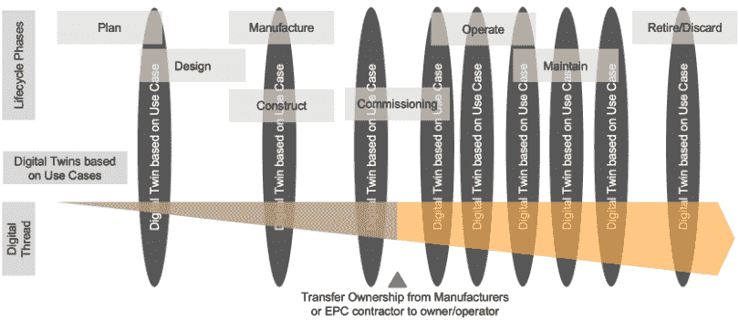

图 1.8 – 数字孪生体与数字线程

前面的图表展示了数字线程在实体整个生命周期中的发展，其中数字孪生体的用例解决了一个或可能两个生命周期阶段内的特定挑战。这在实践中如何使用将在下一节中解释。

### 行业中的数字孪生体应用

在本书中，你将学习如何创建你的第一个工业数字孪生体。不过，在开始之前，了解对数字孪生体价值感兴趣的关键利益相关者是谁，以及不同行业中的一些高级应用，是至关重要的。

### 数字孪生体利益相关者

让我们区分在工业应用中使用数字孪生体时的两种不同高级场景。第一种场景是被孪生的资产是最终用户使用的独立产品。特定型号的**电动汽车（EV）**，例如特斯拉 Model 3，可能是该产品，而消费者是最终用户。车辆制造商将是**原始设备制造商（OEM）**。

第二种场景是制造资产，例如生产电动汽车的智能工厂。数字孪生体是工厂本身，并在智能工厂的生命周期阶段中具有不同的用例和应用。该生产设施也可能是金矿、石油平台、电力分配微电网或核电站。

对于这种场景，利益相关者包括业主/运营商，他们委托**工程、采购、建设和制造（EPCM）**承包商来设计和建造这些生产设施。OEM 为设施提供设备，运营和维护服务提供商通常被业主/运营商用来代表他们运营和维护这些设施。

传统上，OEM 在其产品离开工厂后无法访问其产品和使用数据，但 OEM 越来越多地将其产品数字孪生体与实物资产相结合，并在此过程中旨在获取实时使用数据。我们开始看到 OEM 数字孪生体的影响力超出其自身工厂的边界。

数字孪生体服务提供商旨在将其能力扩展到产品和设施数字孪生体的整个生命周期。这包括连接、计算、存储、集成、建模、分析、可视化和工作流。

下图显示了资产生命周期阶段中利益相关者的典型角色：

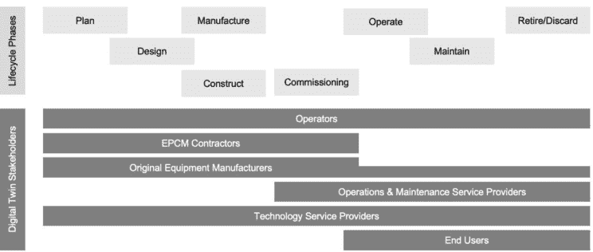

图 1.9 – 实体生命周期中的关键利益相关者

所有这些利益相关者在产品或设施生命周期的某个阶段都对数字孪生体有切身利益。随着数字孪生体用例开始跨越多个阶段的多个利益相关者，利益相关者之间的信息或数字孪生体共享会增加。这显著提高了数字孪生体的商业价值，但也增加了复杂性并导致互操作性挑战。其中一些挑战将在本书后面部分进行解决。

### 工业数字孪生体应用

数字孪生体贯穿资产和产品的整个生命周期，正如我们在本章前面所见。让我们看看不同行业中几个工业数字孪生体用例的示例。这并非详尽无遗的列表，但它确实提供了示例，突出了数字孪生体可以解决的一些挑战。这可以帮助你决定作为原型构建哪种类型的数字孪生体。

### 离散制造

- 在运行期间实时优化**整体设备效率（OEE）**。
- 在运行期间进行预测性质量改进，以减少废品率和返工。
- 利用运行和维护数据的洞察来增强产品设计。

### 流程制造

- 实时管理基于批次的流程以实现“黄金批次”，从而提高产品质量和流程优化。
- 基于实时运行数据和基于历史故障数据构建的模型，使用机器学习模型预测设备故障。
- 在运行期间监控分类设备对安全和法规要求的实时合规性。

### 能源（电力）

- 通过运营规划数字孪生体中的动态机器学习模型，预测每个消费者的能源需求。
- 利用基于实时数据输入的仿真模型，改进**分布式能源资源（DERs）**的电网分配和管理。

### 石油和天然气

- 执行实时有限元法（FEM）分析，根据天气和海洋数据确定离岸石油平台的结构完整性。
- 使用钻探和勘探数据更新地下储层模型，以支持投资决策。
- 实时监控旋转设备（如泵和压缩机），以提高设备可用性和资产性能。这包括基于状态的维护和预测性维护。

### 采矿和冶金

- 在运行期间（如金回收或煤炭洗选）改善矿物加工厂的回收率。
- 实时监控矿山尾矿和其他环境废弃物，并根据专家业务规则提供建议。
- 基于实时工艺参数和冶金（物理）模型，为高炉操作员提供实时浇铸指导。

### 汽车

- 车辆的数字孪生体向制造商提供反馈，其中包含用于设计改进的使用数据。
- 汽车数字孪生体中的实时遥测使制造商及其服务代理能够基于状态监测和预测分析提供维护服务。
- 自动驾驶汽车的数字孪生体为服务提供商（如拼车运营商）开辟了新的商业模式。

### 生命科学和医疗

- 通过端到端供应链的实时数字孪生体，降低关键库存和物流挑战的风险。
- 通过实时状态监测和故障预测，减少昂贵的**高效液相色谱（HPLC）**系统的停机时间。
- 患者的数字孪生体提供整体视图，以改善医疗治疗的质量和疗效（尽管这目前受到隐私和安全问题的挑战）。

### 基础设施

- 通过更新设计数字孪生体中的尺寸和结构数据，实现场外和场内预制，直至在建设和交付阶段进行增材制造。
- 在自然灾害和恶劣天气事件期间提供实时洞察和态势感知。
- 提供零售基础设施（如购物中心和购物广场）中人流量的实时洞察。

### 航空航天

- 追踪与溯源数字孪生体提供航空航天制造中实时材料和供应链管理的洞察。
- 飞机起落架的预测性数字孪生体延长部件寿命并降低维护成本。
- 具有实时飞机移动功能的机场数字孪生体改善机位利用率和周转时间，从而增加收入。

### 国防

- 通过状态监测和预测性维护数字孪生体，提高复杂军事设备的可靠性和可维护性。
- 基于实时态势数据的战略作战数字孪生体为战术指挥和领导提供规划场景。
- 空间数字孪生体具有一个单一的动态数据集，以足够的分辨率表示物理世界，并作为所有需要任务数据的系统的参考点。

### 其他

数字孪生概念越来越多地用于对不太具体的实体进行建模和管理。
其中包括以下内容：

- 地球数字孪生
- 组织数字孪生
- 丛林大火数字孪生

这些不同的示例展示了数字孪生应用的多样化范围。还有许多未列入此列表的应用。潜在应用的范围仅受那些正在积极构建这些数字孪生的人的想象力所限制。

所有这些示例的关键要素在于，它们对物理孪生或实体的利益相关者具有清晰且可衡量的价值。

### 数字孪生的价值主张

数字孪生系统通过加速整体理解、最优决策和有效行动来改变企业。

### 降低复杂性以改善理解

Grieves 和 Vickers 的最初目标是管理日益复杂的资产和系统，使用更简单但具有代表性的虚拟实例。与物理实体同步的数字孪生提供针对您正在解决的特定问题的情境意识和其他运营洞察。

对实时和模拟行为的更好洞察支持更快地做出更好的决策。数字孪生的洞察通常比在多个企业系统中搜索数据的传统方法更可靠。数字孪生的整合数据集成方法提供更可靠、更全面的洞察，从而提高基于该数据做出的决策质量。数字孪生的结构化信息方法也更适合于决策自动化，而不仅仅是决策支持。

拥有这种改进的理解和更好的洞察在两个关键运营视角中提供价值。我们将在以下小节中探讨这些视角。

### 改善情境意识

企业越来越被迫实时或近实时地工作。每天，公司都会面临越来越多的内部和外部事件，需要实时响应。这些事件可能来自多种来源：

- 企业中人员的行为
- 竞争对手、客户、立法者或供应商及供应链的行为
- 设备故障、流程故障和天气事件
- 来自业务应用程序的实时情报，以及来自 Web 服务的近实时数据
- 最近，来自 IoT 的信息涌入，包括基于传感器或智能设备的机载数据在 IoT 平台中

实时情境意识是一个来自美国空军的概念，用于训练战斗机飞行员预判敌方战斗机的行为。它基于收集当前状态和环境的信息，确定信息的含义，并预测未来状态以创建相应的行动。在军事术语中，它被描述为 **Observe – Orient – Decide – Act (OODA)** 循环。

数字孪生可能不需要像军用喷气式战斗机那样的毫秒级响应时间，但代表物理资产的数字孪生的实时同步提供了推动关键决策的关键情境意识。决策的支持信息可以通过预测模型、物理学和/或分析数据进行增强，以向操作员提供全面的决策支持。将规则与决策信息相结合，为数字孪生提供了通过决策自动化变得具有规定性并采取自主行动的机会。

决策支持和决策自动化都专注于基于通过数字孪生获得的情境意识，提供更好的业务成果。

### 改善业务成果

数字孪生以各种方式改善业务成果，但我们将重点关注代表物理资产或实体（例如电机驱动、生产工厂或工厂）的工业数字孪生的影响。

数字孪生的业务影响可以根据四个主要影响类别进行衡量，如下表所示：

| 类别 | 影响 |
|---|---|
| 增加收入 | • 提高生产率 • 增加机器正常运行时间 • 货币化数字信息和服务（商业模式创新） |
| 降低成本 | • 减少机器或设备故障 • 优化库存和更好的供应链管理 • 减少返工和提高质量 |
| 改善客户和员工体验 | • 向客户和业务用户提供实时情境意识 • 通过模拟、分析增强和虚拟现实以及嵌入数字孪生的业务规则提供决策支持 • 提供资产及其运行环境的整体或 360 度可视化 |
| 改善合规性并降低风险 | • 监控健康、安全和环境的实时合规性 • 提高资产运行使用和维护的透明度，特别是针对压力容器和压力释放阀等分类设备。（保险和资产完整性检验服务） • 为业务 KPI 和平衡计分卡自动化运营卓越的合规性。 |

图 1.10 – 数字孪生的业务影响

每个类别都代表一个业务价值驱动因素，数字孪生可以作为杠杆来影响整体业务成果。

### 变革性价值

数字孪生在工业应用中的变革性价值主要关注对数字业务转型的影响，以及基于数字孪生转型开发新产品或改进产品。

### 通过数字化转型实现业务转型

数字孪生是正式数字化转型的变革推动者。数字孪生通常围绕业务目标代表特定的举措或用例。由于数字孪生的数字化特性，特定的用例或举措通常是推动特定数字化转型以实现业务目标或成果的项目：

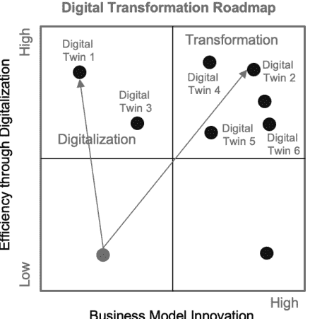

图 1.11 – 数字化转型与数字化

数字孪生可以通过数字化提高效率或通过实现新的商业模式来增加价值，从而影响业务转型。前面图表中的四个象限展示了不同数字孪生举措的影响，这些举措通过数字化和实时数据改善业务流程效率。或者，它可以利用实时数据来改变组织的运营商业模式。右上象限代表机会，企业可以例如基于设备（如支持合同和耗材补充）销售新服务，这些服务基于其产品和客户的实时数据。

许多组织从提高效率的数字化项目开始。随着使用数字孪生的成熟度提高，他们会转向右上象限，寻找货币化这些新数字资产的方法。

### 新产品或改进产品

货币化这些新数字资产有不同的方式，包括向操作员和用户销售运营和维护情报。设备制造商还可以利用这些信息，根据从实时数据收集的条件或预测提供持续服务。

**原始设备制造商 (OEMs)** 还可以利用其设备在现场的使用和性能信息，提供反馈以帮助改进其产品和服务的设计。工业环境中资产的实际使用为设计数字孪生提供了丰富的信息，这些数字孪生现在可以利用这些信息进行更好的模拟，特别是在基于物理的模型中。

### 潜在价值

世界经济论坛的潜在价值框架提供了一种替代视角，用于评估基于数字孪生等技术方法的数字化转型的影响。

“潜在价值”框架从行业或企业的经济学以及对社会的影响方面评估价值。它具有简单的表现形式，尤其是在向业务高管和其他利益相关者传达价值时，他们对数字孪生的技术方面兴趣有限，但需要做出投资数字孪生技术的决策。

数字价值对行业而言基于两个要素：

- 价值迁移，代表收入如何在竞争对手、客户和其他行业参与者等利益相关者之间转移。这与本章前面描述的商业模式创新机会相一致。
- 价值增加，代表常规业务运营机会，例如增加收入和降低成本。

The digital value to society focuses on three impact points:

- The traditional economic measures for customers and employees in terms of cost, time saving, and efficiency improvements.
- The societal impact in terms of job creation, new skills development, reduced traffic congestion, and safer working environments.
- The environmental impact can be described by reducing CO₂ emissions or improving the management of tailings in mining:

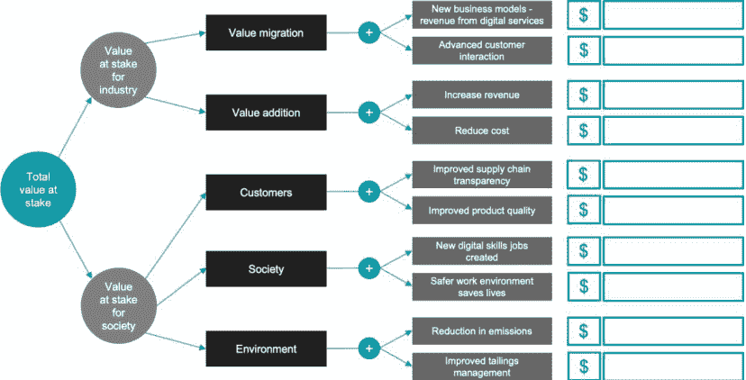

Figure 1.12 – Example of a value at stake analysis for a Digital Twin

> Note
> The preceding diagram has been adapted from https://reports.weforum.org/digital-transformation/introducing-value-at-stake-a-new-analytical-tool-for-understanding-digitalization/.

The single-page view of the value at stake for a Digital Twin, shown in the preceding diagram, provides a simple yet powerful way to describe a Digital Twin’s value proposition.

Now that we can describe the value of a Digital Twin, the next key step is identifying ideal candidates for Digital Twins in your business.

### Identifying opportunities

Digital Twins focus on addressing specific business challenges or exploiting new opportunities, as we saw in the value at stake description of Digital Twin applications. These challenges and opportunities provide guidance for identifying opportunities for Digital Twins in industrial applications. This will be covered in more detail in _Chapter 4, Getting Started with Our First Digital Twin_.

The remainder of this book will focus on selecting and building your first Digital Twin, but let’s provide a summary of the high-level guiding principles that can be used to identify a potential pilot from a pool of candidates.

For Digital Twins that focus on improving asset performance, reducing downtime, and increasing production or throughput, the ideal starting point is to identify current "bad actors." This approach is based on using current failure data, production loss information, or failure mode analysis on previous downtime incidents. Applying the 80/20 Pareto principle will help you identify the initial shortlist of entities that cause the bulk of the downtime.

> **Important Note**
> The Pareto principle states that for many outcomes, roughly 80% of consequences come from 20% of the causes (the "vital few"). Other names for this principle are the 80/20 rule, the law of the vital few, and the principle of factor sparsity: `https://bit.ly/DTPareto8020`.

Digital Twins that focus on exploiting new revenue opportunities are generally more strategic and have well-described business cases. The technical feasibility of these opportunities is typically also a factor when designing the new service. Real-time data access, sensor information, and other functions of the Digital Twin are built from the start.

The next step for both scenarios is to rank the business impact against the Digital Twin’s technical feasibility. Technical feasibility is generally a factor of infrastructure, connectivity, data access, appetite for change, and organizational maturity.

It is a high-level ranking that can easily be done in Excel, and a template is available at https://bit.ly/DTPriority:

### XMPRO Business Value Assessment

| # | Use Case/Scenario | Safety | Downtime | Throughput | Quality | Cost | Economic Value/year | Automation | IT Systems | Analytics | Environment | Project |
|---|---|---|---|---|---|---|---|---|---|---|---|---|
| 1 | Use Case 1 | Medium | High | High | High | High | > $10m | High | High | Medium | High | High |
| 2 | Use Case 2 | Low | Low | Medium | customer satisf | High | > $10m | High | High | Low | High | High |
| 3 | Use Case 3 | Low | Low | Low | Low | Low | > $1m | High | High | Low | High | High |
| 4 | Use Case 4 | Low | Low | Low | Low | Low | > $1m | High | High | Low | High | High |
| 5 | Use Case 5 | Low | Medium | High | Low | Medium | > $10m | Medium | High | Low | High | High |
| 6 | Use Case 6 | Medium | Medium | Medium | Medium | Medium | > $1m | High | High | High | High | High |
| 7 | Use Case 7 | Low | Medium | Medium | Medium | Low | > $1m | High | High | High | High | High |
| 8 | Use Case 8 | Medium | Medium | Medium | Medium | Medium | > $10m | High | High | High | High | High |
| 9 | Use Case 9 | Medium | High | High | High | High | > $1m | High | High | High | High | High |
| 10 | Use Case 10 | High | Medium | Low | High | Low | > $1m | Medium | Medium | Medium | High | High |

Figure 1.13 – Business impact and technical feasibility assessment

In this example, the following technical assessment criteria are being used:

- OT complexity
- IT complexity
- Analytics
- System complexity
- Project readiness

The technical assessment criteria can be adjusted to fit the business’s requirements, but for this example, the criteria are for a typical industrial installation:

### Digital Twin Prioritization

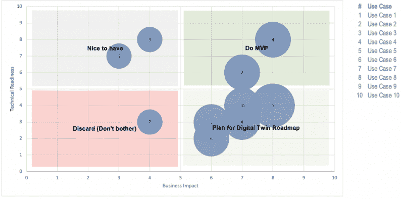

Figure 1.14 – Digital Twin prioritization matrix

### Summary

In this chapter, we started by taking a brief look at the history of Digital Twins and the original intent behind the concept. We discussed the difference between discrete and composite Digital Twins, and then we identified the elements required for something to qualify as a Digital Twin. We introduced several typical use cases across the life cycle of a Digital Twin, discussed the difference between a Digital Twin and a Digital Thread, and provided guidance on describing the value proposition of a Digital Twin. Our Digital Twin prioritization matrix provides a framework to perform a high-level assessment of the use cases for your first DTP.

You now have an understanding of what a Digital Twin is, its key characteristics, the value of a Digital Twin, and assessing where a Digital Twin may apply in your business.

The remaining chapters will guide you through building your first Digital Twin, beginning with planning your Digital Twin, identifying the right candidate for your first Digital Twin, and then providing guidance on setting up, building, deploying, and validating the outcomes of your DTP.

This order of magnitude is visually represented in a bubble chart, with the business impact and technical readiness scores as the two significant measures. The weighted average values of each of these measures are placed on the graph, which is divided into four quadrants. The value of the economic impact determines the size of the bubble. The four quadrants represent the business readiness for each of the Digital Twin scenarios. The **Do Minimum Viable Product (MVP)** quadrant represents a high business impact and a high level of technical readiness.

The opportunities on the quadrant’s far right-hand side, with the biggest bubble size, often represent Digital Twin projects with the highest likelihood of success for all stakeholders.

This is a very simple approach to ranking possible candidates for your first Digital Twin; the next chapter will provide more guidance on planning your Digital Twin project.
