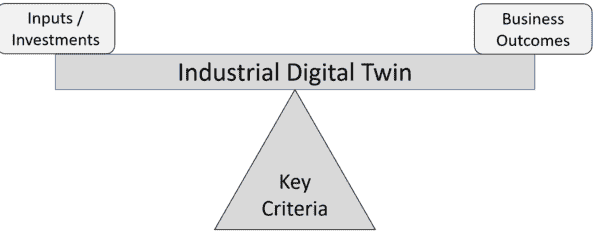
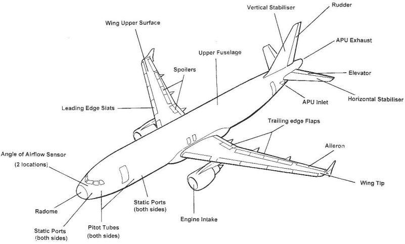
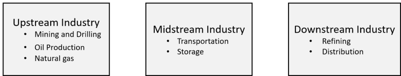
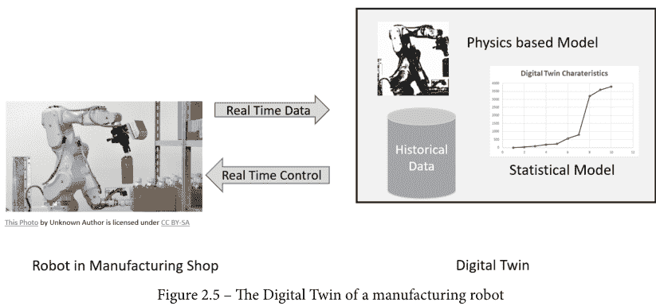
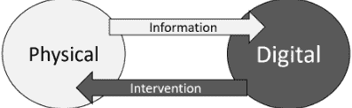
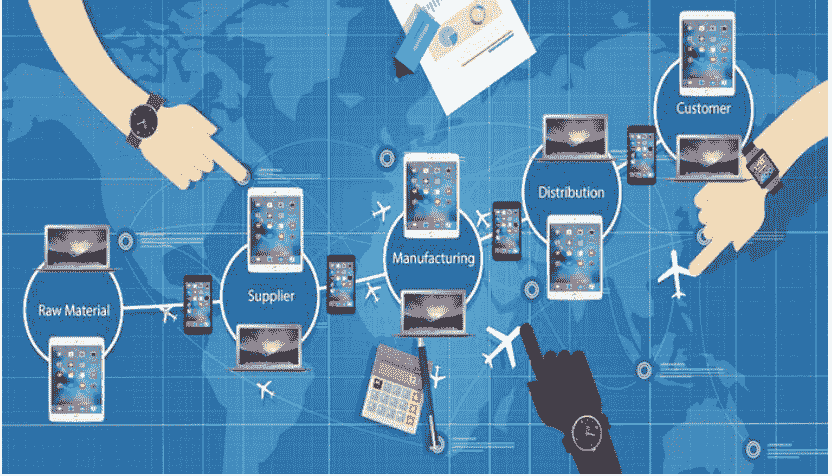
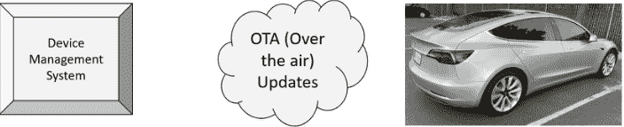

## 2 Planning Your Digital Twin

In the previous chapter, we learned why we need Digital Twins and how to use them to drive specific business outcomes. We explored the history of the Digital Twin and the various industries in which it presents opportunities.

Now, let’s examine how to plan for an industrial Digital Twin in an enterprise setting. We will identify the key criteria that can be used to determine whether the industrial Digital Twin is applicable to the business scenarios. Additionally, we will explore how to develop the business case for investments in the Digital Twin. Following this, we will explore the prerequisites for the Digital Twin in an enterprise, including the functional and non-functional requirements. This will allow us to identify the underlying digital technologies required for the Digital Twin. Note that we will not lose sight of the organizational factors that are in play for the success of the industrial Digital Twin initiatives.

In this chapter, we will learn about the following topics:

- Key criteria
- Expected business outcomes
- Prerequisites for the Digital Twin
- Organizational factors
- Technological needs

### 关键标准

在此，我们将识别关键标准，以帮助企业决定何时引入工业数字孪生具有意义。数字孪生可以针对物理资产系统或流程（例如工厂中的制造流程）。根据数字孪生的目标，必须建立客观标准，以确保数字孪生能够增加商业价值。在此，商业价值和结果被用于更广泛的意义上，它们可能包括以下内容：

- 提高资产寿命
- 流程效率提升
- 运营优化或降低运营成本
- 新的数字收入
- 竞争优势
- 提高最终客户满意度
- 提高安全性
- 一种社会公益，例如减少碳足迹

因此，一旦建立了关键标准，就更容易评估直接和间接投资以及机会成本与所产生的更广泛商业价值之间的关系。图 2.1 直观地展示了这一点：

图 2.1 – 工业数字孪生的商业效益评估

在第 1 章“数字孪生简介”中，我们讨论了在工业中部署数字孪生所带来的商业价值和变革价值。所增加的变革价值通常以新的数字收入形式出现。数字孪生的货币化可以基于单个数字孪生或数字孪生生态系统，例如 **Twin2Twin (T2T) 生态系统**的概念。（请参阅 https://www.hcltech.com/blogs/twin2twin-new-paradigm-enterprise-digital-transformation）。T2T 的概念与 **数字孪生聚合 (DTA)** 类似。但是，T2T 还可以包含不同的孪生体，例如建筑物和空间的孪生体，以及 **供暖、通风和空调 (HVAC)** 和安防系统的孪生体，以高效运营商业建筑。这些 T2T 孪生体在本质上不是层级化的。

单个数字孪生可以由 **原始设备制造商 (OEMs)** 进行货币化，即向客户收取物理产品数字孪生的使用费。此类数字孪生可以作为物理产品的附加组件出售，并具有特定目的，例如资产的预测性维护。如前所述的 T2T 文章指出，价值链中不同利益相关方的数字孪生可以帮助“创建一个充满活力的 TWIN2TWIN 经济”。这将为行业价值链中的不同提供商提供货币化机会。如今，云计算世界中市场很常见。一个例子是 Oracle 的云市场，它允许各种利益相关方创建一个充满活力的云计算服务生态系统，他们可以共同进行货币化。（请参阅 https://cloudmarketplace.oracle.com/marketplace/oci。）

我们相信，类似的数字孪生生态系统将出现，生态系统中的不同参与者将为系统或数字孪生聚合体的数字孪生的相互依赖部分做出贡献。

商业部门通常由盈利能力驱动，因此数字孪生应总体上推动商业价值。然而，在公共部门，驱动因素可能是社会公益，提供可持续性或改善公民体验。新加坡正在尝试其自身的城市数字孪生。政府机构国家研究基金会创建了 Virtual Singapore，它可用于模拟交通或紧急情况。（请参阅 https://www.youtube.com/watch?v=QnLyy0owGL0&feature=youtu.be。）因此，很明显，数字孪生的关键标准将根据利益相关方而有所不同。

在下一节中，我们将深入探讨商业部门特定行业以及公共部门场景的预期业务成果。

### 预期业务成果

在第 1 章“数字孪生简介”的工业数字孪生应用部分中，我们讨论了工业数字孪生适用的行业细分领域。现在，让我们看看在这些场景中预期或可能出现的更具体的业务成果。

### 制造业

在处理物理产品时，制造商负责以下事项：

- 产品设计与开发
- 制造/装配
- 供应链与分销
- 产品保修与声誉
- 可选服务合同

让我们在此背景下进一步了解离散制造和流程制造。

#### 离散制造

让我们以飞机制造为例。商用飞机是一种相当复杂的产品，由机身或机身、机翼、两个或四个发动机、起落架和稳定器等组件组成。要构建飞机作为复合资产的数字孪生，前提是飞机主要部件的数字孪生。这些部件可以由不同的 OEM 制造；例如，飞机可能由波音制造，但发动机可能来自通用电气 (GE)。波音设计的起落架可能由联合技术公司制造，该公司现在称为雷神技术公司。图 2.2 描绘了飞机及其主要部件：

图 2.2 – 飞机的主要部件

当复合资产（例如飞机）是供应商提供的组件的装配体时，复合数字孪生将取决于整个供应链的协作。同样，每个主要 OEM（例如 GE 和联合技术公司（现为雷神技术公司））都依赖于多个较小组件的供应商。

由于我们正在研究商用飞机，它被航空公司用于运送乘客和货物，我们可以列出高级别业务成果如下：

- **飞机制造商**：他们向航空公司提供可靠的飞机。
- **飞机服务提供商**：制造商也可能是维护服务的提供商，并负责确保运营的可靠性、正常运行时间和安全性。
- **飞机所有者或运营商**：运营飞机的航空公司负责为其乘客提供的航班的安全和准时运行。
- **航空公司的乘客**：最终客户期望及时且安全的航班，且航空旅行成本与其他航空公司持平或更优。

前面的列表由在离散制造行业背景下易于理解的业务成果组成，其中产品是飞机。这是 **企业对企业对消费者 (B2B2C)** 业务模型的一个很好示例，其中波音或空客等企业向美国航空或英国航空等另一家企业销售，进而向最终消费者（即航空公司乘客）提供服务。

现在我们了解了商业航空业的简化价值链，可以评估飞机的工业数字孪生如何在此发挥作用。如果飞机的数字孪生帮助制造商制造更好的飞机或为航空公司提供更好的服务，那么它就实现了业务成果。同样，如果数字孪生有助于减少停机时间（尤其是飞机的非计划停机时间）并提高航班的安全性和效率，那么它就提供了商业价值。

虽然航空公司乘客不会直接决定飞机数字孪生的采用或使用，但他们的客户满意度将直接为航空公司的业务成果提供输入。同样，如果飞机的数字孪生以及作为其一部分的喷气发动机有助于提高燃油效率或减少碳排放，那么它将提高法规合规性并促进社会公益。在我们对飞机价值链的过度简化模型中，我们没有研究几个其他非航空利益相关方，例如机场和地面服务提供商。但是，每个利益相关方都从基本航空价值链的效率中受益。如果使用飞机的数字孪生导致航班非计划中断减少，机场运营将顺利进行。

为了提供前一节讨论的所需业务成果，让我们总结商用飞机工业数字孪生预期的关键业务成果：

- 它将帮助改进当前和未来的飞机型号。
- 它将减少飞机的非计划停机时间——这通常被衡量为 **飞机在地 (AOG)**。（请参阅 `https://www.proponent.com/causes-costs-behind-grounded-aircraft/`。）
- 它将提高燃油效率并减少碳足迹。
- 它将提高安全性和可靠性，并减少运营中的差异性。

在下一节中，我们将看一个流程制造的示例。

### Process manufacturing

在 *Discrete manufacturing* 部分，我们研究了商用飞机的示例。航空业高度依赖燃料，燃料是其最大的运营成本之一。因此，自然的过渡就是石油和天然气行业，其中过程制造至关重要。

过程制造通常用于石油和天然气、化工、半导体、塑料、金属、制药和生物技术行业，以及消费品包装行业，包括食品和饮料行业。过程制造使用液体和其他形式的原料，这些原料通常按照既定配方混合。丙烷气体是过程制造的产物，尽管最终包装销售的产品可能以离散的气瓶数量计量。

石油工业由三个主要部分组成。它们包括以下内容：

+   1. **Upstream industry**: 这涉及通过油井勘探、钻探和生产原油或天然气。

+   2. **Midstream industry**: 这涉及石油产品的储存和运输。

+   3. **Downstream industry**: 这涉及石油产品的精炼和分销，以便它们通过加油站到达最终消费者。

*Figure 2.3* 显示了行业的这三个部分：

Figure 2.3 – 石油和天然气行业的三个部分

现在，让我们来看看数字孪生在石油和天然气行业不同部分的适用性。油井使用一种关键设备，称为 **blowout preventer** (BOP)。BOP 用于监测、密封和控制油气井，以防止喷出。但是，BOP 是通过离散制造制造的。在下游行业中，炼油厂是过程制造的一部分。如 Figure 2.4 所示的石化炼油厂，是交通运输行业（包括飞机）燃料生产的重要组成部分：

Figure 2.4 – 石油炼油厂

现在，让我们来看看数字孪生如何为石油炼油厂增加价值。在此背景下，一个常用的术语是数字炼油厂，它指的是炼油厂运营的数字化，以提供运营的端到端视图。这里将列举一些举措，例如 **crude distillation unit** (**CDU**) 的数字孪生。2018 年，TANECO 和 ChemTech 合作创建了 CDU 的数字孪生，其业务目标是优化石油分馏过程。该数字孪生使用了生产过程的热力学模型。（请参阅 `https://www.hydrocarbonprocessing.com/news/2018/06/taneoco-and-chemtech-create-digital-twin-of-refinery`。）AspenTech 也专注于 CDU 的数字孪生，以减少工厂内的运营风险。

通常，石化行业面临着由于排放而难以控制其环境影响的挑战。印度的 Bharat Petroleum Corporation Ltd 正在与 AspenTech 合作开发炼油厂全面排放模型的数字孪生，以帮助控制对环境的影响，并在运营炼油厂时遵守监管指南。（请参阅 https://www.worldofchemicals.com/media/digital-twin-for-refinery-wide-emission-and-efficiency-monitoring/4697.html。）

在前一部分中，我们研究了两个主要行业，即航空业和石油天然气行业。我们研究了离散制造和过程制造的示例，以及两者如何都为使用数字孪生来帮助推动业务成果提供机会。

接下来，我们将研究智能制造中工业数字孪生的作用。

### Smart manufacturing

当机器人用于离散制造的装配线过程时，例如汽车工厂中的汽车，可以对过程的特定阶段进行数字化以优化该阶段。在这种情况下，由其制造商（例如 Figure 2.6 中的 Kuka）提供的机器人数字孪生可以用于以数字方式绘制装配过程，从而产生模拟模型以优化性能，包括吞吐量和质量。这种场景允许 Kuka 向工厂操作员销售由机器人数字孪生驱动的数字服务。反过来，工厂操作员可以将其用于智能制造，并提高其吞吐量以及正在制造的实物资产的质量。最后，这些数字数据帮助我们捕捉制造过程的出生记录，为资产的数字线程做出贡献。这种服务为 ABB 或 Kuka 等提供商带来了 **Robots as a Service (RaaS)** 的可能性。

如果你将人体视为生物工厂，那么人类心脏和智能起搏器的数字孪生是类似的应用。就像智能机器人可以增强和改善工厂运营一样，当心脏变弱时，起搏器可以改善人体。起搏器试图在机械和电气上复制人类心脏。起搏器的数字孪生有助于将实物资产（在此情况下为起搏器）个性化到使用该特定起搏器的人类心脏上。来自起搏器的信号（已被数字化捕获和建模）有助于改善对患者的护理交付。（请参阅 https://www.reuters.com/article/us-healthcare-medical-technology-ai-insi/medtech-firms-get-personal-with-digital-twins-idUSKCN1LG0S0。）

在此场景中，数字孪生提供以下可能的结果：

+   - 起搏器制造商可以深入了解其产品，以便随时间改进其设计。

+   - 随着对数据及其模式的理解随时间增加，制造商可以向医生或患者提供围绕产品的额外数据和分析服务。

+   - 这允许护理提供者（例如医生）改善对患者的监测和护理，包括何时更换起搏器电池，这是一个侵入性过程。

+   - 这允许患者借助基于智能手机或平板电脑的应用程序自我监测自己的心脏相关活动。

在前面的部分中，我们探讨了各种场景，例如优化离散制造中的资产、过程制造的优化以及智能工厂。所有这些领域都可以通过采用工业数字孪生来推动额外的业务成果。Figure 2.6 以简单的可视化方式总结了数字孪生如何通过提供对实物资产干预的洞察来增加价值。

这个现实世界对象的发明不需要是自动的，在解决方案的早期版本中可以包含人在回路中：

Figure 2.6 – 实物资产和数字孪生的反馈回路

关于实物对象的信息是实时传感器数据和资产历史知识的结合。在更高级的场景中，其他信息来源可能包括第三方数据，例如天气数据或宏观经济数据，以及企业 IT 系统中的企业数据。

接下来，让我们来看看系统的工业数字孪生，即 **Supply Chain Management (SCM)**。

### Supply chain management

SCM 将原材料提供商连接到制造商。然后，在分销方面，它将制造商连接到企业（B2B）或最终用户消费者（B2C）。Figure 2.7 显示了供应链过程中这些不同实体之间的关系：

Figure 2.7 – 供应链过程

在第一章《Introduction to Digital Twin》的 Figure 1.5 中，我们从实物资产的角度讨论了数字孪生与数字线程之间的关系。供应链的数字孪生关注系统视角的效率，与正在生产的特定实物资产无关。在 2020 年 8 月发布的 Gartner 供应链战略炒作周期中，你可以看到数字供应链孪生处于创新触发阶段。（请参阅 https://www.supplychainquarterly.com/articles/3877-gartner-says-iot-technology-is-two-to-five-years-from-transformational-impact。）供应链数字孪生的这种定位表明，它将在 5 年以上内达到“生产力高原”；然而，我们相信，在行业的某些细分领域，它将更早提供实质性的业务价值。

在前面的部分中，我们研究了不同场景，其中可量化的业务成果可以通过工业数字孪生来交付。我们研究了成果的潜在受益者，这对于要么投资于数字孪生计划、要么作为消费者为服务和利益付费的决策者来说至关重要。工业数字孪生预期的业务成果得到了 Gartner 等知名分析公司的充分支持。他们预测，到 2021 年，大约一半的大型工业企业将使用数字孪生。这将使这些组织在业务活动中提高 10% 的有效性。（请参阅 https://www.gartner.com/smarterwithgartner/prepare-for-the-impact-of-digital-twins/。）

在下一部分中，我们将研究数字孪生的先决条件。

### Prerequisites for the Digital Twin

为了证明对数字孪生投资的合理性，我们应该以一种方式来阐述业务问题，从而清楚地理解数字孪生的适用性。让我们以卡车运输行业的燃料成本为例。现在，让我们尝试找出此背景下的先决条件：

+   - **Business problem**: 卡车车队的高昂燃料成本
+   - **Business objective**: 在不影响卡车运输运营的前提下降低燃料成本
+   - **Proposed solution**: 构建卡车或卡车运输运营的数字孪生并优化燃料成本

基于对业务问题及涉及数字孪生的拟议解决方案的简化陈述，让我们来看看先决条件：

- **模型**：如第 1 章《数字孪生简介》所述，需要基于物理或分析的模型来创建卡车的数字孪生。此类模型应当已存在，或者基于物理资产及其运营的数据和知识易于创建。

- **框架**：框架是指可用于实例化此模型并将其应用于资产（在本例中即卡车）的软件或系统。该框架应能够摄取传感器数据和其他上下文数据，以创建数字孪生或使其保持最新。

- **应用程序**：为了实现业务目标（例如降低卡车车队的燃油成本），需要在框架之上构建一个应用程序，以向业务用户提供可操作的步骤。在此情况下，该应用程序可以定期或近乎实时地指导卡车司机。

简而言之，模型、框架和应用程序是组织内成功采用数字孪生的关键先决条件。有多种视角可用于观察数字孪生的构建模块。值得注意的是，Futurithmic 将其定义为数字孪生的三个关键组件。（请参阅 https://www.futurithmic.com/2020/04/14/how-digital-twins-driving-future-of-engineering/。）这三个组件如下：

1. 数据模型
2. 算法或分析
3. 执行控制

在此视角下，数据模型还将对应于物理实体的资产模型。简单来说，如果资产具有温度、压力和振动传感器，则数据模型或资产模型将提供有关传感器数据元数据的信息。这将帮助我们决定哪个时间序列数据流是温度的值及相应的工程单位（摄氏度或华氏度）。算法将告诉我们传感器数据的重要性及其与资产健康状况的相关性。一个简单的例子是，如果资产温度在 10 分钟内上升 5 度，同时振动水平增加，则会触发警报。执行控制将指代动作的编排，例如在此情况下，由于温度和振动迅速增加而触发人工操作。响应中的干预可能是关闭资产，从而响应通过传感器数据（即温度和压力以及这些属性的变化率）测得的其行为变化。

Durao、Haag、Schutzer 和 Zancul 撰写的一篇题为《Digital twin requirements in the context of Industry 4.0》的论文，基于对相关文献的调查，给出了数字孪生先决条件或要求的更详尽列表。该列表按这些先决条件在被调查文献中出现次数的降序排列：

- 来自资产的实时数据
- 集成
- 保真度
- 交互
- 通信
- 融合
- 自动更新
- 自主性
- 连接性
- 数据采集
- 数据捕获
- 数据质量
- 数据安全
- 数据仓库
- 效率
- 可扩展性
- 实时全局可用
- 独立扩展
- 互操作性
- 模块化
- 流程规划
- 实时位置
- 可扩展性
- 稳定的数据采集
- 稳定运行

基于此观点，数字孪生最重要的要求是其处理实时数据的能力，其次是集成和保真度。让我们进一步分析。要生成数据，资产必须配备合适的传感器。这些传感器可以是资产的一部分，也可以改装到资产表面或其周围环境中。实时数据要求是指以对数字孪生所服务的应用程序有意义的速率收集此信息的能力。实时数据确保对资产行为的当前视图，并允许我们制定及时的干预措施。例如，飞机在飞行期间会发送其关键系统（如喷气发动机）的快照或汇总信息。这些实时信息会被及时处理，以便就飞机下一次飞行的健康状况做出关键决策。因此，在此处，“实时”一词是相对的。在此情况下，基于将飞机数据应用于其数字孪生所做决策的时间范围是从几分钟到一小时左右。然而，在辅助人类心脏的起搏器的情况下，时间粒度可能要精细得多。

第二个要求是数据集成，即将双胞胎不同子系统的数据（或者，在资产车队的情况下，来自不同资产的数据）进行拼接。一架商用飞机可以有两台或四台发动机。在大多数情况下，飞机的设计旨在在一台发动机在飞行中故障时安全运行。按设计，飞行中关闭一台发动机应该对飞机无害，甚至乘客都察觉不到。在这样的场景中，复合资产（即飞机及其发动机）不同组件之间的数据集成至关重要。我们不仅需要数据集成，还需要近乎实时的数据。这样，飞机上的姐妹发动机才能进行校正，以增加推力水平，从而在少一台发动机的情况下保持飞机姿态。

发动机油压迅速下降可能是飞行中发动机故障的主要指标。为了在只有一台发动机或少一台发动机的情况下安全飞行，飞行员可能会调整空速或高度。

如第 1 章《数字孪生简介》中所讨论的，数字孪生的保真度通常是模型复杂性的结果。保真度的程度使工业数字孪生类似于物理资产。虽然更高保真度的数字孪生可用于更复杂的数字孪生应用，但它也会增加计算复杂性，从而增加管理整个过程的成本。

现在我们对数字孪生的先决条件和要求有了更好的理解。在接下来的两个部分中，我们将探讨数字孪生计划的组织和技术要求。

接下来，我们将探讨组织和文化因素。

### 组织因素

工业巨头采用数字孪生将推动这些公司的关键数字化转型。它们将在某种程度上成为软件公司。这一现象在过去 5–7 年中许多大型工业巨头身上已经可见。让我们来看看霍尼韦尔、通用电气、西门子、ABB、日立、博世、施耐德电气等公司的例子：

- 霍尼韦尔：2019 年 7 月，霍尼韦尔首席执行官 Darius Adamczyk 表示，该公司正朝着“一流软件工业公司”的方向发展，连接软件销售将继续以有机方式以两位数的速度增长。它创建了霍尼韦尔互联企业（HCE）部门，专注于工业物联网（IIoT）软件解决方案等数字技术。

- 通用电气：通用电气在 2010 年代中期决定成为一家数字化工业公司。通用电气对数字化工业公司的愿景可以在一张信息图中查看，该信息图可从 https://www.ge.com/digital/sites/default/files/download_assets/What-is-a-digital-industrial-company-infographic.pdf 下载。通用电气在首席数字官（CDO）下成立了 GE Digital 部门，以落实这一愿景。GE Digital 是一个类似软件公司的业务单元。其目标是创建一个工业互联网平台，用于创建和维护通用电气制造的工业资产的数字孪生。同一平台可用于将通用孪生应用于其他制造商的类似资产，或允许为通用电气客户使用的第三方资产构建自定义数字孪生。第三方资产的一个例子可能是使用通用电气喷气发动机驱动飞机的航空公司使用的除冰机。GE Digital 还围绕此创建了广泛的合作伙伴生态系统，并在 2014 年工业互联网联盟（IIC）的出现中发挥了关键作用。

- 西门子：同样，西门子表达了其对全面数字孪生的愿景，表示“我们通过整合虚拟与物理、硬件与软件、设计与制造世界，模糊了行业领域之间的边界。”（请参阅 https://www.sw.siemens.com/.）

物联网和数字孪生等新兴技术需要组织进行许多变化，以充分利用它们。我们讨论了霍尼韦尔、通用电气和西门子等大型工业公司经历的一些类似变化的例子。我们将这些归纳为以下因素：

- 数字技术和人才：这可以包括物联网、仿真、云计算等领域的技术技能。

### 数字技术与人才

数字孪生可能涉及物联网平台等新兴技术的组合，用于管理连接设备或运营的传感器数据。此外，构建数字孪生可能涉及用于孪生建模和可视化的其他软件功能。通常，物联网平台可能由云中的物联网核心以及位于资产或运营附近的边缘计算环境组成。同样，从概念上讲，资产的数字孪生可能位于云中或边缘，具体取决于用例。组织将需要相应的数字人才来识别、构建和维护技术要求。

### 生态系统与联盟

通常，组织必须与内部资源和生态系统中的参与者合作。例如，之前我们研究了一架飞机，它包括来自供应商的复杂组件组装。例如，波音可能会从 GE 或罗罗购买必要的喷气发动机。在这种情况下，整架飞机的数字孪生将高度依赖于整个生态系统的参与。历史上，供应链中的不同参与者经常相互竞争，缺乏合作的动力。这使得行业细分领域在其价值链中促进协作变得更加困难。

近年来，我们见证了 IIC 和 **数字孪生联盟 (DTC)** 等行业联盟的增长。IIC 和 DTC 等组织能够将行业利益相关者聚集在一起，共同制定框架和指导原则，以加速物联网和工业数字孪生等新兴技术的采用。

### 组织结构与文化

在我们看来，工业数字孪生需要主题专家 (SME) 与技术人员之间的紧密协调。因此，数字孪生可能不会完全由首席信息官 (CIO) 领导的 IT 组织拥有。同样，它也不能完全由制造副总裁等业务线 (LoB) 领导者拥有。相反，我们在大型企业中看到了新组织和角色的出现，它们承担此类技术职能责任。其中一个角色是 CDO。通常，CDO 部门等部门负责数字孪生等计划的成功。在这种情况下，CDO 的团队负责识别相关技术并围绕其开发数字人才库。他们还可能促进公司参与相关联盟，并创建联盟和合作伙伴关系，以加速数字孪生的开发和价值创造。这一过程可能导致新兴技术的快速采用。在本书中，我们解释了数字孪生和可再生能源创新是如何结合在一起的。

创新和实验的文化在采用新兴技术时至关重要。这还要求技术人员和职能 SME 能够跨部门障碍进行交互和协作。有时，这是通过将此类跨职能专业人士安置在卓越中心 (CoE) 下实现的。在其他情况下，此类团队可能是可视的，但具有更高程度的沟通和协作。

### 组织敏捷性的成果

确实，为了验证此类组织和文化变革是否有助于创造价值，让我们来看看前面讨论的一些公司的快速成功案例。霍尼韦尔资产数字孪生功能已被挪威奥斯陆的隆丁公司使用。这家在北海运营的石油和天然气公司使用霍尼韦尔 Forge 的企业绩效管理软件来监控其离岸石油平台的流程和设备，目标是最大限度地提高人员、流程和资产的生产力。隆丁正在使用霍尼韦尔资产数字孪生来创建“能量损失”报告，这有助于其计算 CO2 排放量。能量生成过程的数字孪生有助于隆丁在能量生成资产级别进行完整的能量核算。现在，让我们来看看工业数字孪生的技术需求。

### 技术需求

在前面的章节中，我们全面讨论了围绕工业数字孪生的先决条件和要求。现在，让我们来看看这些要求产生的技术需求。一些最近的新兴和数字技术将在此派上用场。我们将考察以下领域：

1. 框架和模型：IIoT 系统与云端与本地部署
2. 连接性：从资产到边缘，从边缘到云端，再从云端到云端
3. 数据捕获和存储
4. 边缘计算
5. 算法和分析：中央处理器 (CPU) 和图形处理器 (GPU)
6. 平台和应用程序
7. 可视化：仪表板、警报以及增强现实 (AR) 或虚拟现实 (VR)
8. 洞察与行动：人在回路中和现场服务
9. 反馈：产品反馈、流程/运营和培训
10. 软件开发范式和低代码

前面的列表并非旨在穷尽。其他考虑因素包括收集数据所需的传感器、资产上的传感器位置、电源和电池寿命。

### 框架和模型

在这里，我们将了解用于管理理解数字孪生上下文所需的不同方面以及管理数字孪生中涉及的资产、流程或系统的元数据的软件系统。通常，我们会发现 IIoT 平台与数字孪生系统之间存在显著的重叠。通常，数字孪生系统是 IIoT 平台的一部分。常见的数字孪生系统示例包括以下内容：

- Oracle IoT 数字孪生框架 (https://docs.oracle.com/en/cloud/paas/iot-cloud/iotgs/iot-digital-twin-framework.html)
- Azure 数字孪生 (https://azure.microsoft.com/en-us/services/digital-twins/)
- IBM 数字孪生交换 (https://www.ibm.com/internet-of-things/trending/digital-twin/ 或 https://digitaltwinexchange.ibm.com/)
- Ansys Twin Builder (https://www.ansys.com/products/systems/ansys-twin-builder)
- GE 的 Predix 平台 (https://www.ge.com/digital/applications/digital-twin)

在前面的列表中，GE、微软、Oracle 和 IBM 也以其 IIoT 平台产品而闻名。在这里，我们不会深入了解这些技术系统；但是，我们将在后续章节中进行深入探讨。

### 连接性

连接性大致可分为以下几类：

- 传感器与资产之间的连接：传感器可以内置于物理资产中，在维护期间进行改装，或在售后市场进行改装，例如安装在资产表面。在所有这些情况下，传感器都需要与每个资产或每个位置的一个中心系统进行通信。并非所有传感器都可以有线连接。此外，有些传感器可能有自己的电池，因为并非所有物理资产都有自己的电源。请记住，一架在地面上且发动机未启动的飞机使用地面电源单元。此处可能还需要协议转换等其他功能。
- 从资产或传感器到网关/边缘设备：资产可能通过有线方式连接到位置上的聚合器或网关设备。在这种情况下，它将需要无线通信，例如蓝牙低能耗 (BLE) 或 Wi-Fi。这种设置允许一个网关设备（或少量设备）从一个位置管理所有资产到 IoT 核心/数字孪生系统的连接，该系统可能位于云端或远程数据中心。这些设备还可以聚合或处理数据。
- 从边缘/网关到云端：假设 IoT 或数字系统位于公有云或远程数据中心，边缘设备需要连接到核心并以安全的方式发送数据。在某些情况下，边缘设备可能会在一定程度上处理或存储数据。5G 技术的出现可能有助于在一个中心位置集中查看或维护远程现场资产的数字孪生。诺基亚和博世正在朝着此类方向努力。作为连接的数字孪生系统所得洞察的结果，对资产中的系统进行驱动在不久的将来是可能的。通常，工厂或发电厂中的资产通过有线网络连接到基于云的系统。

### 数据采集与存储

资产数据需要被摄入、存储并在数字孪生系统中进行组织。传感器数据最常见的格式是时间序列数据，通常这些数据存储在历史数据库或时间序列数据库中。其他形式的非结构化数据，例如视频或声音文件（通常被称为大数据），也可能需要存储在这样的系统中。通常，Hadoop 系统可能适用于此场景。元数据或资产数据以及企业数据可以存储在关系型数据库中。总之，数据存储需求可以通过 SQL、NoSQL 和 Hadoop 技术等组合来满足。

### 边缘计算

通常，数据源自传感器和资产，并通过边缘传输到核心。但是，在许多情况下，边缘可能在数据整形或预处理、分析、存储和通信数据方面发挥重要作用。根据需求，数字孪生系统组件可能分布在边缘系统和核心系统之间。整个地理分布资产舰队的数字孪生只能存在于核心或中心位置。边缘可用于部署舰队中单个资产的孪生体。

### 算法与分析

边缘可能能够针对给定资产运行近乎实时的有限形式的算法和分析。因此，在通用数字孪生系统中，资产级别的算法和分析模型理想情况下应编写一次，并允许部署在边缘或核心中。根据边缘所需计算的量、性质和速度，它可能使用 CPU 和 GPU。GPU 必要性的典型示例是处理视频数据并需要在边缘对其进行处理时。即使在核心中，运行 IoT 或数字孪生平台的系统也可能使用虚拟机、裸金属服务器或高性能计算（HPC）的组合，后者通常配备 GPU。

此外，在使用复杂的人工智能（AI）算法（包括深度学习）进行学习时，会部署 GPU。关于此的更多细节将在本书后续章节中介绍。

### 平台与应用程序

数字孪生系统构建模块的通用功能通常被称为平台。平台防止反复重建同一组通用功能。GE 的 Predix 平台或 Microsoft Azure 平台可能属于 IoT 平台的这一类别。这些平台服务于多个行业的广泛用例。但是，构建在这些平台之上的应用程序可能服务于非常特定的目的。同一平台可能能够管理起搏器、飞机或汽车的数字孪生。但是，这些应用程序的应用和目标可能非常不同。有时，会采用分层方法，在 IoT 平台之上，可能会开发行业特定或功能特定（资产监控与制造）的应用程序系列，例如用于航空或医疗保健行业。这一层可能试图概括该行业中常见的通用应用需求，以及行业特定的安全和合规要求。然后，应用程序的另一层可能针对特定资产集，例如航空行业的喷气发动机或医疗保健/医疗设备细分市场中的起搏器。

### 可视化

平台可能提供基本的可视化功能，例如数字孪生的可视化、具有警报功能的资产监控仪表板，或资产孪生体的舰队视图。应用程序用户可以重用或自定义这些功能，或根据特定结果构建自己的数字孪生可视化。在更复杂的解决方案中，AR 或 VR 可能用于与资产数字孪生体进行增强交互。

### 洞察与操作——人在回路中和现场服务

允许人工操作员通过数字孪生了解资产并采取适当措施的广泛功能集，将属于此类别。现场服务专业人员可能会使用 AR/VR 来增强其在现场环境中与资产的交互，例如在处理非计划维护时。

### 反馈——产品反馈、流程/运营和培训

数字孪生的整体解决方案必须提供反馈循环。这是为了从孪生体中获得的洞察可以通过知识管理系统捕获。产品设计师和工程师应该能够挖掘这些信息以改进未来产品，或者在软件定义产品（例如特斯拉汽车）的情况下，在现场提供产品的未来修订版。特斯拉使用汽车中的空中下载（OTA）更新来改进产品在整个生命周期中的当前产品；请参阅图 2.8：

### 软件开发范式和低代码

最后，软件开发框架应当健壮且功能丰富，以允许敏捷和快速开发。一些常用术语包括以下内容：

- 云原生或微服务框架
- 低代码开发框架
- 软件开发工具包（SDK）和应用程序编程接口（API），以允许整个生态系统中不同团队和公司之间的协作。

在前一节中，我们探讨了工业数字孪生系统的技术要求。在未来章节中，我们将深入探讨其中一些方面，因为我们开始决定如何为特定问题选择这些技术组件，该问题可以通过数字孪生来解决。

### 摘要

在本章中，我们探讨了工业数字孪生的规划过程。此外，我们根据数字孪生应用的性质和期望的预期结果，探讨了关键标准。我们研究了数字孪生在企业中成功的技术和非技术先决条件。我们研究了不同行业的示例，以应用此决策过程，例如航空行业、石油和天然气行业以及医疗设备行业。因此，本章开发的数字孪生通用框架与其应用的行业领域无关。我们希望考虑并审视工业数字孪生的商业依据。

第 1 章“数字孪生简介”和第 2 章“规划您的数字孪生”结束了本书中我们专注于工业数字孪生的“什么”和“为什么”的部分。第 1 章介绍了数字孪生的背景和定义。然后，本章在此信息基础上构建，并为评估和评估数字孪生的先决条件奠定了基础。

在第 2 部分中，我们将专注于识别、规划和构建数字孪生。在第 3 章“识别第一个数字孪生”中，我们将讨论如何评估数字孪生的合适候选者。我们将探讨此背景下的不同角色和职责。此评估过程将帮助缩小范围，确定在本书中构建工业数字孪生原型的最终候选者。

### 问题

以下是测试您对本章理解的问题列表：

1. 工业数字孪生的一些预期业务成果是什么？
2. 数字孪生是否适用于流程制造行业？
3. 哪些组织因素有助于数字孪生计划的成功？
4. 云计算在数字孪生中的作用是什么？

