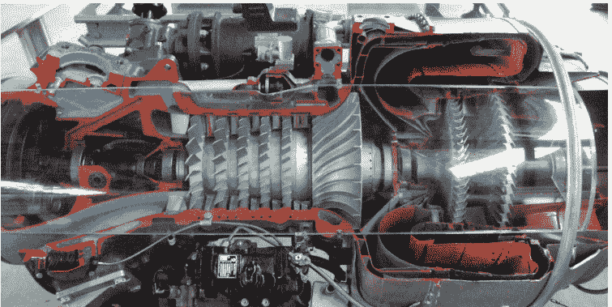
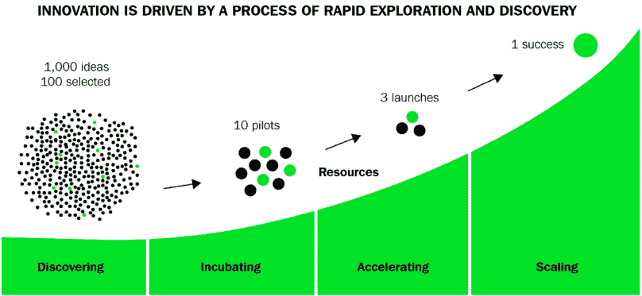
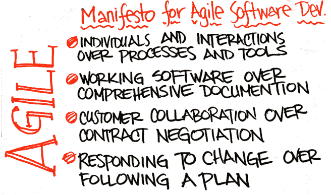
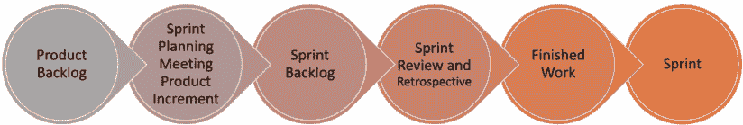
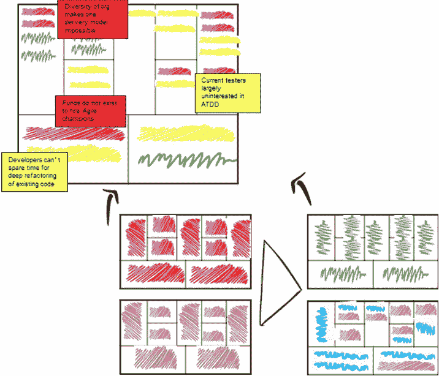
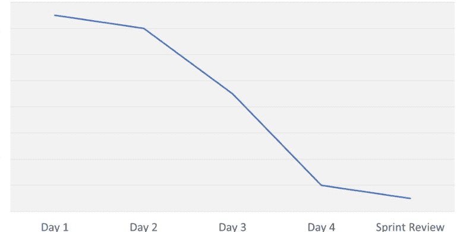

## 3 识别第一个数字孪生

在第 2 章“规划您的数字孪生”中，我们讨论了企业中数字孪生的关键标准及其预期业务成果。我们从不同行业及其生态系统的角度探讨了这一点。我们分析了数字孪生的前提条件，包括组织和文化因素。最后，我们回顾了数字孪生的技术要求。

在本章中，我们将讨论在广泛公司背景下数字孪生的评估流程。这将使您广泛了解数字孪生对内部和外部机会的相关性。我们将把这与当今公司创建和发布的实际角色和职责联系起来。我们将涵盖以下主题：

- 评估数字孪生候选项
- 角色和职责
- 实验与交互
- 最终入围者

简而言之，本章将涵盖确定要构建的第一个数字孪生的过程，以与业务性质和可实现的成果保持一致。这使得第一个数字孪生的识别和评估至关重要。此过程将在此处全面介绍。

### 评估数字孪生候选项

在本节中，我们将识别工业数字孪生的前景，然后评估我们希望推进的那个。此评估必须在您的公司或计划的背景下进行，才能与您相关。我们将在此处针对多种场景进行评估，这应该有助于处理广泛的案例。

以下是可能评估数字孪生的几种场景：

- 工业集团
- 单一行业领域的大型企业
- 公共部门实体
- 大型软件公司或公共云提供商
- 独立软件供应商（ISV）
- 大型系统集成商（SI）或管理咨询公司
- 小型/利基服务公司

让我们现在逐一查看这些场景。

#### 工业集团

符合此类别的公司包括通用电气（GE）、西门子、ABB、日立、霍尼韦尔、强生控制、施耐德电气、博世和爱默生电气。这些工业全球公司近年来在公司内部创建了数字能力中心，目标是加速工业数字化转型。一些示例是 GE Digital 和霍尼韦尔互联企业。我们将查看两种场景：数字组织评估数字孪生候选项，或业务线（LOB）评估。让我们先看看数字组织。

#### 数字能力中心的数字孪生

数字能力通常是一个横向 LOB，其目标是为不同的 LOB 以及在某些情况下直接为外部客户服务，目标是开发新市场或新的数字收入流。当数字组织评估数字孪生候选项时，它将考虑以下事项：

- 哪个 LOB 已为数字孪生识别了一个或多个业务用例？
- 数字孪生将推动 LOB 的内部效率，还是将由其客户采用？
- LOB 是否愿意承诺其主题专家（SMEs）与数字组织合作？
- 数字孪生框架是否可供另一个 LOB 重复使用？
- 物理资产的数据当前状态如何，例如数据的可用性和所有权？
- 基于物理或数学的模型当前状态如何，以及这些模型是否需要为物理资产或流程的数字孪生从头开始开发？

现在我们已列出数字孪生的关键考虑事项，准备好识别候选项了。让我们考虑一个场景，即数字组织正在与航空和电力发电业务合作。航空业务为飞机制造喷气发动机，并为航空公司客户提供服务。电力业务为电力公用事业公司制造发电机。公用事业公司还从制造商处购买长期服务合同。基于这些，数字组织正在评估其第一个数字孪生的三个候选项。这些如下：

- 与航空 LOB 合作，构建其制造的发动机 E 的数字孪生。
- 与电力 LOB 合作，构建其制造的燃气发电机 G 的数字孪生。
- 构建一个与制造商无关的通用发电机数字孪生。由于商用飞机的发动机提供商只有少数几家，通用喷气发动机模型将不太有用。

现在，让我们在以下表格中比较这三种场景：

| 标准 | 发动机 E 的数字孪生 | 燃气发电机 G 的数字孪生 | 通用燃气发电机数字孪生 |
|---|---|---|---|
| 首个客户/用户 | 是 | 是 | 尚未 |
| 数字孪生的可重用性 | 低 | 可用于其他发电机 | 高 |
| 生产力/效率用例 | 是 | 是 | 否 – 仅限外部 |
| 新的数字收入 | 可能 | 可能 | 是 |
| 投资 | 中等 | 中等 | 高 |

前面的表格显示了数字组织如何列出客观标准，以帮助确定数字孪生识别的起点顺序。表格显示，发动机 E 和燃气发电机 G 的数字孪生主要将由 LOB 驱动的内部用例。投资可以通过业务使用数字孪生获得的生产力收益来证明其合理性。但是，当数字孪生的用例仅涉及外部客户时，可能需要更高的初始投资。

在下一节中，让我们从 LOB 的角度看看类似的场景。

#### LOB 的数字孪生

工业集团的 LOB 可能在决定投资数字孪生计划之前，先从自己的视角审视同一场景。在这种情况下，LOB 可能会考虑三个不同的标准：

- LOB 对数字孪生计划自身的准备情况，它是否与其自身业务战略相辅相成，还是可能成为一种干扰
- 量化数字孪生所提供的生产力或效率的能力
- 技术方向

LOB 将审视其当前业务战略，然后查看数字孪生在哪里是一个良好的匹配。例如，航空和电力发电业务通常会一次性出售物理资产，然后向客户销售长期服务。在这种情况下，LOB 将投资数字孪生，以帮助改进预测性维护服务。由于这些合同是长期的，引入数字孪生用于预测性维护不太可能改变顶线收入。但是，服务的交付及其利润率可以通过使用数字孪生得到大幅改善。因此，这将与 LOB 的业务战略非常契合。关于飞机起落架数字孪生的类似案例研究可在此处查看：https://www.ge.com/digital/customers/predictive- insights-aid-aircraft-landing-gear-performance。该数字孪生原型由 GE 和 Infosys 构建，本书的一位作者（Nath）参与了该项目。

While we see that qualitatively speaking, the investment in the Digital Twin makes sense for the aviation LOB, it may further have to build the business case quantitatively. In order to do so, the LOB would have to estimate with sufficient confidence the improvement in the service contract margins due to proper use of the Digital Twin versus additional investments. This business case has to make sense in the long term, but should be measurable in the short to mid-term as well, to ensure they are moving in the right direction.

Finally, the LOB has to look at the technology considerations. This may include the software platform as well as the infrastructure for data and connectivity of the physical asset. The LOB would have to work with the asset owner or operator to obtain the data for the purposes of the Digital Twin. If the LOB decides to work with the digital group, or its conglomerate, then they need to make sure the digital platform can handle the data and modeling needs of their asset. For instance, while the gas generators, as shown in Figure 3.1, work in a fixed location, such as in a power plant, it is easy to connect them to a high-speed network for data collection, as long as the utility customer is on board with that:

**Note**
Image source: http://commons.wikimedia.org/wiki/File:Turboprop_T-53.jpg

Power plants such as the one shown in Figure 3.2 house the gas generators. Often, the utility company buys a long-term service contract from the manufacturer, to transfer the risk of maintenance and downtime to them. In turn, the utility company would often agree to allow the collection and sharing of the data from the generator and its operation with the manufacturer, for the perceived value of better services and lower downtime:

Figure 3.2 – Electric power plant

**Note**
Image source: https://commons.wikimedia.org/wiki/File:Turboprop_T-53.jpg

Aircraft are typically only connected with very low-bandwidth satellite connections that are used for critical data transmission only. As a result, the collection of detailed data from jet engines would need an offline mechanism to collect massive amounts of data from the prior flight(s). The LOB would have to make sure that the digital group can provide the digital platform to facilitate such data collection for the Digital Twin of the engine, E, such as the one shown in Figure 3.3:

Figure 3.3 – Rolls-Royce aircraft engine and landing gear

**Note**
Image source: https://www.aeronef.net/2011/12/boeing-777-300-with-rolls-royces-jet.html

Here, we looked at the key considerations in industrial conglomerate companies about the adoption and investment of a Digital Twin. We looked at the decision process for the central digital group as well as from the viewpoint of the LOBs.

### 大型单一行业企业

延续航空和电力主题，让我们来看看一些主要在单一行业运营的大型企业。此类公司的例子有波音和空客，它们是两家最大的飞机制造商，还有康卡斯特，一家大型能源公司。此类公司与我们在集团中对 LOB 的评估可相比。

让我们以波音或空客为例。他们制造的飞机主要销售给航空公司，或者在某些情况下销售给国防领域。然而，“航空公司”的定义随时间发生了变化，联邦快递、联合包裹、DHL 和亚马逊等公司也像“航空公司”一样运营。联邦快递、联合包裹和 DHL 各自拥有超过 250 架飞机。根据 2018 年 9 月的一篇文章（见 https://www.aviationtoday.com/2018/09/14/boeing-ceo-talks-digital-twin-era-aviation/），波音 CEO 声称，通过利用数字孪生资产开发模型，他们能够将飞机子系统和部件的首次合格率提高 40%。

飞机制造商在做出投资决策之前，将不得不评估如何将数字孪生货币化。他们可能会考虑以下几点：

- 使用数字孪生进行模拟并作为数字线程的一部分，在制造过程中提高产品质量
- 改进为商业航空公司和货运处理商提供的**维修、修理和大修（MRO）**服务，同时考虑与 GE、罗罗和霍尼韦尔等大型零部件提供商的关系
- 作为新收入来源销售的基于数字孪生的产品，包括面向国防客户（见 https://www.machinedesign.com/automation-iiot/article/21139448/full-throttle-digital-twins-boost-airworthiness-in-legacy-airplanes）

此类考虑将有助于决定在航空业中优先采用哪种类型的数字孪生。达索系统是一家拥有约 20,000 名员工的公司，也构建了数字孪生能力（见 https://www.3ds.com/3dexperience/cloud/digital-transformation/digital-twin-technology）。它在航空业有很大影响力，但并不局限于该行业。

康卡斯特等能源公司运营于发电、输电和配电领域。发电将来自可再生能源和非可再生能源。像康卡斯特这样的公司通常会从其他制造商处购买其大部分设备（包括发电机）。因此，他们将不得不决定是去制造商处获取其设备（如 GE 的发电机）的数字孪生，还是构建一个可用于不同制造商发电设备的通用模型。同样，康卡斯特将不得不在内部确定发电效率是否比减少由输电和配电能力引起的任何停电更重要。康卡斯特可以专注于与西门子和本特利系统合作，为其棕地输电和配电提供数字服务（见 https://www.bentley.com/en/about-us/news/2019/october/22/bentley-systems-introduces-assetwise-digital-twin-services）。在此情况下，康卡斯特将采用并基于 OpenUtilities 数字孪生服务，用于其自身的资产和网络性能。

如果可再生能源发电对康卡斯特来说是优先事项，他们可以从风力涡轮机或整个风电场的数字孪生入手。通常，风电场位于沙漠中或山顶，连接性是一个关键考虑因素。替代方案可以是在风电场层面部署资产和机队的数字孪生。

最后，让我们看看一家大型医疗器械制造公司如何使用数字孪生。2020 年，由于疫情（Covid-19），医疗器械和生命科学公司再次受到关注。一些大型医疗器械公司包括美敦力、赛默飞、**强生（J&J）**和雅培。美敦力制造起搏器等医疗器械，虽然对于起搏器等复杂设备的数字孪生似乎是一个很好的起点，但美敦力在 2020 年谈到了其供应链的数字孪生（见 `https://www.forbes.com/sites/stevebanker/2020/06/19/medtronics-digital-twin-supports-their-ability-to-respond-in-the-pandemic/?sh=d4819b6857ee`）。供应链的数字孪生有助于使运营和决策过程更加敏捷，这在 2020 年作为工业数字化转型的一部分绝对是需要的。

### 公共部门

公共部门通常不是由盈利或竞争优势驱动，而是由对公民体验的关注驱动。因此，公共部门的领导者可能会考虑使用数字孪生来改善其选民的公共健康、安全和便利。在公共健康背景下，人体数字孪生的概念正在变得流行。_"随着时间的推移，我的病历可能会成为我的数字孪生"_（见 `https://www.challenge.org/insights/the-next-era-of-public-sector-digital-transformation/`）。这是一个与工业物理资产的数字孪生不同的概念，但在这里，人类是“资产”。

欧洲已考虑城市的数字孪生（见 `https://www.digitalurbanwins.com/post/why-the-public-sector-should-look-to-digital-twins-for-better-policy-making`）。此类城市孪生可用于公共政策变化分析、交通分析和空气质量分析。**中国信息通信研究院（CAICT）**也对城市数字孪生的架构进行了一些工作。

公共部门可能需要根据高级别政府机构的资助和拨款，以及其他非技术考虑因素来优先安排其数字孪生相关计划。然而，这并不限制城市和县寻求公私合作伙伴关系，并在初始阶段发挥创造力以试点数字孪生。

### 软件和公有云提供商

我们将在此介绍两大类软件提供商。具体如下：

- 业务应用软件提供商，例如 Oracle、SAP 和 Salesforce.com
- 公有云提供商，例如 Amazon – AWS、Microsoft – Azure、Google – GCP、Oracle – OCI、IBM 和 Alibaba

Oracle 和 SAP 等业务应用提供商拥有大量使用 **企业资源计划 (ERP)、人力资源管理 (HCM)、客户关系管理 (CRM)** 及相关软件的企业客户。这些企业通常也会向其业务应用提供商寻求新兴技术解决方案。因此，在考虑数字孪生时，他们常会查看这些提供商是否提供数字孪生产品，以及这些产品与其现有业务应用的集成程度如何。因此，Oracle 和 SAP 等公司已投资于 **物联网 (IoT)** 平台，并围绕该平台构建了数字孪生能力。Oracle 和 SAP 等公司不太可能将数字孪生用于内部使用；他们主要关注为客户提供构建工业数字孪生的框架。他们可能会提供数字孪生示例，以帮助加速客户自身的进程。此类业务软件公司可能会提供数字孪生与企业软件（例如侧重制造和 **供应链管理 (SCM)** 模块的 ERP）集成的用例。

> **Note**
> SAP 已讨论其客户 Kaeser Kompressoren 和 Netzsch 使用数字孪生的情况：`https://www.sap.com/products/supply-chain-management/digital-twin.html`。

现在，让我们来看看公有云提供商。你可能已经注意到，Oracle 出现在两个类别中——即业务应用和公有云提供商。公有云提供商专注于云基础设施，即 **基础设施即服务 (IaaS)、平台即服务 (PaaS)**，在某些情况下还包括 **软件即服务 (SaaS)**。大多数大型企业在不同程度上将其软件系统运行在公有云上。因此，这些企业通常会查看其选择的公有云中可用的 IoT 和数字化能力。他们试图尽量减少其 IT 和 **运营技术 (OT)** 解决方案的云提供商数量。因此，公有云提供商已开始向其公有云平台添加 IoT 和数字孪生能力。Microsoft Azure Digital Twins 和 Oracle 数字孪生框架就是此类示例。公有云提供商再次专注于为客户提供构建数字孪生的工具和能力，而不是数字孪生的主要消费者，用于其自身运营。然而，公有云提供商可能会提供安全框架，因为数据从边缘流向云。

### ISV

ISV 包括 AspenTech、AVEVA 和 Bentley 等公司。不过，施耐德电气于 2018 年收购了 AVEVA。此类公司会与其他较大的软件提供商合作，无论是公有云提供商还是类似公司，为最终用户或运营公司提供数字孪生解决方案。在本章前面，我们了解到 Bentley 正与 SAP 合作为 Exelon 提供数字孪生解决方案。同样，AspenTech 正在与其合作伙伴 Equinox 合作，帮助为 **阿布扎比国家石油公司 (ADNOC)** 实施数字孪生，用于 Shah 气体厂（见 `https://www.aspentech.com/en/blog/blog/GLOBal_Threads_of_ Sustainability_From_Digital_Transformation`）。

我们可以看到，ISV 与其他软件和服务提供商保持共生关系，以向运营企业提供数字孪生产品。ISV 倾向于围绕数字孪生构建可重用的软件产品，并通常试图专注于狭窄的行业范围。他们通常依赖最初的几个试点客户来帮助丰富其产品。

### SI

Accenture、Deloitte、**塔塔咨询服务 (TCS)**、Infosys 和 Capgemini 等 SI 和管理咨询公司专注于围绕战略和实施的咨询服务，用于工业 4.0 相关解决方案。通常，其客户群为大型企业。一般来说，SI 不构建任何可重用的软件产品，而是与 IoT 平台和数字孪生系统的技术提供商合作。然而，他们可能会决定投资于其咨询团队的教育和培训，以及构建数字孪生原型，以帮助宣传其服务。飞机起落架的数字孪生由 Infosys 在 GE 的帮助下构建。在此案例中，Infosys 是 GE 的 SI 合作伙伴，GE 提供了领域知识和 **工业物联网 (IIoT)** 平台。

### 利基公司

由于数字孪生仍是一项新兴技术，许多专业和利基提供商正在涉足此领域。举几个公司的例子，我们有 C3.ai、Uptake 和 XMPro（见 https://xmpro.com/digital-twins-the-ultimate-guide/）。我们将越来越多地看到此类利基提供商的专业产品，通常通过公有云提供商的市场，例如以下：

- iGeneration – Azure 上的数字孪生（见 https://azuremarketplace.microsoft.com/en-us/marketplace/apps/adfolks.igenerations-implement?tab=Overview）
- 资产性能管理 – L&T Technology Services（见 https://azuremarketplace.microsoft.com/en-us/marketplace/apps/ltts.rapm_asset_performance_management?tab=overview）

这些主要是供运营公司在其数字孪生之旅中使用的产品。我们将越来越多地看到初创公司进入此领域，围绕数字孪生技术构建新业务。不同类型的数字孪生在 Gartner 2020 年新兴技术炒作曲线中占据重要位置。

在本节中，我们探讨了在不同业务环境中评估数字孪生价值的不同方式。现在，让我们来看看通常负责不同组织中数字孪生的人员和角色。

### 角色和职责

在本节中，我们将识别将参与数字孪生计划的不同角色和人员。表示角色和职责的标准方式之一是使用 RACI 矩阵。缩写 RACI 源自四项主要职责：

- 负责人 (Responsible)
- 问责人 (Accountable)
- 咨询对象 (Consulted)
- 知会对象 (Informed)

### RACI 矩阵定义

| | 谁是负责人 | 分配到执行工作的团队或人员 |
|---|---|---|
| R | 谁是负责人 | 分配到执行工作的团队或人员 |
| A | 谁是问责人 | 作出最终决定并拥有最终所有权的团队或人员 |
| C | 谁是咨询对象 | 在做出决定或采取行动前必须咨询的团队或人员 |
| I | 谁是知会对象 | 必须被告知决定或行动的团队或人员 |

图 3.5 – RACI 矩阵描述

让我们为工业集团示例构建一个示例 RACI 矩阵：

| | CDO/CTO | LOB 领导者 | 架构师 | 开发人员 |
|---|---|---|---|---|
| 数字孪生构思 | RA | C | I | |
| 验证构思 | A | RA | C | |
| 原型 | R | | RA | C |
| 测试/验证 | I | | A | R |
| 生产/市场就绪 | R | A | C | I |

此示例 RACI 矩阵提供了根据公司具体情况将参与数字孪生计划的角色指引。通常，一旦业务领导者决定从销售产品转向销售产品和服务捆绑包，他们就会开始将数字孪生视为推动者。此阶段通常称为产品的服务化。公司的 CEO 和董事会可能会为服务化设定公司方向，或将其委派给 **首席数字官 (CDO)** 等角色。在某些组织中，而不是 CDO，**首席技术官 (CTO)** 角色可能会牵头与 LOB 领导者合作进行数字孪生构思。根据最近一篇《华尔街日报》文章，数字孪生市场在 2019 年价值 38 亿美元，预计到 2025 年将达到 358 亿美元（见 `https://deloitte.wsj.com/cio/2020/06/23/digital-twins-bridging-the-physical-and-digital`）。

通常，技术举措由 CIO 推动；然而，根据我们的经验，大型企业的数字孪生举措主要由其他技术角色牵头，他们与 LOB 领导者密切合作。CIO 的团队通常会在做出技术、平台和基础设施决策时介入。在一篇关于 CIO 在数字孪生领域可能角色的有趣文章中，引入了**工程技术（ET）**的概念（参见 https://thansyn.com/why-cios-must-better-engage-with-engineering-technologists-to-leverage-digital-twins/）。下表总结了文章中的信息：

|   | 数字孪生的性质 | 所有者/用户 | 用例 | CIO 的角色 |
|---|---|---|---|---|
| 1 | 物理属性模型 | 工厂工程师，产品设计师 | 工厂维护 新产品快速原型设计 | 提供高性能计算（HPC）和产品生命周期管理（PLM）功能 |
| 2 | 电气属性模型 | 设施负责人，电气工程师 | 降低功耗 | 数据中心战略 |
| 3 | 化学或热力学属性模型 | 工厂工程师，工艺工程师 | 替代产品和工艺 | 模拟与生产系统的集成 |
| 4 | 工艺操作模型 | 工艺操作工程师 | 更快地解决运营问题并提高效率 | 将不同系统连接在一起，例如 ERP、MES 和工厂运营 |
| 5 | 可靠性模型 | 维护工程师 | 降低维护成本并提高正常运行时间 | 将维护系统和时间序列数据连接在一起 |
| 6 | 经济模型 | CFO/财务团队 | 更好的经济表现 | 集成财务规划和盈利能力系统 |

虽然数字孪生的概念已经存在近二十年，但主流采用仍是一个新兴领域。创新和重塑是否可以由在该领域工作多年的专业人士完成，还是由来自不同领域的人士完成，这是一个重要问题。在同一领域工作数十年的专业人士非常了解该领域，并且已经构建了当今以某种方式运行的产品和解决方案。有时要求他们重塑并以不同方式思考是一个非常困难的命题。让我们举一个飞机在跑道上着陆的例子。一架拥有两个或四个喷气发动机的商用飞机只需要一个发动机来滑行，而不同航空公司的大多数飞行员在着陆后并不会立即关闭其他发动机，因为多年来一直是这么做的。**联邦航空管理局（FAA）**手册并未涉及此问题（参见 https://www.faa.gov/regulations_policies/handbooks_manuals/aviation/airplane_handbook/media/10_afh_ch8.pdf）。然而，亚洲航空通过采用这一流程，每架航班可节省约 9 升燃油（参见 https://climatechange.thenewweconomy.com/aviation-airasia）。这使得每架航班的 CO2 足迹减少了 28 千克。在此案例中，GE 向亚洲航空提供了这一创新的省油建议。

前面的示例表明，当我们审视任何数字孪生举措的角色和职责时，组建一个由内部人员和外部人员组成的团队非常重要。外部人员可能仅指来自不同领域的个人，并不一定指来自公司外部的人员。

我们对明确提及数字孪生相关技能的职位描述进行了简要调查。下表列出了截至 2020 年 12 月的几个示例：

| 公司 | 规模 | 角色 | 职位描述 |
|---|---|---|---|
| Tesla | 4,800 | 高级虚拟调试工程师 | 特斯拉正在寻找一位积极进取的工程师担任高级虚拟调试工程师，重点在于开发代码以及针对数字制造设备及其子组件进行测试和模拟。该职位专注于工业虚拟调试、数字孪生集成、工业 PC/PLC 软件模拟/仿真、使用结构化文本/面向对象编程进行代码开发以及自动化测试。 |
| Nokia | 98,000 | Mirror X 贝尔实验室实习生 | 机器人、混合现实设备、基础设施和其他传感器将提供创建物理世界镜像世界/数字孪生所需的近距离感知，并实现实时。这样的数字孪生将成为企业数字化的关键要素。 |
| Idaho National Lab | 2,200 | 数字孪生研究科学家 | 爱达荷国家实验室（INL）能源、环境、科学和技术总局下属的数字与软件工程小组正在寻找有远见的专业人士，有兴趣在 INL 探索数字孪生研究科学家的技术职业生涯。 |
| Johnson & Johnson | 1,30,000 | 博士后科学家 | 博士后科学家将负责领导一个协作项目，构建强生上游平台工艺的数字孪生模型。该项目的目标是创建一个基于基因组的准确模型，作为大规模生产反应堆的数字表示，并利用该模型指导从细胞系选择到生产生物反应器的上游工艺开发。 |
| PTC | 6,000 | IoT 和 AR 销售区域总监 | PTC 技术帮助公司通过 IoT、AR、3D 打印、数字孪生和工业 4.0 快速释放物理世界与数字世界融合处所创造的价值。 |
| Autodesk | 10,000 | 支持计划经理 | 欢迎加入 Autodesk Tandem™ 团队！我们的使命是创建数字孪生技术和解决方案，改变建筑的设计、建造和运营方式。 |
| Principal Power | 2,600 | 高级海军建筑师 | 与数字孪生相关的全球性能工程和分析工作，例如：缩比模型测试设计与规划、数字孪生软件与数值模型的验证与确认以及资产性能分析。 |
| Rivian | 100 | 高级虚拟工程师 | 制定路线图，以实现完整数字孪生和自动化的交付，保持数字模型的最新状态。 |
| Bright Machines | 330 | 高级软件工程师 – 3D 图形 | 您将加入一支软件工程师团队，他们目前正在为 Bright Machines 的微型工厂构建数字孪生。在 Bright Machines，我们正在构建数字孪生软件，该软件充当虚拟 3D 环境，用户在此环境中设计、编程、调试和测试微型工厂——一个错误成本低且迭代速度快的环境。 |
| IBM | 3,46,000 | 数字孪生架构师 | 为客户领导数字孪生解决方案的设计和交付，向客户提供关于数字孪生、AR 和 IoT 解决方案如何转变其业务和运营的技术领导力，向 C 级客户高管展示 IBM 的数字孪生观点，为售前和提案团队提供技术领导力，开发数字孪生和 IoT 领域的 IBM 知识产权和技术卓越性。 |

前面的职位涵盖了从公共部门到私营部门以及 IBM 等咨询服务公司的大型和中型公司。因此，不同公司正在通过招聘此类技能以及内部培养来应对与数字孪生相关的角色和职责。对于那些可能希望在职业生涯中探索新方向的人来说，这是个好消息。需要知道的是，有时数字孪生相关产品可能会蚕食现有业务和服务，认识到这一点并围绕它规划颠覆非常重要。

在下一节中，让我们看看可以用来围绕数字孪生构思、开发和验证想法的方法论，目标是加速决策周期和上市时间。

### 实验与交互

新兴技术通常需要大量实验以及从之前迭代中学习的能力。图 3.6 展示了快速实验和迭代的过程，最终形成一组较小的成功案例：

图 3.6 – 数字孪生候选项的快速探索与发现

### 敏捷宣言

敏捷宣言是一份解释敏捷软件开发价值观和原则的文档。它在图 3.7 中以可视化方式展示，首次发布于 2001 年。这些价值观和原则在此处描述：`https://www.visual-paradigm.com/scrum/agile-manifesto-and-agile-principles/`。敏捷方法论为传统的重型瀑布式软件开发方法提供了一种替代方案。敏捷方法论适合数字孪生计划通常需要的快速实验。西门子和埃森哲在数字孪生背景下使用敏捷方法论的情况在此处描述：`https://blogs.sw.siemens.com/thought-leadership/2018/01/26/using-agile-processes-and-digital-twin-technology`。我们建议您观看此西门子博客页面上分享的视频，来自数字孪生峰会（参见 `https://youtu.be/ETTlTq88oHU`）。

图 3.7 – 敏捷宣言

图 3.7 总结了敏捷方法论的精神，即较小的迭代带来更大的成果，同时降低风险。开发工作通常分为以下几项：

- 发布
- 史诗
- 用户故事
- 冲刺
- 每日站会
- 测试用例
- 演示和用户验收
- 迭代（转向或坚持）

另一种观察敏捷方法论运作的方式在图 3.8 中以可视化方式展示，按其自然顺序排列：

图 3.8 – Scrum 方法论

产品待办列表按发布、史史和用户故事来定义。用户故事和史诗在冲刺期间进行处理，冲刺通常可以短至 1-2 周。冲刺涉及其自身的规划，以便将用户故事映射到冲刺待办列表。一旦开发人员完成按故事点计量的分配任务，其工作将接受评审或可能向业务用户进行演示。这导致冲刺的结束，并迭代地处理产品待办列表。

在我们进一步解释这些术语时，让我们使用一个现实的例子。**西部数据公司（WDC）**在此处描述了他们为期 12 周的数字孪生实验：`https://blog.westerndigital.com/digital-twins-optimize-robot-manufacturing-ops/`。他们称其为快速学习周期，目标是创建**自主机器人车辆（ARV）**。让我们尝试为此计划创建高级别的 Scrum 产物。

### 发布

发布被定义为可以分发给业务用户或控制组的应用程序。这可以是测试版软件或试点产品，也可以是软件产品的普遍可用版本。在 WDC 案例中，发布将由 ARV 应用程序的某个版本组成，该版本在数字孪生流程的帮助下开发。发布通常按产品路线图上的功能来定义。这些功能可以描述为史诗。

### 史诗

史诗是开发的一个工作单元，逻辑上对应用程序用户社区的相关请求或需求进行分组。史诗帮助团队估算逻辑工作分组所需的时间和精力。史诗应以业务用户能够轻松理解并在周期结束时验证的方式编写。在 WDC 案例中，史诗可以表述为“使用数字孪生的 ARV 试点”。史诗被分解为用户故事，这些故事随后可以更精确地估算并分配给开发团队成员。

### 用户故事

用户故事，也称为用户故事，是从不同利益相关者的角度描述软件应用程序特性的描述。用户故事旨在成为小的工作单元，但具有具体性。这些利益相关者可能是最终用户、维护最终解决方案的 IT 人员或项目的业务赞助人。用户故事应具有以下特征：

- 阐明应用程序的特性对利益相关者的价值。
- 描述这些特性如何被演示、测试并验证以供验收。
- 关注“什么”而非特别关注“如何”。这使技术团队能够找出构建应用程序的最佳方式。
- 易于估算 Scrum 团队所需的工作量，同时降低风险。

最佳实践是垂直切分用户故事。举个简单的类比，披萨由面团、披萨酱、奶酪和配料组成。如果用户故事只包含面团，用户或测试人员只能单独品尝面团，无法对最终披萨的“验收”提供良好反馈。另一方面，根据“垂直切分”原则，如果用户故事是制作一小片披萨，那么用户可以提供更多有意义的反馈，最终披萨验收的风险将大大降低。虽然这种“垂直切分的用户故事”非常理想，但可能并不总是可行。

要查看 WDC 史诗的可能用户故事，以下是一些可能的用户故事：

- 中国上海半导体制造厂（fab）二楼 ARV 移动的数字孪生
- 半导体制造厂（fab）中**待测设备（DUT）**的等待时间和服务时间分布历史

这可以作为 WDC 史诗的两个用户故事的起点。这些用户故事可以在一个或多个冲刺中完成。然而，目标是在每个冲刺结束时向利益相关者演示进度。

### 冲刺

冲刺是一个短时间间隔，通常为 1-2 周。冲刺用于完成诸如用户故事等工作。发布通常被分解为多个冲刺。在 WDC 示例中，例如，为期 12 周的练习可以分解为 6 个为期 2 周的冲刺。随着这些冲刺的进展，可衡量的工作单元根据通常记录的测试用例完成并进行测试。

### 每日站会

每日站会是一种用于跟踪每日进度的敏捷仪式。它可以每天举行一次或两次。如果每天两次，则在工作日的开始和结束时举行。良好的沟通是敏捷方法论成功的关键，而每日站会是同步整个团队的关键部分。通常，每个成员可以讨论以下三项内容：

- 你昨天或今天做了什么工作（如果站会在一天结束时举行）？
- 你今天或明天将做什么工作？
- 你的工作是否有任何障碍？

当整个团队或大部分团队在同一个办公室工作时，团队在每日站会期间围绕信息辐射器或 Scrum 板聚集。图 3.9 显示了这样的信息辐射器：

图 3.9 – Scrum 信息辐射器

> **注意**
> 图片来源：`http://agileconsulting.blogspot.com/2013/09/agile-transformation-cadence-model_495.html.`

在每日站会期间以及 Scrum 团队工作的区域使用信息辐射器，可以对冲刺和发布的整体进度提供高度可见性。在大部分团队不在同一个屋檐下工作的场景中，会使用此类信息辐射器和 Scrum 板的电子版本，每日站会可能通过视频会议系统进行。图 3.10 显示了这样一个电子 Scrum 板：

### 数字孪生冲刺燃尽图

图 3.10 – 敏捷方法论的电子 Scrum 板

> **注意**
> 图片来源：http://phdesign.com.au/general/excel-templates-for-scrum-product-and-sprint-backlogs/

虽然每日站会已以通用方式描述，但这里也将应用于 WDC 场景。

### 测试用例

测试用例是用于验证冲刺正在以满足利益相关者要求的方式生成用户故事和史诗工作的场景。这些测试用例可以由用户的**质量保证（QA）**团队用于在过程中检查和接受工作。用于确定被测系统是否满足要求的一组条件或变量是根据规范手动创建的，这些规范随后用于创建 QA 团队使用的测试。在 WDC 场景中，测试用例将帮助利益相关者验证在冲刺期间使用数字孪生推进 ARV 试点的进度。

### Demo and user acceptance

在每个 Sprint 结束时，整个团队会尽可能在会议室聚会，负责该用户故事的开发团队向利益相关方演示进展。使用垂直切片的用户故事有助于使这些演示对业务用户而言具有具体性。例如，在关于中国上海半导体制造厂（fab）二楼 ARV 移动数字孪生的用户故事演示中，团队可能会展示 fab 小部分区域内单个 ARV 移动的 2D 图表。这对业务 SME 来说是有意义的，他们可以轻松地给予接受或拒绝。

### Iterations

敏捷开发过程本质上是迭代的。如前所述，利益相关方可以在周期结束时接受或拒绝 Sprint、用户故事或整个史诗的结果。基于利益相关方的此类反馈，团队决定下一步是坚持还是转向。在 WDC 场景中，团队决定坚持或继续推进改进。他们的总体业务目标是提高 fab 的整体服务时间。这反过来将帮助 WDC 提高 fab 二楼的吞吐量和效率。一旦实现，这一成功可以在整个 fab 复制，然后复制到其他 WDC 地点。

有关这些工件和敏捷仪式的更多详细信息，请参阅：`https://www.atlassian.com/agile/scrum/artifacts`。

在本节中，我们了解了实验和迭代对于数字孪生相关举措的价值。使用诸如敏捷宣言等既定的软件方法论有助于采用可能提供增量价值并降低风险的实践。虽然我们在软件应用程序的背景下使用了示例，但类似的过程可以应用于物理世界和数字世界的融合，其中最终解决方案涉及传感器和 IoT 网关等硬件以及软件组件。

在下一节中，我们将探讨如何确定数字孪生举措的最终候选方案。

### The finalist

在完成构建第一个数字孪生的候选方案评估过程后，我们选择了风力涡轮机作为资产。让我们看看选择构建风力涡轮机数字孪生的一些原因：

- 总体而言，对可再生能源的关注度日益增加，以帮助控制碳足迹。风力涡轮机使用空气速度或风作为发电燃料。
- 与燃气发电机驱动的发电厂或核反应堆相比，风力涡轮机是一个相对不太复杂的物理资产。因此，风力涡轮机是第一个数字孪生的更好候选方案，以保持较低的复杂性。
- 风力涡轮机的数字孪生将同时惠及涡轮机制造商/服务提供商以及所有者/运营商（通常是公用事业公司）。此外，系统集成商、云平台和业务软件提供商将有兴趣提供实施和技术能力。鉴于可再生能源在商业上是可行的，通过风力涡轮机和风电场的数字孪生提高效率将为其利益相关方提供即时价值。

在考虑所选资产的前提下，为了构建工业级数字孪生，我们将在下一章中探讨规划和先决条件。在本书的其余部分，我们将为风力涡轮机构建第一个数字孪生，并从技术和经济角度对其进行评估以计算 ROI。最后，在第 8 章《增强数字孪生》中，我们将扩展到其他可再生能源资产，例如水力发电厂和太阳能发电厂，以提供更广泛的覆盖范围，从公用事业角度来看，这些资产可能由同一所有者拥有。

### Summary

在本章中，我们从不同组织和利益相关方的角度探讨了数字孪生的评估过程。这为分析数字孪生提供的机会并做出明智决策提供了一个框架。我们探讨了企业中围绕数字孪生举措的不同角色和职责，包括这些角色是如何履行的。然后，我们探讨了与数字孪生及相关举措的开发相关的实验和迭代过程。

在第 4 章《开始构建我们的第一个数字孪生》中，我们将探讨开始构建数字孪生。它将涉及规划框架、围绕数字孪生的业务流程，以及一些技术和数字平台考虑因素。

### Questions

1. 哪些不同类型的企业可能对数字孪生举措感兴趣？
2. 你能否通过使用数字孪生来提高效率并创造新收入？
3. 举一个与飞机相关的数字孪生示例。
4. 在数字孪生的背景下，RACI 矩阵的用途是什么？
5. 快速实验在数字孪生采用中的作用是什么？
