### 4 Getting Started with Our First Digital Twin

在上一章中，我们在决定第一个数字孪生候选方案时，探讨了不同的组织视角。你公司的规模和类型会影响你的视角，以及在选择过程中对你重要的特定价值驱动因素。我们强调了在启动数字孪生计划时明确角色和职责的重要性。我们还描述了用于确定第一个数字孪生最终候选方案的实验过程。

我们还在选择过程中确定了最终候选方案，以确定我们数字孪生的候选对象。你现在应该清楚哪种类型的数字孪生可以满足你特定组织的需求。我们在上一章中选择了一个特定的最终候选方案，作为本书其余部分的示例，但这种方法可以应用于你可能想要开始的任何数字孪生。但是，我们建议你在接下来的几章中跟随我们构建的示例进行操作。

本章将介绍规划框架、如何验证问题陈述和预期结果，以及开发数字孪生的拟议业务流程。最后，我们将解决数字平台选择的一些技术考虑因素和方法。

本章将涵盖以下主题：

- 规划框架
- 验证问题陈述和结果
- 探索数字孪生开发的业务流程
- 考虑技术因素
- 探索数字孪生的数字平台

让我们从规划框架开始，为你的第一个数字孪生奠定基础，该框架基于上一章中描述的方法论。

### Planning framework

第 3 章《识别第一个数字孪生》描述了一种敏捷开发流程，这是我们建议在构建第一个数字孪生时采用的方法。敏捷方法允许你快速进行课程修正，因为数字孪生对你和你的组织来说可能是新事物。你可能没有精确的设计规格。

然而，即使你使用敏捷开发方法论，遵循结构化的规划流程仍然至关重要。本节将描述在开始构建第一个数字孪生时需要考虑的不同规划视角。

项目规划框架为开发第一个数字孪生的不同项目阶段提供指导。我们第一个数字孪生的规划框架已根据敏捷方式进行了定制，因为这里数字孪生的技术和业务影响尚不清楚。

### Project planning framework

在第一个数字孪生开发期间，明确概述每个利益相关方的期望至关重要。我们在第 3 章《识别第一个数字孪生》中介绍了 RACI 图，以及根据你正在为其构建第一个数字孪生的组织类型而定的不同 RACI 角色。

下图显示了大型企业组织业务单元中典型预测性维护数字孪生的项目和规划框架。在开发第一个数字孪生时，这五个高级阶段适用于任何用例或行业。每个阶段的内容和方法可能会略有不同，具体取决于该数字孪生是执行预测性维护功能、运营监控、模拟还是任何其他专业功能：


| 阶段 0：前期准备 | 阶段 1：（1~2 周）项目范围界定 | 阶段 2：（2~4 周）项目设计/开发 | 阶段 3：（1~3 个月）项目验证 | 阶段 4：（持续进行）项目规模化 |
| --- | --- | --- | --- | --- |
| 业务与运营团队 | • 基于当前绩效映射生产价值链<br>• 定义不良资产和系统瓶颈，并识别根本原因 | • 识别哪些优先级根本原因有参考数据<br>• 基于技术成熟度和业务影响优先排序用例，以确定首个数字孪生体<br>• 识别首个数字孪生体的风险价值和关键成功标准 | • 设计端到端业务流程和运营化计划<br>• 确保有合适的团队到位以推动解决方案的嵌入 | • 推动端到端流程的编排和嵌入<br>• 验证结果并框架关键成果和成功案例<br>• 确保数字孪生体在业务单元中完全嵌入，并有清晰的流程<br>• 基于学习成果添加功能和能力<br>• 推动规模化并识别进一步的数字孪生体 |
| IT 和开发团队 | • 为数字孪生体部署和测试准备高级参考架构<br>• 准备高级安全和可信度计划 | • 验证首个数字孪生体的数据可用性和质量<br>• 设置带有正确集成连接器的平台<br>• 与业务团队对齐关键成功标准 | • 与可靠性 IT 团队一起设计首个数字孪生体<br>• 将数字孪生体与业务系统中的 IoT 和操作（例如工单）集成<br>• 设计跟踪用例结果的机制 | • 根据结果改进数字孪生体的调优<br>• 帮助推动数字孪生体的测试和使用<br>• 构建 IT 能力以使用和维护数字孪生体<br>• 扩展支持数字孪生体的使能技术和云基础设施，以支持长期使用<br>• 提供支持服务 |

图 4.1 – 预测性维护数字孪生体的项目规划框架

我们在区分这些阶段中的 **业务部门（LoB）** 和 **信息技术（IT）** 角色的同时，专注于数字孪生体开发的一个关键方面。LoB 职能关注业务挑战和工程分析以解决该挑战。它还关注需要调整以支持数字孪生体技术的运营业务流程。IT 职能关注用于在整个生命周期中创建和操作数字孪生体的数字使能技术。

### 阶段 0 – 前期项目阶段

如前表所示，前期项目阶段指的是需要完成的准备工作，尽管这不一定属于数字孪生体项目的一部分。可靠性工程师、运营经理和其他 LoB 用户通常会进行业务绩效分析，以确定未来效率和效果改进的关注领域。使用精益第一性原理的不良资产分析是可靠性工程师常用的典型方法，如本预测性维护示例所示。不良资产分析是对工厂或车间运营资产的正式审查流程。它使用 **帕累托原则**，在设备故障的情况下，通常 20% 的设备导致 80% 的故障。帕累托原则通常被称为 **80/20 法则**，并广泛应用于许多行业和应用中。不良资产分析的目标是找出导致最多停机时间或生产损失的 20% 设备并对其进行排名。不良资产分析中使用的一种排名机制是将相同的帕累托原则应用于这 20%。它找出导致原始 80% 故障中 80% 的 20%。这意味着我们现在有原始评估的 4%，它导致了 64% 的故障或停机时间。

LoB 职能分析整个生产价值链，并识别潜在的系统瓶颈和特定资产或系统，这些资产或系统被称为 _不良资产_。如前所述，这些不良资产通常导致大部分设备故障事件。按吞吐量或生产损失、停机时间、维修成本和安全性等关键绩效指标对不良资产进行排名是常见的做法。对于制造生产线，主要的不良资产可能是输送系统，排名第二的不良资产可能是机器人装配臂，第三可能是生产线末端的包装站。

下一步，如下图所示，是确定这些排名靠前的不良资产的主要故障模式。**正式失效模式与影响关键性分析（FMECA）** 是可靠性工程中一项成熟的实践。然而，对于我们的首个数字孪生体，我们不需要进行全面的 FMECA。基于历史维护和运营数据识别关键故障模式仍然至关重要，因为这确保了原型数字孪生体将在短期项目验证阶段展示价值：

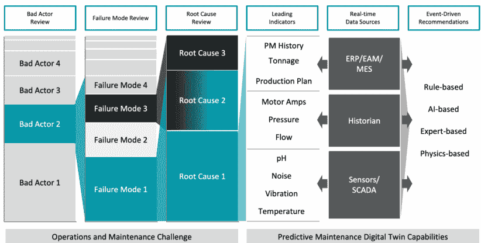

图 4.2 – 预测性维护数字孪生体的项目规划框架

一旦我们了解主要故障模式，就可以识别这些故障模式的根本原因。这也是可靠性工程中一项成熟的实践。然而，为了本书，我们将简单地识别最主要故障模式的主要根本原因。由于我们经常看到物理设备之间存在因果关系，一些根本原因可能导致多个故障模式。

下图显示，**根本原因 2** 可能导致 **故障模式 1** 和 **故障模式 3**。业务影响和不良资产故障模式的性质将决定分析的级别，但就本示例而言，我们将假设 LoB 职能将为此提供必要的输入：

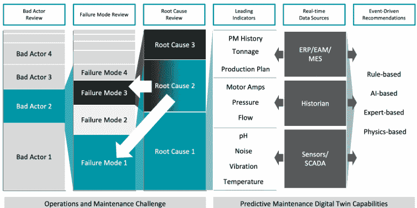

图 4.3 – 根本原因和故障模式的关系

理解根本原因的目标是确定我们是否可以识别任何领先指标，这些指标可以通过 IoT 和传感器设备的实时数据和分析在数字孪生体中得到支持。这些领先指标可以基于原始传感器数据、物理模型以及数学或统计模型，如《第 1 章，数字孪生体简介》中所述。

这些实时指标可以从 **物联网（IoT）**、**运营技术（OT）** 和企业业务系统（如 **企业资产管理（EAM）**、**企业资源计划（ERP）** 和 **制造执行系统（MES）** 解决方案）中建立。

这种对多个不同系统的集成要求引入了 _图 4.1_ 中给出的 IT 和开发职责。这是建立可用于首个数字孪生体，并可根据此初始项目的结果和经验在未来进行调整的高级参考架构的理想机会。

还建议在这些早期阶段启动围绕安全和可信度的治理流程，并为未来项目建立纪律。数字孪生体引入了几种新的安全漏洞和潜在攻击面。IT 职能可以利用初始数字孪生体项目来评估影响并识别风险缓解策略。

### 阶段 1 – 项目范围界定阶段

在项目范围界定阶段，业务和运营团队识别并确认高优先级不良资产资产的领先指标是否有关联的数据源。仍然重要的是从故障模式和根本原因开始，而不是从可用的数据源开始。您的首个数字孪生体解决方案应专注于快速交付价值，因此应以问题为导向。

业务和运营团队应完成业务就绪度评估，如《第 1 章，数字孪生体简介》中图 1.10 所述。根据技术就绪度和业务影响优先排序用例，以识别首个数字孪生体。业务影响措施也与我们在《第 1 章，数字孪生体简介》中图 1.9 识别的风险价值指标相关。我们在《第 1 章，数字孪生体简介》中图 1.10 提供的评估中的潜在业务影响措施包括安全性、停机时间、吞吐量、质量和成本。技术就绪度评估涵盖数据可用性、自动化和 IT 系统的成熟度、分析、拟议的部署环境以及项目管理成熟度水平。

此阶段还包括定义首个数字孪生体的风险价值和关键成功标准。它回答了一个问题：首个数字孪生体的成功是什么样子？

对于 IT 团队，此阶段提供了评估业务团队识别的领先指标的数据可用性和数据质量的机会。根据领先分析公司的研究，基于 IoT 的项目中，数据集成、访问、清理和数据处理可能会消耗超过 50% 的项目资源和成本。项目范围界定阶段为 IT 团队提供了评估数据集成对数字孪生体项目关键成功指标影响的机会。

这也是我们准备数字孪生体平台并在必要的治理护栏内配置所需数据集成连接器的阶段。提前准备这些内容可以降低创建依赖于数据访问且可能因技术原因无法集成的数字孪生体的风险。


During this phase, a final key point is to ensure that business users and IT are aligned on
the **Critical Success Factors (CSFs)** for the first Digital Twin project. A common and
shared vision around the specific measurable outcomes or CSFs for the first Digital Twin
will ensure a results-based focus for the project.

The next phase focuses on developing and delivering the Digital Twin while preparing
the organization to adapt to operational business processes and the way people work.

### Phase 2 – the project design and development phase

Digitally enabled projects typically require a change in how people go about routine tasks.
Digital Twins, as well as the operational, situational awareness, and decision support that
they provide, change the business processes that people traditionally follow. We will cover
this topic in more depth later in this chapter.

To ensure that the first Digital Twin is a success, it is essential to identify the team among
business users that's willing to embrace technology-based solutions to address business
challenges. Operational users in industrial organizations are typically more conservative
and skeptical of new or emerging technologies. This is also the phase during the project
where a decision is made on what kind of Digital Twin will be built and how it will
integrate with design, manufacturing, maintenance, and operational models. Furthermore,
the design and development phase provides the engineering team with the opportunity to
add additional sensors and data collection points for testing and certification. Substantial
planning is involved in the placement and data collection plans for sensor data. Business
users bring about the required engineering knowledge and expertise to help plan how to
sustain the business value of twins. Selecting the right team will improve your chances
of a successful first Digital Twin project.

The IT team will develop or configure the Digital Twin during the design and
development phase. This includes integrating real-time input and other metadata and
integration to backend business systems. We recommend an agile development approach,
as described in _Chapter 3, Identifying the First Digital Twin_, using all the artifacts and
processes shown in Figure 3.8.

The verification steps during the design and development phase provide the necessary
governance to ensure the Digital Twin is designed and engineered correctly.

We also recommend that the Digital Twin is configured so that it can automatically
track use case results continuously. The initial Digital Twin project is typically used to
demonstrate the value based on the CSFs. Automating the reporting on these assists
with value tracking during the project validation phase.

### Phase 3 – the project validation phase

The project validation phase focuses on measuring the key success criteria set out during
the project scope and validating the result of using the Digital Twin. The business team
users need to ensure that the business process changes, as described in phase 2, are
implemented during the validation phase.

During the business validation process, both the business and IT teams can use continuous
CSF monitoring results to improve and fine-tune the Digital Twin's capabilities. This phase
will also allow you to understand the support requirements and other business capabilities
required to maintain and scale out Digital Twins in the organization.

This phase's outcome is to decide if the Digital Twin has delivered on the initial CSFs and
if it is to be continued in production, or if it is the end of the initial assessment. If we have
followed the preceding steps, the likelihood of success is exceptionally high, and this will
often lead to scaling out the Digital Twin in full-scale production applications.

### Phase 4 – the project scaling phase

New requirements and opportunities often emerge during the project validation phase
as business users see the benefit of the improved decision support capability. Scaling out
could mean providing access to additional users or adding other capabilities and features
to address these additional requirements.

The project planning framework used in this example is specific to a predictive maintenance
case. Still, the principle applies to any Digital Twin product, and we recommend that you
outline the planning framework for your project in a similar way. The single-page summary
improves internal communication and provides a clear understanding of the expectations
of the different phases.

The project planning framework is supported by a solution framework that explains the
business value and scope to business executives who sponsor the Digital Twin project.

### Solution planning framework

The proposed solution planning framework has its roots in the **Lean Startup** approach,
which was introduced by **Steve Blank** and popularized by **Eric Ries** (`https://hbr.
org/2013/05/why-the-lean-start-up-changes-everything`). The Lean
Digital Twin is a methodology developed by **XMPro** (`https://bit.ly/idt-ldt`)
and is based on the Lean Startup framework, which focuses on achieving the product/
market fit of a new product before scaling out.

The **Lean Digital Twin** is an ideal approach when developing your first Digital Twin since the application and use of Digital Twins in organizations is not well defined or understood yet:

Figure 4.4 – Moving from the Problem/Solution to the Digital Twin/Business Fit

The first part of the lean Digital Twin approach focuses on the Problem/Solution Fit, and the best way to describe this in a simple and easy-to-understand way is by using the **Lean Digital Twin Canvas**.

This is based on the lean canvas that’s used in the Lean Startup approach, which describes the business problem, solution integration points, and the business case on a single page that is easy to communicate to a project team and executive sponsors:

Figure 4.5 – The lean Digital Twin canvas for the slurry pump predictive maintenance Digital Twin

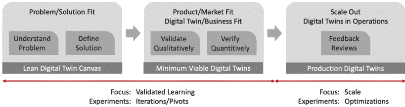

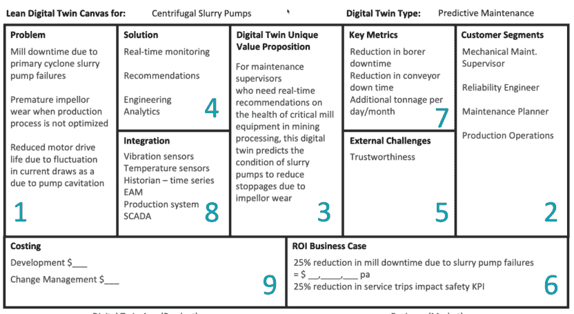

The numbers in the preceding diagram indicate the sequence for completing the canvas during a workshop with the business and IT teams:

- **Problem**: Describe the top three problems that the first Digital Twin will address based on the prioritization matrix described in _Chapter 1, Introduction to Digital Twin_.
- **Customer Segments**: Who are the stakeholders and business users that will benefit from the first Digital Twin solution?
- **Digital Twin UVP**: What makes this Digital Twin different from what you are already doing?
- **Solution**: What are the top three features that will deliver the key capabilities of the Digital Twin (AI, real time, decision support, and so on)?
- **External Challenges**: What are the external red flags for the Digital Twin (security, data access, connectivity, and so on)?
- **ROI Business Case**: How will this Digital Twin deliver the planned _value at stake_, as described in _Chapter 1, Introduction to Digital Twin_?
- **Key Metrics**: How will the Digital Twin be measured quantitatively?
- **Integration**: What are the critical integrations required to make it work?
- **Costing**: What is the projected cost of developing and operating the Digital Twin?

The preceding diagram shows a complete canvas for a slurry pump as part of a predictive maintenance Digital Twin in an industrial mining company. One of this approach’s main benefits is that the canvas provides a single-page view of all the critical aspects of interest to executive decision-makers. The template for the canvas is available to download at `https://bit.ly/idt-ldtc`.

The Lean Digital Twin canvas is ideal as a solution planning framework for your first Digital Twin, since it ensures that you have documented the problem statement and visibly clarified the expected outcomes.


### 验证问题陈述和预期结果

审查问题陈述和预期结果是初始阶段经过验证的学习重点的一部分，如图 4.4 所示。它为我们提供了持续迭代并朝着成功项目转向的机会。

在数字孪生原型的开发生命周期（图 4.1）的每个阶段，验证您正在解决的问题以及对业务结果的期望至关重要。最简单的方法是在每个阶段结束时的正式评审研讨会上使用精益数字孪生画布。您可以将其作为检查点，以确保所有利益相关者仍然与问题和预期的业务结果保持一致。

您应该为每个阶段更新画布的新版本，以便在项目结束时提供有价值的洞察。通过这样做，您将能够评估问题陈述在开发生命周期中对预期业务结果的演变。这是一个向高管展示数字孪生演进和开发的便捷工具，不仅展示技术方面，还展示业务考量。

验证您的问题陈述以及关于首个数字孪生结果的假设是一个不应被忽视的关键步骤。首个项目往往会在您的组织中形成对数字孪生等新方法的持久印象。图 4.4 中的第二个块描述了该方法，类似于精益创业方法中的产品/市场验证。经过调整的精益数字孪生指的是数字孪生/业务匹配，用于验证问题陈述并检查预期结果。

在本节中，我们提出了精益数字孪生画布作为规划首个数字孪生的业务验证和影响的解决方案框架。它基于精益创业方法，该方法强调经过验证的学习，而其中一个关键方面是验证我们是否在解决正确的问题以交付正确的结果。我们将在下一节介绍如何验证问题陈述和预期结果。

### 探索数字孪生开发的业务流程

定义业务流程的变化并确保最终用户接受培训以最大限度地利用数字孪生提供的新洞察至关重要。我们在“阶段 2 – 项目设计和开发阶段”部分中提到过这一点，但在数字孪生项目的生命周期早期就必须考虑这一影响：

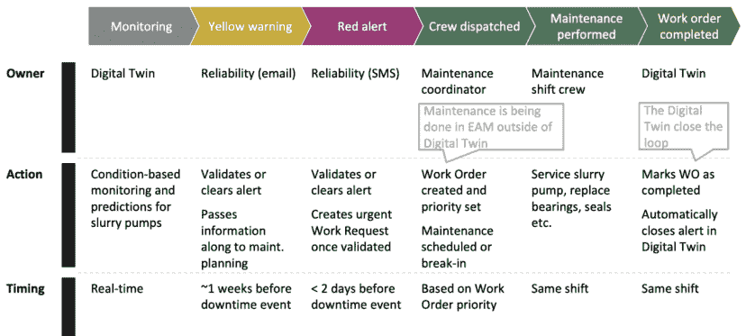

前面的图表描述了数字孪生在矿山浆液泵预测性维护示例中的业务流程影响。此示例展示了数字孪生、可靠性工程团队、维护规划团队和维护班组之间的交互。

数字孪生交付团队有责任确保现有流程已更改以包含新的工作方式，尤其是当它影响不经常使用数字技术解决方案的运营和业务用户时。

对于大规模项目，这可能需要进行正式的业务流程审查，但我们建议您为首个数字孪生绘制简单的流程图，类似于前面图表中所示的示例。这将改善各利益相关者之间的协作和沟通，并使所有流程参与者都能看到这些变化。在每个阶段审查这些变化很重要，但特别是在验证阶段，以确保拟议的新流程改善整体体验：

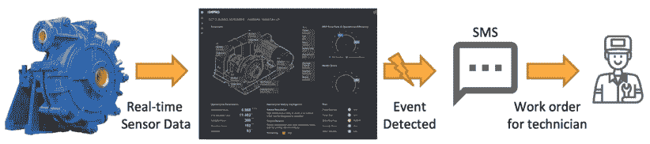

前面的图表展示了一个泵的简单端到端业务流程，其中数字孪生正在从物理泵接收实时数据。当数字孪生预测到潜在故障时，它会向服务技术人员发送消息以启动维修。数字孪生可以在业务系统（例如 ERP）中创建相应的工单。

对业务流程的更改不是首个数字孪生的唯一考虑因素。您此时做出的技术决策可能会影响您未来部署项目的结果和规模。让我们来探讨其中一些技术考量。

### 考虑技术因素

现在，我们已清楚了解希望通过首个数字孪生解决的问题、预期结果、精益敏捷开发周期中的不同项目阶段以及支持其所需的业务流程，我们需要解决首个数字孪生的技术考量。

为了标准化数字孪生定义、互操作性以及如何与这些数字孪生进行交互，各个组织正在致力于技术标准以应对这些挑战。该领域的两个著名项目是由 Plattform Industrie 4.0 开发的资产管理外壳（AAS）（https://bit.ly/idt-aas），以及由微软赞助的开源项目数字孪生定义语言（DTDL）（https://bit.ly/idt-dtdl）。除此之外，目前还在开发制造领域的数字孪生标准框架，例如“数字孪生制造框架”，该框架将作为 ISO 23247 发布。

AAS 和 DTDL 两项倡议都专注于技术上描述和实例化数字孪生，并具有重大的技术影响。在撰写本文时，这两项标准仍在制定中，缺乏足够的细节来帮助我们创建完全可操作的独立数字孪生。决定使用其中任何一项，或者甚至使用您自己的专有方法，是一项关键的架构决策，该决策受到您组织的技术栈以及您在短期和中期所需的复杂程度的影响。将您的首个数字孪生作为最小可行产品来创建的好处是，它可以让您在为业务决定标准之前测试这些方法。

为了决定为首个工业数字孪生使用哪种标准，我们将从高层次上探讨我们之前提到的两种新兴标准（AAS 和 DTDL）。

### 资产管理外壳

**资产管理外壳（AAS）** 是平台工业 4.0 的数字孪生实现，这是一个由德国的公司、协会、工会、科学组织和政府实体组成的网络。它由 Plattform Industrie 4.0 的“参考架构、标准和规范”工作组（**WG1**）开发（`https://bit.ly/idt-wgI40`）：


考虑将 AAS 用于您的数字孪生架构的原因之一，是产品制造商可能提供的数字孪生库，可用于组装复合数字孪生。

AAS 主要与工业 4.0 运动相关联，大部分活动来自欧洲制造商及其客户。技术考量主要围绕与其他基于 AAS 的资产数字孪生的互操作性。

本书不打算提供 AAS 的完整技术评估，但它是未来标准化数字孪生开发的关键技术考量。官方技术信息可在 https://bit.ly/idt-zvei-aas 上查阅，但我们将在此处介绍首个数字孪生的一些关键决策。

数字孪生开发的一项技术考量是您用于定义、创建、存储和操作数字孪生信息模型的格式。标准化这些工作将有助于数字孪生之间的互操作性，同时也将减少集成工作量，并使模型的重用更容易实现。

物理资产是 AAS 的核心。该框架旨在适应资产、组件、信息和子模型，这些要素建立产品层次结构，有点类似于物料清单。这是数字孪生信息模型的一个有用结构，因为它需要在更广泛的工业 4.0 供应商和消费者生态系统中运行。它以机器可读的格式提供对资产的共同理解，而 AAS 是资产及其相关数据的元模型描述。AAS 框架中有用于定义属性和物理单位概念描述的数据规范模板。

目前提供以下 AAS 序列化和映射。我们还指定了它们的典型用例：

- XML 和 JSON 用于通过 .aasx 交换格式在合作伙伴之间交换
- 资源描述框架（RDF）用于推理
- AutomationML 用于工程阶段
- OPC 统一架构（OPC UA）用于操作阶段


序列化遵循标准化结构，有助于改善协作和互操作性。下图显示了 AAS 结构化方法中资产的元模型：

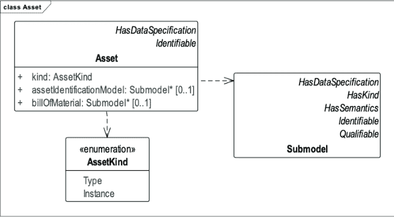

图 4-9 – AAS 结构中资产的元模型

以下 XML 代码片段展示了以机器可读格式定义资产及其组件或子模型层次结构的结构：

```
<aas:assetAdministrationShells>
    <aas:assetAdministrationShell>
        <aas:idShort>ExampleMotor</aas:idShort>
        <aas:category>CONSTANT</aas:category>
        <aas:identification idType="URI">http://customer.com/aas/9175_7013_7091_9168</aas:identification>
        <aas:assetRef>
            <aas:keys>
                <aas:key type="Asset" local="true" idType="URI">http://customer.com/assets/KHBVZJSQKIY</aas:key>
            </aas:keys>
        </aas:assetRef>
        <aas:submodelRefs>
            <aas:submodelRef>
                <aas:keys>
                    <aas:key type="Submodel" local="true" idType="URI">http://i40.customer.com/type/1/1/1A7B62B529F19152</aas:key>
                </aas:keys>
            </aas:submodelRef>
        </aas:submodelRefs>
        <aas:conceptDictionaries />
    </aas:assetAdministrationShell>
</aas:assetAdministrationShells>
```

这种序列化反过来可用于在集成层面与数字孪生进行交互，以及基于数字孪生用例要求，对资产进行可视化用户表示。工业 4.0 社区已提供开源开发者工具，AAS Explorer 是当前项目，其源代码可在 https://bit.ly/idt-aasx 获取。

部分数字孪生赋能技术供应商提供开箱即用的 AAS 支持，具备可视化和数据集成能力。以下截图展示了商业应用中智能工厂机器人的数字孪生在 AAS 定义中的实现：

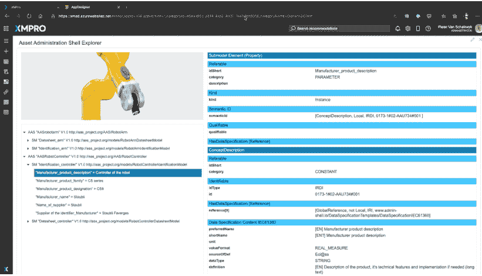

图 4.10 – 智能工厂 AAS 定义中机械臂数字孪生示例

其他供应商示例可在 http://www.i40-aas.de 找到。

另一个技术考量是，在单一技术环境中部署和管理标准化数据模型。当您正在标准化云解决方案提供商的技术栈时，这种方法很有意义。微软 DTDL 开源计划是支持这一技术考量的方法。

### 数字孪生定义语言 (DTDL)

通过其开源计划，微软开发了 **数字孪生定义语言 (DTDL)**，作为一种用于描述包含 IoT 设备、设备数字孪生和资产数字孪生的模型的语言。设备数字孪生是传感器设备的数字表示，包括电池电量和连接质量等设备信息，这些信息通常不与资产数字孪生相关联。DTDL 使用 JSON 的一种变体，即 **JSON-LD**，旨在作为 JSON 或 **资源描述框架 (RDF)** 系统使用。

DTDL 由一组元模型类组成，其方法与 AAS 类似。六个元模型类用于定义基于 DTDL 的数字孪生的行为：

- Interface
- Telemetry
- Property
- Command
- Relationship
- Component

这些元模型类可以使用 **软件开发工具包 (SDK)** 实现。有关 DTDL 及这六个类的开源实现的更多技术信息，可在 `https://bit.ly/idt-dtdlv2` 获取。

请注意，DTDL 只能部署在 **Azure 数字孪生** 服务上，该服务在撰写本书时可在 Microsoft Azure 云中使用。将其技术栈标准化为 Azure 和 Azure 服务的组织可能更倾向于使用 DTDL 进行数字孪生解决方案部署。有关 Azure 数字孪生的更多信息，请访问 `https://bit.ly/idt-adts`。

DTDL 定义实体之间的语义关系，以将数字孪生连接到反映其交互的知识图。它支持模型继承，以创建专用数字孪生。

Azure 数字孪生中的数字孪生知识图可以通过 Azure 数字孪生资源管理器 (https://bit.ly/idt-dtdlx) 进行可视化，该资源管理器显示不同数字孪生模型之间的关系。它是一个示例应用程序，演示了如何执行以下操作：

- 上传并探索基于 DTDL 的数字孪生的模型和图。
- 使用多种布局可视化数字孪生图。
- 编辑 DTDL 数字孪生的属性，并针对图运行查询。

以下截图显示了基于复合数字孪生 DTDL 模型的知识图示例。此示例的描述可在 https://bit.ly/idt-dtdlx 获取：

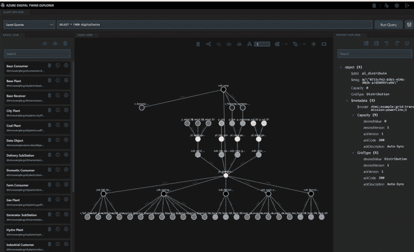

图 4.11 – Azure 数字孪生服务中的基于 DTDL 的数字孪生图

DTDL 目前比 AAS 简单，但其范围和功能也有限。它不存储数字孪生的历史数据，因为它只记录当前状态。如果传感器的温度输入发生变化，当前值会被新值覆盖。

使用 DTDL 的 Azure 数字孪生服务用户通常将时间序列数据存储在时间序列数据库中，然后使用 DTDL 资产标识符和属性创建用于分析目的的历史参考。这可以由 Microsoft Visual Studio 中的开发人员完成，也可以由工程师等领域专家在具有集成连接器的低代码数字孪生平台上完成，该平台提供对 Azure 数字孪生和时间序列数据库的访问。集成连接器的示例可见于图 4.12。

在决定将支持您首个数字孪生开发的数字孪生赋能技术时，这些是重要的技术考量。数字孪生主要是由软件开发人员开发和使用，还是面向业务用户以便在您的组织中创建和维护数字孪生？这两种在技术上都是可行的选项，但需要不同的技术能力来支持数字孪生项目的目标。

以下是描述离心浆泵某些属性的 DTDL JSON 示例：

```json
{
 "@id": "dtmi:com:XMPro:PumpAssembly;1",
 "@type": "Interface",
 "@context": "dtmi:dtdl:context;2",
 "displayName": "Pump Assembly",
 "contents":[
 {
 "@type": "Property",
 "name": "Description",
 "schema": "string"
 },
 {
 "@type": "Property",
 "name": "PumpType",
 "schema": "string"
 },
 {
 "@type": "Property",
 "name": "MotorRatedPower",
 "schema": "double"
 },
 {
 "@type": "more types and properties here"
 }
 ]
}
```

以下截图显示了一个低代码应用程序开发平台示例，其中遥测数据正在发送到 Azure 数字孪生和时间序列洞察：

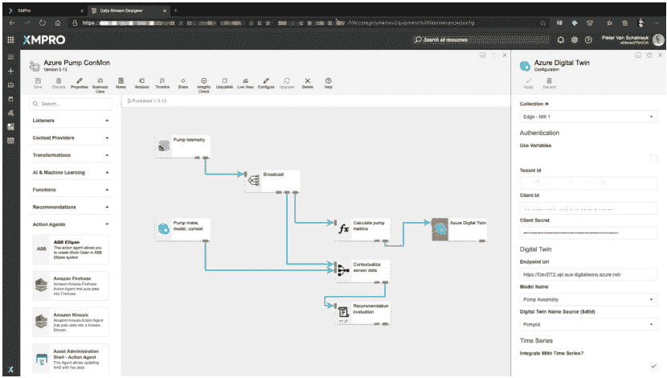

图 4.12 – Azure 数字孪生服务中的基于 DTDL 的数字孪生图

以下截图展示了前一张截图中的泵遥测数据（使用 DTDL 建模）如何在最终用户界面中呈现：

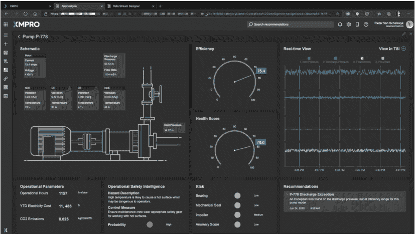

图 4.13 – Azure 数字孪生服务中的基于 DTDL 的数字孪生图

AAS 和 DTDL 凸显了在决定用于开发数字孪生的底层赋能技术时需要解决的一些技术考量。还有许多其他技术方面，例如安全性、可信性、远程访问、通信要求和用户界面，我们将在本书后面开发首个数字孪生时进行高层次介绍。接下来，我们将探讨支持数字孪生开发过程的数字平台。

### 探索数字孪生的数字平台

数字孪生需要一个数字环境来帮助构建和部署其应用程序。数字孪生的数字平台通常由多个组件组成，这些组件协同编排以提供数字孪生赋能技术栈。

这些数字组件包括以下内容：

- IoT 平台
- 业务流程管理平台


### IoT 平台

IoT 平台通常包含多种功能，用于将 IoT 设备连接到分析和业务应用程序。传统的 **操作技术 (OT)** 平台连接专有设备和控制系统。相比之下，IoT 平台通过开放协议连接到广泛的 IoT 设备，并将信息提供给运营和业务应用程序。

IoT 平台通过以下方式支持数字孪生的开发：

- 监控 IoT 端点和实时数据流
- 支持专有和开放行业连接协议，用于连接和数据传输
- 在 IoT 数据上实现基于物理和数学的分析
- 提供边缘、分布式和云计算选项
- 通过 API 提供集成，用于应用程序开发
- 将 IoT 数据与业务和运营系统中的信息进行上下文化

高级 IoT 平台的一些关键功能包括以下内容：

- 设备管理
- 数据集成
- 数据存储和管理
- 分析
- 应用程序开发支持
- 安全性和隐私性

结合这些功能，为数字孪生开发项目提供了理想的技术基础。然而，数字孪生的目标不仅仅是围绕实时传感器或 IoT 信息，而是围绕数字孪生所推动的业务成果。

这些业务成果受到基于数字孪生所获得的洞察所采取的行动的影响。如前一章所述，更改或调整业务流程是数字孪生长期价值的关键成功因素。

IoT 平台的一些代表性供应商包括以下内容：

- Alleantia (alleantia.com)
- Particle (particle.io)
- Microsoft (microsoft.com)
- Relayr (relayr.io)
- Thingworx (ptc.com)

> 重要说明
> 请注意，这只是代表性列表，而不是详尽列表。此列表仅供参考。

来自数字孪生的信息可以为运营用户提供决策支持，也可用于流程自动化，以将人从循环中移除。业务流程管理平台可以同时解决这两个问题。

### 业务流程管理平台

用于数字孪生的 **业务流程管理 (BPM)** 平台可能与 IoT 平台功能有重大重叠，但 BPM 平台的重点更多在于推动由 IoT 数据产生的业务流程或工作流。BPM 对 IoT 设备管理、连接性和通信协议的关注较少。

高级 BPM 解决方案还提供面向主题专家的低代码配置环境，以帮助配置工作流、流程和业务规则，从而触发或自动执行操作。此过程不仅包含来自 IoT 来源的数据，还将高级分析嵌入到运行中的流程中，以从数字孪生应用程序生成洞察和情境意识。

BPM 平台的一些代表性供应商包括以下内容：

- Avolution (avolutionsoftware.com)
- Boxarr (boxarr.com)
- iGrafx (igrafx.com)
- QPR (qpr.com)
- XMPro (xmpro.com)

> **重要说明**
> 请注意，这只是代表性列表，而不是详尽列表。此列表仅供参考。

BPM 平台交付来自数字孪生的操作，但该解决方案可能需要更多关注数据和分析，以确定行动方案。

### 分析和数据平台

分析和数据平台是提供高级分析功能的数字工具。这些功能包括机器学习、人工智能和高保真物理功能。

这些分析平台通常依赖 IoT 平台从传感器和控制系统来源摄取数据。其他数据管理功能包括历史服务、数据湖和针对特定设备类型的预构建分析库。

分析和数据平台通常与 BPM 或应用程序平台结合使用，以可视化并采取分析洞察所产生的结果的行动。

分析和数据平台的一些代表性供应商包括以下内容：

- ANSYS (ansys.com)
- C3.ai (c3.ai)
- OSIsoft (osisoft.com)
- Sight Machine (sightmachine.com)
- Uptake (uptake.com)

> **重要说明**
> 请注意，这只是代表性列表，而不是详尽列表。此列表仅供参考。

### 应用程序平台

应用程序平台是您在组织中开发和使用数字孪生时需要考虑的最后一类数字孪生赋能技术。应用程序平台用于创建垂直聚焦的数字孪生解决方案，以支持现有应用程序，例如 **资产性能管理 (APM)**、**企业资产管理 (EAM)** 和 **运营性能管理 (OPM)**。数字孪生为这些业务应用程序带来了新功能，而数字孪生的配置是供应商自身更广泛应用程序套件的一部分。

应用程序平台的一些代表性供应商包括以下内容：

- AVEVA (aveva.com)
- Bentley (bentley.com)
- GE Digital (ge.com)
- IBM (ibm.com)
- Oracle (oracle.com)
- SAP (sap.com)
- Siemens (siemens.com)

> **重要说明**
> 请注意，这只是代表性列表，而不是详尽列表。此列表仅供参考。

您的数字孪生的应用程序和用例将决定您所需的数字平台功能。如前一章所述，验证所需结果的业务问题对于考虑正确的数字技术和基础设施至关重要。

在下一章中，当我们开始设置第一个数字孪生原型时，这将变得更加明显。

### 摘要

在本章中，我们考虑了在开始第一个数字孪生项目之前需要的规划框架。我们研究了项目规划框架，该框架描述了涉及的阶段，以及解决方案规划框架，该框架定义了我们正在解决的问题、关注的用户以及预期的结果。

然后，我们回顾了如何验证问题陈述和预期结果，以及这将如何影响现有和未来的业务流程。我们还考虑了技术决策的影响。最后，我们提供了赋能技术的高级概述，以及我们可以用于在下一章设置第一个数字孪生的不同类型的数字平台。

在 _第 5 章，设置数字孪生原型_ 中，我们将开始设置第一个数字孪生原型，方法是选择数字孪生平台、决定云基础设施，并启动配置和设置。我们还将考虑数据的影响，并为我们的第一个数字孪生创建解决方案架构。

### 问题

1. 描述您的数字孪生原型的项目阶段。
2. 您能否创建精益数字孪生画布来描述您的解决方案？
3. 您的数字孪生解决方案的主要技术考虑因素是什么？
4. 您认为数字孪生在您的组织中将带来哪些好处？
