### 5 设置数字孪生原型

在第 4 章，开始使用我们的第一个数字孪生中，我们评估了数字孪生之旅的规划阶段和框架。我们涵盖了数字孪生预期的业务成果以及达到所需状态的过程。我们讨论了在企业中创建和管理数字孪生的技术要求。

本章将介绍构建数字孪生原型所需的步骤。我们将首先评估公共云和 **物联网 (IoT)** 平台注意事项，以及构建数字孪生所需的功能。

本章将涵盖以下主题：

- 确定数字孪生平台
- 评估用于数字孪生的公共云、IoT 和专业平台
- 配置和设置
- 您的 Azure 数字孪生的数据注意事项
- 解决方案架构

### 识别数字孪生平台

在第 3 章“识别第一个数字孪生”中，我们从各种公司的角度探讨了数字孪生的评估。第一种和第二种类型是大型工业公司，它们可能是工业资产的制造商。在这里，我们将扩展到此类考虑，例如工业制造商有兴趣在资产的整个生命周期内改进产品并提供良好的维护服务，以服务于其客户或资产的操作员。

### 资产所有者的视角

让我们将范围缩小到能源领域和风力涡轮机制造商。全球变暖和可再生能源的使用正在增加。因此，我们相信风力涡轮机将继续成为能源领域的重要工业资产。**水平轴风力涡轮机（HAWT）**，如下图所示，是最常用的风力涡轮机类型。这种风力涡轮机可以作为单个资产或作为风电场的一部分使用。工业级风力涡轮机可使用约 20 年。风力涡轮机产生能量不需要化石燃料，因为它利用运动的风作为能源。风是风力涡轮机产生能量的唯一输入，就像阳光是太阳能农场的能源一样。如今，更大的风力涡轮机可以产生 10-20 **兆瓦（MW）** 的能量（参见 https://reneweconomy.com.au/germany-gears-up-to-test-20mw-wind-turbines-79007）。这种风力涡轮机的翼展可达 200 米：

图 5.1 – HAWT

风电场可以包含少量涡轮机到数百台涡轮机。此类风电场可以位于陆地（陆上）或海上。下图显示了一个海上风电场。此类位置通常具有 5-10 **米/秒（m/s）** 的风速，以实现有效的发电。风力涡轮机的相对位置和距离对于提高风电场的整体发电量非常重要。同样，风电场通常位于一年中大部分时间或一天中大部分时间有持续风流的地区：

图 5.2 – 海上风电场

当我们准备了解构建风力涡轮机和风电场数字孪生的要求时，了解风力涡轮机在风电场中的物理布局是如何进行以最大化整体发电量非常重要。下一台涡轮机底座之间的距离和方向定向是确定的，使得一台涡轮机对其余涡轮机的风流干扰最小。这种对风的影响称为尾流效应。尾流效应可以来自同一风电场中的不同涡轮机（内部尾流效应）或来自邻近的风电场（外部尾流效应）（参见 `https://www.wind-energy-the-facts.org/wake-effect.html#`）。尾流效应是附近未来风电场建设需要考虑的因素。这很重要，因为风力涡轮机和风电场的寿命很长。附近森林中树木的生长也可能随时间影响风的性质。

接下来，让我们看看构建数字孪生解决方案基础所需的哪些基本能力，例如用于风力涡轮机和风电场。

### 所需的 IoT 能力

数字孪生需要来自资产的数据以保持孪生体的最新状态。这有助于构建和维护更准确的孪生体，从而确保更好的结果。这些结果可以支持预测性维护的决策，也可以简单地通过更好的资产利用率产生。在过去十年中，我们看到了几个 IoT 平台的增长，其中一些面向工业资产。通用 IoT 技术栈如下图所示，该图描绘了设备连接以捕获和转换数据，然后将其传递到 IoT 核心平台。此类核心 IoT 通常位于公有云平台上。包括数字孪生在内的应用程序通常构建在 IoT 平台之上：

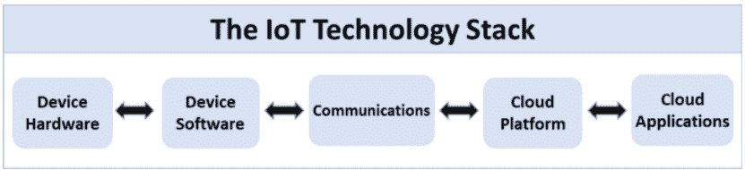

图 5.3 – IoT 技术栈

> **注意**
> 图片引用：Abunahla, H., Gadhafi, R., Mohammad, B. et al. *Integrated graphene oxide resistive element in tunable RF filters*. Sci Rep 10, 13128 (2020)。
> https://doi.org/10.1038/s41598-020-70041-x

接下来，让我们看看 IoT 平台的一些基本能力，即以下内容：

- 从资产、传感器、网关设备或第三方来源（例如环境数据）收集数据的能力。
- 安全可靠地将数据传输到数据存储层的能力。此活动可能需要协议转换和/或数据加密。
- 处理不同类型的通信介质，例如有线、无线，甚至用于偏远地区的卫星通信。
- 了解资产和资产群结构的能力，以便数据可以映射到有意义的构造中。
- 分析来自不同类型数据存储（例如时间序列、关系型或非结构化）的数据的能力，并应用模型和算法生成洞察。
- 允许为特定目的构建的应用程序基于平台功能构建。

现在，当我们查看 IoT 平台所需的基础能力时，我们发现这些是以下内容：

- 计算
- 存储
- 网络

为了以弹性和敏捷的方式获得这些基础能力，IoT 平台使用公有云。由于 IoT 中资产的分布式特性，计算、存储、网络和连接能力可能需要在多个位置。公有云平台通常具有区域和**可用性区域（AZs）**的概念，以帮助满足此类要求。网络安全通过遵循安全实践来处理，例如 a) 限制在不经过现有控制系统的情况下远程驱动设备，以及 b) 在边缘和云之间使用数据加密，以减少数据在传输过程中被篡改的可能性。

### 构建与购买能力

我们在前一节中查看了 IoT 平台所需的基础能力。鉴于这些能力在任何公有云平台上都存在，从公有云“购买”此能力而不是“构建”它可能是一个容易的决定。如果我们回到大约十年前，许多大型企业过去曾构建自己的数据中心以满足其计算需求，并将其数据和**信息技术（IT）**应用程序保存在公司防火墙内。随着公有云技术开始成熟并加强安全性和合规性，企业开始转向在公有云中“购买”类似虚拟数据中心的能力。

在构建数字孪生解决方案（例如，在我们的案例中，风力涡轮机的数字孪生）时，制造公司将面临类似的构建与购买决策。我们将通过提供该公司当前技术环境的详细信息来分解此决策过程，如下：

- 作为一家全球性集团，该公司拥有许多应用程序和数据库。这些应用程序已被分类为 a) 关键任务和 b) 非关键任务。同样，数据库已被分类为 a) 出口管制/受限；b) 私有；和 c) 公共数据。
- 首席信息官（CIO）已获得批准，将非关键任务类别中的应用程序存储在公有云平台上，并使用私有或公共数据。然而，这要求公有云提供商证明其满足一定水平的行业标准和合规性要求。
- 基于公司已批准的公有云平台，云平台上提供了 IoT 平台选项。IoT 平台与用于 IT 应用程序和数据库的选定公有云平台的接近性，确保了进出选定云平台的数据移动量减少。
- 在选定公有云平台上运行的 IoT 平台子集面向工业资产，并不仅限于消费级 IoT 场景。
- 该公司正在减少其数据中心的足迹，除了其高度受限或出口管制的关键任务应用程序和数据。然而，该公司正在评估公有云提供商的路线图，以满足其性能和合规性要求，无论是通过公有云还是混合云/边缘云产品，在未来 2 年内。

基于此处的考虑，该公司决定在此案例中采取“购买”路线，而不是“构建”路线。

### 评估数字孪生的公有云、IoT 和专业平台

让我们看看构建风力涡轮机数字孪生解决方案的考虑因素。在过去十年中，企业计算一直在向公有云转移，在此期间，行业出现了大规模公有云提供商。根据 2020 年 9 月发布的《云基础设施和平台服务魔力象限》，这些是主要提供商：

- Microsoft Azure
- Amazon Web Services (AWS)
- Google Cloud Platform (GCP)
- Alibaba Cloud
- Oracle Cloud Infrastructure (OCI)
- IBM Cloud
- Tencent Cloud

阿里巴巴和腾讯主要在中国流行，因此，我们不会在此讨论这两个平台。我们将从数字孪生的角度，探讨当今行业中常见选项的功能。

# Microsoft Azure Digital Twins

Microsoft **Azure Digital Twins** (**ADT**) 是 Azure IoT 的一部分，是一个基于 IoT 的数字孪生平台，如在 _第 4 章，着手构建我们的第一个数字孪生_ 中所述。Azure IoT 包含多个平台服务，这些服务可以在边缘和云端访问。用于提供 IoT 平台的一些服务包括以下几项：

- **Azure IoT Hub**—这是一个云托管的、安全的双向通信服务，用于 IoT 设备与应用程序后端之间的通信。
- **Azure IoT Central**—这是一个 **用户界面 (UI)** 应用程序，用于管理 Azure IoT Hub 上的设备。
- **Azure IoT Edge**—这通过 Azure 服务的容器化运行 IoT 边缘设备。
- **Azure RTOS**—这是一个面向资源受限 IoT 设备的操作系统，包含嵌入式开发套件。
- **Azure Time Series Insights (TSI)**—使用此服务来存储、可视化和查询大量时间序列数据集。
- **ADT**—这是一个 **平台即服务 (PaaS)** 功能，用于为描述实体或事物模型及其与其他实体关系的实体创建基于图的关系。

这些服务根据业务和技术要求以不同配置组合，以提供 Azure IoT 平台。IoT 和数字孪生应用程序通过微软开发者工具（如 Visual Studio 和 **Visual Studio Code (VS Code)**）在 ADT 平台上开发。

ADT 中的知识图在单一模型中存储实体、关系和状态信息。_图 5.4_ 展示了 Azure IoT 平台及其服务的高级视图，以及 ADT 在架构中的位置。

ADT 使用 **数字孪生定义语言 (DTDL)**，我们在 _第 4 章，着手构建我们的第一个数字孪生_ 中已介绍过。DTDL 是一种开源建模语言，旨在提高 ADT 模型在不同应用程序和用例中的互操作性和可重用性。

您可以在此处查看架构概览：

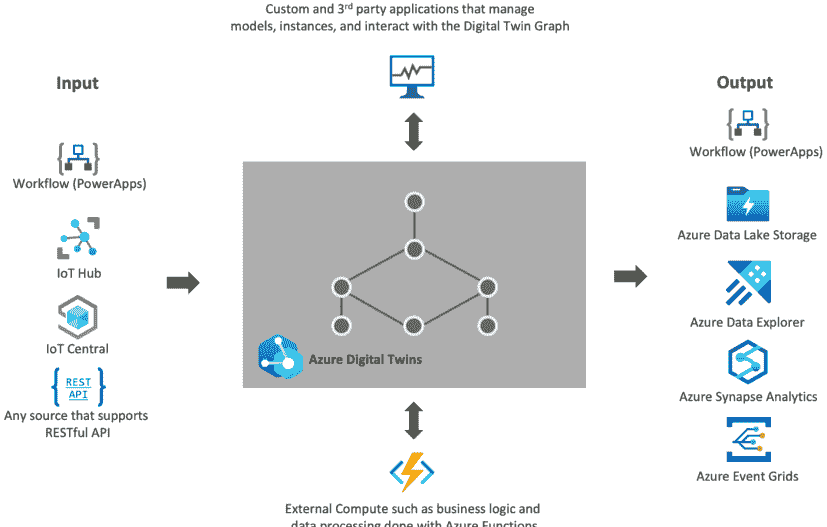

图 5.4 – Azure IoT 平台中的 Microsoft ADT

微软在 Azure IoT 和 ADT 方面拥有广泛的行业关注度。这包括基础设施、制造、能源与公用事业、石油与天然气以及采矿等垂直领域（在撰写本书时）。

接下来我们将探讨 AWS 的功能。

# AWS IoT 平台

让我们来看看 AWS 的功能。AWS 早在 2006 年就开始提供公有云服务。如今，它在 **基础设施即服务 (IaaS)** 和 PaaS 市场中占有很大份额。2015 年底，Amazon 宣布了其 AWS IoT 产品，最初是 AWS IoT Core 或面向连接设备的云服务。其他 AWS 服务，例如 Amazon **简单存储服务 (S3)**、Amazon Kinesis 等，可以与 IoT Core 一起用于构建 IoT 应用程序。AWS IoT 平台支持常用的 IoT 协议，例如 **消息队列遥测传输 (MQTT)**、**超文本传输安全协议 (HTTPS)** 和 **低功耗广域网 (LoRaWAN)**。那些已经使用 AWS 进行 IaaS 和 PaaS 并将其企业数据和应用程序部署在 AWS 上的企业，开始考虑使用 AWS IoT 平台来开发需要设备连接和传感器数据的应用程序。

对于标准化于某个云平台的企业来说，它通常是新云功能（在此案例中为 IoT 和数字孪生）的起点。在某些情况下，CIO 希望在 IT 和云环境中拥有较少的组件。通常，公有云提供商的安全和合规审批过程很漫长，企业会尽量减少使用的公有云平台数量，除非他们愿意采用最佳方案解决方案，或将多云作为其业务连续性策略的一部分。通常，进出公有云平台会产生数据费用，并在应用程序之间引入延迟。

Amazon 的 IoT 产品仅限于其 IoT 平台。Amazon 未在平台之上构建任何可以作为软件即服务 (SaaS) 提供的 IoT 应用程序。SaaS 产品或 IoT 应用程序更易于业务用户使用，而平台功能通常需要软件专业人员和应用程序开发人员通过可用的 IoT 应用程序来使用这些服务。Amazon Sumerian 提供围绕三维 (3D) 建模、增强现实 (AR) 和虚拟现实 (VR) 的功能，可以与 IoT 平台一起用于构建类似数字孪生的应用程序。一个示例是制造工厂的数字孪生，带有设备和平面图的 3D 视图，用于为员工提供培训。

Amazon 提供设备影子服务（参见 https://docs.aws.amazon.com/iot/latest/developerguide/iot-device-shadows.html）。该服务允许您创建物理设备的影子，并例如将物理设备的状态提供给应用程序。但是，影子并不是物理资产的动态数字孪生。设备影子可以存储在 JavaScript 对象表示法 (JSON) 文件中。此类 JSON 文件中的信息将是设备元数据、状态或版本，以及与设备关联的任何安全令牌。应用程序可以使用表述性状态转移 (REST) 应用程序编程接口 (API)（即用于 GET、UPDATE 或 DELETE 请求）或通过 MQTT 消息与设备影子进行交互。

据我们所知，在 2021 年初撰写本书时，AWS 平台上没有完整的数字孪生服务。但是，有独立软件供应商 (ISV) 在 AWS 之上提供此类功能。一个示例是 Hexagon Digital Reality (HxDR) 平台（参见 https://aws.amazon.com/blogs/industries/hxdr-transforming-geospatial-data-in-the-cloud-with-aws-and-hexagon-leica-geosystems/）。

HxDR 提供用于在 AWS 之上构建结构的数字孪生功能。此类数字孪生解决方案的一些特征概述如下：

- 高计算复杂度，用于从物理结构中混合空间数据以创建数字孪生。随着模型规模和精度的增长，能够弹性增长计算能力的特点使公有云适合此用途。
- 高保真数字孪生需要大量关于其物理结构的数据。由于数据量大，存储并使这些数据可用是一项挑战性的任务。存储增长可以是按需或在公有云上进行。HxDR 使用 AWS S3 进行此类弹性存储。
- 数据可能会在全球范围内收集，具体取决于数字孪生的问题领域。通常，公有云平台在多个位置以及边缘位置都有接入点。
- 为数字孪生收集的数据的安全性和敏感性可能需要底层云平台提供额外的安全服务。

Vertex 是 AWS 平台上另一家提供数字孪生功能的供应商（参见 `https://aws.amazon.com/iot/solutions/VertexDigitalTwin/`）。Bosch IoT Things on AWS 可以使用 MQTT 和 **高级消息队列协议 (AMQP)** 连接到设备，并帮助管理数字孪生（参见 `https://aws.amazon.com/marketplace/pp/BoschIO-GmbH-Bosch-IoT-Things/B07DTJK8MV`）。

总结，我们看到像 AWS 这样的公有云提供商可以通过 IoT Core 和其他服务的组合，或来自 ISV 合作伙伴的专门产品，从零开始构建数字孪生功能，这些功能可以用于快速入门。但是，Amazon 缺乏其自身的完整数字孪生解决方案。

接下来让我们探讨 Oracle 在这一领域提供的功能。

# Oracle IoT 应用程序

让我们现在来看看 Oracle 的功能。Oracle 以 **企业资源计划 (ERP)** 和被全球多家中大型企业使用的技术解决方案而闻名。当一家公司寻找 IoT 和数字孪生解决方案时，当前的 ERP 和制造应用程序提供商可能会影响该决策。Oracle 和 SAP 是提供 ERP、**客户关系管理 (CRM)** 或 **人力资本管理 (HCM)** 等业务应用程序的两家主要全球供应商。该领域的其他供应商包括 `Salesforce.com`、Workday、Infor 等。一些大型全球公司可能拥有 Oracle、SAP 和 `Salesforce.com` 的组合，无论是由于不同的业务线还是并购活动。Oracle 的业务应用程序自 2012 年起通过云作为 SaaS 产品提供。Oracle 后来推出了其公有云平台，其当前产品称为 OCI。

Oracle 几年前开始在其公有云上提供 IoT 平台，并进一步通过 IoT 应用程序对其进行了丰富，这些应用程序是 SaaS 产品（请参阅 https://www.oracle.com/internet-of-things/）。Oracle 的 IoT 智能产品包括以下内容：

- **Smart Manufacturing/Production Monitoring** — 在制品监控，最大限度地提高产品质量，并防止非计划停机
- **Predictive Maintenance/Asset Monitoring** — 连接资产和连接产品
- **Connected Logistics/Fleet and Shipment Monitoring** — 监控货运和仓库自动化
- **Connected Worker** — 工人安全监控

接下来，让我们看看 Oracle 提供的数字孪生相关功能。这里的数字孪生重点关注工业资产。Oracle 提供的功能适用于三种不同的场景，概述如下：

- **Virtual twin**: 该孪生体是物理资产的软件等效体，可帮助模拟资产，以便在连接物理设备之前进行测试和虚拟配置等功能。
- **Predictive twin**: 该孪生体用于捕获物理资产的预期行为，并有助于预测其未来状态，包括机器的剩余使用寿命或其对环境的影响。
- **Twin projections**: 该孪生体适用于智能工厂、物流、**供应链管理 (SCM)**、仓储、维护和修理以及资产密集型行业中的现场服务交付等工业环境中的场景分析和规划。

有关 Oracle 数字孪生实现的更多详细信息，请参阅 https://docs.oracle.com/en/cloud/paas/iot-cloud/iotgs/oracle-iot-digital-twin-implementation.html。

Oracle 提供了一个 IoT 数字孪生模拟器，允许模拟来自物理资产的数据、警报和事件，而无需连接到它们。除了 IoT 和数字孪生功能外，Oracle 还为智能追踪与追溯或智能冷链解决方案提供区块链应用程序。此类功能在 COVID-19 相关疫苗分销至消费点方面非常有用。Oracle 允许创建数字线程，可用于从产品的设计构思一直到资产整个生命周期的生产使用来追踪产品。

Oracle IoT 数字孪生实现可能适合使用 Oracle Cloud ERP 应用程序或 OCI 用于其他目的的公司。在这种情况下，数据和应用程序将保留在 Oracle 云上。在其他云平台上运行其业务应用程序的公司可以评估 Oracle IoT 应用程序和数字孪生功能，以满足其功能需求。

在查看了 Microsoft Azure、Amazon AWS 和 Oracle Cloud 的产品后，我们将接下来转向更专业的产品，例如 **PTC (formerly Parametric Technology Corporation)**。

### PTC ThingWorx

PTC ThingWorx 是一个基于 IoT 的数字孪生平台，如 _Chapter 4_、_Getting Started with Our First Digital Twin_ 中所述。ThingWorx 是 PTC 工程解决方案套件产品的一部分，该套件包括用于 AR 的 Vuforia、用于 **产品生命周期管理 (PLM)** 的 Windchill 以及用于 **计算机辅助设计 (CAD)** 的 Creo。

在撰写本书时，ThingWorx 包含三个主要组件来创建数字孪生 (`http://bit.ly/idt-3thingworx`)，概述如下：

- **ThingModel** — 作为 ThingWorx 数字孪生基础的数据模型
- **ThingWorx Composer** — 用于配置模型、编写服务和逻辑规则以及管理 ThingModel 系统配置的应用程序开发环境
- **ThingWorx Mashup Builder** — 用于可视化元素的 UI 创作环境

ThingWorx 是一个基于 Java 的平台，可以本地安装或部署在 Microsoft Azure 或 Amazon AWS 云基础架构上。ThingWorx 可以在 Microsoft Windows 或 Linux 上运行，具体取决于客户组织的要求。PTC ThingWorx 还可作为托管 PaaS 以及 SaaS 解决方案提供给不想管理底层计算基础架构的客户。以下屏幕截图显示了使用 PTC ThingWorx 的示例数字孪生：

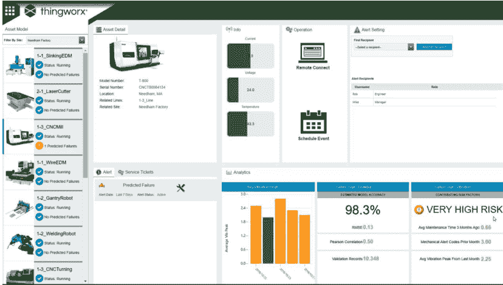

图 5.5 – PTC ThingWorx 示例数字孪生（来源：http://bit.ly/idt-thingworx）

PTC ThingWorx 具有广泛的行业关注点，涵盖所有资产密集型行业，但在撰写本书时，制造业客户占比较高。PTC 目前向制造业领域销售一系列 PLM 和 CAD 解决方案，这些解决方案提高了 ThingWorx 在该市场细分领域的知名度。

在下一节中，我们将重点介绍 XMPro，它是该领域的一个利基提供商。

### XMPro

XMPro 是一个基于 **业务流程管理 (BPM)** 的数字孪生平台，如 _Chapter 4, Getting Started with Our First Digital Twin_ 中所述。XMPro 构建于 Microsoft .NET Core 平台之上，可以部署在边缘、云端，或两者的混合组合中。请参见图 5.6，了解使用 XMPro 平台的示例。

XMPro 主要面向工程师、科学家、地质学家和其他更喜欢低代码应用程序开发环境而非传统 **集成开发环境 (IDE)**（例如 Microsoft Visual Studio）的 **主题专家 (SMEs)**。在撰写本书时，XMPro 包含以下模块：

- **XMPro Data Stream Designer** — 这是一个低代码集成和编排环境，用于将实时 IoT 数据与分析和操作相连接。数据流是集成和服务代理的集合，例如监听器、上下文提供程序、转换、函数、**人工智能 (AI)** 和 **机器学习 (ML)** 服务以及操作代理。
- **XMPro App Designer** — 这是一个低代码可视化编程 UI，用于创建数字孪生应用程序。App Designer 还用于配置 XMPro 推荐引擎的工作流逻辑和业务规则。

您可以在此处查看 XMPro 平台的示例视图：

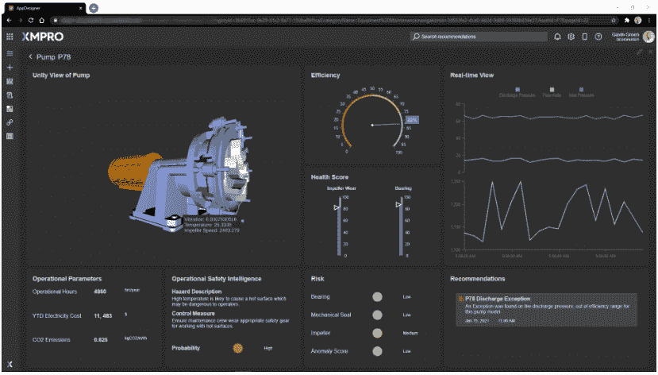

图 5.6 – XMPro 示例数字孪生（来源：XMPro Inc.）

XMPro 专注于使资产密集型行业（如采矿、石油和天然气、石化和制造业）中的非程序员能够使用，也用于供应链解决方案。

在上一节中，我们研究了不同基于云的 IoT 和数字孪生解决方案的功能。这种比较研究有助于企业在进行数字孪生之旅时的决策过程。在本书的背景下，我们将使用 Microsoft ADT 来详细介绍该过程。此决定基于几个因素，概述如下：

- ADT 于 2020 年 11 月由 Microsoft Azure 公开发布，因此可以轻松用于开发、测试或生产部署。
- 在我们构建风力涡轮机数字孪生的全球集团背景下，CIO 已经为其企业应用程序选择了 Microsoft Azure。
- 该公司决定首先探索 Azure 上所有可用的数字孪生选项。
- 该公司还计划将风力涡轮机的数字孪生功能提供给其客户，例如风电场的所有者和运营商。根据其市场调研，能源行业没有首选的公有云平台。

在下一节中，我们将介绍使用 Microsoft ADT 构建风力涡轮机数字孪生的方法。

# 配置和设置

在我们可以在 Microsoft ADT 中配置第一个数字孪生之前，必须在 Microsoft Azure 上设置云基础架构和帐户。Microsoft 为 Azure 管理员提供了详细的设置说明，但我们将从希望设置免费帐户以构建第一个数字孪生原型的非企业用户的角度出发。ADT 文档位于 `http://bit.ly/1dt-azuredocs`。

第一步是创建一个免费的 Azure 帐户，该帐户将托管你的 ADT 服务以及为你的第一个数字孪生所需的任何其他 IoT 和分析服务。请参阅以下屏幕截图，了解如何执行此操作的概述：

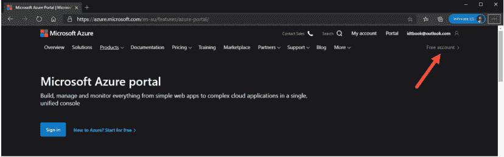

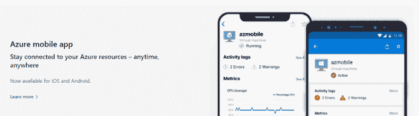

图 5.7 – Microsoft Azure 门户 UI

创建帐户后，你将被引导至 Azure 服务门户。这是所有 Azure 服务（包括 ADT、Azure 数据库、IoT 服务以及 Microsoft 在其 Azure 产品系列中提供的所有其他产品）的中央管理环境。

ADT 是一种 PaaS 解决方案，提供创建和使用数字孪生所需的基础设施。它是面向开发人员编写数字孪生代码的开发环境。它不是面向最终用户的应用程序，也没有供业务用户配置数字孪生的 UI。执行这些操作需要你的 Azure 帐户中的其他 Azure 服务。

ADT 可以通过基于 Web 的 Azure 门户或通过 **Azure 命令行界面 (Azure CLI)** 在命令行中进行配置。这两种方法均在官方 Microsoft 文档中记录，网址为 `http://bit.ly/idt-azuredocs`。出于本书的目的，我们将高度概述门户配置方法。

ADT 及其支持的应用服务的配置和设置分为五个主要步骤，如下图所示：

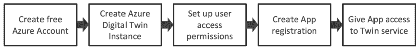

图 5.8 – Microsoft ADT 资源和应用程序配置

第一步是设置 Azure 帐户。在撰写本书时，Microsoft 提供免费帐户选项。第二步是在你创建的 Azure 帐户中创建 ADT 资源或服务。第三步是为你自己授予所创建 ADT 资源的用户和数据访问权限。你也可以在此步骤中授予其他人访问你的 ADT 服务的权限。你创建的 ADT 资源需要一个 Azure 应用资源才能针对 ADT 服务进行编码。我们在第四步中配置应用资源。最后，在第五步中，我们授予应用资源对 ADT 服务的访问权限和权限。

你可以在以下屏幕截图中查看此概述：

**最近的资源**

| 名称 | 类型 | 最后查看 |
|---|---|---|
| idtbook | 资源组 | 42 分钟前 |
| idtbooktwins | Azure 数字孪生 | 一小时前 |

图 5.9 – Microsoft Azure 门户 UI

图 5.9 所示的 UI 表明你已成功创建免费的 Azure 帐户，并显示了撰写本书时可用的服务列表。我们流程中的下一步是为 ADT 创建一个新服务。选择 **+ 创建资源** 选项。应会显示一系列现有资源，如果 ADT 未显示，你可以轻松在搜索栏中搜索它，如以下屏幕截图所示：

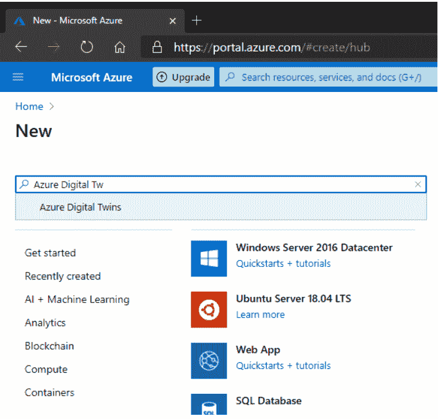

图 5.10 – 创建新的 Azure 资源

找到 ADT 资源后，单击 **创建** 按钮以开始配置资源的过程。

创建资源包含两个主要组件——第一个是选择资源将在其中运行的订阅，第二部分是为 ADT 资源或服务选择托管位置和名称。

以下屏幕截图显示了订阅选项，最好以易于识别的方式命名资源组。出于构建第一个数字孪生的目的，我们建议你为数字孪生应用程序创建一个资源组。你可以将资源组视为一个容器，用于保存 Azure 解决方案的相关资源。出于本书后续参考，我们将资源组命名为 digitaltwinbook：

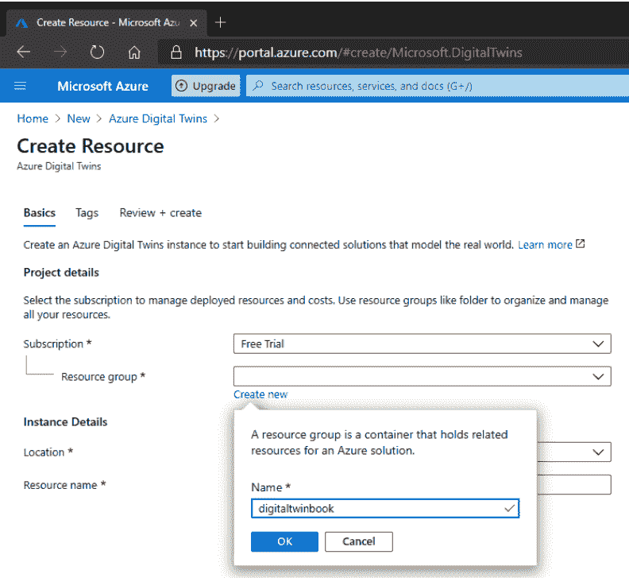

图 5.11 – 创建 Azure 资源订阅

创建 Azure 订阅过程的第二部分是选择托管位置并命名资源。提供 ADT 资源的托管位置可从下拉列表中选择。位置的决定通常基于地理位置接近度，以减少延迟。但是，如果你位于 **欧盟** (EU)，隐私和数据考虑可能会规定你的选择。

以下屏幕截图显示了我们为将在第 6 章《构建数字孪生原型》中配置的数字孪生选择的位置和名称。单击“查看 + 创建”按钮将为你提供选项，以便在 ADT 资源最终在你选择的订阅和首选位置中创建之前查看所有设置：

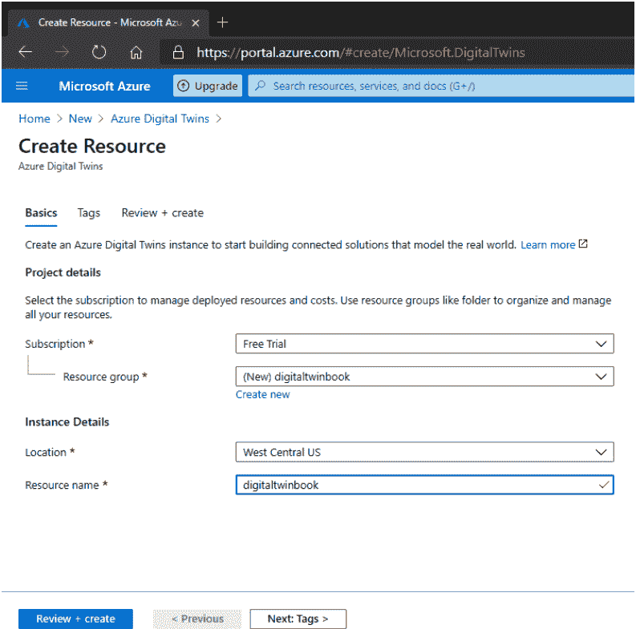

图 5.12 – 选择 Azure 资源位置和名称

所有 ADT 资源信息均在门户视图中可用，如图 5.13 所示。这完成了图 5.8 中显示的前两个步骤。第三步是用户访问配置，以便你在创建第一个数字孪生（在第 6 章《构建数字孪生原型》中）时能够访问数字孪生资源。

接下来，我们在以下屏幕截图中看到 ADT 资源的成功创建：

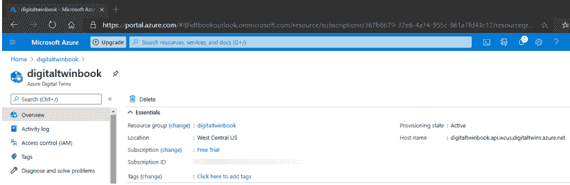

从左侧菜单中选择 **访问控制 (IAM)** 选项，并单击 **添加角色分配** 以打开配置窗格。这将使你能够为你的用户和凭据授予数字孪生资源的访问权限。图 5.14 显示了撰写本书时的 UI。

在个人或免费帐户中设置此项时，将自己的登录用户设置为数字孪生资源的数据所有者非常重要。如果你在组织的 Azure 订阅或租户中执行此操作，可能会有其他治理要求；但是，我们建议你在免费帐户中进行初始原型设计。

你可以在此处查看 UI 的概述：

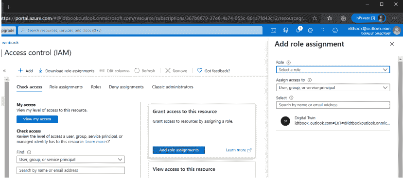

在屏幕右侧的 **角色** 下拉菜单中，从可用选项中选择 **Azure 数字孪生数据所有者**。此选项将授予你对 ADT 资源所有功能的完全访问权限和所有权，如图 5.15 所示。

**分配访问权限给** 选项可以保留默认的 **用户、组或服务主体** 设置。在 **选择** 下拉字段中选择或输入 Azure 免费帐户用户名。

你的用户将显示为下拉字段下方的图标。选择你的用户，并使用页面上的 **保存** 按钮保存访问权限，如以下屏幕截图所示：

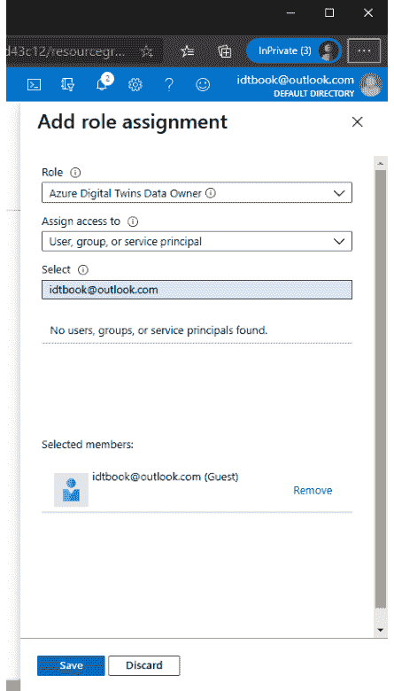

图 5.15 – 为 ADT 中的用户创建角色分配

你现在已成功授予用户帐户访问权限，这完成了图 5.8 的第三步。现在，请查看以下屏幕截图：

inbook

# 访问控制 (IAM)

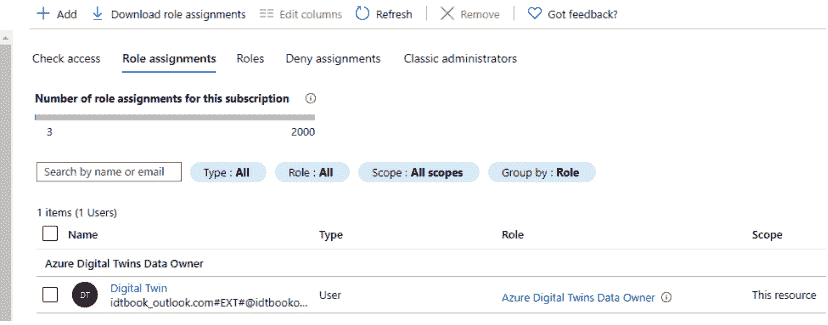

图 5.16 – ADT 中已成功分配用户访问权限

图 5.8 的第四步是创建一个 Azure 应用，该应用将能够与数字孪生服务进行交互。

通常的做法是通过 **ADT Explorer** (`http://bit.ly/adt-adtexplorer`) 或你自己的自定义应用程序等应用程序与 ADT 实例进行交互。这些应用程序需要使用 **Azure Active Directory** (**Azure AD**) 对自身进行身份验证，以便与 ADT 服务进行交互。这意味着你需要在图 5.8 的流程步骤 4 中创建一个 Azure 应用服务。完成此操作后，新的应用服务器将获得对数字孪生的访问权限和权限，类似于上一步中的用户访问权限。

### 设置数字孪生原型

这是从你的 Azure 门户实例的主页完成的，或者通过选择屏幕左侧菜单中的 **Azure Active Directory**，如以下屏幕截图所示：

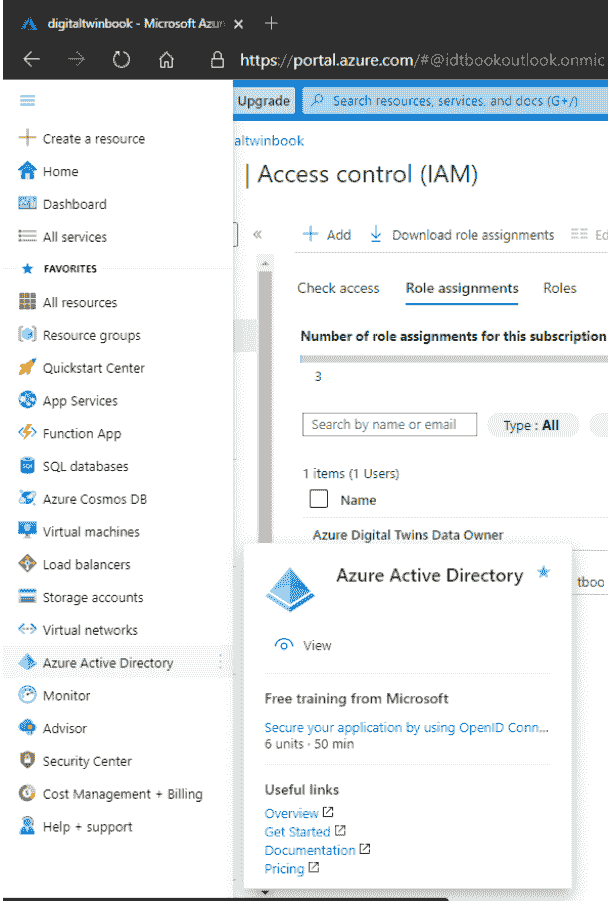

图 5.17 – 创建新的 Azure AD 资源

一个带有应用注册选项的屏幕，类似于以下屏幕截图所示，提供了在 Azure 上创建和管理新应用程序的选项。选择 **+ 新建注册** 以启动图 5.19 中所示的向导：

# Figure 5.18 – Azure AD 中的应用注册

为您的应用创建一个可识别的名称，并单击 **Register** 按钮使用默认设置继续注册应用程序，如以下屏幕截图所示：

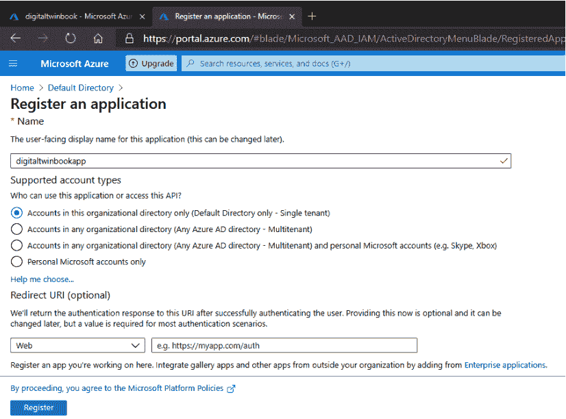

# Figure 5.19 – Azure AD 中的应用注册配置向导

您现在已成功完成 _Figure 5.8_ 中的 _step 4_，如以下屏幕截图所示：

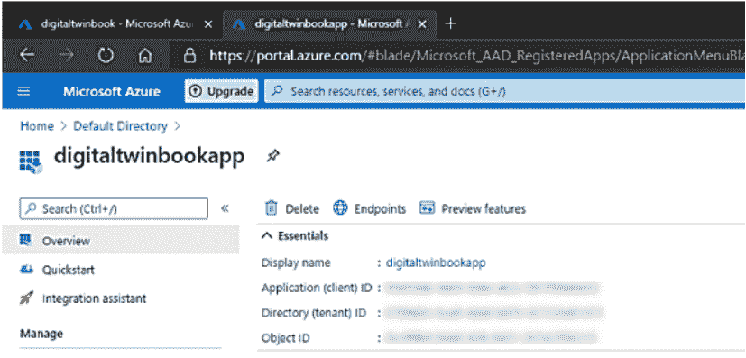

Figure 5.20 – ADT 中的用户访问已成功分配

您现在的帐户中拥有 ADT 和应用程序资源组，类似于 _Figure 5.21_ 中所示的内容。

_Figure 5.8_ 中的最后一步将为您的新应用程序资源提供对 ADT 资源的访问权限。这与之前的步骤类似，当时我们授予了您用户访问权限。在此示例中，我们希望授予应用程序读取和写入 ADT 资源信息的权限。我们遵循类似的方法，但不是选择用户帐户，而是选择您创建的新应用程序服务，如以下屏幕截图所示：

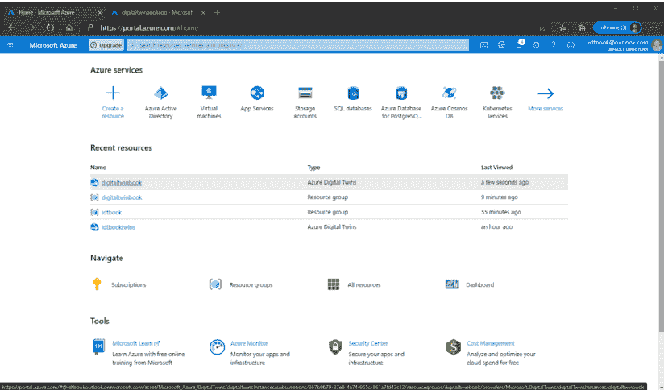

# Figure 5.21 – 您的 Azure 帐户中的 ADT 和应用程序资源

首先，单击 Azure 门户帐户中的 ADT 服务。在我们的示例中，它是 Figure 5.9 中显示的 digitaltwinbook ADT 资源。

### 设置数字孪生原型

从左侧菜单中选择 **Access control (IAM)** 并继续进行角色分配，类似于 _Figure 5.8_ 的 _step 3_，如以下屏幕截图所示：

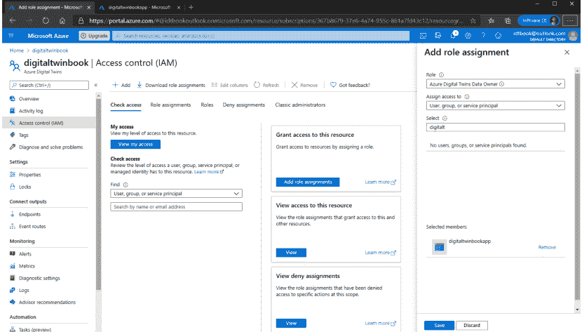

Figure 5.22 – 配置应用访问 ADT 资源

我们建议您为应用程序分配数据所有者角色，以便该应用程序可以与数字孪生资源进行交互。在 **Select** 下拉菜单中选择应用程序而不是您的用户角色。如果应用程序未出现在默认列表中，您可能需要在搜索栏中输入应用程序的名称。

检查应用程序的 API 权限，查看 Microsoft Graph API 是否出现。ADT Explorer 使用此 API。如果可见，这意味着您已成功完成 ADT 服务配置过程中的最后一步，如以下屏幕截图所示：

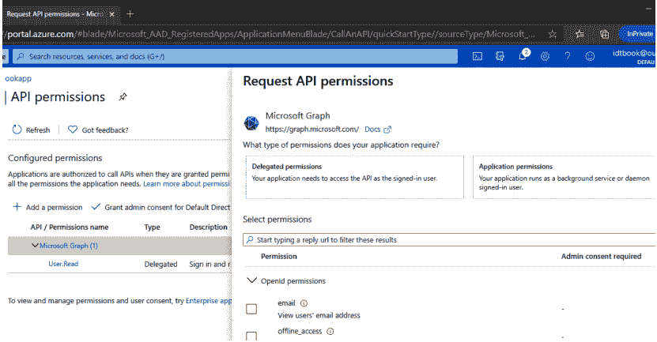

# Figure 5.23 – 应用程序访问 ADT 资源已成功完成

至此，您已完成在免费 Azure 帐户中配置 ADT 环境。我们首先创建了免费 Azure 帐户，创建了 ADT 资源，并授予了 Azure 帐户用户对 ADT 服务的访问权限。为了与 ADT 资源进行交互，我们还创建了具有 ADT 服务访问权限的 Azure 应用程序。

我们现在有能力在 ADT 平台上创建第一个数字孪生。但是，还有另外两个配置过程您可能希望遵循，以安装 ADT Explorer 和 Azure TSI。

ADT Explorer 是一个示例应用程序，可让您以类似图表的可视化方式查看数字孪生。在编写本书时，ADT Explorer 并非微软官方支持的产品，尽管微软推荐使用它。示例应用程序以及源代码和安装说明可从 GitHub 下载 (http://bit.ly/idt-adtexplorergit)。

### 您的 Azure 数字孪生的数据注意事项

在上一部分 _Configuration and setup_ 中，我们描述了设置 ADT 环境的过程，我们将使用该环境创建第一个数字孪生。ADT 提供了部署、配置和使用数字孪生所需的所有基本服务，但围绕数据和流程还有其他需要额外功能的注意事项。

ADT 的主要功能概述如下：

- 一种开放的建模语言，用于描述事物或实体的所有特征和关系
- 一个用于部署此内容的实时执行环境

ADT Explorer 在配置期间将需要 ADT 的主机名，以确保它连接到并可视化正确的数字孪生服务。您将在 Azure 门户中 ADT 服务的属性中找到 **Uniform Resource Locator (URL)**，如以下屏幕截图所示：

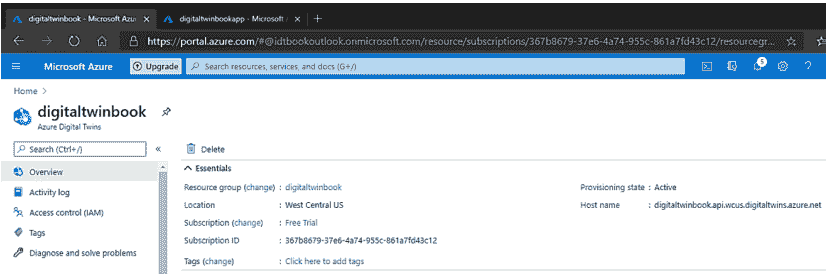

Figure 5.24 – ADT 主机 URL

此时不需要配置 Azure TSI，但以后将用于存储第一个数字孪生原型的时序数据。安装说明可在 `http://bit.ly/idt-azuretsi` 上找到。

使用 Azure TSI 的原因是下一节讨论的主题之一。

ADT 会为每个实体实例收集和存储此数据，并可以将其描绘为图节点。它是创建或更新 ADT 实体时的数据快照。ADT 不会保留图上该节点的任何历史数据。

为报告和分析目的保留这些值需要额外的存储过程。这可以通过额外的 Azure 服务来完成，以更新 Azure SQL、Azure Data Lake 和 Azure TSI。这些服务不是 ADT 基本配置所必需的，但在部署和使用数字孪生的实际用例中是实际的考虑因素。

资产的性质以及我们希望通过数字孪生解决的一组问题将决定构建和维护数字孪生所需的数据元素。让我们以风力涡轮机为例。风力涡轮机的数字孪生可用于预测特定风况下的发电量。同样，它还可以用于评估风力涡轮机的物理状况，如果它在持续一段时间内遇到比预期更强的风。对于此类场景，风速、阵风、温度、湿度和相关数据元素必须被记录并用于数字孪生。这些数据元素被捕获的粒度或频率将取决于参数的性质——例如，风速需要比大气中的温度或湿度记录得更频繁。之前的读数是外部于风力涡轮机的。但是，对于风力涡轮机的健康监测和预测性维护，我们将需要收集内部电机温度，以及齿轮箱中油的粘度和颗粒水平等参数。

我们可能经常需要处理构建和维护数字孪生所需数据的可用性和质量。在某些情况下，企业的安全性和合规性要求可能会使数据无法访问。这也与数据所有权相关。例如，在风力涡轮机的情况下，制造风力涡轮机的公司在组装风力涡轮机以及任何“实验室测试”（如物理检查或无损 (NDT) 测试）期间可以访问数据。但是，它可能无法完全访问供应商零件。同样，一旦风力涡轮机运送给所有者或风电场运营商并投入使用，制造商可能对风力涡轮机运行产生的数据没有或没有完全权利。

数字孪生平台的分析系统必须考虑到一旦风力涡轮机在现场运行时可用数据元素的变化性。与数字孪生数据一起使用的分析编排可以有规则来处理此类场景——例如，如果风力涡轮机数据来自模型 A，则将振动替换为 5 赫兹 (Hz) 以考虑模型 A 中没有振动传感器的情况。在某些情况下，风力涡轮机的运营商可能出于隐私或当地合规性原因决定不共享某些数据元素。

在未来章节中，当我们解决第一个数字孪生原型的部署、测试和评估时，我们将重点介绍风力涡轮机中不同类型数据存储的使用。我们还将在下一节描述的高级解决方案架构中包含这一点。

### 解决方案架构

让我们在本节中查看高级解决方案架构。一般来说，解决方案架构为解决给定的一组业务问题提供参考架构。它有助于在实施阶段推动整体技术愿景。以下图表直观地展示了我们的业务问题陈述。我们的目标是为这个问题陈述提供解决方案架构：

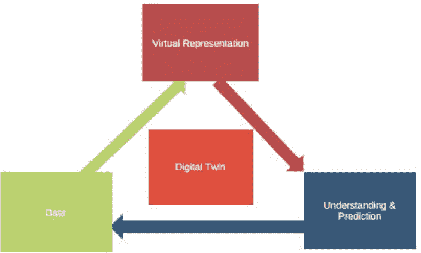

Figure 5.25 – 数字孪生的业务问题

Note
图片来源：Technology Media Telecommunications (TMT), GeoActive Group: https://blog.geoactivegroup.com/2020/07/ digital-twin-apps-in-industrial-markets.html

随着我们演进解决方案架构，我们将业务问题细化到下一级，如以下屏幕截图所示：

Figure 5.26 – 将业务问题提炼出来以演进解决方案架构

> Note 图片来源：`http://dx.doi.org/10.18775/iji ed.1849-7551-7020.2015.52.2006`

在继续演进解决方案架构的过程中，我们会评估并做出技术决策。我们决定将 ADT 作为技术解决方案的一部分。在下面的截图中，我们展示了 ADT 如何融入更广泛的企业解决方案架构：

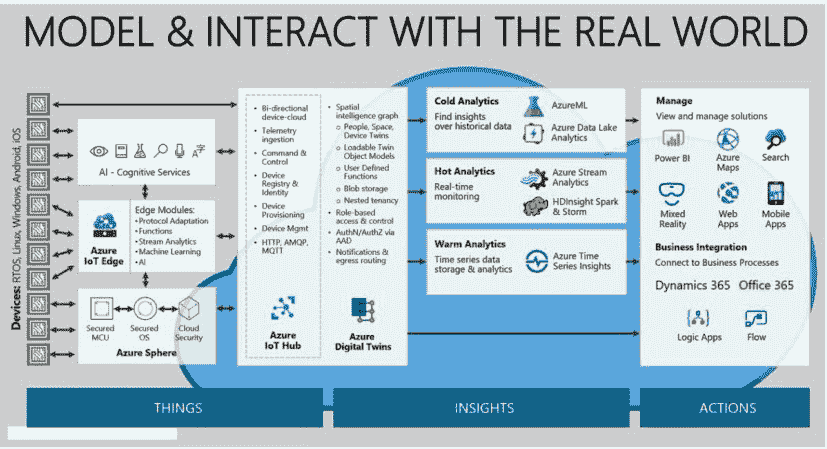

Figure 5.27 – 使用 Microsoft ADT 演进解决方案架构

### Summary

在本章中，我们考虑了一家全球风力涡轮机制造商的视角。然后，我们描述了评估和选择合适平台以设置和构建数字孪生的注意事项。我们将其缩小到 Microsoft ADT，作为本书的选定平台。这使我们开始为我们的第一个数字孪生在 ADT 上设置配置。

在第 6 章《构建数字孪生原型》中，我们将开始在选定的数字孪生平台上为风力涡轮机实施数字孪生原型，使用 ADT。我们将在数字孪生的实施过程中进一步考虑实际约束。

### Questions

- 1. 预测性孪生的重要性是什么？如何将其应用于风力涡轮机？
- 2. 为什么许多 IoT 平台使用公共云？
- 3. 面向风力涡轮机的数字孪生解决方案预期的主要业务成果是什么？
- 4. 时间序列数据存储的用途是什么？
- 5. 分析编排如何处理来自某些资产（例如风力涡轮机）的缺失数据元素？

> **Note**
> 图片来源：`https://schwabencode.com/blog/2020/03/10/ Device-Twins-vs-Digital-Twins-Azure-IoT`

在接下来的几章中，我们将继续针对特定场景细化解决方案架构。此类解决方案架构对于在数字孪生解决方案整个生命周期内进行维护和演进至关重要，因为它会移交给未来的技术和技术功能专家。同样，当数字孪生解决方案销售给外部客户时，此类解决方案架构允许设置客户的解决方案实例，并可在客户的企业环境中进一步细化。
