### 6 构建数字孪生原型

在第 5 章《设置数字孪生原型》中，我们讨论了构建数字孪生原型的推动因素。我们研究了数字孪生的所需功能，这些功能可以由公共云和 IoT 平台作为底层技术来满足。我们进一步调查了数字孪生平台，并研究了配置和设置细节。我们讨论了数据注意事项以及数字孪生的整体解决方案架构。

在本章中，我们将调查已识别工业资产（即风力涡轮机和风电场的一组涡轮机）的数字孪生原型的开发过程。

Figure 6.1 显示了风力涡轮机数字孪生的概念视图，从工业用户的角度来看，该用户将是孪生的受益者。


> **Note**
> 图片来源：Digitalisation in power generation driving performance.
> Available at: https://www.powerengineeringint.com/
> digitalization/digitalisation-in-power-generation-
> driving-performance/

本章将涵盖以下主题：

- 我们数字孪生的开发过程
- 测试框架
- 技术评估注意事项
- 业务验证和理解

让我们开始详细讨论数字孪生原型的开发过程。

### Technical requirements

在本章中，我们将配置您的第一个数字孪生原型。我们使用的风电场示例有基于 JSON 的 DTDL 文件示例。您可以在 GitHub 上找到本章的代码文件，网址为 `https://github.com/PacktPublishing/ Building-Industrial-Digital-Twin`。

### Development process of our Digital Twin

让我们探索数字孪生的开发过程。这将确保我们具备进行此类开发所需的技能。

### Wind turbine as our Digital Twin prototype

我们将使用风电场作为我们第一个数字孪生原型的示例。我们将在此处专注于风电场的简单模型。我们的主要目标是展示如何在本书中创建风力涡轮机的第一个数字孪生，而不是帮助建立对风力涡轮机或可再生能源行业的专业知识。我们将为风电场中的每个物理涡轮机创建数字孪生模型和实例。数字孪生模型代表风力涡轮机的基本元素，从业务价值角度来看，足以应对不同的用例。

风电场和风力涡轮机数字孪生的视角是风力涡轮机制造商的视角，该制造商还受运营商合同，负责维护风力涡轮机以达到商定的服务级别。本章中数字孪生的用例仅限于风力涡轮机的维护和运营阶段，如在 _Chapter 1_、《数字孪生简介》中所述。在实践中，模型将涵盖整个生命周期，包括风电场和风力涡轮机的设计、制造和调试阶段。

本章中风力涡轮机数字孪生的主要用例是制造商，该制造商在资产所有者/运营商持有资产期间对其风力涡轮机进行预测性维护服务。制造商拥有一支现场服务团队，需要主动前往正确的风电场的正确风力涡轮机，执行正确的维护，以防止风力涡轮机故障，从而导致非计划停机或以较低效率运行。

制造商希望确保高首次修复率，减少卡车出勤次数，并限制服务车辆上携带的现场备件。在此语境下，“卡车出勤”是指风力涡轮机现场服务技术人员必须乘坐服务车辆（通常是卡车）前往风电场执行安装、重新配置、故障排除、维修或任何其他形式的计划维护活动的场景。本章中数字孪生原型的重点是陆上风电场，因为对于离岸安装来说，这样做更复杂且更昂贵。

更好地管理风力涡轮机服务活动将提高风电场的产出，从而提高发电量并提高可靠性。它将提高客户满意度并降低维护成本，减少卡车出勤次数。它还将减少服务卡车上库存占用的营运资金。这些都是同时维护运营中资产的制造商的关键 **Value at Stake** 指标。

在我们开始配置在第 5 章《设置数字孪生原型》中设置的 Azure 数字孪生实例中的风电场和风力涡轮机之前，我们将研究风力涡轮机、其组件以及我们想要收集以满足维护和运营用例需求的数据。

### Basics of a wind turbine and a high-level data model

风力涡轮机是低成本的可再生电能生产商，将风的动能转换为电能。它被视为“清洁”能源资源，因为它使用很少的水，不排放温室气体，且发电过程没有废弃物产生。


Figure 6-2 – 美国南加州的风力涡轮机

> Note
> 图片来源：https://commons.wikimedia.org/wiki/
> File:Wind_turbines_in_southern_California_2016.jpg

风力涡轮机相对容易构建，但风电场可以包含许多涡轮机。这使其成为我们第一个数字孪生原型的理想候选者。

最常见的风力涡轮机类型配置为水平轴，但涡轮机也可以具有垂直轴配置。风力涡轮机还根据其安装方式进一步分类。陆上涡轮机被归类为陆上，而离岸风力涡轮机可以部署在海洋数英里外。离岸风力涡轮机具有额外的复杂性，既包括连接性方面的远程访问，也包括现场服务团队的物理访问。离岸风力涡轮机还必须应对海水引起的腐蚀问题。（参见 https://www.materialsperformance.com/articles/material-selection-design/2016/03/corrosion-risks-and-mitigation-strategies-for-offshore-wind-turbine-foundations。）

我们将使用典型的三叶片配置的陆上水平轴风力涡轮机来简化我们的第一个数字孪生。Figure 6.3 显示了水平轴风力涡轮机的高级组件。我们将主要关注整体风力涡轮机性能，以及资产的电机、齿轮箱和发电机组件。为了检测或防止设备故障，我们的维护数字孪生将监控这些组件的实时数据。您可以在后续阶段用额外模型扩展数字孪生，以包含其他组件，例如促距系统、控制器和机舱。

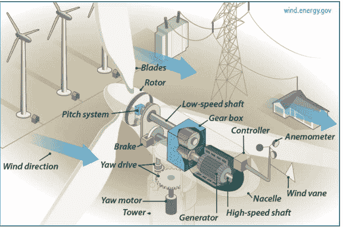

Figure 6.3 – 典型风力涡轮机内部


> **Note**
> Image source: US Department of Energy: `https://www.energy.gov/eere/wind/inside-wind-turbine`

数字孪生模型将表示我们希望为风电场中每个风力涡轮机实例存储的数据元素。风力涡轮机模型还将包括描述电机、齿轮箱和发电机数据的子模型。我们需要区分作为属性的不同数据类型，以及我们将从风力涡轮机上的传感器接收到的遥测数据。

我们为第一个数字孪生所使用的数据模型包含描述风电场、风力涡轮机和遥测数据所需的所有基本元素。

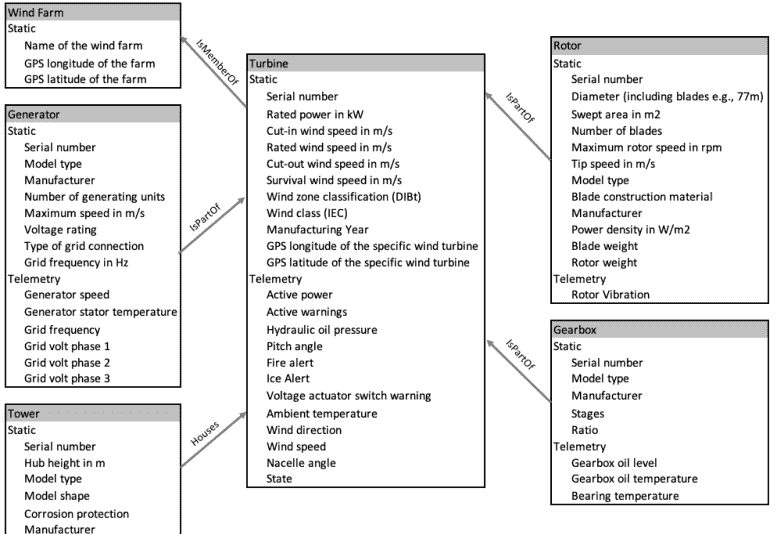

图 6.4 中的这个数据模型足以满足我们风力涡轮机第一个数字孪生中的维护用例。下一步是在将模型和子模型上传到 Azure 数字孪生之前，将其配置为 **数字孪生定义语言 (DTDL)** JSON 文件。我们在图 6.4 中描述的数据模型包含所有数据元素，但不包含不同模型之间的任何关系。使用基于图的数字孪生服务（例如 Azure 数字孪生）的主要原因之一，是为了捕捉资产之间可能存在的非层次关系。

层次关系的一个示例是：风力涡轮机位于特定的风电场，而涡轮机由齿轮箱、转子和发电机组成。然而，数字孪生之间还存在其他非层次关系。一个示例是不同风力涡轮机之间的接近关系。其中一种关系可能是 NextTo，它可以捕捉风力涡轮机 #789 位于风力涡轮机 #248 旁边。

这些关系和特定特征在本体学中进行描述。本体学提供了描述类别、属性和关系的结构。

在下一节中，我们将描述如何为我们的第一个风力涡轮机数字孪生设置相应的 DTDL 本体学。

### 使用本体学定义数字孪生模型

_图 6.5_ 描述了为风力涡轮机原型创建基于 Azure 数字孪生示例的基本步骤。

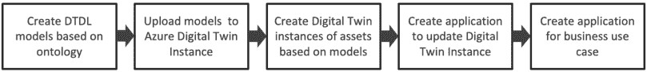

图 6.5 – 创建和使用数字孪生的流程

第一步是创建 JSON 格式的 DTDL 模型，这些模型还描述了不同模型和子模型之间可用的关系。使用 DTDL 将允许数字孪生开发人员根据资产孪生生成的遥测或数据元素、其属性以及它们响应的命令来描述数字孪生。总体而言，DTDL 将促进孪生之间关系的描述。这将导致不同领域的孪生之间的互操作性。例如，在宏观层面上，风电场将与电网进行交互。

然后，这些模型将使用 **Azure 数字孪生 (ADT)** Explorer 应用程序上传到我们的 Azure 数字孪生实例中。在第三步中，我们还将使用 ADT Explorer 根据现在在 Azure 数字孪生平台上可用的模型创建物理资产的实例。这可能是一个相当繁琐且手动的过程，不适合大规模部署。在生产环境中，这些活动的自动化将在您的自定义数字应用程序或第三方解决方案中完成。在第四步中，我们将演示如何在自定义应用程序中上传其他涡轮机实例的信息。在最后一步中，我们将了解如何为我们的维护用例检索 Azure 数字孪生信息。

第一步是根据本体学和 DTDL 中模型文件的特定结构创建我们的 DTDL 模型，而 DTDL 本身又基于 **资源描述框架 (RDF)**。DTDL 的 RDF 特性在 _第 4 章，开始使用我们的第一个数字孪生_ 中已介绍。本体学结构没有特定要求，但建议您遵循 _基于数字孪生定义语言的 RealEstateCore 智能建筑本体学_ (`http://bit.ly/idt-buildingontology`) 的指导，这是微软的一项开源倡议，用于创建数字孪生。它提供了非常全面的本体学描述，如果您想要创建更高级的数字孪生本体学，强烈推荐使用。

_图 6.6_ 提供了我们将用于第一个风力涡轮机数字孪生的拟议简单本体学。

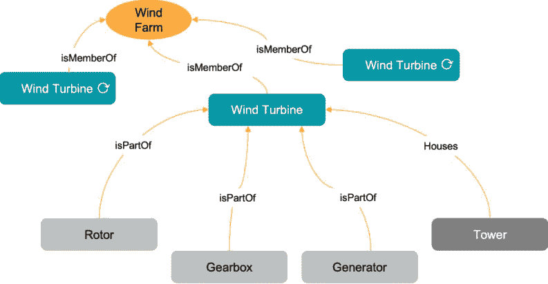

这表明风力涡轮机是风电场的“成员”。转子、齿轮箱、发电机和塔筒反过来是风力涡轮机的“组成部分”。这是一个非常基本的结构，并且有其他表示方式。然而，为了配置我们的第一个数字孪生的目的，我们将保持简单。

现在我们了解了各种模型之间的不同关系，可以继续以 DTDL 格式创建这些模型。微软为描述以下数字孪生行为的六个元模型类提供了广泛的开源 DTDL 文档 (https://bit.ly/idt-azuredocs)：

- **Interface**：描述内容（属性、遥测、命令、关系或组件）
- **Telemetry**：描述任何数字孪生发出的数据，通常来自传感器并在定期的短间隔内同步
- **Property**：描述任何数字孪生的只读和读/写状态，例如组件的序列号
- **Command**：描述可以在任何数字孪生上执行的函数或操作
- **Relationship**：描述到另一个数字孪生的链接，并使数字孪生图得以创建
- **Component**：使接口能够由其他接口组成

风电场的 DTDL 示例如下：

```json
{
"@id": "dtmi:com:idtbook:wt:farm;1",
"@type": "Interface",
"@context": [
"dtmi:dtdl:context;2"
],
"displayName": "WT Farm",
"description": "Wind farm with wind turbines",
"contents": [
{
"@type": "Property",
"name": "Name",
"schema": "string"
},
{
"@type": "Property",
"name": "GPSLongitude",
"schema": "double"
},
{
"@type": "Property",
"name": "GPSLatitude",
"schema": "double"
}
]
}
```

这是一个没有任何遥测或关系数据的接口文件示例。接口文件的典型结构在图 6.7 中描述，并在 http://bit.ly/idt-dtdl2 上有完整文档。

| 属性 | 是否必需 | 数据类型 | 限制 | 描述 |
|---|---|---|---|---|
| @id | 必需 | DTMI | 最多 128 个字符 | 接口的数字孪生模型标识符 |
| @type | 必需 | IRI | | 这必须是 "Interface" |
| @context | 必需（文档中至少一次） | IRI | | 处理此接口时使用的上下文。对于此版本，必须设置为 "dtmi:dtdl:context;2" |
| comment | 可选 | string | 1-512 个字符 | 给模型作者的注释 |
| contents | 可选 | 遥测、属性、命令、关系、组件的集合 | 最多 300 个内容 | 定义此接口内容（遥测、属性、命令、关系和/或组件）的一组对象 |
| description | 可选 | string | 1-512 个字符 | 用于显示的可本地化描述 |
| displayName | 可选 | string | 1-64 个字符 | 用于显示的可本地化名称 |
| extends | 可选 | 接口集合 | 每个 extends 最多 2 个接口；最大深度 10 级 | 一组引用此接口继承的接口的 DTML。接口可以从多个接口继承。 |
| schemas | 可选 | 接口架构集合 | | 引用此接口中可重用架构的一组 IRI 或对象。 |

图 6.7 – 接口文件的结构

微软为 Visual Studio 和免费版的 Visual Studio Code (http://bit.ly/idt-vscodedtdl) 提供了 DTDL 扩展。

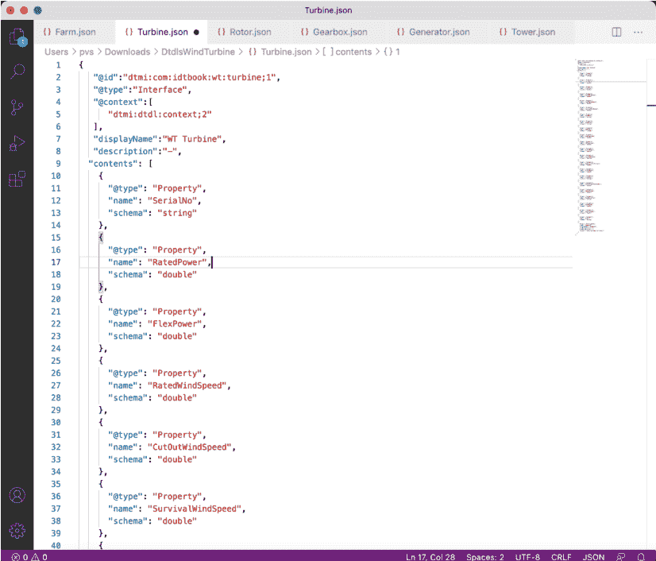

图 6.8 – 带有 IntelliSense 的 Visual Studio Code DTDL 扩展

该扩展提供了从模板创建 DTDL 接口的功能。它支持 IntelliSense 和自动完成功能，并将验证 DTDL 文件的语法。_图 6.8_ 显示了带有 IntelliSense 和语法检查的风力涡轮机 DDL 文件。


DTDL 模型（JSON 格式）中的风力涡轮机包含用于遥测和关系的额外元模型类。它还描述了我们在 *风力涡轮机基础及高级数据模型* 章节中定义的涡轮机的所有数据模型元素：

```json
{
 "@id": "dtmi:com:idtbook:wt:turbine;1",
 "@type": "Interface",
 "@context": [
 "dtmi:dtdl:context;2"
 ],
 "displayName": "WT Turbine",
 "description": "--",
 "contents": [
 {
 "@type": "Property",
 "name": "SerialNo",
 "schema": "string"
 },
 {
 "@type": "Property",
 "name": "RatedPower",
 "schema": "double"
 },
 . . . (See Github for full json files)
 {
 "@type": "Telemetry",
 "name": "Windspeed",
 "schema": "double"
 },
 {
 "@type": "Telemetry",
 "name": "NacelleAngle",
 "schema": "double"
 },
 {
 "@type": "Telemetry",
 "name": "State",
 "schema": "string"
 },
 {
 "@type": "Relationship",
 "name": "isMemberOf",
 "displayName": "MemberOf",
 "minMultiplicity": 0,
 "maxMultiplicity": 1,
 "target": "dtmi:com:idtbook:wt:farm;1"
 }
 ]
}
```

发电机的子模型同样包含与涡轮机模型的关系，如图 6.4 所示：

```json
{
 "@id": "dtmi:com:idtbook:wt:gearbox;1",
 "@type": "Interface",
 "@context": [
 "dtmi:dtdl:context;2"
 ],
 "displayName": "WT Gearbox",
 "description": "--",
 "contents": [
 {
 "@type": "Property",
 "name": "GearboxSerial",
 "schema": "string"
 },
 ... (See Github for full json files)
 {
 "@type": "Relationship",
 "name": "isPartOf",
 "displayName": "PartOf",
 "minMultiplicity": 0,
 "maxMultiplicity": 1,
 "target": "dtmi:com:idtbook:wt:turbine;1"
 }
 ]
}
```

风力发电场、涡轮机及其组件的 DTDL JSON 文件可在本书的 GitHub 仓库中下载，地址为 `https://github.com/PacktPublishing/Building-Industrial-Digital-Twin`。

它包括以下文件：

- `Farm.json`
- `Turbine.json`
- `Rotor.json`
- `Gearbox.json`
- `Generator.json`
- `Tower.json`

在下一节中，我们将使用 Azure Digital Twins Explorer 应用程序将模型文件上传到 Azure Digital Twins 实例。

### 将模型上传到 Azure Digital Twins 实例

在第 5 章“设置数字孪生原型”中，我们配置了 Azure Digital Twins 服务，并建议你设置 Azure Digital Twins Explorer。ADT Explorer 是一款应用程序，可让你以图形可视化方式查看数字孪生。在撰写本文时，ADT Explorer 并非微软官方支持的产品，尽管微软将其作为开源项目支持。它不适用于大规模部署，但提供了构建我们第一个数字孪生所需的基本功能。示例应用程序、源代码和安装说明可从 GitHub 下载（`http://bit.ly/idt-adtexplorergit`）。

在启动 ADT Explorer 应用程序之前，请先登录在第 5 章“设置数字孪生原型”中配置的免费 Azure 服务。

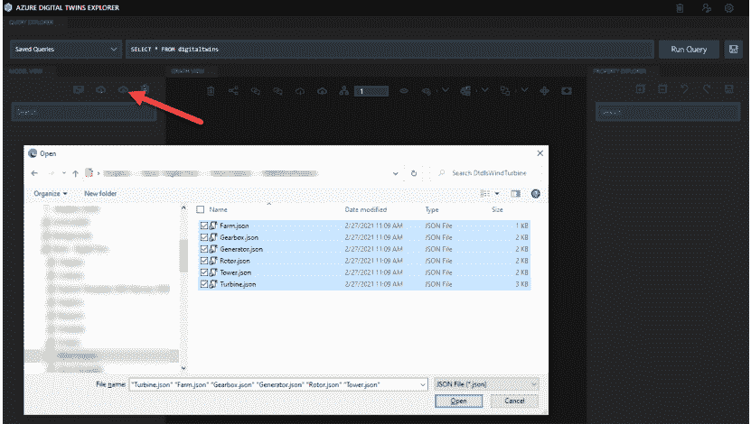

图 6.9 – 使用 Azure Digital Twins Explorer 上传 DTDL JSON 文件

选择所有风力发电场和风力涡轮机模型及子模型，并将其上传到 ADT Explorer，如 *图 6.9* 所示。这将在你在第 5 章“设置数字孪生原型”中配置的 Azure Digital Twins 服务中创建模型文件。

模型现在已在左侧的模型存储库中可用，如 *图 6.10* 所示。

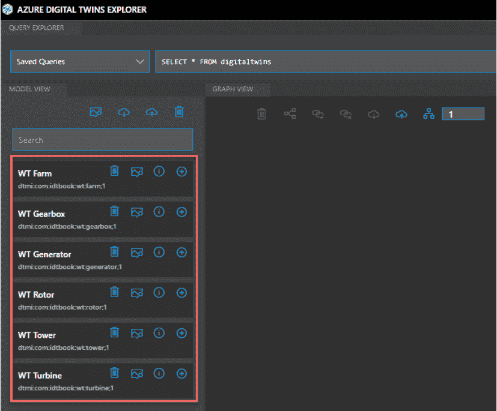

图 6.10 – Azure Digital Twins 中可用的 DTDL 模型

配置第一个数字孪生的下一步，如 *图 6.11* 所示，是为我们的物理风力涡轮机创建数字孪生实例。这些实例将基于我们现在在 Azure Digital Twins 服务中拥有的数字孪生模型。

### 为风力发电场和涡轮机配置数字孪生实例

一个风力发电场可以包含数百甚至数千台风力涡轮机。中国的酒泉风电基地拥有约 7,000 台风力涡轮机（参见 `https://www.power-technology.com/features/feature-biggest-wind-farms-in-the-world-texas`）。

数字孪生软件设计方法的主要优势之一是能够拥有一个数字孪生模型和数千个数字孪生实例。对模型中属性的更改将使该属性可用于所有成千上万的适用实例。可以根据数字孪生模型中的信息架构，开发数字孪生应用程序以满足特定业务需求。

要创建第一个风力发电场数字孪生实例，请选择 **WT Farm** 模型旁边的 + 按钮（参见 *图 6.11*），然后为实例指定一个唯一名称。此名称将是物理孪生实例的唯一标识符或 ID，以后无法更改。这可以是序列号、资产编号或任何唯一描述符。为了本书的目的，我们将使用 windfarm1 作为唯一名称。

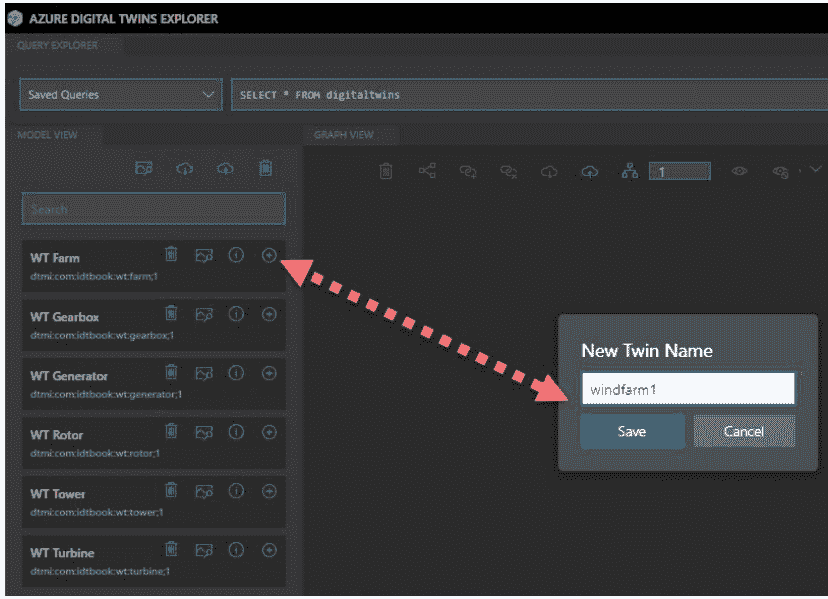

图 6.11 – 为特定风力发电场创建唯一实例

保存孪生名称后，将根据风力发电场 DTDL 模型和唯一的 `windfarm1` ID 创建第一个风力发电场实例。

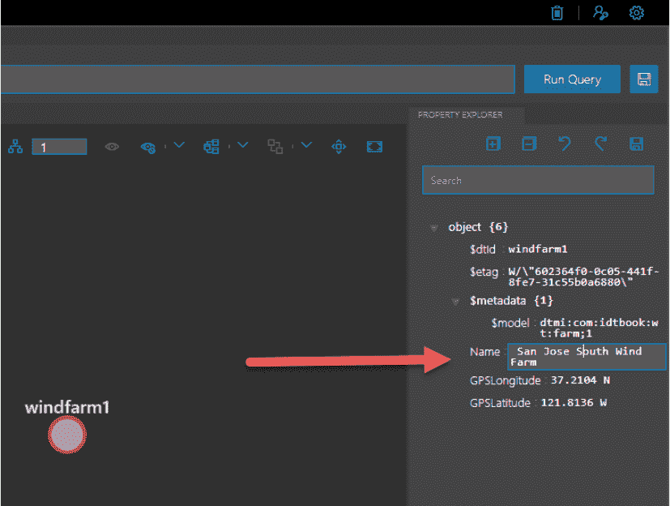

图 6.12 – 更新实例特定的数字孪生值

你可以在右侧属性资源管理器窗格中编辑此实例的属性和信息，如图 6.12 所示。这将使用该字段中的值更新实例。我们可以将 `windfarm1` 的名称更新为 `San Jose South Wind Farm`。`$dtid` ID 将保持唯一且不可编辑，但属性值可以通过 ADT Explorer 更改。`$dtid` 是实例 ID，类似于关系数据库表中的主键。

接下来，我们将为 WT 涡轮机模型创建风力涡轮机实例，过程类似，并更新特定实例数据。当我们拥有风力发电场和第一台涡轮机的实例后，可以继续使用顶部栏中的关系选项将这些实例链接起来。

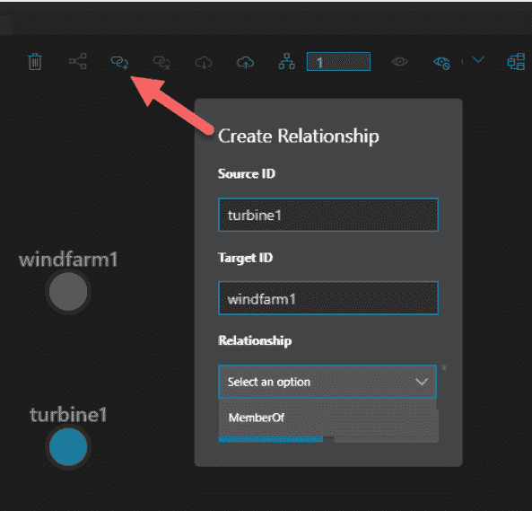

图 6.13 – 设置两个实例之间的关系

首先，选择涡轮机，然后选择风力发电场，并单击顶部栏上的关系图标，如图 6.13 所示。这将打开一个对话框，其中包含在 DTDL 模型中定义的所有关系类型的下拉列表。在此实例中，我们只有 **MemberOf** 关系可用。保存后，将在两个实例之间创建一个箭头，箭头上带有关系描述。继续为其他涡轮机设置实例，并为每个组件（转子、齿轮箱、发电机和塔架）创建唯一实例。同时更新涡轮机和组件每个实例的属性和值。

特定风力发电场中三台风力涡轮机的最终模型应类似于图 6.14 中的节点和关系。

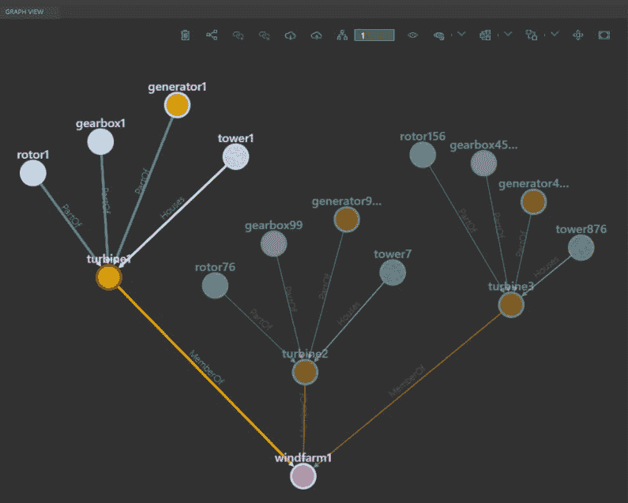

图 6.14 – 为特定风力发电场创建唯一实例

你现在已成功创建了包含风力发电场、涡轮机及其组件的模型和实例的 Azure 数字孪生。你现在可以使用类似 SQL 的查询来查询实例。

图 6.14 中的图显示 rotor1、gearbox1、generator1 和 tower1 是 turbine1 的一部分。在此示例中，组件的数字指标是对齐的，这在实际中很少发生。turbine3 与 rotor156、gearbox457、generator4213 和 tower876 的示例更能反映真实世界的配置。

手动捕获所有实例是一项相当繁琐的任务。想象一下手动加载 7,000 台风力涡轮机及其组件，这肯定会导致人为数据捕获错误。包含数百或数千个节点的图并不是手动导航和数据捕获的最佳用户体验。我们还注意到，遥测字段无法从 ADT Explorer 更新，因为这通常是来自传感器的流式数据。


Azure Digital Twins 服务和 DTDL 为应用程序开发人员提供了一个环境，用于与数字孪生进行交互，并创建解决特定业务挑战的方案。我们的维护用例是此类业务挑战的典型示例，可以使用数字孪生来解决。

该应用程序允许测试本章前一部分中完成的数字孪生开发工作。接下来，让我们专注于测试阶段。

### 测试框架

图 6.5 中的下一步是创建一个应用程序，以便在大量风力涡轮机实例上提供可维护性和可扩展性，并将实时遥测数据传递给数字孪生。这为框架增加了易用性，适用于实际场景。

### 创建应用程序以在代码中更新数字孪生原型

**Azure Digital Twins (ADT)** 是一个面向开发人员的 **平台即服务 (PaaS)** 解决方案，旨在创建数字孪生解决方案。为了本书的目的，我们将介绍两种典型的开发角色。第一种是软件开发人员，他具备必要的编码技能，可以使用 ADT 的 API 和 SDK 开发解决方案。在撰写本书时，ADT API 和 SDK 可以在 .NET、Java、JavaScript、Python 和 Go 中访问。

第二种角色是主题专家，例如风电场的可靠性和维护工程师。主题专家具备技术技能，但通常不具备从头开始创建应用程序的正式软件开发技能。

本节的其余部分将重点介绍创建应用程序以更新风力涡轮机模型的正式软件开发方法。

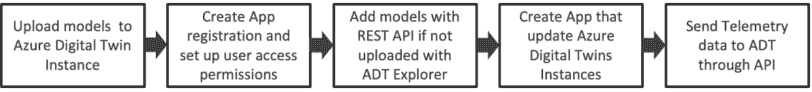

图 6.15 – 创建自定义编码解决方案以更新 Azure Digital Twins 的流程

_图 6.15_ 显示了创建自定义编码解决方案以更新 ADT 的流程。流程的第一步应该在本书的前一部分中完成。建议在 ADT 中拥有模型，以及一两个实例来在开发应用程序时测试您的应用程序。这些孪生实例代表特定的风力涡轮机。

第二步类似于第 5 章“设置数字孪生原型”中图 5.20 的应用程序注册过程。在此示例中，我们将创建一个带有可识别名称的应用程序，例如 digitaltwinapp。向应用程序提供对数字孪生资源的访问权限，类似于第 5 章“设置数字孪生原型”中图 5.23 的过程。

使用 ADT API 和 SDK 的自定义应用程序现在将能够以与 ADT Explorer 访问 ADT 服务相同的方式访问 Azure 中的 ADT 服务。API 和 SDK 提供了图 6.14 中最后三个步骤的功能。使用 API 和 SDK 需要软件编码技能以及访问集成开发环境 (IDE)，例如 Visual Studio、Visual Studio Code 或支持您选择的编程语言的任何 IDE。我们将使用 .NET 编程平台和 Visual Studio 或 Visual Studio Code，后者可从 Microsoft 网站免费获取。

Azure Digital Twins API 和 SDK 在 http://bit.ly/idt-adtapisdk 上有详细文档。数据平面 API 对我们的自定义应用程序特别感兴趣，因为它们将创建和更新数字孪生实例，并将遥测数据发送到数字孪生实例。API 提供对数字孪生模型、实例和事件路由的访问。它们还使开发人员能够以编程方式查询模型和实例。API 操作的详细列表可在 http://bit.ly/idt-apioperations 上找到，并由 Microsoft 维护，随着新操作的添加而更新。

应用程序示例可在 http://bit.ly/idt-adtapisdk 上找到，C# 中的基本创建孪生实例示例如下：

```csharp
string twinId = "turbine2";
var initData = new BasicDigitalTwin
{
    Id = twinId,
    Metadata = { ModelId = "dtmi.com:idtbook:wt:turbine;1" },
    // Initialize properties
    Contents =
    {
        { "SerialNo", "YF568" },
        { "RatedPower", 1500 },
    },
};
await client.CreateOrReplaceDigitalTwinAsync<BasicDigitalTwin>(twinId, initData);
```

Microsoft 提供了一个完整的教程，用于在 http://bit.ly/idt-tutorialapp 中为希望创建带有实时遥测数据的 Azure Digital Twins 应用程序的开发人员编写客户端应用程序。它提供全面的源代码，该链接也列在本书的 GitHub 页面上。它演示了创建创建数字孪生模型和实例并使用遥测数据更新它们的应用程序的所有步骤和操作。这解决了图 6.15 中的最后三个步骤。

作为开发人员，您现在已成功创建 Azure Digital Twins 模型和实例，并在自定义应用程序中使用遥测数据更新了数字孪生。图 6.16 显示了从数据库读取并通过自定义开发的应用程序添加到 ADT 的其他风力涡轮机实例。

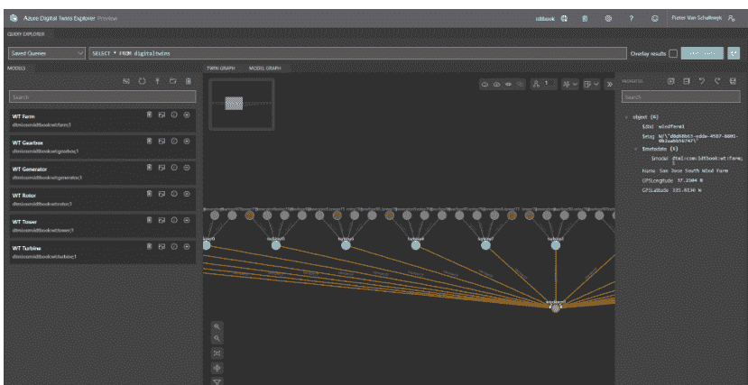

图 6.16 – 多涡轮机示例

创建应用程序，作为图 6.15 中流程的最后一步，以查看或使用模型，将遵循所述的相同过程。另一种方法是在商业智能 (BI) 或可视化应用程序（例如 Microsoft Power BI）中查看 Azure 数字孪生。这种方法也需要编程技能，类似于创建 ADT 应用程序的要求。

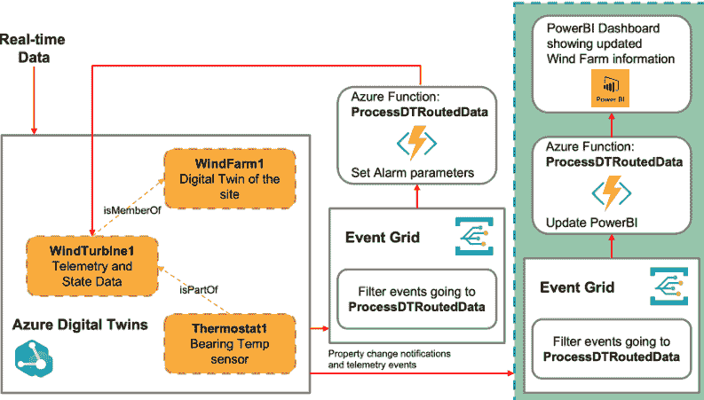

图 6.17 – 创建 Power BI 仪表板以查看您的数字孪生

图 6.17 显示了一种在 Power BI 仪表板上显示 ADT 信息的可能方法。它遵循与本 Microsoft 教程中描述的类似开发方法，该教程介绍如何从 Azure Digital Twins 更新地图服务：http://bit.ly/idt-connectmaps。本书 GitHub 存储库中提供的示例代码包括一个 Azure 函数，用于从事件网格获取 ADT 并更新 Power BI 仪表板文件，如图 6.18 所示。

数字孪生应用程序与 IoT 应用程序的区别在于，Power BI 应用程序将从数字孪生实例接收更新，而不是从不同遥测点的单个传感器接收更新。它在状态和遥测更新与业务应用程序之间充当代理。您可以从单个事件更新服务创建不同的 Power BI 仪表板。您还可以创建多个应用程序，这些应用程序从 ADT 服务接收更新，而无需每次都从单个传感器读取。

ADT 服务也与传统关系数据库不同，因为它在每次更新时不会创建新的事务数据行。它会用新的状态值覆盖先前的实例状态值。实例始终是特定时间点的数字孪生实例状态的快照。它需要额外的编程来持久化数据，例如在 **时间序列数据库 (TSDB)**（如 Microsoft Time Series Insights 或 InfluxDB）中持久化遥测时间序列数据。

_图 6.18_ 中显示的 Power BI 仪表板用于监控风电场涡轮机的运行。它还用于根据遥测读数中的涡轮机状况规划维护服务。

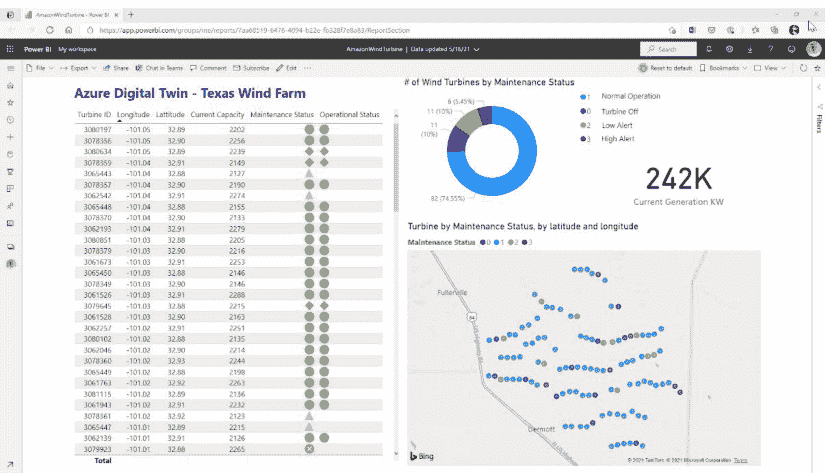

图 6.18 – 我们风电场的 Power BI 仪表板示例

我们现在已创建一个基于 Azure 的数字孪生作为我们的第一个数字孪生原型应用程序。它是一个自定义编码的应用程序，可以创建新的 ADT 模型、实例，从 IoT 传感器更新遥测数据，并在 Power BI 等应用程序中查看 Azure 数字孪生。这种方法为熟练的程序员提供了很大的灵活性，他们可以创建各种专业的数字孪生应用程序。Willow Inc. (https://www.willowinc.com/posts/under-the-hood-willowtwin-x-azure-digital-twins/) 是 Azure 数字孪生在建筑行业应用的绝佳示例。


### 创建无代码/低代码应用程序以更新数字孪生原型

在上一节中，我们描述了如果您具备必要的编程背景和技能，通过在 IDE 中编码解决方案来创建风电场第一个数字孪生的过程。这种方法为开发用于满足用例独特需求的自定义应用程序提供了完全的灵活性，但它确实需要编程技能。

无代码/低代码方法可能更适合编程技能有限且偏好使用可视化编程方法构建应用程序的主题专家。最近，低代码开发技术一直是加速数字化转型的焦点。分析公司 Gartner 最近预测，**低代码应用平台（LCAPs）**将在 2021 年增长 23%（参见 `https://www.gartner.com/en/newsroom/press-releases/2021-02-15-gartner-forecasts-worldwide-low-code-development-technologies-market-to-grow-23-percent-in-2021`）。工业巨头西门子于 2018 年以 7 亿美元收购了 Mendix，以获得此类 LCAP 功能。Oracle APEX 是另一个 LCAP 示例；有关更多信息，请参见 `https://apex.oracle.com/en/platform/low-code/`。

有多种无代码/低代码解决方案可供选择。在这里，我们将使用 XMPRO 来演示使用具有原生 Azure 数字孪生支持的无代码/低代码平台的配置过程。我们将在 XMPRO 中重新创建风力涡轮机数字孪生解决方案，以演示两种方法在维护和现场服务用例中的差异。XMPRO 为本书读者提供免费 120 天试用许可证，网址为 `https://xmpro.com/idtbooktrial`。

这种方法的挑战在于，非熟练开发人员的主题专家和运营数字孪生用户无法在没有开发人员协助的情况下使用 ADT 服务。面向这些主题专家的无代码/低代码应用程序开发工具解决了这一挑战，但降低了在这些平台上开发的应用程序的灵活性。无代码/低代码平台上的应用程序需要在平台的边界内运行。市场上有多种无代码/低代码应用程序可供使用，但 XMPro 是一个基于 Microsoft .NET Core 的无代码平台，原生支持 Azure 数字孪生。

在下一节中，我们将简要介绍在 XMPro 无代码环境中创建本章描述的代码解决方案的类似应用程序。

无代码/低代码平台提供的灵活性不如自定义解决方案，但它将诸如维护和现场服务应用程序之类的解决方案的开发时间缩短了 10 倍或更多。

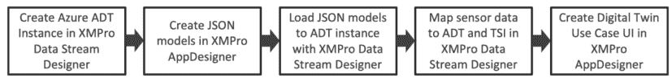

图 6.19 – 在 ADT 上构建第一个数字孪生的低代码方法

图 6.19 显示了在无代码/低代码平台上创建数字孪生应用程序的高级步骤。

第一步是在免费 Azure 订阅中创建数字孪生资源，如图 6.20 所示。这与第 5 章“设置数字孪生原型”中图 5.9 描述的过程类似。它仍然需要 Azure 门户访问权限来配置用户访问权限，如图 5.9 所述。

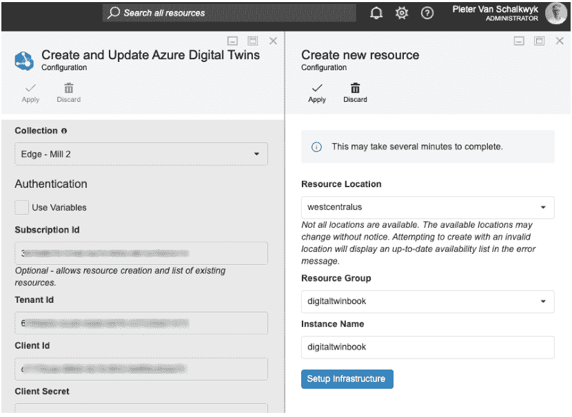

图 6.20 – 从无代码/低代码平台内创建 ADT 实例

图 6.19 中流程的下一步是为风力涡轮机的每个组件（包括转子、齿轮箱和发电机）创建 JSON 模型。图 6.21 显示了一个用于在无代码/低代码页面中创建 DTDL JSON 文件的应用程序，该页面更多面向最终用户，以定义本例中风力涡轮机等属性。

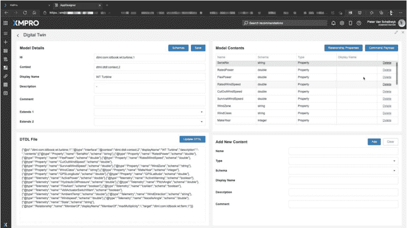

图 6.21 – 在 XMPro App Designer 中创建 JSON 模型

该表单创建 JSON 文件，我们可以在图 6.19 所示流程的下一步中上传该文件。图 6.22 中显示的 XMPRO Azure 数字孪生连接器提供了一个上传功能，可自动将数字孪生模型加载到 ADT 中。

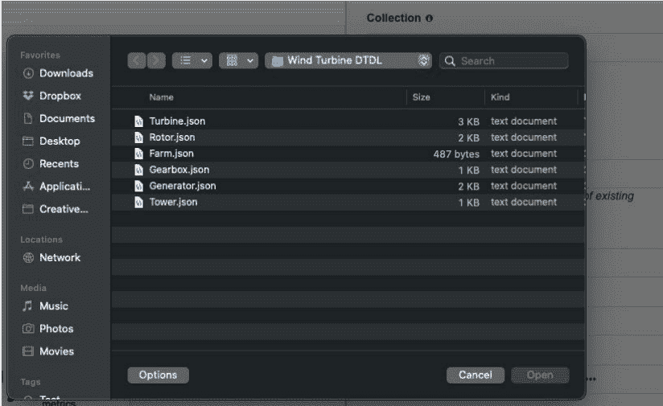

图 6.22 – 使用 XMPRO Data Stream Designer 将 JSON 模型加载到我们的 ADT 实例中

图 6.19 中的第四步是将来自实时遥测或模拟值的传感器数据（如图 6.23 所示）映射到 ADT 中的属性和遥测字段。

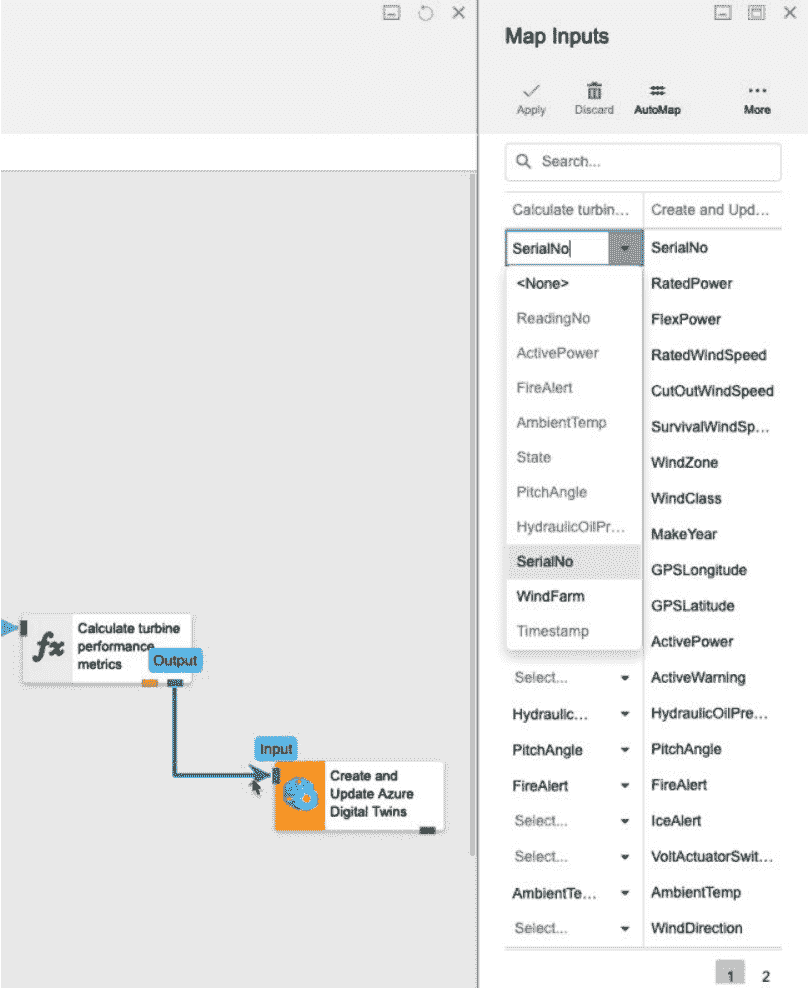

图 6.23 – 在 XMPro Data Stream Designer 中将传感器数据映射到 ADT 和 TSI

最后一步是在无代码/低代码平台的拖放式可视化设计中为维护和现场服务应用程序创建可视化。

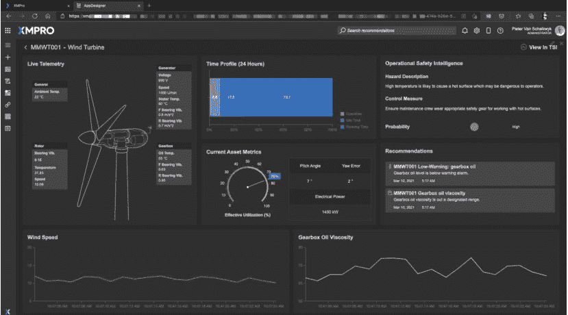

图 6.24 – 在 XMPro AppDesigner 中创建数字孪生用例 UI

图 6.24 显示了一个带有用于状态监测的实时遥测的风力涡轮机数字孪生示例。该平台还允许根据实时遥测数据创建基于分析的建议。建议的分析可以基于状态监测遥测的工程计算、接收实时遥测输入的机器学习模型，或为特定应用程序配置的业务规则。

此示例显示了一个基于观察到的齿轮箱油位的决策树的建议规则。这可以用于计划维护，并向风力涡轮机制造商提供齿轮箱油耗反馈。

在下一节中，让我们专注于数字孪生流程的技术评估。

### 技术评估注意事项

我们的数字孪生预计将反映我们物理资产（即风电场中的风力涡轮机）的当前状况。在我们的案例中，我们确保风力涡轮机不同子组件的 DTDL 包含实现我们目标所需的数据元素，该目标是在风力涡轮机在风电场运行时进行预测性维护。参考图 6.25，我们可以看到齿轮箱油位、油温和轴承温度等属性已在齿轮箱的 DTDL 元素中捕获。

```
{
"@type": "Property",
"name": "Manufacturer",
"schema": "string"
},
{
"@type": "Telemetry",
"name": "GearboxOilLevel",
"schema": "double"
},
{
"@type": "Telemetry",
"name": "GearboxOilTemp",
"schema": "double"
},
{
"@type": "Telemetry",
"name": "BearingTemp",
"schema": "double"
},
```

图 6.25 – 风力涡轮机齿轮箱的数据元素示例

图 6.24 显示了通过数字孪生的可视化应用程序在特定时间间隔内以可视方式显示齿轮箱油粘度等属性的能力。由于齿轮箱油状况监测是风力涡轮机行业的常见做法，这有助于将数字孪生应用程序与对业务用户有意义的参数联系起来。

数字孪生应用程序可以提供风力涡轮机在特定时间点的视图，例如图 6.26 所示的监控和诊断（M&D）中心。此类 M&D 中心通常由制造商的服务组织用于维护其整个机队中的风力涡轮机，这些涡轮机处于保修期或服务合同期内。


图 6.26 – 工业 M&D/指挥中心

> **Note**
> 图片来源：https://commons.wikimedia.org/wiki/File:Elite_ISI_Command_Center.png

M&D 中心通常结合来自数字孪生以及其他企业和第三方数据源的信息，如图 6.27 所示。组合后的信息以分析师易于消费的方式显示。通常，M&D 中心由工业设备制造商运营，并为风电场运营商提供监控服务。

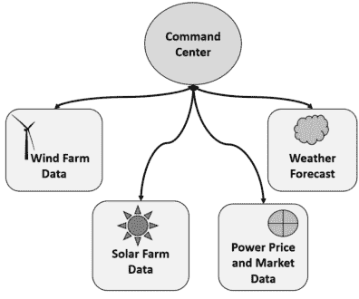

图 6.27 – 工业 M&D/指挥中心


当我们对数字孪生进行技术评估时，必须考虑其与 M&D 中心系统的集成。不同系统的数据可能具有不同的粒度；例如，天气预报（如风速和温度）可能是每小时一次，但风力涡轮机的遥测数据可能每秒记录一次。M&D 中心的数据集成需要处理此类复杂性。

接下来，让我们看看风力涡轮机数字孪生的业务验证注意事项。

### 业务验证与理解

根据 2013 年 7 月的一篇风能出版物《监测风力涡轮机齿轮箱》，观察到齿轮箱的故障比风力涡轮机中的其他子组件更多。根据美国 **能源信息管理局 (EIA)**，风力涡轮机的预期寿命约为 20-25 年。齿轮箱设计寿命约为 20 年，但大多数齿轮箱的实际寿命更短。齿轮箱也是风力涡轮机中最昂贵的子组件之一，其成本可高达风力涡轮机成本的 13%。齿轮箱的维修和更换过程很复杂，因为它位于很高的位置，并会导致长时间停机。图 6.28 显示了风力涡轮机中齿轮箱的视图。齿轮箱中的油可保护变距齿轮、开式齿轮和偏航齿轮。

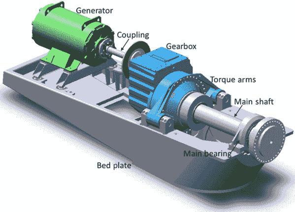

图 6.28 – 风力涡轮机子组件

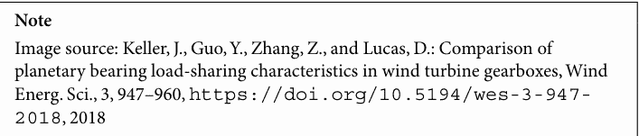

风力涡轮机轴承故障的常见原因之一是 **白蚀裂纹 (WEC)**，因为这些轴承承受着高度的力和扭矩。WEC 是风力涡轮机轴承可靠性问题的主要原因之一。WEC 会导致轴承材料表面下发生结构变化。当轴承受力时，产生的裂纹最终会延伸到轴承表面，从而导致轴承故障。通过监测齿轮箱油的状况来保持适当的润滑，可以帮助减少风力涡轮机轴承中 WEC 的发生。油的状况在降低齿轮箱运动部件的整体摩擦和磨损方面起着关键作用。根据埃克森美孚的一份出版物，2020 年风力发电场的平均年龄为 7 年。基于风力涡轮机平均 5 至 10 年的制造商保修期，从商业角度来看，现场维护这一话题非常及时且相关。

历史上，齿轮箱油的监测是通过离线方式进行的，即取样齿轮箱油。从风力涡轮机中取出的油样被送到实验室进行分析，检查粘度以及铁质和非铁质颗粒水平等特性。风力涡轮机的数字孪生，连同遥测数据，可以促进对油状况的在线监测。传感器可以持续记录温度并推导油的粘度。

在业务验证阶段，**主题专家**会查看数字孪生对风力涡轮机或整个风力发电场 **运营和维护 (O&M)** 成本的经济影响的初步估计。主题专家还会查看数字孪生的可信度，以便能够随时间做出此类 O&M 预算决策。

接下来，让我们看看此背景下的一些实际数字。根据壳牌公司的数据，全球风力发电场维护每年花费约 80 亿美元（参见 `https://www.shell.com/business-customers/lubricants-for-business/sector-expertise/power-industry/wind-power/true-cost-of-wind-turbine-maintenance.html`）。每次齿轮箱故障事件给运营商造成的成本在 30 万至 50 万美元之间。根据我们的研究，平均风力涡轮机更换齿轮箱油的成本约为 8,000 美元。齿轮箱可能容纳 200 至 800 升油。平均而言，基于计划维护，风力涡轮机的齿轮箱油更换每 36 个月进行一次。

在风力涡轮机平均 20 年的使用寿命内，需要 6-7 次换油。如果使用数字孪生进行基于状态的维护将其减少 1 次，即在风力涡轮机的可用寿命内进行 5-6 次换油，这将仅在这一费用项目上每台风力涡轮机降低 8,000 美元的维护成本。此外，它还可以减少因齿轮箱故障导致的停机事件。除了健康监测和预测性维护外，数字孪生还可以有助于优化风力涡轮机，从而提高整个风力发电场的发电量。

在本节中，我们探讨了风力涡轮机数字孪生的业务验证。

### 摘要

在本章中，我们演示了如何构建工业资产的数字孪生，在此案例中为风力涡轮机。我们使用 DTDL 和 Microsoft Azure 数字孪生来构建数字孪生。我们讨论了开发人员如何利用通过 ADT 暴露的 PaaS 功能。我们进一步展示了需要在 ADT 之上为业务人员构建应用程序。我们使用 Power BI 和 XMPRO Data Stream Designer 来展示这些场景。然后，我们探讨了风力涡轮机数字孪生的技术和业务验证。

在 _第 7 章，部署和价值跟踪_ 中，我们将开始探讨在生产级别部署风力发电场数字孪生的注意事项。

### 问题

+   1. 使用 ADT 构建数字孪生时，DTDL 的作用是什么？

+   2. 为什么要查看风力涡轮机的子组件来构建数字孪生？

+   3. 为什么齿轮箱的预测性维护对风力发电场至关重要？

+   4. 如何在 ADT 中存储资产的历史遥测数据？

+   5. 如何评估风力涡轮机数字孪生解决方案预期的业务成果？
