# 7 部署和价值跟踪

在第 6 章，构建数字孪生原型中，我们介绍了由许多风力涡轮机组成的风力发电场数字孪生的开发，每个风力涡轮机都有自己的数字孪生。数字孪生应用程序是使用 Microsoft Azure 数字孪生 (ADT) 服务上的 Visual Studio 集成开发环境 (IDE) 配置的。Visual Studio IDE 方法适用于希望在 ADT 服务上构建高级数字孪生应用程序的程序员。我们进一步使用面向主题专家 (SME) 的无代码应用程序开发平台进行了演示，这些专家希望在不编写代码的情况下创建数字孪生应用程序。我们进一步评估了我们第一个数字孪生的测试、技术评估和业务验证。

本章将重点介绍在运营环境中部署和扩展解决方案。这将有助于提供一种结构化的方法，从对数字孪生的初步实验到交付业务成果的目标状态。这一点很重要，因为通常，涉及物联网 (IoT) 和数字孪生等新兴技术的实验，由于整个生命周期中涉及的各种复杂性，并未产品化。我们将继续使用风力发电场和风力涡轮机的示例，并演示以下部署步骤：

+   - 数字孪生的功能测试
+   - 试点推出
+   - 全面部署
+   - 价值主张和跟踪

在本章的第一部分，我们将评估数字孪生如何满足在第 6 章，构建数字孪生原型中最初设定的功能需求。

### 数字孪生的功能测试

功能测试是开发软件应用程序的标准做法，创建数字孪生解决方案也不例外。然而，对于数字孪生，我们建议对数字孪生基础设施和数字孪生应用程序都进行功能测试。

在第 5 章，设置数字孪生原型中，我们创建了风力发电场和风力涡轮机的模型和实例作为您的数字孪生原型解决方案。测试模型的功能和完整性并确保它们被正确部署是数字孪生功能测试的第一步。一旦确认我们的数字孪生基础设施运行有效，我们就可以测试在第 6 章，构建数字孪生原型中配置的实际数字孪生应用程序。

让我们接下来看看测试框架。

### 测试数字孪生基础设施

您的风力发电场数字孪生原型是在 ADT **平台即服务** (PaaS) 上配置的。它是数字孪生基础设施的 **集成 PaaS** (iPaaS) 的一个示例。在描述数字孪生原型功能测试的第一步时，我们将继续使用该示例。

基础设施功能测试的目的是确保平台组件被正确配置。此功能测试将消除错误的平台配置作为实际应用程序功能测试失败的潜在原因。

我们建议按照以下图所示的测试顺序进行基础设施功能测试：

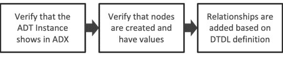

图 7.1 – 测试数字孪生基础设施

序列中的第一步用于检查 Microsoft Azure 中的数字孪生配置和访问控制是否正确配置。功能测试是通过访问您的数字孪生来完成的，使用 **ADT Explorer (ADX)**。

此测试旨在展示我们可以在 ADX 中访问风电场的数字孪生实例，该实例在左侧窗格中显示不同的模型，在中间窗格中显示图表。如果底层基础设施或访问权限存在任何问题，我们将无法成功显示数字孪生实例。以下屏幕截图显示了典型的错误消息：

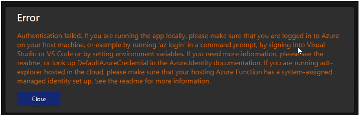

图 7.2 – ADX 中的访问权限错误消息

以下屏幕截图提供了成功测试的示例，显示了 Azure iPaaS 上的模型和实例：

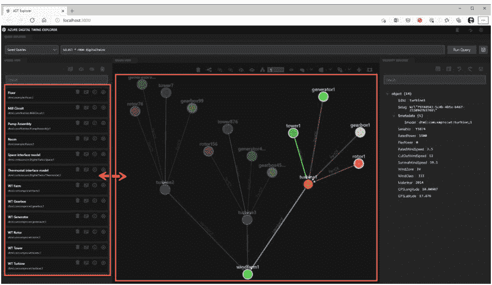

图 7.3 – 数字孪生基础设施的功能测试

_图 7.1_ 中基础设施功能测试的第二步检查节点是否在属性字段中创建了正确的值。以下屏幕截图提供了成功的涡轮机节点及其关联属性的示例：

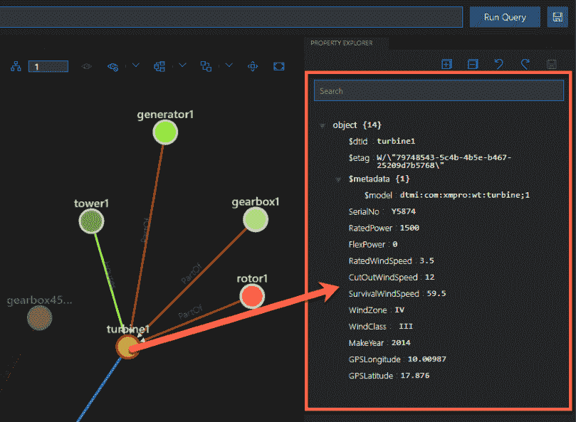

图 7.4 – 节点和值的功能测试

如果此信息不正确，则 **数字孪生定义语言 (DTDL)** 模型文件可能包含无效信息或结构不正确。它还可能表明您的应用程序上的数据摄取服务未将数据传递到数字孪生实例。在这种情况下，我们建议您重新查看 _第 6 章，构建数字孪生原型_ 中的配置步骤。

_图 7.1_ 中基础设施功能测试的最后一步是检查关系是否正确配置。ADX 提供可视化的基于图形的界面，使查看多个 DTDL 模型中定义的各种关系变得容易。这些模型之间的关系对数字孪生实例的成功至关重要，作为基础设施功能测试的一部分测试此内容，可确保底层图形功能已正确部署。

每个关系都在连接节点的箭头上命名，如以下屏幕截图所示。如果您可以看到节点关系，这意味着您的 iPaaS 服务已正确配置，并且图 7.1 中概述的三项基础设施功能测试已结束：

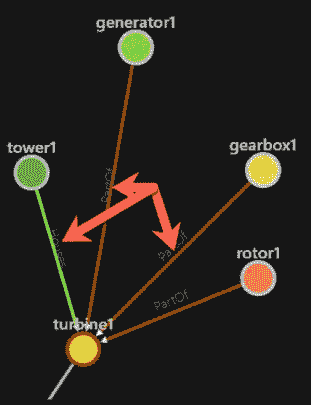

图 7.5 – 关系的功能测试

一旦您确信数字孪生模型和实例的基础设施组件已通过基础设施功能测试，您就可以继续进行数字孪生应用程序的功能测试。

### 测试数字孪生应用程序

接下来让我们看看测试风力涡轮机数字孪生应用程序的详细信息。

### 测试在 Visual Studio 中开发的代码解决方案

数字孪生应用程序的功能测试遵循更传统的软件开发测试方法，尤其是当应用程序是在 Visual Studio 等 IDE 中设计的代码解决方案时。功能测试要求将由数字孪生用例特征决定，例如以下内容：

- 数字孪生应用程序的关键性
- 安全和安全要求
- 与其他系统和数字孪生集成的复杂性
- 数字孪生中控制的自主性和自动化级别
- 数据和建议的准确性

代码数字孪生应用程序的应用程序功能测试基于复杂系统开发的最佳实践。软件功能测试的目标是根据数字孪生的初始功能规范验证应用程序。功能测试通过提供输入并根据数字孪生应用程序的功能规范验证输出来测试每个声明的功能。最常见的功能测试概述如下：

- **单元测试**—一种软件测试方法，开发人员测试单个源代码单元，以确认代码单元按预期执行。
- **冒烟测试**—初步或初始测试，以确定软件构建是否足够稳定，以便进行进一步的 **质量保证 (QA)** 测试。
- **冒泡测试**—一种表面级测试方法，当添加新模块或代码时，用于决定应用程序是否足够稳定以进行进一步的开发周期，然后再进行全面功能测试。
- **集成测试**—单个模块或组件组合并在一起作为一组进行测试。这种方法强烈推荐用于复合数字孪生，其中来自不同离散数字孪生的模块需要互操作以交付数字孪生所需的功能。
- **白盒测试**—一种测试数字孪生应用程序的方法，测试人员完全了解数字孪生解决方案的内部结构和代码。
- **黑盒测试**—一种测试数字孪生应用程序的方法，测试人员不了解数字孪生解决方案的内部结构或代码。
- **用户验收测试 (UAT)**—这是一种测试方法，数字孪生应用程序的最终用户测试解决方案，以确定是否可以接受。
- **回归测试**—这是一种软件测试方法，用于验证代码更改未对现有功能产生不利影响。部分或全部重新执行先前的测试用例可识别回归的代码。

本书不在范围内详细解释每种测试方法，因为这是一门定义明确的软件学科，有许多优秀的资源可用。

单元测试通常由数字孪生应用程序的开发人员完成。在 _第 6 章，构建数字孪生原型_ 中介绍的 Power BI 代码解决方案的单元测试场景，要求开发人员测试数字孪生的每个功能区域。该章节中使用的示例解决方案的功能区域在以下屏幕截图中显示。图表上的每个块都单独测试，针对代码最可能出错的场景，从 ADT 开始，然后是事件网格，最后是 Power BI **用户界面 (UI)**，如下所示：

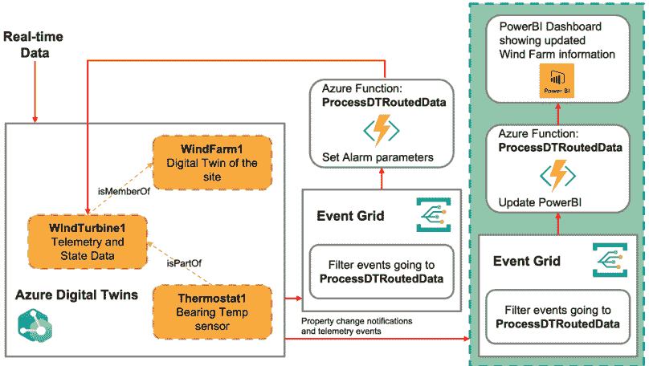

图 7.6 – 单元测试代码数字孪生

相比之下，黑盒测试由 QA 团队完成，他们在不了解解决方案背后代码的情况下评估预期输出。例如，这将是通过使用预期和意外输入值来评估 Power BI 最终用户界面上的结果。

在无代码环境中创建的数字孪生解决方案遵循类似的功能测试方法。主要区别在于，我们无法在代码级别执行单元测试，而是在无代码环境中的功能块上执行。

### 测试无代码数字孪生平台解决方案

无代码应用程序开发平台提供具有有限编码功能的最终用户配置环境。这面向了解数字孪生应用程序业务要求但不具备软件开发技能的中小企业。

无代码环境中数字孪生应用程序的单元测试仅限于脚本或模型，例如外部模型——例如，Python 中的故障预测模型。无代码应用程序开发平台通常提供嵌入或调用外部模型的功能，例如上述的 Python 预测模型。单元测试可以应用于模型或脚本，但不能应用于核心数字孪生应用程序。

数字孪生应用程序的功能测试通常仅限于集成测试和黑盒测试。以下屏幕截图演示了在我们在第 6 章，构建数字孪生原型中使用 XMPro 创建的风力涡轮机数字孪生上进行的集成和黑盒测试：

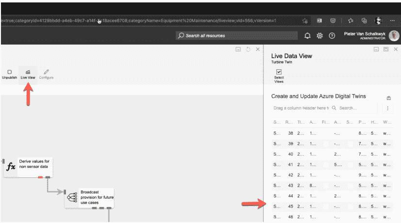

图 7.7 – 无代码应用程序开发中的集成和黑盒功能测试

顶部菜单上的 Live View 选项卡在应用程序右侧打开一个窗格，显示数据流发布时数据流中最后一个块的数据值。它提供了一个简单的功能测试视图，显示来自集成源的数据以及沿途对数据的任何操作。此视图非常适合黑盒功能测试。带有该数据的窗格可以展开以清晰显示值，如以下屏幕截图所示：

# 图 7.8 – 展开的实时视图数据

UAT 提供了测试用户与数字孪生应用交互的机会，检查解决方案逻辑的有效结果以及在不同基础架构（如桌面浏览器、移动设备和 **增强现实/虚拟现实 (AR/VR) 硬件**）上的性能。以下截图显示了桌面浏览器和移动浏览器上的 UAT 示例：

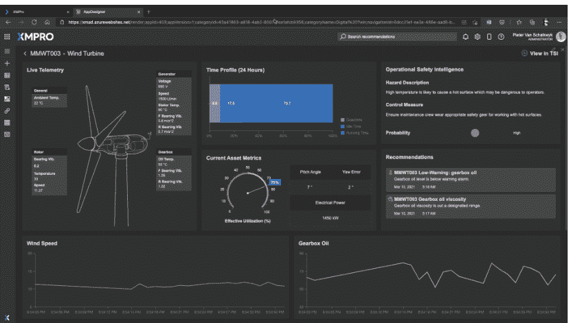

图 7.9 – 桌面和移动浏览器上的 UAT

在本节中，我们概述了对数字孪生原型进行功能测试的典型方法。您对数字孪生原型进行的特定测试将取决于您为创建解决方案所遵循的代码或无代码方法。

一旦基础架构和应用程序功能测试均已完成，我们就可以为数字孪生原型的试点推出做好准备。

### 试点推出

数字孪生项目遵循典型的演进过程，从通过原型验证概念开始，然后进行试点，最后进行全规模部署。这些阶段中的每一个都在创建成功的数字孪生解决方案的过程中发挥特定目的。

以下截图显示了从概念到全规模部署的演进，以及范围在整个过程中如何演变：

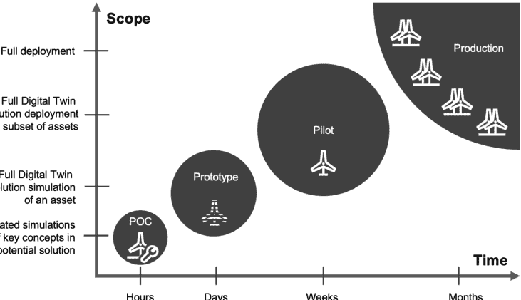

图 7.10 – 从概念到全规模部署的演进

在初始 **概念验证 (POC)** 阶段，目标是证明特定技术或设计组件的可行性。此阶段验证在开发生产系统时使用这些概念的适用性，并作为决策点或门禁，以确定特定解决方案是否可以进入原型阶段。在我们的风力涡轮机示例中，我们可以使用 POC 来确定我们从传感器接收到的数据是否足以创建用于预测性维护的 **机器学习 (ML)** 模型。

_第 6 章，构建数字孪生原型_，重点介绍了配置支持多台风力涡轮机的风电场数字孪生原型。原型是整体解决方案的完整模型，使用模拟数据来演示关键功能。它将多个 POC 元素整合到数字孪生的配置中。

一旦我们成功创建并测试了原型，就可以进入数字孪生应用程序的试点实施。试点推出的范围将由试点环境（如风电场、工厂或用于创建数字孪生应用程序的物理资产）的可用性决定。

### 试点实施的范围

在大规模风电场环境中，我们可以使用一个风电场作为试点，或者在其他情况下，可能仅限于单台涡轮机。最初的问题陈述也将驱动试点实施的要求。如果我们评估单台涡轮机的预测故障，我们需要一个风力涡轮机实例用于试点。如果我们优化风电场上一组涡轮机的发电量，我们需要访问风电场以进行试点推出。

另一个将决定试点范围的因素是我们对数字孪生的视角。在第 3 章，识别第一个数字孪生中，我们描述了数字孪生用户的不同视角以及他们的各自用例将如何不同。我们为第一个数字孪生的原型实施选择的视角是原始设备制造商 (OEM)，该制造商还提供维护服务。

就试点范围达成一致是交付成功结果的关键方面。协议应与内部和外部利益相关方达成，并应涵盖以下范围维度：

- **地理**—试点将在哪个特定地理区域进行？
- **组织**—业务的哪些部门或职能将参与试点？
- **解决方案**—解决方案范围应与第 4 章，开始使用我们的第一个数字孪生中精益数字孪生画布记录的解决方案要求相匹配。
- **集成**—我们需要与哪些系统集成？
- **信息技术 (IT)**—我们的数字孪生试点部署需要哪些 IT 和基础架构，例如公共云服务和其他许可软件？
- **培训和文档**—我们为试点阶段提供哪些培训和文档？
- **变革领导**—我们在变更管理方面承担什么责任？

以下图表提供了一种直观的视觉方法，清楚地展示了每个维度内的内容和不在范围内的内容：

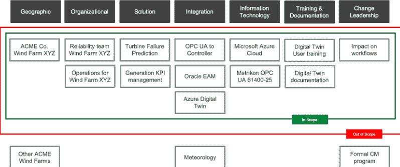

图 7.11 – 风电场解决方案的示例试点推出范围图

在本示例中，地理范围仅限于 ACME Co. 的风电场 XYZ，位于绿色矩形内。图 7.11 还显示，它通过将 ACME Co. 公司运营的其他风电场置于红色（或范围外）矩形之外来排除它们。

所有其他范围维度都可以使用类似于地理范围示例的方法轻松识别。视觉呈现为范围提供了清晰的边界，而无需编写过多文档来描述每个元素。它易于向项目赞助人展示，并清楚地概述了责任领域及其对组织资源的影响。

一旦试点推出的范围达成一致，建立试点阶段的成功标准也是至关重要的。提前确定衡量标准和关键绩效指标 (KPI) 可确保随着试点的进展，目标不会不断移动。同样重要的是，您需要与项目赞助人就这些成功标准达成一致，并以清晰简单的术语向项目的所有利益相关方说明。

### 试点阶段的成功标准

我们建议您将试点推出的成功标准划分为以下图表中显示的三个简单类别：

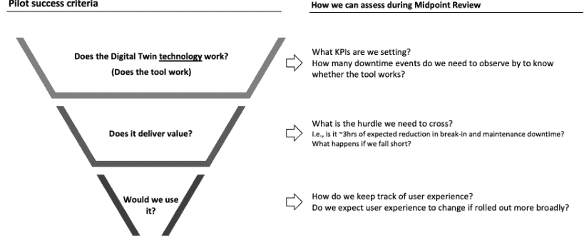

第一个成功衡量标准是确定技术和工具是否按预期工作。在风电场示例中，我们可以衡量数字孪生在评估期间提供的预测故障数量、异常事件和警报数量。如果我们确信技术和应用程序正常工作，就可以进入下一个决策门禁和成功衡量标准。

衡量解决方案的价值与我们在第 4 章，开始使用我们的第一个数字孪生中定义的预期业务成果相关联。

此成功衡量标准在试点阶段至关重要，因为它将指示试点阶段完成后大规模部署时的预期 **投资回报率 (ROI)**。虽然第一个门禁测试技术成功，但价值问题是项目赞助人决定为解决方案全规模推出发出绿灯的重要考量因素。

最后一个成功衡量标准是变更管理以及组织中应用程序的使用。解决方案可能在技术上可行并提供业务价值，但用户可能没有动力或不愿意改变工作方式。监控用户访问系统的频率或响应数字孪生生成的警报和操作，可提供应用程序使用的可量化指标。此成功衡量标准还应包括对数字孪生配置持续维护的承诺，其中包括数字孪生原型和集成点。

在试点推出开始时设定这些标准，可以轻松决定试点期间解决方案的成功。它还消除了利益相关方的情感影响，因为期望在开始时设定，并且随着试点的进展不会改变。

### 试点解决方案的时间表和阶段

试点推出的时间表和阶段将根据您的数字孪生原型的范围和复杂性而有所不同。我们为您的数字孪生试点评估提出了一个三阶段计划。**第 1 阶段** 侧重于解决方案开发周期，**第 2 阶段** 侧重于原型评估，**第 3 阶段** 用于记录试点推出的结果和反馈。以下截图显示了三个拟议阶段及其典型持续时间（以周为单位）。持续时间应根据您的项目和环境进行调整：

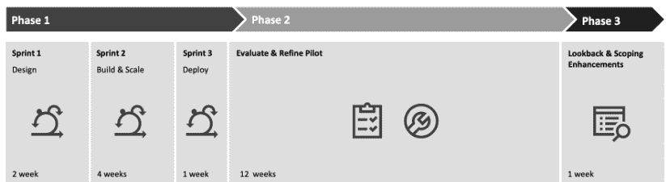

图 7.13 – 试点推出阶段

### 呈现试点结果

项目发起人欣赏对试点结果进行简单直接的展示，我们建议将这些结果呈现在单个演示文稿幻灯片中，并为每个指标提供支持性幻灯片。下图显示了基于我们为定义成功标准所描述的初始结构的演示文稿幻灯片：

### 指标显示试点取得积极成果

| 是否有效？ | 是否提供价值？ | 是否在使用？ |
|---|---|---|
| ☑ 指标仪表板 ☐ 通知数量 ☐ 关闭的通知数量 ☐ 分配的工作请求数量 ☐ 转换为工单的工作请求数量 技术和 IT ☐ 识别至少 90% 的设备问题（齿轮箱轴承振动、发电机温度、转子振动），误报率最高为 5% ☐ 解决方案与 ACME 的 EAM 实例和维护数据库集成 | ☑ 通知系统 ☐ 按解决方案定义创建和发送通知（电子邮件、短信） ☐ 配置 ☑ 创建带数据的数字孪生实例，并允许 ACME 可靠性团队配置设定点 | ☑ 识别至少 30% 因齿轮箱轴承问题导致的停机事件（如果执行工单，可减少 9 小时停机时间） ☑ 识别至少 50% 因齿轮箱油或脂量问题导致的停机事件（如果执行工单，可减少 2.5 小时停机时间） ☑ 优先推动可操作的结果，而非执行手动计算和数据监控（每周绕过 8 小时“行政”任务） | ☑ 使用时间和用户数量 ☑ 87% 的工单已完成 ☑ 用户调查 定性评估以捕捉用户体验、因该工具导致的用户行为/决策变化、改进意见等 |

图 7.17 – 呈现试点结果

我们还建议您向项目发起人提供支持经济商业案例的一些关键运营指标的证据。图 7.18 例如显示了试点推出开始时的性能指标，图 7.19 显示了试点阶段结束时的影响。

下图显示，由于维护计划员的业务流程尚未更改以适应数字孪生的智能，维护团队未对多个预测故障作出响应：

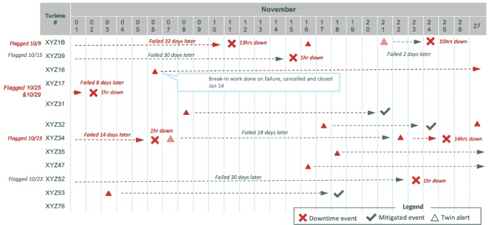

下图显示了对预测故障响应的改进，几乎所有工作都提前安排，并将非计划故障减少了 90% 以上：

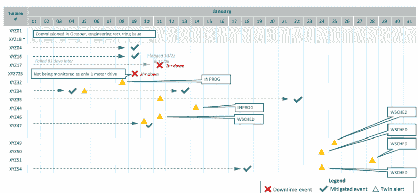

根据我们的经验，前后对比快照对于向需要决定是否从试点阶段赞助您的数字孪生项目进行全面部署的忙碌高管展示影响效果良好。

本书的范围侧重于开发您的第一个数字孪生原型，而试点该解决方案是证明您的数字孪生解决方案实际价值的首个重要证据点。因此，我们对试点推出过程和步骤提供了更详细的解释。

当您的试点实施证明技术有效、能够提供价值、业务用户会使用它，并能为大规模运营化争取到赞助时，图 7.10 中的下一阶段就是对您的数字孪生解决方案进行全面部署。

### 全面部署

现在，我们已完成原型开发和数字孪生解决方案的试点安装，已准备好进行全面部署。

我们经常听到“试点炼狱”这一术语，它与无法进入生产阶段的试点相关。物联网世界论坛（IoTWF）在 2017 年报告称，60% 的物联网项目在 POC 和试点阶段停滞不前（`http://bit.ly/idt-IoTWF`）。

这听起来可能是一个令人震惊的统计数据，但实际上，它表明图 7.10 的分阶段开发方法是有效的，因为它筛选出了大规模部署时可能不成功的项目。这意味着这些项目无法满足技术可行性、商业价值或用户接受度的标准。在财务和商业影响有限的早期阶段让项目失败，总比最终导致昂贵的失败项目并损害个人和组织声誉要好。

然而，对于通过所有审核的项目，下一阶段是在新项目范围内进行全面推广。全面项目的范围涵盖图 7.11 中的所有范围要素，但现在将包括大规模部署数字孪生解决方案的完整范围。许多在试点阶段显示为超出范围的项目，将在全面推广阶段纳入范围。

这个新范围还将定义将您的数字孪生解决方案部署到多个地点的多个资产上的最佳方法，例如我们在风电场示例中所拥有的场景。

接下来，我们将深入探讨实施方法。

### 全面实施方法

大规模分布式软件项目通常遵循两种扩展部署方法之一。这些方法在部署复杂的 **企业资源计划** (ERP) 解决方案时变得流行，但基于大规模软件解决方案部署的经验，提供了出色的指导。以下是两种常用方法：

- 大爆炸方法
- 分阶段方法

让我们现在来看看每种方法的详细信息。

### 大爆炸方法

**大爆炸**方法描述了一种场景，即您的数字孪生解决方案的所有功能在所有位置的所有资产上部署。这种方法意味着所有数字孪生实例同时上线，并在以下条件下有效：

- 基本数字孪生功能已通过试点实施且没有任何技术挑战
- 地理范围有限
- 安装数量有限

具有广泛集成的复杂数字孪生不适合大爆炸实施。地理范围应限制在不同站点的近距离内——例如，某个县或州内拥有有限数量风电场的小型公司可能会从单一实施周期中受益。我们也不建议对拥有两个以上或三个以上数字孪生实施站点的项目采用大爆炸方法。

大爆炸方法的风险高于分阶段方法。然而，一个显著的好处是，组织可以更快地从数字孪生中获得业务价值和结果。

在选择大爆炸或分阶段实施方法时，需要考虑的最后一点是对组织的影响。大爆炸方法通常对资源可用性以及业务用户需要花费在数字孪生系统上的时间产生更大的影响，并且由于实施数字孪生而需要改变其业务流程。

大爆炸方法可能适合规模较小、范围有限的项目，但首选方法是分阶段推出全规模数字孪生项目，以降低风险和对组织的影响。

### 分阶段方法

分阶段实施方法正如其名称所示。基于范围要素，我们决定是按站点逐个推出所有功能，甚至将其分解为不同用例的子阶段。

您的解决方案的复杂性将决定您是否可以按站点分阶段实施完整的数字孪生解决方案。分阶段方法的一个好处是，您可以根据不同的场景或变量设置里程碑，例如：

- 数字孪生用例
- 业务单元或工厂/场地/站点
- 地理位置

这种方法的唯一主要缺点是，它通常比大爆炸方法花费的时间长得多，这意味着实现数字孪生项目业务影响所需的时间会更长。

然而，这种方法最显著的好处之一是改善可用性和采用率。员工会逐步建立他们的能力，尤其是当分阶段方法不仅按站点，而且按数字孪生用例进行时。

以下截图显示了一个全球采矿公司的示例，该公司按矿场和用例分阶段实施了其数字孪生项目。该采矿公司针对特定商品运营六个矿场，并根据可行性和可复制性对矿场进行了排名：

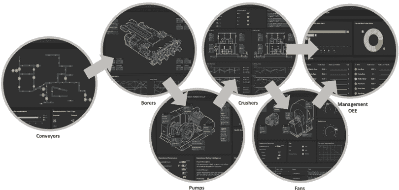

图 7.20 – 按地理位置和数字孪生用例分阶段（图片由 XMPro Inc 提供）

试点项目仅限于地下输送机，从该站点吸取的经验教训用于规划在六个矿场上全面推出多个数字孪生用例。

初始试点站点继续进行钻机、水泵、破碎机、风扇和其他数字孪生用例，而另一个矿场开始以类似的分阶段方法进行输送机数字孪生实施。并非所有矿场都具有与初始试点站点相同的基础设施、传感器和系统。他们特定的分阶段推出计划包括将其他基础设施组件添加到范围中，这些组件在初始试点矿场并不需要。这提示了分阶段方法的一个重要方面。分阶段推出计划仍需根据可行性进行定制，因为大规模部署中的技术环境必然存在差异。

### 208 部署和价值跟踪

以下截图提供了一种简单的单页演示文稿，您可以使用它向项目赞助商和高管描述策略：

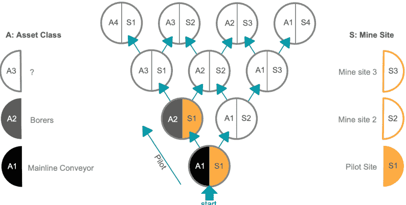

图 7.21 – 分阶段推出的保龄球道计划

圆圈代表每个站点、工厂或地理维度的特定资产类别或用例。对于采矿示例，**A1** 表示输送机，**S1** 表示初始试点站点。在成功完成试点后，初始站点为钻机部署下一个数字孪生用例。如图 7.21 左侧箭头所示，他们沿着自己的轨迹推进任何其他数字孪生用例的分阶段推出。

矿场 2 由 **S2** 表示，从输送机的分阶段推出开始，图 7.21 右侧的箭头显示了以分阶段方法将输送机数字推广到所有矿场。

然后，用例和矿场的时间表可以轻松分阶段，如以下截图所示。这是一个简单的示例，但它说明了按用例和实施或安装站点进行分阶段的能力：

| 数字孪生用例 | 第 1 个月 | 第 2 个月 | 第 3 个月 | 第 4 个月 | 第 5 个月 | 第 6 个月 |
|-----------------------|---------|---------|---------|---------|---------|---------|
| 输送机             | 矿场 1  | 矿场 2  | 矿场 3  | 矿场 4  | 矿场 5  | 矿场 6  |
| 钻机                |         | 矿场 1  | 矿场 2  | 矿场 3  | 矿场 4  | 矿场 5  |
| 水泵                 |         |         | 矿场 1  | 矿场 2  | 矿场 3  | 矿场 4  |
| 破碎机              |         |         |         | 矿场 1  | 矿场 2  | 矿场 3  |
| 风扇                  |         |         |         |         | 矿场 1  | 矿场 2  |
| OEE                   |         |         |         |         |         | 矿场 1  |

这不是实施数字孪生解决方案的唯一分阶段方法；然而，我们发现它对于大规模复杂数字孪生项目是一种高效的方法。例如，另一种方法是在转移到下一个矿场之前，先在单个矿场上推出所有数字孪生用例。组织资源、商业案例和用户采用率将影响最适合您数字孪生项目的方法。

分阶段方法风险较低，但实现其业务价值所需的时间更长。它通常对组织的影响较低，但长期的时间表也可能导致挫败感。考虑这两种方法的优缺点，并决定对您的数字孪生项目实施最有利的方法。

让我们接下来关注推出。

### 风电场数字孪生推出

在 _第 6 章，构建数字孪生原型_ 中，我们在 ADT 上创建了一个带有风力涡轮机的风电场原型。这是一个基本的风力涡轮机资产结构，DTDL 定义文件包含所有潜在属性的一个子集。

对于风电场数字孪生的全规模生产部署，我们建议审查能源电网 (`http://bit.ly/idt-energyontology`) 的 DTDL 本体论，该本体论改编自 **通用信息模型 (CIM)**，这是能源电网资产管理、电力系统运行建模和实物能源商品市场的全球标准 (`http://bit.ly/idt-cim`)。国际标准 _IEC 61400-25，风力发电厂监控和控制通信_ (`http://bit.ly/idt-iec61400`) 为风电场和风力涡轮机的信息交换提供了标准化数据模型。

The standard prescribes a number of logical information nodes for the wind turbine, the controller, and meteorology that can be used in the management of wind turbines and wind farms. Part 2 of the specification describes the wind turbine and asset-information models, whereas Part 6 defines a condition monitoring information model for wind farms.

The following diagram shows the logical nodes in the information model as described by IEC 61400-25. It lists the components of the wind turbine and the controller unit, alarm information, and meteorology data:

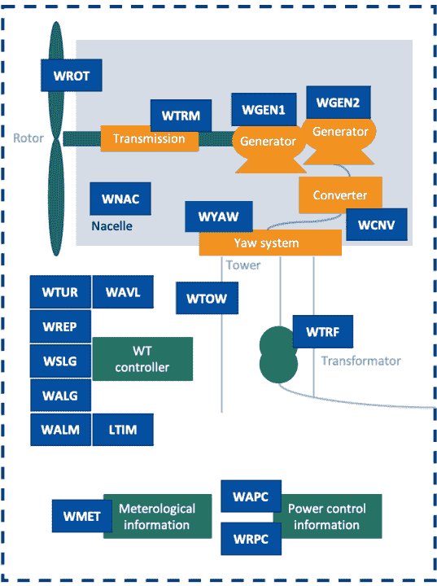

Figure 7.23 – IEC 61400-25 information model logic nodes (Image credit: https://bit.ly/idt-iec61400model)

The transmission (WTRM) logical node prescribes the data model, as shown in the following table:

| Data Object Name | Common Data | Explanation | M/O |
|---|---|---|---|
| | | LN shall inherit all Mandatory Data from Wind Power Plant Common Logical Nodes | M |

### Data

### Common information

### Status information

| BrkOpSt | STV | Status of shaft brake | O |
| LuSt | STV | Status of gearbox lubrication system | O |
| FilSt | STV | Status of filtration system | O |
| ClSt | STV | Status of transmission cooling system | O |
| HtSt | STV | Status of heating system | O |
| OilLevSt | STV | Status of oil level in gearbox sump | O |
| OffFilSt | STV | Status of offline filter contamination | O |
| InFilSt | STV | Status of inline filter contamination | O |
| Measured and metered values | | | |
| ShftBrgTmp | MV | Measured temperature of shaft bearing | O |
| GbxOilTmp | MV | Measured temperature of gear box oil | O |
| ShftBrKTmp | MV | Measured temperature of shaft brake (surface) | O |
| GbxVbr | MV | Measured gearbox vibration | O |
| GsLev | MV | Grease level for lubrication of main shaft bearing | O |
| GbxOilLev | MV | Oil level in gearbox sump | O |
| GbxOilPres | MV | Gear oil pressure | O |
| BrkHyPres | MV | Hydraulic pressure for shaft brake | O |
| OffFil | MV | Offline filter contamination | O |
| InFil | MV | Inline filter contamination | O |

Figure 7.24 – IEC 61400-25 WTRM logical node information model

Figure 7.24 provides a standardized class name (**WTRM**) and defines three types of data in this example, as follows:

- Common information
- Status information
- Measured and metered values

It further defines mandatory and optional information for each logical node and describes the relationship of the class to the overall data model.

The model and subsequent **data definition language (DDL)** models are more advanced than the example we used in the initial Digital Twin configuration. Our focus for the book is on the technology aspect of the Digital Twin configuration rather than an IEC 61400-25-compliant wind turbine Digital Twin. However, for a production system, we would recommend a standards-based approach to ensure interoperability into microgrids and distribution grids.

This section described the entire evolution of the deployment process shown in Figure 7.10, starting with the POC ideation, prototype, pilot implementation, and full-scale rollout guidance. The final step in the evolution is not a distinct phase but instead makes sure that we track the value of the Digital Twin solution as it goes from concept to an operational system.

We defined the problem statement and outcomes in Chapter 4, Getting Started with Our First Digital Twin. Closing the loop on this initial work is the final task for a project team before handing it to a support organization to maintain and operate going forward.

### Value proposition and tracking

In Chapter 1, Introduction to Digital Twin, we described the value proposition of a Digital Twin based in terms of the following abilities:

- Reduce complexity to improve understanding. This can lead to a) improved situational awareness and b) improved business outcomes. The improved business outcomes would be reflected in 1) increased revenue, 2) reduced cost, 3) improved customer and employee experience, and 4) improved compliance and reduced risk.
- Transformational value—namely, a) business transformation through digital transformation and b) new or improved products.
- Value at stake, which can be looked at as a) value to industry and b) value to society. The value to industry can be value migration or value addition. The value to society can be economic, societal benefits such as improved skills and/or a safer work environment, and—finally—environmental.

The key elements of all of these value metrics were captured in a lean Digital Twin canvas in Chapter 4, Getting Started with Our First Digital Twin, and presented to project teams, executive sponsors, and other stakeholders. It is essential to track these metrics and values during each phase of your Digital Twin project. It is a **continuous monitoring (CM)** process that runs in parallel to all the other activities throughout the development and operations life cycle.

Project sponsors are interested in the financial ROI, but they are increasingly interested in **environmental, social, and governance (ESG)** KPIs due to the increased awareness and legislation on sustainability. Senior executives in organizations are making public statements on sustainability targets, and the continuous tracking and forecasting toward the achievement of those goals are areas of high importance for the executive of an organization.

We recommend building value-tracking metrics into the capabilities and reporting of a Digital Twin—a real-time, self-validating Digital Twin that provides continuous insights into the operations and reduces the continuous effort to track value metrics through manual effort. You have a unique opportunity with a Digital Twin to not only provide value but also quantify the value from a Digital Twin continuously.

### Summary

In this chapter, we covered the deployment and scaling of a solution in an operational environment. We addressed four key aspects of turning a Digital Twin prototype into a fully operational Digital Twin solution.

The first key aspect in turning a prototype into a production system is to address the functional testing of the Digital Twin solution. The testing process is to ensure that the Digital Twin solution performs the functions as specified at the requirements at the start of the prototype. In this chapter, we addressed various functional testing processes such as unit testing and black-box testing to illustrate how to test Digital Twins for full-scale deployment.

We described the process of creating a pilot implementation as the second aspect of turning a prototype into a production system. This reduces the risk of a project while proving the capabilities and value in a real-world application.

The third aspect in turning a prototype into a production system is planning and executing a full-scale deployment that builds on the learnings of the pilot phases. We assessed the pros and cons of big-bang and phased approaches and presented a bowling-alley model for a phased approach as our preferred method of scaling out from a pilot.

Finally, we evaluated the success of the solution based on its ability to demonstrate the value it was designed to deliver and we described the process to track the value in a value-at-stake model first introduced in _Chapter 1, Introduction to Digital Twin_.

In the following chapter, we will focus on enhancing the Digital Twin in its ecosystem, describing a system-of-systems Digital Twin approach, and providing some guidance on planning these composite twins.

### Questions

1. What are the different functional testing methods that you should consider for your Digital Twin project?

2. Which scope elements will you include in your Digital Twin project?

3. What are the success criteria for your Digital Twin pilot project and how will you present the criteria to the project stakeholders?

4. What approach will you need for a full-scale rollout to take the project beyond the initial pilot?

5. How will you track and present the value of your Digital Twin prototype to create a case to move it beyond a pilot?

