### 8 增强数字孪生

在第 7 章“部署和价值跟踪”中，我们讨论了如何执行功能测试，然后规划了数字孪生试点的部署和推广。我们探讨了跟踪**关键绩效指标（KPIs）**以及风力涡轮机数字孪生整体价值的方法。数字孪生的成功试点部署通常会导致大规模推广，以实现既定的业务目标。

在本章中，我们将探讨超越试点阶段增强数字孪生的方法。我们将考虑不同组织的视角，以推动经济成果。本章将涵盖以下主题：

- 定义孪生体的孪生体
- 在完整系统中评估第一个数字孪生
- 识别相关孪生体
- 规划复合孪生体
- 增强和下一步

让我们从数字“孪生体的孪生体”概念开始。

### 定义孪生体的孪生体

在此背景下，复合孪生体、孪生体的孪生体和系统的系统等术语经常被使用。让我们以能源生态系统为例来理解这一概念。在能源生态系统中，我们按以下层次结构来看：

- 能源价值链将包括 a) 发电、b) 输电、c) 配电和 d) 用电，如图 8.1 所示。电网可以有一个或多个发电源。
- 能源发电大致可分为 a) 化石燃料或非可再生能源和 b) 可再生能源。
- 对于可再生能源，我们可以看 a) 风能、b) 太阳能和 c) 水能。
- 风电场可以是 a) 陆上风电场或 b) 海上风电场。
- 每个风电场通常由多台风力涡轮机组成。
- 每台风力涡轮机有几个子系统或子组件及部件。

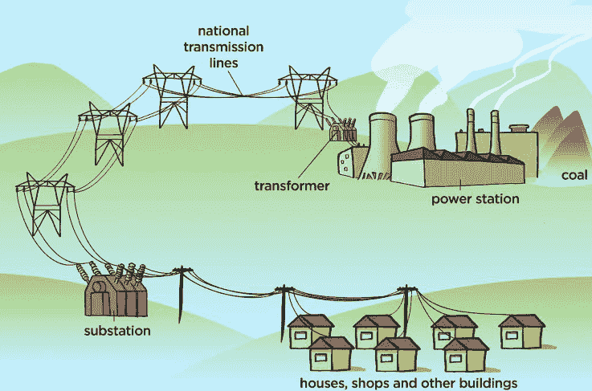

图 8.1 – 能源价值链，包括发电、输电和配电

> **注意**
> 图片来源：https://www.flickr.com/photos/121935927@N06/13580677703

风力涡轮机子系统的常见示例包括转子系统、齿轮箱、叶片、机舱、发电机、液压系统、制动器和偏航系统。我们在第 6 章“构建数字孪生原型”的图 6.3 中介绍了这一点。风力涡轮机的整体可靠性或正常运行时间将取决于子系统的可靠性和正常运行时间。

有关更多信息，请参阅以下内容：
https://www.researchgate.net/publication/271973476_Reliability_Analysis_of_Sub_Assemblies_for_Wind_Turbine_at_High_Uncertain_Wind

基于生态系统的这一层次结构视图，我们可以非常高层次地可视化图 8.2 中所示的孪生体的孪生体：

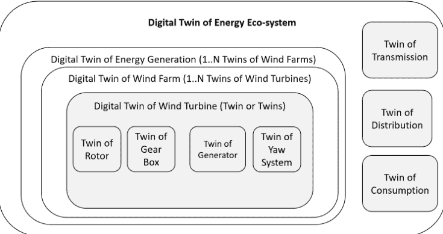

图 8.2 – 能源生态系统的数字孪生体的孪生体概念

虽然本书前几章仅限于风力涡轮机的数字孪生，但理解图 8.2 中所示的孪生体的孪生体概念对于规划风力涡轮机数字孪生的大规模部署至关重要。如果我们从使用风电场作为可再生能源手段之一的能源公用事业公司的角度来看待能源生态系统，他们还将计划其他形式的发电。其他形式的发电，无论是太阳能电站还是燃气轮机发电厂，也可能有相关的孪生体的孪生体。因此，将此问题陈述视为系统的系统非常重要。在理论上，这可能看起来像是一种递归关系，但不同设备的其他工程制造商可能会导致不同的数字孪生系统。这导致了复合解决方案中数字孪生互操作性的挑战。

### 标准的作用

有几项努力旨在引入标准，以使孪生体的互操作性更容易。在第 7 章“部署和价值跟踪”中，图 7.23 显示了 IEC 61400-25，它描述了在风电场背景下交换信息的标准数据模型。

另一个这样的机构是 SC 41，它是 JTC 1 下属的一个分委员会。JTC 1 是**国际标准化组织（ISO）**和**国际电工委员会（IEC）**的联合机构。SC 41 正在致力于**物联网（IoT）**和数字孪生相关标准。有关更多信息，请参阅以下内容：

`https://www.iso.org/committee/6483279.html` 和 `https://www.iec.ch/blog/moving-ahead-standardization-digital-twin`

_图 8.3_ 显示了在此背景下 SC 41 的工作范围：

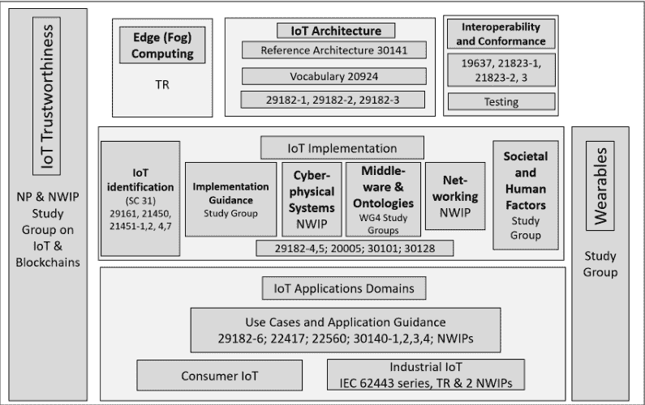

图 8.3 – SC 41 的范围及其活动

**注意**
图片重新绘制自来源：`https://www.itu.int/en/ITU-T/ Workshops-and-Seminars/20180604/Documents/ Francois_Coallier_P_V2.pdf`

在此背景下，关于 SC 41 小组的活动范围，我们应该将 IoT 术语视为更广泛的含义，其中将包括数字孪生等技术。

SC 41 小组的一些标准相关工作包括以下内容：

- ISO/IEC 21823-2，描述了 IoT 系统信息交换的框架和要求。它涵盖了 IoT 系统之间以及 IoT 系统内部的通信。
- ISO/IEC TR 30164，描述了 IoT 系统应用边缘计算的一般概念。我们的场景，计算风力涡轮机，可以被视为 IoT 系统的边缘计算。
- ISO/IEC TR 30166，涵盖**工业物联网（IIoT）**系统和环境。它涵盖了 IIoT 的功能和非功能方面。有关更多信息，请参阅 `https://www.iso.org/news/ref2529.html`。

我们可以看到，IoT 和数字孪生相关标准仍在不断发展。我们建议数字孪生计划的利益相关者关注此类不断发展的标准，例如数字孪生参考架构的项目 PWI JTC1-SC41-5。利益相关者可以将其纳入规划中，以便与其他系统实现互操作性。一些相关文档可以在此处找到：`https://www.iec.ch/dyn/www/f?p=103:23:0::::FSP_ORG_ID:20486`。

**美国国家标准与技术研究院（NIST）**也在致力于 NISTIR 8356 数字孪生技术和新兴标准的考虑事项。有关更多信息，请参阅 `https://csrc.nist.gov/News/2021/draft-nistir-8356-digital-twin-technology`。这份草案文档在数字孪生的“信任考虑”下，讨论了适用于孪生体的孪生体的“系统的系统”。当数字孪生由不同物理对象的孪生体组成时，源自底层孪生体的数据错误和损坏可能会传播并对孪生体的孪生体产生不利影响。因此，该文档建议，底层“孪生体应包装前置条件和后置条件，以确定来自一个孪生体的输出是否可作为另一个孪生体的输入。”

本节关于数字孪生的新兴标准和指南，为孪生体的孪生体系统提供了考虑事项和最佳实践。我们建议数字孪生解决方案的利益相关者密切关注此类新兴标准和指南，以使其解决方案更加强健和互操作。

接下来，让我们看看如何为孪生体的孪生体设定愿景。

### 设定愿景

在上一节中，我们了解了孪生体的孪生体。_图 8.4_ 显示了我们第一个数字孪生（即风力涡轮机的数字孪生）在系统的系统中如何契合的高层次视图。该图显示了利用数字孪生推动能源领域效率和数字收入流的整体历程。

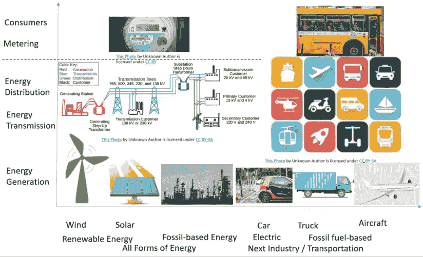

图 8.4 – 设定跨行业细分市场的数字孪生愿景

风力涡轮机的数字孪生有助于建模以下场景：

- 如果风力超过正常水平（例如飓风或龙卷风），风力涡轮机可能受到的损坏
- 如果风速持续一段时间达到每小时 25 至 30 英里，对能源发电的影响
- 如果风速长时间低于每小时 5 英里，对能源发电的影响

这些关于数字孪生实用性的场景有助于我们将风力涡轮机和风电场置于能源发电电网的背景下。在图 8.1 中，我们展示了整个电力价值链，这设定了更广泛的背景。图 8.4 进一步描绘了公用事业公司如何规划不同能源发电模式（包括可再生能源和非可再生能源）的数字孪生未来推广。同样，他们随后可以查看传输和分布网络的数字孪生。这是审视数字孪生系统的系统的完美方式。

能源电网的 **数字孪生定义语言（DTDL）** 本体，如图 8.8 所示，将有助于以标准化方式构建数字孪生应用程序。

一家在多个行业领域运营的工业制造公司，例如能源发电、交通运输和航空，接下来可以查看交通运输和航空领域的数字孪生。此类工业集团的例子包括通用电气（GE）、霍尼韦尔和西门斯等公司。

既然我们已经设定了数字孪生作为系统的系统的更大背景，让我们来看看我们第一个风力涡轮机数字孪生的评估。

### 在完整系统中评估第一个数字孪生

在 _第 7 章，部署与价值跟踪_ 中，我们讨论了风力涡轮机数字孪生的功能测试。这包括测试数字孪生基础设施以及测试数字孪生应用程序。此类测试先于数字孪生的试点推广。在图 7.12 中，我们展示了数字孪生试点的成功标准。此外，图 7.17 至图 7.19 展示了如何在此背景下捕获和展示关键绩效指标（KPI）。最后，我们讨论了两种推广方法：

- 大爆炸方法
- 分阶段方法

大爆炸方法适用于成熟技术，例如 **企业资源计划（ERP）** 软件的推广，其中技术和功能被利益相关者非常清楚地理解。对于新兴技术，大爆炸方法会从技术、采用和经济角度增加更多风险。我们将在此处采用分阶段方法，以评估完整系统中的第一个数字孪生。

让我们看看从高级别角度看，完整系统可能是什么样子。图 8.5 展示了数字孪生解决方案向风电场推广的分阶段方法：

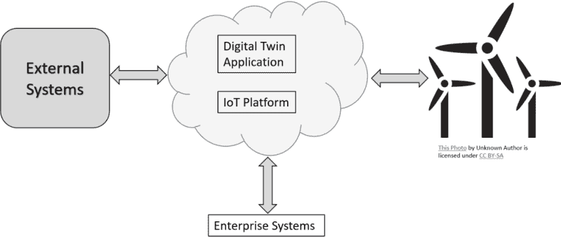

图 8.5 – 数字孪生推广的高级别视图

在分阶段方法中，数字孪生被推广到单个风电场中三分之一的风力涡轮机。这样，可以将数字孪生的性能和结果与同一风电场中的其他风力涡轮机进行评估。这提供了一个良好的基准，并且，通常，同一风电场中风力涡轮机的年龄和型号预计会相似。它们都受到相同环境的影响，例如相似的风速和温度。

接下来，让我们看看为什么我们推荐为数字孪生解决方案的推广采用分阶段方法。

### 分阶段方法的理由

让我们使用图 8.6 来看看我们对分阶段方法的理由。

有关更多信息，请参阅以下内容：

https://blogs.gartner.com/tuong-nguyen/2020/12/07/gartner- launches-emerging-technologies-radar-2021/

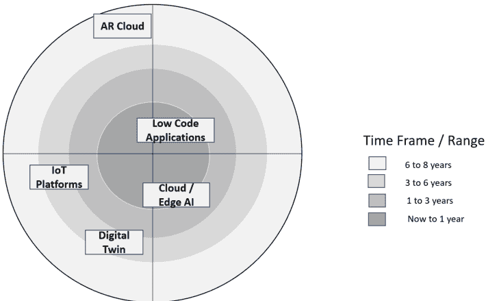

图 8.6 – 新兴技术和趋势的影响雷达图

根据此图，数字孪生和物联网平台等技术将在大约 3-6 年内完全成熟。另一方面，低代码应用程序开发已经相当成熟。这意味着仅使用低代码应用程序开发的大爆炸推广方法风险要低得多，并且被很好地理解。另一方面，使用物联网平台和数字孪生技术的大爆炸方法并不被很好地理解，并且承载着更高水平的风险。因此，对于涉及数字孪生的企业级解决方案，建议使用分阶段方法。在这样的计划中，随着行业的成熟，解决方案可以在过程中进行调整。

在下一节中，让我们量化数字孪生解决方案的效益。

### 效益量化

为了定量评估风电场数字孪生解决方案分阶段推广的效益，我们将假设该风电场拥有 150 台风力涡轮机，这接近行业平均水平。让我们使用每台风力涡轮机平均 1 兆瓦的发电量和每年约 45,000 美元的平均 **运营与维护（O&M）** 成本。我们将在 **投资回报率（RoI）** 模型中比较三分之一（即 50 台涡轮机）的成本，因为数字孪生的分阶段推广是针对 50 台风力涡轮机的。我们在 _表 8.1_ 中展示了计算过程。

让我们来看看部署数字孪生解决方案的效益理由。一台 1 兆瓦的风力涡轮机在 35% 的容量下产生约 61,300 美元的电力，在 50% 的容量下产生约 87,600 美元的电力。有关更多信息，请参阅 http://anemoiservices.com/industry-news/how-much-money-does-a-wind-turbine-produce-from-electricity-it-generates/。

我们将针对每台风力涡轮机每年约 12,000 美元的电力提升目标，这是由于数字孪生部署带来的运营效率。对于可再生能源，发电成本没有可变燃料成本。能够更高效地运行风力涡轮机并减少停机时间会导致发电量增加。我们预计每年还会减少 3,000 美元的预测性维护成本。这将使每台风力涡轮机每年的净效益达到 15,000 美元。

| 项目 | 基准成本 | 数字孪生成本 | 效益 | RoI |
|---|---|---|---|---|
| 当前 O&M 系统成本 | 每年 50 x 45,000 美元 | 每年 50 x 5,000 美元 | 15,000 美元 | 每年 50 x 10,000 美元 |
| 由于数字孪生/云计算产生的间接成本 | 0 | 每年 50,000 美元 | | -50,000 美元 |
| 人力成本 | 0 | 每年 50K 美元 | | -50K 美元 |
| | | | 净效益 > | 每年 400K 美元 |

表 8.1 – 量化数字孪生分阶段推广的效益

我们在计算中使用了可变成本而不是固定成本。虽然建造一台 1 兆瓦风力涡轮机的成本可能在 150 万美元左右，但从我们处理现有风电场（通常被称为棕地项目）的角度来看，这是一项沉没成本。由于我们提议使用云计算（例如 Azure 数字孪生服务）作为主要支持服务，以及其他 Azure 服务，因此为了此 ROI 计算的目的，查看订阅模式的成本而不是资本成本很容易。同样，我们按每台风力涡轮机每年的基础估算了间接成本，例如集成成本、企业软件和人力成本。这使得模型保持简单，并可重复用于其他分阶段推广场景，例如数字孪生覆盖率为风电场的 25% 或 50%。

让我们进一步看看，在推广后得出业务效益时，数字孪生可以测量和影响哪些现实世界的指标。一篇 GE 可再生能源文章在其 Haliade 150-6MW 风力涡轮机的背景下讨论了这些问题，这是最强大的离岸风力涡轮机之一。风力涡轮机偏航电机的温度对于提高其性能至关重要。偏航电机通过风力涡轮机的偏航系统控制水平方向。要查看风力涡轮机横截面的详细视图（包括偏航系统），请访问此页面：https://www.windpowerengineering.com/wp-content/uploads/2016/04/Haliade_cutaway.png。

为了最大限度地发电，偏航系统使转子迎风，这一点很重要，因为风向经常变化。这一点非常重要，因为在我们的 ROI 模型中，我们假设数字孪生系统的部署将有助于增加发电量，并将其效率从 35% 提高到更高水平，我们可以衡量发电量增加的经济影响。

使用数字孪生监控温度，将允许开发应用程序，该程序可以决定是允许全功率发电并承担更高的运行温度风险（这会降低材料寿命），还是略微减少发电量。这是通过使用偏航电机根据风向对齐涡轮机来完成的。总体而言，这将有助于在不冒风力涡轮机故障风险的情况下增加发电量。这有助于通过在安全区域运行风力涡轮机来实现资产更高的运行效率以及降低维护成本。这些是我们在表 8.1 中的 ROI 计算中的两个主要假设。有关更多信息，请参阅 https://www.ge.com/news/reports/french-connection-digital-twins-paris-will-protect-wind-turbines-battering-north-atlantic-gales。

在前一节中，我们研究了风力涡轮机数字孪生提供的业务成果。我们看到，随着风力涡轮机数字孪生技术的证明，美国政府（例如能源部（DOE））在这方面进行了投资。2019 年 9 月，DOE 的高级研究计划署-能源（ARPA-E）向一个联盟颁发了 360 万美元的研究补助金 DIGIFLOAT。DIGIFLOAT 的目标是为浮动或离岸风力涡轮机创新数字孪生技术。浮动离岸风力涡轮机（FOWT）是海洋中的风力涡轮机，与陆地风力涡轮机相对。有关更多信息，请参阅以下内容：
https://www.principlepowerinc.com/en/news-press/press-archive/2019/09/26/principle-power-led-consortium-awarded-36-million-for-digifloat-an-innovative-digital-twin-project-for-floating-wind-applications

在下一节中，我们将研究相关数字孪生的识别。

### 识别相关数字孪生体

在图 8.1 中，我们探讨了能源生态系统。电力系统的关键部分如下：

- 发电 – 可再生能源和非可再生能源
- 电力传输
- 电力分配
- 居民和商业消费者的电力消耗

这有助于我们了解电力价值链，并在风力涡轮机的初始数字孪生体解决方案推出后，识别未来的数字孪生体。

让我们来看图 8.7，即能源电网的数字孪生体定义语言（DTDL）本体论。在这里，本体论有助于描述能源价值链中的概念和类别集合。此外，它还有助于可视化能源电网主要组件之间的属性和关系。

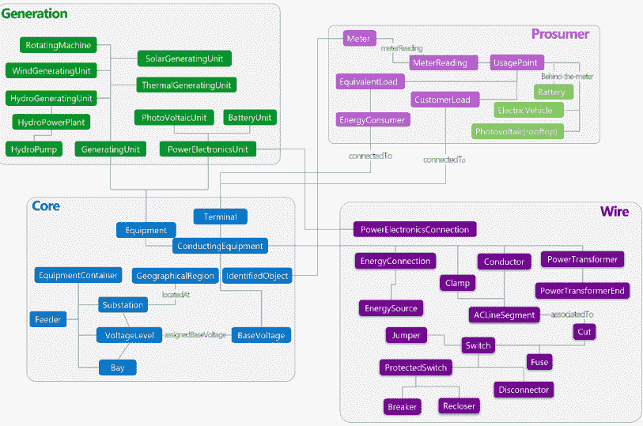

图 8.7 – 能源电网的数字孪生体本体论

本书的重点一直放在风力涡轮机的数字孪生体上，它属于能源生态系统中的发电部分。因此，可再生能源发电中的相关数字孪生体将如下所示：

- 离岸风电场数字孪生体
- 太阳能电站数字孪生体
- 水力发电厂数字孪生体

考虑到对可再生能源的关注度不断提高，我们建议进一步探索这些数字孪生体。让我们从公用事业公司的角度来看。为了最大限度地提高发电量并满足峰值需求，它将需要可靠地优化所有发电资产的发电。我们假设公用事业公司使用可再生能源和非可再生能源。这里我们将关注可再生能源。假设公用事业公司拥有风力、太阳能和水力发电厂。这并非不切实际的场景。美国最大的公用事业公司之一 Exelon 拥有“天然气、水电、风能和太阳能”的平衡发电组合。有关更多信息，请参阅 https://www.exeloncorp.com/companies/exelon-generation。

2020 年夏天，加利福尼亚州北部在炎热的日子里面临电力短缺。原因之一是一些发电厂的运行产能不足。有关更多信息，请参阅 https://www.nytimes.com/2020/08/20/business/energy-environment/california-blackout-electric-grid.html。

为这些发电厂（如风力、太阳能和水力发电厂）部署数字孪生体，可以确保这些资产得到妥善维护，并在需求较高的日子里（例如炎热的夏天，加利福尼亚州北部大部分地区气温超过 100°F/38°C）能够以峰值水平提供能源。在某些地方，气温可超过 110°F/43°C。提高现有发电资产效率的能力将是数字孪生体解决方案的高效应用。

在前一节中，我们确定了与第一个风力涡轮机数字孪生体相关的数字孪生体。这些数字孪生体将共同改变公用事业公司提高发电资产生产率以及通过改进预测性维护效率来降低运营成本的方式。

接下来，让我们看看复合孪生体的规划。

### 规划复合孪生体

在深入规划复合孪生体之前，让我们先了解一个简单的复合资产。我们都熟悉商用飞机。波音和空客等公司是商用飞机的主要制造商。然而，像波音 747-8（见 https://www.boeing.com/commercial/747/）这样的商用飞机，可容纳多达 410 人，并使用通用电气航空的 GEnx-2B 发动机，由多达 550 家供应商在多达 30 个国家制造的多达 600 万个零件组成。有关更多信息，请参阅 https://boeing.mediaroom.com/2013-05-29-Boeing-Celebrates-Delivery-of-50th-747-8。

图 8.8 显示了商用飞机等复合资产的简化视图。同样，飞机的每个主要部分都由许多子组件和单个零件组成。图 8.9 显示了飞机的喷气发动机。像波音 747-8 这样的单架飞机，机翼上任何时候都有四台喷气发动机。请注意，飞机发动机也可以从飞机上拆下进行检查和维护，并更换为备用发动机。为了使情况更加复杂，有些飞机允许使用不同制造商的发动机。一个过度简化的类比是，你可以为你的汽车使用不同批准制造商的轮胎或电池。

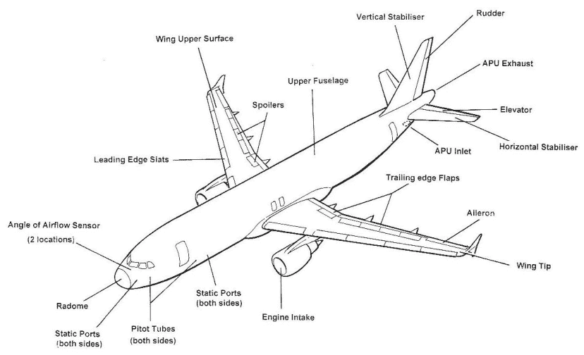

图 8.8 – 商用飞机主要组件的简化视图

注意
图片来源：https://it.wikipedia.org/wiki/File:Aircraft_Parts_eng.jpg

喷气发动机是飞机最关键、最昂贵的部分。像波音 747-8 这样的宽体飞机使用四台喷气发动机。其他一些商用飞机，如波音 777，使用两台喷气发动机。一台普通喷气发动机可来自多个供应商的 25,000 个零件。

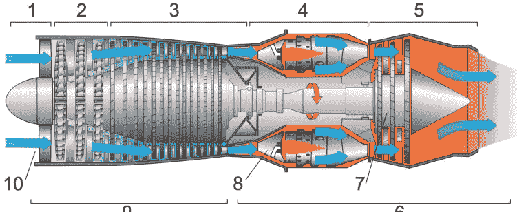

图 8.9 – 商用飞机发动机的横截面视图

注意
图片来源：https://en.wikipedia.org/wiki/Components_of_jet_engines

总的来说，我们注意到飞机等现实世界资产本质上非常复杂，并由小零件组成。同样，如果我们看光谱的另一端，例如航空公司的机队，它可能不仅包含不同的飞机，还包含不同的型号和制造商。此外，航空公司可能不仅拥有飞机，还拥有其他资产，例如除冰机、行李车、地面电源装置、登机桥等。从航空公司的角度来看，整个网络是如此多样资产的复合体。

从航空公司的角度来看，其整个航空公司网络的数字孪生体将是一个复合数字孪生体，由其主要枢纽、主要航线、机队和其他关键资产的运营组成。

现在，回到发电示例，我们最初从风力涡轮机和风电场的数字孪生体开始。接下来，我们将其扩展到可再生能源发电的不同数字孪生体。要继续，一家主要公用事业公司的整个发电复合体将包括可再生能源和非可再生能源的数字孪生体。接下来，公用事业公司将需要查看传输、分配以及消费者级资产（如智能电表）的数字孪生体。

接下来，让我们看看水力发电的数字孪生体。

### 水力发电的数字孪生体

美国能源部（DOE）有一个专注于水力发电技术的办公室。该 DOE 办公室正在致力于水力发电数字孪生体框架，目标是利用虚拟平台加速创新。有关更多信息，请参阅 https://www.pnnl.gov/projects/digital-twins-hydropower。

水力发电厂的平均使用寿命约为 50 年。水力发电数字孪生体模拟发电、传输和分配系统。水力发电数字孪生体的主要应用包括以下内容：

- 运营和维护 – 优化水力发电厂的维护，目标是提高运行时间，从而增加发电量。
- 网络安全 – 检测任何入侵并保护基础设施。2021 年 6 月，美国东海岸的殖民管道勒索软件攻击提高了人们对保护能源基础设施的意识。有关更多信息，请参阅 https://www.cnn.com/2021/06/07/politics/colonial-pipeline-ransomware-recovered/index.html。
- 投资和市场规划 – 帮助做出初始投资决策、扩张决策和 ROI 计算。

根据通用电气（GE）的一篇文章，2017 年，水力发电（见图 8.10）是一种可再生能源，可按需提供大量电力，因为我们缺乏用于能源存储的电网级电池技术。当风力涡轮机受低风速或多云天气影响，以及一天中的时间影响太阳能时，水力发电数字孪生体可以帮助弥补差距。有关更多信息，请参阅 https://www.ge.com/news/reports/dam-powerful-ge-connected-hydropower-internet。

Figure 8.10 – 水力发电所产生的可再生能源

Note
图片来源：https://no.wikipedia.org/wiki/Energi_i_Afghanistan

水力发电数字孪生可帮助进行类似的情景规划，这些规划可能影响发电量，例如降雨量以及水坝和水库中的水位。

为了了解利用水力发电的潜在发电规模，让我们来看看加拿大魁北克省。由于该省湖泊和河流资源丰富，水力发电可以满足魁北克省700万人口高达95%的电力需求。水力发电的装机容量约为46吉瓦。有关更多信息，请参阅 https://www.cer-rec.gc.ca/en/data-analysis/energy-markets/provincial-territorial-energy-profiles/provincial-territorial-energy-profiles-quebec.html。GE Ecomagination前全球执行董事Deb Frodl表示，由于停机时间减少，数字化水电站的运营可靠性提高了1%或更多。在全球范围内推广，这相当于每小时约413吉瓦的增量水力发电量。与风力发电相比，这相当于约700台风力涡轮机的风电场所产生的电力。

水电站通常使用Francis水轮机，这是一种反应式水轮机。当水流经水轮机时，其压力会发生变化，从而释放能量。有关更多信息，请参阅 https://www.sciencedirect.com/topics/engineering/francis-turbines。此类水力发电水轮机的简化视图如图8.11所示。

水轮机位于高压水源和低压水出口之间，通常位于水坝底部。这使我们能够利用水系统动力学和机械扭矩到水轮机轴的方程，创建水力发电的基于物理的初始数字孪生。要了解此类基于物理的计算的更多信息，请参阅此处的研究论文：https://www.researchgate.net/publication/226204151_Torque_model_of_hydro_turbine_with_inner_energy_loss_characteristics。

Figure 8.11 – 水力发电水轮机的简化视图

Note
图片来源：https://en.wikipedia.org/wiki/Water_turbine

在前面的章节中，我们为着手开展水力发电数字孪生提供了功能和技术基础。在下一节中，我们将重点介绍太阳能农场的数字孪生。

### 太阳能农场的数字孪生

我们经常在家庭屋顶上看到太阳能电池板，如图8.12所示。美国加利福尼亚州已推出加州太阳能强制令，要求从2020年1月1日起，所有不超过四层的独户和多户住宅都必须安装太阳能电池板。该强制令旨在将温室气体排放量减少相当于让115,000辆燃油汽车停驶的水平。该强制令后来有所放宽，允许建筑开发商将屋顶太阳能电池板与场外太阳能发电厂相结合。

在本节中，我们将主要关注商业太阳能发电厂。2020年，太阳能占美国加利福尼亚州能源需求的15.4%。根据加州能源委员会的数据，它通过太阳能光伏（PV）和太阳能热能发电厂产生了约30吉瓦时（GWh）的能源。图8.13展示了一个典型的太阳能光伏电站。在下一节中，我们将探讨构建太阳能发电厂数字孪生的注意事项。

Gemini太阳能项目，拥有690兆瓦的集成太阳能光伏和电池储能设施，将成为美国最大且全球最大的项目之一。它将位于美国内华达州拉斯维加斯附近的美国联邦政府土地上。有关更多信息，请参阅 https://www.nsenergybusiness.com/projects/gemini-solar-project/。它将耗资约10亿美元，预计将于2023年完工。

Figure 8.13 – 太阳能光伏电站

太阳能发电厂（如图8.13所示）通过逆变器和变压器连接到电网，如图8.14所示。风力发电场和水电站也是如此，它们都将为电网提供可再生能源，最大限度地减少使用化石燃料发电的需求。

Figure 8.14 – 太阳能发电厂与电网的连接

本书作者之一Nath曾亲身参与工业互联网联盟（IIC）下的一项早期倡议，构建太阳能发电厂数字孪生作为测试平台。有关更多信息，请参阅 https://www.iiconsortium.org/press-room/11-08-17.htm。

为了确定太阳能发电厂的理想位置，可以使用太阳辐照度信息。有关更多信息，请参阅 https://www.nrel.gov/gis/assets/images/nsrdb-v3-ghi-2018-01.jpg。

辐照度是衡量在给定时间间隔内到达特定区域的太阳辐射能量的指标。它通常以瓦特/平方米（W/m²）为单位进行测量。数字孪生也用于基础设施建设的可行性研究，例如四名电气工程专业学生正在进行的这项智能电网数字孪生项目。有关更多信息，请参阅 https://www.unb.ca/alumni/magazine/2021-spring-summer/solar-energy.html。

太阳能发电厂的数字孪生（重点关注预测性维护和运营优化）将包括主要组件（见图8.15），如下所示：

- 太阳能光伏电池板 – 商用级太阳能光伏电池板的尺寸约为78英寸乘39英寸（约2米×1米），约有72个太阳能电池。重量约为40磅（18千克），成本约为250,000美元。
- 电池板串 – 一个200兆瓦的太阳能发电厂将拥有约100,000块电池板，排列成2,000串。理想情况下，每块电池板和每串电池板的数字孪生都需要作为“孪生体的孪生体”进行维护。
- 串式汇流箱（SCB） – 这些用于将多个太阳能电池板或电池板串组合在一起。
- 逆变器 – 在连接到电网之前，将太阳能电池板产生的直流电（DC）转换为交流电（AC）。

考虑太阳能发电厂主要功能模块的数字孪生，可使太阳能发电厂的运营成本降低多达4%。我们建议阅读题为《Performance evaluation of 10 MW grid connected solar photovoltaic》的研究论文，以了解运营效率的基本原理和基本功率转换因素。该研究论文可在此处找到：https://www.sciencedirect.com/science/article/pii/S2352484715000311

Figure 8.15 – 太阳能发电厂框图

太阳能发电厂的数字孪生可以帮助决定何时更换太阳能光伏电池板以增加能源产出。同样，一次数字孪生的试点部署能够提前一周检测出高达83%的逆变器故障。这种故障模式覆盖率的提高和提前量的增加是数字孪生解决方案的关键整体性能指标。太阳能发电厂数字孪生解决方案的使用正在推动行业从“安装后不管”的行为转向对能源基础设施的更积极管理。低效可能由多种原因造成，例如：

- 太阳能光伏的设计和安装存在缺陷。
- 串联的光伏组件与并联的串式模块不匹配，导致系统性能降低。
- 随着时间的推移，太阳能光伏电池板上会积聚污垢，加上缺乏降雨，尤其是安装角度不正确时。
- 更换周期不匹配，因为不同组件的预期寿命不同，例如逆变器为5-10年，太阳能光伏电池板为20-25年。

### 太阳能光伏与风力发电混合系统

我们已借助太阳能发电厂的数字孪生体，重点介绍了一些需要监控和修复的实际问题。更多信息，请参阅 https://www.mdpi.com/1996-1073/13/6/1398/htm。

太阳能发电厂的发电水平取决于日照时长，冬季日照时间会大幅缩短。同样，风电场在夏季可能会经历比冬季更低的风速，具体取决于其地理位置。这为开发混合发电厂提供了机遇。更多信息，请参阅 https://www.energy.gov/energysaver/hybrid-wind-and-solar-electric-systems。图 8.16 展示了太阳能光伏与风力发电机的此类混合系统。此类混合动力系统目前正在小规模出现，未来可能会出现在商业规模上。混合发电厂的数字孪生体将需要新的跨领域专业水平。

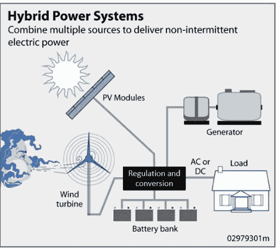

图 8.16 – 混合发电厂

> **注意**
> 图片来源：https://www.energy.gov/energysaver/hybrid-wind-and-solar-electric-systems

在前面的章节中，我们探讨了主要的可再生能源。我们研究了每种可再生能源的数字孪生体的注意事项。这些信息将有助于从以下角度规划复合数字孪生体：

- 拥有基于可再生能源和非可再生能源发电的大型公用事业公司，以及/或
- 能源行业的工业制造公司，为多种这些能源制造发电设备

接下来，我们将探讨数字孪生体的作用，这是由于与风力发电机和太阳能发电厂相关的新创新。

### 可再生能源发电的新创新

让我们在风能背景下讨论风能捕获技术。风能捕获具有降低**平准化度电成本（LCOE）**的巨大潜力，LCOE 是衡量能源发电设施全生命周期成本除以总发电量的指标。图 8.17 展示了海上风能的风能捕获设计。它是一种浮动安装。这项技术占用空间更小，产生的能量可比传统海上风力涡轮机多出五倍。更多信息，请参阅 https://windcatching.com/。

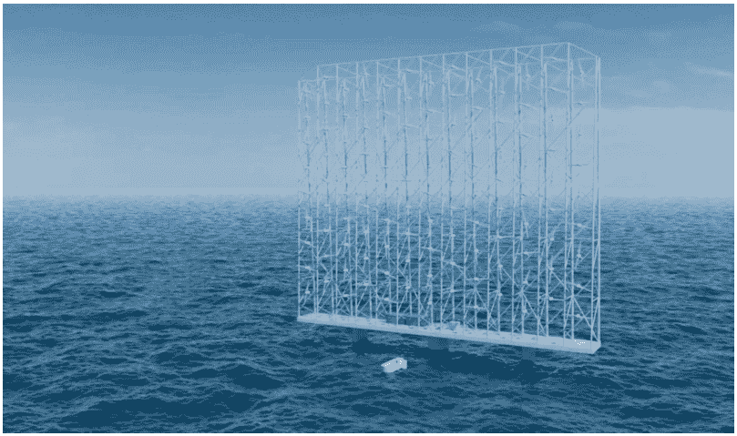

图 8.17 – 海上安装的风能捕获设计

在风能捕获中，预计发电量将随风速呈指数增长。传统风力涡轮机在风速超过每秒约 12 米时，会通过改变叶片桨距来限制能量输出，以减少磨损。因此，风能捕获装置可以从相同的覆盖面积中产生几倍的能量。当此类新技术推广时，数字孪生体的作用会增加，因为我们缺乏大量历史数据来进行预测性维护和优化能源发电。基于风能捕获装置的产品设计和实验室测试数据的物理模型，可以帮助从第一天起部署风能捕获装置的数字孪生体。这些数字孪生体将提供关键信息，帮助随着风能捕获装置群随时间成熟而增强对其的理解。其预期寿命为 50 年，远长于传统风力涡轮机。

同样，2021 年 7 月，新加坡启动了一个大型浮动太阳能农场。更多信息，请参阅 https://www.scmp.com/video/asia/3141298/singapore-unveils-one-worlds-biggest-floating-solar-panel-farms。它拥有 122,000 块太阳能电池板，面积约为 45 个足球场。这个浮动太阳能发电厂将为五个水处理厂供电。图 8.18 展示了浮动太阳能发电厂的概念。由于水体冷却以及附近建筑物没有阴影，此类浮动太阳能发电厂效率很高。同样，此类新一代资产的数字孪生体将在高效管理中发挥重要作用，因为我们开始充分了解这些新资产。

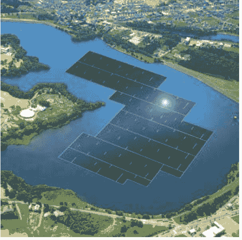

此照片由 KYOCERA CORP 提供，根据 CC BY 授权。

### 改进与后续步骤

在此，我们将从采用并推出此类计划的公司角度，对数字孪生体计划进行整体审视。我们在图 8.5 中看到了风电场数字孪生体解决方案的高级别推出。接下来，让我们在图 8.19 中查看增强且更详细的视图。从左到右的主要模块如下：

- 供应链网络 – 这些是供应链生态系统的外部网络，由供应商、分销商和物流提供商组成。考虑到 COVID-19 大流行期间全球供应链的中断，近期该领域非常适合供应链和物流数字孪生体。
- 企业系统 – 这些包括企业中的信息技术（IT）系统，例如 Oracle Enterprise Resource Planning (ERP)、Salesforce.com 作为客户关系管理 (CRM)，或制造执行系统 (MES)。
- 用于经济、天气和市场数据的外部系统 – 这些是可靠的外部数据源，可由其他系统订阅和消费以做出决策。
- 业务应用程序 – 这些通常是新兴的行业导向型应用程序和数字平台群组，将帮助推动下一波工业数字化转型。此类应用程序通常位于数字孪生体和 IoT 平台之上，提供业务洞察。它们可能位于同一公有云或同一供应商技术中，也可能不位于其中。例如，Oracle 的 IoT Intelligent Applications（https://www.oracle.com/internet-of-things/）可以连接到基于 Azure 数字孪生体的解决方案。其他示例包括 GE 的资产性能管理 (APM) 或更专业的能源交易咨询解决方案。
- 数字孪生体和 IoT 平台 – 这些是数字孪生体解决方案的构建模块，并提供与发电源（例如风电场中的风力涡轮机）的连接。随着更多发电源的引入，复合数字孪生体将在此部署。
- 现场服务管理 (FSM) – 工业资产密集型行业，如公用事业公司或风力涡轮机制造商，通常管理着庞大的现场服务人员队伍。FSM 应用程序提供了一种高效的方式来管理此类人员的运营和维护活动。FSM 人员的数字孪生体是未来的机遇领域。
- 发电源 – 这是发电厂和系统中实际发电资产的集合，包括便于连接和数据采集的边缘系统、监控控制和数据访问系统。
- 电网 – 所有商业级发电资产都连接到电网，电网管理电力的传输和分配。

至此，我们已总结了企业级数字孪生体解决方案推出中涉及的主要系统：

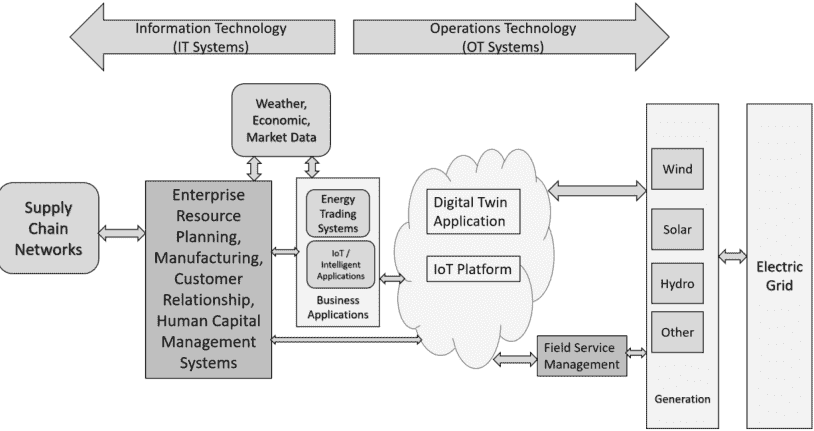

图 8.19 – 数字孪生体解决方案部署的企业版图

在本最后一节中，我们将探讨我们推荐的组织结构，以确保此类数字孪生体相关计划在大型企业中取得成功。

### 数字孪生体卓越中心

**卓越中心（CoE）**通常是一个共享设施，拥有一支专门团队，致力于在业务优先领域开发、收集和推广最佳实践。通用电气（GE）于 2012 年创建了一个软件 CoE，专注于工业互联网。更多信息，请参阅 https://hbr.org/2015/01/building-a-software-start-up-inside-ge。此软件 CoE 后来成为 GE Digital。本书的作者之一 Nath，曾于 2013 年至 2018 年期间在该 GE 软件 CoE 和 GE Digital 担任员工。GE Digital 已成为 IIoT 和数字孪生体技术的先驱之一。GE Digital 支持 GE Renewables 作为其业务线之一。GE Renewables 是世界上最大的风力涡轮机制造商之一。

CoE 在私营部门（如大型全球企业）和公共部门（如明尼苏达州能源 CoE）中开始变得流行。更多信息，请参阅 https://www.energycareersminnesota.org/。另一个示例是 Equinor 的数字 CoE，其活动范围也包括数字孪生体。更多信息，请参阅 https://www.equinor.com/en/magazine/statoil-2030---putting-on-digital-bionic-boots.html。这里描述了一些构建旨在推动数字化转型的 CoE 的策略：https://techbeacon.com/enterprise-it/why-you-need-digital-transformation-center-excellence。

我们在此总结这些策略：

- 在合适的数字领导者下，组建具备技术与业务知识的正确团队。
- 提供清晰的自上而下章程和运营指南。
- 提供适当的技术和业务培训，同时强力关注创新文化。
- 设立治理并建立衡量机制，同时牢记初创公司式的创新和执行自由。

我们还推荐阅读 Packt 出版于 2020 年的书籍《工业数字化转型》。请查看本章的推荐阅读清单。由于数字孪生体是一项新兴技术，强烈建议考虑建立一个能够宣传数字孪生体计划并确保投资带来业务效益的 CoE。对于公用事业公司，数字孪生体解决方案将提升整体生产力和效率；而对于工业制造公司，数字孪生体解决方案不仅可以推动内部生产力和效率，还可以通过向公用事业公司和其他公司商业销售此解决方案来创造新的数字收入来源。

### 摘要

在本书的最后一章中，我们从可能推出此类计划的企业角度，探讨了部署数字孪生解决方案的优势。我们探讨了如何从单个风力涡轮机的数字孪生扩展到风电场，再扩展到不同的可再生能源。我们探讨了孪生体的孪生体，以及如何规划和部署复合数字孪生。总体而言，我们探讨了如何从初始试点部署阶段增强数字孪生解决方案。

我们坚信，本书为您构建第一个工业资产的数字孪生并使其投入生产提供了坚实的技术和功能基础。这项技能将在未来几年成为工业数字化转型的游戏规则改变者。感谢您与我们一起踏上构建第一个数字孪生的旅程，祝您事业成功。

### 问题

- 1. 什么是孪生体的孪生体？
- 2. 数字孪生解决方案的大爆炸式推出与分阶段推出有什么区别？
- 3. 可再生能源的常见来源有哪些？
- 4. 什么是混合动力系统？
- 5. **卓越中心（CoE）**在数字孪生解决方案推出中扮演什么角色？

### 推荐阅读

- • 如何通过技术卓越中心推动数字化转型：https://enterprisersproject.com/article/2021/2/digital-transformation-via-technology-centers-excellence-COE
- • https://reveconsulting.com/pages/creating-digital-center-excellence-global-giant/
- • https://www.coe-iot.com/
- • https://www.robolab.in/center-of-excellence-in-internet-of-things/
