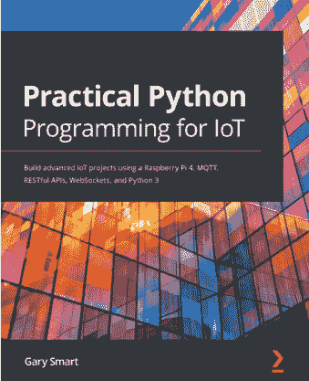
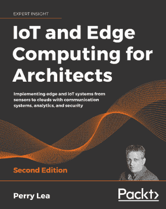

# 其他你可能喜欢的书籍

如果你喜欢这本书，可能会对 Packt 的这些其他书籍感兴趣：

### 面向 IoT 的实用 Python 编程

Gary Smart
ISBN: 978-1-83898-246-1

- 从零开始了解与 Raspberry Pi 的电子接口
- 获得构建传感器和执行器电子电路的知识
- 使用 Async IO、pub/sub 模型等在 Python 中构建你的代码
- 使用传感器和执行器集成自动化现实世界的 IoT 项目
- 将电子设备与 ThingSpeak 和 IFTTT 集成以实现自动化
- 构建和使用带有传感器和执行器的 RESTful API、WebSockets 和 MQTT
- 为 IoT 项目设置 Raspberry Pi 和 Python 开发环境

# 面向架构师的 IoT 和边缘计算

Perry Lea

ISBN: 978-1-83921-480-6

- 了解构建成功 IoT 部署的架构角色和范围
- 扫描 IoT 技术的格局，从传感器到云端及更多
- 了解 IoT 部署中协议和通信选择的权衡
- 熟悉在 IoT 领域工作所需的术语
- 拓展 IoT 架构师所需的多个工程领域的技能
- 实施最佳实践，确保 IoT 基础设施的可靠性、可扩展性和安全性

### Packt 正在寻找像你这样的作者

如果你有兴趣成为 Packt 的作者，请访问 **authors.packtpub.com** 并立即申请。我们与成千上万的开发人员和技术专业人士（与你一样）合作，帮助他们将见解分享给全球技术社区。你可以提交一般性申请，申请我们正在招募作者的特定热门主题，或提交自己的想法。

### 分享你的想法

现在你已经读完了《Building Industrial Digital Twins》，我们很乐意听听你的想法！如果你在 Amazon 上购买了本书，请点击此处直接前往本书的 Amazon 评论页面，分享你的反馈，或在你购买本书的网站上留下评论。

你的评论对我们和技术社区非常重要，将帮助我们确保提供优质内容。
