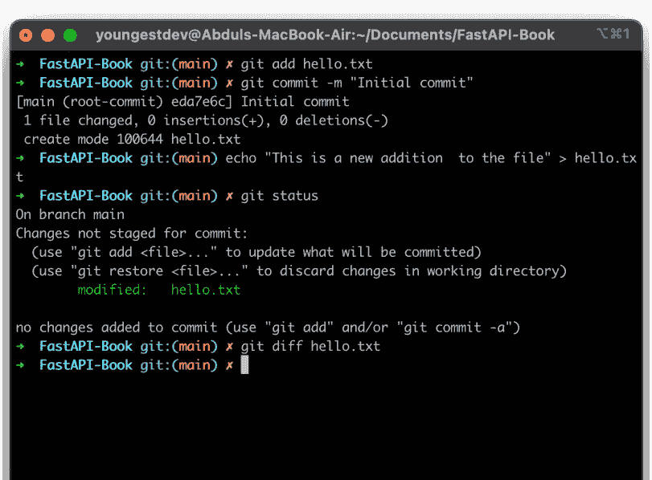
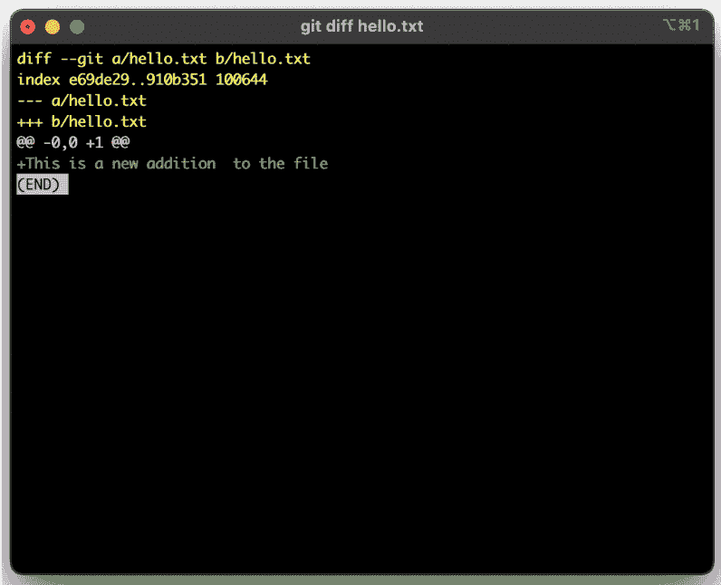
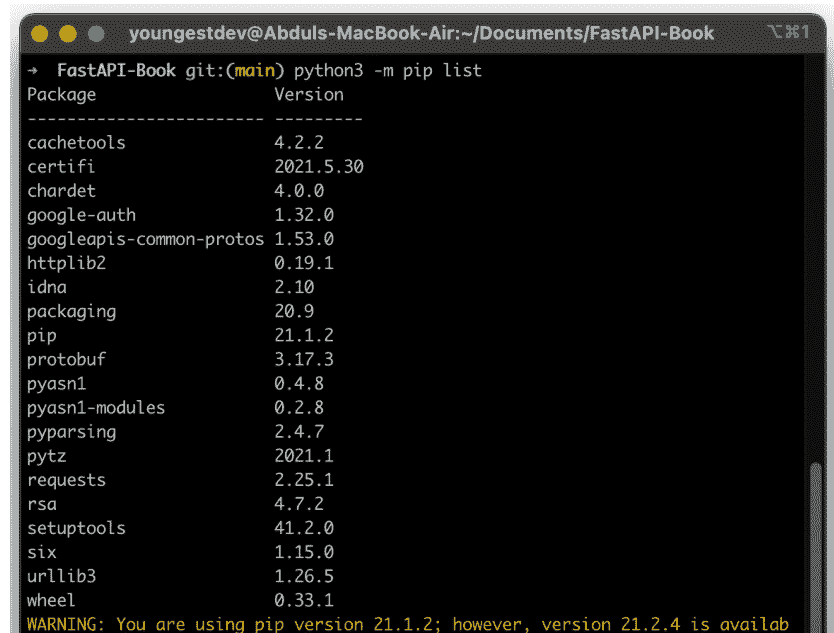
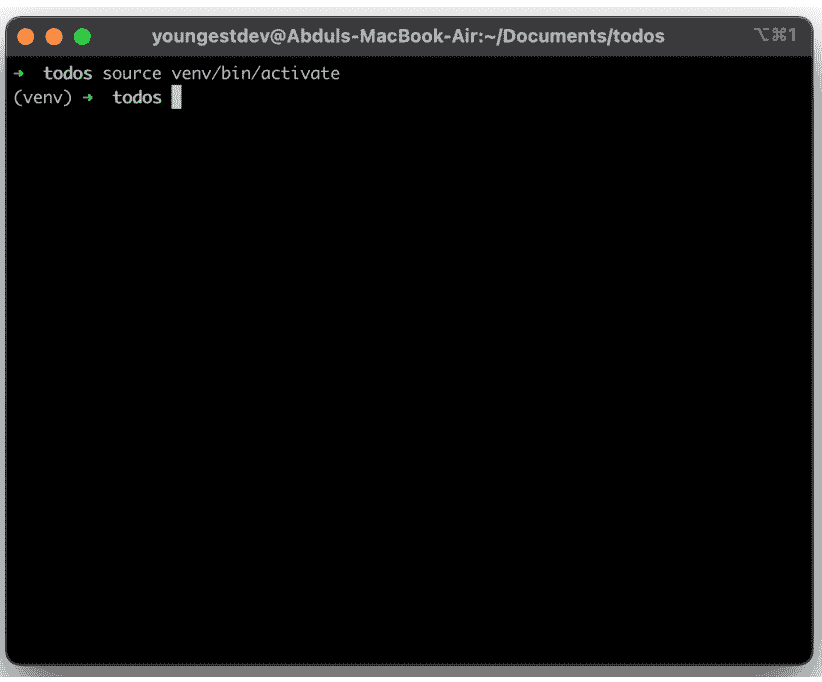
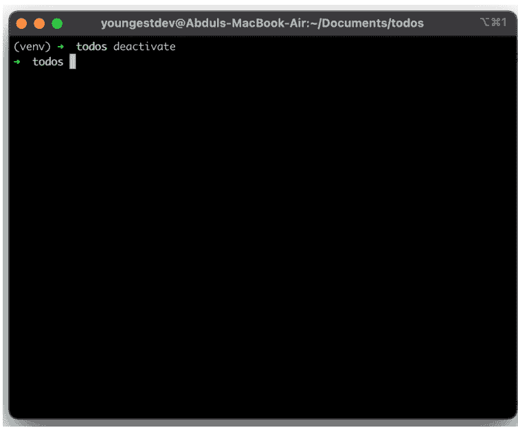

## 第 1 部分：
FastAPI 简介

完成本部分后，您将对 FastAPI 有实质性的理解，包括路由、文件处理、错误处理、构建响应模型和模板。本部分首先介绍本书中将使用的技术，然后再介绍 FastAPI 框架的基础知识。

本部分包含以下章节：

- 第 1 章，开始使用 FastAPI
- 第 2 章，FastAPI 中的路由
- 第 3 章，响应模型和错误处理
- 第 4 章，FastAPI 中的模板

### 1
开始使用
FastAPI

FastAPI 是我们将在本书中使用的 Python Web 框架。它是一个快速、轻量级的现代 API，与其他 Python Web 框架（如 Flask 和 Django）相比，具有更易于学习的曲线。FastAPI 相对较新，但拥有不断增长的社区。它被广泛用于构建 Web API 和部署机器学习模型。

在第一章中，您将学习如何设置开发环境并构建您的第一个 FastAPI 应用。您将首先学习 Git 的基础知识——一个版本控制系统——以便您具备存储、跟踪和检索文件更改的知识，因为您构建应用。您还将学习如何使用 pip 在 Python 中处理包，如何使用 Virtualenv 创建隔离的开发环境，以及 Docker 的基础知识。最后，您将通过构建一个简单的 Hello World 应用来了解 FastAPI 的基础知识。

理解前面提到的技术对于构建完整的 FastAPI 应用是必需的。它也作为您当前技能集的补充。

完成本章后，您将能够设置和使用 Git，使用 pip 安装和管理包，使用 Virtualenv 创建隔离的开发环境，使用 Docker，最重要的是，搭建一个 FastAPI 应用。

本章涵盖以下主题：

- Git 基础
- 使用 Virtualenv 创建隔离的开发环境
- 使用 pip 进行包管理
- 设置和学习 Docker 基础知识
- 构建简单的 FastAPI 应用

### 技术要求

您可以在 GitHub 上找到本章的代码文件，网址为 https://github.com/PacktPublishing/Building-Python-Web-APIs-with-FastAPI/tree/main/ch01

### Git 基础

Git 是一个版本控制系统，使开发人员能够记录、跟踪并恢复到文件的早期版本。它是一个去中心化且轻量级的工具，可以安装在任何操作系统上。

您将学习如何使用 Git 进行记录保存。随着应用的每一层被构建，都会进行更改，重要的是要记录这些更改。

### 安装 Git

要安装 Git，请访问下载页面 https://git-scm.com/downloads 并为当前操作系统选择下载选项。您将被重定向到有关如何在机器上安装 Git 的说明页面。


It is also worth noting that Git comes as a **CLI** and a **GUI** application. Therefore, you can download the one that works best for you.

### Git operations

As mentioned earlier, Git can be used to record, track, and revert to earlier versions of a file. However, only the basic operations of Git will be used in this book and will be introduced in this section.

In order for Git to run properly, folders housing files must be initialized. Initializing folders enables Git to keep track of the content except otherwise exempted.

To initialize a new Git repository in your project, you need to run the following command in your terminal:

```
$ git init
```

To enable tracking of files, a file must first be added and committed. A Git commit enables you to track file changes between timeframes; for example, a commit made an hour ago and the current file version.

> **What Is a Commit?**
> A commit is a unique capture of a file or folder status at a particular time, and it is identified by a unique code.

Now that we know what a commit is, we can go ahead and commit a file as follows:

```
$ git add hello.txt
$ git commit -m "Initial commit"
```

You can track the status of your files after making changes by running the following command:

```
$ git status
```

Your terminal should look similar to the following:



Figure 1.1 – Git commands

To view the changes made to the file, which can be additions or subtractions from the file contents, run the following command:

```
$ git diff
```

Your terminal should look similar to the following:



Figure 1.2 - Output from the git diff command

It is good practice to include a .gitignore file in every folder. The .gitignore file contains the names of files and folders to be ignored by Git. This way, you can add and commit all the files in your folder without the fear of committing files like .env.

To include a .gitignore file, run the following command in your terminal:

```
$ touch .gitignore
```

To exempt a file from being tracked by Git, add it to the .gitignore file as follows:

```
$ echo ".env" >> .gitignore
```

Common files contained in a .gitignore file include the following:

- Environment files (*.env)
- Virtualenv folder (env, venv)
- IDE metadata folders (such as .vscode and .idea)

### Git branches

Branches are an important feature that enables developers to easily work on different application features, bugs, and so on, separately before merging into the main branch. The system of branching is employed in both small-scale and large-scale applications and promotes the culture of previewing and collaborations via pull requests. The primary branch is called the main branch and it is the branch from which other branches are created.

To create a new branch from an existing branch, we run the git checkout -b newbranch command. Let's create a new branch by running the following command:

```
$ git checkout -b hello-python-branch
```

The preceding command creates a new branch from the existing one, and then sets the active branch to the newly created branch. To switch back to the original main branch, we run git checkout main as follows:

```
$ git checkout main
```

> **Important Note**
> Running git checkout main makes main the active working branch, whereas git checkout -b newbranch creates a new branch from the current working branch and sets the newly created branch as the active one.
> 
> To learn more, refer to the Git documentation: http://www.git-scm.com/doc.

Now that we have learned the basics of Git, we can now proceed to learn about how to create isolated environments with **virtualenv**.

### Creating isolated development environments with Virtualenv

The traditional approach to developing applications in Python is to isolate these applications in a virtual environment. This is done to avoid installing packages globally and reduce conflicts during application development.

A virtual environment is an isolated environment where application dependencies installed can only be accessed within it. As a result, the application can only access packages and interact only within this environment.

#### Creating a virtual environment

By default, the venv module from the standard library is installed in Python3. The venv module is responsible for creating a virtual environment. Let's create a todos folder and create a virtual environment in it by running the following commands:

```
$ mkdir todos && cd todos
$ python3 -m venv venv
```

The venv module takes an argument, which is the name of the folder where the virtual environment should be installed into. In our newly created virtual environment, a copy of the Python interpreter is installed in the lib folder, and the files enabling interactions within the virtual environment are stored in the bin folder.

#### Activating and deactivating the virtual environment

To activate a virtual environment, we run the following command:

```
$ source venv/bin/activate
```

The preceding command instructs your shell to use the virtual environment’s interpreter and packages by default. Upon activating the virtual environment, a prefix of the venv virtual environment folder is added before the prompt as follows:



Figure 1.3 – Prefixed prompt

To deactivate a virtual environment, the deactivate command is run in the prompt. Running the command immediately exits the isolated environment and the prefix is removed as follows:



Figure 1.4 – Deactivating a virtual environment

Important Note
You can also create a virtual environment and manage application dependencies using Pipenv and Poetry.

Now that we have created the virtual environment, we can now proceed to understand how package management with pip works.

### Package management with pip

A FastAPI application constitutes packages, therefore you will be introduced to package management practices, such as installing packages, removing packages, and updating packages for your application.

#### Installing pip

Pip is automatically installed during a Python installation. You can verify whether pip is installed by running the following command in your terminal:

```
$ python3 -m pip list
```

The preceding command should return a list of packages installed. The output should be similar to the following figure:



Figure 1.5 – List of installed Python packages

If the command returns an error, follow the instructions at https://pip.pypa.io/en/stable/installation/ to install pip.

#### Basic commands

With pip installed, let’s learn its basic commands. To install the FastAPI package with pip, we run the following command:

```
$ pip install fastapi
```

On a Unix operating system, such as Mac or Linux, in some cases, the sudo keyword is prepended to install global packages.

To uninstall a package, the following command is used:

```
$ pip uninstall fastapi
```

To collate the current packages installed in a project into a file, we use the following freeze command:

```
$ pip freeze > requirements.txt
```

The > operator tells bash to save the output from the command into the requirements.txt file. This means that running pip freeze returns an output of all the currently installed packages.

To install packages from a file such as the requirements.txt file, the following command is used:

```
$ pip install -r requirements.txt
```

The preceding command is mostly used in deployment.

Now that you have learned the basics of pip and have gone over some basic commands, let’s learn the basics of Docker.

### Setting up Docker

As our application grows into having multiple layers, such as a database, coupling the application into a single piece enables us to deploy our application. We’ll be using Docker to containerize our application layers into a single image, which can then be easily deployed locally or in the cloud.


此外，使用 Dockerfile 和 docker-compose 文件可以消除上传和共享应用程序镜像的需求。应用程序的新版本可以从 Dockerfile 构建，并使用 docker-compose 文件部署。应用程序镜像也可以存储在 Docker Hub 中并从中检索。这被称为推送和拉取操作。

开始设置时，从 https://docs.docker.com/install 下载并安装 Docker。

##### Dockerfile

Dockerfile 包含有关如何构建我们的应用程序镜像的说明。以下是一个示例 Dockerfile：

```
FROM python:3.8
#### Set working directory to /usr/src/app
WORKDIR /usr/src/app
#### Copy the contents of the current local directory into the container's working directory
ADD . /usr/src/app
#### Run a command
CMD ["python", "hello.py"]
```

接下来，我们将构建应用程序容器镜像并将其标记为 getting_started，如下所示：

```
$ docker build -t getting_started .
```

如果 Dockerfile 不在运行命令的目录中，则应按如下方式正确附加 Dockerfile 的路径：

```
$ docker build -t api api/Dockerfile
```

可以使用以下命令运行容器镜像：

```
$ docker run getting-started
```

Docker 是一个高效的容器化工具。我们只查看了基本操作，我们将在第 9 章《部署 FastAPI 应用程序》中在实践中学习更多操作。

### 构建一个简单的 FastAPI 应用程序

最后，我们现在可以开始我们的第一个 FastAPI 项目。我们在本节的目标是通过构建一个简单的应用程序来介绍 FastAPI。我们将在后续章节中深入介绍操作。

我们将首先在之前创建的 todos 文件夹中安装应用程序所需的依赖项。依赖项如下：

- fastapi：我们将构建应用程序的框架。
- uvicorn：用于运行应用程序的异步服务器网关接口模块。

首先，通过在项目目录中运行以下命令激活你的开发环境：

```
$ source venv/bin/activate
```

然后，按如下方式安装依赖项：

```
(venv)$ pip install fastapi uvicorn
```

现在，我们将创建一个新的 api.py 文件并按如下方式创建 FastAPI 的新实例：

```
from fastapi import FastAPI

app = FastAPI()
```

通过在 app 变量中实例化 FastAPI，我们可以继续创建路由。让我们创建一个欢迎路由。

路由是通过首先定义一个装饰器来指示操作类型，然后是一个包含在调用此路由时要执行的操作的函数来创建的。在以下示例中，我们将创建一个仅接受 GET 请求的 "/" 路由，并在访问时返回欢迎消息：

```
@app.get("/")
async def welcome() -> dict:
    return { "message": "Hello World"}
```

下一步是使用 uvicorn 启动我们的应用程序。在你的终端中运行以下命令：

```
(venv)$ uvicorn api:app --port 8000 --reload
```

在前面的命令中，uvicorn 接受以下参数：

- `file:instance`：包含 FastAPI 实例的文件和保存 FastAPI 实例的名称变量。
- `--port PORT`：应用程序将被提供服务的端口。
- `--reload`：一个可选参数，用于在每次文件更改时重新启动应用程序。

命令返回以下输出：

```
(venv) → todos uvicorn api:app --port 8080 --reload
INFO:     Will watch for changes in these directories: ['/Users/youngestdev/Documents/todos']
INFO:     Uvicorn running on http://0.0.0.0:8080 (Press CTRL+C to quit)
INFO:     Started reloader process [3982] using statreload
INFO:     Started server process [3984]
INFO:     Waiting for application startup.
INFO:     Application startup complete.
```

下一步是通过发送 GET 请求到 API 来测试应用程序。在新的终端中，使用 curl 按如下方式发送 GET 请求：

```
$ curl http://0.0.0.0:8080/
```

记录在控制台中的应用程序响应将如下所示：

```
{"message":"Hello World"}
```

### 总结

在本章中，我们学习了如何安装设置开发环境所需的工具。我们还构建了一个简单的 API 作为对 FastAPI 的介绍，并在过程中学习了如何创建路由。

在下一章中，你将被介绍到 FastAPI 中的路由。首先，你将被介绍使用 Pydantic 构建模型以验证请求负载和响应的过程。然后你将学习路径和查询参数以及请求体，最后，你将学习如何构建一个 CRUD todo 应用程序。
