### 2 FastAPI 中的路由

**路由**是构建 Web 应用程序的重要组成部分。FastAPI 中的路由灵活且无忧。路由是从客户端发送到服务器的 **HTTP 请求**的处理过程。HTTP 请求被发送到定义的路由，这些路由具有用于处理请求并响应的定义处理程序。这些处理程序称为路由处理程序。

到本章结束时，你将知道如何使用 **APIRouter** 实例创建路由并连接到主 **FastAPI** 应用程序。你还将了解模型是什么以及如何使用它们来验证请求体。你还将了解路径和查询参数是什么以及如何在 FastAPI 应用程序中使用它们。FastAPI 中路由的知识对于构建小型和大型规模的应用程序至关重要。

在本章中，我们将介绍以下主题：

- FastAPI 中的路由
- `APIRouter` 类
- 使用 Pydantic 模型进行验证
- 路径和查询参数
- 请求体
- 构建一个简单的 CRUD 应用

### 技术要求

本章使用的代码可以在 https://github.com/PacktPublishing/Building-Python-Web-APIs-with-FastAPI/tree/main/ch02/todos 找到。

### 理解 FastAPI 中的路由

路由被定义为接受来自 HTTP 请求方法的请求，并可选地接受参数。当请求发送到路由时，应用程序会在路由处理程序中处理请求之前检查路由是否已定义。另一方面，路由处理程序是一个处理发送到服务器的请求的函数。路由处理程序的一个例子是一个函数，当请求通过路由发送到路由器时从数据库检索记录。

> **什么是 HTTP 请求方法？**
> HTTP 方法是用于指示要执行的操作类型的标识符。标准方法包括 GET、POST、PUT、PATCH 和 DELETE。你可以在 https://developer.mozilla.org/en-US/docs/Web/HTTP/Methods 了解更多关于 HTTP 方法的信息。

### 路由示例

在上一章的 *项目脚手架* 部分中，我们构建了一个单路由应用程序。路由由在 app 变量中初始化的 FastAPI() 实例处理：

```
from fastapi import FastAPI

app = FastAPI()

@app.get("/")
async def welcome() -> dict:
    return { "message": "Hello World"}
```

**uvicorn** 工具指向 FastAPI 的实例以提供应用程序服务：

```
(venv)$ uvicorn api:app --port 8080 --reload
```

传统上，FastAPI () 实例可用于路由操作，如前所述。然而，这种方法通常用于路由期间需要单个路径的应用程序。在使用 FastAPI () 实例创建执行唯一功能的单独路由的情况下，应用程序将无法同时运行这两个路由，因为 uvicorn 只能运行一个入口点。

那么如何处理需要一系列执行不同功能的路由的庞大应用程序呢？我们将在下一节中了解 APIRouter 类如何帮助进行多路由。

### 使用 APIRouter 类进行路由

APIRouter 类属于 FastAPI 包并为多个路由创建路径操作。APIRouter 类鼓励应用程序路由和逻辑的模块化和组织。

APIRouter 类从 fastapi 包导入，并创建实例。路由方法从创建的实例创建和分发，如下所示：

```
from fastapi import APIRouter

router = APIRouter()

@router.get("/hello")
async def say_hello() -> dict:
    return {"message": "Hello!"}
```

让我们使用 APIRouter 类创建一个新的路径操作来创建和检索 todos。在上一章的 todos 文件夹中，创建一个新文件 todo.py：

```
(venv)$ touch todo.py
```

我们将首先从 fastapi 包导入 APIRouter 类并创建实例：

```
from fastapi import APIRouter

todo_router = APIRouter()
```


接下来，我们将创建一个临时的应用内数据库，并为添加和检索待办事项创建两个路由：

```
todo_list = []

@todo_router.post("/todo")
async def add_todo(todo: dict) -> dict:
    todo_list.append(todo)
    return {"message": "Todo added successfully"}

@todo_router.get("/todo")
async def retrieve_todos() -> dict:
    return {"todos": todo_list}
```

在前面的代码块中，我们为待办事项操作创建了两个路由。第一个路由通过 POST 方法将待办事项添加到待办列表中，第二个路由通过 GET 方法从待办列表中检索所有待办事项。

我们已完成了待办路由的路径操作。下一步是将应用程序部署到生产环境，以便我们可以测试已定义的路径操作。

APIRouter 类的工作方式与 FastAPI 类相同。然而，与 FastAPI 不同，uvicorn 不能使用 APIRouter 实例来提供应用程序服务。使用 APIRouter 类定义的路由会被添加到 fastapi 实例中以使其可见。

为了使待办路由可见，我们将使用 include_router() 方法将 todo_router 路径操作处理器包含到主要的 FastAPI 实例中。

> include_router()
> include_router(router, ...) 方法负责将使用 APIRouter 类定义的路由添加到主应用程序实例中，以使路由可见。

在 api.py 中，从 todo.py 导入 todo_router：

```
from todo import todo_router
```

使用 FastAPI 实例的 include_router 方法将 todo_router 包含到 FastAPI 应用程序中：

```
from fastapi import FastAPI
from todo import todo_router

app = FastAPI()

@app.get("/")
async def welcome() -> dict:
    return {
        "message": "Hello World"
    }

app.include_router(todo_router)
```

一切就绪后，从终端启动应用程序：

```
(venv)$ uvicorn api:app --port 8000 --reload
```

前面的命令启动我们的应用程序并为我们提供应用程序进程的实时日志：

```
(venv) → todos git:(main) X uvicorn api:app --port 8000 --reload
INFO: Will watch for changes in these directories: ['/Users/youngestdev/Work/Building-Web-APIs-with-FastAPI-and-Python/ch02/todos']
INFO:     uvicorn running on http://127.0.0.1:8000 (Press CTRL+C to quit)
INFO:     Started reloader process [4732] using statreload
INFO:     Started server process [4734]
INFO:     Waiting for application startup.
INFO:     Application startup complete.
```

下一步是通过使用 curl 发送 GET 请求来测试应用程序：

```
(venv)$ curl http://0.0.0.0:8080/
```

应用程序在控制台中记录的响应：

```
{"message":"Hello World"}
```

接下来，我们检查待办路由是否可用：

```
(venv)$ curl -X 'GET' \
'http://127.0.0.1:8000/todo' \
-H 'accept: application/json'
```

应用程序在控制台中记录的响应应如下所示：

```
{
  "todos": []
}
```

待办路由工作正常！让我们通过发送请求来添加项目到我们的待办列表来测试 POST 操作：

```
(venv)$ curl -X 'POST' \
'http://127.0.0.1:8000/todo' \
-H 'accept: application/json' \
-H 'Content-Type: application/json' \
-d '{
"id": 1,
"item": "First Todo is to finish this book!"
}'
```

我们得到以下响应：

```
{
  "message": "Todo added successfully."
}
```

我们学习了 APIRouter 类的工作原理以及如何将其包含到主应用程序实例中以启用已定义的路径操作的使用。本节中构建的待办路由缺乏模型，也称为模式。在下一节中，让我们来看看 Pydantic 模型及其用例。

### 使用 Pydantic 模型验证请求体

在 FastAPI 中，请求体可以被验证以确保只发送已定义的数据。这至关重要，因为它有助于清理请求数据并降低恶意攻击的风险。此过程称为验证。

FastAPI 中的模型是一个结构化类，规定数据应如何接收或解析。模型通过子类化 Pydantic 的 BaseModel 类来创建。

> **什么是 Pydantic？**
> Pydantic 是一个 Python 库，使用 Python 类型注解处理数据验证。

模型在定义后用作请求体对象和请求-响应对象的类型提示。在本章中，我们将只查看使用 Pydantic 模型进行请求体的情况。

一个示例模型如下：

```
from pydantic import BaseModel

class PacktBook(BaseModel):
    id: int
    Name: str
    Publishers: str
    Isbn: str
```

在前面的代码块中，我们将 PacktBook 模型定义为 Pydantic 的 BaseModel 类的子类。类型提示为 PacktBook 类的变量只能采用之前定义的四个字段。在接下来的几个示例中，我们可以看到 Pydantic 如何帮助验证输入。

在我们之前的待办应用程序中，我们定义了一个路由来添加项目到待办列表。在路由定义中，我们将请求体设置为字典：

```
async def add_todo(todo: dict) -> dict:
    ...
```

在示例 POST 请求中，发送的数据格式如下：

```
{
    "id": id,
    "item": item
}
```

然而，也可能发送一个空字典而不会返回任何错误。用户可以发送与前面所示不同的请求体。通过创建具有所需请求体结构的模型并将其分配为请求体的类型，可以确保只传递模型中存在的字段数据。

例如，要确保请求体只包含前面的示例中的字段，请创建一个新的 model.py 文件并添加以下代码：

```
from pydantic import BaseModel

class Todo(BaseModel):
    id: int
    item: str
```

在前面的代码块中，我们创建了一个 Pydantic 模型，只接受两个字段：

- id 为整数类型
- item 为字符串类型

让我们继续在我们的 POST 路由中使用该模型。在 api.py 中导入模型：

```
from model import Todo
```

接下来，将请求体变量类型从 dict 替换为 Todo：

```
todo_list = []

@todo_router.post("/todo")
async def add_todo(todo: Todo) -> dict:
    todo_list.append(todo)
    return {"message": "Todo added successfully"}
```

```
@todo_router.get("/todo")
async def retrieve_todos() -> dict:
    return {"todos": todo_list}
```

让我们通过发送空字典作为请求体来验证新的请求体验证器：

```
(venv)$ curl -X 'POST' \
  'http://127.0.0.1:8000/todo' \
  -H 'accept: application/json' \
  -H 'Content-Type: application/json' \
  -d '{
}'
```

我们得到一个响应，表明请求体中缺少 id 和 item 字段：

```
{
  "detail": [
    {
      "loc": [
        "body",
        "id"
      ],
      "msg": "field required",
      "type": "value_error.missing"
    },
    {
      "loc": [
        "body",
        "item"
      ],
      "msg": "field required",
      "type": "value_error.missing"
    }
  ]
}
```

发送包含正确数据的请求会返回成功响应：

```
(venv)$ curl -X 'POST' \
  'http://127.0.0.1:8000/todo' \
  -H 'accept: application/json' \
  -H 'Content-Type: application/json' \
  -d '{
  "id": 2,
  "item": "Validation models help with input types"
}'
```

以下是响应：

```
{
  "message": "Todo added successfully."
}
```

### 嵌套模型

Pydantic 模型也可以嵌套，如下所示：

```
class Item(BaseModel):
    item: str
    status: str

class Todo(BaseModel):
    id: int
    item: Item
```

因此，类型为 Todo 的待办事项将表示为如下：

```
{
  "id": 1,
  "item": {
    "item": "Nested models",
    "Status": "completed"
  }
}
```

我们学习了模型是什么、如何创建以及其用例。我们将在本书的剩余部分随后使用它。在下一节中，让我们来看看 **路径** 和 **查询** 参数。

### 路径和查询参数

在上一节中，我们学习了模型是什么以及如何使用它们来验证请求体。在本节中，你将学习什么是路径和查询参数，它们在路由中的作用以及如何使用它们。

### 路径参数

路径参数是包含在 API 路由中以标识资源的<|message|>参数。这些参数充当标识符，有时也是实现 Web 应用程序中进一步操作的桥梁。

我们目前有用于添加待办事项和检索所有待办事项的路由。让我们创建一个新的路由，用于通过将待办事项 ID 作为路径参数附加来检索单个待办事项。

在 `todo.py` 中，添加新的路由：

```
from fastapi import APIRouter, Path
from model import Todo

todo_router = APIRouter()

todo_list = []

@todo_router.post("/todo")
async def add_todo(todo: Todo) -> dict:
    todo_list.append(todo)
    return {
        "message": "Todo added successfully."
    }
```


```python
@todo_router.get("/todo")
async def retrieve_todo() -> dict:
    return {
        "todos": todo_list
    }

@todo_router.get("/todo/{todo_id}")
async def get_single_todo(todo_id: int = Path(..., title="The ID of the todo to retrieve.")) -> dict:
    for todo in todo_list:
        if todo.id == todo_id:
            return {
                "todo": todo
            }
    return {
        "message": "Todo with supplied ID doesn't exist."
    }
```

在前面的代码块中，{todo_id} 是路径参数。此参数使应用程序能够返回与传入 ID 匹配的待办事项。

让我们测试该路由：

```
(venv)$ curl -X 'GET' \
'http://127.0.0.1:8000/todo/1' \
-H 'accept: application/json'
```

在前面的 GET 请求中，1 是路径参数。这里，我们告诉我们的待办事项应用程序返回 ID 为 1 的待办事项。

执行前面的请求会得到以下响应：

```
{
  "todo": {
    "id": 1,
    "item": "First Todo is to finish this book!"
  }
}
```

FastAPI 还提供了一个 Path 类，用于区分路由函数中存在的路径参数和其他参数。Path 类还有助于在 OpenAPI 通过 Swagger 和 ReDoc 自动提供的文档中为路由参数提供更多上下文，并充当验证器。

让我们修改路由定义：

```
from fastapi import APIRouter, Path

from model import Todo

todo_router = APIRouter()

todo_list = []

@todo_router.post("/todo")
async def add_todo(todo: Todo) -> dict:
    todo_list.append(todo)
    return {
        "message": "Todo added successfully."
    }

@todo_router.get("/todo")
async def retrieve_todo() -> dict:
    return {
        "todos": todo_list
    }

@todo_router.get("/todo/{todo_id}")
async def get_single_todo(todo_id: int = Path(..., title="The ID of the todo to retrieve")) -> dict:
    for todo in todo_list:
        if todo.id == todo_id:
            return {
                "todo": todo
```
```
}
return {
    "message": "Todo with supplied ID doesn't exist."
}
```

> **提示 – Path(..., kwargs)**
> Path 类接受第一个位置参数，设置为 None 或省略号（...）。如果第一个参数设置为省略号（...），则路径参数变为必填。Path 类还包含用于数值验证的参数，如果路径参数是数字则使用。定义包括 gt 和 le – gt 表示大于，le 表示小于等于。当使用时，路由将根据这些参数验证路径参数。

### 查询参数

查询参数是通常出现在 URL 问号后的可选参数。它用于过滤请求并根据提供的查询返回特定数据。

在路由处理函数中，与路径参数同名的参数之外的参数即为查询。您还可以通过在函数参数中创建 FastAPI Query() 类的实例来定义查询，例如以下内容：

```
async query_route(query: str = Query(None)):
    return query
```

我们将在本书后面讨论如何构建比待办事项应用程序更高级的应用程序时，进一步了解查询参数的用例。

现在你已经学会了如何在 FastAPI 应用程序中创建路由、验证请求体以及使用路径和查询参数，你将在下一节学习这些组件如何协同工作以形成请求体。

### 请求体

在前面的章节中，我们学习了如何使用 APIRouter 类和 Pydantic 模型进行请求体验证，并讨论了路径和查询参数。

请求体是使用 POST 和 UPDATE 等路由方法发送到 API 的数据。

**POST 和 UPDATE**
POST 方法用于在服务器中进行插入，而 UPDATE 方法用于更新服务器中现有的数据。

让我们看一下本章前面出现的 POST 请求：

```
(venv)$ curl -X 'POST' \
'http://127.0.0.1:8000/todo' \
-H 'accept: application/json' \
-H 'Content-Type: application/json' \
-d '{
  "id": 2,
  "item": "Validation models help with input types"
}'
```

在前面的请求中，请求体如下：

```
{
  "id": 2,
  "item": "Validation models help with input types.."
}
```

**提示**
FastAPI 还为我们提供了 Body() 类来提供额外的验证。

我们已经了解了 FastAPI 中的模型。它们在记录我们的 API 端点和请求体类型方面也发挥着额外的作用。在下一小节中，我们将学习 FastAPI 应用程序默认生成的文档页面。

### FastAPI 自动文档

FastAPI 为我们的模型生成 JSON 模式定义，并自动记录我们的路由，包括其请求体类型、路径和查询参数以及响应模型。此文档有两种类型：

- **Swagger**
- **ReDoc**

### Swagger

Swagger 托管的文档提供了一个交互式环境来测试我们的 API。您可以通过在应用程序地址后附加 /docs 来访问它。在 Web 浏览器中访问 http://127.0.0.1:8000/docs URL：

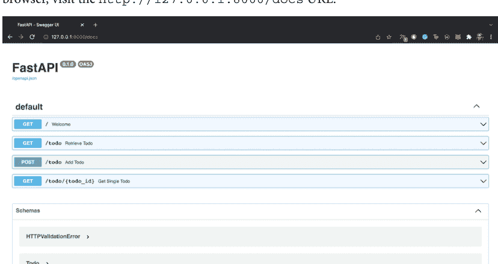

图 2.1 – FastAPI 交互式文档

交互式文档允许我们测试我们的方法。让我们从交互式文档中添加一个待办事项：

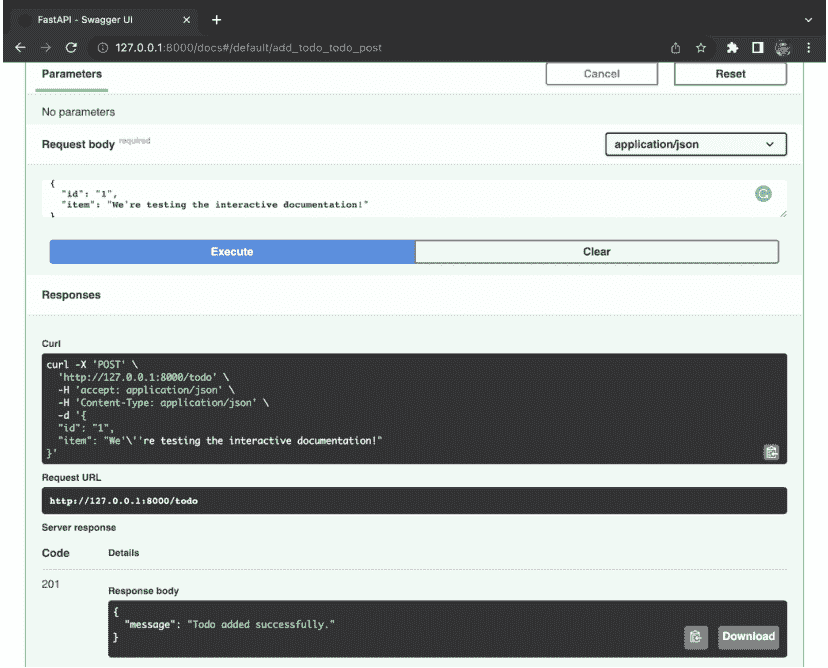

图 2.2 – 来自交互式文档的路由测试

现在我们知道了交互式文档的样子，让我们检查 ReDoc 生成的文档。

### ReDoc

ReDoc 文档对模型、路由和 API 提供了更详细和直接的展示。您可以通过在应用程序地址后附加 /redoc 来访问它。在 Web 浏览器中访问 http://127.0.0.1:8000/redoc URL：

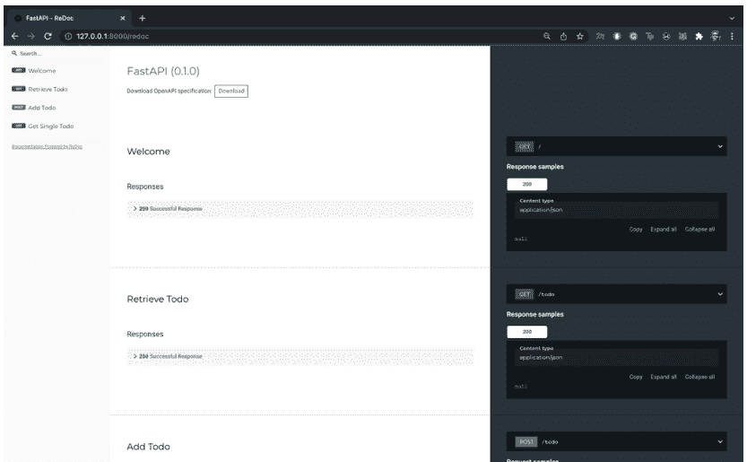

图 2.3 – ReDoc 驱动的文档门户

为了正确生成 JSON Schema，您可以设置用户如何在模型中填写数据的示例。示例是通过将 Config 类嵌入到模型类中设置的。让我们在我们的 Todo 模型中添加一个示例模式：

```
class Todo(BaseModel):
    id: int
    item: str

    class Config:
        Schema_extra = {
            "Example": {
                "id": 1,
```
```
"item": "Example schema!"
}
```

刷新 ReDoc 文档页面并在左侧窗格中单击 Add Todo。示例显示在右侧窗格中：

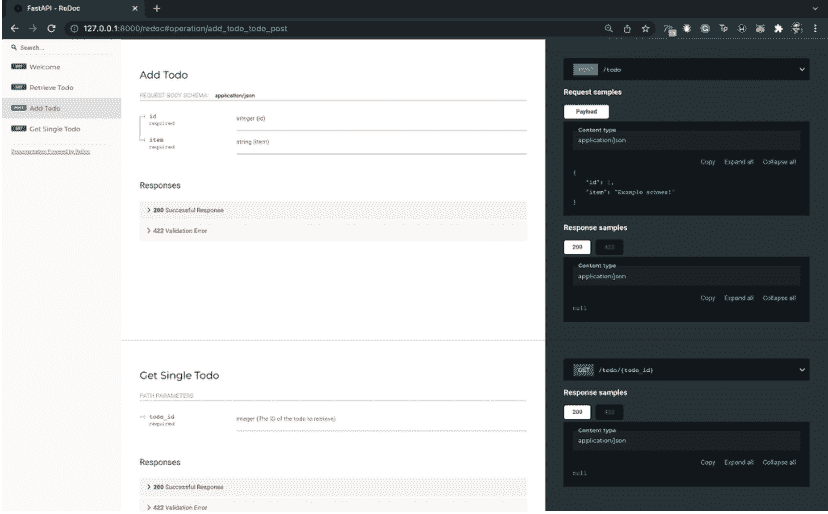

图 2.4 – 文档门户显示示例模式

在交互式文档中也可以看到示例模式：

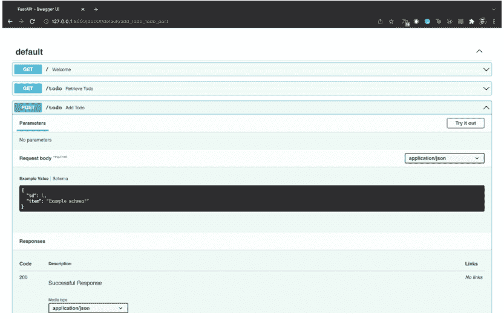

图 2.5 – 文档门户显示示例模式

我们已经学习了如何添加示例模式数据来指导用户如何向 API 发送请求并从 Swagger 的交互式文档中测试应用程序。ReDoc 提供的文档也不例外，它充当了如何使用 API 的知识库。

现在我们已经了解了 APIRouter 类是什么以及如何使用它、请求体、路径和查询参数，以及使用 Pydantic 模型验证请求体，让我们更新我们的待办事项应用程序以包含更新和删除待办事项的路由。

### 构建一个简单的 CRUD 应用

我们已经为 **创建** 和 **检索** 待办事项构建了路由。让我们为 **更新** 和 **删除** 添加的待办事项构建路由。让我们首先在 model.py 中为 UPDATE 路由的请求体创建一个模型：

```
class TodoItem(BaseModel):
    item: str

    class Config:
        schema_extra = {
            "example": {
                "item": "Read the next chapter of the book"
            }
        }
```

接下来，让我们在 todo.py 中编写更新待办事项的路由：

```
from fastapi import APIRouter, Path
from model import Todo, TodoItem

todo_router = APIRouter()

todo_list = []

@todo_router.post("/todo")
async def add_todo(todo: Todo) -> dict:
    todo_list.append(todo)
    return {
        "message": "Todo added successfully."
    }

@todo_router.get("/todo")
async def retrieve_todo() -> dict:
    return {
        "todos": todo_list
```


```
@todo_router.get("/todo/{todo_id}")
async def get_single_todo(todo_id: int = Path(..., title="The ID of the todo to retrieve")) -> dict:
    for todo in todo_list:
        if todo.id == todo_id:
            return {
                "todo": todo
            }
    return {
        "message": "Todo with supplied ID doesn't exist."
    }

@todo_router.put("/todo/{todo_id}")
async def update_todo(todo_data: TodoItem, todo_id: int = Path(..., title="The ID of the todo to be updated")) -> dict:
    for todo in todo_list:
        if todo.id == todo_id:
            todo.item = todo_data.item
            return {
                "message": "Todo updated successfully."
            }
    return {
        "message": "Todo with supplied ID doesn't exist."
    }
```

让我们测试新的路由。首先，让我们添加一个待办事项：

```
(venv)$ curl -X 'POST' \
'http://127.0.0.1:8000/todo' \
-H 'accept: application/json' \
-H 'Content-Type: application/json' \
-d '{
"id": 1,
```
```
"item": "Example Schema!"
}'
```

以下是响应：

```
(venv)$ {
  "message": "Todo added successfully."
}
```

接下来，让我们通过发送 PUT 请求来更新待办事项：

```
(venv)$ curl -X 'PUT' \
'http://127.0.0.1:8000/todo/1' \
-H 'accept: application/json' \
-H 'Content-Type: application/json' \
-d '{
  "item": "Read the next chapter of the book."
}'
```

以下是响应：

```
(venv)$ {
  "message": "Todo updated successfully."
}
```

让我们验证我们的待办事项是否确实已更新：

```
(venv)$ curl -X 'GET' \
'http://127.0.0.1:8000/todo/1' \
-H 'accept: application/json'
```

以下是响应：

```
(venv)$ {
  "todo": {
    "id": 1,
    "item": "Read the next chapter of the book"
  }
}
```

从返回的响应中，我们可以看到待办事项已成功更新。现在，让我们创建用于删除单个待办事项和所有待办事项的路由。

在 todo.py 中，更新路由：

```
@todo_router.delete("/todo/{todo_id}")
async def delete_single_todo(todo_id: int) -> dict:
    for index in range(len(todo_list)):
        todo = todo_list[index]
        if todo.id == todo_id:
            todo_list.pop(index)
            return {
                "message": "Todo deleted successfully."
            }
    return {
        "message": "Todo with supplied ID doesn't exist."
    }

@todo_router.delete("/todo")
async def delete_all_todo() -> dict:
    todo_list.clear()
    return {
        "message": "Todos deleted successfully."
    }
```

让我们测试删除路由。首先，我们添加一个待办事项：

```
(venv)$ curl -X 'POST' \
  'http://127.0.0.1:8000/todo' \
  -H 'accept: application/json' \
  -H 'Content-Type: application/json' \
  -d '{
  "id": 1,
  "item": "Example Schema!"
}'
```

以下是响应：

```
(venv) $ {
  "message": "Todo added successfully."
}
```

接下来，删除待办事项：

```
(venv)$ curl -X 'DELETE' \
  'http://127.0.0.1:8000/todo/1' \
  -H 'accept: application/json'
```

以下是响应：

```
(venv) $ {
  "message": "Todo deleted successfully."
}
```

让我们通过发送 GET 请求来检索待办事项，验证待办事项是否已被删除：

```
(venv)$ curl -X 'GET' \
  'http://127.0.0.1:8000/todo/1' \
  -H 'accept: application/json'
```

以下是响应：

```
(venv) $ {
  "message": "Todo with supplied ID doesn't exist.
}
```

在本节中，我们结合前几节学到的知识构建了一个 CRUD 待办事项应用程序。通过验证请求体，我们能够确保向 API 发送的是正确的数据。路由中包含路径参数也使我们能够从待办事项列表中检索和删除单个待办事项。

### Summary

在本章中，我们学习了如何使用 `APIRouter` 类并将其定义的路由连接到主 FastAPI 实例。我们还学习了如何为请求体创建模型以及向路径操作添加路径和查询参数。这些模型可作为对请求体字段提供的错误数据类型进行额外验证。我们还构建了一个 CRUD 待办事项应用程序，以将本章学到的所有内容付诸实践。

在下一章中，您将了解 FastAPI 中的响应、响应建模和错误处理。您将首先了解响应的概念以及本章学到的 Pydantic 模型知识如何帮助构建 API 响应的模型。然后您将学习状态码以及如何在响应对象中使用它们以及正确的错误处理。

### 3
#### Response Models
and Error Handling

响应模型充当从 API 路由路径返回数据的模板。它们基于 **Pydantic** 构建，以便从发送到服务器的请求中正确呈现响应。

错误处理包括处理应用程序错误所涉及的实践和活动。这些实践包括返回适当的错误状态码和错误消息。

在本章结束时，您将知道响应是什么以及它由什么组成，并且您将了解错误处理以及如何在 FastAPI 应用程序中处理错误。您还将知道如何使用 Pydantic 为请求响应构建响应模型。

在本章中，我们将涵盖以下主题：

- Responses in FastAPI
- Building a response model
- Error handling

### Technical requirements

本章使用的代码可以在 https://github.com/PacktPublishing/Building-Python-Web-APIs-with-FastAPI/tree/main/ch03/todos 中找到。

#### Understanding responses in FastAPI

响应是 API 生命周期中不可或缺的一部分。响应是通过使用任何标准 HTTP 方法与 API 路由交互后收到的反馈。API 响应通常采用 JSON 或 XML 格式，但也可以是文档的形式。响应由头部和主体组成。

#### What is a response header?

响应头部由请求的狀態和用于指导响应主体传输的额外信息组成。响应头部中包含的信息示例是 Content-Type，它告诉客户端返回的内容类型。

#### What is a response body?

另一方面，响应主体是客户端从服务器请求的数据。响应主体由 Content-Type 头部变量决定，最常用的就是 application/json。在上一章中，返回的待办事项列表就是响应主体。

现在您已经了解了响应是什么以及它由什么组成，让我们在下一节中看一下响应中包含的 HTTP 状态码。

#### Status codes

状态码是由服务器对客户端请求发出的唯一简短代码。响应状态码分为五类，每类表示不同的响应：

- 1XX: 请求已被接收。
- 2XX: 请求成功。
- 3XX: 请求被重定向。
- 4XX: 客户端出现错误。
- 5XX: 服务器出现错误。

完整的 HTTP 状态码列表可以在 https://httpstatuses.com/ 找到。

状态码的第一位数字定义了其类别。常见的状态码包括 200 表示请求成功，404 表示请求未找到，500 表示内部服务器错误。

无论框架如何，构建 Web 应用程序时遵循的标准做法是为各个事件返回适当的状态码。不应为服务器错误返回 400 状态码。同样，不应为失败的请求操作返回 200 状态码。

现在您已经了解了状态码是什么，让我们在下一节中学习如何构建响应模型。

#### Building response models

我们在本章开头阐述了响应模型的目的。您还学习了如何使用 Pydantic 在上一章中构建模型。响应模型也是基于 Pydantic 构建的，但用途不同。

在路由路径的定义中，我们有例如以下内容：

```
@app.get("/todo")
async def retrieve_todo() -> dict:
    return {
        "todos": todo_list
    }
```

该路由返回数据库中存在的待办事项列表。以下是一些示例输出：

```
{
  "todos": [
    {
      "id": 1,
      "item": "Example schema 1!"
    },
    {
      "id": 2,
      "item": "Example schema 2!"
    },
    {
      "id": 3,
```


```
"item": "Example schema 5!"
}
]
}
```

该路由返回存储在 todos 数组中的所有内容。若要指定返回的信息，我们就必须将要显示的数据分离出来或引入额外的逻辑。幸运的是，我们可以创建一个包含我们想要返回的字段的模型，并使用 response_model 参数将其添加到我们的路由定义中。

让我们更新检索所有待办事项的路由，使其返回仅包含待办事项项的数组，而不返回 ID。让我们先在 model.py 中定义一个新的模型类来返回待办事项项列表：

```
from typing import List

class TodoItem(BaseModel):
    item: str

    class Config:
        schema_extra = {
            "example": {
                "item": "Read the next chapter of the book"
            }
        }

class TodoItems(BaseModel):
    todos: List[TodoItem]

    class Config:
        schema_extra = {
            "example": {
                "todos": [
                    {
                        "item": "Example schema 1!"
                    },
                    {
                        "item": "Example schema 2!"
```

```
}
]
}
}
```

在前面的代码块中，我们定义了一个新的模型 TodoItems，它返回包含在 TodoItem 模型中的变量列表。让我们通过向其添加响应模型来更新 todo.py 中的路由：

```
from model import Todo, TodoItem, TodoItems
...
@todo_router.get("/todo", response_model=TodoItems)
async def retrieve_todo() -> dict:
    return {
        "todos": todo_list
    }
```

激活你的虚拟环境并启动应用程序：

```
$ source venv/bin/activate
(venv)$ uvicorn api:app --host=0.0.0.0 --port 8000 --reload
```

接下来，添加一个新的待办事项：

```
(venv)$ curl -X 'POST' \
'http://127.0.0.1:8000/todo' \
-H 'accept: application/json' \
-H 'Content-Type: application/json' \
-d '{
"id": 1,
"item": "This todo will be retrieved without exposing my ID!"
}'
```

检索待办事项：

```
(venv)$ curl -X 'GET' \
  'http://127.0.0.1:8000/todo' \
  -H 'accept: application/json'
```

收到的响应如下：

```
{
  "todos": [
    {
      "item": " This todo will be retrieved without exposing my ID!"
    }
  ]
}
```

现在我们已经了解了响应模型是什么以及如何使用它们，我们将在后续章节中在合适的地方继续使用它们。让我们在下一节中看看错误响应以及如何处理错误。

#### 错误处理

在本章前面，我们学习了状态码是什么以及它们在告知客户端请求状态方面如何有用。请求可能会返回错误的响应，而这些响应可能很丑陋或关于失败原因的信息不足。

请求错误可能源于尝试访问不存在的资源、在没有足够权限的情况下访问受保护的页面，甚至是服务器错误。FastAPI 中的错误通过使用 FastAPI 的 HTTPException 类引发异常来处理。

> **什么是 HTTP 异常？**
> HTTP 异常是一个事件，用于指示请求流程中的故障或问题。

HTTPException 类接受三个参数：

- status_code：为此次中断返回的状态码
- detail：随同发送给客户端的消息
- headers：需要标头的响应的可选参数

在我们的待办事项路由路径定义中，当找不到待办事项时，我们会返回一条消息。我们将对其进行更新以引发 HTTPException。HTTPException 允许我们返回适当的错误响应代码。

在我们当前的应用程序中，检索不存在的待办事项会在 http://127.0.0.1:8000/docs 上返回 200 响应状态码而不是 404 响应状态码：

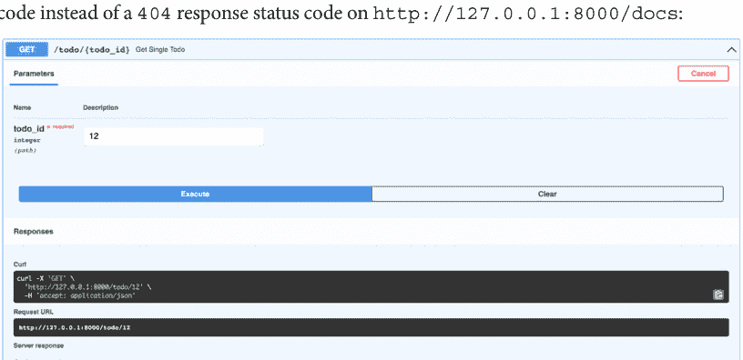

图 3.1 – 请求返回 200 响应而不是 404 响应

通过更新路由以使用 HTTPException 类，我们可以在响应中返回相关详细信息。在 todo.py 中，更新检索、更新和删除待办事项的路由：

```
from fastapi import APIRouter, Path, HTTPException, status
..
@todo_router.get("/todo/{todo_id}")
async def get_single_todo(todo_id: int = Path(..., title="The ID of the todo to retrieve.")) -> dict:
    for todo in todo_list:
```

```
if todo.id == todo_id:
    return {
        "todo": todo
    }
raise HTTPException(
    status_code=status.HTTP_404_NOT_FOUND,
    detail="Todo with supplied ID doesn't exist",
)

@todo_router.put("/todo/{todo_id}")
async def update_todo(todo_data: TodoItem, todo_id: int = Path(..., title="The ID of the todo to be updated.")) -> dict:
    for todo in todo_list:
        if todo.id == todo_id:
            todo.item = todo_data.item
            return {
                "message": "Todo updated successfully."
            }

    raise HTTPException(
        status_code=status.HTTP_404_NOT_FOUND,
        detail="Todo with supplied ID doesn't exist",
    )

@todo_router.delete("/todo/{todo_id}")
async def delete_single_todo(todo_id: int) -> dict:
    for index in range(len(todo_list)):
        todo = todo_list[index]
        if todo.id == todo_id:
            todo_list.pop(index)
            return {
                "message": "Todo deleted successfully."
            }

    raise HTTPException(
        status_code=status.HTTP_404_NOT_FOUND,
```

```
detail="Todo with supplied ID doesn't exist",
)
```

现在，让我们重试检索不存在的待办事项以验证是否返回了正确的响应代码：

#### 响应

#### Curl

```
curl -X 'GET' \
'http://127.0.0.1:8000/todo/12' \
-H 'accept: application/json'
```

#### 请求 URL

```
http://127.0.0.1:8000/todo/12
```

#### 服务器响应

#### 代码
详细信息

404
未记录错误：未找到

#### 响应体

```
{
  "detail": "Todo with supplied ID doesn't exist"
}
```

#### 响应标头

图 3.2 – 显示正确的 404 响应代码

最后，我们可以通过向装饰器函数添加 status_code 参数来声明 HTTP 状态码以覆盖成功操作的默认状态码：

```
@todo_router.post("/todo", status_code=201)
async def add_todo(todo: Todo) -> dict:
    todo_list.append(todo)
    return {
        "message": "Todo added successfully."
    }
```

在本节中，我们学习了如何向客户端返回正确的响应代码，以及如何覆盖默认状态码。还需要注意的是，成功的默认状态码是 200。

### 总结

在本章中，我们学习了响应和响应模型是什么，以及错误处理意味着什么。我们还学习了 HTTP 状态码以及使用它们的重要性。

我们还根据上一章创建模型所获得的知识创建了响应模型，并创建了一个响应模型来仅返回待办事项列表中的项目而不返回其 ID。最后，我们学习了错误和错误处理。我们更新了现有的路由，使其返回正确的响应代码而不是默认的 200 状态码。

在下一章中，你将介绍使用 Jinja 模板化 FastAPI 应用程序。你将首先介绍开始使用 Jinja 模板所需的基础知识，然后使用你的模板知识为我们的简单待办事项应用程序创建一个用户界面。

### 4

#### FastAPI 中的模板化

现在我们已经在上一章学习了如何处理包括错误在内的请求响应，我们可以继续将请求响应渲染到网页上。在本章中，我们将学习如何使用 Jinja 提供的模板将 API 的响应渲染到网页上，Jinja 是一种用 Python 编写的模板语言，旨在帮助 API 响应的渲染过程。

模板化是将从 API 获取的数据以各种格式显示的过程。模板充当 Web 应用程序中的前端组件。

到本章结束时，你将具备模板是什么以及如何使用模板渲染 API 信息的知识。本章将涵盖以下主题：

- 了解 Jinja
- 在 FastAPI 中使用 Jinja2 模板

### 技术要求

本章使用的代码可以在 https://github.com/PacktPublishing/Building-Python-Web-APIs-with-FastAPI/tree/main/ch04/todos 找到。


#### 理解 Jinja

**Jinja** 是一个用 Python 编写的模板引擎，旨在帮助 API 响应的渲染过程。在每种模板语言中，都有变量在模板渲染时会被替换为传递给它们的实际值，还有标签来控制模板的逻辑。

Jinja 模板引擎使用花括号 { } 来区分其表达式和语法与常规 HTML、文本以及模板文件中的任何其他变量。

{{ }} 语法称为 **变量块**。 语法包含控制结构，例如 **if/else、循环和宏**。

Jinja 模板语言中使用的三种常见语法块包括以下内容：

- `` – 此语法用于语句，例如控制结构。
- `{{ todo.item }}` – 此语法用于打印传递给它的表达式的值。
- `{# This is a great API book! #}` – 此语法用于编写注释，并且不会在网页上显示。

Jinja 模板变量可以是任何可以转换为字符串的 Python 类型或对象。可以将模型、列表或字典类型传递给模板，并通过将这些属性放在前面列出的第二个块中来显示其属性。

在下一节中，我们将研究过滤器。过滤器是每个模板引擎的重要组成部分，在 Jinja 中，过滤器使我们能够执行某些函数，例如从列表中连接值和检索对象的长度等。

在以下小节中，我们将研究 Jinja 中使用的一些常见功能：过滤器、if 语句、循环、宏和模板继承。

#### 过滤器

尽管 Python 和 Jinja 的语法相似，但诸如连接字符串、将字符串的第一个字符设为大写等修改无法使用 Jinja 中的 Python 语法完成。因此，为了执行此类修改，我们在 Jinja 中使用过滤器。

过滤器与变量之间用管道符号 (|) 分隔，并且可以在括号中包含可选参数。过滤器按以下格式定义：

```
{{ variable | filter_name(*args) }}
```

如果没有参数，定义变为以下内容：

```
{{ variable | filter_name }}
```

让我们在以下小节中查看一些常见过滤器。

##### default 过滤器

default 过滤器变量用于在传递的值最终为 None 时替换输出：

```
{{ todo.item | default('This is a default todo item') }}
This is a default todo item
```

##### escape 过滤器

此过滤器用于渲染原始 HTML 输出：

```
{{ "<title>Todo Application</title>" | escape }}
<title>Todo Application</title>
```

##### 转换过滤器

这些过滤器包括 int 和 float 过滤器，用于从一种数据类型转换为另一种数据类型：

```
{{ 3.142 | int }}
3

{{ 31 | float }}
31.0
```

##### join 过滤器

此过滤器用于将列表中的元素连接成字符串，如 Python 中所示：

```
{{ ['Packt', 'produces', 'great', 'books!'] | join(' ') }}
Packt produces great books!
```

##### length 过滤器

此过滤器用于返回传递对象的长度。它在 Python 中与 len() 具有相同的功能：

```
Todo count: {{ todos | length }}
Todo count: 4
```

> Note
> 要获取过滤器的完整列表并了解有关 Jinja 中过滤器的更多信息，请访问 https://jinja.palletsprojects.com/en/3.0.x/templates/#builtin-filters。

#### 使用 if 语句

Jinja 中 if 语句的使用与 Python 中的使用相似。if 语句用于  控制块中。让我们看一个例子：

```

    You don't have much items on your todo list!

    You have a busy day it seems!

```

#### 循环

我们也可以在 Jinja 中遍历变量。这可以是列表或通用函数，例如以下示例：

```

    <b> {{ todo.item }} </b>

```

你可以在 for 循环中访问特殊变量，例如 loop.index，它给出当前迭代的索引。以下是特殊变量及其描述的列表：

| Variable | Description |
|---|---|
| loop.index | The current iteration of the loop (1 indexed) |
| loop.index0 | The current iteration of the loop (0 indexed) |
| loop.revindex | The number of iterations from the end of the loop (1 indexed) |
| loop.revindex0 | The number of iterations from the end of the loop (0 indexed) |
| loop.first | True if first iteration |
| loop.last | True if last iteration |
| loop.length | The number of items in the sequence |
| loop.cycle | A helper function to cycle between a list of sequences |
| loop.depth | Indicates how deep in a recursive loop the rendering currently is; starts at level 1 |
| loop.depth0 | Indicates how deep in a recursive loop the rendering currently is; starts at level 0 |
| loop.previtem | The item from the previous iteration of the loop; undefined during the first iteration |
| loop.nextitem | The item from the following iteration of the loop; undefined during the last iteration |
| loop.changed(*val) | True if previously called with a different value (or not called at all) |

#### 宏

Jinja 中的宏是一个返回 HTML 字符串的函数。宏的主要用例是避免代码重复，而是使用单个函数调用。例如，定义输入宏是为了减少在 HTML 表单中连续定义输入标签：

```

    <div class="form">
        <input type="{{ type }}" name="{{ name }}" 
        value="{{ value|escape }}" size="{{ size }}">
    </div>

```

现在，要快速在表单中创建输入，调用宏：

```
{{ input('item') }}
```

这将返回以下内容：

```
<div class="form">
    <input type="text" name="item" value="" size="20">
</div>
```

现在我们已经了解了宏是什么，我们将继续学习模板继承是什么以及它在 FastAPI 中如何工作。

#### 模板继承

Jinja 最强大的功能是模板继承。此功能推进了 **不要重复自己 (DRY)** 原则，并在大型 Web 应用程序中非常有用。模板继承是指定义一个基础模板，子模板可以交互、继承和替换基础模板中定义的各个部分。

> **Note**
> 你可以在 https://jinja.palletsprojects.com/en/3.0.x/templates/#template-inheritance 了解有关 Jinja 模板继承的更多信息。

现在你已经学习了 Jinja 语法的[content]

#### 理解 Jinja

**Jinja** 是一个用 Python 编写的模板引擎，旨在帮助 API 响应的渲染过程。在每种模板语言中，都有变量在模板渲染时会被替换为传递给它们的实际值，还有标签来控制模板的逻辑。

Jinja 模板引擎使用花括号 { } 来区分其表达式和语法与常规 HTML、文本以及模板文件中的任何其他变量。

{{ }} 语法称为 **变量块**。 语法包含控制结构，例如 **if/else、循环和宏**。

Jinja 模板语言中使用的三种常见语法块包括以下内容：

- `` – 此语法用于语句，例如控制结构。
- `{{ todo.item }}` – 此语法用于打印传递给它的表达式的值。
- `{# This is a great API book! #}` – 此语法用于编写注释，并且不会在网页上显示。

Jinja 模板变量可以是任何可以转换为字符串的 Python 类型或对象。可以将模型、列表或字典类型传递给模板，并通过将这些属性放在前面列出的第二个块中来显示其属性。

在下一节中，我们将研究过滤器。过滤器是每个模板引擎的重要组成部分，在 Jinja 中，过滤器使我们能够执行某些函数，例如从列表中连接值和检索对象的长度等。

在以下小节中，我们将研究 Jinja 中使用的一些常见功能：过滤器、if 语句、循环、宏和模板继承。

#### 过滤器

尽管 Python 和 Jinja 的语法相似，但诸如连接字符串、将字符串的第一个字符设为大写等修改无法使用 Jinja 中的 Python 语法完成。因此，为了执行此类修改，我们在 Jinja 中使用过滤器。

过滤器与变量之间用管道符号 (|) 分隔，并且可以在括号中包含可选参数。过滤器按以下格式定义：

```
{{ variable | filter_name(*args) }}
```

如果没有参数，定义变为以下内容：

```
{{ variable | filter_name }}
```

让我们在以下小节中查看一些常见过滤器。

##### The default filter

The default filter variable is used to replace the output of the passed value if it turns out to be None:

```
{{ todo.item | default('This is a default todo item') }}
This is a default todo item
```

##### The escape filter

This filter is used to render raw HTML output:

```
{{ "<title>Todo Application</title>" | escape }}
<title>Todo Application</title>
```

##### The conversion filters

These filters include int and float filters used to convert from one data type to another:

```
{{ 3.142 | int }}
3

{{ 31 | float }}
31.0
```

##### The join filter

This filter is used to join elements in a list into a string as in Python:

```
{{ ['Packt', 'produces', 'great', 'books!'] | join(' ') }}
Packt produces great books!
```

##### The length filter

This filter is used to return the length of the object passed. It fulfills the same role as len() in Python:

```
Todo count: {{ todos | length }}
Todo count: 4
```

> Note
> For a full list of filters and to learn more about filters in Jinja, visit https://jinja.palletsprojects.com/en/3.0.x/templates/#builtin-filters.

#### Using if statements

The usage of if statements in Jinja is similar to their usage in Python. if statements are used in the  control blocks. Let's look at an example:

```

    You don't have much items on your todo list!

    You have a busy day it seems!

```

#### Loops

We can also iterate through variables in Jinja. This could be a list or a general function, such as the following, for example:

```

    <b> {{ todo.item }} </b>

```

You can access special variables inside a for loop, such as loop.index, which gives the index of the current iteration. The following is a list of the special variables and their descriptions:

| Variable | Description |
|---|---|
| loop.index | The current iteration of the loop (1 indexed) |
| loop.index0 | The current iteration of the loop (0 indexed) |
| loop.revindex | The number of iterations from the end of the loop (1 indexed) |
| loop.revindex0 | The number of iterations from the end of the loop (0 indexed) |
| loop.first | True if first iteration |
| loop.last | True if last iteration |
| loop.length | The number of items in the sequence |
| loop.cycle | A helper function to cycle between a list of sequences |
| loop.depth | Indicates how deep in a recursive loop the rendering currently is; starts at level 1 |
| loop.depth0 | Indicates how deep in a recursive loop the rendering currently is; starts at level 0 |
| loop.previtem | The item from the previous iteration of the loop; undefined during the first iteration |
| loop.nextitem | The item from the following iteration of the loop; undefined during the last iteration |
| loop.changed(*val) | True if previously called with a different value (or not called at all) |

#### Macros

A macro in Jinja is a function that return an HTML string. The main use case for macros is to avoid the repetition of code and instead use a single function call. For example, an input macro is defined to reduce the continuous definition of input tags in an HTML form:

```

    <div class="form">
        <input type="{{ type }}" name="{{ name }}" 
        value="{{ value|escape }}" size="{{ size }}">
    </div>

```

Now, to quickly create an input in your form, the macro is called:

```
{{ input('item') }}
```

This will return the following:

```
<div class="form">
    <input type="text" name="item" value="" size="20">
</div>
```

Now that we have learned what macros are, we will proceed to learn what template inheritance is and how it works in FastAPI.

#### Template inheritance

Jinja’s most powerful feature is the inheritance of templates. This feature advances the **don’t repeat yourself (DRY)** principle and comes in handy in large web applications. Template inheritance is a situation where a base template is defined and child templates can interact, inherit, and replace defined sections of the base template.

> **Note**
> You can learn more about Jinja’s template inheritance at https://jinja.palletsprojects.com/en/3.0.x/templates/#template-inheritance.

Now that you’ve learned the basics of Jinja’s syntax, let’s learn how to use templates in FastAPI in the next section.

#### Using Jinja templates in FastAPI

To get started, we need to install the Jinja package and create a new folder, `templates`, in our project directory. This folder will store all our Jinja files, which are HTML files mixed with Jinja’s syntax. Since this book does not focus on user interface design, we will be making use of the CSS `Bootstrap` library and avoid writing our own styles.

The Bootstrap library will be downloaded from the CDN upon page load. However, extra assets can be stored in a different folder. We will look into serving static files in the next chapter.

We’ll start by creating the homepage template, which will house the section for creating new todos. The following is a mockup of how we want our homepage template to look:

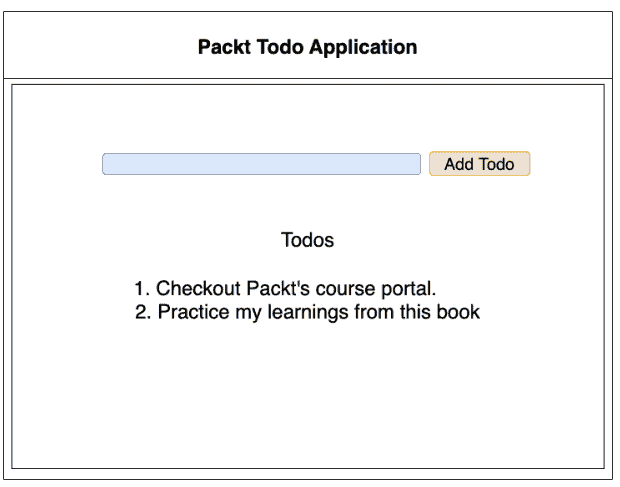

Figure 4.1 – Mockup of our homepage template

1. First, let’s install the Jinja package and create the templates folder:

```
(venv)$ pip install jinja2
(venv)$ mkdir templates
```

2. In the newly created folder, create two new files, home.html and todo.html:

```
(venv)$ cd templates
(venv)$ touch {home,todo}.html
```

In the preceding command block, we have created two template files:

- home.html for the application’s home page
- todo.html for the todo page

In the mockup in Figure 4.1, the inner box denotes the todo template while the bigger box is the homepage template.


在构建模板之前，让我们先在 FastAPI 应用中配置 Jinja：

+   1. 让我们修改 todo API 组件 todo.py 的 POST 路由：

```
from fastapi import APIRouter, Path, HTTPException,
status, Request, Depends
from fastapi.templating import Jinja2Templates
from model import Todo, TodoItem, TodoItems

todo_router = APIRouter()

todo_list = []

templates = Jinja2Templates(directory="templates/")

@todo_router.post("/todo")
async def add_todo(request: Request, todo: Todo =
Depends(Todo.as_form())):
    todo.id = len(todo_list) + 1
    todo_list.append(todo)
    return templates.TemplateResponse("todo.html",
    {
        "request": request,
        "todos": todo_list
    })
```

+   2. 接下来，更新 GET 路由：

```
@todo_router.get("/todo", response_model=TodoItems)
async def retrieve_todo(request: Request):
    return templates.TemplateResponse("todo.html", {
        "request": request,
        "todos": todo_list
    })

@todo_router.get("/todo/{todo_id}")
async def get_single_todo(request: Request, todo_id: int
= Path(..., title="The ID of the todo to retrieve.")):
```

```
for todo in todo_list:
    if todo.id == todo_id:
        return templates.TemplateResponse(
            "todo.html", {
                "request": request,
                "todo": todo
            })
    raise HTTPException(
        status_code=status.HTTP_404_NOT_FOUND,
        detail="Todo with supplied ID doesn't exist",
    )
```

在前面的代码块中，我们已配置 Jinja 在 templates 目录中查找模板，以提供传递给 templates.TemplateResponse() 方法的模板。

用于添加 todo 的 POST 方法也已更新，以包含对输入的依赖。依赖将在第 6 章《连接到数据库》中详细介绍。

+   3. 在 model.py 中，在 Config 子类之前添加高亮代码：

```
from typing import List, Optional

class Todo(BaseModel):
    id: Optional[int]
    item: str

    @classmethod
    def as_form(
        cls,
        item: str = Form(...)
    ):
        return cls(item=item)
```

现在我们已更新 API 代码，让我们编写模板。我们将从下一步开始编写基础 home.html 模板。

4. 在 home.html 中，我们将首先声明文档类型：

```
<!DOCTYPE html>
<html lang="en">
    <head>
        <meta charset="UTF-8">
        <meta http-equiv="X-UA-Compatible" content="IE=edge">
        <meta name="viewport" content="width=device-width, initial-scale=1.0">
        <title>Packt Todo Application</title>
        <link rel="stylesheet" href="https://stackpath.bootstrapcdn.com/bootstrap/4.1.0/css/bootstrap.min.css" integrity="sha384-9gVQ4dYFwwWSjIDZ9bE..." crossorigin="anonymous">
        <link rel="stylesheet" href="https://use.fontawesome.com/releases/v5.0.10/css/all.css" integrity="sha384-+d0P83n9kaQMCwj8F4RJB66tzIwOKmrdb46+porD/OvrJ+37WqIM7UoBtwH06Nlg" crossorigin="anonymous">
    </head>
```

5. 下一步是为模板正文编写内容。在模板的正文中，我们将在 <header></header> 标签下包含应用程序的名称，并将指向子模板的 todo_container 的链接包裹在 block 标签中。子模板将在第 8 步中编写。

在 home.html 模板文件中，紧接在 </head> 标签后包含以下代码：

```
<body>
    <header>
        <nav class="navbar">
            <div class="container-fluid">
                <center>
```

```
<h1>Packt Todo
Application</h1>
</center>
</div>
</nav>
</header>
<div class="container-fluid">

</div>
</body>
</html>
```

高亮代码告诉父模板 todo_container 块将由子模板定义。包含 todo_container 块并扩展父模板的子模板，其内容将在此处显示。

6. 要查看更改，请激活虚拟环境并启动应用程序：

```
$ source venv/bin/activate
(venv)$ uvicorn api:app --host=0.0.0.0 --port 8000 --reload
```

7. 打开 http://127.0.0.1:8000/todo 以预览更改：

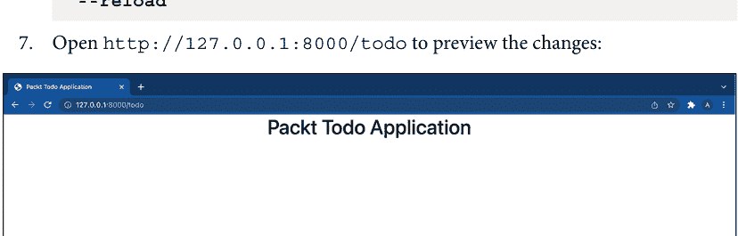

图 4.2 – Todo 应用程序主页

8. 接下来，让我们在 todo.html 中编写 todo 模板：

```



<main class="container">
    <hr>
    <section class="container-fluid">
        <form method="post">
            <div class="col-auto">
                <div class="input-group mb-3">
                    <input type="text" name="item"
                           value="{{ item }}" class="form-control" placeholder="Purchase Packt's Python workshop course"
                           aria-label="Add a todo"
                           aria-describedby="button-addon2" />
                    <button class="btn btn-outline-primary" type="submit" id="button-addon2" data-mdb-ripple-color="dark">
                        Add Todo
                    </button>
                </div>
            </div>
        </form>
    </section>

    <article class="card container-fluid">
        <br/>
        <h4>Todo ID: {{ todo.id }} </h4>
        <p>
            <strong>
                Item: {{ todo.item }}
            </strong>
```

```
</p>
</article>

    <section class="container-fluid">
        <h2 align="center">Todos</h2>
        <br>
        <div class="card">
            <ul class="list-group list-group-flush">
                
                    <li class="list-group-item">
                        {{ loop.index }}. <a href="/todo/{{loop.index}}"> {{
                        todo.item }} </a>
                    </li>
                
            </ul>
        </div>
    
</section>
</main>

```

在前面的代码块中，todo 模板继承了主页模板。我们还定义了 todo_container 块，其内容将在父模板中显示。

todo 模板同时被用于检索所有 todos 和单个 todo 的路由。因此，模板根据使用的路由渲染不同的内容。

在模板中，Jinja 使用  块检查是否传递了 todo 变量。如果传递了 todo 变量，则渲染 todo 详情，否则渲染  块中的内容，即 todos 列表。

9. 刷新 Web 浏览器以查看最近的更改：

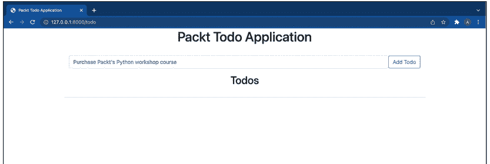

图 4.3 – 更新 todo 主页

10. 让我们添加一个 todo 以验证主页按预期工作：

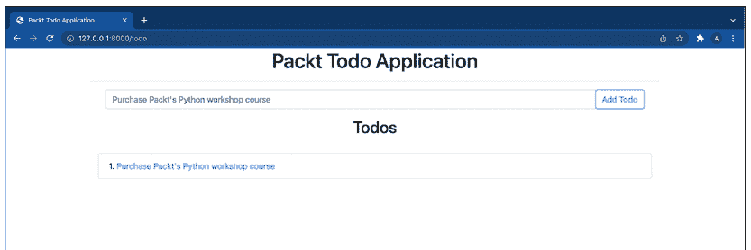

图 4.4 – 显示的 todos 列表

11. todo 是可点击的。点击 todo，你应该会看到以下页面：

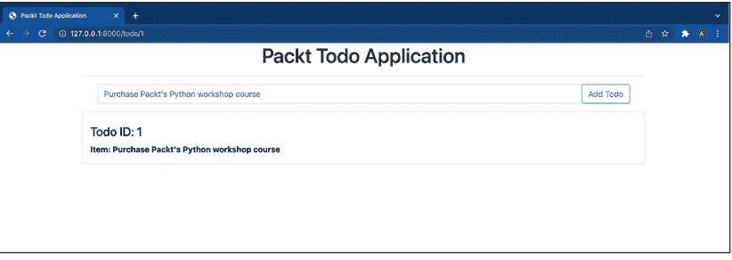

图 4.5 – 单个 todo 页面

我们已成功向 FastAPI 应用程序添加了模板。

### 摘要

在本章中，我们学习了什么是模板化、Jinja 模板系统的基础知识，以及如何在 FastAPI 中使用它。我们利用本章第一部分学到的基础知识来决定渲染什么内容。我们还学习了什么是模板继承，以及它是如何工作的，使用主页和 todo 模板作为示例。

在下一章中，你将被介绍 FastAPI 中的应用程序结构。在本章中，你将使用本章和前几章的知识构建一个计划应用程序。你将首先被介绍应用程序是如何结构化的，然后再继续构建计划应用程序。
