### 8
Testing FastAPI Applications

在上一章中，我们学习了如何使用 OAuth 和 JSON Web Token（JWT）保护 FastAPI 应用程序。我们成功实现了一个身份验证系统并了解了依赖注入是什么。我们还学习了如何将依赖项注入到我们的路由中以限制未经授权的访问和操作。我们已成功构建了一个具有数据库支持的、能够轻松执行 CRUD 操作的安全 Web API。在本章中，我们将学习什么是测试以及如何编写测试以确保我们的应用程序按预期运行。

测试是应用程序开发周期的一个组成部分。应用程序测试是为了确保应用程序的正确运行状态，并在部署到生产环境之前轻松检测应用程序中的异常。虽然我们在过去几章中手动测试了应用程序的端点，但我们将学习如何自动化这些测试。

到本章结束时，您将能够为 FastAPI 应用程序路由编写测试。本章将解释什么是单元测试以及如何在应用程序路由上执行单元测试。本章将涵盖以下主题：

- Unit testing with pytest
- Setting up our test environment
- Writing tests for REST API endpoints
- Test coverage

### Technical requirements

对于本章，您需要在本地机器上运行一个 MongoDB 服务器。应遵循第 6 章《Connecting to a Database》中概述的步骤来启动并运行您的数据库服务器。

本章使用的代码可以在 https://github.com/PacktPublishing/Building-Python-Web-APIs-with-FastAPI/tree/main/ch08/planner 找到。

### Unit testing with pytest

单元测试是一种测试程序，其中应用程序的各个组件被测试。这种形式的测试使我们能够验证各个组件的工作能力。例如，单元测试用于测试应用程序中的各个路由以确保返回适当的响应。

在本章中，我们将使用 pytest，这是一个 Python 测试库，来进行我们的单元测试操作。虽然 Python 附带了一个名为 unittest 的内置单元测试库，但 pytest 库具有更短的语法，并且更受青睐用于测试应用程序。让我们安装 pytest 并编写我们的第一个示例测试。

让我们安装 pytest 库：

```
(venv)$ pip install pytest
```

接下来，创建一个名为 tests 的文件夹来容纳应用程序的测试文件：

```
(venv)$ mkdir tests && cd
(venv)$ touch __init__.py
```

在创建时，单个测试文件名将以 test_ 为前缀。这将使 pytest 库能够识别并运行测试文件。让我们在新创建的 tests 目录中创建一个测试文件来检查加法、减法、乘法和除法算术运算的正确性：

```
(venv)$ touch test_arithmetic_operations.py
```


让我们先定义执行算术运算的函数。在 tests 文件中，添加以下内容：

```
def add(a: int , b: int) -> int:
    return a + b

def subtract(a: int, b: int) -> int:
    return b - a

def multiply(a: int, b: int) -> int:
    return a * b

def divide(a: int, b: int) -> int:
    return b // a
```

现在我们已经定义了要测试的运算，接下来我们将创建处理这些测试的函数。在测试函数中，要执行的运算会被定义。`assert` 关键字用于验证左侧的输出是否与右侧运算的输出相对应。在我们的例子中，我们将测试算术运算是否等于其各自的结果。

将以下内容添加到 tests 文件中：

```
def test_add() -> None:
    assert add(1, 1) == 2

def test_subtract() -> None:
    assert subtract(2, 5) == 3

def test_multiply() -> None:
    assert multiply(10, 10) == 100

def test_divide() -> None:
    assert divide(25, 100) == 4
```

> 提示
> 标准做法是将将被测试的函数定义在外部位置（在我们的例子中是 add()、subtract() 等）。然后导入此文件，并在测试函数中调用要测试的函数。

有了测试函数，我们就可以运行测试文件了。测试可以通过运行 pytest 命令来执行。但是，此命令会运行文件夹中包含的所有测试文件。要执行单个测试，将测试文件名作为参数传递。让我们运行测试文件：

```
(venv)$ pytest test_arithmetic_operations.py
```

所有定义的测试都已通过。这由绿色响应表示：

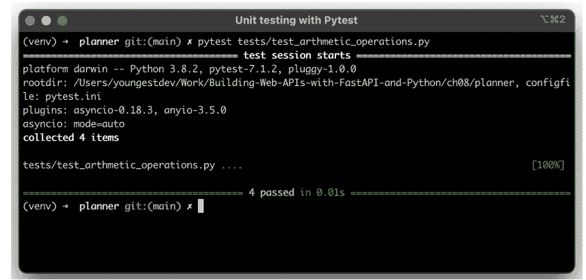

图 8.1 – 对算术运算进行的单元测试结果

失败的测试以及失败点会以红色突出显示。例如，假设我们按如下方式修改 test_add() 函数：

```
def test_add() -> None:
    assert add(1, 1) == 11
```

在下图中，失败的测试以及失败点以红色突出显示。

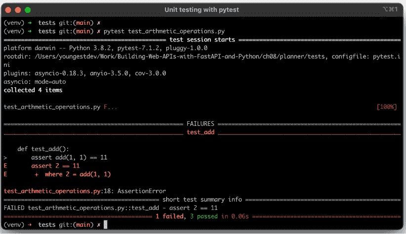

图 8.2 – 失败的测试

测试在 assert 语句处失败，其中正确结果 2 被显示。

失败被总结为 AssertionError，这告诉我们测试由于传递了错误的断言（2 == 1）而失败。

现在我们对 pytest 的工作原理有了一定的了解，让我们来看看 pytest 中的 fixtures。

### 使用 pytest fixtures 消除重复

Fixtures 是可重用的函数，用于返回测试函数所需的数据。

Fixtures 使用 pytest.fixture 装饰器进行装饰。fixture 的一个示例用例是返回应用程序实例以执行 API 端点的测试。

fixture 可用于定义应用程序客户端，该客户端返回并在测试函数中使用，从而无需在每个测试中重新定义应用程序实例。我们将在 编写 REST API 端点的测试 部分看到其用法。

让我们看一个例子：

```
import pytest

from models.events import EventUpdate
```

```
#### Fixture is defined.
@ pytest.fixture
def event() -> EventUpdate:
    return EventUpdate(
        title="FastAPI Book Launch",
        image="https://packt.com/fastapi.png",
        description="We will be discussing the contents of the FastAPI book in this event.Ensure to come with your own copy to win gifts!",
        tags=["python", "fastapi", "book", "launch"],
        location="Google Meet"
    )

def test_event_name(event: EventUpdate) -> None:
    assert event.title == "FastAPI Book Launch"
```

在前面的代码块中，我们定义了一个返回 EventUpdate pydantic 模型实例的 fixture。此 fixture 作为 test_event_name 函数的参数传递，使其属性可访问。

fixture 装饰器可以可选地接受参数。其中一个参数是 scope – fixture 的作用域告诉 pytest fixture 函数的持续时间。在本章中，我们将使用两种作用域：

- session：此作用域告诉 pytest 在整个测试会话中仅实例化一次函数。
- module：此作用域指示 pytest 仅在测试文件执行时执行一次附加的函数。

现在我们知道了 fixture 是什么，让我们在下一节中设置我们的测试环境。

### 设置我们的测试环境

在上一节中，我们学习了测试的基础知识以及 fixtures 是什么。我们现在将测试 CRUD 操作以及用户身份验证的端点。为了测试我们的异步 API，我们将使用 httpx 并安装 pytest-asyncio 库以使我们能够测试我们的异步 API。

安装额外的库：

```
(venv)$ pip install httpx pytest-asyncio
```

接下来，我们将创建一个名为 pytest.ini 的配置文件。向其中添加以下代码：

```
[pytest]
asyncio_mode = True
```

配置文件在运行 pytest 时被读取。这会自动使 pytest 以异步模式运行所有测试。

有了配置文件，让我们创建 umbrella 测试文件 conftest.py，它将负责创建测试文件所需的应用程序实例。在 tests 文件夹中，创建 conftest 文件：

```
(venv)$ touch tests/conftest.py
```

我们将首先将所需的依赖项导入 conftest.py：

```
import asyncio
import httpx
import pytest

from main import app
from database.connection import Settings
from models.events import Event
from models.users import User
```

在前面的代码块中，我们导入了 asyncio、httpx 和 pytest 模块。asyncio 模块将用于创建一个活动的循环会话，以确保测试在单个线程上运行以避免冲突。httpx 测试将充当进行 HTTP CRUD 操作的异步客户端。pytest 库用于定义 fixtures。

我们还导入了应用程序实例 app，以及 models 和 Settings 类。让我们定义循环会话 fixture：

```
@pytest.fixture(scope="session")
def event_loop():
    loop = asyncio.get_event_loop()
    yield loop
    loop.close()
```

有了这个，让我们从 Settings 类创建一个新的数据库实例：

```
async def init_db():
    test_settings = Settings()
    test_settings.DATABASE_URL =
    "mongodb://localhost:27017/testdb"

    await test_settings.initialize_database()
```

在前面的代码块中，我们定义了一个新的 DATABASE_URL，以及调用了第 6 章《连接到数据库》中定义的初始化函数。我们现在使用的是一个新的数据库 testdb。

最后，让我们定义默认客户端 fixture，它返回通过 httpx 异步运行的应用程序实例：

```
@pytest.fixture(scope="session")
async def default_client():
    await init_db()
    async with httpx.AsyncClient(app=app,
    base_url="http://app") as client:
        yield client
        # Clean up resources
        await Event.find_all().delete()
        await User.find_all().delete()
```

在前面的代码块中，首先初始化数据库，然后将应用程序作为 AsyncClient 启动，并在整个测试会话期间保持活动状态。在测试会话结束时，event 和 user 集合将被清除，以确保每次测试运行前数据库为空。

在本节中，您已了解设置测试环境所涉及的步骤。在下一节中，您将了解为应用程序中创建的每个端点编写测试的过程。

### 为 REST API 端点编写测试

一切就绪后，让我们创建 test_login.py 文件，在其中测试身份验证路由：

```
(venv)$ touch tests/test_login.py
```

在测试文件中，我们将首先导入依赖项：

```
import httpx
import pytest
```

#### 测试注册路由

我们将测试的第一个端点是注册端点。我们将添加 pytest.mark.asyncio 装饰器，告知 pytest 将其视为异步测试。让我们定义函数和请求负载：

```
@pytest.mark.asyncio
async def test_sign_new_user(default_client: httpx.AsyncClient) -> None:
    payload = {
        "email": "testuser@packt.com",
        "password": "testpassword",
    }
```

让我们定义请求头和预期响应：

```
headers = {
    "accept": "application/json",
    "Content-Type": "application/json"
}

test_response = {
    "message": "User created successfully"
}
```

现在我们已经为此请求定义了预期响应，让我们发起请求：

```
response = await default_client.post("/user/signup",
json=payload, headers=headers)
```

接下来，我们将通过比较响应来测试请求是否成功：

```
assert response.status_code == 200
assert response.json() == test_response
```


在运行此测试之前，让我们先暂时注释掉 conftest.py 中删除用户数据的那一行，因为它会导致经过身份验证的测试失败：

```
##### await User.find_all().delete()
```

从你的终端启动 MongoDB 服务器并运行测试：

```
(venv)$ pytest tests/test_login.py
```

注册路由已成功测试：

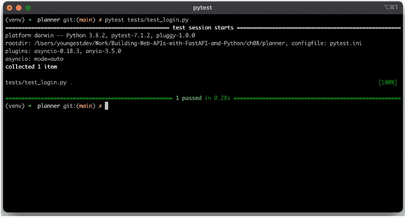

图 8.3 – 注册路由的成功测试运行

让我们继续编写登录路由的测试。在此期间，你可以快速调整测试响应，看看测试是否会失败！

### 测试登录路由

在注册路由的测试下方，让我们定义登录路由的测试。我们将先像第一个测试那样定义请求负载和请求头，然后再发起请求：

```
@pytest.mark.asyncio
async def test_sign_user_in(default_client: httpx.AsyncClient) -> None:
    payload = {
        "username": "testuser@packt.com",
        "password": "testpassword"
    }
```

```
}

headers = {
    "accept": "application/json",
    "Content-Type": "application/x-www-form-urlencoded"
}
```

接下来，我们将发起请求并测试响应：

```
response = await default_client.post("/user/signin",
    data=payload, headers=headers)

    assert response.status_code == 200
    assert response.json()["token_type"] == "Bearer"
```

让我们重新运行测试：

```
(venv)$ pytest tests/test_login.py
```

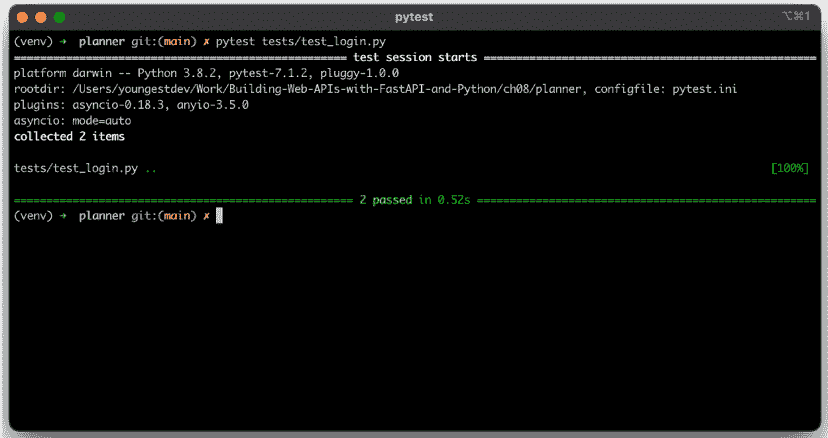

图 8.4 – 两个路由的成功测试运行

让我们将用于登录的用户名改为错误的用户名，以确认测试会失败：

```
payload = {
    "username": "wronguser@packt.com",
    "password": "testpassword"
}
```

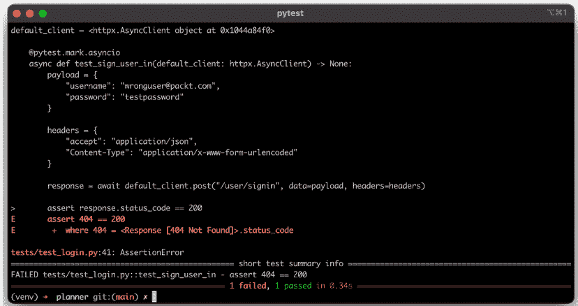

图 8.5 – 因请求负载错误导致测试失败

我们已成功为注册和登录路由编写了测试。让我们继续测试活动规划 API 的 CRUD 路由。

### 测试 CRUD 端点

我们将首先创建一个名为 test_routes.py 的新文件：

```
(venv)$ touch test_routes.py
```

在新创建的文件中，添加以下代码：

```
import httpx
import pytest

from auth.jwt_handler import create_access_token
from models.events import Event
```

在前面的代码块中，我们导入了常规依赖项。我们还导入了 create_access_token（用户）函数和 Event 模型。由于某些路由受保护，我们将自行生成访问令牌。让我们创建一个在调用时返回访问令牌的新 fixture。该 fixture 的作用域为 module，这意味着它仅在测试文件执行时运行一次，而不会在每次函数调用时被调用。添加以下代码：

```
@pytest.fixture(scope="module")
async def access_token() -> str:
    return create_access_token("testuser@packt.com")
```

让我们创建一个向数据库添加事件的新 fixture。此操作是为了在测试 CRUD 端点之前运行初步测试。添加以下代码：

```
@pytest.fixture(scope="module")
async def mock_event() -> Event:
    new_event = Event(
        creator="testuser@packt.com",
        title="FastAPI Book Launch",
        image="https://linktomyimage.com/image.png",
        description="We will be discussing the contents of the FastAPI book in this event.Ensure to come with your own copy to win gifts!",
        tags=["python", "fastapi", "book", "launch"],
        location="Google Meet"
    )

    await Event.insert_one(new_event)

    yield new_event
```

### 测试 READ 端点

接下来，让我们编写一个测试函数来测试 /event 路由上的 GET HTTP 方法：

```
@pytest.mark.asyncio
async def test_get_events(default_client: httpx.AsyncClient, mock_event: Event) -> None:
    response = await default_client.get("/event/")
```

```
assert response.status_code == 200
assert response.json()[0]["_id"] == str(mock_event.id)
```

在前面的代码块中，我们正在测试事件路由路径，以检查在 mock_event fixture 中添加到数据库的事件是否存在。让我们运行测试：

```
(venv)$ pytest tests/test_routes.py
```

结果如下：

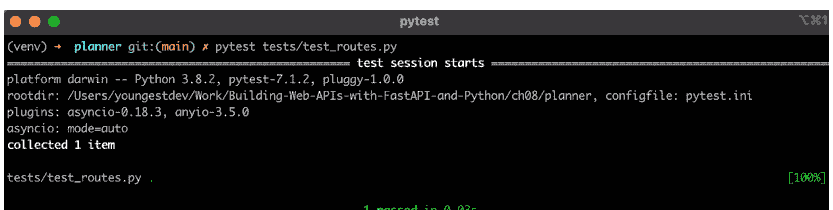

图 8.6 – 成功测试运行

接下来，让我们编写 /event/{id} 端点的测试函数：

```
@pytest.mark.asyncio
async def test_get_event(default_client: httpx.AsyncClient,
mock_event: Event) -> None:
    url = f"/event/{str(mock_event.id)}"
    response = await default_client.get(url)

    assert response.status_code == 200
    assert response.json()["creator"] == mock_event.creator
    assert response.json()["_id"] == str(mock_event.id)
```

在前面的代码块中，我们正在测试检索单个事件的端点。传递的事件 ID 从 mock_event fixture 中获取，并将请求结果与 mock_event fixture 中存储的数据进行比较。让我们运行测试：

```
(venv)$ pytest tests/test_routes.py
```

结果如下：

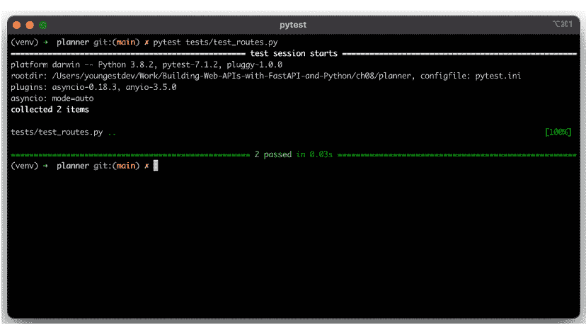

图 8.7 – 单个事件检索的成功测试运行

接下来，让我们编写创建新事件的测试函数。

### 测试 CREATE 端点

我们将首先定义函数并从之前创建的 fixture 中获取访问令牌。我们将创建将发送到服务器的请求负载、将包含内容类型以及授权头值的请求头。测试响应也将被定义，然后发起请求并比较响应。添加以下代码：

```
@pytest.mark.asyncio
async def test_post_event(default_client: httpx.AsyncClient,
access_token: str) -> None:
    payload = {
        "title": "FastAPI Book Launch",
        "image": "https://linktomyimage.com/image.png",
        "description": "We will be discussing the contents
of the FastAPI book in this event.Ensure to come
with your own copy to win gifts!",
        "tags": [
```

```
"python",
"fastapi",
"book",
"launch"
],
"location": "Google Meet",
}

headers = {
    "Content-Type": "application/json",
    "Authorization": f"Bearer {access_token}"
}

test_response = {
    "message": "Event created successfully"
}

response = await default_client.post("/event/new",
json=payload, headers=headers)

assert response.status_code == 200
assert response.json() == test_response
```

让我们重新运行测试文件：

```
(venv)$ pytest tests/test_routes.py
```

结果如下所示：

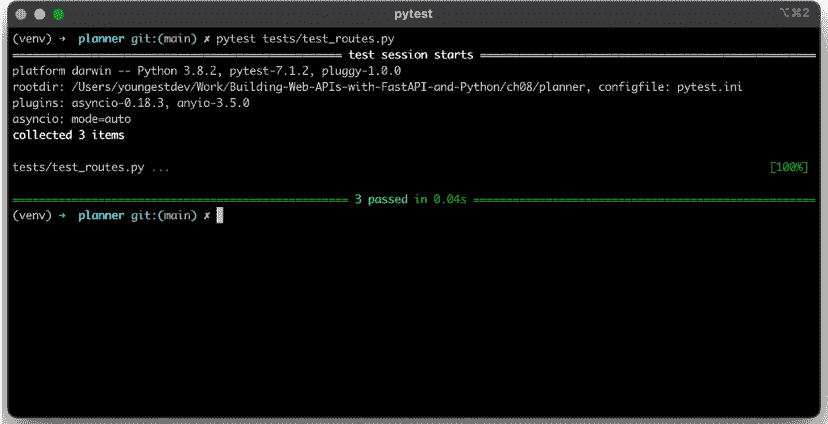

图 8.8 – 成功 POST 请求测试运行

让我们编写一个测试来验证数据库中存储的事件数量（在本例中为 2）。添加以下内容：

```
@pytest.mark.asyncio
async def test_get_events_count(default_client: httpx.AsyncClient) -> None:
    response = await default_client.get("/event/")

    events = response.json()

    assert response.status_code == 200
    assert len(events) == 2
```

在前面的代码块中，我们将 JSON 响应存储在 events 变量中，其长度用于我们的测试比较。让我们重新运行测试文件：

```
(venv)$ pytest tests/test_routes.py
```

结果如下：

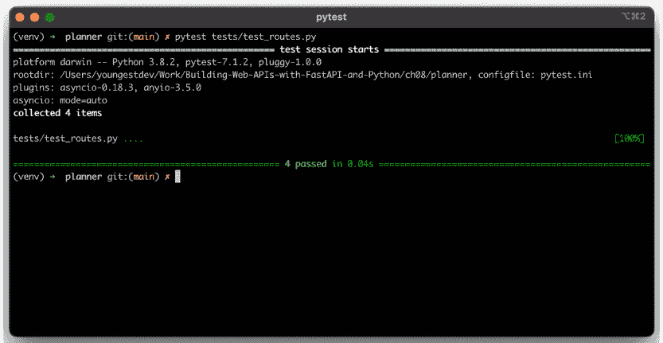

图 8.9 – 确认事件数量的成功测试运行

我们已成功测试了 GET 端点 /event 和 /event/{id} 以及 POST 端点 /event/new。让我们接下来测试 /event/new 的 UPDATE 和 DELETE 端点。

### 测试 UPDATE 端点

让我们从 UPDATE 端点开始：

```
@pytest.mark.asyncio
async def test_update_event(default_client: httpx.AsyncClient, mock_event: Event, access_token: str) -> None:
    test_payload = {
        "title": "Updated FastAPI event"
    }

    headers = {
        "Content-Type": "application/json",
        "Authorization": f"Bearer {access_token}"
    }
```


```
url = f"/event/{str(mock_event.id)}"

response = await default_client.put(url,
json=test_payload, headers=headers)

assert response.status_code == 200
assert response.json()["title"] ==
test_payload["title"]
```

在前面的代码块中，我们通过从 `mock_event` fixture 中获取 ID 来修改数据库中存储的事件。然后我们定义请求负载和头部。在 `response` 变量中，请求被发起并获取的响应被比较。让我们确认测试是否正确运行：

```
(venv)$ pytest tests/test_routes.py
```

以下是结果：

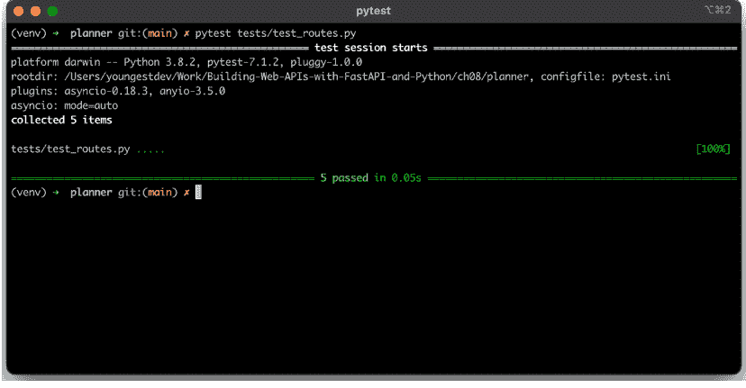

图 8.10 – UPDATE 请求的成功运行

> **提示**
> `mock_event` fixture 在作为 MongoDB 文档的 ID 时非常有用，因为每次向数据库添加文档时都会唯一生成 ID。

让我们更改预期响应以确认我们测试的有效性：

```
assert response.json()["title"] == "This test should fail"
```

重新运行测试：

```
(venv)$ pytest tests/test_routes.py
```

以下是结果：

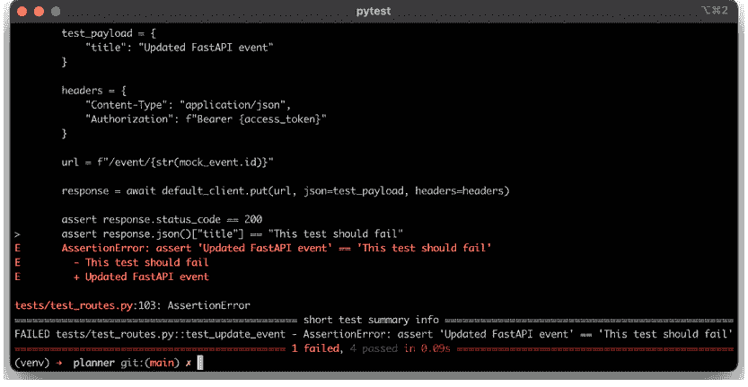

### 测试 DELETE 端点

最后，让我们为 DELETE 端点编写测试函数：

```
@pytest.mark.asyncio
async def test_delete_event(default_client: httpx.AsyncClient, mock_event: Event, access_token: str) -> None:
    test_response = {
        "message": "Event deleted successfully."
    }

    headers = {
        "Content-Type": "application/json",
```

```
"Authorization": f"Bearer {access_token}"
}

url = f"/event/{mock_event.id}"

response = await default_client.delete(url,
headers=headers)

assert response.status_code == 200
assert response.json() == test_response
```

与之前的测试一样，预期测试响应也被定义，以及头部。DELETE 路由被调用并比较响应。让我们运行测试：

```
(venv)$ pytest tests/test_routes.py
```

以下是结果：

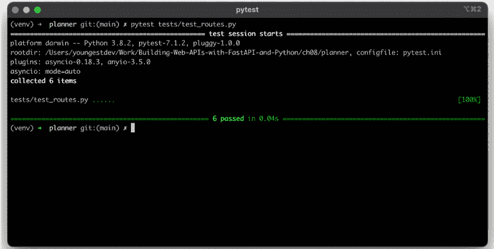

图 8.12 – 成功 DELETE 测试

为了确认文档确实已被删除，让我们添加一个最终测试：

```
@pytest.mark.asyncio
async def test_get_event_again(default_client: httpx.
AsyncClient, mock_event: Event) -> None:
```

```
url = f"/event/{str(mock_event.id)}"
response = await default_client.get(url)

assert response.status_code == 200
assert response.json()["creator"] == mock_event.creator
assert response.json()["_id"] == str(mock_event.id)
```

预期响应是失败。让我们试试：

```
(venv)$ pytest tests/test_routes.py
```

以下是结果：

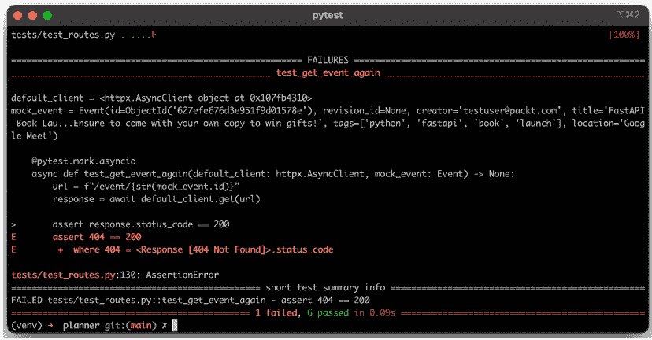

图 8.13 – 失败的测试响应

如前面的截图所示，该项目已无法在数据库中找到。现在你已成功为身份验证和事件路由实现了测试，请取消注释负责从数据库中清除用户数据的代码：

```
await User.find_all().delete()
```

更新最后一个测试：

```
assert response.status_code == 404
```

最后，让我们运行应用程序中存在的所有测试：

```
(venv) $ pytest
```

以下是结果：

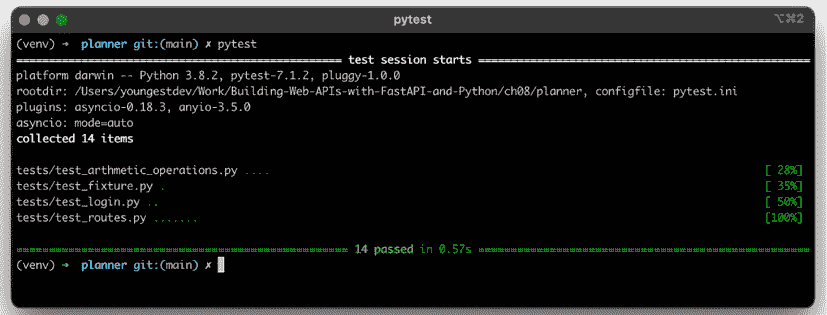

图 8.14 – 完整的测试在 0.57 秒内运行

现在我们已成功测试了 event-planner API 中包含的端点，让我们运行覆盖率测试以确定测试操作中涉及的代码百分比。

### 测试覆盖率

测试覆盖率报告有助于确定在测试过程中执行的代码百分比。让我们安装 coverage 模块，以便我们可以衡量我们的 API 是否得到充分测试：

```
(venv) $ pip install coverage
```

接下来，让我们通过运行以下命令生成覆盖率报告：

```
(venv) $ coverage run -m pytest
```

以下是结果：

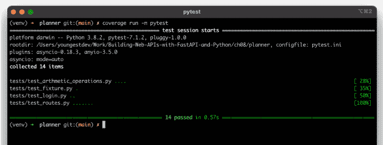

图 8.15 – 生成的覆盖率报告

接下来，让我们查看由 `coverage run -m pytest` 命令生成的报告。我们可以选择在终端或网页上查看报告，通过生成 HTML 报告。我们将两者都做。

让我们从终端查看报告：

```
(venv)$ coverage report
```

以下是结果：

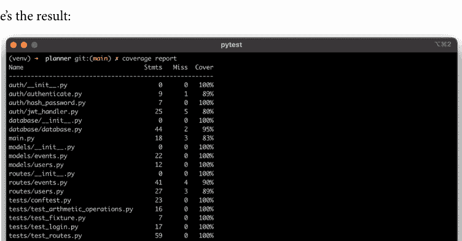

图 8.16 – 来自终端的覆盖率报告

从前面的报告中，百分比表示执行的和交互的代码量。让我们生成 HTML 报告，以便我们可以检查交互的代码块。

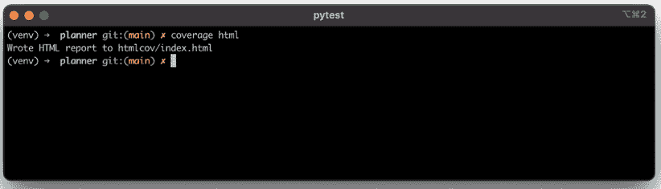

图 8.17 – 生成 HTML 覆盖率报告

接下来，从浏览器打开 `htmlcov/index.html`。

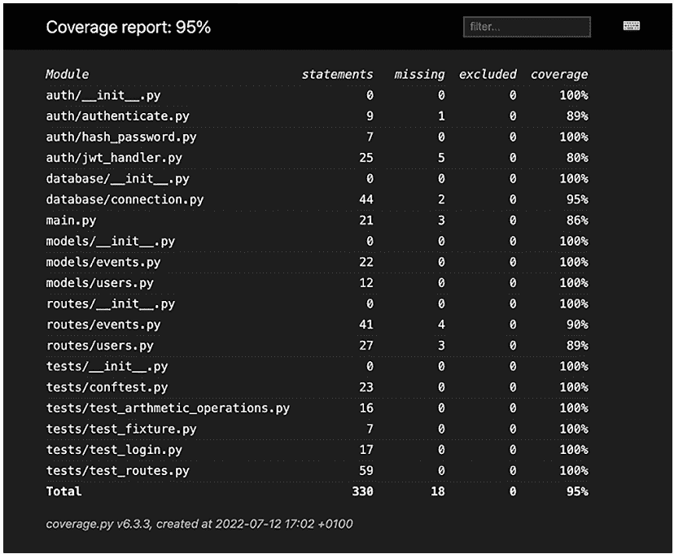

图 8.18 – 来自网页浏览器的覆盖率报告

让我们检查 `routes/events.py` 的覆盖率报告。点击它以显示。

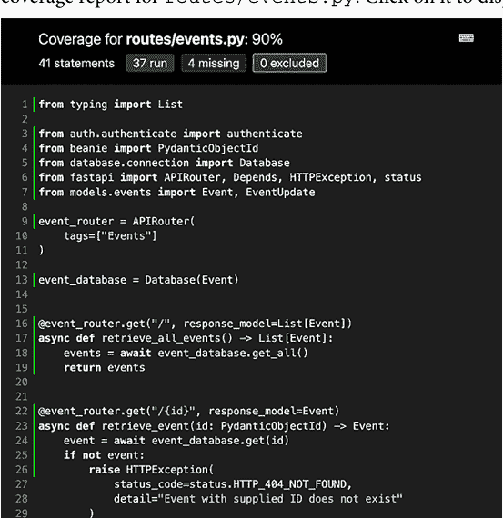

图 8.19 – 覆盖率报告显示已执行的代码为绿色，未触及的代码为红色

### 总结

在本章中，你已成功通过为身份验证路由和 CRUD 路由编写测试来测试 API。你学习了什么是测试以及如何使用 pytest 编写测试，pytest 是一个为 Python 应用程序构建的快速测试库。你还学习了 pytest fixtures 是什么，并在创建可重用的访问令牌和数据库对象以及在整个测试会话中保留应用程序实例时使用了它们。你能够断言 API HTTP 请求的响应并验证 API 的行为。最后，你学习了如何为测试生成覆盖率报告并区分测试会话期间运行的代码块。

现在你已具备测试 Web API 的知识，你已准备好通过部署渠道将应用程序发布到万维网。在下一章也是最后一章中，你将学习如何容器化你的应用程序并使用 Docker 和 docker-compose 在本地部署它。
