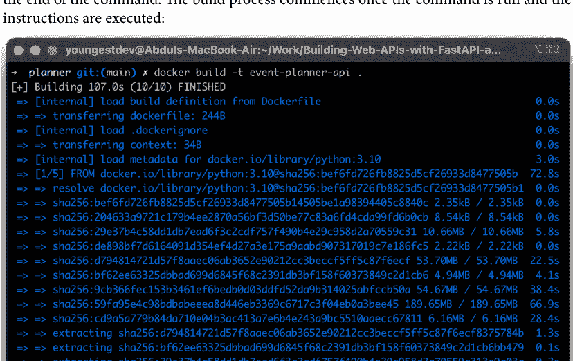
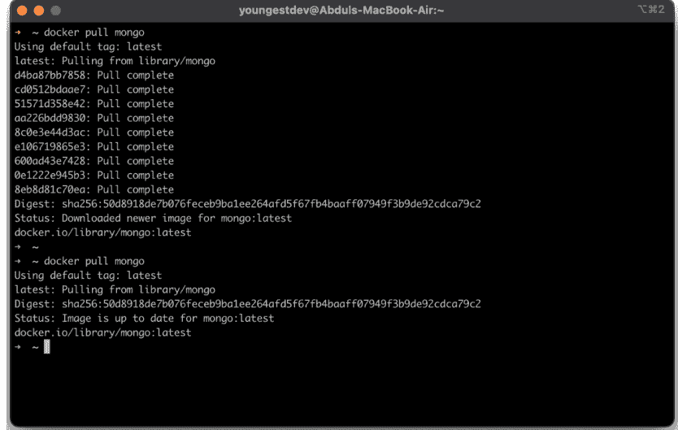
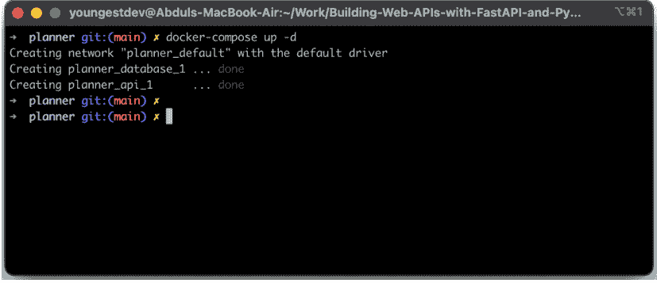
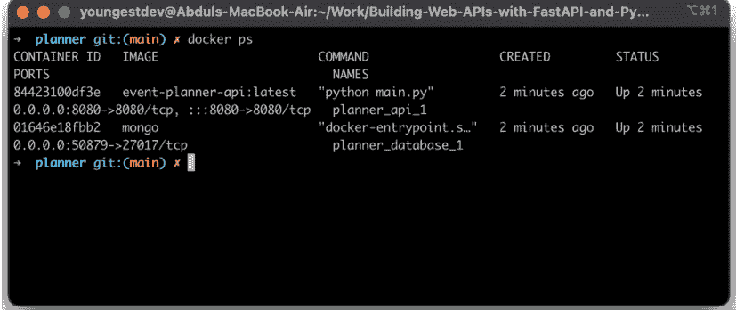
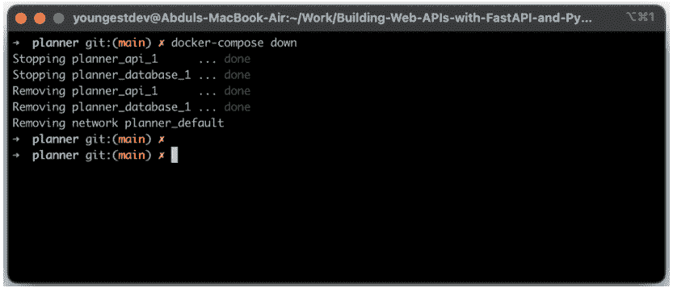

### 9
#### 部署 FastAPI 应用程序

在上一章中，你学习了如何为 FastAPI 应用程序中创建的 API 端点编写测试。我们首先学习了什么是测试，并使用 pytest 库介绍了单元测试的基础知识。我们还研究了如何消除重复并使用 fixtures 重用测试组件，然后继续设置我们的测试环境。我们在上一章的结尾通过为每个端点编写测试并在测试后检查测试覆盖率报告来测试它们。

在本章中，你将学习如何使用 Docker 和 docker-compose 在本地部署 FastAPI 应用程序。还添加了一个简短的部分，其中包含将应用程序部署到你选择的无服务器平台的外部资源。

在本章中，我们将涵盖以下主题：

- 部署准备
- 使用 Docker 部署
- 部署 Docker 镜像

### 技术要求

本章使用的代码可以在 https://github.com/PacktPublishing/Building-Python-Web-APIs-with-FastAPI/tree/main/ch09/planner 找到。

### 部署准备

部署通常标志着应用程序生命周期的结束。在部署我们的应用程序之前，我们必须确保为顺利部署所需的正确设置已到位。这些设置包括确保应用程序依赖项在 requirements.txt 文件中是最新的，配置环境变量等。

### 管理依赖项

在前几章中，我们安装了 beanie 和 pytest 等包。这些包在 requirements.txt 文件中缺失，该文件充当应用程序的依赖管理器。保持 requirements.txt 文件是最新的非常重要。

在 Python 中，开发环境中使用的包列表可以使用 pip freeze 命令检索。pip freeze 命令返回直接安装的所有包的列表以及每个已安装包的子依赖项。幸运的是，requirements.txt 文件可以手动维护，使我们能够仅列出主要包，从而使依赖管理变得更容易。

让我们在覆盖 requirements.txt 文件之前列出应用程序使用的依赖项：

```
(venv)$ pip freeze
anyio==3.5.0
asgi-lifespan==1.0.1
asgiref==3.5.0
attrs==21.4.0
bcrypt==3.2.2
cffi==1.15.0
python-multipart==0.0.5
...
```


The command returns several dependencies, some of which we do not use directly in the application. Let's manually fill the requirements.txt file with the packages we will be using:

#### requirements.txt

```
fastapi==0.78.0
bcrypt==3.2.2
beanie==1.11.1
email-validator==1.2.1
httpx==0.22.0
Jinja2==3.0.3
motor==2.5.1
passlib==1.7.4
pytest==7.1.2
python-multipart==0.0.5
python-dotenv==0.20.0
python-jose==3.3.0
sqlmodel==0.0.6
uvicorn==0.17.6
```

In this code block, we have populated the requirements.txt file with the dependencies used directly in our application.

### Configuring environment variables

We used environment variables in Chapter 6, Connecting to a Database. Environment variables can be injected during deployment, as we'll see in the next section.

> Note
> It is important to note that environment variables are to be properly handled and kept out of version control systems such as GitHub.

Now that we have covered the necessary steps in preparation for our deployments, let's proceed to deploying our application locally with Docker in the next section.

### Deploying with Docker

In Chapter 1, Getting Started with FastAPI, you were introduced to the basics of Docker and the Dockerfile. In this section, you’ll be writing a Dockerfile for the event planner API.

Docker is the most popular technology used for containerization. Containers are self-contained systems consisting of packages, code, and dependencies that enable them to run in different environments with little to no dependence on their running environment. Docker uses Dockerfiles for the containerization process.

Docker can be used for local development as well as for deploying applications to production. We’ll only be looking at local deployment in this chapter, and links to official guides on deploying to cloud services will be included as well.

For managing applications with multiple containers, such as an application container and a database container, the compose tool is used. Compose is a tool used to manage multi-container Docker applications defined in the configuration file, usually docker-compose.yaml. The compose tool, docker-compose, comes installed with the Docker engine.

#### Writing the Dockerfile

A Dockerfile contains a set of instructions employed to build a Docker image. The Docker image built can then be distributed to registries (private and public), deployed to cloud servers such as AWS and Google Cloud, and used on different operating systems by creating a container.

Now that we know what a Dockerfile does, let’s create a Dockerfile to build the application’s image. In the project directory, create the Dockerfile file:

```
(venv)$ touch Dockerfile
```

##### Dockerfile

```
FROM python:3.10

WORKDIR /app

COPY requirements.txt /app

RUN pip install --upgrade pip && pip install -r /app/requirements.txt

EXPOSE 8080

COPY ./ /app

CMD ["python", "main.py"]
```

Let’s go through the instructions contained in the preceding Dockerfile one by one:

- The first instruction the Dockerfile executes is to set the base image for our own image using the FROM keyword. Other variations of this image can be found at https://hub.docker.com/_/python.
- The next line uses the WORKDIR keyword to set the working directory to /app. A working directory helps organize the structure of the project being built to an image.
- Next, we copy the requirements.txt file from the local directory to the working directory on the Docker container using the COPY keyword.
- The next instruction is the RUN command, which is used to upgrade the pip package and then install the dependencies from the requirements.txt file.
- The next command exposes the PORT from which our application can be accessed from the local network.
- The next command copies the rest of the files and folders into the Docker container working directory.
- Lastly, the last command starts the application using the CMD command.

Each set of instructions listed in the Dockerfile is built as an individual layer. Docker does an intelligent job of caching each layer during a build to reduce build time and eliminate repetition. If a layer that is essentially an instruction is untouched, the layer is skipped and the previously built one is used. That is, Docker uses the cache system when building images.

Let’s create a .dockerignore file before proceeding to build our image:

```
(venv)$ touch .dockerignore
```

##### .dockerignore

```
Venv
.env
.git
```

> **What Is .dockerignore?**
> The .dockerignore file contains files and folders to be exempted from instructions defined in the Dockerfile.

### Building the Docker image

To build the application image, run the following command in the base directory:

```
(venv)$ docker build -t event-planner-api .
```

This command simply tells Docker to build an image with the event-planner-api tag from the instructions defined in the current directory, which is represented by the dot at the end of the command. The build process commences once the command is run and the instructions are executed:



Figure 9.1 – Docker build process

Now that we have successfully built our application’s image, let’s pull the MongoDB image:

```
(venv)$ docker pull mongo
```

We’re pulling a MongoDB image to create a standalone database container accessible from the API container when created. By default, the Docker container has a separate network configuration, and connecting to the machine hosts' localhost address is not allowed.



Figure 9.2 – Pulling a MongoDB image

> **What Is docker pull?**
> 
> The `docker pull` command is responsible for downloading images from a registry. Unless otherwise stated, these images are downloaded from the public Docker Hub registry.

### Deploying our application locally

Now that we have created the images for the API and pulled the image for the MongoDB database, let’s proceed to write a compose manifest to handle our application deployment. The docker-compose manifest will consist of the API service and the MongoDB database service. In the root directory, create the manifest file:

```
(venv)$ touch docker-compose.yml
```

#### docker-compose.yml

```
version: "3"

services:
  api:
    build: .
    image: event-planner-api:latest
    ports:
      - "8080:8080"
    env_file:
      - .env.prod

  database:
    image: mongo
    ports:
      - "27017"
    volumes:
      - data:/data/db

volumes:
  data:
```

In the services section, we have the api service and the database service. In the api service, the following set of instructions are put in place:

- The build field instructs Docker to build the event-planner-api:latest image for the api service from the Dockerfile situated in the current directory denoted by . .
- Port 8080 is exposed from the container to enable us to access the service through HTTP.

- The environment file is set to .env.prod. Alternatively, the environment variables can be set in this format:

```
environment:
  - DATABASE_URL=mongodb://database:27017/planner
  - SECRET_KEY=secretkey
```

This format is mostly used when environment variables are to be injected from a deployment service. It is encouraged to use the environment file.

In the database service, the following set of instructions are put in place:

- The database service makes use of the mongo image we pulled earlier.
- Port 27017 is defined but not exposed externally. The port is only accessible internally by the api service.
- A persistent volume is attached to the service to store our data. The folder allocated for this is /data/db.
- Lastly, the volume for this deployment is created with the name data.

Now that we have understood the content of the compose manifest, let’s create the environment file, .env.prod:

#### .env.prod

```
DATABASE_URL=mongodb://database:27017/planner
SECRET_KEY=NOTSTRONGENOUGH!
```

In the environment file, DATABASE_URL is set to the name of the MongoDB service created by the compose manifest.

### Running our application

We are set to deploy and run the application from the docker-compose manifest. Let’s start the services using the compose tool:

```
(venv) $ docker-compose up -d
```


此命令以分离模式启动服务：



应用程序服务已创建并部署。让我们通过检查正在运行的容器列表来验证：

```
(venv) $ docker ps
```

结果如下：



该命令返回正在运行的容器列表以及可以访问它们的端口。让我们通过向已部署的应用程序发送 GET 请求来测试工作状态：

```
(venv)$ curl -X 'GET' \
  'http://localhost:8080/event/' \
  -H 'accept: application/json'
```

我们得到以下响应：

```
[]
```

太好了！已部署的应用程序工作正常。让我们也通过创建一个用户来验证数据库是否正常工作：

```
(venv)$ curl -X 'POST' \
  'http://localhost:8080/user/signup' \
  -H 'accept: application/json' \
  -H 'Content-Type: application/json' \
  -d '{
"email": "fastapi@packt.com",
"password": "strong!!!"
}'
```

我们也得到了积极的响应：

```
{
  "message": "User created successfully"
}
```

现在我们已经测试了这两个路由，你可以继续测试其他路由。在探索后停止部署服务器，从根目录运行以下命令：

```
(venv)$ docker-compose down
```

结果如下：



图 9.5 – 停止应用程序实例

### 部署 Docker 镜像

在上一节中，我们学习了如何本地构建和部署 Docker 镜像。这些镜像可以部署在任何虚拟机上以及诸如 Google Cloud 和 AWS 之类的无服务器平台上。

常规操作模式涉及将 Docker 镜像推送到无服务器平台上的私有注册表。在无服务器平台上部署 Docker 镜像的过程因提供商而异，因此这里提供了选择无服务器服务提供商的链接：

+   - Google Cloud Run: https://cloud.google.com/run/docs/quickstarts/build-and-deploy/python
+   - Amazon EC2: https://docs.aws.amazon.com/AmazonECS/latest/developerguide/getting-started-ecs-ec2.html
+   - Deploying to Microsoft Azure: https://docs.microsoft.com/en-us/azure/container-instances/container-instances-tutorial-deploy-app

### 部署数据库

Google Cloud、AWS 等平台提供托管数据库容器的选项。然而，这在运行成本和整体可管理性方面可能很昂贵。

对于不支持部署 docker-compose 清单的平台，MongoDB 数据库可以托管在 MongoDB Atlas (https://www.mongodb.com/atlas/database) 上，并用连接字符串覆盖 DATABASE_URL 环境变量。有关在 MongoDB Atlas 上设置数据库的详细指南可在 https://www.mongodb.com/docs/atlas/getting-started/ 找到。

### 总结

在本章中，你学习了如何为部署准备应用程序。你首先通过更新应用程序使用的依赖项并将它们保存在 requirements.txt 文件中，然后继续管理 API 使用的环境变量。

我们还介绍了将应用程序部署到生产环境的步骤：从 Dockerfile 构建 Docker 镜像，为 API 和数据库服务配置 compose 清单，然后部署应用程序。你还学习了新的命令来检查正在运行的容器的列表以及启动和停止 Docker 容器。最后，你测试了应用程序以确保部署成功。

这标志着本书的结束，你现在应该准备好在网络上构建、测试和部署 FastAPI 应用程序。我们涵盖了各种概念，并确保每个概念都通过充分的示例得到适当讨论：路由、模板、身份验证、连接数据库以及部署应用程序。务必查看书中偶尔提到的外部资源以获得更多知识！
