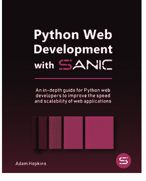
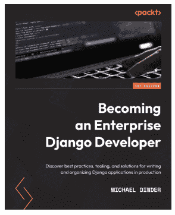

## 索引

## 符号

+   - {{ }} 语法 54
+   -  语法 54

### A

+   - access token 124
+   - Amazon EC2
+     - reference link 186
+   - APIRouter class
+     - used, for multiple routing 19-22
+   - authentication methods, FastAPI
+     - basic HTTP authentication 122
+     - bearer token authentication 122
+     - cookies 122

### B

+   - beanie library
+     - using 104
+   - bearer tokens 122
+   - Body() class 31

### C

+   - create_engine() method 93
+   - CREATE endpoint
+     - testing 163-166
+   - CRUD endpoint
+     - testing 160, 161
+   - CRUD operations
+     - about 110
+     - create 110
+     - delete 112
+     - methods 105
+     - read 110, 111
+     - routes/events.py 112-114
+     - routes/users.py 114-120
+     - update 111
+   - CRUD todo app
+     - building 37-41

### D

+   - database
+     - creating 92-97
+     - events, creating 97-99
+     - events, deleting 102-104
+     - events, reading 99, 100
+     - events, updating 101, 102

### E

DELETE endpoint
  testing 168-171
dependency injection
  about 123
  creating 123, 124
  using 123, 124
Depends class 98
deployment preparation, FastAPI applications
  about 176
  dependencies, managing 176, 177
  environment variables, configuring 177
Docker
  about 13
  deploying with 178
FastAPI applications, deploying with 178
installation link 14
setting up 13
Dockerfile
  about 14
  writing 178, 179
Docker Hub 14
Docker images
  building 180, 181
  databases, deploying 187
  deploying 186, 187
documents 104
DRY (don’t repeat yourself) 58

error handling 48-51
event document class
  updating 140-145
event document routes
  updating 140-145

### F

event planner application
  building 73, 74
event routes
  updating 136-140

FastAPI
  about 21
  authentication methods 122
  Jinja templates, using 58-67
  routing 18
  routing, example 18, 19
FastAPI application
  building 15, 16
  deploying locally 181-183
  deploying, with Docker 178
event document class and routes, updating 140-145
event planner application, building 73, 74
event routes, updating 136-140
models, implementing 74-77
routes, implementing 78
running 183-185
securing, with JWT 124, 125
securing, with OAuth2 124, 125
structuring 72, 73
updating 133
user sign-in route, updating 133-136
FastAPI Automatic Docs
  about 31
  ReDoc 34-36
  Swagger 32, 33
FastAPI responses
  about 44
  response body 44

response header 44
status codes 44, 45
filters
  about 54
  conversion filters 55
  default filter 55
  escape filter 55
  join filter 55
  length filter 55
filters, in Jinja
  reference link 56
G
Git
  about 4
  branch 8
  download link 4
  installing 4
  operations 5-8
Git documentation
  reference link 8
Google Cloud Run
  reference link 186
H
HS256 algorithm 131
HTTP exception 48
HTTPException arguments
  detail 49
  headers 49
  status_code 49
HTTP request methods 18
HTTP status codes
  reference link 45
I
if statements
  using 56
isolated development environments
  creating, with Virtualenv 9
J
Jinja
  about 54
  filters 54
  if statements, using 56
  loops 56
  macros 57
  template inheritance 58
Jinja's, template inheritance
  reference link 58
Jinja templates
  using, in FastAPI 58-67
JSON Schema 34
JSON Web Token (JWT)
  about 124
  creating 129-132
  FastAPI application, securing
    with 124, 125
  need for 124
  verifying 129-132
L
loops 56

M
macros 57
main branch 8
Microsoft Azure deployment
  reference link 186
MongoDB
  database, initializing 106-109
  documents 104, 106
  setting up 104
MongoDB atlas
  reference link 187
multiple routing
  with APIRouter class 19-22
installing 12, 13
package management with 11, 12
primary key 91
push and pull operation 14
Pydantic models
  nested models 26, 27
  used, for validating request bodies 23-26
pytest
  unit testing with 150-153
pytest fixtures
  repetition, eliminating with 153, 154
N
non-existent todo
  retrieving 51
O
OAuth2
  application, securing with 125
  FastAPI application, securing with 124
Object Document Mapper (ODM) 104
P
package management
  with pip 11, 12
Path class 30
path parameters 27-30
pip
  about 12
  basic commands 13
  installation link 13
Q
query parameters 30
R
READ endpoint
  testing 161-163
ReDoc 34-36
REST API endpoints
  CREATE endpoint, testing 163-166
  CRUD endpoint, testing 160, 161
  DELETE endpoint, testing 168-171
  READ endpoint, testing 161-163
  sign-in route, testing 158-160
  sign-up route, testing 157
  tests, writing 156
  UPDATE endpoint, testing 166-168
request bodies
  about 30, 31
  validating, with Pydantic models 23-26
response header 44
response models
  building 45-48

routes
  about 18
  event routes, implementing 83-87
  implementing 78
  user routes, implementing 78-82

user authentication
  handling 132, 133
user passwords
  hashing 125-129
user sign-in route
  updating 133-136
uvicorn tool 18

### S

schemas 22
Session class
  methods 92
sign-in route
  testing 158-160
sign-up route
  testing 157
SQLModel
  rows 91, 92
  Session class 92
  setting up 90
  tables 90, 91
Swagger 32, 33

### V

validation 23
variable block 54
Virtualenv
  used, for creating isolated
    development environments 9
virtual environment
  about 9
  activating 9, 10
  creating 9
  deactivating 10, 11

### T

template inheritance 58
test coverage report
  generating 171-174
test environment
  setting up 154-156

### U

unit testing
  with pytest 150-153
UPDATE endpoint
  testing 166-168

Packt.com

订阅我们的在线数字图书馆，即可完全访问超过 7,000 本书籍和视频，以及领先的行业工具，帮助您规划个人发展并推进职业生涯。更多信息，请访问我们的网站。

## 为什么订阅？

- 花更少时间学习，花更多时间编码，借助来自 4,000 多名行业专业人士的实用电子书和视频
- 使用专为你打造的技能计划改善学习
- 每月免费获得一本电子书或视频
- 完全可搜索，便于轻松访问重要信息
- 复制粘贴、打印和书签收藏内容

您知道 Packt 为每本出版的书籍都提供电子书版本，文件格式包括 PDF 和 ePub 吗？您可以在 packt.com 升级到电子书版本，作为印刷书籍的客户，您有权享受电子书折扣。更多详情请联系 customercare@packtpub.com。

在 www.packt.com，您还可以阅读大量免费技术文章，订阅各类免费通讯，并获得 Packt 书籍和电子书的独家折扣和优惠。

## 其他您可能喜欢的书籍

如果您喜欢这本书，您可能对 Packt 的以下其他书籍感兴趣：

### Python Web Development with Sanic

Adam Hopkins

ISBN: 978-1-80181-441-6

- Understand the difference between WSGI, Async, and ASGI servers
- Discover how Sanic organizes incoming data, why it does it, and how to make the most of it
- Implement best practices for building reliable, performant, and secure web apps
- Explore useful techniques for successfully testing and deploying a Sanic web app

### Becoming an Enterprise Django Developer

Michael Dinder

ISBN: 978-1-80107-363-9

- Create and configure a proof-of-concept Django project on a local machine
- Understand the steps and tools used to scale up a proof-of-concept project to production without going too deep into specific technologies
- Explore core Django components and how to use them in different ways to suit your app's needs
- Find out how Django allows you to build RESTful APIs
- Write and run test cases using the built-in testing tools in Django

## Packt is searching for authors like you

如果您有兴趣成为 Packt 的作者，请访问 authors.packtpub.com 并立即申请。我们已与成千上万的开发人员和技术专业人士合作，就像您一样，帮助他们与全球技术社区分享见解。您可以提交通用申请、申请我们正在招聘作者的特定热门主题，或提交您自己的想法。

## Share Your Thoughts

现在您已完成 *Building Python Web APIs with FastAPI*，我们很想听听您的想法！如果您是在 Amazon 购买的本书，请点击此处直接前往本书在 Amazon 的评论页面并分享您的反馈，或在您购买的网站上留下评论。

您的评论对我们和技术社区非常重要，将帮助我们确保提供优质内容。

