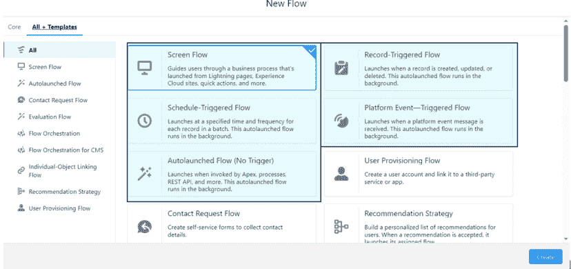
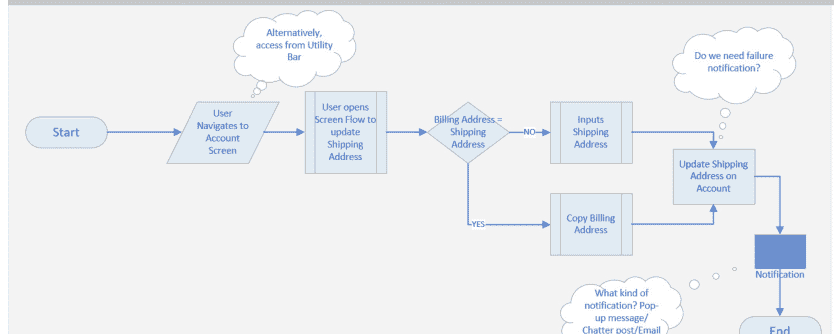
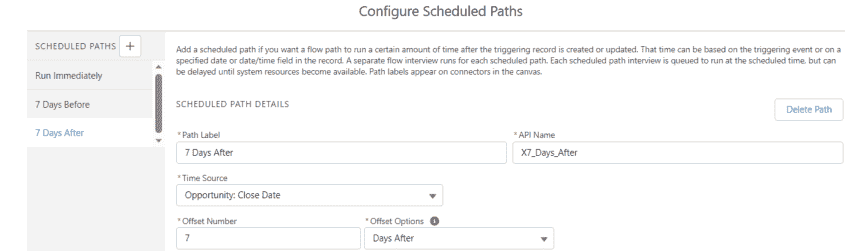
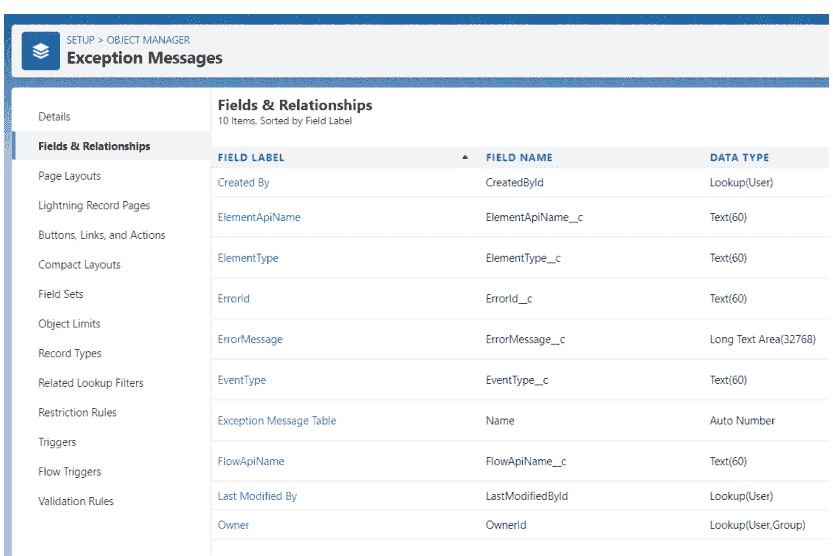
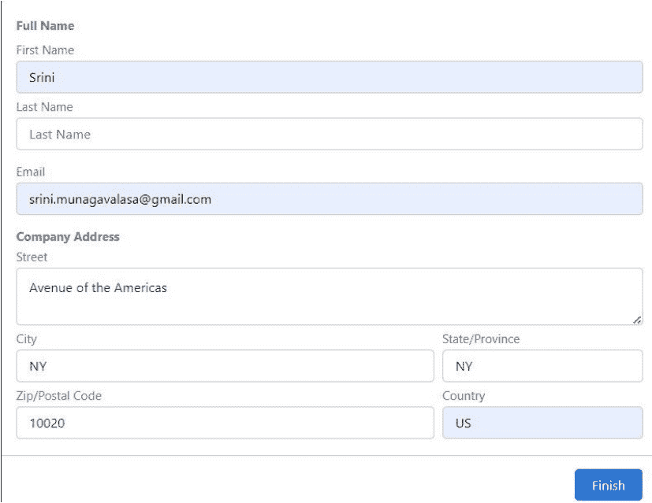
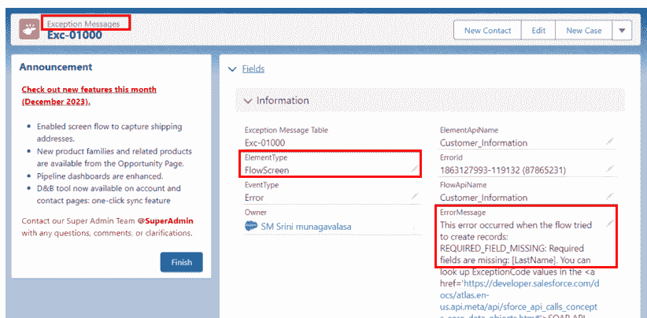
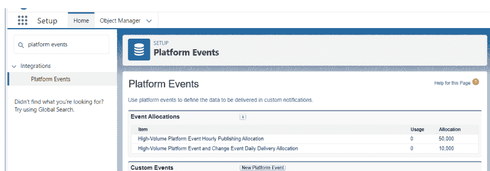
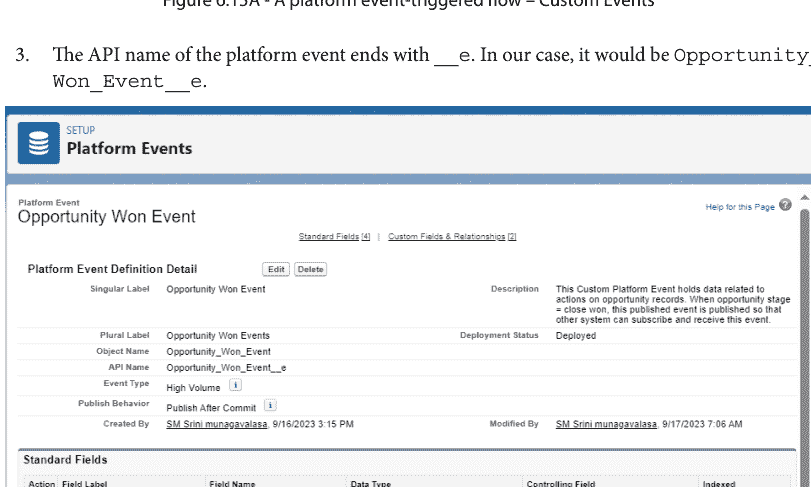
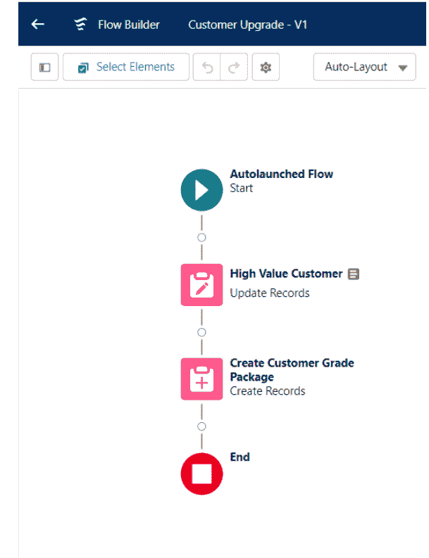
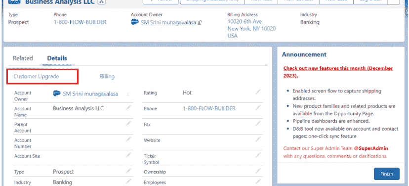

# Salesforce Flow 类型

本章将探讨五种基本流程类型以自动化我们的业务流程。你将深入了解每种流程类型的场景——屏幕流、记录触发流、计划触发流、平台事件触发流和自动启动流。我们可以创建允许用户通过用户界面交互的流程，由屏幕流启动，并基于数据操作语言 (DML) 操作自动运行。我们将探讨可安排在未来时间及频率运行的计划流，以及基于平台事件消息触发的平台事件触发器。

我们将涵盖以下 Salesforce 流程部分：

- Salesforce 中的五种基本流程类型：
  - 探索屏幕流
  - 探索记录触发流
  - 探索计划触发流
  - 探索平台事件触发流
  - 探索自动启动流
- 成功实践技巧

我们将详细回顾每种自动化流程类型，并提供实用示例，探讨哪种流程类型适合自动化你的业务流程。你将学习每种流程及其概念，以便在开始使用 Flow Builder 规划 Salesforce 业务流程自动化时做出明智决策。你很少只使用一种流程类型。你的业务很复杂，业务流程也同样复杂，因此为了简化用户面对的复杂场景，你会使用不止一种流程类型。这些复杂场景将在本书第 3 部分中介绍，我们在那里探索流程编排工具。现在，在本章中，让我们专注于每种单独的流程类型，一次一个，并尝试掌握概念。

让我们更详细地查看每一种。

要在 Salesforce 中查看流程，请点击 **New Flows** 和 **All + Templates**，如图 6.1 所示。

**Core** 选项卡会显示你基本流程，但以下视图 (**All + Templates**) 将为你提供基本流程，以及 Salesforce 或通过 AppExchange 提供的第三方供应商提供的所有模板。探索开箱即用的各种模板，并查看它们是如何开发的。探索、理解并重新利用这些模板是很好的做法，可以缩短你的开发时间。

图 6.1 - 五种基本流程类型

现在，让我们通过示例详细了解每种流程类型。要创建特定流程类型，请选择流程并点击 **Create**。

## 屏幕流

屏幕流帮助我们实现功能，用户能够通过 Salesforce 界面以交互方式执行其业务流程，从而提供出色的用户体验。这些屏幕流可通过快速操作或从 Lightning 页面启用。

以下是创建屏幕流的步骤：

1. 使用 Flow Builder 工具创建屏幕流。
2. 根据你的需求添加元素——数据、逻辑和屏幕元素。
3. 添加计划在画布上使用的资源，例如变量、屏幕组件和元素。
4. 在使用画布上的自由形式样式时手动连接这些元素，而在自动布局中，随着你将元素添加到屏幕布局，它们会自动连接。随意尝试，选择适合你的元素。

图 6.2 - 更新客户收货地址（流程）

此流程易于遵循且不言自明。在团队同意业务流程后，你可以使用屏幕流通过简单点击在 Salesforce 中创建它。当你开始流程时，例如通过点击按钮（或链接），流程运行屏幕元素，流程保持在该元素上并等待输入。根据业务流程的复杂性，你的流程可能有多个屏幕，最后是保存或取消按钮。完成此最终操作后，你的屏幕流结束。

以下步骤是我在 Salesforce 中创建此屏幕流的方式，也显示在图 6.3 中（请结合图 6.2 使用并跟随流程）：

1. 从 Flow Builder 创建新的屏幕流。
2. 从账户记录获取账单地址数据——使用 Get Records 数据元素。
3. 添加屏幕元素以捕获收货地址。
4. 添加决策元素以评估账单和收货是否相同。
5. 使用两个分配资源基于上一步的决策进行分配。如果已勾选，则将账单地址复制到变量；否则保留屏幕输入。
6. 使用收货地址更新账户记录。
7. 添加操作元素以通知用户地址更新。
8. 可选地，对于复杂流程，我们可以添加异常捕获和通知机制。

图 6.6 - 记录触发流 – 配置计划路径

**注意**

当你创建自动启动流时，画布上不可用屏幕元素供我们添加。自动启动流在后台运行，无需用户交互，因此我们不需要屏幕元素。

为了让我们的记录触发流运行，让我们来看一个简单场景。

## 记录触发流的业务场景

在此场景中，如果 1) 高价值机会达到某个阶段，或 2) 机会属于顶级客户，则销售分析师将在机会无活动三天后立即收到提醒任务创建。如果七天无活动，则会向账户所有者发送升级。

让我们看看记录触发流的实际运行情况。要创建它，我们选择触发流程的机会对象，然后配置触发器，设置条件逻辑的入口条件，并选择在记录保存后运行的选项。在以下场景中，我们使用 Create Records 元素创建两个任务，并使用 Email Alert 操作进行升级：

- 通知/升级：
  - 创建任务 – **Create Records** 元素：创建任务并分配给销售分析师
  - 创建任务 – **Create Records** 元素：创建任务并分配给销售分析师（未来日期操作）
  - 创建电子邮件通知 – **Email Alert**：为账户经理创建电子邮件警报（未来日期操作）
- 异常 – 地址失败：
  - 创建 **Fault** 路径：始终创建故障路径以捕获异常

记录触发流帮助我们自动化常见功能，如通知、创建任务和相关记录。它们基于记录状态自动运行，如果满足条件，则触发并在后台完成工作。始终计划捕获异常以及如何处理它们。在前述场景中，我们有一个故障路径，我们会在 Chatter 上发布/向管理员发送电子邮件，以便我们第一时间了解问题。

在下一节，让我们探索计划触发流。

## 计划触发流

这些流程基于你为每个记录批次设定的指定时间和频率启动。到了时间，自动启动流在后台运行。

要创建计划触发流，我们首先设置计划。

这些流程可以安排并在后台从计划开始日期、开始时间运行，并设置频率——一次、每天或每周（见图 6.8）。

你可以通过从画布上的 **Record-Triggered Flow** 元素点击 **Add Scheduled Paths (Optional)** 访问此页面。

此流程在收到平台事件消息时运行。平台事件用于交换实时事件数据，这些事件可以来自 Salesforce 内部，也可以来自外部系统。此自动启动的流程在后台运行，并在收到平台事件消息时被触发。

让我们来看一个平台事件触发器。在此场景中，我们将捕获屏幕流程执行中的错误。我们使用 Salesforce 提供的标准平台事件——流程执行错误事件。此标准平台事件会通知订阅者与屏幕流程执行相关的任何错误。请注意，它不会捕获其他流程类型的事件通知。

# 平台事件触发器的业务场景

这是一个非常简单的场景，用于理解和掌握平台事件触发器的工作原理。我们的服务专员使用屏幕流程捕获客户联系信息。有时，服务专员会忘记添加客户联系人的姓氏。由于在我们的场景中姓氏是必填字段，此流程会失败。我们将捕获流程错误消息，并将其插入到其中一个自定义对象中。

有关流程执行错误事件的更多详细信息，请参阅 https://developer.salesforce.com/docs/atlas.en-us.platform_events.meta/platform_events/sforce_api_objects_flowexecutionerrorevent.htm。

以下是为上述场景创建流程的步骤：

- 1. 第一步是创建一个名为**异常消息**的自定义对象，用于捕获流程错误消息（参见图 6.10）。

我创建了一个自定义对象**异常消息**，其字段如下面的屏幕截图所示。该对象保存错误消息，技术团队可以使用这些消息来排查问题。

# 图 6.10 - 平台事件触发的流程 – 异常消息对象

我们使用了名为**流程执行错误事件**的标准平台事件：https://developer.salesforce.com/docs/atlas.en-us.platform_events.meta/platform_events/sforce_api_objects_flowexecutionerrorevent.htm

- 2. 接下来，我们使用**流程执行错误事件**作为**事件**类型，创建一个平台事件触发的流程（参见图 6.11）。该流程订阅指定平台的**流程执行错误**事件。当收到屏幕流程平台事件消息时，该流程会被触发运行。

# 编辑创建记录

使用流程中的值创建 Salesforce 记录。

# 流程异常日志 (Flow_Exception_Log)

要创建的记录数
单个
多个

如何设置记录字段
使用记录中的所有值
使用单独资源和字面值

# 创建此对象的记录

* 对象
异常消息

# 为异常消息设置字段值

字段 ElementApiName__c 值 $Record > 流程元素 API 名称

字段 ElementType__c 值 $Record > 流程元素类型

字段 ErrorId__c 值 $Record > 流程错误 ID

字段 ErrorMessage__c 值 $Record > 流程错误消息

字段 EventType__c 值 $Record > 流程事件类型

取消 完成

图 6.12 - 平台事件触发的流程 – 流程异常日志

现在，让我们看看我们的平台事件触发流程的实际运行情况：

- 1. 我创建了一个屏幕流程来捕获联系人的名字、姓氏、电子邮件和地址。我运行了该流程并添加了客户联系信息，但屏幕上有一个字段未填写。我故意跳过了姓氏字段，以生成流程异常（参见图 6.13）：

图 6.13 - 平台事件触发的流程

由于**姓氏**是必填字段，此流程在创建联系人记录时会抛出异常消息。我们捕获此异常，并使用异常详细信息更新自定义对象。

我们可以在**异常消息**对象中看到作为记录捕获的错误消息。您的技术团队可以定期查看这些来自异常对象的消息，并修复根本问题。此外，我们可以创建一个记录触发的流程，并通过 Chatter 或电子邮件转发此消息，以处理此错误/问题（参见*图 6.14*）。

# 图 6.14 - 平台事件触发的流程

2. 平台事件的另一个示例是，当商机关闭时发布事件消息，以便合同管理系统（可以是内部的，也可以是外部的，例如 Oracle、SAP 等）订阅此自定义平台事件，从而启动后续步骤（即创建合同）。

您可以通过“设置 | 集成 | 平台事件 | 新建平台事件”创建自定义平台事件。

单击“新建平台事件”以创建您的自定义事件。在以下示例中，我创建了一个平台事件，其标签为“商机赢单事件”，并带有两个新的自定义字段：“商机名称”和“商机阶段”。

平台事件的结构类似于我们的自定义对象（参见图 6.15A 和图 6.15B）。

# 图 6.15A - 平台事件触发的流程 – 自定义事件

3. 平台事件的 API 名称以 __e 结尾。在我们的示例中，它将是 Opportunity_Won_Event__e。

# 图 6.15B - 平台事件触发的流程 – 示例自定义事件字段

图 6.17 - 自动启动的流程（无触发器）：客户升级

由于我们希望此流程由客户经理自行决定启动，因此在此场景中，我们在账户页面的“详细信息”部分下创建了一个名为“客户升级”的自定义链接。因此，当我们的客户经理决定升级时，只需单击此链接，我们的自动启动流程（无触发器）就会在后台无缝处理业务（参见图 6.18）。

图 6.18 - 用于触发自动启动流程（无触发器）的客户升级链接

您也可以通过自定义按钮实现同样的效果。请在自己的某个开发组织中亲自尝试一下。另外，您是否注意到屏幕右侧的“公告”窗口？这是屏幕流程的另一个示例。这对于与用户沟通非常有帮助。既然没有用户交互，这怎么会是屏幕流程呢？

如果您的组织中有大量流程，则有一种简单的方法可以识别自动启动的流程（无触发器）。

您知道我们可以为流程创建列表视图吗？借助列表视图，我们可以轻松识别流程类型。进程类型与触发器机制的组合将提供与流程类型相关的信息。

流程类型 = 进程类型 + 触发器：例如，进程类型 = 自动启动的流程，触发器 = 平台事件，则该流程就是平台事件触发的流程。

类似地，从下面的列表视图中，当“进程类型”为“自动启动的流程”且“触发器”为 null 时，我们可以识别出自动启动的流程（无触发器）（参见图 6.19）：

- 如果必须执行保存后操作（例如发布到 Chatter、发送电子邮件、更新相关记录或汇总汇总），请使用用户保存后（操作和相关记录）。
- 始终添加一个路径来确认流程已完成，无论是显示成功消息还是错误消息。这将帮助您在流程失败时及时获取信息以修复问题。
- 如果您正在自动化复杂的业务逻辑，请寻求架构师和首席开发人员的帮助。在我看来，流程 80% 是点击操作且无需编码，但其余 20% 需要您充分理解代码。想象一下，您正在更新相关对象、使用平台事件、在循环中进行数据操作等。

了解实用技巧不仅能帮助我们正确做事，还能节省宝贵的项目时间。我还可以继续添加更多技巧，但让我们在此结束本节，并对本章进行总结。

# 总结

本章探讨了可用于自动化业务流程的五种基本流程类型。我们通过屏幕截图详细讨论了每种流程类型。我们采用了简化的场景，并逐步解释每个步骤，探讨了每种流程背后的概念和原理。我希望您现在对屏幕流程、记录触发的流程、计划触发的流程、平台事件触发的流程和自动启动的流程有了更好的理解，并了解它们如何满足您的业务需求。通过练习，您将能够熟练地在您的组织中创建复杂的 Salesforce 流程并自动化您的业务流程。

在下一章中，您将学习如何通过流程共享记录，而这些记录无法通过除 Apex 编码以外的任何其他方式共享。借助流程，我们拥有了一个强大的功能，您无需借助代码即可执行复杂的数据共享。您将看到并探索一个真实的业务场景。

# 问题

- 1. 解释不同类型的流程。
- 2. 记录触发的流程的一个良好用例是什么？
- 3. 如何区分自动启动的流程（无触发器）与其他自动启动的流程？
- 4. 我们何时使用保存后触发器，为什么使用它们？
- 5. 从应用内的任何页面为用户提供屏幕流程的最佳方式是什么？
- 6. 我们如何让您的用户访问流程？

