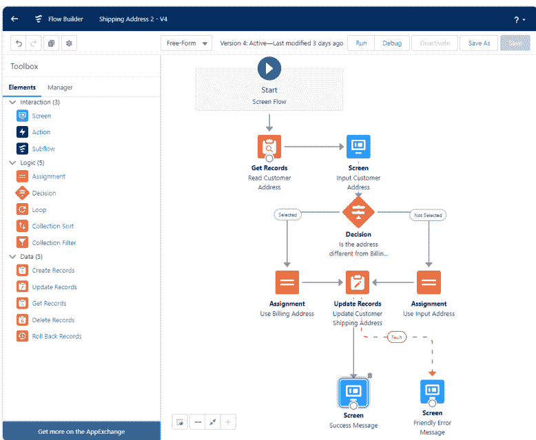
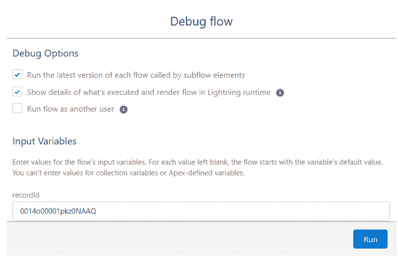
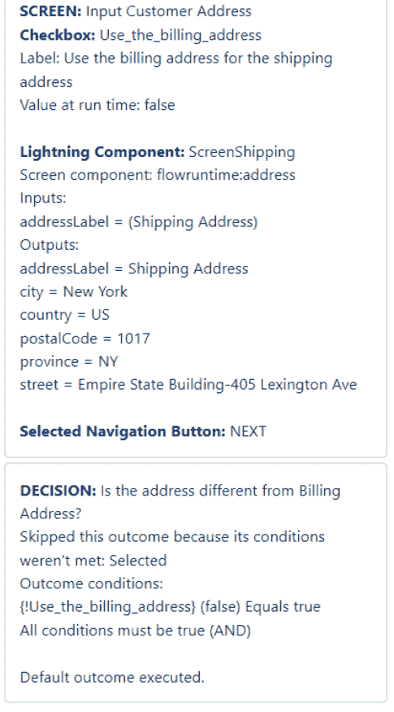
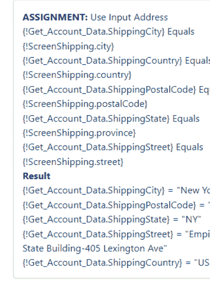
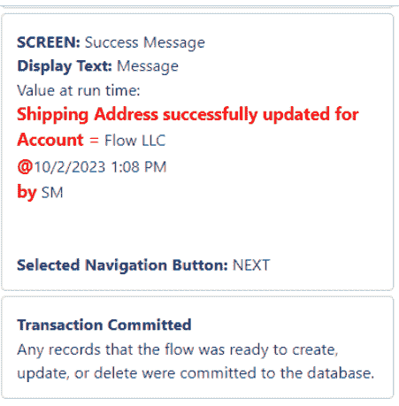
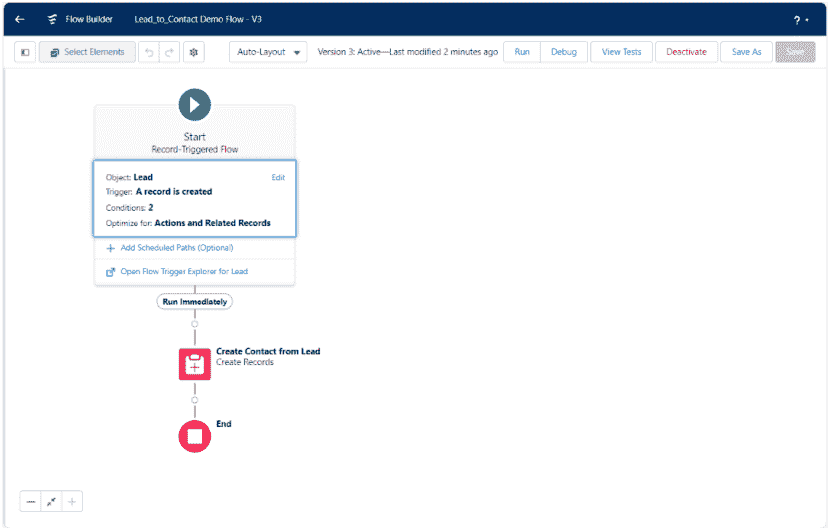
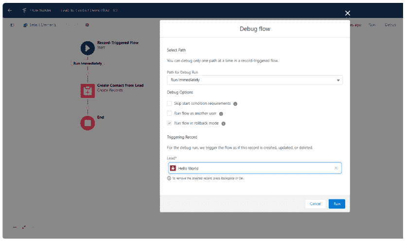
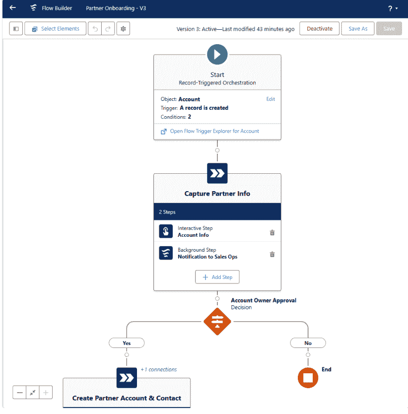

# 了解流程调试窗口

从 Flow Builder 进行调试只需简单的点击即可完成。我们无需使用跟踪标志创建调试日志然后再浏览 **调试日志详细信息。**

**什么是调试日志？**
调试日志记录数据库操作和系统进程，如验证、分配规则等，以及执行事务时的任何错误。系统为用户执行事务而生成调试日志。你可以指定一个包含事务开始时间的跟踪标志，并设置开始和过期日期。调试日志提供更详细的信息，你需要具备一定的技术技能才能解读这些日志。

流程调试不仅仅是在我们遇到问题时使用。这是一个非常有用的工具，可以让我们测试功能块并确保其端到端按预期工作。调试窗口捕获的详细信息让我们可以看到流程是如何运行的。这提供了流程执行情况的分步结果 – 它是如何触发的，哪些操作正在进行，结果如何。我们可以微调流程中的步骤并修复任何故障，优化单个步骤，自定义错误消息，添加信息消息等等。

让我们来看一下调试窗口的关键功能。以下是从开始到结束的步骤：

1. 要访问流程调试，请在 Flow Builder 中打开流程。
2. 点击 **Debug**。
3. 设置调试选项和输入变量。
4. 通过点击 **Next** 滚动屏幕（如果有多个屏幕），并在最后一个屏幕上选择 **Finish** 结束流程。
5. 你可以用相同的输入值再次调试流程，或通过更改输入值进行调试：
   A. **Change Inputs**：选择此项以使用不同的场景（输入值）调试流程。
   B. **Run Again**：选择此项以使用相同的输入重新运行。

# 简单的实际场景 – 捕获送货地址

分析师将能够使用 **Screen Flow** 捕获送货地址。

让我们逐步介绍一个理想路径场景。在此场景中，一切都如愿以偿地神奇运行。确保我们输入有效的值，以便我们的流程从头到尾正常工作。

让我们回顾一下我们在 *第 6 章* 中讨论的场景。这是我们的业务流程：

1. 用户进入账户屏幕。
2. 访问并运行屏幕流程。
3. 如果送货地址与账单地址相同，则将账单地址复制到送货地址。
4. 如果不同，则收集并输入送货地址。
5. 保存记录。
6. 在屏幕上显示成功或错误消息。

我们使用 **Screen Flow** 来启用此功能。在我们的场景中，在本节中，我们将从 Flow Builder 本身测试此功能。

打开你的流程（在我们的示例中，它是 **Screen Flow: Shipping Address Update**，如图 8.1 所示）并点击 **Debug**：



图 8.1 – Screen Flow: Shipping Address Update

流程上的 **Debug** 按钮打开 **Debug flow** 窗口。在这里，我们可以设置调试选项和输入变量，如图 8.2 所示：



图 8.2 – Debug flow 窗口

我们有以下选项：

- 运行最新版本。这在大多数情况下都是如此，除非你有特定条件需要测试旧版本。
- 显示已执行的详细信息并在 Lightning 运行时中呈现流程。我已勾选此项，以便我可以看到流程执行步骤的详细信息。
- 以其他用户身份运行流程。确保你以不同的角色进行调试。作为管理员，你将拥有对 Salesforce 的完全访问权限，可能不会遇到任何问题。很多时候，主要的罪魁祸首可能是你的用户对数据的访问权限。
- **输入变量：** 这些是触发屏幕流程的记录的 recordId 变量。对于我们的用户，我们通过 **Custom** 按钮、自定义 URL 等提供此信息。由于我们正在 Flow Builder 中模拟此操作，我们需要提供此记录 ID。在我们的示例中，这将是我们账户记录的 18 位字符 ID。


- **获取记录（GET RECORDS）：**用于读取客户地址的流程元素。它使用查询来获取所有符合输入条件的客户记录。由于客户记录 ID 是唯一的，因此输出中只有一条记录。对于复杂的屏幕流，可能需要检索多条记录，并创建一个用于处理多条记录的流程：

# 调试详细信息

``` 
**面试开始方式**
SM Srini munagavalasa (005460000023WZk) 启动了流程面试。
运行流程的 API 版本：58
此流程的部分变量在面试开始时已设置。
recordId = 0014o00001pkz0NAAQ

**获取记录（GET RECORDS）：**读取客户地址
查找所有符合以下条件的 Account 记录：
Id 等于 {!recordId} (0014o00001pkz0NAAQ)
将以下字段的值存储到
Get_Account_Data：Description、BillingCity、ShippingStreet、Name、BillingCountry、BillingStreet、ShippingPostalCode、ShippingCountry、ShippingCity、BillingPostalCode、ShippingState、Id、BillingState
**结果**
成功找到记录。

**事务已提交**
流程准备创建、更新或删除的所有记录均已提交到数据库。
```

图 8.6A – 面试开始

- **屏幕（SCREEN）：输入客户地址（Input Customer Address）：**此处将呈现**输入客户地址（Input Customer Address）**屏幕元素，以供输入。
- **决策（DECISION）：地址是否不同于账单地址？**：此决策元素将帮助我们确定该地址是否不同于账单地址。在本例中，结果为 **false**，这意味着我们不希望将账单地址复制到收货地址：

# 调试详细信息



图 8.6B – 面试：输入屏幕和决策元素

- **赋值（ASSIGNMENT）：使用输入地址（Use Input Address）：**根据捕获收货地址的决策结果，屏幕输入值将被赋给以下变量：

# 调试详细信息



图 8.6C – 面试和赋值

- **更新记录（UPDATE RECORDS）：更新客户收货地址（Update Customer Shipping Address）：**我们获取前面赋值中的值，并使用**更新记录（UPDATE RECORDS）**数据元素将其保存到数据库中。

- **事务已提交：**由于未遇到任何错误或问题，新的收货地址已成功保存到客户记录中：

# 调试详细信息



图 8.6E – 面试完成

希望现在你已经对流程的运行方式有了一定了解，并能查看每个已执行步骤的详细信息。该功能位于 Flow Builder 中，易于阅读和理解。你可以准确知道流程在何处以及为何失败。

下一节中，我们将了解执行流程时可能遇到的错误消息。

# 了解流程错误

到目前为止，我们已经了解了顺利执行的路径，并理解了流程的行为方式。但是，即使进行了谨慎的规划、全面的设计和测试，也始终会有一些注定会失败的场景和边缘情况，给团队带来麻烦。

如果我们不规划和设计流程，用户就会遇到异常，却不知道失败原因，或者只能看到没人能理解的晦涩消息。他们现在该怎么办？感到沮丧吗？

为了解决这个问题，我们需要为这些异常做好规划。问题总会发生；如果我们准备好及时处理问题并修复根本原因，就能创造更好的用户体验。

图 8.7 中包含了该电子邮件：

```
主题：流程“Lead_to_Contact Demo Flow”执行期间发生错误：
流程尝试创建记录时发生此错误……

FlowApplication <info@jp.salesforce.com>
发送至 srini.munagavalasa@gmail.com

你正在查看一条附加的消息。Gmail 无法验证附加消息的真实性。

请在 Flow Builder 中调试失败的面试，面试 GUID 为：609532f6a7cbe0a9a7f13551759718af670a333-3adb

错误元素 Create_Contact_from_Lead (FlowRecordCreate)。
流程尝试创建记录时发生此错误：REQUIRED_FIELD_MISSING：缺少必填字段：[Security_ID__c]。
你可以在 SOAP API Developer Guide 中查找 ExceptionCode 值。

流程详细信息
流程 API 名称：Lead_to_Contact_Demo_Flow
类型：自动启动流程
版本：3
状态：活动
组织：mufg (00D4600000113Dg)

流程面试详细信息
面试标签：Lead_to_Contact Demo Flow 10/3/2023 1:03 PM
面试 GUID：609532f6a7cbe0a9a7f13551759718af670a333-3adb
当前用户：SM Srini munagavalasa (005460000023WZk)
开始时间：10/3/2023 1:03 PM
持续时间：0 秒

面试开始方式
此次调试运行是在模拟创建潜在客户记录的情况下触发的。
SM Srini munagavalasa (005460000023WZk) 启动了流程面试。
运行流程的 API 版本：58
此流程的部分变量在面试开始时已设置。
SRecord = Lead (00Q4600000LpNFEEA3)

启动条件要求：
触发记录满足条件要求。
进入条件
1. Status (Working - Contacted) 等于 Working - Contacted
2. AnnualRevenue (2000000.0) 大于 1000000.0
逻辑：所有条件都必须为 true（AND）

创建记录（CREATE RECORDS）：从潜在客户创建联系人
创建一条 Contact 记录，其中：
Department = Sales
Email = {!SRecord.Email} (dr.hello@universe.llc)
FirstName = {!SRecord.FirstName} (Hello)
LastName = {!SRecord.LastName} (World)
MailingCity = {!SRecord.City} (New York)
MailingCountry = {!SRecord.Country} (USA)
MailingPostalCode = {!SRecord.PostalCode} (100001)
MailingState = {!SRecord.State} (NY)
MailingStreet = {!SRecord.Street} (1001 battery park)
结果
创建记录失败。

发生错误：流程尝试创建记录时发生此错误：
REQUIRED_FIELD_MISSING：缺少必填字段：[Security_ID__c]。
你可以在 SOAP API Developer Guide 中查找 ExceptionCode 值。

事务已回滚
由于发生错误，流程准备创建、更新或删除的所有记录均未提交到数据库。

Salesforce 错误 ID：648870654-37446 (513355057)
```

图 8.7 – 流程失败电子邮件消息详细信息（发送给管理员的示例电子邮件通知）

如前面的屏幕截图所示，其中包含以下内容：

- 一条错误消息
- 面试所执行的流程元素的详细信息
- 用于在 Flow Builder 中查看失败流程面试的链接

有几种故障排除方法可以修复这些用户错误。其中大多数问题都可以相对快速地解决。你需要了解这些问题是什么，以及它们发生在流程的哪个阶段。

# 故障排除选项

如果你持续分配足够的时间处理以下选项，大多数流程问题都可以主动或及时得到解决：

1. Flow Builder 中的 **调试（Debug）**选项是我们最好的选择。我们可以实时查看流程执行的详细信息，可以设置输入变量，并根据需要重新启动流程。在适用的情况下，可以通过更改输入值并以不同用户身份运行流程来尝试不同场景。
2. **流程 URL：**我们可能通过**自定义**按钮或自定义链接分发流程；请检查其底层流程。在大多数情况下，可能是没有向底层流程传递正确的变量，或者流程发生了更改但新版本尚未激活。此外，如果重命名了流程，请确保流程 URL 使用了流程新的 API 名称。
3. **流程错误电子邮件收件人：**当流程面试失败时，系统会生成一封详细的电子邮件，并发送给最后修改该流程的管理员。请将其转发给三级支持人员或技术团队，以便他们更有效地解决问题。

> **注意**
> 要配置 Apex 异常电子邮件收件人，请执行以下操作：
> - 在 **设置 | 流程自动化设置** 中，将 **发送流程错误电子邮件（Send Process or Flow Error Email）** 设置为 **Apex 异常电子邮件收件人（Apex Exception Email Recipients）**。
> - 在 **设置 | 电子邮件 | Apex 异常电子邮件** 中，设置 Salesforce 用户电子邮件地址或外部电子邮件地址。

> **重要提示**
> **不要**使用浏览器的**后退**按钮在流程中导航。这样做可能导致流程与 Salesforce 之间的数据不一致。

现在，我们已经了解了流程错误及其故障排除方法，下面来看一个简化的实际场景。


# 实际场景——流程失败示例

场景：当潜在客户的状态更新为“正在联系”，且年收入大于 100 万美元时，创建一个联系人。我们需要通过流程在联系人上添加一个名为 `security` 的必填字段，并且该字段应包含 10 个字符。为了测试不同的变体，我们将在流程中对该值进行硬编码。

创建一个包含两个条件的记录触发流程：状态 = “正在联系”，且年收入大于 100 万。

当满足前述条件并且潜在客户完成更新后，此触发流程会立即运行。请参见图 8.8：



图 8.8——记录触发流程：潜在客户转联系人流程

单击“调试”，启动流程调试。这将打开“调试流程”窗口；请参见图 8.9。流程会立即运行，并处于回滚模式。这意味着流程调试过程会确保流程结束时，对数据库执行的任何操作（例如创建、更新或删除）都会回滚，而不会提交到数据库。默认情况下，此选项处于禁用状态，并且在调试模式下我们只有回滚选项。这样可以确保不会将任何数据保存到数据库中。

我添加了一个现有潜在客户，该潜在客户的数据将用于运行流程（请参见图 8.9）：

将潜在客户姓名设置为 Hello World。

我创建了一个与该潜在客户具有相同姓氏和电子邮件地址的联系人。这样做是为了在流程调试中捕获重复异常：



图 8.9——潜在客户转联系人：“调试流程”窗口

单击“运行”后，入口条件得到满足，并执行流程中的“创建记录”元素。正如前文所述，由于存在一个具有相同姓氏和电子邮件地址的联系人，流程因联系人记录重复而出错，执行随即结束。请参见图 8.10。我们可以看到，在流程失败的元素旁边显示了一个“否”图标：

图 8.10——由于联系人记录重复，流程失败

我解决了联系人重复问题，然后针对同一个潜在客户重新运行流程。但随后我移除了 `security` 字段的硬编码值，而该字段是创建联系人时的必填字段。

如第 9 章所述，要创建新的编排，请在“新建流程 | 全部 + 模板”中单击“新建流程编排”，然后选择“开始记录触发编排”：



图 10.5A——合作伙伴入职——流程编排

- 工作 123、124
- **流程**
  - 注意事项 44
  - 设计提示 116、117
  - 与流程编排的比较 122
- **流程，Salesforce**
  - 访问 56、57
  - 自动启动流程（无触发器）56、77
  - 探索 56
  - 平台事件触发流程 56、68、69
  - 实用提示 80、81
  - 记录触发流程 56、61
  - 计划触发流程 66-68
  - 计划触发流程 56
  - 屏幕流程 56-58
- **用于触发业务流程的流程**
  - 后台自动化流程 41
  - 交互式体验流程 41
- **FSD 任务大纲**
  - 开发 19、20
- **功能需求** 16
  - 示例 16
  - 自动化的成功提示 21
- **功能规格说明文档（FSD）** 15
- **自动化功能任务**
  - 识别 17、18

## I

- **输入变量** 98
- **交互式体验流程** 41、42
  - 审批流程 41
  - 自动启动流程 41
  - Lightning 组件 42
  - 屏幕流程 41
  - Visualforce 页面 42

## K

- **了解你的客户（KYC）** 16

## L

- **Lightning 组件** 42
- **Lightning Web 组件（LWC）** 56
- **列表视图控件（LVC）** 25

## M

- **托管服务提供商（MSP）** 8
- **市场开发基金（MDF）** 8
- **重大非公开信息（MNPI）** 42
- **最小可行产品（MVP）** 16、31

## O

- **执行顺序（OOE）** 47-49
- **组织范围默认值（OWD）** 84

## P

- **合作伙伴注册** 140
  - 流程、场景 140、141
- **合作伙伴关系管理（PRM）** 8
- **合作伙伴用户入职流程** 8-10
- **平台事件触发流程** 42、56、68、69
  - 业务场景 69-71
  - 工作 72-76
- **潜在自动化步骤**
  - 识别 26
- **实际场景**
  - 测试 91-93

