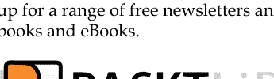

# 干净数据 - 数据科学应对脏数据的策略


## 鸣谢

**作者**
Megan Squire

**审阅者**
J. Benjamin Cook
Richard A. Denman, Jr.
Oskar Jarczyk

**策划编辑**
Akram Hussain

**收购编辑**
Harsha Bharwani

**内容开发编辑**
Mamata Walkar

**技术编辑**
Nilesh Mangnakar

**校对编辑**
Puja Lalwani
Aditya Nair
Stuti Srivastava

**项目协调员**
Shipra Chawhan

**校对**
Stephen Copestake
Safis Editing

**索引**
Priya Sane

**制作协调员**
Shantanu N. Zagade

**封面工作**
Shantanu N. Zagade

## 关于作者

**Megan Squire** 是 Elon University 计算科学教授。她在过去二十年里一直在收集和清理脏数据。她也是 `FLOSSmole.org` 的负责人，这是一个研究项目，旨在收集数据并分析数据，以了解自由、自由和开源软件是如何制作的。

## 关于审阅者

**J. Benjamin Cook** 在内布拉斯加林肯大学学习社会学后，从哈佛大学应用计算科学研究所获得了计算科学与工程硕士学位。目前，他正在帮助构建体育软件公司 Hudl 的数据科学团队，该公司的使命是捕捉并为体育中的每一刻带来价值。当他不学习所有关于数据的事情时，Ben 会陪伴他的女儿们和他美丽的妻子 Renee。

**Richard A. Denman, Jr.** 是 Numb3rs 的高级顾问，拥有超过 30 年为主要公司提供数据分析、数据科学、优化、流程改进和信息技术服务方面的经验。他在 25 年以上的时间里一直是计算机协会（ACM）和电气和电子工程师协会（IEEE）的成员。他也是运筹学和管理科学研究所（INFORMS）和美国质量学会（ASQ）的成员。

我要感谢我的妻子 Barbara、我的儿子 Ashford 和我的女儿 Addie 对本书出版的支持。

**Oskar Jarczyk** 从波兰-日本信息技术学院毕业，获得计算机科学（主修数据库）工程硕士学位。在从事三年商业工作后，他重返学术界，成为社会信息学领域的博士生。

他的学术工作与网络智能类别的问题相关，尤其是在自由/自由开源软件（FLOSS）和协作创新网络（COINs）方面。他专门分析在 GitHub 门户上开发者的开源软件团队的工作质量。与 WikiTeams 研究团队的同事一起，他在创建 MongoDB 和 MySQL 数据集时每天都处理“干净数据”的问题。它们后来被成功用于 R 和 Python 语言中的 FLOSS 科学分析。

业余时间，Oskar 阅读大数据书籍并练习剑道。

## www.PacktPub.com

## 支持文件、电子书、折扣优惠等

有关您书籍的支持文件和下载，请访问 www.PacktPub.com。

您知道 Packt 为出版的每本书都提供电子书版本，附带 PDF 和 ePub 文件吗？您可以在 www.PacktPub.com 升级到电子书版本，作为印刷书籍客户，您有权享受电子书副本的折扣。欲了解更多详情，请联系 service@packtpub.com。

在 www.PacktPub.com，您还可以阅读免费技术文章的合集，订阅各种免费通讯，并获得 Packt 书籍和电子书的独家折扣和优惠。



https://www2.packtpub.com/books/subscription/packtlib

您需要即时解决 IT 问题吗？PacktLib 是 Packt 的在线数字图书库。在这里，您可以搜索、访问和阅读 Packt 的全部图书库。

## 为什么订阅？

- 可在 Packt 出版的每本书中完全搜索
- 复制粘贴、打印和书签内容
- 按需提供，可通过网络浏览器访问

## Packt 账户持有者的免费访问

如果您在 www.PacktPub.com 有 Packt 账户，您可以使用它立即访问 PacktLib 并查看 9 本完全免费的书籍。只需使用您的登录凭据即可立即访问。

# 第4章：说通用语 – 数据转换
基于工具的快速转换 82
电子表格到 CSV 82
电子表格到 JSON 82
第一步 – 将 Google 电子表格发布到网络 83
第二步 – 创建正确的 URL 83
使用 phpMyAdmin 将 SQL 转换为 CSV 或 JSON 85
使用 PHP 转换 87
使用 PHP 将 SQL 转换为 JSON 87
使用 PHP 将 SQL 转换为 CSV 88
使用 PHP 将 JSON 转换为 CSV 89
使用 PHP 将 CSV 转换为 JSON 90
使用 Python 转换 90
使用 Python 将 CSV 转换为 JSON 91
使用 csvkit 将 CSV 转换为 JSON 92
Python JSON 到 CSV 92
示例项目 93
第一步 – 以 GDF 格式下载 Facebook 数据 93
第二步 – 在文本编辑器中查看 GDF 文件格式 94
第三步 – 将 GDF 文件转换为 JSON 95
第四步 – 构建 D3 图表 99
第五步 – 将数据转换为 Pajek 文件格式 101
第六步 – 计算简单的网络指标 104
摘要 105
# 第5章：从网络收集和清洗数据
理解 HTML 页面结构 108
行分隔符模型 108
树结构模型 109
方法一 – Python 和正则表达式 110
第一步 – 查找并保存用于实验的 Web 文件 111
第二步 – 查看文件并决定提取哪些内容 111
第三步 – 编写 Python 程序提取有趣的部分并保存到 CSV 文件 112
第四步 – 查看文件并确保其干净 113
使用正则表达式解析 HTML 的局限性 114
方法二 – Python 和 BeautifulSoup 115
第一步 – 查找并保存用于实验的文件 115
第二步 – 安装 BeautifulSoup 115
第三步 – 编写 Python 程序提取数据 115
第四步 – 查看文件并确保其干净 116
方法三 – Chrome Scraper 117
第一步 – 安装 Scraper Chrome 扩展 117
第二步 – 从网站收集数据 117
第三步 – 对数据列进行最终清洗 120
示例项目 – 从电子邮件和网络论坛提取数据 121
项目背景 121
第一部分 – 清洗 Google Groups 电子邮件数据 122
第一步 – 收集 Google Groups 消息 122
第二步 – 从 Google Groups 消息中提取数据 123
第二部分 – 清洗网络论坛数据 126
第一步 – 收集指向 HTML 文件的 RSS 126
第二步 – 从 RSS 提取 URL；收集并解析 HTML 128
摘要 133
# 第6章：在 PDF 文件中清洗数据
为什么清洗 PDF 文件困难？ 136
首先尝试简单解决方案 – 复制 137
我们的实验文件 137
第一步 – 尝试复制我们想要的数据 138
第二步 – 尝试将复制的数据粘贴到文本编辑器中 139
第三步 – 制作文件的较小版本 140
另一种可尝试的技术 – pdfMiner 141
第一步 – 安装 pdfMiner 141
第二步 – 从 PDF 文件中提取文本 141
第三选择 – Tabula 143
第一步 – 下载 Tabula 144
第二步 – 运行 Tabula 144
第三步 – 指示 Tabula 提取数据 145
第四步 – 复制数据 145
第五步 – 更多清洗 146
当其他方法都失败时 – 第四种技术 146
摘要 148
# 第7章：RDBMS 清洗技术
准备工作 152
第一步 – 下载并检查 Sentiment140 152
第二步 – 为数据库导入进行清洗 152
第三步 – 将数据导入 MySQL 的单个表中 153
检测和清洗异常 155
创建我们的表 157
第四步 – 清洗 &amp; 字符 158
第五步 – 清洗其他神秘字符 158
第六步 – 清洗日期 161
第七步 – 分离用户提及、hashtags 和 URL 162
创建一些新表 163
提取用户提及 164
提取 hashtags 166
提取 URL 167
第八步 – 为查找表进行清洗 169
第九步 – 记录你所做的工作 172
摘要 172
# 第8章：共享干净数据的最佳实践
准备干净的数据包 174
一点警告 – 使用 GitHub 分发数据 176
记录你的数据 177
README 文件 177
文件头 179
数据模型和图表 181
文档 Wiki 或 CMS 183
为你的数据设定条款和许可 184
常见使用条款 184
知识共享 185
ODbL 和开放数据公地 186
公开你的数据 186
数据集列表 186
Stack Exchange 上的开放数据 187
黑客马拉松 187
摘要 188
# 第9章：Stack Overflow 项目
第一步 – 就 Stack Overflow 提出问题 190
第二步 – 收集和存储 Stack Overflow 数据 192
下载 Stack Overflow 数据转储 192
解压文件 193
创建 MySQL 表并加载数据 193
构建测试表 195
第三步 – 清洗数据 198
创建新表 199
提取 URL 并填充新表 200
提取代码并填充新表 202
第四步 – 分析数据 203
哪些粘贴网站最受欢迎？ 204
哪些粘贴网站在问题中受欢迎，哪些在答案中受欢迎？ 205
帖子是否同时包含粘贴网站的 URL 和源代码？ 208
第五步 – 可视化数据 209
第六步 – 问题解决 212
从测试表迁移到完整表 213
摘要 214
# 第10章：Twitter 项目
第一步 – 就推文存档提出问题 216
第二步 – 收集数据 217
下载并提取 Ferguson 文件 217
创建文件的测试版本 219
填充推文 ID 219
设置 Twitter 开发者账户 219
安装 twarc 221
运行 twarc 222
第三步 – 数据清洗 225
创建数据库表 225
在 Python 中填充新表 227
第四步 – 简单数据分析 229
第五步 – 可视化数据 230
第六步 – 问题解决 234
将此过程迁移到完整（非测试）表 235
摘要 236
## 索引 239

## 前言

> "请问，巴贝奇先生，如果你把错误的数字输入机器，正确的答案会出来吗？"
> 
> – Charles Babbage (1864)

> "垃圾进，垃圾出"
> 
> – The United States Internal Revenue Service (1963)

> "没有干净的数据集。"
> 
> – Josh Sullivan, Booz Allen VP in Fortune (2015)

在他 1864 年的论文集中，第一台计算机的发明者查尔斯·巴贝奇回忆起自己对那种“思想混乱”感到惊讶，这种混乱会让人假设计算机即使被输入错误数据也能算出正确答案。再向前推进 100 年，税务官僚机构开始耐心解释“垃圾进，垃圾出”，以表达即使对于全能的税务征收者来说，计算机处理仍然依赖于输入的质量。再向前推进 50 年到 2015 年：一个看似神奇的时代，机器学习、自动纠正、预测性界面和比我更了解我的推荐系统比比皆是。然而，所有这些有用的算法首先仍需要高质量的数据才能正确学习，我们感叹“没有干净的数据集”。

本书适合任何定期处理数据的人，无论是数据科学家、数据记者、软件开发者还是其他角色。目标是教授实用的策略，快速轻松地弥合我们想要的数据与我们拥有的数据之间的差距。我们想要高质量、完美的数据，但现实是，大多数情况下，我们的数据远远不够。无论是缺失数据、格式错误的数据、位置错误的数据，还是数据中的异常，结果往往如说唱歌手 Notorious B.I.G. 所说，“数据越多，问题越多”。

在整本书中，我们将把数据清洗视为数据科学流程中一个重要且值得的步骤：易于改进，绝不忽视。我们的目标是将数据清洗重新定义为不再是令人畏惧、枯燥的任务，我们必须艰难地完成它才能进行真正的工作。相反，掌握几种经过验证的程序和工具后，我们将了解到，就像在厨房里一样，如果你先洗蔬菜，你的食物会看起来更好、味道更好、更有益健康。如果你学会一些正确的刀工技巧，你的肉会更多汁，你的蔬菜会更均匀地烹饪。就像一位优秀的厨师会有自己喜欢的刀具和烹饪传统一样，一位优秀的数据科学家希望在尽可能最好的条件下使用尽可能最好的数据。

## 本书涵盖内容

第 1 章《为什么需要干净的数据？》通过展示数据清洗在整体数据科学流程中的核心作用来激发我们对干净数据的追求。我们随后用一个简单示例展示来自真实数据集的一些脏数据。我们权衡每种潜在清洗过程的利弊，然后描述如何向他人传达我们的清洗变更。

第 2 章《基础 – 格式、类型和编码》建立了一些关于文件格式、压缩和数据类型的基础知识，包括缺失和空数据以及字符编码。每个部分都有来自真实数据集的示例。本章很重要，因为我们将在整本书中依赖这些基本概念的知识。

第 3 章《干净数据的 workhorses – 电子表格和文本编辑器》描述了如何从两种常见工具——文本编辑器和电子表格中获得最大的数据清洗效用。我们将介绍常见问题的简单解决方案，包括如何使用函数、查找替换和正则表达式来纠正和转换数据。在本章结束时，我们将使用这两种工具来清洗一些关于大学的真实数据，以检验我们的技能。


*第4章，说通用语 – 数据转换，* 重点介绍将数据从一种格式转换为另一种格式。这是数据清理中最重要的任务之一，拥有多种工具来轻松完成此任务非常有用。我们首先逐步进行每种不同的转换，包括在常见格式之间相互转换，例如逗号分隔值（CSV）、JSON 和 SQL。为了将我们新的数据转换技能付诸实践，我们完成了一个项目，其中我们下载了一个 Facebook 好友网络并将其转换为几种不同的格式，以便我们可视化其形状。

*第5章，从网络收集和清理数据，* 描述了三种在 HTML 页面中清理数据的方法。本章介绍了三种从标记文本中提取数据元素的流行工具，并提供了理解除此处所示特定工具之外的其他方法的概念基础。作为本章的项目，我们构建了一套清理程序，用于从基于网络的讨论论坛中提取数据。

*第6章，清理 PDF 文件中的数据，* 介绍了几种应对数据清理人员最顽固且最常见的挑战的方法：提取存储在 Adobe 便携式文档格式（PDF）文件中的数据。我们首先检查完成此任务的低成本工具，然后尝试一些入门门槛低的工具，最后，我们尝试 Adobe 付费软件本身。正如我们一直所做的那样，我们的实验使用真实数据，这为我们在遇到问题时学习如何解决提供了丰富的经验。

*第7章，RDBMS 清理技术，* 使用一个公开可用的推文数据集来演示清理存储在关系数据库中的数据的众多策略。所示数据库是 MySQL，但许多概念，包括基于正则表达式的文本提取和异常检测，也很容易适用于其他存储系统。

*第8章，共享干净数据的最佳实践，* 描述了一些策略，使你的辛苦工作尽可能易于他人使用。即使你从不打算与他人分享你的数据，本章中的策略也会帮助你在自己的工作中保持井然有序，从而在未来节省时间。本章介绍了如何以多种格式创建理想的数据包，如何记录你的数据，如何为你的数据选择并附加许可证，以及如何宣传你的数据，以便在你选择时它能够持续存在。

*第9章，Stack Overflow 项目，* 指导你使用真实数据集完成一个完整的项目。我们首先提出一组关于该数据集的真实问题。在回答这些问题时，我们将完成 *第1章，为什么需要干净的数据？* 中介绍的整个数据科学流程，并将实践在前几章中学到的许多清理流程。此外，由于该数据集非常庞大，我们将介绍一些处理测试数据集创建的新技术。

第10章，Twitter 项目， 是一个完整的项目，展示了如何执行目前最热门且变化最快的 数据收集和清理任务之一：挖掘 Twitter。我们将展示如何在遵守 Twitter 服务使用法律限制的同时，找到并收集有关现实世界当前事件的公开推文存档。我们将在学习如何从 JSON 中清理和提取数据时回答有关数据集的一个简单问题，JSON 目前是使用 API 访问的网络数据中最流行的格式。最后，我们将设计一个简单的 数据模型，用于长期存储提取和清理后的数据，并展示如何生成一些简单的可视化。

## 本书所需

要完成本书中的项目，你需要以下工具：

- 一个网络浏览器、互联网访问和现代操作系统。浏览器和操作系统应该无关紧要，但能够访问命令行终端窗口是理想的（例如 OS X 中的终端应用程序）。在第5章，从网络收集和清理数据中，三项活动之一依赖于在 Chrome 浏览器中运行的基于浏览器的实用程序，因此如果你想完成此活动，请记住这一点。
- 一个文本编辑器，例如适用于 Mac OSX 的 Text Wrangler 或适用于 Windows 的 Notepad++。一些集成开发环境（IDE，例如 Eclipse）也可以用作文本编辑器，但它们通常具有许多你不需要的功能。
- 一个电子表格应用程序，例如 Microsoft Excel 或 Google 表格。在可能的情况下，提供了通用的示例，可以在这两种工具上使用，但在某些情况下，需要其中一种。
- 一个 Python 开发环境以及安装 Python 库的能力。我推荐 Enthought Canopy Python 环境，可在此处获取：https://www.enthought.com/products/canopy/。
- 安装并运行的 MySQL 5.5+ 服务器。
- 一个 Web 服务器（运行任何服务器软件）以及已安装的 PHP 5+。
- 一个 MySQL 客户端界面，要么是命令行界面、MySQL Workbench，要么是 phpMyAdmin（如果你已运行 PHP）。

## 本书适合谁

如果你正在阅读本书，我想你可能属于以下两类之一。一类是数据科学家群体，他们已经花费大量时间清理数据，但你希望做得更好。你可能对数据清理的繁琐感到沮丧，并正在寻找加快速度、提高效率或只是使用不同工具来完成工作的方法。在我们的厨房比喻中，你就是只需要磨练几项刀工技巧的厨师。

另一类是由从事数据科学工作但从未真正关心数据清理的人组成。但现在，你开始认为如果有清理流程，你的结果也许会更好。也许“垃圾进，垃圾出”这句老话开始显得过于真实。也许你有兴趣与他人分享你的数据，但你对自己生成的数据集的质量没有信心。凭借本书，你将获得足够的信心通过学习一些技巧并养成新习惯来“公开烹饪”，从而确保整洁干净的数据科学环境。

无论如何，本书将帮助你重新定义数据清理，使其不再是繁重工作的象征，而成为你质量、品味、风格和效率的标志。你应该具备一点编程背景，但不必精通。如同大多数数据科学项目一样，愿意学习和实验、健康的求知欲以及敏锐的细节关注度都非常重要且备受重视。

## 惯例

在本书中，你会发现多种文本样式，用于区分不同类型的信息。以下是这些样式的一些示例及其含义说明。

文本中的代码词、数据库表名、文件夹名、文件名、文件扩展名、路径名、虚拟 URL、用户输入和 Twitter 账号显示如下：“问题在于 open() 未准备好处理 UTF-8 字符。”

代码块设置如下：

```
for tweet in stream:
    encoded_tweet = tweet['text'].encode('ascii','ignore')
    print counter, "-", encoded_tweet[0:10]
    f.write(encoded_tweet)
```

当我们希望引起你对代码块中特定部分的注意时，相关行或项目以粗体显示：

```
First name,birth date,favorite color,salary
"Sally","1971-09-16","light blue",129000
"Manu","1984-11-03","",159960
"Martin","1978-12-10","",76888
```

任何命令行输入或输出都写成如下形式：

```
tar cvf fileArchive.tar reallyBigFile.csv anotherBigFile.csv
gzip fileArchive.tar
```

新术语和重要词语以粗体显示。你在屏幕上看到的词语，例如在菜单或对话框中，会在文本中这样出现：“按住 Option 键并选择列中的文本。”


警告或重要说明以如下框显示。


提示和技巧如下所示。

## 读者反馈

我们始终欢迎读者的反馈。请告诉我们你对本书的看法——你喜欢或不喜欢什么。读者的反馈对我们非常重要，因为它帮助我们开发你真正能从中获益的书名。

如需发送一般反馈，只需发送电子邮件至 feedback@packtpub.com，并在邮件主题中提及本书标题即可。

如果你擅长某个主题并有兴趣撰写或为一本书做出贡献，请参阅我们的作者指南 www.packtpub.com/authors。

## 客户支持

现在你已成为 Packt 书籍的自豪拥有者，我们提供多项帮助，让你充分利用你的购买。


## 下载本书的彩色图像

我们还为您提供了一份 PDF 文件，其中包含本书中使用的屏幕截图/图表的彩色图像。彩色图像将帮助您更好地理解输出中的变化。您可以从 https://www.packtpub.com/sites/default/files/downloads/Clean_Data_Graphics.zip 下载此文件。

## 勘误

尽管我们已尽一切努力确保内容的准确性，但错误仍会发生。如果您在我们的某本书中发现错误——也许是文本或代码中的错误——我们将非常感激您能向我们报告。通过这样做，您可以让其他读者免于沮丧，并帮助我们改进本书的后续版本。如果您发现任何勘误，请访问 http://www.packtpub.com/submit-errata，选择您的图书，单击勘误提交表单链接，并输入您的勘误详情。一旦您的勘误得到验证，您的提交将被接受，勘误将被上传到我们的网站或添加到该书名勘误部分下现有勘误列表中的任何列表。

要查看之前提交的勘误，请访问 https://www.packtpub.com/books/content/support 并在搜索字段中输入图书名称。所需信息将出现在勘误部分下。

## 盗版

互联网上版权材料的盗版是所有媒体持续存在的问题。在 Packt，我们非常重视对版权和许可的保护。如果您在互联网上以任何形式发现我们作品的非法复制品，请立即向我们提供位置地址或网站名称，以便我们采取补救措施。

请通过 copyright@packtpub.com 联系我们，并附上疑似盗版材料的链接。

我们感谢您帮助保护我们的作者以及我们为您提供有价值内容的<|message|>。

## 问题

如果您对本书的任何方面有问题，可以联系我们 questions@packtpub.com，我们会尽力解决问题。
