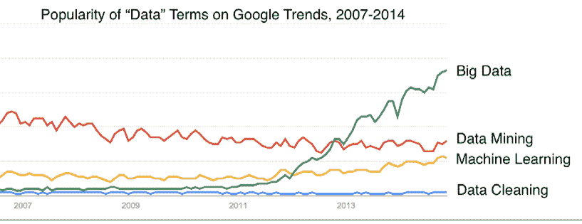
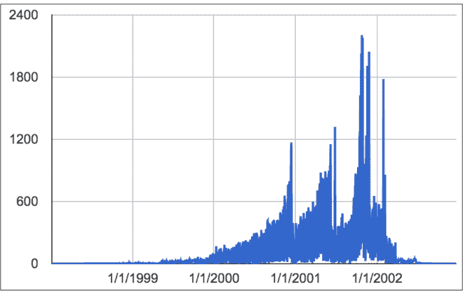
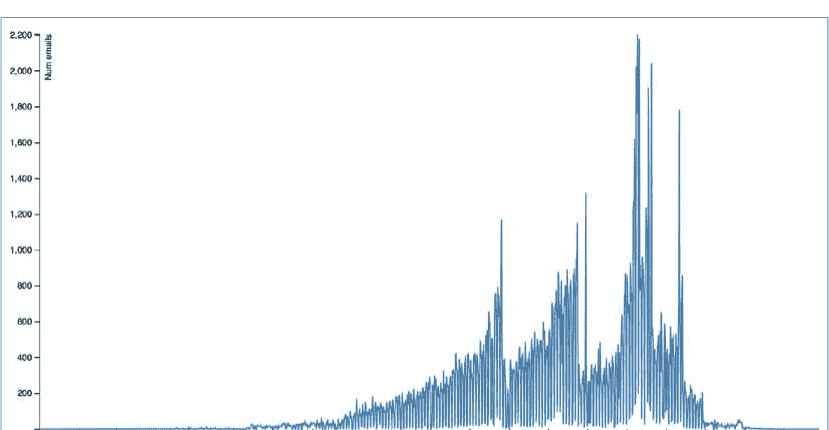
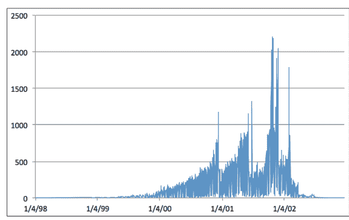
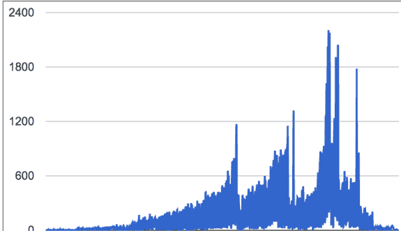

# 第1章：为什么需要干净的数据？

大数据、数据挖掘、机器学习和可视化——似乎数据是最近计算领域一切伟大进展的核心。从统计学家到软件开发人员再到平面设计师，每个人突然都对数据科学感兴趣。廉价硬件、更好的处理和可视化工具以及大量可自由获取的数据的汇聚意味着，我们现在可以比以往任何时候都更准确、更轻松地发现趋势并做出预测。

然而，你可能 *没有* 听说过的是，所有这些数据科学的希望和梦想都建立在数据是混乱的这一事实之上。通常，数据在准备好用于我们认为 **数据科学** 核心的算法或可视化之前，必须被移动、压缩、清洗、切碎、切片、切丁，并接受无数其他转换。

在本章中，我们将介绍：
- 一个简单的六步流程，您可以遵循进行数据科学，包括清洗
- 有助于传达您如何清洗数据的实用指南
- 一些您可能对数据清洗有帮助的工具
- 一个入门示例，展示数据清洗如何融入整体数据科学流程

### 全新的视角

我们最近读到《纽约时报》称数据清洗为清洁工的工作，并说数据科学家 80% 的时间将花费在这种清洗上。如以下图所示，尽管其重要性，数据清洗并没有像大数据、数据挖掘或机器学习那样真正引起公众的想象：



谁能责怪我们不想成群结队地谈论清洁工的工作有多有趣和超酷呢？好吧，很不幸——这对真正的家务也同样适用——如果我们只是把工作做完，而不是忽视它、抱怨它，并给它各种贬义的名字，我们都会好得多。

还没被说服吗？考虑一个不同的隐喻吧，你不是数据清洁工；你是一个数据厨师。想象一下，你手里拿着一个市场篮子，里面装满了你见过最漂亮的传家宝蔬菜，每一种都是在新鲜度巅峰时手工挑选的，并在有机农场可持续生产。西红柿完美多汁，生菜爽脆，辣椒明亮而结实。你很兴奋地开始烹饪，但你环顾四周，厨房脏乱不堪，锅碗瓢盆上烤着、结着谁知道是什么的东西，而且就工具而言，你只有一把生锈的刀和一条湿漉漉的毛巾。水槽坏了，你刚刚看到一只甲虫从那曾经美丽的生菜下爬出来。

即使是初学者厨师也知道不应该在这种地方烹饪。至少，你会毁掉你得到的那个完美美味的礼物篮子。而最坏的情况是，你会让人们生病。而且，这样烹饪甚至不好玩，用一把旧生锈的刀切蔬菜要花一整天。

正如你在厨房中所做的那样，花时间提前清理和准备你的数据科学工作空间、工具和原材料绝对是值得的。1960 年代的老计算机编程格言——垃圾进，垃圾出——对数据科学也同样适用。

### 数据科学流程

清洗如何融入数据科学工作的其他部分？好吧，简短的回答是它是一个关键部分，并且直接影响其前后流程。

更长的回答依赖于用六个步骤描述数据科学流程，如以下列表所示。数据清洗正好在中间，第 3 步。但与其将这些步骤视为线性、从头到尾的框架，我们将在项目过程中根据需要以更迭代的方式多次重访这些步骤。还值得指出的是，并非每个项目都会有所有步骤；例如，有时我们没有收集步骤或可视化步骤。它真的取决于项目的具体需求：
- 1. 第一步是提出问题陈述。确定你试图解决的问题是什么。
- 2. 下一步是数据收集和存储。帮助你回答这个问题的数据来自哪里？你把它存储在哪里，采用什么格式？
- 3. 然后是数据清洗。你是否对数据做了任何更改？你删除了任何东西吗？你如何为下一步的分析和挖掘做好准备？
- 4. 下一步是数据分析和机器学习。你对数据做了什么处理？什么转换？你使用了什么算法？你应用了什么公式？你使用了什么机器学习算法？顺序如何？
- 5. 表示和可视化是下一步。你如何展示你的工作成果？这可以是一个或多个表格、绘图、图表、网络图、词云、地图等。这是表示数据的最佳可视化吗？你考虑过哪些替代方案？
- 6. 最后一步是问题解决。你在第 1 步提出的问题或问题的答案是什么？你的结果有哪些局限性？这个问题有哪些部分是你无法用这种方法回答的？你本可以做些什么不同的事？下一步是什么？

数据清洗需要在尝试分析/挖掘/机器学习或可视化步骤之前进行是有道理的。虽然，记住这是一个迭代过程，我们可能在项目过程中多次重访清洗。此外，我们将要进行的挖掘或分析类型通常会驱动我们清洗数据的方式。我们认为清洗包括多种任务，这些任务可能由所选的分析方法决定，例如交换文件格式、更改字符编码或解析出要操作的数据片段。

数据清洗也将与收集和存储步骤（第 2 步）紧密相连。这意味着你可能需要收集原始数据，存储它，清洗它，再次存储清洗后的数据，收集更多数据，清洗它，将其与之前的数据合并，再次清洗它，存储它，等等。因此，记住你做了什么并能够在需要时重复该过程或告诉其他人你做了什么将变得非常重要。

### 关于数据清洗的沟通

由于六步流程围绕一个从问题开始并以问题解决结束的故事弧组织，它作为报告框架非常适用。如果你决定使用六步框架来报告你的数据科学流程，你会发现你在第三步写到你的清洗工作。

但即使你没有以正式报告的形式记录你的数据科学流程，你也会发现仔细记录你对数据做了什么以及顺序如何是极其有帮助的。

记住，即使对于最小、最不重要的项目，你也始终是在为至少两个受众工作：现在的你和六个月后的你。相信我，六个月后的你不会记得今天的你对数据做了什么清洗，更不用说为什么这样做或如何再次做到！

对此最简单的解决方案就是只保留一个日志。日志应包括你运行的具体命令的链接、屏幕截图或复制粘贴，以及为什么这样做的简短说明。以下示例显示了一个非常小的文本挖掘项目的日志，其中嵌入了每个阶段输出文件的链接以及清洗脚本的链接。不要担心如果你不熟悉此日志中提到的一些技术。这个示例向你展示了日志可能是什么样子：
- 1. 我们编写了一个 SQL 查询来检索每项及其描述的列表。
- 2. 为了在 Python 中进行词频分析，我们需要特定 JSON 格式的数据。我们构建了一个 PHP 脚本，该脚本遍历查询结果，将其结果放入 JSON 文件中（版本 1）。


3. 该文件存在一些格式错误，例如未转义的引号和嵌入的 HTML 标签。这些错误已通过第二个 PHP 脚本进行了修正，运行后该脚本输出了此清理后的 JSON 文件（版本 2）。

请注意，我们的日志试图解释我们做了什么以及为什么这么做。它简短，并且在可能的情况下可以包含链接。

如果你选择使用，还有更多更复杂的解决方案来沟通数据清理工作，例如，如果你熟悉 Git 或 Subversion 等版本控制系统，它们通常用于管理软件项目，你大概可以设想如何扩展它们来跟踪你的数据清理。无论你选择什么系统，即使它只是一个简单的日志，最重要的是真正使用它。因此，请选择能鼓励使用且不会阻碍你进展的东西。

## 我们的数据清理环境

本书中使用的数据清理方法是一种通用、广泛适用的方法。它不需要也不假设你拥有任何高端专用单一厂商的数据库或数据分析产品（事实上，这些厂商和产品可能有自己的清理例程或方法）。我围绕你在使用真实数据集时可能遇到的常见、日常问题设计了本书中的清理教程。我围绕任何人都可以访问的真实数据设计了本书。我将向你展示如何使用开源、通用且易于获取、在工作场所常用软件和技术来清理数据。

以下是你应该准备好使用的一些工具和技术：

- 对于几乎每一章，我们都会使用终端窗口及其命令行界面，例如 Mac OSX 上的 Terminal 程序或 Linux 系统上的 bash。在 Windows 中，一些命令可以使用 Windows 命令提示符运行，但其他命令可能需要使用功能更强大的 Windows 命令行程序，例如 CygWin。
- 对于几乎每一章，我们都会使用文本编辑器或程序员编辑器，例如 Mac 上的 Text Wrangler、Linux 中的 vi 或 emacs，或 Windows 上的 Notepad++ 或 Sublime Editor。
- 对于大多数章节，我们需要一个 Python 2.7 客户端，例如 Enthought Canopy，并且需要足够的权限来安装包。许多示例可以用 Python 3 运行，但有些不行，因此如果你已有 Python 3，可能希望创建一个替代的 2.7 安装。
- 对于第 3 章《干净数据的 workhorses – 电子表格和文本编辑器》，我们需要一个电子表格程序（我们将重点关注 Microsoft Excel 和 Google Spreadsheets）。
- 对于第 7 章《RDBMS 清理技术》，我们需要一个可用的 MySQL 安装以及访问它的客户端软件。

## 一个入门示例

开始之前，让我们用一个小例子来磨利厨师刀，该例子整合了六步框架并说明如何处理几个简单的清理问题。此示例使用公开可用的 Enron 电子邮件数据集。这是一个非常著名的包含发送给、来自以及在已倒闭的 Enron 公司员工之间发送的电子邮件消息的数据集。作为美国政府对 Enron 会计欺诈的调查的一部分，这些电子邮件成为公共记录的一部分，现在任何人都可以下载。各个领域的研究人员发现这些电子邮件有助于研究工作场所沟通、社会网络等。


> 你可以在其 Wikipedia 页面 http://en.wikipedia.org/wiki/Enron 上阅读更多关于 Enron 及其导致其衰落的金融丑闻的信息，你也可以在其单独页面 http://en.wikipedia.org/wiki/Enron_Corpus 上阅读关于 Enron 电子邮件语料库本身的信息。

在此示例中，我们将在一个简单的数据科学问题上实现六步框架。假设我们想揭示 Enron 公司内部电子邮件使用随时间变化的趋势和模式。让我们先按日期统计发送给/来自 Enron 员工的消息。然后我们将把计数在时间线上以图形方式显示。

首先，我们需要使用 http://www.ahschulz.de/enron-email-data/ 上的说明下载 MySQL Enron 语料库。该文件的另一个（备份）来源是 https://www.cs.purdue.edu/homes/jpfeiff/enron.html。按照这些说明，我们需要将数据导入到 MySQL 服务器上的名为 Enron 的新数据库架构中。现在数据已准备好可通过 MySQL 命令行界面或使用 PHPMyAdmin 等基于 Web 的工具进行查询。

我们的第一个计数查询如下所示：

```
SELECT date(date) AS dateSent, count(mid) AS numMsg
FROM message
GROUP BY dateSent
ORDER BY dateSent;
```

立即我们注意到许多电子邮件的日期不正确，例如，有一些日期似乎早于或晚于公司存在的时间（例如，1979 年）或来自不合逻辑的年份（例如，0001 或 2044）。电子邮件很老，但没那么老！

下表显示了一些奇怪行的摘录（完整结果集约有 1300 行）。所有这些日期格式都正确；然而，其中一些日期绝对是错误的：

| 发送日期 | 消息数 |
|---|---|
| 0002-03-05 | 1 |
| 0002-03-07 | 3 |
| 0002-03-08 | 2 |
| 0002-03-12 | 1 |
| 1979-12-31 | 6 |
| 1997-01-01 | 1 |
| 1998-01-04 | 1 |
| 1998-01-05 | 1 |
| 1998-10-30 | 3 |

这些错误日期很可能是由于电子邮件客户端配置错误造成的。此时，我们有三种选择：

- **不做任何事：** 也许我们可以直接忽略错误数据，仍然构建折线图。但由于最坏的日期来自公元 0001 年，最晚的来自 2044 年，我们可以想象我们的折线图在时间轴上有 1300 个刻度，每个显示计数为 1 或 2。这个图听起来并不吸引人或有信息量，所以不做任何事行不通。
- **修复数据：** 我们可以尝试找出每个错误消息的正确日期，并生成一个更正后的数据集，然后用它来构建图表。
- **丢弃受影响的电子邮件：** 我们可以做出明智的决定，丢弃任何日期落在预定窗口之外的电子邮件。

为了在选项 2 和 3 之间做出决定，我们需要统计仅使用 1999-2002 窗口会受影响的消息数量。我们可以使用以下 SQL：

```
SELECT count(*) FROM message
WHERE year(date) < 1998 or year(date) > 2002;
Result: 325
```

325 条带有错误日期的消息乍一看似乎很多，但它们仅占整个数据集的约 1%。根据我们的目标，我们可能会决定手动修复这些日期，但这里我们假设我们不介意损失 1% 的消息。我们可以谨慎地朝向选项 3 推进，丢弃受影响的电子邮件。以下是修改后的查询：

```
SELECT date(date) AS dateSent, count(mid) AS numMsg
FROM message
WHERE year(date) BETWEEN 1998 AND 2002
GROUP BY dateSent
ORDER BY dateSent;
```

清理后的数据现在包含 1,211 行，每行都有一个计数。以下是新数据集的摘录：

| 发送日期 | 消息数 |
|---|---|
| 1998-01-04 | 1 |
| 1998-01-05 | 1 |
| 1998-10-30 | 3 |
| 1998-11-02 | 1 |
| 1998-11-03 | 1 |
| 1998-11-04 | 4 |
| 1998-11-05 | 1 |
| 1998-11-13 | 2 |

在此示例中，看起来 1998 年 1 月有两个可疑日期，直到十月之前没有其他消息，之后消息开始更规律地到来。这看起来很奇怪，也指出了另一个问题，x 轴上是否必须有每个日期，即使当天没有发送电子邮件？

如果我们回答是，重要的是显示每个日期，即使计数为 0 的日期；这可能意味着需要进行另一轮清理，以生成显示日期并带有零的行。

但另一方面，也许我们可以更策略性地处理这个问题。我们是否需要在原始数据中包含零值，实际上取决于我们用来创建图表的工具以及图表的类型，例如，Google Spreadsheets 会构建折线图或条形图，可以自动检测 x 轴上缺少的日期，并在初始数据集中未提供的情况下填入零值。在我们的数据中，这些零值将是 1998 年大部分时间的神秘缺失日期。

下三幅图显示了这些工具各自如何处理日期轴上的零值。请注意此处所示的 Google Spreadsheets 数据表示中开头和结尾的长零尾部：



Google Spreadsheets 会自动用零填充任何缺失的天数。


## 为什么需要干净的数据？

D3 JavaScript 可视化库也会这样做，默认情况下会在范围内为缺失的日期填充零值，如下图所示。

> 对于简单的 D3 折线图示例，请查看此教程：http://bl.ocks.org/mbostock/3883245。



D3 会自动用零填充任何缺失的天数。

Excel 在其默认折线图中也有相同的日期填充行为，如下所示：



Excel 会自动用零填充任何缺失的天数。

接下来，我们需要考虑是否通过允许日期的零值，也使我们的 x 轴变得更长（我的计数查询产生了 1211 行，但在指定的范围内总共有 1822 天，即 1998-2002）。也许显示零计数天数可能不起作用；如果图表过于拥挤，我们无论如何也看不到间隙。

为了比较，我们可以快速将相同的数据导入 Google 电子表格（你也可以在 Excel 或 D3 中这样做），但这次，我们只选择计数列来构建图表，从而迫使 Google 电子表格不在 x 轴上显示日期。结果是仅来自数据库计数查询的数据的真实形状，且未填充零计数天数。长尾巴消失了，但图表重要部分（中间）的整体形状保持不变：



图表现在仅显示有一条或多条消息的日期。

## 为什么需要干净的数据？

幸运的是，数据的形状相似，只是图表上的头部和尾部更短。基于此比较，以及我们计划对数据做什么（记住我们所要做的只是创建一个简单的折线图），我们可以对我们决定在不专门创建显示零计数天数的数据集的情况下继续前进感到满意。

归根结底，折线图显示安然公司在电子邮件流量中有几个显著峰值。最大的峰值和最繁重的流量发生在 2001 年 10 月和 11 月，丑闻爆发时。两个较小的峰值发生在 2001 年 6 月 26-27 日和 2000 年 12 月 12-13 日左右，当时发生了涉及安然的类似新闻事件（一个涉及加州能源危机，另一个涉及公司领导层变动）。

如果你对数据分析感到兴奋，你可能对接下来用这些数据做什么有很多很酷的想法。而且现在你有了干净的数据，希望这会让你的分析任务变得更容易！

## 摘要

经过所有这些工作，看起来《纽约时报》是对的。正如你从这个简单练习中看到的，数据清洗确实占回答即使是一个微小的数据导向问题所付出的努力的约 80%（在这种情况下，讨论数据清洗的理由和选择就占了 900 字案例研究的 700 字）。数据清洗确实是数据科学过程的关键部分，它涉及理解技术问题，也要求我们做出一些价值判断。作为数据清洗的一部分，我们甚至必须考虑到分析和可视化步骤的预期结果，尽管我们还没有真正完成它们。

在考虑了本章中介绍的数据清洗的作用后，我们的清洗有效性如何改进可以迅速累积成实质性的时间节省变得更加明显。

下一章将描述任何想要进入更大、更好的“厨房”的“数据厨师”所需的几个基础知识，包括文件格式、数据类型和字符编码。
