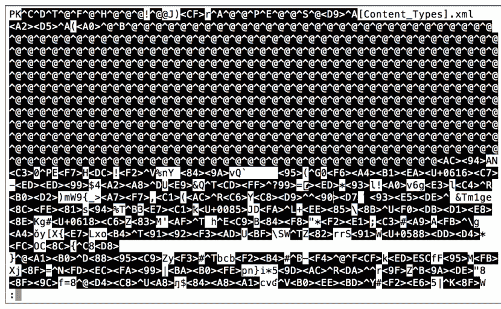
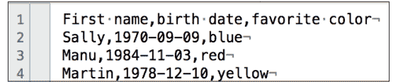
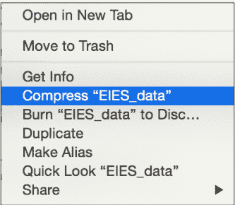
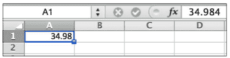
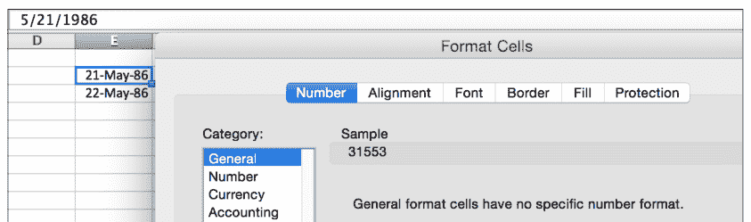
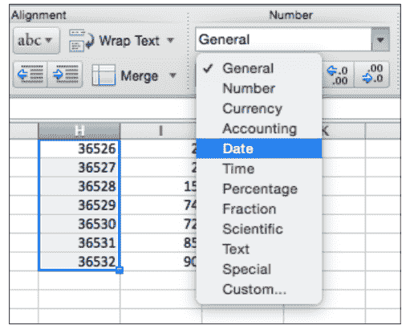
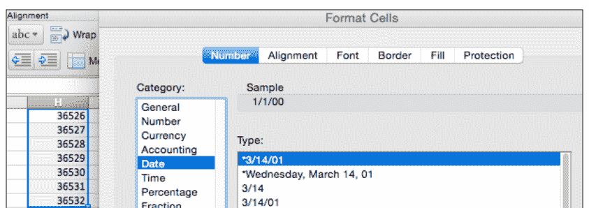
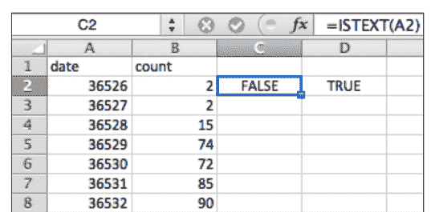
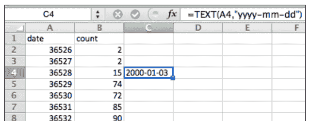

# 第2章：基础 – 格式、类型和编码

几年前，我在家人年度假日礼物交换会上收到了一份非常有趣的礼物。那是一套 *garde manger* 厨房工具，包括一把不同刀具以及用于准备蔬菜和水果的削皮器、勺子和刨丝器。我学会了使用每种工具，随着时间的推移，我对通道刀和番茄鲨产生了特殊的喜爱。本章就像你的入门数据清洗工具集。我们将回顾：

- 文件格式，包括压缩标准
- 数据类型的基础知识（包括不同类型的缺失数据）
- 字符编码

我们将在 iler 章节中需要所有这些基础知识。我们将要涵盖的一些概念非常基础，你几乎每天都会遇到，例如压缩和文件格式。这些非常常见；它们就像厨师刀。但其中一些概念，如字符编码，更具特殊用途和奇特，就像番茄鲨！

### 文件格式

本节描述了任何数据科学家在处理野外发现的数据时可能遇到的不同文件格式——换句话说，你*不会*在那些许多书籍所依赖的精心构建的数据集中找到的那种数据。在这里，我们遇到了一些与最常见文件格式交互的策略和限制，然后我们回顾你可能遇到的各种压缩和归档格式。

### 文本文件与二进制文件

从在线来源收集数据时，你可能会以以下方式之一遇到数据：

- 数据将以文件形式可下载
- 数据将通过存储系统的交互式前端提供，例如通过具有查询界面的数据库系统
- 数据将通过连续流提供
- 数据将通过 **应用程序编程接口 (API)** 提供。

无论如何，你可能需要在以后创建数据文件以便与他人分享。因此，对各种数据格式及其优缺点有坚实的基础非常重要。

首先，我们可以将计算机文件视为属于两个大类，通常称为 **文本文件** 和 **二进制文件**。由于所有文件都由一串字节组成，一个接一个，严格来说，所有文件都是二进制的。但如果文件中的字节都是文本字符（例如，字母、数字以及一些控制字符，如换行符、回车符或制表符），那么我们就说该文件是文本文件。相比之下，二进制文件是包含大部分不可读字符的字节的文件。

### 打开和读取文件

文本文件可以由一个名为文本编辑器的程序读取和写入。如果你尝试在文本编辑器中打开一个文件并且可以成功阅读它（即使你不理解它），那么它很可能是一个文本文件。然而，如果你在文本编辑器中打开文件，它看起来只是乱码字符和奇怪的无法辨认的符号的混合，那么它很可能是一个二进制文件。

二进制文件旨在由特定应用程序打开或编辑，而不是由文本编辑器。例如，Microsoft Excel 电子表格旨在由 Microsoft Excel 打开和读取，而数码相机拍摄的照片可以由 Photoshop 或 Preview 等图形程序读取。有时，二进制文件可以由多个兼容的软件包读取，例如，许多不同的图形程序可以读取和编辑照片，甚至为专有格式设计的二进制文件，如 Microsoft Excel 或 Microsoft Word 文件，也可以由兼容软件（如 Apache OpenOffice）读取和编辑。还有一种称为二进制编辑器的程序，可以让你窥探二进制文件内部并编辑它。

有时，文本文件也旨在由应用程序读取，但你仍然可以在文本编辑器中读取它们。例如，网页和计算机源代码仅由文本字符组成，可以轻松在文本编辑器中编辑，但如果没有对文本本身的特定格式或布局进行一些培训，就很难理解。

通常即使不打开编辑器也可以知道你拥有什么类型的文件。例如，大多数人会寻找有关文件的线索，从文件本身的名称开始。三字母和四字母文件扩展名是表示文件类型的一种常见方式。许多人知道的常见扩展名包括：

- `.xlsx` 用于 Excel 文件，`.docx` 用于 Word 文件，`.pptx` 用于 PowerPoint 文件
- `.png`、`.jpg` 和 `.gif` 用于图像文件
- `.mp3`、`.ogg`、`.wmv` 和 `.mp4` 用于音乐和视频文件
- `.txt` 用于文本文件

还有几个网站列出了文件扩展名以及与这些特定扩展名关联的程序。其中一个热门网站是 fileinfo.com，维基百科也有一个按字母顺序排列的文件扩展名列表，可在 https://en.wikipedia.org/wiki/List_of_filename_extensions_(alphabetical) 获取。

### 窥探文件内部

如果你必须打开一个未知文件来窥探内部，有几个命令行选项可以用来查看文件的开头几个字节。

### 在 OSX 或 Linux 上

在 OSX Mac 或 Linux 上，打开你的终端窗口（在 Mac 上，你可以通过导航到 应用程序 | 实用工具 | 终端 找到标准终端应用程序），使用 print working directory (pwd) 和 change directory (cd) 命令的组合导航到你的文件位置，然后使用 less 命令逐页查看文件。以下是我的执行此任务的命令示例：

```
flossmole2:~ megan$ pwd
/Users/megan
flossmole2:~ megan$ cd Downloads
flossmole2:Downloads megan$ less OlympicAthletes_0.xlsx
"OlympicAthletes_0.xlsx" may be a binary file. See it anyway?
```


如果提示“无论如何查看”，则该文件是二进制文件，你应做好看到乱码的准备。你可以输入 `y` 来查看文件，或直接输入 `n` 以反向运行。下一张图展示了使用 `less` 命令查看名为 `OlympicAthletes_0.xlsx` 的文件的结果，如对话中所示。乱成一团！



当你看完后，可以输入 `q` 来退出 `less` 程序。

## On Windows

Windows 也有 `more` 程序可在其命令提示符应用程序中使用。它与前面描述的 `less` 命令类似工作（毕竟，*少即是多*）。你可以通过 **开始** 菜单中的 `cmd` 访问 Windows 命令提示符。在 Windows 8 中，导航到 **应用** | **Windows 系统** | **命令提示符**。你可以使用 `cd` 和 `pwd` 以与前面示例相同的方式导航到你的文件。

## Common formats for text files

在本书中，我们主要关注文本文件而非二进制文件。（一些特殊例外包括压缩和归档文件，我们将在下一节中介绍，以及 Excel 和 PDF 文件，本书后面各有专门章节。）

本书中我们将关注的三种主要文本文件类型是：

- 分隔符格式（结构化数据）
- JSON 格式（半结构化数据）
- HTML 格式（非结构化数据）

这些文件在布局上有所不同（我们阅读时看起来就不同），并且在结构可预测性方面也不同。换句话说，文件中多少是有组织的并且具有结构化数据？文件中又有多少数据是不规则或非结构化的？这里，我们分别讨论这些文本文件格式。

## The delimited format

分隔文件作为共享和传输数据的方式非常常见。分隔格式文件只是文本文件，其中每个数据属性（每列）和每个数据实例（每行）都由一致的字符符号分隔。我们称分隔符字符为分隔符。两种最常见的分隔符是制表符和逗号。这两种常见选择分别反映在制表符分隔值（TSV）和逗号分隔值（CSV）文件扩展名中。有时，分隔文件也称为记录导向文件，因为假设每行代表一条记录。

下面是一些数据的三个实例（描述人员的三行），数据值以逗号分隔。第一行列出了列的名称。这一行也称为标题行，并且已在数据中突出显示以使其更清晰：

```
First name,birth date,favorite color
Sally,1970-09-09,blue
Manu,1984-11-03,red
Martin,1978-12-10,yellow
```

请注意，对于这种分隔数据的示例，没有非数据信息。所有内容都是行或数据值。并且数据高度结构化。然而，仍然有一些选项可以使一种分隔格式与另一种分隔格式有所不同。第一个区别因素是每个数据实例（每行）如何分隔。通常在行末，使用换行符或回车符，或两者都使用，具体取决于创建文件时使用的操作系统环境。

## Seeing invisible characters

在前面的示例中，换行符或回车符是不可见的。如何查看不可见字符？我们将在 Mac 上的 Text Wrangler 中读取同一个文件（Windows 上有类似的全功能编辑器，如 Notepad++），其中我们可以使用显示不可见字符选项（通过导航到 View | Text Display 找到）。



另一种查看不可见字符的方法是使用 vi（命令行文本编辑器）在 Linux 系统上或在 Mac 的终端窗口中使用（默认情况下 Windows 机器上不可用）。使用 vi 查看文件中不可见字符的过程如下：

- 1. 首先，使用命令：
  `vi <filename>`
- 2. 然后，输入 : 进入 vi 编辑模式。
- 3. 然后，输入 set list 并按 Enter 查看不可见字符。

以下屏幕截图显示了由 set list 在 vi 中显示的行尾字符，显示行终止符号 $。

```
```text
First name,birth date,favorite color$
Sally,1970-09-09,blue$
Manu,1984-11-03,red$
Martin,1978-12-10,yellow$
~
~
~
~
~
~
~
~
~
~
~
~
~
~
:set list
```
```

## Enclosing values to trap errant characters

分隔文件中的另一个重要选项是用来包围每个被分隔值的字符。例如，除非你有以逗号作为千位分隔符的数值，否则逗号分隔值非常好。考虑以下示例，其中薪水以逗号作为千位分隔符，但逗号也是分隔符：

```
```text
First name,birth date,favorite color,salary
Sally,1971-09-16,light blue,129,000
Manu,1984-11-03,red,159,960
Martin,1978-12-10,yellow,76,888
```
```

如何在文件创建时修复这个问题？我们有两个选项：

- **选项 1：** 创建分隔文件的人需要在创建此表之前删除最后一列中的逗号（换句话说，薪水金额中没有逗号）
- **选项 2：** 创建此文件的人需要使用额外的符号来包围数据值本身。

如果选择选项 2，通常会添加双引号分隔符来包围数据值。因此，第一行的 129,000 将变为 "129,000"。

## Escaping characters

如果数据本身包含引号怎么办？如果 Sally 的喜欢的颜色被列出并显示为 light "Carolina" blue 怎么办？看一下：

```
First name,birth date,favorite color,salary
"Sally","1971-09-16","light "Carolina" blue","129,000"
"Manu","1984-11-03","red","159,960"
"Martin","1978-12-10","yellow","76,888"
```

内部引号必须通过使用另一个特殊字符反斜杠 \ 来转义：

```
First name,birth date,favorite color,salary
"Sally","1971-09-16","light \"Carolina\" blue","129,000"
"Manu","1984-11-03","red","159,960"
"Martin","1978-12-10","yellow","76,888"
```

> 或者，我们可以尝试用单引号而不是双引号来封装，但然后我们可能会遇到带撇号的问题，例如 "it's" 或名字如 O'Malley。总是有问题的！

分隔文件非常方便，因为它们易于理解，并且易于在简单的文本编辑器中访问。然而，正如我们所见，它们也需要在提前进行一些规划，以确保数据值真正正确分隔，并且一切都按预期格式化。

如果你不幸收到前面类似的分隔错误文件，我们将在第 3 章《清洁数据的支柱 – 电子表格和文本编辑器》中为你提供一些技巧和窍门来清理它们。

## The JSON format

**JavaScript 对象表示法 (JSON)**，读作 JAY-sahn，是有时称为半结构化数据的一种更受欢迎的格式之一。与其名称的含义相反，JSON 的有用性并不依赖于 JavaScript。该名称指的是它被设计用于序列化 JavaScript 对象。

当数据值被标记，但其顺序无关紧要，而且实际上某些数据值甚至可能缺失时，一组数据可以称为半结构化。JSON 文件只是一组属性-值对，例如：

```
{
  "firstName": "Sally",
  "birthDate": "1971-09-16",
  "faveColor": "light\"Carolina\" blue",
  "salary":129000
}
```

属性在冒号的左侧，值在冒号的右侧。每个属性由逗号分隔。整个实体用大括号括起来。

JSON 的一些方面与分隔文件相似，一些方面则不同。首先，字符串值必须用双引号引起来，因此字符串内部的任何双引号都必须用反斜杠转义。（转义字符 \，当用作普通字符时，也必须转义！）

在 JSON 中，除非值被视为字符串并正确引用，否则数值中不能包含逗号。（字符串化数字时要小心——你确定要这样做吗？然后，参考本章中的数据类型部分，它可以帮助你解决这些问题。）

```
{
  "firstName": "Sally",
  "birthDate": "1971-09-16",
  "faveColor": "light\"Carolina\" blue",
  "salary": "129,000"
}
```

多值属性是可以接受的，层次值也是如此（这些在分隔文件中都很难实现）。这里有一个 JSON 文件的示例，其中 pet 有多值属性，jobTitle 有数据层次。注意我们已将薪资数据移入这个新的工作层次中：

```
{
  "firstName": "Sally",
  "birthDate": "1971-09-16",
  "faveColor": "light\"Carolina\" blue",
  "pet":
  [
    {
      "type": "dog",
      "name": "Fido"
```


```
},
{
    "type": "dog",
    "name": "Lucky"
}
],
"job": {
    "jobTitle": "Data Scientist",
    "company": "Data Wizards, Inc.",
    "salary":129000
}
}
```

## 尝试 JSON

JSON 因其可扩展性、简洁性以及对多值属性、缺失属性和嵌套属性/属性层级结构支持而成为一种极受欢迎的数据交换格式。用于分发数据集的 API 的日益普及也促进了 JSON 的实用性。

为了查看 API 如何使用搜索词生成以 JSON 编码的数据集的示例，我们可以尝试 iTunes API。iTunes 是苹果运营的音乐服务。任何人都可以查询 iTunes 服务以获取有关歌曲、艺术家和专辑的详细信息。搜索词可以按如下方式附加到 iTunes API URL：

```
https://itunes.apple.com/search?term=the+growlers
```

在此 URL 中，= 号之后的所有内容都是搜索词。在这种情况下，我搜索了我喜欢的一个乐队，叫做 The Growlers。请注意，有一个 + 号代表空格字符，因为 URL 不允许空格。

iTunes API 会根据我的搜索关键词从其音乐数据库返回 50 条结果。整个集合被格式化为一个 JSON 对象。与所有 JSON 对象一样，它被格式化为名称-值对的集合。此示例中返回的 JSON 看起来很长，因为返回了 50 条结果，但每条结果实际上非常简单——在该 URL 中显示的 iTunes 数据中没有多值属性，甚至没有任何分层数据。


> 有关如何使用 iTunes API 的更多详细信息，请访问 Apple iTunes 开发者文档 https://www.apple.com/itunes/affiliates/resources/documentation/itunes-store-web-service-search-api.html。

## HTML 格式

HTML 文件或网页文件是另一种经常包含大量有用数据的文本文件类型。你有多少次看到网站上的有趣表格或信息列表，并想要保存数据？有时，复制和粘贴可以用来尝试从网页创建分隔文件，但大多数时候，复制和粘贴并不能有效工作。HTML 文件可能非常混乱，因此是从中提取数据的一种可能很痛苦的方式。因此，有时我们将网页文件称为非结构化数据。即使网页可能有一些 HTML 标签可用于尝试以模式化方式组织数据的分隔类型，它们也不总是如此。而且，这些各种 HTML 标签的应用方式存在很多出错的空间，无论是在不同网站之间还是在同一网站内部。

下图仅显示了 `http://weather.com` 网站的一小部分。即使此屏幕截图中包含图片、颜色和其他非文本内容，在其最基本层面上，该网页是用 HTML 编写的，如果我们想从该页面提取文本数据，我们可以做到。


如果我们查看网页的 HTML 源代码，我们可以找到近 1,000 行 HTML 代码中的几行，这些代码构成了浏览器显示该特定天气表格的数据和布局指令：

```
806 <div class="wx-temperature-label">FEELS LIKE
807 <span itemprop="feels-like-temperature-fahrenheit">43</span>&deg;</div>
808 </div>
809 <div class="wx-data-part">
810 <div class="wx-temperature">43<span class="wx-degrees">&deg;</span></div>
811 <div class="wx-temperature-label">HIGH AT 1:25 PM</div>
812 </div>
813 <div class="wx-data-part">
814 <div class="wx-temperature">28<span class="wx-degrees">&deg;</span></div>
815 <div class="wx-temperature-label">LOW</div>
816 </div>
```

确实是非结构化的！当然，从技术上讲，可以从此页面提取数据值 43（华氏温度），但这不会是一个有趣的过程，而且我们无法保证我们的方法明天或后天仍然适用，因为 http://weather.com 随时可能更改网站的源代码。尽管如此，网络上仍有大量数据，因此在第 5 章《从网络收集和清理数据》中，我们将介绍几种从基于网络的非结构化文件中提取数据的策略。

## 归档和压缩

文本文件何时也是二进制文件？当然是当它已被压缩或归档时。归档和压缩是什么？在本节中，我们将了解文件归档和压缩文件是什么，归档和压缩如何工作，以及每种的标准。

这是一个重要的部分，因为你在现实世界中发现的大量真实数据（尤其是分隔数据）在你找到它们时会被压缩。你作为数据科学家最有可能遇到哪些最常见的压缩格式？我们肯定会找到这个问题的答案。你可能也想在与他人分享数据时压缩数据。如何确定哪种压缩方法是最好的选择？

## 归档文件

归档文件只是一个包含其中多个文件的文件。这些文件内部可以是文本、二进制或两者混合。归档文件由特殊程序创建，该程序将文件列表更改为单个文件。当然，归档文件是以可以扩展回多个文件的方式创建的。

## tar

你在进行数据科学工作时最有可能遇到的最常见的归档文件是所谓的磁带归档（TAR）文件，使用 tar 程序创建，通常带有 .tar 扩展名。它们的最初目的是创建磁带归档。

tar 程序可在类 Unix 操作系统上使用，我们也可以在 Mac OSX 终端中使用它。

要创建 tar 文件，只需指示 tar 程序你想要包含哪些文件以及输出文件名应为多少。（程序选项 c 用于指示我们正在创建新的归档文件，选项 v 在提取时打印文件名。选项 f 让我们指定输出文件名。）

```
tar cvf fileArchive.tar reallyBigFile.csv anotherBigFile.csv
```

要“解包”文件（或将其扩展为所有文件的完整列表），只需将 tar 程序指向你想要扩展的文件。xvf 中的 x 字母代表 eXtract（提取）：

```
tar xvf fileArchive.tar
```

那么，.tar 归档文件包含多个文件，但有多少个以及文件是什么？你希望在开始提取文件之前确保有足够的可用磁盘空间，并且文件确实是你一开始想要的文件。tar 命令中的 t 选项将显示 tar 文件内部的文件列表：

```
tar -tf fileArchive.tar
```

除了 tar 之外还有许多其他归档程序，但其中一些有趣的程序（例如 OSX 上的内置归档 ZIP 压缩器以及 Windows 上的各种 ZIP 和 RAR 实用程序）在归档之外还对文件进行压缩，因此我们可能应该接下来讨论这个概念。

## 压缩文件

压缩文件是那些被缩小以占用更少空间的文件。文件越小，磁盘上的存储空间越少，如果文件需要在网络上共享，传输时间也越快。对于我们感兴趣的数据文件而言，假设压缩文件可以轻松解压缩回原始文件。

## 如何压缩文件

创建压缩文件的方法有很多，选择哪一种取决于你使用的操作系统和已安装的压缩软件。例如，在 OSX 上，任何文件或文件夹（或组）都可以轻松压缩，只需在 Finder 中选择它，右键单击并从菜单中选择压缩即可。此操作将在与原始文件相同的目录中创建一个压缩的（.zip 扩展名）文件。这在以下图像中显示：



## 如何解压缩文件

数据科学流程的收集步骤通常包括下载压缩文件。这些可能是我们在本章前面描述的分隔文本文件，也可能是包含多种类型数据文件的文件，例如电子表格或用于构建数据库的 SQL 命令。

在任何情况下，解压缩文件都会将数据返回到我们可以用来实现目标的状态。我们如何知道使用哪个程序来解压缩文件？第一个也是最大的线索是文件的扩展名。这是压缩程序创建文件的关键提示。知道如何解压缩文件取决于它是如何被压缩的。

在 Windows 中，你可以通过右键单击文件并选择属性来查看与文件扩展名关联的已安装程序。然后，查找“打开方式”选项，以查看 Windows 认为哪个程序将解压缩文件。

本节的其余部分将概述如何在 OSX 或 Linux 系统上使用命令行程序。


## 使用 zip、gzip 和 bzip2 进行压缩

zip、gzip 和 bzip2 是最常见的压缩程序。它们的解压对应程序分别称为 Unzip、Gunzip 和 Bunzip2。

下表展示了在这些程序中压缩和解压的示例命令行。

| | Compress | Uncompress |
|---|---|---|
| Zip | `zip filename.csv filename.zip` | `unzip filename.zip` |
| gzip | `gzip filename.csv filename.gz` | `gunzip filename.gz` |
| bzip2 | `bzip2 filename.csv filename.bz2` | `bunzip2 filename.bz2` |

有时，你会看到一个文件同时包含 .tar 和 .gz 扩展名或 .bz2 扩展名，像这样：somefile.tar.gz。常见的其他组合包括：.tgz 和 .tbz2，如 somefile.tgz。这些文件是先被 tar 打包（归档），然后再使用 gzip 或 bzip2 进行压缩。原因在于 gzip 和 bzip2 并不是归档程序；它们只是压缩器。因此，它们一次只能压缩单个文件（或文件归档）。由于 tar 的工作是将多个文件合并成单个文件，因此这些程序经常一起出现。

tar 程序甚至有一个内置选项，可以在打包后立即对文件进行 gzip 或 bzip2 压缩。要对新创建的 .tar 文件进行 gzip 压缩，我们只需在之前的 tar 命令中添加 z，并修改文件名：

```
tar cvzf fileArchive.tar.gz reallyBigFile.csv anotherBigFile.csv
```

或者，你可以分两步完成：

```
tar cvf fileArchive.tar reallyBigFile.csv anotherBigFile.csv
```

```
gzip fileArchive.tar
```

这一系列命令将创建 fileArchive.tar.gz 文件：

要解压 tar.gz 文件，请使用两步：

```
gunzip fileArchive.tar.gz
```

```
tar xvf fileArchive.tar
```

这些步骤也适用于 bzip2 文件：

```
tar cvjf fileArchive.tar.bz2 reallyBigFile.csv anotherBigFile.csv
```

要解压 tar.bz2 文件，请使用两步：

```
bunzip2 fileArchive.tar.bz2
```

```
tar xvf fileArchive.tar
```

## 压缩选项

在压缩和解压时，还有许多其他选项需要考虑，以便让你的数据清洗工作更轻松：

- 你是否想压缩文件同时保留原始文件？默认情况下，大多数压缩和归档程序会删除原始文件。如果你想保留原始文件并同时创建其压缩版本，通常可以指定这一点。
- 你是否想向现有压缩文件添加新文件？大多数归档和压缩程序中都有此选项。有时，这被称为 **updating** 或 **replacing**。
- 你是否想加密压缩文件并要求密码才能打开？许多压缩程序都提供此选项。
- 解压时，你是否想用同名文件覆盖目录中的文件？请查找 **force** 选项。

根据你使用的压缩软件及其选项，你可以使用许多这些选项来使处理文件的工作更轻松。对于大文件——无论是体积大还是数量多——这一点尤其如此！

## 我应该使用哪种压缩程序？

本节关于归档和压缩的概念适用于任何操作系统和任何类型的压缩数据文件。大多数时候，我们会从某个地方下载压缩文件，我们的主要关注点是高效地解压这些文件。

但是，如果你自己创建压缩文件怎么办？如果需要解压数据文件、清理它，然后重新压缩并发送给同事怎么办？或者，如果你可以选择下载的文件，每个文件使用不同的压缩格式：zip、bz2 或 gz？你应该选择哪种格式？

假设我们处于一个允许使用多种压缩类型的操作环境中，有一些经验法则可以说明不同压缩类型的各种优缺点。

我们在做出压缩决策时使用的一些因素包括：

- 压缩和解压的速度
- 压缩比（文件变小了多少？）
- 压缩解决方案的互操作性（我的受众能否轻松解压此文件？）

## 经验法则

Gzip 压缩和解压速度更快，并且在每台 OSX 和 Linux 机器上都 readily available。然而，一些 Windows 用户可能没有 readily available 的 gunzip 程序。

Bzip2 比 gzip 和 zip 产生更小的文件，但耗时更长。它在 OSX 和 Linux 上广泛使用。如果 Windows 用户尚未安装特殊软件，他们可能难以处理 bzip2 文件。

Zip 在 Linux、OSX 和 Windows 上都 readily available，其压缩和解压速度也不算糟糕。然而，它并不能产生非常理想的压缩比（其他压缩器会产生更小的文件）。尽管如此，其普遍性和相对速度（例如与 bzip2 相比）是其强项。

RAR 是 Windows 的一种广泛可用的归档和压缩解决方案；然而，其在 OSX 和 Linux 上的可用性需要特殊软件，并且其压缩速度不如某些其他解决方案。

最终，你必须根据正在进行的特定项目以及你的受众或用户的需求来决定压缩标准，无论是自己、客户还是客户。

## 数据类型、空值和编码

本节概述了数据科学家必须定期处理的最常见数据类型以及这些类型之间的一些差异。我们还讨论了在数据类型之间转换以及如何在不丢失信息的情况下安全转换（或至少事先了解风险）。

本节还涵盖了神秘的空值、null 和空白世界。我们探讨了各种类型的缺失数据，并描述了缺失数据如何负面影响数据分析结果。我们将比较处理缺失数据的选择和权衡，以及每种方法的利弊。

由于我们的大部分数据将以字符串形式存储，我们将学习识别不同的字符编码以及在真实世界数据中会遇到的一些常见格式。我们将学习如何识别字符编码问题以及如何为特定数据集确定适当的字符编码类型。我们将编写一些 Python 代码以从一种编码方案转换到另一种编码方案。我们还将介绍这种策略的局限性。

## 数据类型

无论我们是在清理存储在文本文件、数据库系统还是其他格式中的数据，我们都会开始认识到相同类型的数据一次又一次出现：各种数字、日期、时间、字符、字符字符串等等。接下来的部分描述了一些最常见的数据类型，以及每个类型的一些示例。

## 数值数据

在本节中，我们将发现存储数字的方式有很多种，其中一些比其他方式更容易清理和管理。尽管如此，与字符串和日期相比，数字相对简单，因此我们将从这些开始，然后再转向更棘手的数据类型。

## 整数

整数，或整数，可以为正或负，正如名称所示，它们没有小数点或分数。根据整数存储在何种存储系统中，例如在 **Database Management System (DBMS)** 中，我们可能还会有关于整数可以存储多大的额外信息，以及它是否允许有符号（正负值）或仅无符号（全部为正值）。

## 带小数点的数字

在我们的数据清洗工作中，具有小数部分的数字——例如价格、平均值、测量值等——通常使用小数点表示（而不是分子/分母）。有时，特定的存储系统也制定规则，规定小数点后允许的数字位数（**scale**）以及数字中允许的总位数（**precision**）。例如，我们说数字 34.984 的精度为 5，小数为 3。


不同的数据存储系统也会允许不同类型的十进制数字。例如，在设置数据库时，DBMS 可能允许我们声明将存储浮点数、十进制数以及货币/金额数。它们各自的行为会略有不同——例如在数学问题中。我们需要阅读 DBMS 为每种数据类型提供的指导并及时了解变化。很多时候，由于内存考虑或其他原因，DBMS 提供商会更改特定数据类型的规范。

另一方面，与 DBMS 应用不同，电子表格应用程序旨在除了存储数据之外还显示数据。因此，我们实际上可能以一种格式存储数字，而以另一种格式显示它。如果在电子表格的数据单元格中应用了格式，这可能会引起一些混淆。下面的图示显示了为单元格设置的一些十进制显示属性的示例。公式栏显示完整的数字 34.984，但单元格显示该数字似乎已被向下舍入。




> 在世界许多地区，逗号字符用于分隔数字的小数部分和非小数部分，而不是点或句点字符。这是一个很好的提醒，始终值得检查你所使用的系统的本地化设置，并确保它们与你正在处理的数据的预期相匹配。例如，在 OSX 中，**Language & Region** 对话框位于 **Systems Preferences** 菜单中。从这里，你可以根据需要更改本地化设置。

与 DBMS 不同，原始文本文件没有指定数字字段的大小或期望值的选项，而且与电子表格不同，文本文件也没有针对给定数据值的显示选项。如果文本文件显示的值为 34.98，那么这可能就是我们对该数字所知道的全部信息。

## 当数字不是数值时

数值数据首先主要由 0-9 的数字序列组成，有时还包括小数点。但关于真正数值数据的一个关键点是，它主要设计用于在其上执行计算。当我们期望能够对数据值进行 *do math*、期望数值比较一个值与另一个值，或希望项目按数值顺序排序时，我们应选择数值存储。在这些情况下，数据值需要以数字形式存储。请考虑以下按数值从低到高排序的数字列表：

- 1
- 10
- 11
- 123
- 245
- 1016

现在，考虑将同一列表作为地址字段中的文本值进行排序：

- 1 Elm Lane
- 10 Pine Cir.
- 1016 Pine Cir.
- 11 Front St.
- 123 Main St.
- 245 Oak Ave.

电话号码和邮政编码（以及街道地址中的门牌号，如前例所示）通常由数字组成，但当我们将它们视为数据值时，它们更类似于文本还是数值数据？我们计划对它们进行加法、减法，或计算平均值或标准差吗？如果不打算这样做，它们可能更适合存储为文本值。

## 日期和时间

你可能熟悉许多不同的日期书写方式，并且可能有一些你更偏爱的方式。例如，以下是书写同一日期的几种常见方式：

- 11-23-14
- 11-23-2014
- 23-11-2014
- 2014-11-23
- 23-Nov-14
- November 23, 2014
- 23 November 2014
- Nov. 23, 2014

无论我们偏爱哪种日期书写方式，完整的日期都由三个部分组成：月份、日期和年份。任何日期都应能解析为这些组成部分。日期混淆通常出现在两个方面：对于小于 12 的数字，月份标识符和日期标识符缺乏清晰度，以及指定年份的混淆。例如，如果我们只看到“11-23”，我们可以假设是 11 月 23 日，因为没有缩写为“23”的月份，但那是哪一年呢？如果我们看到“11-12”这个日期，是 11 月的第 12 天还是 12 月的第 11 天？又是在哪一年？38 年是指 1938 年还是 2038 年？

大多数 DBMS 在你将数据指定为日期时有特定的导入方式，如果你导出数据，也会以该日期格式返回。然而，这些系统也有许多函数可以应用以重新格式化日期或提取你想要的部分。例如，MySQL 有许多有趣的日期函数，允许我们仅提取月份或日期，以及更复杂的函数，允许我们找出特定日期在一年中的第几周或那天是星期几。例如，以下 SQL 统计了第 1 章《Why Do You Need Clean Data?》中的 Enron 数据集中在每年 5 月 12 日发送的消息，并打印出星期几：

```
SELECT YEAR(date) AS yr, DAYOFWEEK(date) AS day, COUNT(mid)
FROM message WHERE MONTHNAME(date) = "May" AND DAY(date) = 12
GROUP BY yr, day
ORDER BY yr ASC;
```

一些电子表格程序，如 Excel，内部将日期存储为数字，但随后允许用户使用内置或自定义格式以任何喜欢的格式显示值。Excel 将给定日期值存储为自 1899 年 12 月 31 日以来的天数的小数部分。你可以通过输入日期并要求常规格式来查看 Excel 中日期的内部表示，如下图所示。Excel 将 1986 年 5 月 21 日存储为 31553。



因此，当你在不同格式之间转换时，将斜杠改为破折号，或交换月份和日期的顺序，Excel 只是对你所看到的日期应用了不同的外观，但在底层，其对日期值的内部表示并未改变。

为什么 Excel 需要用小数来存储自 1899 年以来的日期？天数不是整数吗？事实证明，小数部分是 Excel 存储时间的方式。

| E | F |
|---|---|
| 格式化为日期和时间 | 格式化为 'general' |
| 5/21/86 12:00 AM | 31553 |
| 5/21/86 12:00 PM | 31553.5 |
| 5/21/86 6:00 PM | 31553.75 |

在前面的图中，我们可以看到内部日期 31553 如何映射到午夜，但 31553.5（一天的中间）是中午，而 31553.75 是下午 6 点。我们在小数点上添加的精度越大，内部表示中的时间特异性就越大。

但并非所有数据存储系统都将日期和时间存储为分数，并且它们也不都从同一个起点开始。一些系统将日期和时间存储为自 Unix 纪元（00:00:00，1970 年 1 月 1 日，世界协调时）以来的秒数，并使用负数来存储纪元之前的时间。

DBMS 和电子表格应用程序都允许进行一些日期运算，就像数字一样。在这两种类型的系统中，都有函数允许对日期进行减法以找到差异，或进行其他计算，例如将一周的数字加到某一天并得到新的日期值。

## 字符串

字符串代表任何字符数据的序列，包括字母、数字、空格和标点符号、数百种语言中的字符以及各种特殊用途符号。字符串非常灵活，这使得它们成为存储数据最常见的方式。此外，由于它们可以存储几乎任何其他类型的数据（不一定高效），字符串成为在系统之间通信数据或移动数据的最低公分母。

与数值数据一样，我们当前使用的存储机制可能有一些我们预期要使用的字符串指南。例如，DBMS 或电子表格可能要求我们提前说明我们期望字符串的大小或我们期望的字符类型。字符编码本身就是一个有趣且重要的领域，因此本章后面我们将专门介绍它。

或者，在特定环境中，可能有关于我们允许处理的数据大小的指南。在数据库世界中，有固定宽度和可变宽度字符列，旨在保存较短的字符串，一些 DBMS 厂商设计了文本类型，旨在保存较长的字符串。


> 通常，许多数据科学家会扩展这种术语。随着字符串数据变得更大、更难以处理，它被称为文本数据，其分析成为文本分析或文本挖掘。

字符串（或文本）数据可以在本章前面讨论的任何文件格式中找到（分隔文件、JSON 或网页），并且可以存储在或通过我们讨论过的许多存储解决方案访问（API、DBMS、电子表格和平文件）。但无论存储和交付机制如何，似乎字符串最常与大数据、混乱的非结构化数据一起讨论。Excel 专家如果被要求解析几百个街道地址的各个部分或将几千个书名分类到类别中，不会感到困扰。没有统计学家或程序员会被要求计算词表中字符频率而眨眼。但当字符串操作变成“从 9000 万封用俄语写成的电子邮件中提取嵌入的源代码”或“计算 Stack Overflow 网站全部内容的词汇多样性”时，事情就会变得更有趣得多。


## 其他数据类型

数字、日期/时间 和 字符串 是三大主要数据类型，但根据我们工作的环境，我们还会遇到许多其他类型的奇异数据。以下是其中一些更有趣类型的简要介绍：

- **集合/枚举**：如果您的数据似乎只有少数几种可能的数据值可供选择，您可能正在查看集合或枚举（enum）类型。枚举数据的示例可能是大学课程中可能的最终成绩集合：{A, A-, B+, B, B-, C+, C, C-, D+, D, D-, F, W}。
- **布尔值**：如果您的数据仅限于两种选择之一，并且它们求值为 0/1 或 true/false，您可能正在查看布尔数据。名为 package_shipped 的数据库列可能具有 yes 或 no 的值，表示包裹是否已发出。
- **BLOB（二进制大对象）**：如果您的数据是二进制的，例如，您存储的是图片文件的实际字节（而不仅仅是链接）或 mp3 音乐文件的实际字节，那么您可能正在查看 blob 数据。

## 数据类型之间的转换

数据类型之间的转换是数据清洗工作中不可避免的一部分。您可能获得的是字符串数据，但您知道需要对其进行数学运算，因此希望将其存储为数字。您可能获得的是一种格式的日期字符串，但希望将其转换为另一种日期格式。不过，在继续之前，我们需要讨论转换中可能出现的一个问题。

## 数据丢失

在从一种数据类型转换为另一种数据类型时存在数据丢失的风险。通常，这发生在目标数据类型无法存储与原始数据类型一样多细节时。有时我们并不在意数据丢失（事实上，甚至可能有数据清洗过程需要一定程度的故意丢失），但如果我们没有预料到数据丢失，它可能会造成毁灭性后果。风险因素包括：

- **在相同数据类型的不同大小之间转换**：假设您有一个长度为 200 个字符的字符串列，并决定将其数据移动到仅有 100 个字符长的列中。任何超过 100 个字符的数据可能会被截断或切掉。这在不同大小的数字列之间切换时也会发生，例如从大整数到常规整数，或从常规整数到微小整数。
- **在不同精度级别之间转换：** 假设您有一列精确到四位小数的小数列表，然后将其转换为两位精度的数字，甚至更糟，转换为整数。每个数字将被四舍五入或截断，您将失去原有的精度。

## 转换策略

处理数据类型转换有许多策略，您使用的策略取决于数据当前存储的位置。我们将介绍数据科学清洗过程中最常见的两种数据类型转换方式。

第一种策略，基于 SQL 的操作，适用于数据存储在数据库中的情况。我们可以使用几乎每个数据库系统都提供的数据库函数，对数据进行切片和处理，转换为适合作为查询结果导出或存储到另一列的格式。

第二种策略，基于文件的操作，在我们获得平面数据文件（例如电子表格或 JSON 文件）并且需要在从文件中读取后以某种方式操作数据类型时发挥作用。

## SQL 级别的类型转换

在这里，我们将介绍几种 SQL 可用于操作数据类型的常见情况。

### 示例一 – 将 MySQL 日期解析为格式化字符串

对于此示例，我们将回到第 1 章《为什么需要干净的数据？》中使用的 Enron 电子邮件数据集。与之前的示例一样，我们将查看 message 表，其中我们使用的是 date 列，其存储为 datetime MySQL 数据类型。假设我们想打印完整的日期，其中月份拼写出来（而不是数字），甚至包括星期几和一天中的时间。我们如何最好地实现这一点？

对于 message ID（mid）为 52 的记录，我们有：

```
2000-01-21 04:51:00
```

我们想要的是：

```
4:51am, Friday, January 21, 2000
```

- 选项 1：使用 concat() 和单独的日期和时间函数，如以下代码示例所示。此选项的缺点是 a.m./p.m. 不容易打印：

```
SELECT concat(hour(date),
':',
minute(date),
', ',
dayname(date),
', ',
monthname(date),
' ',
day(date),
', ',
year(date))
FROM message
WHERE mid=52;
```

结果：

```
4:51, Friday, January 21, 2000
```

如果我们真的想要 a.m./p.m.，我们可以使用 if 语句测试小时数，如果小时数小于 12 则打印 "am"，否则打印 "pm"：

```
SELECT concat(
    concat(hour(date),
        ': ',
        minute(date)),
    if(hour(date)<12,'am','pm'),
    concat(
        ', ',
        dayname(date),
        ', ',
        monthname(date),
        ' ',
        day(date),
        ', ',
        year(date)
)
)
FROM message
WHERE mid=52;
```

结果：

4:51am Friday, January 21, 2000


> MySQL 日期和时间函数，例如 day() 和 year()，在其文档中有描述：http://dev.mysql.com/doc/refman/5.7/en/date-and-time-functions.html，其字符串函数，例如 concat()，可以在此处找到：http://dev.mysql.com/doc/refman/5.7/en/string-functions.html。其他数据库管理系统将有这些函数的类似版本。

- 选项 2：使用更复杂的 date_format() MySQL 函数。此函数接受一系列字符串说明符，用于指定您希望如何格式化日期。MySQL 文档中有这些说明符的非常长的列表。以下代码中显示了一个将日期转换为我们所需格式的完整示例：

```
SELECT date_format(date, '%l:%i%p, %W, %M %e, %Y')
FROM message
WHERE mid=52;
```

结果：

4:51AM, Friday, January 21, 2000

这与我们想要的非常接近，而且比选项 1 短得多。唯一的区别是 a.m./p.m. 是大写的。如果我们真的想要小写，可以这样做：

```
SELECT concat(
    date_format(date, '%l:%i'),
    lower(date_format(date,'%p ')),
    date_format(date,'%W, %M %e, %Y')
)
FROM message
WHERE mid=52;
```

结果：

4:51am, Friday, January 21, 2000

### 示例二 – 将字符串转换为 MySQL 的日期类型

对于此示例，让我们查看 Enron 模式中的一个新表：名为 `referenceinfo` 的表。该表显示了其他消息引用的消息。例如，该表中 `rfid` 为 2 的第一条记录，包含消息 79 引用的电子邮件的文本。该列是字符串，其数据如下所示（部分）：

```
> From: Le Vine, Debi> Sent: Thursday, August 17, 2000 6:29 PM> To: ISO Market Participants> Subject: Request for Bids - Contract for Generation Under Gas> Curtailment Conditions>> Attached is a Request for Bids to supply the California ISO with> Generation
```

这是一个非常混乱的字符串！让我们来提取顶行显示的日期，并将其转换为 MySQL 日期类型，以便插入到另一个表或执行一些日期计算。

为此，我们将使用内置的 `str_to_date()` MySQL 函数。此函数有点像我们之前看到的 `date_format()`，只是方向相反。以下是一个工作示例，它将查找单词 `Sent:` 并提取其后直到 `>` 符号的字符，然后将这些字符转换为真正的 MySQL datetime 数据类型：

```
SELECT
str_to_date(
  substring_index(
    substring_index(reference,' >',3),
    'Sent: ',
    -1
  ),
  '%W,%M %e, %Y %h:%i %p'
)
FROM referenceinfo
WHERE mid=79;
```

结果：

```
2000-08-17 18:29:00
```

现在我们有一个 datetime 值，可以准备插入到新的 MySQL 列中，或对其执行更多日期函数或计算。


## 示例三 – 将 MySQL 字符串数据强制转换或转换为十进制数字

在本示例中，让我们考虑如何将隐藏在文本列中的数字转换为适合计算的格式。

假设我们有兴趣从 Enron 收到的邮件列表发送的某些电子邮件中提取一桶石油的价格（缩写为 bbl）。

我们可以编写一个查询，使得每当我们在某个发件人的电子邮件中看到 /bbl 字符串时，就查找前面的美元符号并将附加的数值提取为十进制数字。

以下是 Enron 消息表中 message ID（mid）为 270516 的电子邮件消息中的示例片段，展示了数字在字符串中的外观：

```
March had slipped by 51 cts at the same time to trade at $18.47/bbl.
```

执行此字符串提取并转换为十进制的 MySQL 命令如下：

```
SELECT convert(
    substring_index(
        substring(
            body,
            locate('$',body)+1
        ),
        '/bbl',
        1
    ),
    decimal(4,2)
) as price
FROM message
WHERE body LIKE "%$%" AND body LIKE "%/bbl%" AND sender =
    'energybulletin@platts.com';
```

添加 WHERE 子句限制是为了确保我们只获取包含 bbl 油价的消息。

convert() 函数与 MySQL 中的 cast() 类似。大多数现代数据库系统都将有一种方法将数据类型转换为此类数字。

## 文件级别的类型转换

在本节中，我们将展示一些在文件级别需要操作数据类型的常见情况。

> 这些材料仅适用于具有隐式类型结构的文件类型，例如电子表格和像 JSON 这样的半结构化数据！我们在此没有使用分隔（纯文本）平面文件的示例，因为在文本文件中，所有数据都是文本数据！

### 示例一 – 在 Excel 中进行类型检测和转换

您可能熟悉通过单元格格式菜单选项在 Excel 和类似的电子表格应用程序中进行类型转换。典型流程涉及选择要更改的单元格并使用位于功能区的下拉菜单。



或者，如果这提供的选项不够，还有位于格式菜单中的“设置单元格格式”对话框，它提供了对转换过程输出的更精细控制。



较少为人所知的 istext() 和 isnumber() 函数在 Excel 中格式化数据时也可能有用。



这些函数可以应用于任何单元格，并根据数据是否为文本返回 TRUE 或 FALSE，或者在 isnumber() 的情况下，数字是否真的是数字。将它们与条件格式等功能配对，这两个公式可以帮助您在少量数据中定位错误值或类型错误的值。

Excel 除了使用菜单外，还有一些用于将字符串操作为其他数据类型的简单函数。以下图示显示了 TEXT() 函数被用来将数值日期转换为 yyyy-mm-dd 格式的日期字符串。在公式栏中，我们输入 =TEXT(A4,"yyyy-mm-dd")，36528 这个数字被转换为 2000-01-03。日期字符串现在以我们指定的格式出现。



### 示例二 – 在 JSON 中进行类型转换

JSON 作为一种半结构化的基于文本的格式，在格式和数据类型方面提供的选项并不多。回顾本章前面关于 JSON 的描述，JSON 对象是作为名称-值对构造的。名称-值对的值部分的格式选项只有文本字符串、数字或列表。虽然可以手工构建 JSON 对象——例如，通过在文本编辑器中键入它们——通常，我们以编程方式构建 JSON 对象，要么从数据库导出 JSON，要么编写一个小型程序将平面文本文件转换为 JSON。

如果我们设计用于生成 JSON 的程序有缺陷会怎样？假设程序给我们的是字符串而不是数字。这种情况偶尔会发生，并且可能对设计用于消费 JSON 的任何程序产生意想不到的后果。以下是一些示例，展示了旨在生成 JSON 的简单 PHP 代码，该 JSON 稍后将被读入 D3 以构建图表。

从数据库生成数据集的 JSON 表示的 PHP 代码很直接。如下示例所示的示例代码，连接到 Enron 数据库，构建查询，运行查询，将查询结果的每个部分放入数组中，然后将数组值编码为 JSON 名称-值对。以下是构建日期和计数列表的代码，就像我们在第 1 章《为什么需要干净的数据？》中使用的日期和计数一样：

```
<?php
// connect to db
$dbc = mysqli_connect('localhost','username','password','enron')
or die('Error connecting to database!' . mysqli_error());

// the same sample count-by-date query from chapter 1
$select_query = "SELECT date(date) AS dateSent, count(mid) AS numMsg FROM message GROUP BY 1 ORDER BY 1";
$select_result = mysqli_query($dbc, $select_query);
// die if the query failed
if (!$select_result)
    die ("SELECT failed! [$select_query]" . mysqli_error());
// build a new array, suitable for json printing
$counts = array();
while($row = mysqli_fetch_array($select_result))
{
    array_push($counts, array('dateSent' => $row['dateSent'],
        'numMsg'  => $row['numMsg']));
}
echo json_encode($counts);
?>
```


请注意，json_encode() 函数需要 PHP 5.3 或更高版本，并且此示例依赖于我们在第 1 章《为什么需要干净的数据？》中构建的同一个可工作的 Enron 数据库。

这里的问题是结果被字符串化了——PHP 将 numMsg 的数值放在了引号中，在 JSON 中这意味着字符串值：

```
[
    {"dateSent":"0001-05-30","numMsg":"2"},
    {"dateSent":"0001-06-18","numMsg":"1"}
]
```

为了促使 PHP 函数对数值真正小心，而不是简单地假设一切都是字符串，我们需要在打印到屏幕之前专门将值转换为数字。只需更改我们调用 json_encode() 的方式，使其如下所示：

```
echo json_encode($counts, JSON_NUMERIC_CHECK);
```

现在 JSON 结果包含 numMsg 的实际数字：

```
[
    {"dateSent":"0001-05-30","numMsg":2},
    {"dateSent":"0001-06-18","numMsg":1}
]
```

PHP 还包括将大整数转换为字符串的类似函数。当您有极大的数字但出于某种原因需要将其存储为字符串数据时，这可能很有用，例如在存储会话值或 Facebook 或 Twitter 用户 ID 值时。

如果我们不控制生成 JSON 输出的 PHP 代码——例如，如果我们通过 API 访问 JSON 并且对其生成没有任何控制——那么我们就必须在 JSON 已经构建之后进行转换。在这种情况下，我们需要让我们的 D3 JavaScript 代码使用 + 运算符将字符串强制转换为数字。在此示例中，我们已读取 JSON 输出并准备构建图表。numMsg 值已从字符串强制转换为数字：

```
d3.json("counts.json", function(d) {
  return {
    dateSent: d.dateSent,
    numMsg: +d.numMsg
  };
}, function(error, rows) {
  console.log(rows);
});
```

## 如果一个空值掉进森林...

在本节中，我们将用厨师的勺子探入零、空值和空值的神秘炖菜中。

这些之间有什么区别？好吧，正如我提到的炖菜，首先考虑这个插图。想象一下，您在豪华厨师厨房里有一台顶级炉灶，在那台炉灶上，您将准备一锅浓稠丰盛的炖菜。您的副厨问您：“锅里有多少炖菜？”看看这些选项：

- 1. 一天开始时，您观察到炉灶上没有锅。“锅里有多少炖菜？”这个问题无法回答。没有锅！答案不是正值，不是零值，甚至不是空值。值是 NULL。
- 2. 几个小时后，经过大量清洗和切菜，您看向锅中，看到三升美味的炖菜。太好了；您现在有了问题的答案。在这种情况下，我们的答案是数据值 3。


-   3. 午餐高峰过后，你再次看向锅里，发现汤已经没有了。每一滴都被卖掉了。你看了，你测量了，并且你发现“锅里有多少汤？”的答案是一个 **零** 值。你把锅送去水槽清洗。
-   4. 晚餐前夕，你从水槽里拿起干净的锅。穿过厨房时，副厨问道：“锅里有什么？”目前，锅是 **空** 的。锅里什么都没有。请注意，答案不是零，因为他问的问题不是数值性的。答案也不是 NULL，因为我们 *确实* 有一个锅，并且我们 *确实* 看过里面，但只是没有答案。

不同数据和编程环境（DBMS、存储系统和编程语言）对这些零、空和 NULL 概念的处理略有不同。并非所有环境都能清楚地区分全部四种情况。因此，本章的写法较为通用，并且在给出示例时，我们会尽量指出所适用的环境。在每个环境中说某事物为 null、空或零时，了解 *你* 的含义非常重要。而且在真实世界的数据集中看到这些值时，明确你能（和不能）对每个值做出哪些假设也很重要。


> 特别提醒那些处理 Oracle 数据库的人：在 Oracle 中，empty、blank 和 NULL 与许多其他系统相比是不同的。请谨慎阅读本节内容，并查阅数据库文档以了解 Oracle 特有的细节。

## 零

先说重点。在零、空值和 NULL 中，最容易处理的是零值。零是一个可测量的数量，在数值系统中具有意义。我们可以对零进行排序（它们排在 1、2、3...之前），并且可以使用方便的数轴（-2、-1、0、1、2、3...）将其他数字与零进行比较。我们也可以对零进行数学运算（除以零除外，除零总是很尴尬的）。

作为一个合法值，零最适合作为数值数据。零的字符串值意义不大，因为最终仍需要将其解释为 0，或字符 '0'，这可能并不是我们本意的。

## 空值

空值比零更难处理一些，但在某些情况下很有意义，例如处理字符串时。例如，假设我们有一个名为中间名的属性。好吧，我没有中间名，所以我总是希望将此字段留空。 （有趣的事实：我母亲仍然讲述着我的幼儿园毕业证书上显示了一个我在现场编造的中间名的故事，因为太害羞而不敢告诉老师我没有中间名。）对于真正为空的值，填入空格或连字符（或编造一些东西）意义不大。空格不等于空。在空字符串的情况下，正确的值实际上可能是“空”。

在 CSV 或分隔文件中，空值可能看起来像这样——在这里，我们已清空了后两条记录的喜好颜色值：

```
First name,birth date,favorite color,salary
"Sally","1971-09-16","light blue",129000
"Manu","1984-11-03","",159960
"Martin","1978-12-10","",76888
```

在 INSERT 数据库中，例如，要将 Manu 记录放入 MySQL 系统中，我们会使用类似这样的代码：

```
INSERT INTO people (firstName, birthdate, favoriteColor, salary)
VALUES ("Manu","1984-11-03","",159960);
```

有时，半结构化数据格式，如 JSON，会允许空白对象和空白字符串。考虑以下示例：

```
{
  "firstName": "Sally",
  "birthDate": "1971-09-16",
  "faveColor": "",
  "pet": [],
  "job": {
    "jobTitle": "Data Scientist",
    "company": "Data Wizards, Inc.",
    "salary":129000
  }
}
```

在这里，我们移除了 Sally 的宠物，并将她的喜好颜色设为空字符串。

## 空白

请注意，“ ”（两个双引号中间有一个空格，有时称为空白但更恰当地称为 **空格**）不一定与 ""（两个双引号紧挨在一起，有时也称为空白但更恰当地称为 **空**）相同。考虑以下两个 MySQL INSERT 语句的区别：

```
-- this SQL has an empty for Sally's favoriteColor and a space for Frank's
INSERT INTO people (firstName, birthdate, favoriteColor, salary)
VALUES ("Sally","1971-09-16","",129000),
       ("Frank","1975-10-23"," ",76000);
```

除了空格之外，有时会被错误解释为空或空白的不可见字符还包括制表符和回车符/换行符。请注意这些字符，并在不确定的情况下，使用本章前面介绍的一些技巧来发现不可见字符。

## Null

我知道如果你在字典里查 null，它可能会说它意味着零。但不要被骗了。在计算中，我们对 NULL 有一整套特殊的定义。对我们来说，NULL 不是无；事实上，它甚至是无的缺席。

这与空有什么不同？首先，空可以等于空，因为空字符串的长度为 0。所以，我们可以想象一个值存在，可以对其进行比较。然而，NULL 不能等于 NULL，NOT NULL 也不会等于 NOT NULL。我听说有人建议我们都应该把 *NULL 不等于任何东西，甚至不等于它自己* 作为座右铭反复念诵。

我们使用 NULL 是在我们真正想要对数据值没有任何条目时。我们甚至不想把锅放在炉子上！

## 为什么中间名示例是“空”而不是 NULL？

好问题。回顾汤锅类比，如果我们问问题而答案为空，这与从未得到答案（NULL）不同。如果你问我我的中间名是什么，而我告诉你我没有，那么数据值为空。但如果你只是不知道我是否有中间名，那么数据值就是 NULL。

## 是否 ever 有用使用零而不是空或 null 来清理数据？

也许。记住第 1 章《为什么需要干净的数据？》中的电子邮件示例，当我们讨论向折线图添加缺失日期以及各种电子表格程序在创建缺少日期的折线图时自动将计数填充为零的情况？即使我们没有在这些日期统计电子邮件，我们的图表也会将缺失值插值为空值。我们能接受吗？好吧，这取决于。如果我们能确认电子邮件系统在这些日期是正常运行的，并且我们确信拥有发送的所有电子邮件的完整集合，那么这些日期的计数确实可以推断为零。然而，在第 1 章《为什么需要干净的数据？》中我们使用的 Enron 电子邮件案例中，我们相当确定情况并非如此。

存储零类型数据而不是空值可能有用的另一个情况是当我们有虚拟日期或只有部分日期时，例如，如果你知道月份和年份，但不知道日期，并且必须将数据插入完整的日期列。在这种情况下，填写 2014-11-00 可能是可行的方法。但你当然应该记录此操作（参考第 1 章《为什么需要干净的数据？》中“关于数据清理的沟通”部分），因为你做了什么以及为什么，六个月后你查看这些数据时可能不会很明显！

## 字符编码

在计算的旧时代，每个字符串值都必须由仅 128 个不同符号构建。这种早期的编码系统称为美国信息交换标准代码（ASCII），在很大程度上基于英语字母，并且是固定的。128 个字符包括 a-z、A-Z、0-9、一些标点和空格，以及一些现在无用的电传打字机代码。在我们的数据科学厨房里，今天使用这种类型的编码系统就像烹饪冷冻晚餐一样。是的，它很便宜，但也缺乏多样性和营养，你真的不能指望把它端给客人。

在 1990 年代初期，提出并标准化了一种可变长度编码系统，现在称为 UTF-8。这种可变长度方案允许对更多自然语言符号以及所有数学符号进行正确编码，并为未来增长提供了充足的空间。（所有这些符号的列表称为 Unicode。Unicode 符号的编码称为 UTF-8。）现在还有 UTF-16 编码，每个字符编码至少需要两个字节。在撰写本文时，UTF-8 是 Web 的主要编码。


为本书的目的，我们主要关注的是如何处理存在于一种编码中的数据，并通过将其转换为另一种编码来清理数据。可能相关的一些示例场景包括：

- 你有一个使用简单编码创建的 MySQL 数据库（如 MySQL 默认的 256 个字符的 Latin-1 字符集之一），并且它将 UTF-8 数据存储为 Latin-1，但现在你希望将整个表转换为 UTF-8。
- 你有一个 Python 2.7 程序，它使用为 ASCII 设计的函数，但现在必须处理 UTF-8 文件或字符串。

在本节中，我们将根据这些场景逐步介绍几个基本示例。遇到字符编码问题的情况还有很多，但这将是一个起点。

## 示例一 – 在 MySQL 数据中查找多字节字符

假设我们有一个数据列，我们好奇该列中有多少值实际上具有多字节编码。看起来像单个字符但编码需要多个字节的字符可以通过比较其字节长度（使用 length() 函数）和字符长度（使用 char_length() 函数）来发现。

> 以下示例使用的是 MySQL 文档中提供的 MySQL World 数据库的 MyISAM 版本，网址为 http://dev.mysql.com/doc/index-other.html

默认情况下，MySQL World 测试数据库的 MyISAM 版本使用 latin1_swedish_ci 字符编码。因此，如果我们对包含特殊字符的国家名称运行查询，对于 Côte d'Ivoire，我们可能会看到如下内容：

```
SELECT Name, length(Name)
FROM Country
WHERE Code='CIV';
```

这显示该国家的长度为 15，且国家名称 Côte d'Ivoire 被编码为 C™te dÃlvoire。其他列中也有几个条目被奇怪地编码了。为修复此问题，我们可以使用以下 SQL 命令将 name 列的默认排序规则更改为 utf8：

```
ALTER TABLE Country
  CHANGE Name `Name` CHAR(52)
  CHARACTER SET utf8
  COLLATE utf8_general_ci
  NOT NULL DEFAULT '';
```

现在我们可以清空表并再次插入 239 条 Country 行：

```
TRUNCATE Country;
```

现在我们有了使用 UTF-8 编码的国家名称。我们可以通过运行以下 SQL 来测试是否有哪些国家的名称现在使用了多字节字符表示：

```
SELECT *
  FROM Country
  WHERE length(Name) != char_length(Name);
```

它显示 Côte d'Ivoire 和法国岛屿 Réunion 都有多字节字符表示。

如果你无法访问 world 数据集，或者事实上根本没有任何数据集，这里是另一个示例。你可以作为 MySQL select 命令运行多字节字符比较：

```
SELECT length('私は、データを愛し'), char_length('私は、データを愛し');
```

在此示例中，日文字符的长度为 27，但字符长度为 9。

当我们想要测试数据的字符集时，会使用此技术——也许你的行数太多，无法逐一查看，你只想要一个 SQL 语句，可以一次性显示所有多字节条目，以便你制定清理计划。此命令显示了当前具有多字节格式的数据。

## 示例二 – 查找存储在 MySQL 中的 Unicode 字符的 UTF-8 和 Latin-1 等价项

以下代码将使用 convert() 函数和 RLIKE 运算符来打印使用 Latin-1 保存到 MySQL 中的 Unicode 字符串的 UTF-8 等价项。如果你在 MySQL 的 Latin-1 编码文本列中存储了多字节数据，这很有用，这是一个不幸的常见情况，因为 Latin-1 仍然是默认编码（截至 MySQL 5）。

此代码使用公开可用且广泛使用的 Movielens 电影及其评论数据库。整个 movielens 数据集在许多网站上广泛可用，包括原始项目站点：http://grouplens.org/datasets/movielens/。另一个适合 SQL 的链接在这里：https://github.com/ankane/movielens.sql。为了更轻松地完成这些示例，本书作者的 GitHub 站点上提供了仅针对相关行的一个小子集的 CREATE 和 INSERT 语句：https://github.com/megansquire/datacleaning/blob/master/ch2movies.sql。这样，如果你愿意，只需使用该代码创建这一个表并完成以下示例即可。

```
SELECT convert(
    convert(title USING BINARY) USING latin1
) AS 'latin1 version',
convert(
    convert(title USING BINARY) USING utf8
) AS 'utf8 version'
FROM movies
WHERE convert(title USING BINARY)
RLIKE concat(
    '[',
    unhex('80'),
    '-]',
    unhex('FF'),
    ']'
);
```

以下截图显示了在 Movielens 数据库的 movies 表中对 Latin-1 编码的 title 列在 phpMyAdmin 中运行此命令后，前三个电影的结果：

| latin-1 版本 | utf-8 版本 |
|---|---|
| City of Lost Children, The (Cité des enfants perd... | City of Lost Children, The (Cité des enfants perdu... |
| Misérables, Les (1995) | Misérables, Les (1995) |
| Happiness Is in the Field (Bonheur est dans le prÃ... | Happiness Is in the Field (Bonheur est dans le pré... |


> 转换现有数据库到 UTF-8 有什么建议吗？
> 由于 UTF-8 在网络上的普遍性及其在准确传达世界各地自然语言书写信息方面的重要性，我们强烈建议你以 UTF-8 编码方案创建新数据库。以 UTF-8 编码开始会比不这样做容易得多。
> 然而，如果你已经创建了非 UTF-8 编码的表，但尚未填充数据，你将不得不将表更改为 UTF-8 编码，并将每个列的字符集更改为 UTF-8 编码。然后，你就可以插入 UTF-8 数据了。
> 最困难的情况是当你已有大量非 UTF-8 编码的数据，并且希望在数据库中就地转换它时。在这种情况下，你需要做一些规划。你必须根据是否可以通过在少数表和/或少数列上运行命令来解决，还是有一个很长的列和表列表需要调整，来采取不同的方法。在规划此转换时，你应查阅特定于你的数据库系统的文档。例如，在执行 MySQL 转换时，有使用 mysqldump 实用程序的解决方案，也有使用 SELECT、convert() 和 INSERT 组合的解决方案。你必须确定哪一种适合你的数据库系统。

## 示例三 – 在文件级别处理 UTF-8 编码

有时，你需要在文件级别调整代码以处理 UTF-8 数据。想象一个设计用于收集和打印网络内容的简单程序。如果大多数网络内容现在都是 UTF-8 编码的，那么我们的程序内部需要准备好处理它。不幸的是，许多编程语言仍需要一点点引导才能干净地处理 UTF-8 编码数据。考虑以下 Python 2.7 程序示例，该程序设计用于使用其 API 连接到 Twitter 并将 10 条推文写入文件：

```python
import twitter
import sys

#################
def oauth_login():
    CONSUMER_KEY = ''
    CONSUMER_SECRET = ''
    OAUTH_TOKEN = ''
    OAUTH_TOKEN_SECRET = ''
    auth = twitter.oauth.OAuth(OAUTH_TOKEN, OAUTH_TOKEN_SECRET,
                               CONSUMER_KEY, CONSUMER_SECRET)
    twitter_api = twitter.Twitter(auth=auth)
    return twitter_api
#################

twitter_api = oauth_login()
codeword = 'DataCleaning'
twitter_stream = twitter.TwitterStream(auth=twitter_api.auth)
stream = twitter_stream.statuses.filter(track=codeword)

f = open('outfile.txt','wb')
counter = 0
max_tweets = 10
for tweet in stream:
    print counter, "-", tweet['text'][0:10]
    f.write(tweet['text'])
    f.write('\n')
    counter += 1
    if counter >= max_tweets:
        f.close()
        sys.exit()
```


如果你担心设置 Twitter 身份验证以获取此脚本中使用的密钥和令牌，请不要担心。你可以按照 https://dev.twitter.com/apps/new 处的简单设置流程进行操作，或者我们在第 10 章《Twitter 项目》中有一个更长、更深入的 Twitter 挖掘示例。在该章节中，我们将完整介绍 Twitter 开发者账户的设置，并更详细地介绍推文收集流程。


This little program finds 10 recent tweets that use the keyword DataCleaning. (I chose this keyword because I recently posted several tweets full of emojis and UTF-8 characters using this hashtag, I was pretty sure it would quickly generate some nice results characters within the first 10 tweets.) However, asking Python to save these tweets to a file using this code results in the following error message:

```
UnicodeEncodeError: 'ascii' codec can't encode character u'\u00c9' in position 72: ordinal not in range(128)
```

The issue is that open() is not prepared to handle UTF-8 characters. We have two choices for a fix: strip out UTF-8 characters or change the way we write files.

## Option one – strip out the UTF-8 characters

If we take this route, we need to understand that by stripping out characters, we have lost data that could be meaningful. As we discussed earlier in this chapter, data loss is generally an undesirable thing. Still, if we did want to strip these characters, we could make the following changes to the original for loop:

```
for tweet in stream:
    encoded_tweet = tweet['text'].encode('ascii','ignore')
    print counter, "-", encoded_tweet[0:10]
    f.write(encoded_tweet)
```

This new code changes an original tweet written in Icelandic like this:

```
Ég elska gögn
```

To this:

```
g elska ggn
```

For text analysis purposes, this sentence no longer makes any sense as g and ggn are not words. This is probably not our best option for cleaning the character encoding of these tweets.

## Option two – write the file in a way that can handle UTF-8 characters

Another option is to just use the codecs or io libraries, which allow UTF-8 encoding to be specified at the time the file is opened. Add an import codec line at the top of the file, and then change the line where you open the file like this:

```
f = codecs.open('outfile.txt', 'a+', 'utf-8')
```

The a+ parameter states we want to append the data to the file if it has already been created.

Another option is to include the io library at the top of your program and then use its version of open(), which can be passed a particular encoding, as follows:

```
f= io.open('outfile.txt', 'a+', encoding='utf8')
```


> Can we just use Python 3? Why are you still using 2.7?
> It is true that Python 3 handles UTF-8 encodings more easily than Python 2.7. Feel free to use Python 3 if the rest of your development environment can handle it. In my world, I prefer to use Enthought Canopy to work in data analysis and data mining and to teach my students. Many distributions of Python—Enthought included—are written for 2.7 and will not be moved to Python 3 for quite some time. The reason for this is that Python 3 made some major changes to the internals of the language (for example, in supporting UTF-8 encodings naturally, as we just discussed), and this means that there were a lot of important and useful packages that still have to be rewritten to work with it. This rewriting process takes a long time. For more on this issue, visit https://wiki.python.org/moin/Python2orPython3

## Summary

This chapter covered a whirlwind of fundamental topics that we will need in order to clean data in the rest of this book. Some of the techniques we learned here were simple, and some were exotic. We learned about file formats, compression, data types, and character encodings at both the file level and database level. In the next chapter, we will tackle two more workhorses of clean data: the spreadsheet and the text editor.
