# 第3章：Workhorses of Clean Data – Spreadsheets and Text Editors

When designing a home kitchen, the typical layout invokes the classic work triangle, the points of which are the refrigerator, sink, and stove. In our Clean Data kitchen, we have a few indispensable devices as well. Two of these are the humble **spreadsheet** and the **text editor**. Although these unpretentious tools are often overlooked, full knowledge of their features can make many cleaning tasks quicker and easier. In *Chapter 2, Fundamentals – Formats, Types, and Encodings*, we briefly introduced these two tools in the context of learning about data types and file types, but in this chapter, we are ready to dig deeper into:

- Useful functions in Excel and Google Spreadsheets that can help us manipulate data, including text to columns, splitting and concatenating strings, searching and formatting to find unusual values, sorting, importing spreadsheet data into MySQL, and even generating SQL using a spreadsheet
- Typical features of a text editor that can automatically extract and manipulate data into a more useful format, including searching and replacing with regular expressions, altering line beginnings and endings, and column-based editing
- A small project where we use features of both of these tools to clean some real-world data

## Spreadsheet data cleaning

The utility of the spreadsheet for data cleaning comes from two things: its ability to organize data into columns and rows and its suite of built-in functions. In this section, we will learn how to use the spreadsheet to its fullest in our quest for clean data.

## Text to columns in Excel

As spreadsheets are designed to hold data in columns and rows, one of the first cleaning tasks we might need to do is arrange our data accordingly. For instance, if you paste a large amount of data into Excel or Google Spreadsheets, the software will first try to look for a delimiter (such as a comma or tab) and divide the data into columns that way. (Refer to Chapter 2, Fundamentals – Formats, Types, and Encodings, for a review of delimited data.) Sometimes, the spreadsheet software will not find a delimiter, so we will have to provide it more guidance about how to divide the data into columns. Consider the following snippet of text from a list of several thousand Internet Relay Chat channel topics on Freenode:

```
[2014-09-19 14:10:47] === #eurovision  4  Congratulations to
Austria, winner of the Eurovision Song Contest 2014!
[2014-09-19 14:10:47] === #tinkerforge  3
[2014-09-19 14:10:47] === ##new  3  Welcome to ##NEW
```


> To generate a list of channels and their topics in an IRC chat server, use the alis command, which can be sent as part of either /query or /msg, depending on your server's settings. On Freenode, the /msg alis * command will generate a list of channels. More information on IRC chat can be found here: https://freenode.net/services.shtml

We can see with our human eyes that the first chunk of data is a timestamp, followed by ===, # and a channel name, a number (the count of users on the channel at the moment the list was constructed), and a description of the channel. However, if we paste these lines into Excel or Google Spreadsheets, it is unable to automatically make the same observations about what columns should be. The rows are detected correctly by the spreadsheet, but the delimiting is too inconsistent for columns to be detected automatically. How the data looks when pasted into Google Spreadsheets is given in the following image. By highlighting cell A1, we can see that the entire line is shown in the formula bar, indicating that the entire row has been pasted into cell A1:

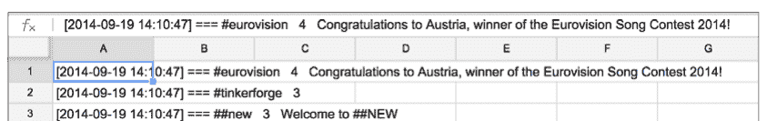

How can we easily create columns from this data in the spreadsheet? We would like each separate data item to be in its own column. By doing this, we will be able to, for example, take an average of the number of users on the channels or sort the data by the channel names. Right now, we cannot easily sort or use formulas on this data as it is all in one giant text string.

One strategy will be to use Excel's text-to-columns wizard to split the data into recognizable chunks; then, we can reassemble them and strip out extra characters if needed. This is shown in the steps mentioned as follows:

- 1. Highlight column A, and launch the text-to-columns wizard (located in the Data menu). In step 1, choose a fixed width, and in step 2, double-click on all the lines that have been drawn to delimit the description field. The following figure shows you how the data should look after delimiting the first few columns and removing all the extra lines:

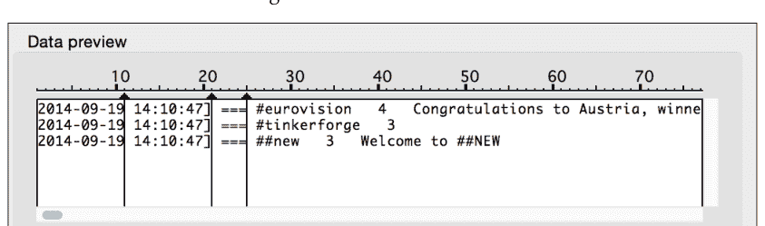

Fixed-width splitting in Excel.

The resulting data looks like the following figure. The first three columns are good, but the fixed-width delimiting did not work to separate the count of users and channel names in column D. This happened because the channel names are not as predictable in length as the previous columns.

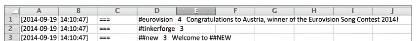

This is the result after the first round of text-to-columns splitting.


2. 我们这次需要再次运行文本分列，但仅针对 D 列，并使用分隔符而不是定宽程序。首先，请注意频道名称 #eurovision 与用户数 (4) 之间有两个空格，4 与频道描述之间也又有两个空格。尽管文本分列不允许我们输入两个空格作为分隔符（它只允许单个字符），我们可以使用查找-替换对话框将文本中所有出现的两个空格替换为其他地方未使用的符号。（先执行查找操作以确保。）我选择了 ^ 符号。

这一步看起来有点粗糙，所以如果你对替代方法感兴趣，我完全不怪你。Excel 在查找和替换错误文本的能力上比其他工具更受限制。我们将在本章后面的文本编辑器数据清理部分学习如何使用正则表达式。


添加一个不寻常的分隔字符可以让我们拆分剩余的列。

3. 现在，使用 **查找-替换** 从 A 列和 B 列中删除 [ 和 ] 字符，并将其替换为空。（在开始查找替换之前先选中这些列，以免意外地在整个工作表中删除符号。）

不幸的是，Excel 在其永无止境地试图帮助我们的过程中，会将这些日期转换为我们可能不喜欢的格式：9/19/2014。如果你希望它们恢复原样（2014-09-19），请选中整列并使用自定义格式对话框将日期格式指定为 yyyy-mm-dd。

4. **F** 列中的字符串开头仍有额外空格。我们可以使用 `trim()` 函数去除每个字符串值前面的额外空格。在 **F** 左侧插入一列，并按如下所示应用 `trim()` 函数：

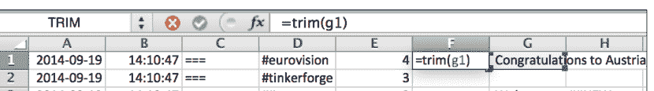

这是应用 `trim()` 函数去除首尾空格的结果。

5. 我们也可以对修剪后的文本应用 `clean()` 函数。这将删除前 32 个 ASCII 字符中的任何字符：所有可能以某种方式进入这些频道描述的非打印控制字符。你可以像这样在 `trim()` 函数外部应用 `clean()`：`clean(trim(g1))`。

6. 将 F1 框的角向下拖动，以将 `clean(trim())` 应用于 **F** 列其余单元格。

7. 选择 **F** 列，复制它，并在 **F** 列中使用 **粘贴值专用**，以便我们可以删除 **G** 列。

8. 删除 **G** 列。好了，现在你拥有了完美清理过的数据。

## 字符串拆分

Google Sheets 中可用而 Excel 中不可用的文本分列功能的轻量级版本是 split() 函数。该函数仅接收一个字符串值并将其拆分为各个组成部分。请注意，你需要提供足够的新的列来容纳拆分后的数据。在以下示例中，我们使用了与前一个示例相同的数据，但创建了三列新的列来保存来自 D 的拆分值。

| fx | =split(D1,"-") |
| --- | --- | --- | --- | --- |
|  | A | B | C | D |
| 1 | 2014 | 9 | 19 | 2014-09-19 |
| 2 | 2014 | 9 | 19 | 2014-09-19 |
| 3 | 2014 | 9 | 19 | 2014-09-19 |

## 字符串连接

concatenate() 函数接收多个字符串，可以是单元格引用或带引号的字符串，并将它们连接在一起放入新单元格中。在以下示例中，我们使用 concatenate() 函数将日期和时间字符串连接为一个。该函数在 Excel 和 Google Sheets 中都可用，如下图所示：

| fx | =CONCATENATE(B1," ",C1) |
| --- | --- | --- |
|  | A | B | C |
| 1 | 2014-09-19 14:10:47 | 2014-09-19 | 14:10:47 |
| 2 | 2014-09-19 14:10:47 | 2014-09-19 | 14:10:47 |
| 3 | 2014-09-19 14:10:47 | 2014-09-19 | 14:10:47 |

## 使用条件格式查找异常值

Excel 和 Google Sheets 都有条件格式功能。条件格式使用一组规则，根据是否满足某些条件（条件）来更改单元格或单元格的外观（格式）。我们可以用它来查找过高、过低、缺失或其它异常的数据。一旦识别出来，我们就可以清理它。

以下是如何在 Google Sheets 中使用条件格式来查找示例数据中频道名称不包含 # 且聊天参与者数量为空的行的方法：

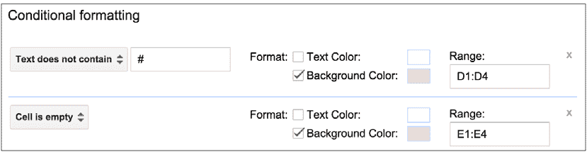

以下是更改背景单元格颜色后的结果，用于定位 D 列中不以 # 开头的单元格以及 E 列中为空的单元格。现在这些问题值可以通过目视检查轻松找到。

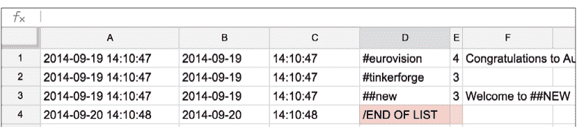

## 使用排序查找异常值

如果数据太多无法目视检查，那么我们可以尝试使用排序来查找麻烦的数据。在 Google Sheets 或 Excel 中，选择要排序的列，可以是整个工作表，然后在数据菜单中使用排序选项。对于大多数列来说，这都很容易实现，特别是如果你正在查找像 D4 单元格这样的数据时。

但是如果尝试按 E 列排序以查找缺失值会怎样？也许我们希望将所有缺失的数据放在一起，以便删除这些数据行。E4 的值为空。请记住第 2 章《基础知识 – 格式、类型和编码》中的内容，NULL（在 Google Sheets 用语中为空）无法与其他任何值进行比较，因此无论按 E 列从低到高还是从高到低排序，它都仍保留在排序列表的底部。

## 将电子表格数据导入 MySQL

现在你有一个充满干净数据的漂亮电子表格，你可能希望将其长期存储在数据库中。

## 从电子表格创建 CSV

许多数据库系统会通过围绕 CSV 文件构建的导入例程接受数据。如果使用 MySQL，有一个 LOAD DATA IN FILE 命令可以将数据直接从分隔文件吸入数据库，而且你甚至可以设置自己的分隔符。首先，让我们看一下该命令的示例，然后我们可以根据想要的参数在 Excel 中创建文件。

从 MySQL 命令行，我们可以运行：

```
load data local infile 'myFile.csv'
    into table freenode_topics
    fields terminated by ','
    (dateOfTopic, channel, numUsers, message);
```

这当然假设表已经创建。在这种情况下，它被称为 freenode_topics，并且其中有四列，这些列出现在此 SQL 查询的最后一行。

因此，此查询中引用的 CSV 文件 myFile.csv 需要按此顺序排列列并用逗号分隔。

在 Excel 中，可以通过导航到 文件 | 另存为，然后从格式选项列表中选择 CSV (MS-DOS) 来从工作簿中的当前工作表创建 CSV。在 Google Sheets 中，你可以通过导航到 文件 | 下载 | CSV 实现同样的目的。在这两种情况下，将文件保存到本地系统，然后启动 MySQL 客户端并按照前面所示的命令行操作。


> 如果你不喜欢使用 MySQL 命令行客户端，CSV 文件也可以使用 MySQL 自带的 Workbench 图形客户端或 PhpMyAdmin 等工具上传到服务器。PhpMyAdmin 确实对上传文件有大小限制（目前为 2 MB）。

## 使用电子表格生成 SQL

另一种将数据导入数据库的方法乍一看似乎很奇怪，但如果你由于某种原因——也许是权限错误或文件大小限制——无法通过前面讨论的 CSV 加载它，这可以节省大量时间。在此方法中，我们将在电子表格内部构建 INSERT 语句，然后在数据库中运行这些命令。

如果电子表格中的每一列代表数据库中的一列，那么我们只需在电子表格的列周围添加 SQL INSERT 命令的结构组件（带引号的字符串、括号、命令和行终止分号），然后将结果连接成一个巨大的 INSERT 命令字符串即可。

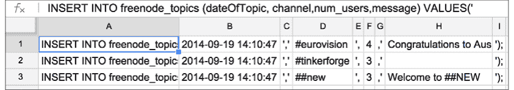

使用 concatenate (A1:I1) 函数将 A:I 列中的所有字符串连接起来后，我们得到的 INSERT 语句如下所示：

```
INSERT INTO freenode_topics (dateOfTopic, channel, num_users, message) VALUES('2014-09-19 14:10:47', '#eurovision',4, 'Congratulations to Austria, winner of the Eurovision Song Contest 2014!');
```

这些可以粘贴到用户友好的前端，例如 PhpMyAdmin 或 MySQL Workbench。或者，你也可以将其保存为文本文件（使用文本编辑器），一个 INSERT 语句接一个。我将我的文件命名为 inserts.sql。此文件现在可以使用命令行和 MySQL 客户端导入到数据库中，如下所示：

```
$mysql -uusername -p -hhostname databasename < inserts.sql
```

或者，可以使用 MySQL 命令行客户端中的 source 命令像这样导入：

```
$mysql -uusername -p -hhostname
[enter your password]
> use databasename;
> source inserts.sql
```

这两种方法都可以将数据导入 MySQL。如果脚本足够小，你也可以使用其中一个图形客户端，例如 MySQL Workbench。但是请注意不要将非常大的脚本加载到图形客户端中，因为客户端机器上的内存量可能不足以加载数百 GB 的 SQL。我更喜欢第二种方法（source），因为它在每次成功插入后都会打印出成功消息，这样我就能知道我的命令是正确的。


如果你对如何创建名为 `inserts.sql` 的文本文件不太清楚，那么下一节就是为你准备的。我们将介绍比你想象中更多关于文本编辑器的内容！

## 文本编辑器数据清洗

我们在 *第 2 章，基础 – 格式、类型和编码* 中了解到，文本编辑器是读取和创建文本文件的首选方式。这听起来合理，也完全说得通。当时我们没有真正解释的是，文本编辑器有时也被称为程序员编辑器，因为它具有许多很酷的功能，可以帮助程序员以及数据清洗人员等，他们必须整天处理文本文件。我们现在将参观一些最有用的功能。


> 每种操作系统都有数十种文本编辑器可供选择。有些需要付费，但许多是免费提供的。本章中，我将使用 Text Wrangler，这是一款适用于 OSX 的免费编辑器（可在此处获取： `http://www.barebones.com/products/textwrangler`）。本章中展示的功能在大多数其他编辑器中也很常见，例如 Sublime Editor，但如果你选择的编辑器中某个特定功能或工具的位置不明显，请查阅其文档。

## 文本微调

我们选择的文本编辑器内置了许多用于文本操作的实用功能。这里列出的功能代表了数据清洗任务中最常用的一些。请记住，在清洗一个文本文件的过程中，你可能需要在单个文本文件上运行数十个清洗例程，因此我们在 *第 1 章，为什么需要干净的数据？* 中关于如何清晰传达所做更改的提示在这里会非常有用。

**更改大小写** 是数据清洗中非常常见的需求。很多时候，我们继承的数据全部是小写或全部是大写。以下图片显示了 Text Wrangler 中用于对所选文本执行大小写更改的对话框。每个选项右侧显示了键盘快捷键。

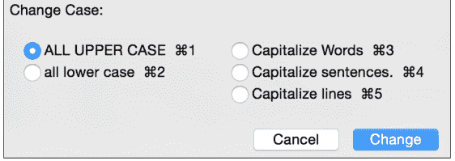

大小写更改选项包括大写和小写，以及将每个单词、行或句子的第一个单词的首字母大写。

在所选内容中的每一行添加或删除前缀或后缀是另一项常见任务。几天前我在构建文本分类器时，需要对大量文本行执行此操作。我需要为每一行添加后缀，即逗号和该行所示例的类别（正类或负类）的名称。以下是 Text Wrangler 中的前缀和后缀对话框。请注意，你可以在同一操作中选择插入或删除，但不能同时进行。如果需要执行这两个任务，请先执行一个，然后再执行另一个。

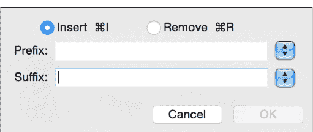

**清除小妖怪** 是文本编辑器的另一项优秀任务。Text Wrangler 和 Windows 版的 Sublime Editor 都具有此功能。在清除小妖怪时，编辑器可以查找任何超出你期望字符集的字符，例如控制字符、NULL 字符和非 ASCII 字符。它可以删除它们或用其字符代码替换它们。它也可以用你指定的任何字符替换小妖怪。这使得以后更容易找到它们。

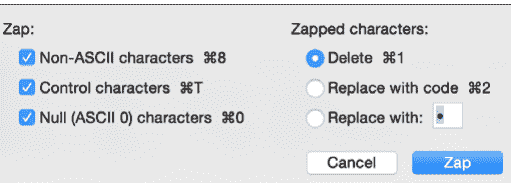

## 列模式

当文本编辑器处于列模式时，意味着你可以按列选择文本，而不仅仅是按行。以下是正常（非列）模式下选择的示例：

```
1 [2014-09-19 14:10:47] === #eurovision 4 Congratulations to Austria,
2 [2014-09-19 14:10:47] === #tinkerforge 3
3 [2014-09-19 14:10:47] === ##new 3 Welcome to ##NEW
4 [2014-09-19 14:10:47] === #postcyberpunk 3 Postcyberpunk related ma
5 [2014-09-19 14:10:47] === #osi 7 The Open Source Initiative
6 [2014-09-19 14:10:48] === #apg-dev 3 APG - latest version: 1.1.1 -
```

这是列模式下选择的示例。按住 Option 键并按列选择文本。文本被选中后，你可以像对待任何选定文本一样对待它：你可以删除它、剪切它或将其复制到剪贴板，或者使用我们在上一节中讨论的任何文本微调，只要它们适用于选择即可。

```
1 [2014-09-19 14:10:47] === #eurovision 4 Congratulations to Austria,
2 [2014-09-19 14:10:47] === #tinkerforge 3
3 [2014-09-19 14:10:47] === ##new 3 Welcome to ##NEW
4 [2014-09-19 14:10:47] === #postcyberpunk 3 Postcyberpunk related ma
5 [2014-09-19 14:10:47] === #osi 7 The Open Source Initiative
6 [2014-09-19 14:10:48] === #apg-dev 3 APG - latest version: 1.1.1 -
```

该功能的一些限制包括：

- 每个字符占一列，因此字符应以非比例、打字机样式的字体显示。
- 在 Text Wrangler 中，列模式仅在关闭换行时才有效。关闭软换行意味着你的行将向右延伸且不会被换行。
- 在 Text Wrangler 中，你所绘制的列的垂直高度必须能够由你手动绘制，因此这是一种适用于少量数据（数百或数千行，但可能不是数十万行）的技术。

## 重型查找和替换

文本编辑器在文本操作方面表现出色。使用文本编辑器进行列模式可能感觉很奇怪，因为这似乎更像是电子表格的自然任务。同样，在看到文本编辑器能做什么之后，使用电子表格进行查找-替换似乎也很别扭。

Text Wrangler 中 **查找** 对话框窗口的主要部分如下所示。提供的功能包括区分大小写的搜索选项、环绕搜索、在文本子选择中搜索，以及在整个单词内或单词的一部分内查找给定文本模式。你还可以将特殊字符、空白（包括制表符和行终止符）、表情符号等粘贴到文本框中。**查找** 框右侧的小下拉框提供额外功能。上面带时钟图标的下拉框保存最近的搜索和替换列表。下面带字母 **g** 的下拉框保存可能有用的内置搜索模式列表，并且该菜单底部有一个选项可将你自己的模式添加到列表中。

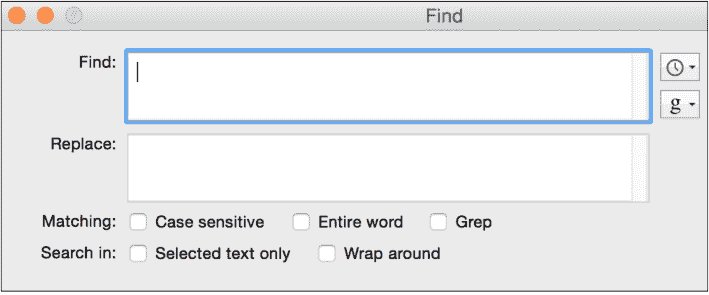

其中最强大的查找-替换功能由 **Grep** 复选框启用。选中此框允许我们对搜索使用正则表达式模式。简而言之，**正则表达式（regex）** 是一种用特殊语言编写的模式，由符号组成，旨在与某些字符串文本匹配。对正则表达式的完整论述超出了本书的范围，但可以说它们非常有用，我们在需要清洗数据时会定期使用它们。

> Text Wrangler 界面中的复选框说的是 Grep——而不是 RegEx 或 Match——是因为正则表达式模式匹配语言有几种细微的变体。Text Wrangler 正在向我们表明它使用的是 Grep 的那种变体，Grep 最初是为 Unix 编写的程序，也是最常见的变体。

在这里，我们将概述一些我们将反复用于清洗数据的必不可少的正则表达式符号。对于更复杂的模式，查阅一本专门的书籍或众多展示各种奇特正则表达式语法的网页是值得的：

| 符号 | 它做什么 |
|---|---|
| $ | 匹配行的末尾 |
| ^ | 匹配行的开头 |
| + | 匹配指定字符的一个或多个 |
| * | 匹配指定字符的零个或多个 |
| \w | 匹配任何单词字符（0-9、A-Z）。要匹配非单词字符，请使用 \W |
| \s | 匹配任何空白字符（制表符、换行符或回车符）。要匹配非空白字符，请使用 \S |
| \t | 匹配制表符 |
| \r | 匹配回车符。使用 \n 表示换行符。 |
| \ | 这是转义字符。它匹配其后的确切字符，而不是正则表达式模式字符。 |

以下是一些查找-替换组合示例，以便我们了解 Text Wrangler 如何与正则表达式配合使用。请确保选中 Grep 框。如果替换列中没有显示任何内容，则意味着应将替换字段留空。

| 查找 | 替换 | 它做什么 |
|---|---|---|
| \r |  | 查找换行符（行终止符）并将其替换为空。另一种说法是“将多行合并为一行”。 |
| ^\w+ | - | 匹配行的开头，后跟至少一个单词字符。在行前面添加一个 - 字符。 |
| \\r$ | \[end\] | 查找所有以实际 \r 字符（反斜杠后跟 r）结尾的行，并将它们替换为实际字符 [end]。请注意，[ 和 ] 也是特殊的正则表达式字符，因此要将它们用作实际字符，需要对其进行转义。 |

如果正则表达式看起来令人生畏，请放心。首先，回顾本章前面 *文本微调* 部分，大多数文本编辑器，包括 Text Wrangler，都具有许多内置的搜索和替换功能，这些功能基于最常见的正则表达式。因此，你可能会发现自己并不需要经常编写很多正则表达式。其次，由于正则表达式非常强大且有用，有很多在线资源可以供你查阅，以学习如何构建复杂的正则表达式，如果你需要的话。


我最喜欢的两个正则表达式资源是 Stack Overflow (http://stackoverflow.com) 和 regular-expressions.info (http://regular-expressions.info)。通过快速网络搜索，还可以找到众多正则表达式测试网站。这些网站让你能够在示例文本上编写和测试正则表达式。

## A word of caution

然而，使用在线正则表达式测试器时要小心，因为它们通常是为教授特定风格的正则表达式而设计的，例如 JavaScript、PHP 或 Python 内部的正则表达式解析器。你想做的事情在你的文本编辑器中可能与这些语言中的正则表达式语法相同，也可能不相同。取决于你尝试完成任务的复杂程度，更好的做法可能只是创建一份文本数据的备份副本（或将相关文本的小样本提取到新文件中），然后在自己的文本编辑器中使用其正则表达式语法进行实验。

## Text sorting and processing duplicates

一旦我们对正则表达式进行了一点实验，就会发现文本编辑器偶尔会在其他菜单选项中提供这些模式匹配技术，例如在排序和重复处理中。考虑以下排序对话框，看看如何将正则表达式应用于多行排序：

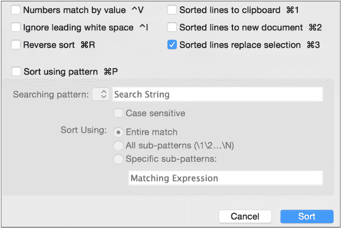

在这种情况下，我们可以使用“使用模式排序”复选框输入一个正则表达式模式来进行排序。重复处理对话框类似。你可以告诉编辑器是保留原始行还是删除它。有趣的是，如果你需要将它们用于其他用途，例如保留已删除行的日志，你还可以将重复项删除到另一个文件或剪贴板中。

> 在数据清洗中，最好至少考虑将已删除的行保存到自己的文件中，以防将来需要再次使用它们。

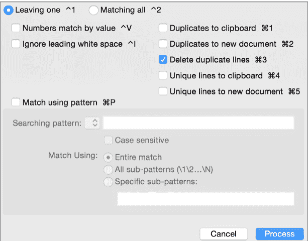

## Process Lines Containing

Text Wrangler 中的一个实用功能称为 Process Lines Containing。它将搜索（包括使用正则表达式的可能性）与逐行处理混合，例如将受影响的行移至另一个文件或剪贴板，或删除匹配的行。

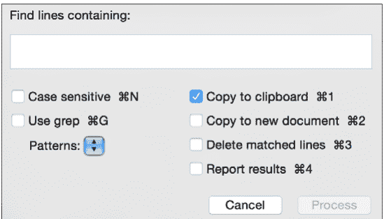

## An example project

在本示例项目中，我们将下载一个电子表格，使用 Excel 或文本编辑器对其进行清理，然后在其上运行一些简单的分析。

## Step one – state the problem

本项目灵感来源于《高等教育纪事报》Chronicle of Higher Education 提供的一些数据，这是一份关于大学和高校新闻与动态的出版物。2012 年，他们创建了一个名为 “Who does your college think its peers are?” 的互动功能。在此功能中，用户可以输入任何美国大学或学院的名称到表单中，并查看一个互动可视化，显示哪些其他大学将该目标学校视为同行。Peers 是在某种程度上相似的大学。原始数据来自美国政府报告，但《纪事报》已将此可视化背后的数据免费提供给任何人使用。

对于本示例，我们感兴趣的是一个互补的问题：当 University X 出现在一个列表中时，这些列表上还有哪些其他大学？要回答这个问题，我们需要找到所有与 University X 一起列出的其他大学，然后统计每个大学名称出现的次数。

## Step two – data collection

在此步骤中，我们将逐步了解收集数据然后清理数据的流程。接下来的章节将讨论我们为项目收集适当数据所需采取的行动。

## Download the data

本项目的数据可以从原始文章 http://chronicle.com/article/Who-Does-Your-College-Think/134222/ 下载，或从电子表格的直接链接 https://s3.amazonaws.com/03peers/selected_peers.csv.zip 下载。

文件是压缩的，因此使用你选择的解压程序解压文件。

## Get familiar with the data

ZIP 文件夹内的文件具有 .csv 扩展名，确实是一个 CSV 分隔文件，共有 1,686 行，包括标题行。逗号分隔两列：第一列是所讨论大学的名称，第二列是原始大学列为同行的所有大学列表。这些同行本身由竖线字符 | 分隔。以下是示例行：

```
Harvard University,Yale University|Princeton University|Stanford University
```

在这种情况下，第一列说明 Harvard University 是目标大学，第二列显示 Yale、Princeton 和 Stanford 已被 Harvard 列为其同行。

## Step three – data cleaning

由于本示例的目标是查看某一特定大学以及它被列为其他大学同行的所有时间，我们首先要清理掉不包含目标大学的任何行。然后我们将文件转换为单个长列表，其中包含单个大学。此时，我们的数据将被清理干净，我们就可以进入分析和可视化步骤。

## Extracting relevant lines

让我们比较提取相关行的两种方法：一种使用电子表格，另一种使用本章概述的技术配合文本编辑器。

## Using a spreadsheet

在电子表格程序中打开文件，使用条件格式突出显示包含 Harvard 书面内容的任何行（或你选择的目標大学），然后删除其余行。

## Using a text editor

在文本编辑器中打开文件并使用 **Process Lines Containing** 查找包含 **Harvard University** 短语（或你选择的大学）的所有行，然后将其复制到新文件。

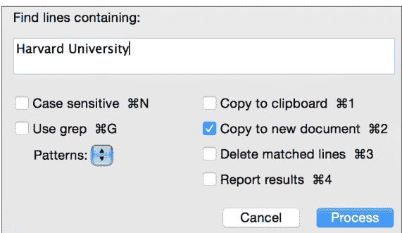

无论采用哪种选项，此过程的结果都是一个包含 26 行的新文件，所有行都在某处包含 **Harvard University**。

## Transform the lines

现在我们有一个包含 26 行的文件，每行包含多个大学（宽数据）。我们预计在某个时候可能会将文件读入 Python 以执行大学的简单频率计数。因此，我们决定将其更改为长数据，每行一个大学。

为了将文件转换为每行一个大学，我们将使用文本编辑器并进行三次查找和替换。首先，我们将查找逗号并将其替换为 \r（回车）。

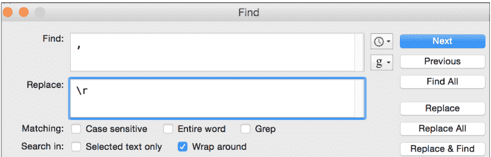

接下来，查找竖线字符 | 的实例并将其替换为 \r。此时，文本文件有 749 行。

最后，我们需要删除所有 Harvard University 的实例。记住，我们只对与 Harvard 一起提及的同行感兴趣，因此我们不需要在计数中包含 Harvard 本身。在 Text Wrangler 中，我们可以在查找框中输入 Harvard University\r 并将替换框留空。这将删除 26 行，文件总共剩下 723 行。

## Step four – data analysis

由于我们的主要重点是数据清理，我们不会花费太多时间在分析和可视化上，但这里有一个快速的 Python 脚本来计算这些同行与 Harvard 一起出现在某所大学列表中的次数：

```
from collections import Counter
with open('universities.txt') as infile:
    counted = Counter(filter(None, [line.strip() for line in infile]))
    sorted = counted.most_common()
    for key,value in sorted:
        print key,",", value
```

结果显示有 232 所独特的大学以及该大学被提及的次数。以下是前几项结果。我们可以这样解释这些结果：

- 当 Harvard 被提及为同行时，Yale 也被提及 26 次：

Yale University , 26
Princeton University , 25
Cornell University , 24
Stanford University , 23
Columbia University in the City of New York , 22
Brown University , 21
University of Pennsylvania , 21

此时，你可以取该列表（或更长列表的一部分）并将其输入条形图或词云或你认为具有说服力或有趣的任何类型的可视化。由于数据是逗号分隔的，你甚至可以轻松将其粘贴到电子表格程序中进行进一步分析。但在这一点上，我们已经回答了关于给定目标大学时哪些同行被提及最多的初始问题。


## 摘要

在本章中，我们学习了一些非常实用的数据清洗技巧，使用两种易于获取的工具：文本编辑器和电子表格。我们概述了电子表格中用于拆分数据、移动数据、查找和替换部分、格式化数据，然后重新组合的可用函数。然后，我们学习了如何充分利用简单的文本编辑器，包括一些内置功能，以及如何最有效地使用查找和替换和正则表达式。

在下一章中，我们将把迄今为止学到的各种技术组合起来执行一些重要的文件转换。我们将使用的许多技术都基于我们在过去两章中关于文本编辑、正则表达式、数据类型和文件格式所学的内容，因此请准备好解决一些现实世界的数据清洗问题。
