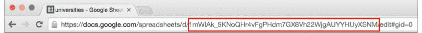
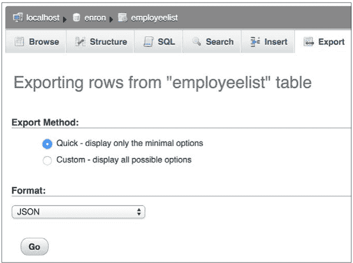
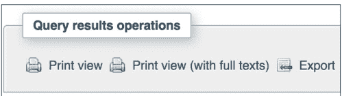
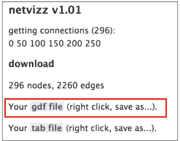
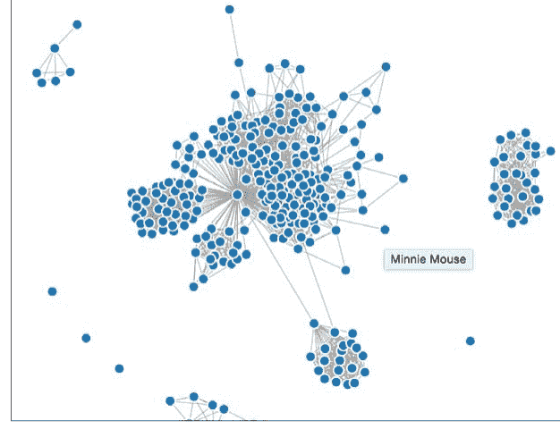

# 第4章：说通用语 – 数据转换

去年夏天，我在一所当地烹饪学校上了一门制作奶酪的课程。我们做的第一件事之一就是里科塔奶酪。我很高兴地了解到里科塔奶酪只需用牛奶和发酵奶即可在大约一个小时内制作出来，而且发酵奶本身可以用牛奶和柠檬汁制作。在厨房里，原料不断被转化为其他原料，而这些原料又会被转化为美味的餐点。在我们的数据科学厨房里，我们将常规地执行从一种数据格式到另一种数据格式的转换。我们可能需要这样做，以便执行各种分析，当我们想要合并数据集时，或如果我们需要以新的方式存储数据集。

Lingua franca 是一种被采纳为不同语言使用者之间对话的通用标准的语言。在转换数据时，有几种数据格式可以作为通用标准。我们在第 2 章《基础 – 格式、类型和编码》中介绍了一些这些格式。JSON 和 CSV 是最常见的两种。在本章中，我们将花一些时间学习：

- 如何使用软件工具和语言（Excel、Google Spreadsheets 和 phpMyAdmin）执行快速的 JSON 和 CSV 转换。
- 如何编写 Python 和 PHP 程序来生成不同的文本格式并在它们之间转换。
- 如何实现数据转换以完成一项现实世界的任务。在此项目中，我们将使用 netvizz 软件从 Facebook 下载一个好友网络，并将数据清理并转换为构建 D3 中社交网络可视化的所需 JSON 格式。然后，我们将以不同的方式清理数据，将其转换为社交网络包 networkx 所需的 Pajek 格式。

### 基于工具的快速转换

将少量到中等量的数据转换为另一种格式的最快、最简单的方法之一就是直接让您正在使用的软件工具为您完成。有时，您正在使用的应用程序已经具有将数据转换为所需格式的选项。就像 *第 3 章《清洁数据的 workhorses – 电子表格和文本编辑器》* 中的技巧一样，我们希望尽可能利用工具中的这些隐藏功能。如果您的数据对于基于应用程序的转换来说太多，或者您想要的特定转换不可用，我们将在即将到来的章节 *使用 PHP 转换* 和 *使用 Python 转换* 中介绍编程解决方案。

### 电子表格到 CSV

将电子表格保存为分隔文件相当直接。Excel 和 Google 电子表格都具有 **File** 菜单选项 **Save As**；在此选项中，选择 **CSV (MS DOS)**。此外，Google Spreadsheets 具有保存为 Excel 文件和保存为制表符分隔文件的选项。将内容保存为 CSV 有一些限制：

- 在 Excel 和 Google Spreadsheets 中，使用 **Save As** 功能时，只会保存当前工作表。这是因为 CSV 文件本质上只描述一组数据；因此，它不能包含多个工作表。如果您有多个工作表的电子表格，您需要将每个工作表保存为单独的 CSV 文件。
- 在这两个工具中，自定义 CSV 文件的选项相对较少，例如，Excel 使用逗号作为分隔符保存数据（作为 CSV 文件，这是有意义的），并且不提供将数据值用引号括起或使用不同行终止符的选项。

### 电子表格到 JSON

JSON 比 CSV 更难处理。Excel 没有易用的 JSON 转换器，尽管网上有几个转换工具声称可以为您将 CSV 文件转换为 JSON。

Google Spreadsheets 然而，可以通过 URL 获得 JSON 转换器。这种方法有几个缺点，首先是您必须将文档发布到网络（至少暂时）才能访问其 JSON 版本。您还必须使用一些非常长的数字来自定义 URL，这些数字标识了您的电子表格。它还会在 JSON 转储中产生大量信息——可能比您想要或需要的多得多。尽管如此，这里有一些逐步说明，可将 Google 电子表格转换为其 JSON 表示形式。

### 第一步 – 将 Google 电子表格发布到网络

在创建并保存 Google 电子表格后，从 **File** 菜单中选择 **Publish to the Web**。点击后续的对话框（我为我的选择了所有默认设置）。此时，您就可以通过 URL 访问此文件的 JSON。

### 第二步 – 创建正确的 URL

从已发布的 Google 电子表格创建 JSON 的 URL 模式如下所示：

```
http://spreadsheets.google.com/feeds/list/key/sheet/public/basic?alt=json
```

您需要更改此 URL 的三个部分以匹配您的特定电子表格文件：

- **list**：(可选) 您可以将 `list` 更改为例如 cells，如果您希望在 JSON 文件中分别列出每个单元格及其引用（A1、A2 等）。如果您希望每个行作为一个实体，请在 URL 中保留 `list`。
- **key**：将此 URL 中的 `key` 更改为与 Google 内部用于表示您的文件的长唯一数字相匹配。在您在浏览器中查看电子表格的 URL 中，此 key 显示为 `/spreadsheets/d` 部分之后、两个斜杠之间的长标识符，如下所示：
- **sheet**：将示例 URL 中的 sheet 词更改为 `od6` 以表示您有兴趣转换第一个工作表。



> od6是什么意思？Google 使用代码来表示每个工作表。然而，代码并不是严格按数字顺序排列的。关于编号方案的详细讨论可以在 Stack Overflow 帖子及其答案中的问题上找到：http://stackoverflow.com/questions/11290337/

为了测试此过程，我们可以为第 3 章《清洁数据的 workhorses – 电子表格和文本编辑器》中示例项目末尾练习生成的大学和计数创建一个 Google 电子表格。此电子表格的前三行如下所示：

| 耶鲁大学 | 26 |
| 普林斯顿大学 | 25 |
| 康奈尔大学 | 24 |

我的 URL 通过 JSON 访问此文件如下所示：

```
http://spreadsheets.google.com/feeds/list/1mWIAk_5KNoQHr4vFgPHdm7GX8Vh22WjgAUYYHU yXSNM/od6/public/basic?alt=json
```

将此 URL 粘贴到浏览器中会生成数据的 JSON 表示。它包含 231 个条目，每个条目看起来都像以下片段。我已为便于阅读在此条目中添加了换行符：

```
{
  "id":{
    "$t":"https://spreadsheets.google.com/feeds/list/1mWIAk_5KNoQHr4vFgPHdm7GX8Vh22WjgAUYYHU yXSNM/od6/public/basic/cokwr"
  },
  "updated":{"$t":"2014-12-17T20:02:57.196Z"},
  "category":[{
    "scheme":"http://schemas.google.com/spreadsheets/2006",
    "term" :"http://schemas.google.com/spreadsheets/2006#list"
  }],
  "title":{
    "type":"text",
    "$t"  :"Yale University "
  },
  "content":{
    "type":"text",
    "$t"  :"_cokwr: 26"
  },
  "link": [{
    "rel" :"self",
    "type":"application/atom+xml",
    "href":"https://spreadsheets.google.com/feeds/list/1mWIAk_5KNoQHr4vFgPHdm7GX8Vh22WjgAUYYHU yXSNM/od6/public/basic/cokwr"
  }]
}
```


即使经过我的重新格式化，这个 JSON 也不太美观，而且其中许多名称-值对对我们来说并不有趣。尽管如此，我们还是成功生成了一个功能性的 JSON。如果我们使用程序来消费这个 JSON，我们将忽略有关电子表格本身的所有多余信息，只关注标题和内容实体以及 $t 值（在本例中为 Yale University 和 _cokwr: 26）。这些值在前一个示例中显示的 JSON 中被突出显示。如果你想知道是否可以将电子表格转换为 CSV 再转换为 JSON，答案是肯定的。我们将在本章后面的“使用 PHP 转换”和“使用 Python 转换”部分详细介绍如何做到这一点。

## 使用 phpMyAdmin 将 SQL 转换为 CSV 或 JSON

在本节中，我们将讨论两种无需编程即可直接从数据库写入 JSON 和 CSV 的选项，MySQL 在我们的例子中。

首先，phpMyAdmin 是一个非常常见的 MySQL 数据库基于 Web 的前端。如果您使用的是该工具的现代版本，您将能够导出整个表或查询结果为 CSV 或 JSON 文件。使用我们在第 1 章 Why Do You Need Clean Data? 中首次访问的同一个 enron 数据库，请考虑以下导出选项卡的屏幕截图，其中 JSON 被选为整个 employeelist 表的目标格式（CSV 也可在该选择框中使用）：



PhpMyAdmin JSON export for entire tables

导出查询结果的过程非常相似，只是不要使用屏幕顶部的导出选项卡，而是运行 SQL 查询，然后在页面底部的“查询结果操作”下使用导出选项，如下所示：



PhpMyAdmin can export the results of a query as well

以下是我们可以在 employeelist 表上运行以测试此过程的简单查询：

```sql
SELECT concat(firstName, " ", lastName) as name, email_id
FROM employeelist
ORDER BY lastName;
```

当我们将结果导出为 JSON 时，phpMyAdmin 会向我们显示 151 个值，格式如下：

```json
{
  "name": "Lysa Akin",
  "email_id": "lysa.akin@enron.com"
}
```

phpMyAdmin 工具很好，并且在转换存储在 MySQL 中的中等数量的数据时非常有效，特别是作为查询的结果。如果您使用的是不同的 RDBMS，您的 SQL 接口很可能也有一些自己的格式选项，您应该探索一下。

另一种策略是完全绕过 phpMyAdmin，只使用 MySQL 命令行来写出您想要格式化的 CSV 文件：

```sql
SELECT concat(firstName, " ", lastName) as name, email_id
INTO OUTFILE 'enronEmployees.csv'
FIELDS TERMINATED BY ',' OPTIONALLY ENCLOSED BY '"'
LINES TERMINATED BY '\n'
FROM employeelist;
```

这将使用指定的名称写入一个逗号分隔的文件（employees.csv）。它将被写入当前目录。

那 JSON 呢？使用这种策略没有非常干净的方式输出 JSON，因此您应该使用前面显示的 phpMyAdmin 解决方案，或者使用用 PHP 或 Python 编写的更强大的解决方案。这些编程解决方案将在后面的部分中介绍，所以请继续阅读。

## 使用 PHP 转换

在我们的第 2 章 Fundamentals – Formats, Types, and Encodings 中，在关于 JSON 数值格式的讨论中，我们简要展示了如何使用 PHP 连接到数据库、运行查询、从结果构建 PHP 数组，然后将 JSON 结果打印到屏幕上。在这里，我们首先将此示例扩展为写入文件而不是打印到屏幕，并写入 CSV 文件。接下来，我们将展示如何使用 PHP 读取 JSON 文件并转换为 CSV 文件，反之亦然。

### 使用 PHP 将 SQL 转换为 JSON

在本节中，我们将编写一个 PHP 脚本来连接到 enron 数据库，运行 SQL 查询，并将其导出为 JSON 格式的文件。为什么要为此编写 PHP 脚本而不是使用 phpMyAdmin？嗯，这种策略在我们需要在导出数据之前对数据进行额外处理，或者我们怀疑数据量超过基于 Web 的应用程序（如 phpMyAdmin）所能处理的情况时很有用：

```php
<?php
// connect to db, set up query, run the query
$dbc = mysqli_connect('localhost','username','password','enron')
or die('Error connecting to database!' . mysqli_error());

$select_query = "SELECT concat(firstName, \" \", lastName) as
    name, email_id FROM employeelist ORDER BY lastName";

$select_result = mysqli_query($dbc, $select_query);

if (!$select_result)
    die ("SELECT failed! [$select_query]" . mysqli_error());

// ----JSON output----
// build a new array, suitable for json
$counts = array();
while($row = mysqli_fetch_array($select_result))
{
```
```
// add onto the json array
    array_push($counts, array('name'     => $row['name'],
    'email_id' => $row['email_id']));
}
// encode query results array as json
$json_formatted = json_encode($counts);

// write out the json file
file_put_contents("enronEmail.json", $json_formatted);
?>
```

这段代码将 JSON 格式的输出文件写入 file_put_contents() 行中指定的位置。

### 使用 PHP 将 SQL 转换为 CSV

以下代码片段展示了如何使用 PHP 文件输出流创建 SQL 查询结果的 CSV 格式文件。将此代码保存为 Web 服务器上脚本可用的目录中的 .php 文件，然后在浏览器中请求该文件。它将自动下载包含正确值的 CSV 文件：

```php
<?php
// connect to db, set up query, run the query
    $dbc = mysqli_connect('localhost','username','password','enron')
    or die('Error connecting to database!' . mysqli_error());

$select_query = "SELECT concat(firstName, \" \", lastName) as
    name, email_id FROM employeelist ORDER BY lastName";

$select_result = mysqli_query($dbc, $select_query);

if (!$select_result)
    die ("SELECT failed! [$select_query]" . mysqli_error());

// ----CSV output----
// set up a file stream
$file = fopen('php://output', 'w');
if ($file && $select_result)
{
    header('Content-Type: text/csv');
    header('Content-Disposition: attachment;
    filename="enronEmail.csv"');
    // write each result row to the file in csv format
```
```
while($row = mysqli_fetch_assoc($select_result))
{
    fputcsv($file, array_values($row));
}
?>
```

结果的格式如下（仅显示前三行）：

```
"Lysa Akin",lysa.akin@enron.com
"Phillip Allen",k..allen@enron.com
"Harry Arora",harry.arora@enron.com
```

如果你想知道 Phillip 的电子邮件是否真的应该有两个点，我们可以运行一个快速查询来找出 Enron 有多少电子邮件的格式是这样的：

```sql
SELECT CONCAT(firstName, " ", lastName) AS name, email_id
FROM employeelist
WHERE email_id LIKE "%..%"
ORDER BY name ASC;
```

结果发现 24 个电子邮件地址的格式与此类似，带有双点。

### 使用 PHP 将 JSON 转换为 CSV

在这里，我们将使用 PHP 读取 JSON 文件并将其转换为 CSV 并输出文件：

```php
<?php
// read in the file
$json = file_get_contents("outfile.json");
// convert JSON to an associative array
$array = json_decode ($json, true);
// open the file stream
$file = fopen('php://output', 'w');
header('Content-Type: text/csv');
header('Content-Disposition: attachment;
filename="enronEmail.csv"');
// loop through the array and write each item to the file
foreach ($array as $line)
{
    fputcsv($file, $line);
}
?>
```

这段代码将创建一个 CSV，其中包含每一行，就像之前的示例一样。我们应该注意 file_get_contents() 函数会将文件作为字符串读入内存，因此对于极大的文件，您可能需要改用 fread()、fgets() 和 fclose() PHP 函数的组合。

### 使用 PHP 将 CSV 转换为 JSON

另一个常见任务是读取 CSV 文件并将其写出为 JSON 文件。大多数时候，我们有一个 CSV，其第一行是标题行。标题行列出了文件中每一列的列名，我们希望标题行中的每一项都成为 JSON 格式的文件的键：

```php
<?php
$file = fopen('enronEmail.csv', 'r');
$headers = fgetcsv($file, 0, ',');
$complete = array();

while ($row = fgetcsv($file, 0, ','))
{
    $complete[] = array_combine($headers, $row);
}
fclose($file);
$json_formatted = json_encode($complete);
file_put_contents('enronEmail.json',$json_formatted);
?>
```

此代码对前面创建的带有标题行的 enronEmail.csv 文件的结果如下：

```
[{"name":"Lysa Akin","email_id":"lysa.akin@enron.com"},
{"name":"Phillip Allen","email_id":"k..allen@enron.com"},
{"name":"Harry Arora","email_id":"harry.arora@enron.com"},...]
```

对于此示例，实际 CSV 文件中的 151 个结果中，仅显示了前三行。

## 使用 Python 转换

在本节中，我们描述了多种使用 Python 将 CSV 转换为 JSON 以及反之亦然的方法。在这些示例中，我们将探索使用专门安装的库和使用更原生的 Python 代码来实现此目标的不同方法。


## 使用 Python 将 CSV 转换为 JSON

我们找到了几种使用 Python 将 CSV 文件转换为 JSON 的方法。其中第一种使用内置的 csv 和 json 库。假设我们有一个 CSV 文件，其行如下所示（仅显示前三行）：

```
name,email_id
"Lysa Akin",lysa.akin@enron.com
"Phillip Allen",k..allen@enron.com
"Harry Arora",harry.arora@enron.com
```

我们可以编写一个 Python 程序来读取这些行并将其转换为 JSON：

```
import json
import csv

# read in the CSV file
with open('enronEmail.csv') as file:
    file_csv = csv.DictReader(file)
    output = '['
    # process each dictionary row
    for row in file_csv:
        # put a comma between the entities
        output += json.dumps(row) + ','
    output = output.rstrip(',') + ']'
# write out a new file to disk
f = open('enronEmailPy.json','w')
f.write(output)
f.close()
```

生成的 JSON 将如下所示（仅显示前两行）：

```
[{"email_id": "lysa.akin@enron.com", "name": "Lysa Akin"},
{"email_id": "k..allen@enron.com", "name": "Phillip Allen"},...]
```

使用这种方法的一个好处是，除了获取和放置正在读取（CSV）和写入（JSON）的文件外，它不需要任何特殊库安装或命令行访问。

## 使用 csvkit 将 CSV 转换为 JSON

第二种将 CSV 更改为 JSON 的方法依赖于一个非常有趣的 Python 工具包，称为 **csvkit**。要使用 Canopy 安装 csvkit，只需启动 Canopy 终端窗口（您可以在 Canopy 中通过导航到 **工具 | Canopy 终端** 找到它），然后运行 `pip install csvkit` 命令。使用 csvkit 的所有依赖项都将为您安装。在这一点上，您可以选择通过 Python 程序作为库使用 `import csvkit` 访问 csvkit，或通过命令行访问，正如我们在以下片段中所做的那样：

```
csvjson enronEmail.csv > enronEmail.json
```

此命令获取 `enronEmail.csv` CSV 文件并快速无痛地将其转换为 JSON `enronEmail.csvkit.json` 文件。

csvkit 包附带了几个其他非常有用的命令行程序，包括 `csvcut`，它可以从 CSV 文件中提取任意列列表，以及 `csvformat`，它可以对 CSV 文件执行分隔符交换或更改行结束符或类似的清理操作。`csvcut` 程序特别有帮助，如果您只想提取几列进行处理。对于这些命令行工具中的任何一个，您都可以将其输出重定向到新文件。以下命令行获取名为 `bigFile.csv` 的文件，剪切出第一列和第三列，并将结果保存为新的 CSV 文件：

```
csvcut bigFile.csv -c 1,3 > firstThirdCols.csv
```


有关 csvkit 的更多信息，包括完整文档、下载和示例，可在 http://csvkit.rtfd.org/ 获取。

## Python JSON 到 CSV

使用 Python 读取 JSON 文件并将其转换为 CSV 进行处理非常简单：

```
import json
import csv

with open('enronEmailPy.json', 'r') as f:
    dicts = json.load(f)
out = open('enronEmailPy.csv', 'w')
writer = csv.DictWriter(out, dicts[0].keys())
writer.writeheader()
writer.writerows(dicts)
out.close()
```

此程序获取名为 `enronEmailPy.json` 的 JSON 文件，并使用 JSON 的键作为新文件中的标题行导出此文件的 CSV 格式版本，名为 `enronEmailPy.csv`。

## 示例项目

在本章中，我们专注于将数据从一种格式转换为另一种格式，这是在完成其余数据分析项目之前需要反复进行的一项常见数据清理任务。我们专注于一些非常常见的文本格式（CSV 和 JSON）以及数据的常见位置（文件和 SQL 数据库）。现在，我们准备通过一个示例项目来扩展我们对数据转换的基本知识，该项目将要求我们在一些不太标准化——但仍基于文本——的数据格式之间进行转换。

在这个项目中，我们想调查我们的 Facebook 社交网络。我们将：

- 1. 使用 netvizz 将我们的 Facebook 社交网络（朋友及其之间的关系）下载为一种名为 **图描述格式 (GDF)** 的基于文本的文件格式。
- 2. 构建 Facebook 社交网络的图形表示，将我们网络中的人员显示为节点，将他们的友谊显示为这些节点之间的连接线（称为 *边*）。为此，我们将使用 D3 JavaScript 图形库。该库期望网络中数据的 JSON 表示。
- 3. 计算有关社交网络的一些指标，例如网络的大小（称为网络的 *度*）以及我们网络中两个人之间的最短路径。为此，我们将使用 Python 中的 `networkx` 包。该包期望数据采用基于文本的格式，称为 **Pajek** 格式。

该项目的首要目标是展示如何协调所有这些不同的预期格式（GDF、Pajek 和 JSON）并执行从一种格式到另一种格式的转换。我们的次要目标是实际提供足够的示例代码和指导来执行我们社交网络的小型分析。

### 第一步 – 将 Facebook 数据下载为 GDF

对于此步骤，您需要登录您的 Facebook 帐户。使用 Facebook 的搜索框查找 netvizz 应用，或使用此 URL 直接链接到 netvizz 应用：`https://apps.facebook.com/netvizz/`。

进入 netvizz 页面后，单击 **个人网络**。随后的页面解释说，单击 **开始** 按钮将提供一个可下载文件，其中包含两项：一份列出您所有朋友及其之间连接的 GDF 格式文件，以及一份制表符分隔的 **制表符分隔值 (TSV)** 统计文件。我们主要对本项目的 GDF 文件感兴趣。单击 **开始** 按钮，然后在随后的页面上，右键单击 GDF 文件将其保存到本地磁盘，如以下屏幕截图所示：



netvizz Facebook 应用允许我们将社交网络下载为 GDF 文件

在这一点上，给文件一个更短的名称也可能有所帮助。（我将我的文件命名为 `personal.gdf` 并将其保存在为此项目创建的目录中。）

### 第二步 – 在文本编辑器中查看 GDF 文件格式

在文本编辑器中打开文件（我使用的是 Text Wrangler），并注意该文件格式的几点：

- 1. 文件分为两部分：nodes 和 edges。
- 2. nodes 位于文件的第一部分，以单词 `nodedef` 开头。节点列表是我所有朋友的列表以及关于他们的一些基本事实（他们的性别和他们内部的 Facebook 识别号码）。节点按人员加入 Facebook 的日期顺序列出。
- 3. 文件的第二部分显示了我朋友之间的 edges 或连接。有时，这些也称为 links。文件此部分以单词 `edgedef` 开头。edges 描述我的哪些朋友与哪些其他朋友相连。

这里是一个 nodes 部分的摘录：

```
nodedef>name VARCHAR,label VARCHAR,sex VARCHAR,locale VARCHAR,agerank INT
1234,Bugs Bunny,male,en_US,296
2345,Daffy Duck,male,en_US,295
3456,Minnie Mouse,female,en_US,294
```

这里是一个 edges 部分的摘录。它显示 Bugs（1234）和 Daffy（2345）是朋友，Bugs 也与 Minnie（3456）是朋友：

```
edgedef>node1 VARCHAR,node2 VARCHAR
1234,2345
1234,3456
3456,9876
```

### 第三步 – 将 GDF 文件转换为 JSON

我们想要执行的任务是构建此数据的社交网络表示形式 in D3。首先，我们需要查看数十个可用的 D3 示例来构建社交网络，例如 D3 示例画廊中可用的示例，https://github.com/mbostock/d3/wiki/Gallery 和 http://christopheviau.com/d3list/。

这些社交网络图示例依赖于 JSON 文件。每个 JSON 文件显示 nodes 及其之间的 edges。这里是一个这些 JSON 文件应如下所示的示例：

```
{"nodes": [
  {"name":"Bugs Bunny"},
  {"name":"Daffy Duck"},
  {"name":"Minnie Mouse"}],
"edges": [
  {"source": 0,"target": 2},
  {"source": 1,"target": 3},
  {"source": 2,"target": 3}]}
```

关于此 JSON 代码最重要的一点是注意它与 GDF 文件一样具有相同的两个主要部分：nodes 和 edges。nodes 只是人的姓名。edges 是表示友谊关系的数字对列表。然而，这些对没有使用 Facebook 识别号码，而是使用 nodes 列表中每个项目的索引，从 0 开始。


目前我们还没有 JSON 文件。我们只有一份 GDF 文件。我们将如何构建这个 JSON 文件？仔细查看 GDF 文件后，可以发现它看起来很像两份 CSV 文件叠放在一起。从本章前面部分我们知道，有几种不同的策略可以将 CSV 转换为 JSON。

因此，我们决定先将 GDF 转换为 CSV，再将 CSV 转换为 JSON。


> 等等；如果那个 JSON 示例看起来不像我在网上找到的用于在 D3 中绘制社交网络图的 JSON 文件怎么办？
> 你在网上找到的一些 D3 社交网络可视化示例会为每个节点或链接显示许多额外的值，例如，它们可能包含可用于表示大小差异、悬停功能或颜色变化的额外属性，如此示例所示： http://bl.ocks.org/christophermanning/1625629。
> 此可视化显示了芝加哥付费政治游说者的关系。在此示例中，代码会考虑 JSON 文件中的信息来确定节点的圆圈大小以及悬停在节点上时显示的文本。它制作出非常漂亮的图表，但很复杂。由于我们的主要目标是学习如何清理数据，我们将在此使用一个精简、简单的示例，其中没有太多这些额外内容。别担心；我们的示例仍然会构建一个不错的 D3 图表！

将 GDF 文件转换为我们想要的格式的 JSON 时，可以按照以下步骤操作：

- 1. 使用文本编辑器将 `personal.gdf` 文件拆分为两个文件，`nodes.gdf` 和 `links.gdf`。
- 2. 修改每个文件中的标题行，使其与我们最终希望在 JSON 文件中使用的列名相匹配：
```
id,name,gender,lang,num
1234,Bugs Bunny,male,en_US,296
2345,Daffy Duck,male,en_US,295
9876,Minnie Mouse,female,en_US,294

source,target
1234,2345
1234,9876
2345,9876
```
- 3. 使用 `csvcut` 工具（之前讨论过的 csvkit 的一部分）从 `nodes.gdf` 文件中提取第一列和第二列，并将输出重定向到名为 `nodesCut.gdf` 的新文件：
```
csvcut -c 1,2 nodes.gdf > nodesCut.gdf
```

- 4. 现在，我们需要为每条边对赋予索引值，而不是其完整的 Facebook ID 值。索引只是通过其在节点列表中的位置来标识该节点。我们需要执行此转换，以便数据能够轻松地输入到我们现有的 D3 力网络代码示例中，且尽可能少地进行重构。我们需要将此内容转换为：
```
source,target
1234,2345
1234,9876
2345,9876
```
into this:
```
source,target
0,1
0,2
1,2
```
下面是一个小型 Python 脚本，可自动创建这些索引值：
```
import csv

# read in the nodes
with open('nodesCut.gdf', 'r') as nodefile:
    nodereader = csv.reader(nodefile)
    nodeid, name = zip(*nodereader)

# read in the source and target of the edges
with open('edges.gdf', 'r') as edgefile:
    edgereader = csv.reader(edgefile)
    sourcearray, targetarray = zip(*edgereader)
slist = list(sourcearray)
tlist = list(targetarray)

# find the node index value for each source and target
for n,i in enumerate(nodeid):
    for j,s in enumerate(slist):
        if s == i:
            slist[j]=n-1
    for k,t in enumerate(tlist):
        if t == i:
            tlist[k]=n-1
# write out the new edge list with index values
with open('edgelistIndex.csv', 'wb') as indexfile:
    iwriter = csv.writer(indexfile)
    for c in range(len(slist)):
        iwriter.writerow([ slist[c], tlist[c]])
```

- 5. 现在，回到 nodesCut.csv 文件并删除 id 列：
```
csvcut -c 2 nodesCut.gdf > nodesCutName.gdf
```

- 6. 编写一个小型 Python 脚本，将这些文件读取并写入完整的 JSON 文件，以便 D3 处理：
```
import csv
import json

# read in the nodes file
with open('nodesCutName.gdf') as nodefile:
    nodefile_csv = csv.DictReader(nodefile)
    noutput = '['
    ncounter = 0;

    # process each dictionary row
    for nrow in nodefile_csv:
        # look for ' in node names, like O'Connor
        nrow["name"] = \
            str(nrow["name"]).replace("'",",")
        # put a comma between the entities
        if ncounter > 0:
            noutput += ','
        noutput += json.dumps(nrow)
        ncounter += 1
    noutput += ']'
    # write out a new file to disk
    f = open('complete.json','w')
    f.write('{')
    f.write('\"nodes\": ')
    f.write(noutput)

# read in the edge file
with open('edgelistIndex.csv') as edgefile:
    edgefile_csv = csv.DictReader(edgefile)
    eoutput = '['
    ecounter = 0;
    # process each dictionary row
    for erow in edgefile_csv:
        # make sure numeric data is coded as number not
        # string
        for ekey in erow:
            try:
                erow[ekey] = int(erow[ekey])
```
```
except ValueError:
    # not an int
    pass
# put a comma between the entities
if ecounter > 0:
    eoutput += ','
eoutput += json.dumps(erow)
    ecounter += 1
eoutput += ']'

# write out a new file to disk
f.write(',')
f.write('"links":')
f.write(eoutput)
f.write('}')
f.close()
```

## 第四步 – 构建 D3 图表

本节展示如何将我们的节点和链接 JSON 文件输入到 D3 中构建力导向图的样板示例中。此代码示例来自 D3 网站，并使用提供的 JSON 文件构建一个简单的图。每个节点显示为一个圆圈，当将鼠标悬停在节点上时，该人的姓名会作为工具提示显示：
```
<!DOCTYPE html>
<!-- this code is based on the force-directed graph D3 example given
at : https://gist.github.com/mbostock/4062045 -->

<meta charset="utf-8">
<style>

.node {
    stroke: #fff;
    stroke-width: 1.5px;
}

.link {
    stroke: #999;
    stroke-opacity: .6;
}

</style>
```
```
<body>
<!-- make sure you have downloaded the D3 libraries and stored them locally -->
<script src="d3.min.js"></script>
<script>

var width = 960, height = 500;
var color = d3.scale.category20();
var force = d3.layout.force()
    .charge(-25)
    .linkDistance(30)
    .size([width, height]);

var svg = d3.select("body").append("svg")
    .attr("width", width)
    .attr("height", height);

d3.json("complete.json", function(error, graph) {
    force
        .nodes(graph.nodes)
        .links(graph.links)
        .start();

    var link = svg.selectAll(".link")
        .data(graph.links)
        .enter().append("line")
        .attr("class", "link")
        .style("stroke-width", function(d) { return Math.sqrt(d.value);
});

var node = svg.selectAll(".node")
    .data(graph.nodes)
    .enter().append("circle")
    .attr("class", "node")
    .attr("r", 5)
    .style("fill", function(d) { return color(d.group); })
    .call(force.drag);

node.append("title")
    .text(function(d) { return d.name; });

force.on("tick", function() {
    link.attr("x1", function(d) { return d.source.x; })
        .attr("y1", function(d) { return d.source.y; })
```
```
.attr("x2", function(d) { return d.target.x; })
.attr("y2", function(d) { return d.target.y; });

node.attr("cx", function(d) { return d.x; })
.attr("cy", function(d) { return d.y; });
});
});
</script>
```

以下屏幕截图显示了此社交网络的一个示例。其中一个节点已被悬停，显示了该节点的工具提示（名称）。



使用 D3 构建的社交网络

## 第五步 – 将数据转换为 Pajek 文件格式

到目前为止，我们已将 GDF 文件转换为 CSV，然后转换为 JSON，并为其构建了 D3 图表。在接下来的两个步骤中，我们将继续追求我们的目标，即将数据置于可以对其计算一些社交网络指标的格式中。

对于此步骤，我们将采用原始的 GDF 文件并对其进行调整，使其成为有效的 Pajek 文件，这是社交网络工具 networkx 所需的格式。


> 单词 *pajek* 在斯洛文尼亚语中意为 *蜘蛛*。社交网络可以被视为由节点及其之间的链接构成的网络。

我们 Facebook GDF 文件转换为 Pajek 文件的格式如下所示：

```
*vertices 296
1234 Bugs_Bunny male en_US 296
2456 Daffy_Duck male en_US 295
9876 Minnie_Mouse female en_US 294
*edges
1234 2456
2456 9876
2456 3456
```

立即可注意到的关于此 Pajek 文件格式的几点重要事项如下：

- 它是空格分隔的，而不是逗号分隔的。
- 就像在 GDF 文件中一样，数据有两个主要部分，并且这些部分以星号 * 开头进行标记。两个部分分别是顶点（节点的另一个词）和边。
- 文件中总共有多少个顶点（节点）有一个计数，并且该计数位于顶行单词 vertices 旁边。
- 每个人姓名中的空格已被移除并替换为下划线。
- 节点部分中的其他列是可选的。

为了将我们的 GDF 文件转换为 Pajek 格式，让我们使用文本编辑器，因为这些更改相当直接，并且我们的文件不是很大。我们将按如下方式执行数据清理任务：

1. 将你的 GDF 文件保存为新文件的副本，并将其命名为类似 fbPajek.net（.net 扩展名通常用于 Pajek 网络文件）。
2. 替换文件中的顶行。目前，它看起来像这样：

```
nodedef>name VARCHAR,label VARCHAR,sex VARCHAR,locale VARCHAR,agerank INT
```

你需要将其更改为类似这样：

```
*vertices 296
```

确保顶点数与实际文件中的数量相匹配。这是节点的计数。你的 GDF 文件中每行应有一个。

3. 替换文件中的边行。目前，它看起来像这样：

```
edgedef>node1 VARCHAR,node2 VARCHAR
```

你需要将其更改为如下所示：

```
*edges
```

4. 从第 2 行开始，将每个空格实例替换为下划线。这可行，因为此文件中唯一的空格在名称中。看一下这个：

```
1234,Bugs Bunny,male,en_US,296
2456,Daffy Duck,male,en_US,295
3456,Minnie Mouse,female,en_US,294
```

此操作将前者转换为如下：

```
1234,Bugs_Bunny,male,en_US,296
2456,Daffy_Duck,male,en_US,295
3456,Minnie_Mouse,female,en_US,294
```

5. 现在，使用查找和替换将所有逗号实例替换为空格。节点部分的結果将为：

```
*vertices 296
1234 Bugs_Bunny male en_US 296
2456 Daffy_Duck male en_US 295
3456 Minnie_Mouse female en_US 294
```

边部分的結果将为：

```
*edges
1234 2456
2456 9876
2456 3456
```

6. 最后一点；使用文本编辑器的查找功能定位姓名中带有撇号的 Facebook 好友。将此撇号替换为空。于是，Cap'n_Crunch 变为：

```
1998988 Capn_Crunch male en_US 137
```

这现在是一个完全清理过的、Pajek 格式的文件。

## 第六步 – 计算简单的网络指标

在这一点上，我们准备使用像 networkx 这样的 Python 包运行一些简单的社交网络指标。尽管社会网络分析（SNA）超出了本书的范围，但我们仍然可以相当轻松地执行一些计算，而无需深入 SNA 的奥秘。

首先，我们应该确保已安装 networkx 包。我使用 Canopy 作为我的 Python 编辑器，因此我将使用包管理器搜索 networkx 并安装它。

然后，一旦 networkx 安装完成，我们就可以编写一些快速的 Python 代码来读取我们的 Pajek 文件并输出有关我的 Facebook 网络结构的一些有趣事实：

```
import networkx as net

# read in the file
g = net.read_pajek('fb_pajek.net')

# how many nodes are in the graph?
# print len(g)

# create a degree map: a set of name-value pairs linking nodes
# to the number of edges in my network
deg = net.degree(g)
# sort the degree map and print the top ten nodes with the
# highest degree (highest number of edges in the network)
print sorted(deg.iteritems(), key=lambda(k,v): (-v,k))[0:9]
```

我网络的结果看起来像以下输出。列出了前十个节点，以及这些节点各自链接到的其他节点的数量：

```
[(u'Bambi', 134), (u'Cinderella', 56), (u'Capn_Crunch', 50),
    (u'Bugs_Bunny', 47), (u'Minnie_Mouse', 47), (u'Cruella_Deville',
    46), (u'Alice_Wonderland', 44), (u'Prince_Charming', 42),
    (u'Daffy_Duck', 42)]
```

这表明 Bambi 与我的 134 个其他朋友相连，但 Prince_Charming 仅与我的 42 个其他朋友相连。


> 如果你遇到任何关于缺少引号的 Python 错误，请仔细检查你的 Pajek 格式文件，以确保所有节点标签都不包含空格和其他特殊字符。在前面示例中解释的清理过程中，我们移除了空格和引号字符，但你的朋友的姓名中可能包含更奇特的字符！

当然，使用 networkx 和 D3 可视化还可以做更多有趣的事情，但这个示例项目旨在让我们了解数据清理过程对任何更大分析工作成功结果的重要性。

## 总结

在本章中，我们学习了许多将数据从一种格式转换为另一种格式的不同方法。其中一些技术很简单，例如只需将文件保存为所需格式或查找菜单选项以输出正确格式。有时，我们需要编写自己的程序化解决方案。

许多项目，例如我们在本章中实现的示例项目，将需要几个不同的清理步骤，我们必须仔细规划清理步骤并写下我们所做的工作。networkx 和 D3 都是非常巧妙的工具，但它们确实要求数据以特定格式存在，我们才能准备好使用它们。同样，Facebook 数据可以通过 netvizz 轻松获取，但它也有自己的数据格式。找到从一种文件格式轻松转换为另一种文件格式的方法是数据科学中的一项关键技能。

在本章中，我们在结构化和半结构化数据之间进行了大量转换。但对于清理混乱的数据，例如非结构化文本怎么办？

在第 5 章《从 Web 收集和清理数据》中，我们将继续充实我们的数据科学清理工具箱，通过学习一些我们可以清理我们在网络上找到的页面的方法。
