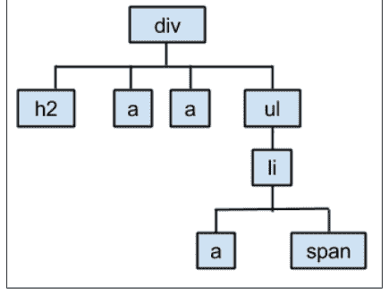
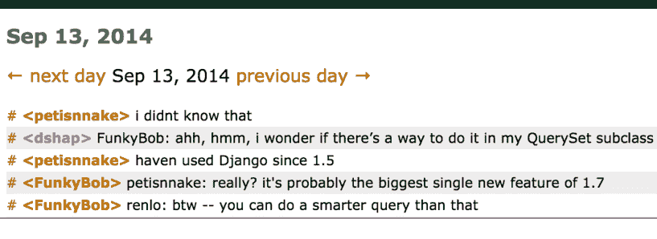
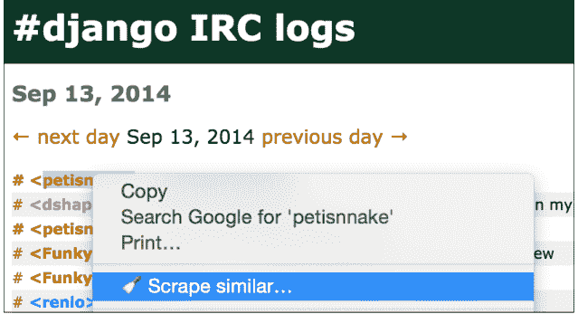
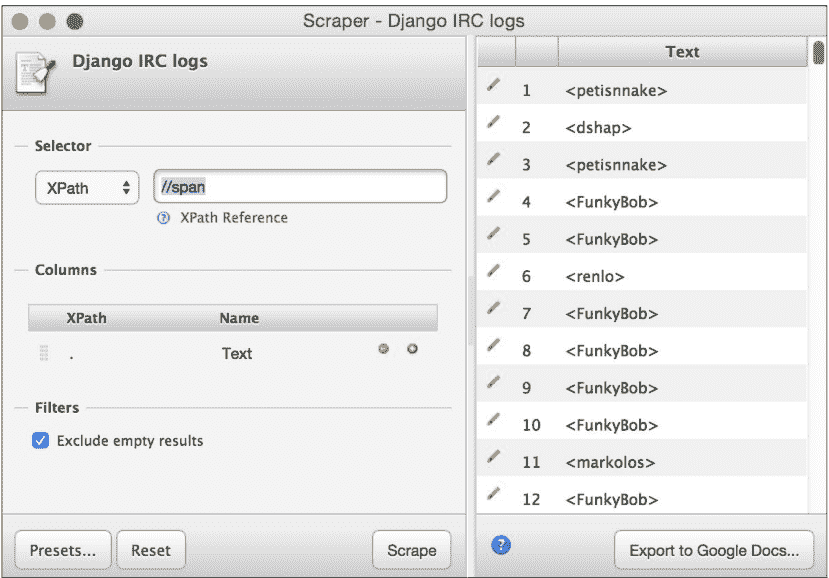
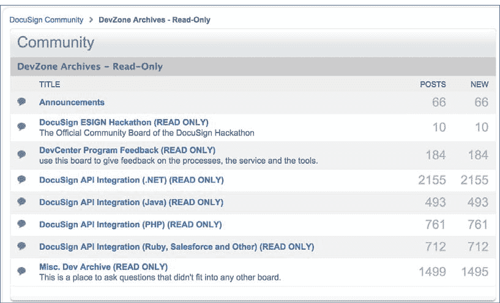
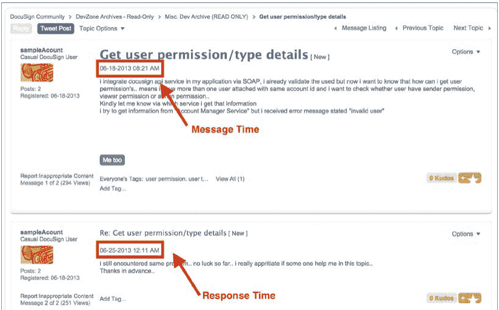

# 第5章：从网络收集和清洗数据
收集和清理数据
来自网络

最常见和有用的厨房工具之一是滤网，也称为筛子、漏勺或中式滤勺，其目的是在烹饪过程中将固体与液体分离。在本章中，我们将为我们在网络上找到的数据构建滤网。我们将学习如何创建几种类型的程序，帮助我们找到并保留我们想要的数据，同时丢弃我们不想要的部分。

在本章中，我们将：

- 理解设想 HTML 页面结构的两种选项，即 (a) 作为我们可以查找模式的行集合，或 (b) 作为包含可识别和收集值的节点的树结构。
- 尝试三种解析网页的方法，一种使用逐行方法（基于正则表达式的 HTML 解析），两种使用树结构方法（Python 的 BeautifulSoup 库和名为 Scraper 的 Chrome 浏览器工具）。
- 在一些真实数据上实现这三种技术；我们将练习从发布到网络论坛的消息中抓取日期和时间。

## 理解 HTML 页面结构

一个网页只是一个文本文件，其中包含一些特殊的标记 **元素**（有时称为 HTML **标签**），旨在指示网页浏览器在向用户显示页面时应如何显示，例如，如果我们希望某个单词以表示强调的方式显示，我们可以用 `<em>` 标签将其包围，如下所示：

它是 `<em>非常重要</em>` 你必须遵循这些说明。

所有网页都有这些相同的特征；它们由文本组成，文本中可能包含标签。我们可以采用两种主要的心智模型来从网页中提取数据。这两种模型都有其有用的方面。在本节中，我们将描述两种结构模型，然后在下一节中，我们将使用三种不同的工具进行数据提取。

### 行级分隔符模型

在最简单地思考网页的方式中，我们关注的是有数十种 HTML 元素/标签用于在网络上组织和显示页面这一事实。如果我们想在这种简单模型中从网页中提取有趣的数据，我们可以使用页面文本和嵌入的 HTML 元素本身作为 **分隔符**。例如，在前面的例子中，我们可能会决定想要收集 `<em>` 标签内的所有内容，或者也许我们想要收集 `<em>` 标签之前或 `</em>` 标签之后的所有内容。

在这种模型中，我们将网页视为大量非结构化文本的集合，而 HTML 标签（或其他文本特征，例如重复的词）有助于提供结构，我们可以使用它来分隔我们想要的部分。一旦我们有了分隔符，我们就能够从垃圾中筛选出有趣的数据。

例如，这里是来自真实网页的摘录，来自 Django IRC 频道的聊天记录。让我们考虑如何使用其 HTML 元素作为分隔符来提取有趣的数据：

```
<div id="content">
<h2>Sep 13, 2014</h2>

<a href="/2014/sep/14/">← next day</a> Sep 13, 2014 <a href="/2014/sep/12/">previous day →</a>

<ul id="ll">
<li class="le" rel="petisnnake"><a href="#1574618" name="1574618">#</a> <span style="color:#b78a0f;8" class="username" rel="petisnnake">&lt;petisnnake&gt;</span> i didnt know that </li>
```


```
...
</ul>
...
</div>
```

根据此示例文本，我们可以使用 <h2></h2> 标签作为分隔符来提取此特定聊天日志的日期。我们可以使用 <li></li> 标签作为一行文本的分隔符，并且在该行内，我们可以看到 rel="" 可用于提取聊天者的用户名。最后，从 </span> 结束处到 </li> 开始处延伸的所有文本似乎是用户发送到聊天频道的实际行消息。

> 这些聊天日志都可在 Django IRC 日志网站 http://django-irc-logs.com 上在线获取。该网站还提供日志的关键词搜索界面。前面代码中的省略号 (...) 代表为简洁起见在此示例中已删除的文本。

从这段杂乱的文本中，我们能够使用分隔符的概念提取出三个干净的数据片段（日志日期、用户和行消息）。

## 树结构模型

另一种想象文本网页的方式是将其视为由 HTML 元素/标签组成的树结构，每个元素都与其他标签相关联。每个标签显示为一个节点，一棵树由特定页面中的所有不同节点组成。在 HTML 中出现在另一个标签内的标签被视为子节点，而包含的标签则是父节点。在之前的 IRC 聊天示例中，HTML 摘录可以用如下树状图表示：



如果我们能够将 HTML 文本设想为树结构，我们就可以使用编程语言为我们构建一棵树。这使我们能够根据元素的名称或其在元素列表中的位置提取所需文本值。例如：

- 我们可能想要按名称获取标签的值（给我 <h2> 节点的文本）
- 我们可能想要特定类型的所有节点（给我 <ul> 内部、<div> 内部的所有 <li> 节点）
- 我们可能想要给定元素的所有属性（给我 <li> 元素中的 rel 属性列表）

在本章的剩余部分，我们将把这两种心智模型——逐行和树结构——与一些示例一起付诸实践。我们将通过三种不同的方法逐步介绍如何从 HTML 页面中提取和清理数据。

## 方法一 – Python 和正则表达式

在本节中，我们将使用一种简单的方法从 HTML 页面中提取我们想要的数据。这种方法基于在页面中识别分隔符并使用正则表达式模式匹配来提取我们想要的数据的概念。

你可能还记得我们在第 3 章《清洁数据的支柱 – 电子表格和文本编辑器》中学习文本编辑器时，曾稍微尝试过正则表达式（regex）。在本章中，部分概念会相似，只是我们将编写 Python 程序来查找匹配文本并提取它，而不是像该章中那样使用文本编辑器进行替换。

在开始示例之前最后说明一点，虽然这种正则表达式方法很容易理解，但它确实存在一些局限性，具体取决于你的项目。这些局限性可能会很显著。我们将在本节末尾详细描述这种方法的局限性。

### 第一步 – 查找并保存用于实验的网页文件

对于本示例，我们将抓取前面提到的 Django 项目的其中一个 IRC 聊天日志之一。这些是结构相当规律的公开可用文件，因此非常适合本项目。前往 Django IRC 日志存档 http://django-irc-logs.com/ 并找到一个吸引你的日期。导航到其中一个日期的目标页面并将其保存到你的工作目录。完成后你应该有一个 .html 文件。

### 第二步 – 查看文件并决定提取什么内容

由于我们在第 2 章《基础 – 格式、类型和编码》中了解到 .html 文件只是文本，而第 3 章《清洁数据的支柱 – 电子表格和文本编辑器》让我们非常习惯于在文本编辑器中查看文本文件，因此这一步应该很容易。只需在文本编辑器中打开 HTML 文件并查看它。有什么看起来适合提取的？

当我查看我的文件时，我看到有几样东西想要提取。立刻我看到对于每条聊天评论，都有行号、用户名和评论本身。让我们计划从每条聊天行中提取这三项。

下图显示了我的文本编辑器中打开的 HTML 文件。我已打开软换行，因为有些行相当长（在 TextWrangler 中此选项位于菜单下的 View | Text Display | Soft Wrap Text）。大约在第 29 行我们看到聊天行列表的开始，每行都有我们感兴趣的三个项目：

```
29 <ul id="li">
30 <li class="le" rel="petisnnake"><a href="#1574618" name="1574618">#</a> <span style="color:#b78a0f;" class="username" rel="petisnnake">&lt;petisnnake&gt;</span> i didn't know that </li>
31 <li class="le" rel="dshap"><a href="#1574619" name="1574619">#</a> <span style="color:#b93d98;" class="username" rel="dshap">&lt;dshap&gt;</span> FunkyBob: ahh, hmm, i wonder if there's a way to do it in my QuerySet subclass so i'm not creating a new manager subclass *only* for get_queryset to do the initial filtering </li>
```

因此，我们的工作是找到每行中看起来相同的特征，以便可预测地从每条聊天行中提取相同的三项内容。查看文本后，以下是我们可以遵循的一些可能规则，以准确且只需少量调整地提取每个数据项：

- 似乎我们想要的全部三项都位于 <li> 标签内，而这些 <li> 标签本身位于 <ul id="li"> 标签内。每个 <li> 代表一条聊天消息。
- 在该消息内，行号位于两个位置：它跟在字符串 <a href="# 后面，并且出现在 name 属性后的引号内。所示示例文本中，第一行号为 1574618。
- 用户名属性出现在三个位置，第一个是 li class="le" 的 rel 属性值。在 span 标签内，用户名属性再次作为 rel 属性值出现，并且还在 &lt; 和 &gt; 符号之间出现。在示例文本中，第一个用户名为 petisnake。
- 行消息位于 </span> 标签之后和 </li> 标签之前。在所示示例中，第一行消息为 i didn't know that。

现在我们已经有了关于数据项所在位置的规则，我们可以编写程序了。

### 第三步 – 编写 Python 程序来提取有趣的部分并保存到 CSV 文件

下面是一段简短的代码，用于以前面所示的格式打开给定的 IRC 日志文件，解析出我们感兴趣的三个部分，并将它们打印到新的 CSV 文件中：

```
import re
import io

row = []

infile = io.open('django13-sept-2014.html', 'r', encoding='utf8')
outfile = io.open('django13-sept-2014.csv', 'a+', encoding='utf8')
for line in infile:
    pattern = re.compile(ur'<li class="le" rel="(.+?)" ><a href="#(.+?)" name="(.+?)</span> (.+?)</li>', re.UNICODE)
    if pattern.search(line):
```

```
username = pattern.search(line).group(1)
linenum = pattern.search(line).group(2)
message = pattern.search(line).group(4)
row.append(linenum)
row.append(username)
row.append(message)
outfile.write(', '.join(row))
outfile.write(u'\n')
row = []
infile.close()
```

这段代码中最棘手的部分是 pattern 行。该行构建了模式匹配，每行文件都将与之进行比较。


> 要保持警惕。只要网站开发者更改页面中的 HTML，我们精心构建的正则表达式模式就可能不再有效。事实上，在撰写本书的几个月里，该页面的 HTML 至少更改过一次！

每个匹配目标组看起来像这样：.+?。共有五个。其中三个是我们感兴趣的项目（username、linenum 和 message），而另外两个组只是我们可以丢弃的垃圾。我们还将丢弃未匹配我们模式的网页其余内容。我们的程序就像一个恰好有三个功能孔的筛子。好东西会流过孔洞，留下垃圾。

### 第四步 – 查看文件并确保其干净

当我们在文本编辑器中打开新的 CSV 文件时，可以看到前几行现在看起来像这样：

```
1574618, petisnnake, i didn't know that
1574619, dshap, FunkyBob: ahh, hmm, i wonder if there's a way to do it in my QuerySet subclass so i'm not creating a new manager subclass *only* for get_queryset to do the initial filtering
1574620, petisnnake, haven't used Django since 1.5
```


看起来结果很不错。你可能会注意到，第三列的文本周围没有封装字符。这可能会成为一个问题，因为我们使用了逗号作为分隔符。如果第三列中出现逗号怎么办？如果这让你担心，你可以给第三列加上引号，或者使用制表符来分隔列。要做到这一点，将第一个 `outfile.write()` 行改为使用 \t（制表符）作为连接字符而不是逗号。你也可以通过 `lstrip()` 对消息进行一些空白修剪，以去除任何多余字符。

## 使用正则表达式解析 HTML 的局限性

这种正则表达式方法乍一看似乎很直接，但它有一些局限性。首先，对于新手数据清洗人员来说，设计和完善正则表达式可能有点让人头疼。你应该做好花大量时间调试并为自己编写大量文档的准备。为了帮助生成正则表达式，我强烈建议使用正则表达式测试工具，例如 http://Pythex.org，或者直接使用你喜欢的搜索引擎查找一个。确保你指定想要 Python 正则表达式测试工具，如果你使用的语言是 Python。

接下来，你应该事先知道，正则表达式完全依赖于网页结构在未来保持不变。因此，如果你计划按计划从网站收集数据，今天编写的正则表达式明天可能就无法工作。它们只有在页面布局不发生变化时才有效。两个标签之间添加一个空格就会导致整个正则表达式失败，并且极难排查问题。还要记住，大多数时候你对网站更改几乎没有控制权或完全没有控制权，因为你收集数据的通常不是你自己的网站！

最后，有很多很多情况，准确编写正则表达式来匹配给定的 HTML 结构几乎是不可能的。Regex 强大但不完美也不万无一失。关于这个问题的一个有趣看法，我推荐你阅读在 Stack Overflow 上被点赞超过 4000 次的著名回答：http://stackoverflow.com/questions/1732348/。在该回答中，作者幽默地表达了许多程序员反复尝试解释为什么正则表达式不是解析网页中不规则且不断变化的 HTML 的完美解决方案时的挫败感。

## 方法二 – Python 和 BeautifulSoup

由于正则表达式存在一些局限性，我们肯定需要在数据清洗工具包中增加更多工具。在这里，我们描述如何使用名为 BeautifulSoup 的基于解析树的 Python 库从 HTML 页面中提取数据。

### 第一步 – 查找并保存用于实验的文件

对于这一步，我们将使用与方法 1 相同的文件：来自 Django IRC 频道的文件。我们将搜索相同的三个项目。这样做可以轻松比较两种方法。

### 第二步 – 安装 BeautifulSoup

BeautifulSoup 目前是第 4 版。此版本适用于 Python 2.7 和 Python 3。

> 如果你使用的是 Enthought Canopy Python 环境，只需在 Canopy 终端中运行 `pip install beautifulsoup4` 即可。

### 第三步 – 编写 Python 程序来提取数据

我们感兴趣的三个项目都存在于 `li` 标签集合中，具体来说是那些具有 `class="le"` 的标签。在这个特定文件中没有其他 `li` 标签，但为了以防万一，我们还是具体一点。以下是我们想要的项目以及在解析树中的查找位置：

- 我们可以从 `li` 标签下的 `rel` 属性中提取用户名。
- 我们可以从 `a` 标签中的 `name` 属性获取 `linenum` 值。`a` 标签也是 `li` 标签的内容中的第一项。

> 请记住数组是从零开始的，所以我们需要请求第 0 项。

在 BeautifulSoup 中，标签的 **内容** 是解析树中该标签下方的项目。其他一些包会称它们为 **子** 项。

- 我们可以将消息提取为 li 标签中的第四个内容项（引用为数组项 [3]）。我们还注意到每个消息前面都有一个前导空格，所以在保存数据之前我们想将其去掉。

以下是对应于我们想要从解析树中获取内容的轮廓的 Python 代码：

```
from bs4 import BeautifulSoup
import io

infile = io.open('django13-sept-2014.html', 'r', encoding='utf8')
outfile = io.open('django13-sept-2014.csv', 'a+', encoding='utf8')
soup = BeautifulSoup(infile)

row = []
allLines = soup.findAll("li","le")
for line in allLines:
    username = line['rel']
    linenum = line.contents[0]['name']
    message = line.contents[3].lstrip()
    row.append(linenum)
    row.append(username)
    row.append(message)
    outfile.write(', '.join(row))
    outfile.write(u'\n')
    row = []
infile.close()
```

### 第四步 – 查看文件并确保其干净

当我们在文本编辑器中打开新的 CSV 文件时，可以看到前几行现在看起来与方法 1 中的完全相同：

```
1574618, petisnnake, i didn't know that
1574619, dshap, FunkyBob: ahh, hmm, i wonder if there's a way to do
it in my QuerySet subclass so i'm not creating a new manager subclass
*only* for get_queryset to do the initial filtering
1574620, petisnnake, haven't used Django since 1.5
```

就像使用正则表达式方法一样，如果你担心最后一列中嵌入了逗号，你可以对列文本进行封装引号，或者直接使用制表符来分隔列。

## 方法三 – Chrome Scraper

如果你真的不想编写程序来解析数据，有几个基于浏览器的工具使用树结构让你能够识别和提取你感兴趣的数据。我认为最容易使用且工作量最小的是一个名为 Scraper 的 Chrome 扩展，由一名名为 mnmldave 的开发者创建（真名：Dave Heaton）。

### 第一步 – 安装 Scraper Chrome 扩展

如果尚未运行，请下载 Chrome 浏览器。确保你获取的是正确的 Scraper 扩展；有几个扩展名称非常相似。我建议使用该产品的开发者自己的 GitHub 网站，网址为 http://mnmldave.github.io/scraper/。这样你就可以获得正确的抓取工具，而不是尝试使用 Chrome 商店搜索。从 http://mnmldave.github.io/scraper 网站，点击链接从 Google 商店安装扩展，然后重新启动浏览器。

### 第二步 – 从网站收集数据

将浏览器指向我们用于另外两次网页数据提取实验的相同网页 URL，即 Django IRC 日志之一。我在这里的示例和屏幕截图中使用的是 2014 年 9 月 13 日的日志，所以我将访问 http://django-irc-logs.com/2014/sep/13/。

在我撰写本文时，我的浏览器中该页面看起来如下：



我们对这个 IRC 日志感兴趣的三个项目是：

- 行号（我们从之前两次实验中知道这是 # 符号下链接的一部分）
- 用户名（位于 < 和 > 符号之间）
- 实际行消息

Scraper 允许我们依次突出显示这三个项目中的每一个，并将值导出到 Google 电子表格中，然后我们可以将它们重新组装到一个工作表中并导出为 CSV（或随心所欲地处理它们）。操作方法如下：

1. 使用鼠标突出显示你想要抓取的项目。
2. 右键单击并从菜单中选择 Scrape similar...。在下面的示例中，我选择了用户名 petisnnake 作为我希望 Scraper 使用的用户名：



3. 选择 Scrape similar 后，工具会显示一个新窗口，其中包含页面上所有相似项目的集合。下面的屏幕截图显示了 Scraper 找到的整个用户名列表：




Scraper 根据一个示例用户名查找所有相似项目。

- 4. 在窗口底部，有一个标记为 **Export to Google Docs...** 的按钮。请注意，根据您的设置，您可能需要点击同意以允许 Scraper 访问 Google Docs。

## 第三步 – 对数据列进行最终清理

一旦我们从页面中提取出所有数据元素并存放在单独的 Google Docs 中，我们就需要将它们合并到一个文件中并进行最终清理。以下是行号在提取后但尚未清理时的示例：

|  | A | B |
|---|---|---|
| 1 | 链接 | 网址 |
| 2 | # | #1574618 |
| 3 | # | #1574619 |
| 4 | # | #1574620 |
| 5 | # | #1574621 |
| 6 | # | #1574622 |

我们对列 A 完全不感兴趣，也不关心前导的 # 符号。用户名和行消息数据类似——我们想要大部分内容，但希望删除一些符号并将所有内容合并到单个 Google 电子表格中。

使用我们在第 3 章《干净数据的 workhorses – 电子表格和文本编辑器》中介绍的查找和替换技术（即删除 #、< 和 > 符号并将行粘贴到单个工作表中），我们最终得到一个干净的数据集，如下所示：

|  | A | B | C |
|---|---|---|---|
| 1 | 1574618 | petisnake | 我不知道这一点 |
| 2 | 1574619 | dshap | FunkyBob：啊，嗯，我想知道是否可以在我的 QuerySet 中做到这一点 |
| 3 | 1574620 | petisnake | 从 1.5 版以来没有使用过 Django |
| 4 | 1574621 | FunkyBob | petisnake：真的吗？它可能是 1.7 中最大的单一新功能 |
| 5 | 1574622 | FunkyBob | renlo：顺便说一下——你可以做一个更聪明的查询 |

Scraper 是一个从网页中提取少量数据的不错工具。它具有方便的 Google 电子表格界面，如果你不想编写程序来完成这项工作，它可以是一个快速解决方案。在下一节中，我们将处理一个更大的项目。它可能复杂到足以让我们必须将本章中的一些概念实现到一个解决方案中。

## 示例项目 – 从电子邮件和网络论坛中提取数据

Django IRC 日志项目非常简单。它旨在向你展示三种常用的、可靠的技术之间的差异，这些技术常用于从 HTML 页面中提取干净数据。我们提取的数据包括行号、用户名和 IRC 聊天消息，所有这些都很容易找到，并且几乎不需要额外的清理。在这个新的示例项目中，我们将考虑一个概念上相似的案例，但它将要求我们将数据提取的想法从 HTML 扩展到网络上发现的另外两种半结构化文本：托管在网络上的电子邮件消息和基于网络的讨论论坛。

## 项目背景

我最近正在进行一项关于如何使用社交媒体提供软件技术支持的研究。具体来说，我试图发现某些制作 API 和框架的软件开发组织是否应将对开发者的技术支持转移到 Stack Overflow，还是应继续使用较旧的媒体，例如电子邮件和网络论坛。为了完成这项研究，我比较了（其中之一）开发者通过 Stack Overflow 获得 API 问题答案所需的时间，与在较旧的社交媒体如网络论坛和电子邮件组上所需的时间。

在这个项目中，我们将处理这个问题的其中一小部分。我们将下载代表旧社交媒体的两种原始数据：来自网络论坛的 HTML 文件和来自 Google Groups 的电子邮件消息。我们将编写 Python 代码来提取发送到这两个支持论坛的消息的日期和时间。然后我们将找出哪些消息是对其他消息的回复，并计算每个消息获得回复所需时间的一些基本汇总统计数据。


> 如果你想知道为什么我们在这个示例项目中没有为该问题的 Stack Overflow 部分提取数据，只要等到第 9 章，Stack Overflow 项目。那一整章都致力于创建和清理 Stack Overflow 数据库。

该项目将分为两部分。在第一部分中，我们将从托管在 Google Groups 上的项目中提取电子邮件档案数据，在第二部分中，我们将从另一个项目的 HTML 文件中提取数据。

## 第一部分 – 清理 Google Groups 电子邮件数据

许多软件公司传统上使用电子邮件邮件列表或混合电子邮件-网络论坛为其产品提供技术支持。Google Groups 是此服务的热门选择。用户可以向该组发送电子邮件，也可以从网络浏览器中阅读和搜索消息。然而，一些公司已放弃通过 Google Groups 向开发者提供技术支持（包括 Google 自身的产品），而改用 Stack Overflow。数据库产品 Google BigQuery 就是这样一个现在使用 Stack Overflow 的组。

## 第一步 – 收集 Google Groups 消息

为了研究 BigQuery Google Group 上问题的响应时间，我首先创建了该组中所有帖子的 URL 列表。你可以在我的 GitHub 网站上找到我的完整 URL 列表：https://github.com/megansquire/stackpaper2015/blob/master/BigQueryGGurls.txt。

一旦我们有了目标 URL 列表，我们就可以编写一个 Python 程序来下载这些 URL 中驻留的所有电子邮件，并将它们保存到磁盘。在下面的程序中，我的 URL 列表已保存为名为 GGurls.txt 的文件。包含了 time 库，以便我们在向 Google Groups 服务器发出请求之间进行短暂的 sleep() 方法：

```python
import urllib2
import time

with open('GGurls.txt', 'r') as f:
    urls = []
    for url in f:
        urls.append(url.strip())

currentFileNum = 1
for url in urls:
    print("Downloading: {0} Number: {1}".format(url, currentFileNum))
    time.sleep(2)
    htmlFile = urllib2.urlopen(url)
    urlFile = open("msg%d.txt" %currentFileNum,'wb')
    urlFile.write(htmlFile.read())
    urlFile.close()
    currentFileNum = currentFileNum +1
```

该程序导致写入磁盘 667 个文件。

## 第二步 – 从 Google Groups 消息中提取数据

我们现在有 667 条分别存放在不同文件中的电子邮件消息。我们的任务是编写一个程序逐一读取它们，并使用本章中的一种技术来提取我们需要的信息。如果我们查看其中一条电子邮件消息，我们会看到很多 **headers**，它们存储有关电子邮件或其 **metadata** 的信息。我们可以快速看到标识我们需要的元数据元素的三个头：

```
In-Reply-To: <ab71b72a-ef9b-4484-b0cc-a72ecb2a3b85@r9g2000yqd.googlegroups.com>
Date: Mon, 30 Apr 2012 10:33:18 -0700
Message-ID: <CA+qSDkQ4JB+Cn7HNjmtLOqqkbJnyBu=Z1Ocs5-dTe5cN9UEPyA@mail.gmail.com>
```

所有消息都有 Message-ID 和 Date，但 In-Reply-To 头只会出现在是对另一条消息的回复的消息中。In-Reply-To 值必须是另一条消息的 Message-ID 值。

下面的代码展示了基于正则表达式的解决方案，用于提取 Date、Message-ID 和 In-Reply-To（如果可用）值，并创建原始消息和回复消息的一些列表。然后，代码尝试计算一条消息与其回复之间的时间差：

```python
import os
import re
import email.utils
import time
import datetime
import numpy

originals = {}
replies = {}
timelist = []

for filename in os.listdir(os.getcwd()):
    if filename.endswith(".txt"):
        f=open(filename, 'r')
        i=''
        m=''
        d=''
        for line in f:
            irt = re.search('(In\-Reply\-To: <)(.+?)@', line)
            mid = re.search('(Message\-ID: <)(.+?)@', line)
```


```
dt = re.search('(Date: )(.+?)\r', line)
    if irt:
        i= irt.group(2)
    if mid:
        m= mid.group(2)
    if dt:
        d= dt.group(2)
    f.close()
    if i and d:
        replies[i] = d
    if m and d:
        originals[m] = d

for (messageid, origdate) in originals.items():
    try:
        if replies[messageid]:
            replydate = replies[messageid]
        try:
            parseddate = email.utils.parsedate(origdate)
            parsedreply = email.utils.parsedate(replydate)
        except:
            pass
        try:
            # this still creates some malformed (error) times
            timeddate = time.mktime(parseddate)
            timedreply = time.mktime(parsedreply)
        except:
            pass
        try:
            dtdate = datetime.datetime.fromtimestamp(timeddate)
            dtreply = datetime.datetime.fromtimestamp(timedreply)
        except:
            pass
        try:
            difference = dtreply - dtdate
            totalseconds = difference.total_seconds()
            timeinhours = (difference.days*86400+difference.seconds)/3600
            # this is a hack to take care of negative times
            # I should probably handle this with timezones but alas
            if timeinhours > 1:
                #print timeinhours
```
```
timelist.append(timeinhours)
    except:
        pass
    except:
        pass

print numpy.mean(timelist)
print numpy.std(timelist)
print numpy.median(timelist)
```

在这段代码中，初始的 for 循环遍历每条消息并提取我们感兴趣的三个数据片段。（此程序不会将这些数据存储到单独的文件或磁盘中，但如果你愿意，可以添加此功能。）这部分代码还创建了两个重要的列表：

- `originals[]` 是原始消息的列表。我们假设这些主要是向列表成员提出的问题。
- `replies[]` 是回复消息的列表。我们假设这些主要是对另一条消息中提出的问题的回答。

第二个 for 循环处理原始消息列表中的每条消息，执行以下操作：如果原始消息有回复，则尝试计算该回复发送所需的时间。我们随后保留一个回复时间列表。

## 提取代码

对于本章，我们主要关注代码的清理和提取部分，因此让我们仔细查看这些行。这里，我们处理电子邮件文件的每一行，查找三个电子邮件头：In-Reply-To、Message-ID 和 Date。我们使用正则表达式搜索和分组，就像本章前面方法 1 中所做的那样，来界定这些头并轻松提取其后的值：

```
for line in f:
    irt = re.search('(In\-Reply\-To: <)(.+?)@', line)
    mid = re.search('(Message\-ID: <)(.+?)@', line)
    dt = re.search('(Date: )(.+?)\r', line)
    if irt:
        i = irt.group(2)
    if mid:
        m = mid.group(2)
    if dt:
        d = dt.group(2)
```

我们为什么决定在这里使用正则表达式而不是基于树的解析器？主要有两个原因：

- 1. 因为我们下载的电子邮件不是 HTML，无法轻易描述为具有父子关系的节点树。因此，像 BeautifulSoup 这样的基于解析树的解决方案并不是最佳选择。
- 2. 因为电子邮件头是结构化且非常可预测的（尤其是我们在这里查找的三个头），正则表达式解决方案是可以接受的。

## 程序输出

此程序的输出是打印三个数字，估计该 Google 群组中消息回复的平均时间、标准差和中位数（以小时为单位）。当我运行此代码时，结果如下：

```
178.911877395
876.102630872
18.0
```

这意味着发布到 BigQuery Google 群组的消息的中位响应时间约为 18 小时。现在让我们考虑如何从另一个来源：网络论坛中提取类似的数据。你认为网络论坛中对问题的回复会比 Google 群组更快、更慢还是差不多？

## 第二部分 – 从网络论坛清理数据

我们将在本项目中研究的网络论坛来自一家名为 DocuSign 的公司。他们还将开发者支持转移到了 Stack Overflow，但他们仍在线存档了旧的基于网络的开发者论坛。我在他们的网站上查找，直到发现如何下载这些旧论坛中的一些消息。这里展示的过程比 Google Groups 示例更复杂，但你将学到很多关于如何自动收集数据的内容。

### 第一步 – 收集指向 HTML 文件的 RSS

DocuSign 开发者论坛上有数千条消息。我们希望获得所有这些消息或讨论线程的 URL 列表，以便编写代码自动下载它们并高效地提取回复时间。

为此，首先我们需要一份所有讨论的 URL 列表。我发现 DocuSign 旧 Dev-Zone 开发者站点的存档位于 https://community.docusign.com/t5/DevZone-Archives-Read-Only/ct-p/dev_zone。

浏览器中该站点看起来如下：



我们绝对不想逐个点击这些论坛，然后逐条进入每条消息并手动保存。那样会花费永远，而且极其无聊。有更好的方法吗？

DocuSign 网站的帮助页面指出，可以下载一个 Really Simple Syndication（RSS）文件，显示每个论坛中最新的线程和消息。我们可以使用 RSS 文件自动收集该站点上许多讨论的 URL。我们感兴趣的 RSS 文件是仅与开发者支持论坛相关的那些（不是公告或销售论坛）。这些 RSS 文件可从以下 URL 获取：

- `https://community.docusign.com/docusign/rss/board?board.id=upcoming_releases`
- `https://community.docusign.com/docusign/rss/board?board.id=DocuSign_Developer_Connection`
- `https://community.docusign.com/docusign/rss/board?board.id=Electronic_Signature_API`
- https://community.docusign.com/docusign/rss/board?board.id=Java
- https://community.docusign.com/docusign/rss/board?board.id=php_api
- https://community.docusign.com/docusign/rss/board?board.id=dev_other
- https://community.docusign.com/docusign/rss/board?board.id=Ask_A_Development_Question_Board`

在你的网络浏览器中访问列表中的每个 URL（如果时间紧张，只访问一个）。文件是 RSS，看起来像带有标签的半结构化文本，类似于 HTML。将 RSS 保存为本地系统上的文件，并为每个文件添加 .rss 文件扩展名。完成此过程后，你最多应有七个 RSS 文件，每个对应前面显示的每个 URL。

每个 RSS 文件内部都包含描述论坛上所有讨论线程的元数据，包括我们在此阶段真正想要的一项数据：每个特定讨论线程的 URL。在文本编辑器中打开其中一个 RSS 文件，你就能找到我们感兴趣的 URL 示例。它看起来像这样，并且在文件中，你会看到每个讨论线程都有一个这样的条目：

```
<guid>http://community.docusign.com/t5/Misc-Dev-Archive-READ-ONLY/Re-Custom-CheckBox-Tabs-not-marked-when-setting-value-to-quot-X/m-p/28884#M1674</guid>
```

现在，我们可以编写一个程序循环遍历每个 RSS 文件，查找这些 URL，访问它们，然后提取我们感兴趣的回复时间。下一节将把此过程分解为一系列更小的步骤，然后展示一个完成整个任务的程序。

### 第二步 – 从 RSS 提取 URL；收集并解析 HTML

在此步骤中，我们将编写一个程序执行以下操作：

- 1. 打开我们在步骤 1 中保存的每个 RSS 文件。
- 2. 每当看到 <guid> 和 </guid> 标签对时，提取其中的 URL 并将其添加到列表中。
- 3. 对列表中的每个 URL，下载该位置的 HTML 文件。
- 4. 读取该 HTML 文件并从每条消息中提取原始发布时间和回复时间。
- 5. 计算发送回复所需的时间的平均值、中位数和标准差，就像我们在第一部分中所做的那样。


以下是处理这些步骤的 Python 代码。我们将在代码列表末尾详细讲解提取部分：

```
import os
import re
import urllib2
import datetime
import numpy

alllinks = []
timelist = []
for filename in os.listdir(os.getcwd()):
    if filename.endswith('.rss'):
        f = open(filename, 'r')
        linktext = ''
        linkurl = ''
        for line in f:
            # find the URLs for discussion threads
            linktext = re.search('(<guid>)(.+?)(</guid>)', line)
            if linktext:
                linkurl= linktext.group(2)
                alllinks.append(linkurl)
        f.close()

mainmessage = ''
reply = ''
maindateobj = datetime.datetime.today()
replydateobj = datetime.datetime.today()
for item in alllinks:
    print "==="
    print "working on thread\n" + item
    response = urllib2.urlopen(item)
    html = response.read()
    # this is the regex needed to match the timestamp
    tuples = re.findall('lia-message-posted-on\\">\\s+<span class=\\"local-date\\">\\xe2\\x80\\x8e(.*?)</span>\\s+<span class=\\"local-time\\">([\\w:\\sAM|PM]+)</span>', html)
    mainmessage = tuples[0]
    if len(tuples) > 1:
        reply = tuples[1]
    if mainmessage:
        print "main: "
        maindateastr = mainmessage[0] + " " + mainmessage[1]
        print maindateastr
        maindateobj = datetime.datetime.strptime(maindateastr,
'%m-%d-%Y %I:%M %p')
    if reply:
        print "reply: "
        replydateastr = reply[0] + " " + reply[1]
```
```
print replydateastr
replydateobj = datetime.datetime.strptime(replydateastr,
'%m-%d-%Y %I:%M %p')

# only calculate difference if there was a reply
difference = replydateobj - maindateobj
totalseconds = difference.total_seconds()
timeinhours = (difference.days*86400+difference.seconds)/3600
if timeinhours > 1:
    print timeinhours
    timelist.append(timeinhours)

print "when all is said and done, in hours:"
print numpy.mean(timelist)
print numpy.std(timelist)
print numpy.median(timelist)
```

## 程序状态

随着程序运行，它会打印出状态信息，以便我们知道它正在处理什么。状态信息如下所示，并且 RSS 订阅源中发现的每个 URL 都会有一个：

```
===
working on thread
http://community.docusign.com/t5/Misc-Dev-Archive-READ-ONLY/Can-you-disable-the-Echosign-notification-in-Adobe-Reader/m-p/21473#M1156
main:
06-21-2013 08:09 AM
reply:
06-24-2013 10:34 AM
74
```

在此显示中，74 表示线程中第一条消息的发布时间与第一条回复的发布时间之间（约三天零两小时）的小时数（四舍五入）。

## 程序输出

在程序结束时，它会打印出回复时间的平均值、标准差和中位数（以小时为单位），就像第一部分程序对 Google Groups 所做的那样：

```
when all is said and done, in hours:
695.009009009
2506.66701108
20.0
```

看起来 DocuSign 论坛的回复时间比 Google Groups 稍慢一些。与 Google Groups 的 18 小时相比，它报告为 20 小时，但至少这两个数字在相同的近似范围内。你的结果可能会发生变化，因为消息一直在不断添加。

## 提取代码

由于我们主要关注数据提取，让我们仔细看看代码中执行该操作的<|message|>。以下是相关性最强的代码行：

```
tuples = re.findall('lia-message-posted-on">\s+<span class=\"local-date\">\xe2\x80\x8e(.*?)</span>\s+<span class=\"local-time\">([\w:\sAM|PM]+)</span>', html)
```

与之前的一些示例一样，这段代码也依赖正则表达式来完成工作。然而，这个正则表达式相当混乱。也许我们应该用 BeautifulSoup 来写？让我们看看我们试图匹配的原始 HTML，以便更深入地了解这段代码试图做什么，以及我们是否应该以不同的方式来做。接下来是浏览器中页面外观的截图，我们感兴趣的时间已在截图上进行了标注：



不过底层的 HTML 长什么样呢？这正是我们的程序需要能够解析的部分。事实证明，原始消息的日期在 HTML 页面上的多个位置都有打印，但日期和时间组合仅对原始消息打印一次，对回复也打印一次。以下是这些内容的 HTML 显示（HTML 已压缩并删除换行符以便于查看）：

```
<p class="lia-message-dates lia-message-post-date lia-component-post-date-last-edited" class="lia-message-dates lia-message-post-date">
<span class="DateTime lia-message-posted-on lia-component-common-widget-date" class="DateTime lia-message-posted-on">
<span class="local-date">06-18-2013</span>
<span class="local-time">08:21 AM</span>

<p class="lia-message-dates lia-message-post-date lia-component-post-date-last-edited" class="lia-message-dates lia-message-post-date">
<span class="DateTime lia-message-posted-on lia-component-common-widget-date" class="DateTime lia-message-posted-on">
<span class="local-date">06-25-2013</span>
<span class="local-time">12:11 AM</span>
```

这对于正则表达式来说似乎是一个相当直接的问题，因为我们可以编写一个单一的正则表达式并为两种类型的消息找到所有实例。在代码中，我们说明我们找到的第一个实例成为原始消息，下一个实例成为回复，如下所示：

```
mainmessage = tuples[0]
if len(tuples) > 1:
    reply = tuples[1]
```

我们本可以使用 BeautifulSoup 等基于解析树的解决方案，但我们必须应对这样一个事实：两组日期的 span class 值是相同的，甚至父元素（the <p> 标签）也具有相同的 class。因此，这个解析树比本章前面方法 2 中显示的要复杂得多。

如果您真的想尝试使用 BeautifulSoup 进行此提取，我的建议是首先使用浏览器的开发者工具查看页面的结构，例如在 Chrome 浏览器中，您可以选中您感兴趣的元素——本例中的日期和时间——右键单击它，然后选择 **Inspect Element**。这将打开一个开发者工具面板，显示这段数据在整个文档树中的位置。每个 HTML 元素左侧的小箭头表示是否存在子节点。然后，您可以通过以编程方式在解析树中定位目标元素来决定如何继续，并可以制定计划将其与其他节点区分开来。由于此任务超出了本入门书籍的范围，我将把它留作读者的练习。

## 摘要

在本章中，我们发现了一些 tried-and-true 技术来分离有趣数据与不需要的数据。当我们在厨师的厨房里做汤时，我们使用滤网来捕获我们不想要的骨头和蔬菜皮，同时允许我们 *do* 想要的美味液体通过筛子的孔流入我们的容器。相同的思想也适用于我们在数据科学厨房中从网页中提取数据时。我们希望制定一个清理计划，允许我们提取我们想要的内容，同时留下其余的 HTML。

在此过程中，我们回顾了从 HTML 中提取数据时使用的两种主要思维模式，即逐行分隔符方法和解析树/节点模型。然后我们研究了三种可靠、经过验证的解析 HTML 页面以提取我们想要的数据的方法：正则表达式、BeautifulSoup 以及基于 Chrome 的点按式 Scraper 工具。最后，我们完成了一个项目，该项目从真实的电子邮件和 HTML 页面中收集并提取了有用的数据。

电子邮件和 HTML 等文本数据最终证明并不难清理，但二进制文件呢？在下一章中，我们将探讨如何从一个更困难的目标中提取干净的数据：PDF 文件。


