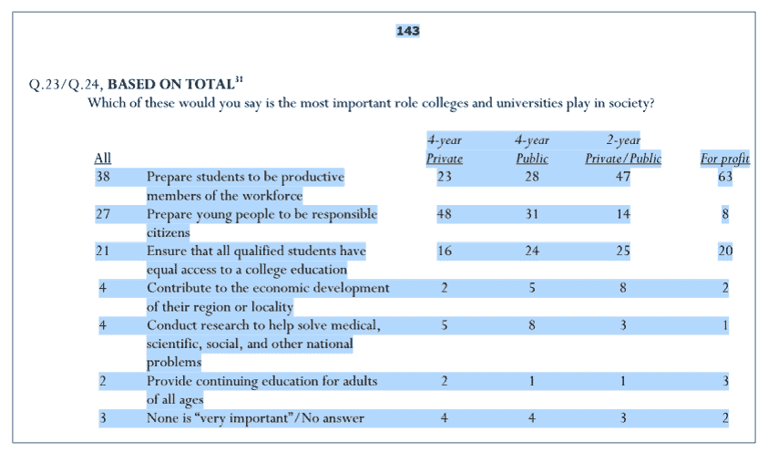
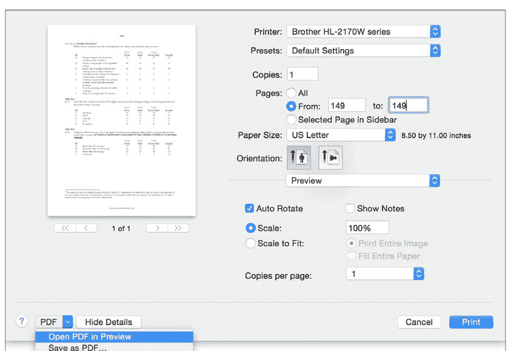
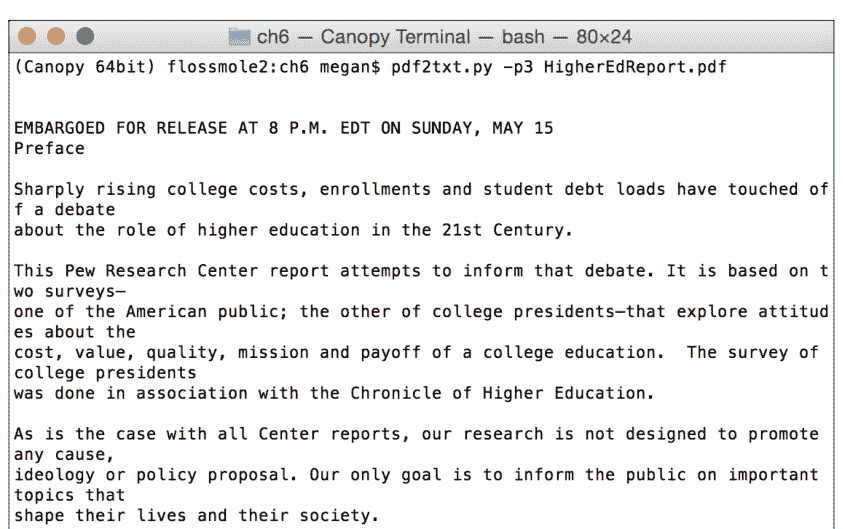
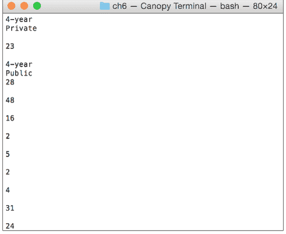
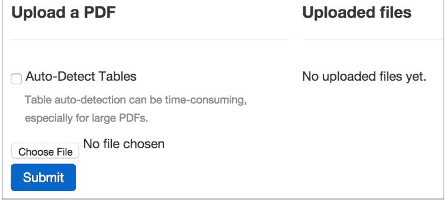
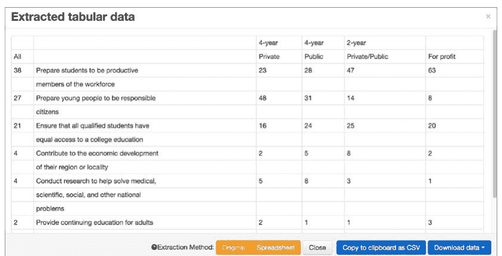
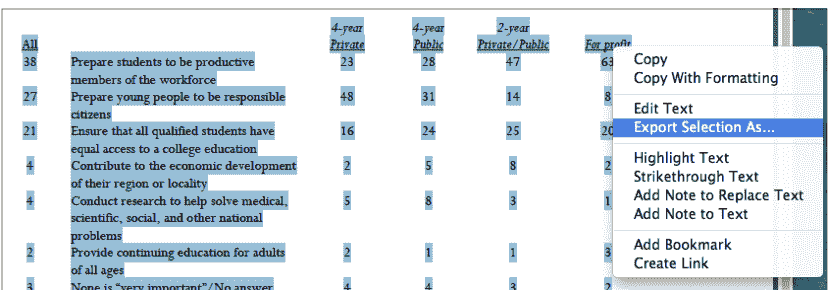
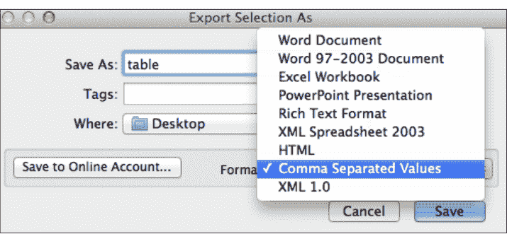

# 第6章：在 PDF 文件中清洗数据

在上一章中，我们发现了多种从我们想要的数据中分离出不需要的数据的方法。我们设想数据清理过程有点像制作鸡汤，我们的目标是保留汤汁但滤掉骨头。但如果我们想要的数据并不那么容易与我们不想要的数据区分开来会怎样？

考虑一瓶陈年较久、沉淀物较多的好酒。乍一看，我们可能无法看到液体中悬浮的沉淀物。但在酒在醒酒器中放置一段时间后，沉淀物会沉到底部，我们就能倒出更干净、更芳香的酒。在这种情况下，简单的滤网无法将酒与沉淀物分离——需要一种专用工具。

在本章中，我们将尝试几种数据醒酒器，以提取隐藏在晦涩 PDF 文件中的所有好东西。我们将探讨以下主题：

- PDF 文件的用途以及为什么难以从中提取数据
- 如何从 PDF 文件中复制和粘贴，以及当此方法不工作时该怎么办
- 如何通过只保存所需的页面来缩小 PDF 文件
- 如何使用名为 **pdfMiner** 的 Python 包中的工具从 PDF 文件中提取文本和数字
- 如何使用名为 **Tabula** 的基于浏览器的 Java 应用程序从 PDF 文件中提取表格数据
- 如何使用完整的付费版 Adobe Acrobat 提取数据表

### 为什么清理 PDF 文件很困难？

保存为 **便携式文档格式 (PDF)** 的文件比本书迄今为止所看过的文本文件要复杂一些。PDF 是一种二进制格式，由 Adobe Systems 发明，后来演变为开放标准，以便多个应用程序可以创建其文档的 PDF 版本。PDF 文件的目的是提供一种查看文档中的文本和图形的方式，而与原始排版所使用的软件无关。

在 20 世纪 90 年代桌面出版的鼎盛时期，每个图形设计软件包都有其自己的专有文件格式，而且这些软件包价格昂贵。在那个时代，要查看在 Word、Pagemaker 或 Quark 中创建的文档，你必须使用创建该文档的相同软件打开它。这在网络早期尤其成问题，因为 HTML 中没有太多创建复杂布局的技术，但人们仍然希望相互分享文件。PDF 旨在成为一种厂商中立的布局格式。Adobe 将其 Acrobat Reader 软件免费提供给任何人下载，随后 PDF 格式被广泛使用。


> 关于 Acrobat Reader 早期的一个有趣事实。当 `click here` 输入到 Google 搜索引擎时，仍然会将 *Adobe Acrobat PDF Reader 下载网站* 作为第一个结果显示，并且多年来一直如此。这是因为许多网站分发 PDF 文件并附带类似“要查看此文件，您必须安装 Acrobat Reader。点击此处下载它。”的消息。由于 Google 的搜索算法使用链接文本来了解哪些网站与哪些关键词相关，因此关键词 click here 现在与 Adobe Acrobat 的下载站点相关联。

PDF 仍用于制作厂商和应用程序中立的文件版本，这些文件的布局比纯文本所能实现的功能更复杂。例如，在各种版本的 Microsoft Word 中查看同一文档，有时仍会导致包含大量嵌入表格、样式、图像、表单和字体的文档在外观上有所不同。这可能是由于多种因素造成的，例如操作系统或已安装的 Word 软件本身版本的差异。即使是旨在在软件包或版本之间兼容的应用程序，细微差异也可能导致不兼容。PDF 的创建是为了解决其中的一些问题。

我们马上就能看出 PDF 比文本文件更难处理，因为它是一种二进制格式，并且具有嵌入字体、图像等。因此，我们可靠的数据清理工具箱中的大多数工具，例如文本编辑器和命令行工具（`less`）对 PDF 文件来说几乎毫无用处。幸运的是，我们仍然有一些技巧可以从 PDF 文件中获取数据。

### 先尝试简单的解决方案 – 复制

假设你在去醒你那瓶好红酒的路上，不小心把酒瓶打翻在地板上。你第一反应可能是这是一场彻底的灾难，你必须更换整个地毯。但在开始拆除整个地板之前，值得先尝试用一个老调酒师的技巧来清理这团乱：苏打水和湿布。本节概述了一些在进行昂贵的文件改造项目之前可以先尝试的事情。它们可能不起作用，但值得一试。

### 我们的实验文件

让我们通过使用一个真实的 PDF 文件来练习清理 PDF 数据。我们也不希望这个实验太容易，所以让我们选择一个非常复杂的文件。假设我们有兴趣从我们在皮尤研究中心网站上找到的一个名为“Is College Worth It?” 的文件中提取数据。发表于 2011 年，这份 PDF 文件长达 159 页，包含大量数据表，展示了衡量在美国获得大学教育是否值得投资的各种方式。我们希望找到一种快速提取这些众多表格内数据的方法，以便我们可以对其进行一些额外的统计分析。例如，以下是报告中一个表格的示例：

**Q.23/Q.24，基于总计**
你认为以下哪一项是大学在社会中扮演的最重要角色？

| 全部 | 回答 | 私立四年制 | 公立四年制 | 私立/公立两年制 | 盈利性 |
|---|---|---|---|---|---|
| 38 | 培养学生成为生产力成员 | 23 | 28 | 47 | 63 |
| 27 | 培养年轻人成为负责任的公民 | 48 | 31 | 14 | 8 |
| 21 | 确保所有合格的学生都能平等接受大学教育 | 16 | 24 | 25 | 20 |
| 4 | 为其所在地区或地方的经济发展做出贡献 | 2 | 5 | 8 | 2 |
| 4 | 进行研究以帮助解决医疗、科学、社会和其他国家问题 | 5 | 8 | 3 | 1 |
| 2 | 为各年龄段的成年人提供继续教育 | 2 | 1 | 1 | 3 |
| 3 | 没有一项“非常重要”/无回答 | 4 | 4 | 3 | 2 |

这个表格相当复杂。它只有六列和八行，但其中几行占了两行，表头行文本只显示在五列上。

> 完整的报告可以在 PewResearch 网站上的 http://www.pewsocialtrends.org/2011/05/15/is-college-worth-it/ 找到，我们使用的特定文件标记为 Complete Report：http://www.pewsocialtrends.org/files/2011/05/higher-ed-report.pdf。

### 第一步 – 尝试复制我们想要的数据

我们在此示例中进行实验的数据位于 PDF 文件的第 149 页（他们文档中标记为第 143 页）。如果我们在 PDF 查看器中打开该文件，例如 Mac OSX 上的 Preview，并尝试仅选择表格中的数据，我们已经看到一些奇怪的事情正在发生。例如，即使我们没有打算选择页码（143）；它也被选中了。这对我们的实验来说不是个好兆头，但让我们继续。复制数据，使用 Command-C 或选择 Edit | Copy。



在 Preview 中选中此 PDF 时文本的外观

### 第二步 – 尝试将复制的数据粘贴到文本编辑器中

以下屏幕截图显示了复制的文本粘贴到 Text Wrangler 文本编辑器中的样子：

```
1  38 Prepare students to be productive
2  members of the workforce
3  27 Prepare young people to be responsible
4  citizens
5  21 Ensure that all qualified students have
6  4-year 4-year 2-year Private Public Private/Public
7  23 28 47 48 31 14 16 24 25
8  For profit
9  63 8 20
10 143
11  equal access to a college education
12 4 Contribute to the economic development 2582
13 of their region or locality
14 4 Conduct research to help solve medical, 5831
15 scientific, social, and other national
16 problems
17 2 Provide continuing education for adults 2113
18 of all ages
19 3 None is "very important"/No answer 4432
```

很明显，复制并粘贴后这些数据没有任何合理的顺序。页码被包含在内，数字是水平的而不是垂直的，列标题的顺序也不正确。甚至有些数字也被合并了；例如，最后一行包含数字 4,4,3,2；但在粘贴版本中，这变成了一个单一数字 4432。此时手动清理这些数据可能需要比重新输入原始表格更长的时间。我们可以得出结论，对于这个特定的 PDF 文件，我们将不得不采取更强有力的措施来清理它。


> 我们应该在此指出，该 PDF 文件的其他区域清理得很好。例如，位于文件第 3 页的仅文本的前言部分，使用上述技术复制得非常好。对于此文件，只有实际的表格数据存在问题。在决定提取技术之前，你应该尝试 PDF 文件的所有部分——包括文本和表格数据。


## 第三步 – 制作文件的缩小版本

我们的复制和粘贴操作没有成功，所以我们不得不接受事实，我们需要为更具侵入性的措施做准备。也许如果我们对从这份 PDF 文件的全部 159 页中提取数据不感兴趣，我们可以只识别出我们想要操作的 PDF 区域，并将该部分保存到单独的文件中。

要在 MacOSX 上的 Preview 中执行此操作，启动“文件 | 打印...”对话框。在“页数”区域，我们将输入实际想要复制的页码范围。为本次实验的目的，我们只对第 149 页感兴趣；因此，如以下屏幕截图所示，在“从：”和“到：”框中均输入 149。

然后从底部的 PDF 下拉框中，选择“在 Preview 中打开 PDF”。你将在新窗口中看到单页 PDF。从这里，我们可以将其保存为新文件并赋予新名称，例如 report149.pdf 或类似名称。



## 另一种尝试的技术 – pdfMiner

现在我们有了更小的实验文件，让我们尝试一些编程解决方案来提取文本，看看效果是否更好。pdfMiner 是一个 Python 包，包含两个用于操作 PDF 文件的嵌入式工具。我们特别有兴趣尝试其中一个工具，一个名为 pdf2txt 的命令行程序，旨在从 PDF 文档中提取文本。也许这可以帮助我们正确地从文件中提取出那些数字表格。

### 第一步 – 安装 pdfMiner

启动 Canopy Python 环境。从 Canopy 终端窗口，运行以下命令：

```
pip install pdfminer
```

这将安装整个 pdfMiner 包及其所有相关命令行工具。


> pdfMiner 及其随附的两个工具 pdf2txt 和 dumpPDF 的文档位于 http://www.unixuser.org/~euske/python/pdfminer/。

### 第二步 – 从 PDF 文件中提取文本

我们可以使用名为 pdf2txt.py 的命令行工具从 PDF 文件中提取所有文本。要执行此操作，使用 Canopy 终端并导航到文件所在的目录。命令的基本格式是 pdf2txt.py <filename>。如果您有一个包含多页的大文件（或您尚未将 PDF 分成更小的文件），您也可以运行 pdf2txt.py -p149 <filename> 来指定您只想要第 149 页。

就像之前的复制粘贴实验一样，我们将不仅在第 149 页的表格上尝试此技术，还将在第 3 页的序言上尝试。要仅提取第 3 页的文本，我们运行以下命令：

```
pdf2txt.py -p3 pewReport.pdf
```

运行此命令后，皮尤研究报告的提取序言出现在我们的命令行窗口中：



要将此文本保存到名为 pewPreface.txt 的文件中，我们只需在命令行中添加重定向，如下所示：

```
pdf2txt.py -p3 pewReport.pdf > pewPreface.txt
```

但是那些位于第 149 页的麻烦数据表呢？当我们对它们使用 pdf2txt 时会发生什么？我们可以运行以下命令：

```
pdf2txt.py pewReport149.pdf
```

结果比复制粘贴好一点，但好得不多。实际的数据输出部分显示在以下屏幕截图中。列标题和数据混在一起，不同列的数据显示顺序也不正确。



我们不得不宣布本次实验的表格数据提取部分失败，尽管 pdfMiner 在逐行纯文本提取方面效果相当不错。

> 请记住，您对这些工具的成功程度可能会有所不同。很大程度上取决于原始 PDF 文件的特定特征。

看起来我们为此示例选择了一个非常棘手的 PDF，但让我们不要灰心。相反，我们将继续使用另一个工具，看看效果如何。

## 第三选择 – Tabula

Tabula 是一个基于 Java 的程序，用于从 PDF 文件中提取表格中的数据。我们将下载 Tabula 软件并将其用于我们第 149 页文件中的棘手表格。

### 第一步 – 下载 Tabula

Tabula 可从其网站 http://tabula.technology/ 下载。该网站包含一些简单的下载说明。

> 在 Mac OSX 版本 10.10.1 上，我必须先下载旧版 Java 6 应用程序，然后才能运行 Tabula。过程很直接，只需按照屏幕上的说明操作即可。

### 第二步 – 运行 Tabula

从下载的 .zip 归档中启动 Tabula。在 Mac 上，Tabula 应用程序文件仅称为 Tabula.app。您可以将其复制到“应用程序”文件夹中，如果您愿意的话。

当 Tabula 启动时，它会在默认网页浏览器中以地址 http://127.0.0.1:8080/ 启动一个标签或窗口。屏幕的初始操作部分如下所示：



自动检测表格需要很长时间的警告是正确的。对于包含三个表格的单页 pewReport149.pdf 文件，表格自动检测花费了整整两分钟，并导致关于 PDF 文件格式不正确的错误消息。

### 第三步 – 指导 Tabula 提取数据

一旦 Tabula 读取文件，就该指示它表格所在的位置了。使用鼠标光标选择您感兴趣的表格。我在整个第一个表格周围画了一个框。

Tabula 花了大约 30 秒读取表格，结果如下所示：



与使用复制粘贴和 pdf2txt 读取数据的方式相比，此数据看起来很棒。但如果您对 Tabula 读取表格的方式不满意，您可以通过清除选择并重新绘制矩形来重复此过程。

### 第四步 – 复制数据

我们可以使用 Tabula 中的“下载数据”按钮将数据保存为更友好的文件格式，例如 CSV 或 TSV。正如我们在前几章的工作中所知，这些是可以根据需要在电子表格或文本编辑器中清理的格式。很及时，我们准备好进行下一步了。

### 第五步 – 进一步清理

在 Excel 或文本编辑器中打开 CSV 文件并查看它。在此阶段，我们在提取此 PDF 数据方面遇到了很多失败，因此现在就放弃的诱惑非常大。然而，如果您已经读到关于数据清理的书籍的这一部分，您可能可以猜到这些数据还可以变得更干净。以下是我们从前几章就已经知道如何做的一些简单数据清理任务：

- 1. 我们可以将所有两行文本单元格合并为单个单元格。例如，在列 B 中，许多短语占用了多行。准备学生成为生产力成员和劳动力成员应作为一个短语放在一个单元格中。行 1 和行 2 中的标题也是如此（4-year 和 Private 应放在一个单元格中）。要在 Excel 中清理此内容，在列 B 和 C 之间创建一个新列。使用 concatenate() 函数将 B3:B4、B5:B6 等连接起来。使用“选择性粘贴”将新的连接值添加到新列中。然后删除不再需要的两列。对行 1 和行 2 执行相同的操作。
- 2. 删除行之间的空白行。

完成这些操作后，数据如下所示：

| 行 | A | B | 私立四年制 | 公立四年制 | 私立/公立两年制 | 营利性 |
|---|---|---|---|---|---|---|
|1|全部||私立四年制|公立四年制|私立/公立两年制|营利性|
|2||38 培养学生成为生产力的劳动力成员|23|28|47|63|
|3||27 培养年轻人成为负责任的公民|48|31|14|8|
|4||21 确保所有合格学生都能平等接受大学教育|16|24|25|20|
|5||4 促进其所在地区或地方的经济发展|2|5|8|2|
|6||4 进行研究以帮助解决医疗、科学、社会及其他国家问题|5|8|3|1|
|7||2 为各年龄段成年人提供继续教育|2|1|1|3|
|8||3 没有一项“非常重要”/无回答|4|4|3|2|


> 与剪切粘贴数据或运行简单的命令行工具相比，Tabula 可能看起来工作量很大。那是真的，除非您的 PDF 文件像这个一样棘手。请记住，专业工具之所以存在是有原因的——但不要在您真的不需要它们时使用它们。先从简单的解决方案开始，只有在您真的需要时才继续使用更困难的工具。

## 当一切都失败时 – 第四种技术

Adobe Systems 出售其 Acrobat 软件的付费商业版本，其功能远不止于允许您阅读 PDF 文件。使用完整的 Acrobat 版本，您可以创建复杂的 PDF 文件并以各种方式操作现有文件。这里相关的一个功能是 Acrobat 中找到的“导出所选内容为...”选项。


开始使用此功能，请启动 Acrobat 并使用 **文件打开** 对话框打开 PDF 文件。在文件中，导航到包含要导出数据的表格。以下屏幕截图显示了如何从我们一直在操作的第 149 页 PDF 中选择数据。使用鼠标选择数据，然后右键单击并选择 **导出选区为...**



此时，Acrobat 会询问您希望如何导出数据。CSV 是其中一个选项。如果您确定不想在文本编辑器中编辑文件，Excel 工作簿（.xlsx）也是一个不错的选择。由于我知道 Excel 也能打开 CSV 文件，我决定以该格式保存文件，以便在 Excel 和文本编辑器之间编辑时具有最大的灵活性。



选择文件格式后，我们将被提示输入文件名和保存文件的位置。当我们在文本编辑器或 Excel 中启动 resulting 文件时，可以看到它看起来很像我们在上一节中看到的 Tabula 版本。以下是我们的 CSV 文件在 Excel 中打开时的样子：

|   | A | B | C | D | E | F |
|---|---|---|---|---|---|---|
|1|全部||4年私立|4年公立|2年私立|营利性|
|2|38|准备学习|23|28|47|63|
|3||劳动力成员|||||
|4|27|准备你的|48|31|14|8|
|5||公民|||||
|6|21|确保有一个|16|24|25|20|
|7||平等接受大学教育|||||
|8|4|贡献于|2|5|8|2|
|9||其所在地区或地方|||||
|10|4|进行研究|5|8|3|1|
|11||科学、社会和其他国家|||||
|12||问题|||||
|13|2|提供内容|2|1|1|3|
|14||各年龄段的|||||
|15|3|无人超过|4|4|3|2|

此时，我们可以使用与 Tabula 数据相同的清理流程，其中将 B2:B3 单元格合并为单个单元格，然后删除空行。

## 摘要

本章的目标是学习如何从 PDF 文件中导出数据。就像细酒中的沉淀物一样，PDF 文件中的数据乍一看似乎很难分离。然而，与倒酒不同，倒酒是一个非常被动的过程，分离 PDF 数据需要大量的试错。我们学习了四种处理 PDF 文件以清理数据的方法：复制和粘贴、pdfMiner、Tabula 和 Acrobat 导出。每种工具都有其特定的优势和劣势：

- 复制和粘贴无需成本且工作量很小，但对于复杂的表格效果不佳。
- pdfMiner/Pdf2txt 也是免费的，作为命令行工具可以自动化。它也能处理大量数据。但与复制粘贴一样，它很容易被某些类型的表格弄混。
- Tabula 需要一些设置工作，而且由于它仍在开发中，有时会给出奇怪的警告。它也比其他选项慢一点。然而，其输出非常干净，即使是复杂的表格也一样。
- Acrobat 的输出与 Tabula 相似，但几乎无需设置且几乎不费力。它是一款付费产品。

到最后，我们获得了一个干净的数据集，可用于分析或长期存储。

在下一章中，我们将重点关注已放置在 **关系数据库管理系统** (**RDBMS**) 中长期存储的数据。我们将了解以这种方式存储数据时清理数据的挑战，以及一些常见的数据异常及其修复方法。
