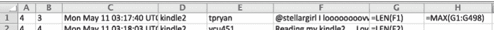
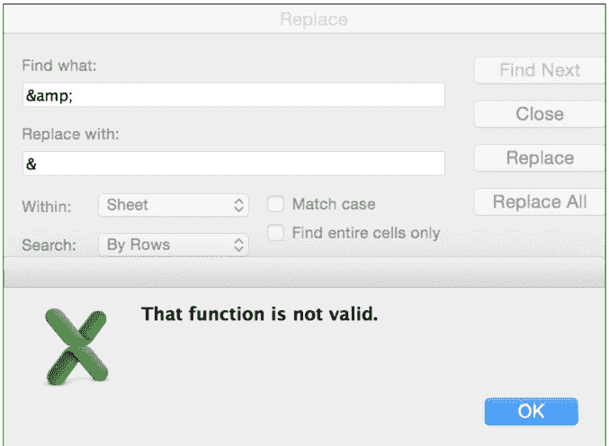

# 第7章：RDBMS 清洗技术

## RDBMS 清理技术

家用冰箱都配有架子，大多数还有一两个蔬菜抽屉。但如果你去过家居整理商店或与专业整理师交谈，你会了解到还有许多额外的存储选项，包括鸡蛋容器、奶酪盒、可乐罐分配器、酒瓶架、剩菜标签系统，以及各种尺寸的可堆叠、颜色编码的收纳箱。但我们真的需要所有这些额外物品吗？要回答这个问题，请问自己这些问题：我经常使用的食物是否容易找到？食物是否占用了比应有的更多空间？剩菜是否清楚地贴上标签，以便我记得它们是什么以及何时制作的？如果我们的答案是否定的，组织专家说容器和标签可以帮助我们优化存储、减少浪费，让生活更轻松。

在我们的 **关系数据库管理系统 (RDBMS)** 中也是如此。作为经典的长期数据存储解决方案，RDBMS 是现代数据科学工具包的标准组成部分。但我们经常犯的错误就是将数据简单地存入数据库，而对细节考虑甚少。在本章中，我们将学习如何设计一个超越 *两个架子和一个抽屉* 的 RDBMS。我们将学习一些技术，确保我们的 RDBMS 能够优化存储、减少浪费，让生活更轻松。具体来说，我们将：

- 学习如何在 RDBMS 数据中查找异常
- 学习多种清理不同类型问题数据的策略
- 学习何时以及如何为清理后的数据创建新表，包括创建子表和查找表
- 学习如何记录所做更改的规则

### 准备工作

为了设置本章中的示例，我们将使用一个名为 **Sentiment140** 的流行数据集。该数据集创建的目的是帮助学习 Twitter 消息中的正面和负面情绪。我们在本书中并不真正关心情感分析，但我们将使用该数据集来练习在数据已导入关系数据库后清理数据。

要开始使用 Sentiment140 数据集，您需要设置好 MySQL 服务器并准备就绪，就像之前的 Enron 示例中一样。

### 第一步 – 下载并检查 Sentiment140

我们想要使用的 Sentiment140 数据版本是直接从 Sentiment140 项目提供的原始两文件集，网址为 `http://help.sentiment140.com/for-students`。这个推文及其正面和负面极性（或情感，范围为 0、2 或 4）的 ZIP 文件由斯坦福大学的一些研究生创建。由于该文件被公开提供，原始的 Sentiment140 文件已被其他网站添加，并作为许多更大的推文集合的一部分提供。对于本章，我们将使用原始的 Sentiment140 文本文件，该文件要么可从前述网站的链接获得，要么可通过精确路径 `http://cs.stanford.edu/people/alecmgo/trainingandtestdata.zip` 获取。

下载 ZIP 文件，解压它，并使用文本编辑器查看其中的两个 CSV 文件。立刻你会注意到一个文件比另一个文件有更多的行，但这两个文件中的列数相同。数据以逗号分隔，每个列都用双引号括起来。每列的描述可以在前一节中链接的 `for-students` 页面上找到。

### 第二步 – 清理以便数据库导入

就我们的目的——学习如何清理数据而言，将这些文件中的较小文件加载到单个 MySQL 数据库表中就足够了。我们需要学习的一切，都可以用较小的文件来完成，该文件名为 `testdata.manual.2009.06.14.csv`。

当我们查看数据时，如果直接将此文件导入 MySQL，可能会注意到一些会给我们带来麻烦的区域。其中一个问题点位于文件的第 28 行：

```
"4","46","Thu May 14 02:58:07 UTC 2009","""booz allen""",
```

你能看到 booz 关键字之前和 allen 单词之后的三个引号 """ 吗？同样的问题稍后在第 41 行出现，双引号包围了歌曲标题 P.Y.T.：

```
"4","131","Sun May 17 15:05:03 UTC 2009","Danny Gokey","VickyTigger","I'm listening to ""P.Y.T"" by Danny Gokey..."
```

这些额外引号的问题在于 MySQL 导入例程会使用引号来分隔列文本。这会产生错误，因为 MySQL 会认为该行有比实际更多的列。

为了解决这个问题，在文本编辑器中，我们可以使用查找和替换将所有 """ 实例替换为 "（双引号），并将所有 " 实例替换为 '（单引号）。


> 这些 " 也可能完全删除，对此清理练习的负面影响很小。要做到这一点，我们只需搜索 " 并将其替换为空。但如果你想尽可能贴近推文的原始意图，使用单引号（甚至像这样转义的双引号 \"）作为替换字符是安全的选择。

将此清理后的文件保存为新文件名，例如 cleanedTestData.csv。我们现在准备将其导入 MySQL。

### 第三步 – 将数据导入 MySQL 单表

要将我们稍微清理过的数据文件加载到 MySQL 中，我们需要重新回顾第 3 章《Workhorses of Clean Data – Spreadsheets and Text Editors》中《Importing spreadsheet data into MySQL》部分中的 CSV 到 SQL 技术：

- 1. 从命令行导航到保存步骤二中创建的文件的目录。这是我们要导入 MySQL 的文件。
- 2. 然后启动 MySQL 客户端并连接到数据库服务器：

```
user@machine:~/sentiment140$ mysql -hlocalhost -umsquire -p
Enter password:
```


3. 输入您的密码，登录后，在 MySQL 中创建数据库以存放表，如下所示：

```
mysql> CREATE DATABASE sentiment140;
mysql> USE sentiment140;
```

4. 接下来，我们需要创建一个表来存放数据。每个列的数据类型和长度应代表我们对所拥有数据的最佳匹配尝试。其中一些列将是 varchar，并且每个都需要一个长度。由于我们可能不知道这些长度应该是多少，我们可以使用清理工具来确定一个合适的范围。

5. 如果我们在 Excel 中打开 CSV 文件（使用 Google 表格也完全没问题），我们可以运行一些简单的函数来查找部分文本字段的最大长度。例如，len() 函数会给出文本字符串的字符长度，而 max() 函数可以告诉我们某个范围内的最高数字。在 CSV 文件打开的情况下，我们可以应用这些函数来查看 MySQL 中 varchar 列应该有多长。

以下截图展示了一种使用函数解决此问题的方法。它显示了 length() 函数应用于列 G，以及 max() 函数用于列 H 但应用于列 G。



列 G 和 H 显示了如何在 Excel 中获取文本列的长度，然后获取最大值。

6. 为了更快地计算这些最大长度，我们也可以使用 Excel 快捷方式。以下数组公式可以快速将最大值与文本列的长度结合到单个单元格中——只需确保在输入此嵌套函数后按 Ctrl + Shift + Enter，而不是仅按 Enter：

```
=max(len(f1:f498))
```

此嵌套函数可应用于任何文本列，以获取该列中文本的最大长度，并且它仅使用一个单元格来完成此操作，而无需任何中间长度计算。

在运行这些函数后，我们发现我们所有推文的最大长度为 144 个字符。

## 检测和清理异常

您可能会想知道该数据集中的一条推文怎么可能长达 144 个字符，因为 Twitter 将所有推文限制为最大长度 140 个字符。事实证明，在 sentiment140 数据集中，& 字符有时会被翻译成 HTML 等效代码 &amp;，但并非总是如此。还使用了其他一些 HTML 代码，例如，有时 < 字符会变成 &lt;，而 > 会变成 &gt;。因此，对于少数很长的推文，仅仅增加几个字符就很容易使该推文超过 140 的长度限制。由于我们知道这些 HTML 编码的字符并不是原始用户所推文的内容，并且因为我们看到它们有时会出现但并非总是如此，我们称这些为数据异常。

要清理这些，我们有两个选择。我们可以继续将混乱的数据导入数据库然后在其中清理，或者我们可以先在 Excel 或文本编辑器中尝试清理。为了展示这两种技术的差异，我们在这里两者都做。首先，我们将在电子表格或文本编辑器中使用查找和替换来尝试转换以下表格中显示的字符。我们可以将 CSV 文件导入 Excel，看看能做多少清理工作：

| HTML 代码 | 替换为 | 实例计数 | 用于查找计数的 Excel 函数 |
|---|---|---|---|
| &lt; | < | 6 | =COUNTIF(F1:F498,"*&lt;*") |
| &gt; | > | 5 | =COUNTIF(F1:F498,"*&gt;*") |
| &amp; | & | 24 | =COUNTIF(F1:F498,"*&amp;*") |

前两个字符交换在 Excel 中使用查找和替换可以正常工作。&lt; 和 &gt; HTML 编码字符已被更改。看看类似这样的文本：

```
I'm listening to 'P.Y.T' by Danny Gokey &lt;3 &lt;3 &lt;3 Aww,
    he's so amazing. I &lt;3 him so much :)
```

前者变成类似这样的文本：

```
I'm listening to 'P.Y.T' by Danny Gokey <3 <3 <3 Aww, he's so
    amazing. I <3 him so much :)
```

然而，当我们尝试使用 Excel 查找 &amp; 并将其替换为 & 时，您可能会遇到错误，如下所示：



某些操作系统和版本的 Excel 在将 & 字符作为替换项时存在问题。此时，如果我们遇到此错误，可以采取几种不同的方法：

- 我们可以使用自己选择的搜索引擎尝试为此错误找到 Excel 解决方案
- 我们可以将 CSV 文本数据移至文本编辑器并在其中执行查找和替换功能
- 我们可以继续前进，将数据扔进数据库，尽管其中包含奇怪的 &amp; 字符，然后尝试在数据库内部清理它

通常，我会倾向于在尽可能在数据库外部清理的情况下不要将脏数据移入数据库。然而，由于本章是关于在数据库内部清理的，让我们继续将半清理后的数据导入数据库，我们将在数据进入表后处理 &amp; 问题。

## 创建我们的表

要将半清理后的数据移入数据库，我们将首先编写 CREATE 语句，然后在 MySQL 数据库上运行它。CREATE 语句如下所示：

```
mysql> CREATE TABLE sentiment140 (
    ->   polarity enum('0','2','4') DEFAULT NULL,
    ->   id int(11) PRIMARY KEY,
    ->   date_of_tweet varchar(28) DEFAULT NULL,
    ->   query_phrase varchar(10) DEFAULT NULL,
    ->   user varchar(10) DEFAULT NULL,
    ->   tweet_text varchar(144) DEFAULT NULL
    -> ) ENGINE=MyISAM DEFAULT CHARSET=utf8;
```


> 此语句使用简单且快速的 MyISAM 引擎，因为我们预计不需要任何 InnoDB 功能，例如行级锁定或事务。有关 MyISAM 与 InnoDB 差异的更多信息，这里有一个关于何时使用每个存储引擎的有用讨论：http://stackoverflow.com/questions/20148/myisam-versus-innodb。

您可能会注意到代码仍然要求 tweet_text 列的长度为 144。这是因为我们无法清理其中包含 &amp; 代码的列。然而，这并不太困扰我，因为我知道 varchar 列不会使用其额外的空间，除非它们需要。毕竟，这就是它们被称为 varchar，即可变字符列的原因。但如果这个额外长度真的困扰您，您可以稍后更改表，使该列只有 140 个字符。

接下来，我们将使用 MySQL 命令行从以下位置运行以下导入语句：

```
mysql> LOAD DATA LOCAL INFILE 'cleanedTestData.csv'
    ->   INTO TABLE sentiment140
    ->   FIELDS TERMINATED BY ',' ENCLOSED BY '"' ESCAPED BY '\\'
    ->   (polarity, id, date_of_tweet, query_phrase, user,
        tweet_text);
```

此命令将我们清理后的 CSV 文件中的数据加载到我们创建的新表中。成功消息看起来像这样，表明所有 498 行都已加载到表中：

```
Query OK, 498 rows affected (0.00 sec)
Records: 498  Deleted: 0  Skipped: 0  Warnings: 0
```

如果您有权访问基于浏览器的界面，例如 phpMyAdmin（或桌面应用程序，例如 MySQL Workbench 或 Toad for MySQL），所有这些 SQL 命令都可以在这些工具内部非常轻松地完成，而无需在命令行上输入，例如在 phpMyAdmin 中，您可以使用导入选项卡并在那里上传 CSV 文件。只需确保数据文件按照第二步 – 清理以便数据库导入中的程序进行清理，否则您可能会收到有关文件列数过多的错误。此错误是由引号问题引起的。


## 第四步 – 清理 &amp; 字符

在上一步中，我们决定推迟清理 &amp; 字符，因为 Excel 对其给出了奇怪的错误。现在我们已经完成了第三步 – 将数据导入 MySQL 中的单个表，并且数据已导入 MySQL，我们可以使用 UPDATE 语句和 replace() 字符串函数非常轻松地清理数据。以下是将所有 &amp; 实例替换为 & 所需的 SQL 查询：

```sql
UPDATE sentiment140 SET tweet_text = replace(tweet_text,'&amp;',
'&');
```

replace() 函数的工作方式与 Excel 或文本编辑器中的查找和替换完全相同。我们可以看到推文 ID 594，以前说 #at&amp;t is complete fail，现在读作 #at&t is complete fail。

## 第五步 – 清理其他神秘字符

当我们浏览 tweet_text 列时，我们可能注意到一些奇怪的推文，例如推文 ID 613 和 2086：

```
613, Talk is Cheap: Bing that, I?ll stick with Google
2086, Stanford University?s Facebook Profile
```

? 字符是我们应该关注的。正如我们之前看到的 HTML 编码字符一样，此字符问题也非常可能是在字符集之间转换之前的产物。在这种情况下，原始推文中可能存在某种高 ASCII 或 Unicode 省略号（有时称为智能引号），但当数据转换为较低阶字符集，例如纯 ASCII 时，该特定风格的省略号 simply 被更改为 ?。


根据我们计划对数据进行的操作，我们可能不想忽略 ? 字符，例如，如果我们进行词频统计或文本挖掘，将 I?ll 转换为 I’ll 以及 University?s 转换为 University's 可能会非常重要。如果我们决定这很重要，那么我们的任务就是检测出现此错误的推文，然后制定策略将问号转换回单引号。当然，诀窍在于我们不能简单地将 tweet_text 列中的每个问号都替换为单引号字符，因为某些推文中包含的问号应该保留。

为了定位问题字符，我们可以运行一些 SQL 查询，尝试使用正则表达式定位问题。我们关注的是出现在奇怪位置的问号，例如后面紧跟字母字符的情况。以下是使用 MySQL REGEXP 功能的正则 SQL 表达式的初步尝试。运行它将让我们大致了解问题问号可能存在的位置：

```
SELECT id, tweet_text
FROM sentiment140
WHERE tweet_text
REGEXP '\\?[[:alpha:]]+' ;
```

这个 SQL 正则表达式查找后面紧跟一个或多个字母字符的任何问号字符。该 SQL 查询产生六行，其中四行确实包含奇怪的问号，两行是 **假阳性**。假阳性是指匹配了我们的模式但实际上不应更改的推文。两个假阳性是 ID 为 **234** 和 **2204** 的推文。这两条推文中的问号是合法 URL 的一部分。推文 **139**、**224**、**613** 和 **2086** 是 **真阳性**，意味着被正确检测为异常且应更改的推文。所有结果都显示在以下 phpMyAdmin 截图中：

| id | 推文文本 |
|---|---|
| 139 | ?Obama Administration Must Stop Bonuses to AIG Ponzi Schemers ... http://bit.ly/2CUlg |
| 224 | Life?s a bitch? and so is Dick Cheney. #p2 #bipart #lot #tcot #rhrs #GOP #DNC http://is.gd/DjyQ |
| 234 | jQuery UI 1.6 Book Review - http://cfbloggers.org/?c=30631 |
| 613 | Talk is Cheap: Bing that, I?ll stick with Google. http://bit.ly/XC3C8 |
| 2086 | Stanford University?s Facebook Profile is One of the Most Popular Official University Pages - http://tinyurl.com/p5b3fl |
| 2204 | Learning jQuery 1.3 Book Review - http://cfbloggers.org/?c=30629 |

不过推文 139 很奇怪。它在单词 Obama 前有一个问号，就好像新闻文章的名称被引用了，但字符串末尾没有匹配的引号（或缺少引号）。这本应是其他字符吗？这可能实际上也是一个假阳性，或者至少不足以构成真正的阳性而需要我们修复它。在仔细查看推文时，224 也在不合适的位置多了一个奇怪的问号。

如果我们要编写一个 replace() 函数来将有问题的问号更改为单引号，我们就需要以某种方式编写一个正则表达式，使其仅匹配真阳性而不匹配任何假阳性。然而，由于这个数据集很小，只有四个真阳性——如果我们决定 139 不需要清理，则为三个——那么我们完全可以手工清理真阳性。这尤其是个好主意，因为我们对其他可能的问题还有一些疑问，例如推文 224 中的额外问号。

在这种情况下，由于我们只有三行问题数据，直接运行三个小的 UPDATE 命令处理数据比尝试制作完美的正则表达式更快。以下是处理推文 224（仅第一个问题）、613 和 2086 的 SQL 查询：

```
UPDATE sentiment140 SET tweet_text = 'Life''s a bitch? and so is
  Dick Cheney. #p2 #bipart #lot #tcot #rhrs #GOP #DNC
  http://is.gd/DjyQ' WHERE id = 224;
```

```
UPDATE sentiment140 SET tweet_text = 'Talk is Cheap: Bing that,
  I''ll stick with Google. http://bit.ly/XC3C8' WHERE id = 613;
```

```
UPDATE sentiment140 SET tweet_text = 'Stanford University''s
  Facebook Profile is One of the Most Popular Official University
  Pages - http://tinyurl.com/p5b3fl' WHERE id = 2086;
```


> 请注意，我们必须在这些更新语句中转义单引号。在 MySQL 中，转义字符可以是反斜杠或单引号本身。这些示例显示了单引号作为转义字符。

## 第六步 – 清理日期

如果我们查看 date_of_tweet 列，我们会发现我们将其创建为一个简单的可变字符字段 varchar(30)。这有什么问题呢？好吧，假设我们想按从最早到最晚的顺序排列推文。现在我们无法使用简单的 SQL ORDER BY 子句获得正确的日期顺序，因为我们会得到字母顺序。所有星期五都会排在任何星期一之前，而五月总是排在六月之后。我们可以用以下 SQL 查询来测试这一点：

```
SELECT id, date_of_tweet
FROM sentiment140
ORDER BY date_of_tweet;
```

前几行是有序的，但在第 28 行附近，我们开始看到问题：

```
2018  Fri May 15 06:45:54 UTC 2009
2544  Mon Jun 08 00:01:27 UTC 2009
...
3     Mon May 11 03:17:40 UTC 2009
```

5 月 11 日并没有排在 5 月 15 日或 6 月 8 日之后。为了解决这个问题，我们需要创建一个新列来清理这些日期字符串并将其转换为正确的 MySQL datetime 数据类型。我们在第 2 章《基础 – 格式、类型和编码》中的“在数据类型之间转换”部分学到，MySQL 在日期和时间以原生 date、time 或 datetime 类型存储时工作最佳。插入 datetime 类型的格式如下：YYYY-MM-DD HH:MM:SS。但这不是 date_of_tweet 列中数据的样子。

有许多内置的 MySQL 函数可以帮助我们将混乱的日期字符串格式化为首选格式。通过这样做，我们将能够利用 MySQL 对日期和时间进行数学运算的能力，例如查找两个日期或时间之间的差异，或按日期或时间顺序正确排序项目。

为了将我们的字符串转换为 MySQL 友好的 datetime 类型，我们将执行以下步骤：

- 1. 修改表以包含一个新列，其目的是保存新的 datetime 信息。我们可以将这个新列命名为 date_of_tweet_new 或 date_clean 或其他能清楚区别于原始 date_of_tweet 列的名称。执行此任务的 SQL 查询如下：

```
ALTER TABLE sentiment140
ADD date_clean DATETIME NULL
AFTER date_of_tweet;
```

- 2. 对每一行执行更新，在此过程中我们将旧的日期字符串格式化为正确格式的 datetime 类型而不是字符串，并将新值添加到新创建的 date_clean 列中。执行此任务的 SQL 如下：

```
UPDATE sentiment140
SET date_clean = str_to_date(date_of_tweet,
  '%a %b %d %H:%i:%s UTC %Y');
```

此时，我们有一个新列，已填充干净的 datetime。请记住，旧的 date_of_tweet 列存在缺陷，即无法正确排序日期。为了测试日期现在是否排序正确，我们可以按新列的顺序选择数据：

```
SELECT id, date_of_tweet
FROM sentiment140
ORDER BY date_clean;
```

我们看到行现在已完美排序，5 月 11 日的日期排在最前，且没有日期顺序错误。

我们应该删除旧的日期列吗？这由你决定。如果你担心自己可能犯了错误，或者出于某种原因可能需要原始数据，那么请务必保留它。但如果你想删除它，只需按如下所示删除该列即可：

```
ALTER TABLE sentiment140
DROP date_of_tweet;
```

你也可以创建一个包含原始列的 Sentiment140 表的副本作为备份。

## 第七步 – 分离用户提及、话题标签和 URL

目前这个数据还有另一个问题是 tweet_text 列中隐藏着大量有趣的信息，例如，考虑一个人使用 @ 符号在其用户名前将推文指向另一个人的所有情况。这在 Twitter 上称为提及。统计某个人被提及的次数或与特定关键词一起被提及的次数可能会很有趣。一些推文中隐藏的另一个有趣数据是话题标签；例如，ID 为 2165 的推文使用 #jobs 和 #sittercity 话题标签讨论了工作和 babysitting 的概念。


这条推文还包含一个外部的、非 Twitter 的 URL。我们可以提取这些提及、话题标签和 URL，并分别保存到数据库中。

此任务与我们清理日期的方式类似，但有一个重要区别。对于日期而言，我们只有一个可能的修正版本，因此只需添加一列新列来保存新的清理版本即可。然而对于提及、话题标签和 URL，我们可能在单个 tweet_text 值中出现零个或多个，例如，我们之前查看的推文（ID 2165）中包含两个话题标签，这条推文（ID 2223）也是如此：

```
HTML 5 Demos! Lots of great stuff to come! Yes, I'm excited. :)
http://htmlfive.appspot.com #io2009 #googleio
```

这条推文有零个提及、一个 URL 和两个话题标签。推文 13078 包含三个提及，但没有话题标签或 URL：

```
Monday already. Iran may implode. Kitchen is a disaster. @annagoss
seems happy. @sebulous had a nice weekend and @goldpanda is
great. whoop.
```

我们需要更改数据库结构来保存这些新信息——话题标签、URL 和提及——同时要记住一条推文可能包含大量这些内容。

## 创建一些新表

遵循关系数据库理论，我们应避免创建存储多值属性的列，例如，如果一条推文有三个话题标签，我们不应只将三个话题标签全部存入单个列。对我们而言，此规则的影响是，我们不能直接复制之前在日期清理问题中使用的 ALTER 过程。

相反，我们需要创建三个新表：sentiment140_mentions、sentiment140_urls 和 sentiment140_hashtags。每个新表的首要键都将是一个合成 ID 列，每个表还将包含另外两列：tweet_id，它将此新表链接回原始 sentiment140 表，以及提取的话题标签、提及或 URL 的实际文本。以下是创建我们需要的表的三个 CREATE 语句：

```
CREATE TABLE IF NOT EXISTS sentiment140_mentions (
  id int(11) NOT NULL AUTO_INCREMENT,
  tweet_id int(11) NOT NULL,
  mention varchar(144) NOT NULL,
  PRIMARY KEY (id)
) ENGINE=MyISAM DEFAULT CHARSET=utf8;
```

```
CREATE TABLE IF NOT EXISTS sentiment140_hashtags (
  id int(11) NOT NULL AUTO_INCREMENT,
  tweet_id int(11) NOT NULL,
  hashtag varchar(144) NOT NULL,
  PRIMARY KEY (id)
) ENGINE=MyISAM DEFAULT CHARSET=utf8;
```

```
CREATE TABLE IF NOT EXISTS sentiment140_urls (
  id int(11) NOT NULL AUTO_INCREMENT,
  tweet_id int(11) NOT NULL,
  url varchar(144) NOT NULL,
  PRIMARY KEY (id)
) ENGINE=MyISAM DEFAULT CHARSET=utf8;
```

> 这些表未使用指向原始 sentiment140 推文表的外键。如果你想添加这些，完全可以。对于学习如何清理此数据集的目的而言，这并不是必要的。

现在我们的表已创建，是时候用我们从 tweet_text 列中仔细提取的数据填充它们了。我们将分别处理每种提取情况，首先从用户提及开始。

## 提取用户提及

为了设计一个能够处理用户提及提取的流程，让我们先回顾一下我们对推文中提及的了解：

- 用户提及总是以 @ 符号开头
- 用户提及是 @ 符号后面紧跟的词
- 如果 @ 后面有空格，则不是用户提及
- 用户提及本身内部没有空格
- 由于电子邮件地址也使用 @，我们应注意它们

使用这些规则，我们可以构造一些有效用户提及：

- @foo
- @foobar1
- @_1foobar_

我们可以构造一些无效用户提及的示例：

- @ foo（@ 后的空格使其无效）
- foo@bar.com（bar.com 不会被识别）
- @foo bar（只有 @foo 会被识别）
- @foo.bar（只有 @foo 会被识别）

> 在此示例中，我们假设我们不关心普通 @mention 和 .@mention 之间的区别，后者有时称为点提及。这些是 @ 符号前面带有一个句点的推文。它们旨在将推文推送给用户的全部关注者。

由于这套规则比我们能在 SQL 中高效执行的复杂得多，最好编写一个简单的脚本使用正则表达式来清理这些推文。我们可以用任何能连接数据库的语言编写此类脚本，例如 Python 或 PHP。由于我们在第 2 章《Fundamentals – Formats, Types, and Encodings》中使用 PHP 连接到数据库，这里也让我们使用一个快速的 PHP 脚本。此脚本连接到数据库，在 tweet_text 列中搜索用户提及，并将找到的提及移动到新的 sentiment140_mentions 表中：

```
<?php
// connect to db
$dbc = mysqli_connect('localhost', 'username', 'password',
    'sentiment140')
    or die('Error connecting to database!' . mysqli_error());
$dbc->set_charset("utf8");

// pull out the tweets
$select_query = "SELECT id, tweet_text FROM sentiment140";
$select_result = mysqli_query($dbc, $select_query);

// die if the query failed
if (!$select_result)
    die ("SELECT failed! [$select_query]" . mysqli_error());

// pull out the mentions, if any
$mentions = array();
while($row = mysqli_fetch_array($select_result))
{
    if (preg_match_all(
        "/(?<!\pL)@(\pL+)/iu",
        $row["tweet_text"],
        $mentions
    ))
    {
        foreach ($mentions[0] as $name)
        {
            $insert_query = "INSERT into sentiment140_mentions (id,
tweet_id, mention) VALUES (NULL," . $row["id"] . ",'$name')";
            echo "<br />$insert_query";
            $insert_result = mysqli_query($dbc, $insert_query);
            // die if the query failed
            if (!$insert_result)
                die ("INSERT failed! [$insert_query]" .
mysqli_error());
        }
    }
}
?>
```

在 sentiment140 表上运行这个小脚本后，我们看到从 498 条原始推文中提取出了 124 个唯一用户提及。关于此脚本的一些有趣之处包括它能够处理用户名中的 Unicode 字符，尽管此数据集中恰好没有。我们可以通过在 sentiment140 表末尾快速插入一条测试行来测试，例如：

```
INSERT INTO sentiment140 (id, tweet_text) VALUES (99999, "This is a @ тест");
```

然后再次运行脚本；你会看到 sentiment140_mentions 表中已添加一行，其中 @тест Unicode 用户提及已成功提取。在下一节中，我们将构建一个类似的脚本来提取话题标签。

## 提取话题标签

话题标签有自己的规则，与用户提及略有不同。以下是一些可用于判断某物是否为话题标签的规则列表：

- 话题标签以 # 符号开头
- 话题标签是 # 符号后面紧跟的词
- 话题标签可以包含下划线，但不能有空格和其他标点符号

将话题标签提取到自己的表中的 PHP 代码与用户提及代码大部分相同，唯一例外是代码中间的正则表达式。我们只需将 $mentions 变量更改为 $hashtags，然后调整正则表达式使其如下所示：

```
if (preg_match_all(
    "/(#\pL+)/iu",
    $row["tweet_text"],
    $hashtags
))
```

此正则表达式表示我们感兴趣的是匹配大小写不敏感的 Unicode 字母字符。然后，我们需要更改 INSERT 行以使用正确的表和列名，如下所示：

```
$insert_query = "INSERT INTO sentiment140_hashtags (id, tweet_id, hashtag) VALUES (NULL," . $row["id"] . ",'$name')";
```

成功运行此脚本后，我们看到 sentiment140_hashtags 表中已添加了 54 个话题标签。许多推文包含多个话题标签，甚至比包含多个用户提及的推文还要多，例如，我们可以立即看到推文 174 和 224 都包含多个嵌入话题标签。

接下来，我们将使用相同的骨架脚本并再次修改它以提取 URL。

## 提取 URL

从文本中提取 URL 可能简单到查找以 http:// 或 https:// 开头的任何字符串，也可能变得非常复杂，这取决于文本字符串包含的 URL 类型，例如，一些字符串可能包含 file:// URL 或 torrent 链接，如 magnet URL，或其他类型的异常链接。在我们的 Twitter 数据的情况下，我们的情况稍微容易一些，因为数据集中包含的 URL 都以 HTTP 开头。因此，我们可以偷懒，只设计一个简单的正则表达式来提取跟随 http:// 或 https:// 的任何字符串。此正则表达式将如下所示：

```
if (preg_match_all(
    "!https?://\S+!",
    $row["tweet_text"],
    $urls
))
```


然而，如果我们在喜爱的搜索引擎上稍微搜索一下，就会发现可以轻松找到一些相当令人印象深刻且实用的通用 URL 匹配模式，这些模式能够处理更复杂的链接模式。这之所以有用，是因为如果我们编写的 URL 提取能够处理更复杂的情况，那么即使未来数据发生变化，它仍然会有效。

一个记录非常详尽的 URL 模式匹配例程在 http://daringfireball.net/2010/07/improved_regex_for_matching_urls 网站上给出。下面的代码展示了如何修改我们的 PHP 代码以使用此模式在 Sentiment140 数据集中进行 URL 提取：

```php
<?php
// connect to db
$dbc = mysqli_connect('localhost', 'username', 'password',
    'sentiment140')
    or die('Error connecting to database!' . mysqli_error());
$dbc->set_charset("utf8");

// pull out the tweets
$select_query = "SELECT id, tweet_text FROM sentiment140";
$select_result = mysqli_query($dbc, $select_query);

// die if the query failed
if (!$select_result)
    die ("SELECT failed! [$select_query]" . mysqli_error());

// pull out the URLS, if any
$urls = array();
$pattern = '#\b(([\\w-]+://?|www[.] )[^\s()<>]+(?:\:[\\w\d]+\)|[^[:punct:]\\s|/]))#';

while($row = mysqli_fetch_array($select_result))
{
    echo "<br/>working on tweet id: " . $row["id"];
    if (preg_match_all(
        $pattern,
        $row["tweet_text"],
        $urls
    ))
    {
        foreach ($urls[0] as $name)
        {
            echo "<br/>---url: ".$name;
            $insert_query = "INSERT into sentiment140_urls (id,
            tweet_id, url)
VALUES (NULL," . $row["id"] . ",'$name')";
            echo "<br />$insert_query";
            $insert_result = mysqli_query($dbc, $insert_query);
            // die if the query failed
            if (!$insert_result)
                die ("INSERT failed! [$insert_query]" .
                mysqli_error());
        }
    }
}
?>
```

此程序几乎与我们之前编写的提及提取程序相同，只有两个例外。首先，我们将正则表达式模式存储在一个名为 $pattern 的变量中，因为它很长且复杂。其次，我们对数据库 INSERT 命令做了少量修改，就像我们为 hashtag 提取所做的那样。

正则表达式模式的逐行完整解释可在其原始网站上找到，但简要说明是，所示模式将匹配任何 URL 协议，例如 http:// 或 file://，并且它还尝试匹配有效的域名模式以及数层深的目录/文件模式。源网站还提供了自己的测试数据集，如果你想查看它将匹配的各种模式以及一些肯定不会匹配的已知模式。

## 第八步 – 为查找表清理

在“第七步 – 分离用户提及、hashtag 和 URL”部分，我们创建了新表来保存提取的 hashtag、用户提及和 URL，然后通过 id 列提供了一种将每一行链接回原始表的方法。我们遵循数据库规范化的规则，创建了表示推文与用户提及之间、推文与 hashtag 之间或推文与 URL 之间一对多关系的新表。在本步骤中，我们将继续优化此表以提高性能和效率。

我们现在关注的列是 query_phrase 列。查看列数据，可以看到它包含反复重复出现的相同短语。这些显然是最初用于定位和选择现在存在于此数据集中的推文的搜索短语。在 sentiment140 表中的 498 条推文中，有多少查询短语是反复重复的？我们可以使用以下 SQL 来检测这一点：

```
SELECT count(DISTINCT query_phrase)
FROM sentiment140;
```

查询结果显示只有 80 个不同的查询短语，但这些短语在 498 行中反复使用。

在 498 行的表中，这可能看起来不是问题，但如果我们有一个极大的表，例如包含数亿行，我们应该对该列担心两件事。首先，反复重复这些字符串会占用数据库中不必要的空间，其次，搜索不同的字符串值速度非常慢。

为了解决这个问题，我们将创建一个 **查找表** 来存放查询值。每个查询字符串在这个新表中只存在一次，我们还将为每个字符串创建一个 ID 号。然后，我们将更改原始表，使其使用这些新的数值而不是当前使用的字符串值。我们实现此目的的步骤如下：

- 1. 创建一个新的查找表：
  ```sql
  CREATE TABLE sentiment140_queries (
      query_id int(11) NOT NULL AUTO_INCREMENT,
      query_phrase varchar(25) NOT NULL,
      PRIMARY KEY (query_id)
  ) ENGINE=MyISAM DEFAULT CHARSET=utf8 AUTO_INCREMENT=1;
  ```
- 2. 使用不同的查询短语填充查找表，并自动为每个短语分配一个 query_id 编号：
  ```sql
  INSERT INTO sentiment140_queries (query_phrase)
  SELECT DISTINCT query_phrase FROM sentiment140;
  ```
- 3. 在原始表中创建一个新列来保存查询短语编号：
  ```sql
  ALTER TABLE sentiment140
  ADD query_id INT NOT NULL AFTER query_phrase;
  ```
- 4. 在下一步出错以防万一备份 sentiment140 表。任何时候我们在表上执行 UPDATE，都最好先进行备份。要创建 sentiment140 表的副本，我们可以使用 phpMyAdmin 等工具轻松复制表（使用 Operations 选项卡）。或者，我们可以重新创建一个表的副本，然后将原始表的行导入其中，如以下 SQL 所示：
  ```sql
  CREATE TABLE sentiment140_backup(
      polarity int(1) DEFAULT NULL,
      id int(5) NOT NULL,
      date_of_tweet varchar(30) CHARACTER SET utf8 DEFAULT NULL,
      date_clean datetime DEFAULT NULL COMMENT 'holds clean,
      formatted date_of_tweet',
      query_id int(11) NOT NULL,
      user varchar(25) CHARACTER SET utf8 DEFAULT NULL,
      tweet_text varchar(144) CHARACTER SET utf8 DEFAULT NULL ,
      PRIMARY KEY (id)) ENGINE=MyISAM DEFAULT CHARSET=utf8;

  SET SQL_MODE='NO_AUTO_VALUE_ON_ZERO';
  INSERT INTO sentiment140_backup SELECT * FROM sentiment140;
  ```
- 5. 用正确的编号填充新列。为此，我们将两个表按其文本列连接起来，然后从查找表中查找正确的编号值，并将其插入 sentiment140 表中。在以下查询中，每个表都已分配别名 s 和 sq：
  ```sql
  UPDATE sentiment140 s
  INNER JOIN sentiment140_queries sq
  ON s.query_phrase = sq.query_phrase
  SET s.query_id = sq.query_id;
  ```
- 6. 删除 sentiment140 表中的旧 query_phrase 列：
  ```sql
  ALTER TABLE sentiment140
  DROP query_phrase;
  ```

此时，我们有一种有效的方式来创建短语列表，如下所示。
这些按字母顺序显示：

```
SELECT query_phrase
FROM sentiment140_queries
ORDER BY 1;
```

我们也可以通过在两个表之间执行连接来查找具有给定短语（baseball）的推文：

```
SELECT s.id, s.tweet_text, sq.query_phrase
FROM sentiment140 s
INNER JOIN sentiment140_queries sq
ON s.query_id = sq.query_id
WHERE sq.query_phrase = 'baseball';
```

此时，我们有一个清理过的 sentiment140 表和四个新表来保存各种提取和清理后的值，包括 hashtag、用户提及、URL 和查询短语。我们的 tweet_text 和 date_clean 列是干净的，并且我们有一个查询短语的查找表。

## 第九步 – 记录你所做的工作

经过九步清理并使用多种语言和工具，毫无疑问我们会在某个时候犯错并不得不重复某个步骤。如果我们必须向他人描述我们做了什么，我们几乎肯定会难以记住确切的步骤以及我们做每件事的所有原因。

为了在过程中避免错误，保留清理步骤日志至关重要。至少，日志应按执行顺序包含以下内容：

- 每条 SQL 语句
- 每个 Excel 函数或文本编辑器例程，包括必要时的屏幕截图
- 每个脚本
- 关于为何执行每项操作的说明和注释

另一个绝佳的想法是在每个阶段创建表的备份，例如，我们在对 sentiment140 表执行 UPDATE 之前创建了备份，并且我们讨论过在创建新的 date_clean 列后进行备份。备份很容易完成，如果你决定不需要它，随时可以删除备份的表。

## 摘要

在本章中，我们使用了一个示例数据集，即名为 Sentiment140 的推文集合，来学习如何在关系数据库管理系统 中清理和操作数据。我们在 Excel 中执行了一些基本的清理操作，然后回顾了如何将数据从 CSV 文件中取出并导入数据库。此时，其余的清理操作都在 RDBMS 内部完成。我们学习了如何将字符串操作为正确的日期，然后着手从推文文本中提取三种类型的数据，最终将这些提取的值移动到新的、干净的表中。接下来，我们学习了如何创建当前存储效率低下的值的查找表，从而允许我们用高效的数值查找值更新原始表。最后，由于我们执行了许多步骤，并且总有可能出现错误或对我们所做的事情的沟通不畅，我们回顾了一些记录清理过程的策略。

在下一章中，我们将转换视角，从清理给定的数据转向为他人使用而准备清理后的数据。我们将学习一些最佳实践，以创建需要他人最少清理的数据集。


