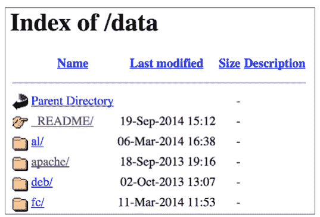
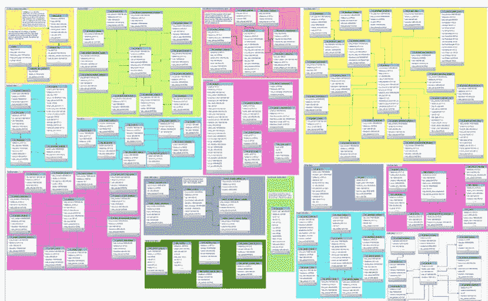
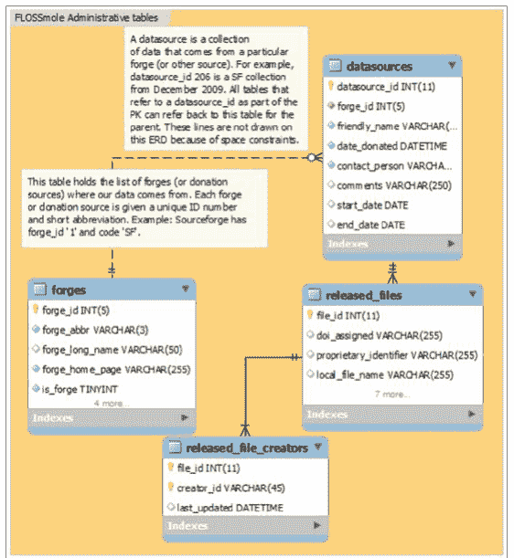

# 第8章：共享干净数据的最佳实践

## 分享干净数据的最佳实践

迄今为止，在本书中，我们学习了许多不同的清理和组织数据集的方法。也许现在是时候考虑让他人使用我们清理过的数据了。本章的目标是介绍一些邀请朋友进入你的数据科学厨房的最佳实践。分享你的数据可能意味着将其提供给其他人、其他团队，甚至只是你未来的某个版本。怎样才能最好地将数据打包供他人使用？应该如何告知人们你所拥有的清理数据？如何确保你所有的辛苦工作都得到署名？

在本章中，我们将学习：

- 如何呈现和打包你的清理数据
- 如何为数据中包含的内容提供清晰的文档
- 如何通过许可你的清理数据来保护和扩展你的辛苦工作
- 如何找到并评估宣传你的清理数据的选项

在开始本章之前，我们应该明确指出的一点是，我们只能清理和分享我们有权分享的数据。也许这看起来显而易见，但值得重复。本章的全部内容都假设你只是在清理，并且随后分享你实际上有权以这种方式使用的数据。如果你对此有疑问，请阅读本章的 *为你的数据设定条款和许可* 部分，并确保你遵循与要求用户遵循相同的准则。

## 准备干净的数据包

在本节中，我们将深入探讨在你能够发布数据包供公众使用之前需要回答的许多重要问题。

你希望人们如何访问你的数据？如果它在数据库中，你希望用户能够登录并在上面运行 SQL 命令吗？还是你希望为他们创建可下载的纯文本文件供使用？你需要为数据创建 API 吗？无论如何你有多少数据，你是否希望对数据的不同部分提供不同级别的访问权限？

分享干净数据的技术方面极其重要。一般来说，从简单的事情开始，并在需要时再转向更复杂的分发计划可能是个好主意。以下是一些分发数据的选项，按从最不复杂到最复杂的顺序排列。当然，随着复杂性的增加，带来的好处也越大：

- **压缩纯文本** – 这是一种风险很低的分发方法。正如我们在第 2 章 *基础 – 格式、类型和编码* 中学到的，纯文本可以被压缩以创建非常小的文件大小。简单的 CSV 或 JSON 文件具有通用用途，并且可以轻松转换为许多其他格式。需要考虑的一些事项包括：
  - 你将如何让用户下载文件？网页上的开放链接极其简单方便，但它不允许你要求用户名和密码等凭据来访问文件。如果这对你很重要，那么你将不得不考虑其他分发文件的方法；例如，使用带用户名和密码的 FTP 服务器或使用 Web 服务器的访问控制。
  - 你的文件有多大？你预计会有多少流量？在开始额外收费之前，你的主机提供商允许多少流量？
- **压缩 SQL 文件** – 分发 SQL 文件允许你的用户在自己的系统上重建你的数据库结构和数据。需要考虑的一些事项包括：
  - 你的用户可能运行的数据库系统与你不同，因此他们无论如何都必须清理数据。直接给他们纯文本可能更有效率。
  - 你的数据库系统可能有与他们不同的服务器设置，因此你必须提前澄清这些自定义设置。
  - 你还需要提前计划你的数据集是否设计为随时间增长，例如，通过决定你是否只提供 `UPDATE` 语句，还是你将始终提供足够的 `CREATE` 和 `INSERT` 语句来重建整个数据库。
- **实时数据库访问** – 为用户提供直接访问你的数据库是一种非常好的方式，让他们在低层级与你的数据交互。需要考虑的一些事项包括：
  - 提供实时访问确实要求你为每个用户设置单独的用户名和密码，这意味着需要跟踪用户。
  - 因为你有可识别的用户，你需要提供一种方式与他们就支持问题进行沟通，包括丢失凭据和如何使用系统。
  - 除非你也在数据库上构建了安全的[content]
## 8

## 分享干净数据的最佳实践

迄今为止，在本书中，我们学习了许多不同的清理和组织数据集的方法。也许现在是时候考虑让他人使用我们清理过的数据了。本章的目标是介绍一些邀请朋友进入你的数据科学厨房的最佳实践。分享你的数据可能意味着将其提供给其他人、其他团队，甚至只是你未来的某个版本。怎样才能最好地将数据打包供他人使用？应该如何告知人们你所拥有的清理数据？如何确保你所有的辛苦工作都得到署名？

在本章中，我们将学习：

- 如何呈现和打包你的清理数据
- 如何为数据中包含的内容提供清晰的文档
- 如何通过许可你的清理数据来保护和扩展你的辛苦工作
- 如何找到并评估宣传你的清理数据的选项

在开始本章之前，我们应该明确指出的一点是，我们只能清理和分享我们有权分享的数据。也许这看起来显而易见，但值得重复。本章的全部内容都假设你只是在清理，并且随后分享你实际上有权以这种方式使用的数据。如果你对此有疑问，请阅读本章的 *为你的数据设定条款和许可* 部分，并确保你遵循与要求用户遵循相同的准则。

## 准备干净的数据包

在本节中，我们将深入探讨在你能够发布数据包供公众使用之前需要回答的许多重要问题。

你希望人们如何访问你的数据？如果它在数据库中，你希望用户能够登录并在上面运行 SQL 命令吗？还是你希望为他们创建可下载的纯文本文件供使用？你需要为数据创建 API 吗？无论如何你有多少数据，你是否希望对数据的不同部分提供不同级别的访问权限？

分享干净数据的技术方面极其重要。一般来说，从简单的事情开始，并在需要时再转向更复杂的分发计划可能是个好主意。以下是一些分发数据的选项，按从最不复杂到最复杂的顺序排列。当然，随着复杂性的增加，带来的好处也越大：

- **压缩纯文本** – 这是一种风险很低的分发方法。正如我们在第 2 章 *基础 – 格式、类型和编码* 中学到的，纯文本可以被压缩以创建非常小的文件大小。简单的 CSV 或 JSON 文件具有通用用途，并且可以轻松转换为许多其他格式。需要考虑的一些事项包括：
  - 你将如何让用户下载文件？网页上的开放链接极其简单方便，但它不允许你要求用户名和密码等凭据来访问文件。如果这对你很重要，那么你将不得不考虑其他分发文件的方法；例如，使用带用户名和密码的 FTP 服务器或使用 Web 服务器的访问控制。
  - 你的文件有多大？你预计会有多少流量？在开始额外收费之前，你的主机提供商允许多少流量？
- **压缩 SQL 文件** – 分发 SQL 文件允许你的用户在自己的系统上重建你的数据库结构和数据。需要考虑的一些事项包括：
  - 你的用户可能运行的数据库系统与你不同，因此他们无论如何都必须清理数据。直接给他们纯文本可能更有效率。
  - 你的数据库系统可能有与他们不同的服务器设置，因此你必须提前澄清这些自定义设置。
  - 你还需要提前计划你的数据集是否设计为随时间增长，例如，通过决定你是否只提供 `UPDATE` 语句，还是你将始终提供足够的 `CREATE` 和 `INSERT` 语句来重建整个数据库。
- **实时数据库访问** – 为用户提供直接访问你的数据库是一种非常好的方式，让他们在低层级与你的数据交互。需要考虑的一些事项包括：
  - 提供实时访问确实要求你为每个用户设置单独的用户名和密码，这意味着需要跟踪用户。
  - 因为你有可识别的用户，你需要提供一种方式与他们就支持问题进行沟通，包括丢失凭据和如何使用系统。
  - 除非你也在数据库上构建了安全的

- 其次，GitHub 有一些相当严格的文件大小限制。它将每个项目（仓库）的限制列为 1GB，每个文件的限制列为 100MB。我发布的大多数数据文件单独来看都小于该限制，但由于我每年多次发布许多时间序列文件，我将不得不为它们创建多个仓库。在这种方案下，每次我发布新文件时，都必须评估是否接近文件大小限制。这很快就会成为一个大麻烦。

简而言之，GitHub 本身建议使用网络托管解决方案来分发文件，特别是如果它们很大或以数据库为导向。如果您决定在 GitHub 上托管，请务必注意不要发布包含用户凭据的文件。这包括发布数据库系统的用户名和密码、Twitter 的身份验证密钥和密钥，或任何其他个人详细信息。由于 GitHub 本质上是一个 Git 仓库，错误将永远存在，除非仓库本身被删除。如果您发现自己确实犯了错误并将个人详细信息发布到 GitHub，您必须立即取消所有当前账户的身份验证并重新创建所有密钥和密码。

## 记录您的数据

一旦人们能够访问数据，最好是在此之前，他们就需要知道自己得到的是什么。对您来说，记录数据可能感觉像是事后才想到的，但对您的用户来说却极其重要，因为他们对数据或您对数据所做的所有处理都不熟悉。在本节中，我们将回顾一些可以添加到您的数据包中以使其更易于理解的内容。

## README 文件

简单的 README 文件在计算领域有着悠久的历史。它只是一个文本文件，随软件包一起分发，或存放在包含其他文件的目录中，其理念是用户在开始使用其余软件包或文件之前应先阅读 README 文件。README 文件会向用户提供有关软件包的重要信息，例如谁编写了它以及为什么、安装说明、已知错误以及使用文件的基本说明等。

如果您正在构建数据包，例如装满文本或 SQL 文件的压缩文件，在压缩之前快速轻松地向文件包添加一个 `README` 文件。如果您为文件制作网站或在线目录，在显眼的位置添加 `README` 文件会非常有帮助。以下截图显示了我用来分发我参与的一个项目文件的一个网络目录，名为 **FLOSSmole**。我添加了一个 `README` 目录，其中包含我希望用户首先阅读的所有文件。我在该目录名称前加上了下划线，以便它在列表中按字母顺序始终显示在顶部：



网站上的文件目录显示 README 文件位于顶部。

在 `README.txt` 文件中，我为用户提供有关文件的一般和具体说明。以下是我在该目录中为我的数据提供的 `README` 文件示例：

```
README for http://flossdata.syr.edu/data directory

What is this place?
This is a repository of flat files or data "dumps", from the FLOSSmole project.

What is FLOSSmole?
Since 2004, FLOSSmole aims to:
  --freely provide data about free, libre, and open source software (FLOSS) projects in multiple formats for anyone to download;
  --integrate donated data & scripts from other research teams;
  --provide a community for researchers to discuss public data about FLOSS development.
```

FLOSSmole 包含：涵盖 2004 年至今的数十 TB 数据，并随着来自近 10,000 次基于网络的采集操作的数据集而不断增长，每月都在增长。这包括数百万个开源项目及其开发人员的数据。

如果您使用 FLOSSmole 数据，请相应地引用：
Howison, J., Conklin, M., & Crowston, K. (2006). FLOSSmole: A collaborative repository for FLOSS research data and analyses. International Journal of Information Technology and Web Engineering, 1(3), 17-26.

本网站包含什么？
来自各种软件锻造厂和项目的平面文件，均带有日期和时间戳。我们的数据库中还有大量其他数据，这里以平面文件形式不可用。例如，来自各个项目的 IRC 日志和电子邮件。有关这些，请参阅以下内容：

- 1. 直接数据库访问。请使用此链接直接访问我们的 MySQL 数据库：http://flossmole.org/content/direct-db-access-flossmole-collection-available
- 2. FLOSSmole 网站。包括更新、可视化和示例。http://flossmole.org/

此示例 README 文件适用于整个文件目录，但您可以为每个文件或不同目录提供 README 文件。由您决定。

## 文件头

向用户传达信息的另一种有效方式，尤其是在创建文本或 SQL 命令的平面文件时，是在每个文件顶部放置一个标题，解释其格式和用法。常见做法是用类似注释的字符（如 # 或 //）为标题的每一行加上前缀。

文件头中通常包含的一些项目包括：

- 文件的名称以及其所在的包的名称
- 参与创建的人员姓名及其组织和位置
- 发布日期
- 其版本号，或查找文件早期版本的位置
- 文件的用途
- 数据最初来自何处，以及从那时到现在对数据所做的任何更改
- 文件的格式及其组织方式，例如列出字段及其含义
- 文件的使用条款或许可

以下示例显示了我其中一个数据项目分发的一个 TSV 文件的示例头。在其中，我解释了数据是什么以及如何解释文件中的每一列。我还解释了如何引用数据以及共享数据的政策。我们将在本章后面讨论许可和共享的选项：

```
# Author: Squire, M. & Gazda, R.
# License: Open Database License 1.0
# This data 2012LTinsultsLKML.tsv.txt is made available under the
# Open Database License: http://opendatacommons.org/licenses/
# odbl/1.0/.
#
# filename: 2012LTinsultsLKML.tsv.txt
# explanation: This data set is part of a larger group of data
# sets described in the paper below, and hosted on the
# FLOSSmole.org site. Contains insults gleaned from messages sent
# to the LKML mailing list by Linus Torvalds during the year 2012
#
# explanation of fields:
# date: this is the date the original email was sent
# markmail permalink: this is a permalink to the email on markmail
# (for easy reading)
# type: this is our code for what type of insult this is
# mail excerpt: this is the fragment of the email containing the
# insult(s). Ellipses (...) have been added where necessary.
#
# Please cite the paper and FLOSSmole as follows:
#
# Squire, M. & Gazda, R. (2015). FLOSS as a source for profanity
# and insults: Collecting the data. In Proceedings of 48th
# Hawai'i International Conference on System Sciences (HICSS-48).
# IEEE. Hawaii, USA. 5290-5298
#
# Howison, J., Conklin, M., & Crowston, K. (2006). FLOSSmole: A
# collaborative repository for FLOSS research data and analyses.
# International Journal of Information Technology and Web
# Engineering, 1(3), 17-26.
```

如果您预计用户会定期收集您的数据文件，您应在使用标题的注释字符时保持一致。在前面的示例中，我使用了 # 字符。原因在于您的用户可能会编写程序自动下载和解析您的数据，也许将其加载到数据库中或在程序中使用。您对注释字符的一致使用将允许用户跳过标题而不处理它们。

## 数据模型和图表

如果您分发 SQL 文件来构建数据库，或提供对数据库的实时查询访问，您可能会发现诸如 **entity-relationship diagram (ERD)** 之类的可视化图表会真正帮助您的用户。

在我的一些项目中，我喜欢同时提供表格的文本描述，例如前面描述的标题和 README 文件，以及表格及其之间关系的视觉图表。由于我分发的数据库非常庞大，我还会对图表进行着色，并对图表的每个部分进行注释，以指示数据库该部分内部的内容。

以下截图显示了我其中一个大型图表的高级概述。它已缩小以显示 ERD 的大小：




由于此 ERD 有点令人不知所措且难以阅读，即使在大显示器上也是如此，我已对数据库的每个独立部分进行了着色，并在需要的地方提供了注释。以下是大图中左上角橙色部分的更近视图的屏幕截图：



数据库其中一个部分的特写视图，包括描述表用途的注释。

通过阅读此图，用户可以很好地了解数据库的不同部分如何相互配合。重要的是，高级注释直接显示在图表上，而当用户想要了解某个特定字段的更详细信息时，他们可以参考 README 文件或该特定文件中的标题。

要创建 ERD，您可以使用任意数量的 RDBMS 工具，包括 MySQL Workbench（这是我用来创建您在此处看到的彩色版本的那一个）。其他流行的工具包括 Microsoft Visio、Sparx Enterprise Architect 和 draw.io。这些工具中的许多允许您连接到 RDBMS 并从现有数据库反向工程图表，或从绘图正向工程 SQL 语句。在任何一种情况下，ERD 都肯定会帮助您的用户更好地理解数据模型。

## 文档 Wiki 或 CMS

保持项目所有文档井然有序的另一种方法是将其发布到 Wiki 或内容管理系统（CMS）。用于此目的的 CMS 和 Wiki 软件包有数百种，但流行选项包括 MediaWiki、WordPress、Joomla! 和 Drupal。GitHub 也为托管在其上的项目提供 Wiki 服务，一些其他软件托管服务（如 Sourceforge 和 Bitbucket）也是如此。

您可以使用 CMS 或 Wiki 提供文件本身的下载链接，并使用 CMS 发布文档和说明。我也在自己的工作中使用过 CMS 来托管更新博客、显示示例图表的可视化、基于数据构建的图表，以及用户可能在处理我的数据时觉得有帮助的脚本存储库。

以下是大多数数据导向项目在文档 CMS 或 Wiki 中包含的一些常见部分：

- **关于项目** — 这告诉用户数据项目的目的以及如何联系项目负责人。本部分还可能包括如何参与的想法，如何加入邮件列表或讨论区，或如何联系项目负责人。
- **获取数据** — 这解释了访问数据的不同机制。常见选择包括直接数据库访问、文件下载或 API。本部分还解释任何特殊的注册或登录程序。
- **使用数据** — 这包括入门查询、使用示例、基于数据构建的图形以及图表和 ERD。它提供其他人使用数据所做事情的链接。本部分还解释（如果必要）您对数据引用的期望和任何许可政策。

在本节中，我们讨论了记录数据的各种方法，包括 READMEs、文件头、ERDs 和基于 Web 的解决方案。在整个讨论中，我们提到了许可数据的概念以及解释您对引用和共享数据的期望。在下一节中，我们将更深入地探讨许可您的数据集的具体细节。

## 为您的数据设定条款和许可

数据分发计划的任何重要部分都是决定您对用户如何引用、共享或混搭您的数据的期望。您希望用户如何使用您的数据的期望列表称为数据的 **使用条款** (**ToU**)。ToU 还可能赋予用户特定权利，例如修改或重新分发数据的能力。您授予用户的这些权利集合称为 **数据许可**。用户可以根据是否同意遵守其 ToU 来选择是否使用您的数据集。他们还可以根据其许可是否允许他们想要对数据执行的操作来决定是否使用数据。

在本节中，我们将概述您可以为用户如何与您的数据交互设定期望的几种选择。我们还将回顾您可能希望包含在 ToU 中的一些最常见项目，以及可应用于您的数据集的一些更常见的预制许可。

## 常见使用条款

并非每个人分享数据的目标都相同，例如，我参与的一个项目的具体目标是为科学界收集、清理和重新分发数据。因为我是大学教授，我的工作职责的一部分是发表对他人有用的学术研究论文、软件和数据集。因此，对我来说，人们在使用时引用我的论文和已发布的数据集很重要。然而，我的另一位朋友不是学术界人士，他经常完全匿名发布数据集，并且在使用该数据时没有任何引用或通知的期望。

以下是设定您的数据使用期望时常见的考虑因素列表：

- **引用** – 您是否希望基于您的数据发表某物的作者明确说明他们的数据来自您？如果是这样，他们应该使用什么 URL 或参考？
- **隐私** – 您是否有关于保护用户或其信息的隐私的任何规则？您是否希望您的用户遵守任何特定的隐私指南或研究指南？例如，有些人要求用户遵循与他们自己的 **机构审查委员会 (IRB)** 或其他研究伦理团体（例如 **互联网研究者协会 (AOIR)**）类似的程序。
- **数据的适当用途** – 您是否怀疑您的数据集可能以某种方式被滥用？数据是否可能被断章取义？其内容是否可能以有害的方式与其他数据集结合？对于某些项目，为用户设定他们可以使用您提供的数据的方式的期望将是非常好的主意。
- **联系** – 您是否希望数据用户以特定方式通知您他们正在使用数据？他们是否需要通知您？如果您预计用户对数据有疑问或担忧，那么关于如何以及为何联系您（作为数据集提供者）的指南是有帮助的。

正如我们在本章的 *记录你的数据* 部分前面讨论的那样，数据集的 ToU 可以在 README 文件内、文件头内或网站上提供给潜在用户。如果您提供实时数据库访问，您还可以通知潜在用户，通过接受数据库系统的用户名和密码，他们同意遵守您的条款。类似的结构也可以用于 API 访问，其中积极使用身份验证令牌或访问凭据表明用户同意您的 ToU。

当然，所有这些最佳实践都受各种国际国家和组织的法律和政策的约束。没有一点帮助就试图把这一切都做对可能会非常复杂。为了帮助数据提供者为用户设定期望，随着时间的推移出现了一些通用许可方案。我们现在将讨论其中两种：

## 知识共享

**知识共享 (CC)** 许可是对受版权保护或可版权保护的材料提供者可以应用于其作品的预包装、通用规则集。这些许可规定了作品用户被允许做什么。通过提前说明许可，作品所有者可以避免为每个想要更改或重新分发特定作品的人授予单独许可。

CC 的问题——这可能根本不是您的问题，取决于您如何使用它——是 CC 许可旨在应用于可版权作品。您的数据库或数据集是否可版权？您是否有兴趣许可数据库的内容，还是数据库本身？为了帮助您回答这个问题，我们将指引您阅读 Creative Commons Wiki，该 Wiki 以比我们在这里希望做的更详细的程度解决了这个问题的所有考虑因素。该页面甚至有一个专门关于数据和数据库的常见问题解答部分：https://wiki.creativecommons.org/Data.


## ODbL 与开放数据公用

许可数据的另一个不错选择是 **开放数据库许可 (ODbL)**。这是一种专门为数据库设计的通用许可。**开放知识基金会 (OKF)** 创建了一份关于如何开放数据的两分钟指南，您可以在此处找到：http://OpenDataCommons.org/guide/。

如果您想要更多选择，http://OpenDefinition.org 网站也是 OKF 的一部分，它提供了更多可预先打包的许可供您应用于数据集。这些许可范围从非常开放的公共领域风格许可，一直到要求署名和分享衍生作品的许可。此外，他们还提供了一本《开放数据手册》，它在引导您思考数据库或数据集中的知识产权以及您想如何使用它方面非常有帮助。您可以从此处下载《开放数据手册》或在线浏览：http://OpenDataHandbook.org。

## 公布您的数据

一旦您拥有完整的数据包，就该向世界介绍它了。公布您数据的存在将确保尽可能多的人使用它。如果您已经为数据设想了用户社区，公布它可能只需在邮件列表或发送给特定研究组一个 URL 就行。不过，有时我们创建的数据集可能对更大、更模糊的群体感兴趣。

## 数据集列表

网上有很多数据集合列表，其中大多数围绕某种主题组织。这类元集合（集合的集合）的出版商通常很乐意列出符合其细分领域的新数据源。元集合主题可以包括：

- 与同一主题相关的数据集，例如，音乐数据、生物数据或新闻报道文章的集合
- 与解决同一类型问题相关的数据集，例如，可用于开发推荐系统的数据集或用于训练机器学习分类器的数据集
- 与特定技术问题相关的数据集，例如，旨在基准测试或测试特定软件或硬件设计的数据集
- 为特定系统设计使用的数据集，例如，针对学习 R 等编程语言、Tableau 等数据可视化服务或 Amazon Web Services 等云平台优化的数据集
- 所有具有相同类型许可的数据集，例如，仅列出公共领域数据集合或仅列出已获准用于学术研究的数据

如果您发现您的数据集在这些列表中没有得到充分代表，或不符合现有元集合的要求，另一个选择是建立自己的数据存储库。

## Stack Exchange 上的开放数据

Stack Exchange 上的开放数据区域，网址为 http://opendata.stackexchange.com，是与开放数据集相关的问答集合。我在这里找到有趣数据集的例子很多，有时我也能向其他人展示如何使用我自己的数据集来回答问题。这个问答网站也是了解人们有什么样的问题以及他们喜欢使用的数据格式的好方法。

在 Stack Exchange 上将您的数据作为某人问题的解决方案进行宣传之前，请确保您的访问方法、文档和许可符合标准，使用本章前面讨论的指南。这在 Stack Exchange 上尤其重要，因为用户可以对问题和答案进行点踩。您最不想做的事情就是带着一堆损坏的链接和令人困惑的文档来宣传您的数据。

## 黑客松

让人们参与您数据的另一种有趣方式是将其作为黑客松的可使用数据集进行宣传。数据黑客松通常是为期一天或多天的活动，程序员和数据科学家聚在一起在数据集上练习不同技术，或使用数据解决特定类别的问题。

简单的搜索引擎查询“数据黑客松”会向您展示当前黑客松的关注重点。其中一些由公司赞助，一些旨在应对社会问题。大多数都有维基或其他方法，可以在黑客松当天可使用的数据集列表中添加您的 URL 和数据的简要描述。我犹豫是否推荐其中某一个，因为黑客松的本质就是发生一次然后演变并改变成其他东西。它们也往往在不规律的时间举行，并由临时小组组织。

如果您的数据集是出于学术目的而设计的，例如，如果它是研究数据集，您可以考虑在学术会议的研讨会或海报环节期间举办自己的黑客松。这是一种让人们参与操作您数据的方式，至少，您可能会从会议的与会者那里获得有关如何改进您的数据或他们认为您应该构建哪些数据集的良好反馈。

## 摘要

在本章中，我们研究了分享我们清理后的数据的各种可能性。我们讨论了数据打包和分发不同方式的各种解决方案和权衡。我们还回顾了提供文档的基础知识，包括用户最需要了解的重要事项以及如何在文档文件中传达这些内容。我们注意到许可和使用条款几乎总是出现在文档中，但它们意味着什么，您应该如何为数据选择一个？我们回顾了一些数据项目常见的使用条款，以及最常见的许可方案：知识共享许可和 ODbL。最后，我们集思广益了一些宣传您数据的方法，包括数据元集合、开放数据 Stack Exchange 网站和以数据为中心的黑客松。

在本书的这个阶段，您已经看到了数据清理的完整从头到尾概述。接下来的两章包含更长、更详细的项目，将让您在实践中使用本书前面学到的技能来接触数据清理任务。
