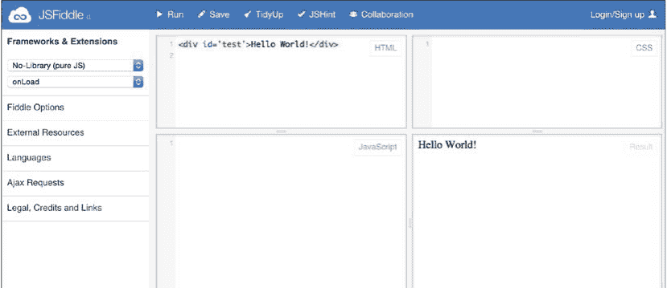
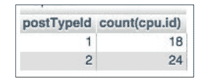
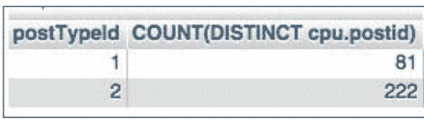
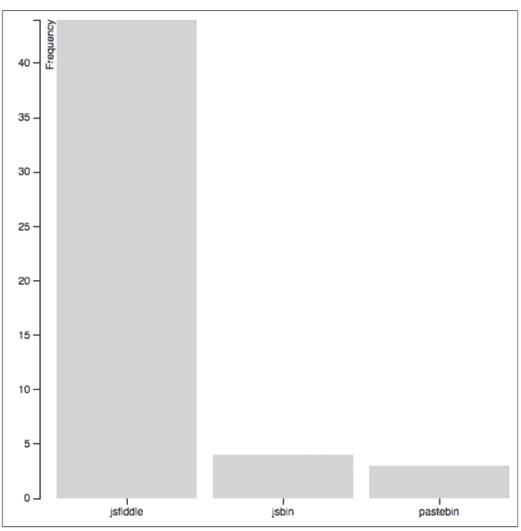

# 第9章：Stack Overflow 项目

## Stack Overflow 项目

这是两个完整的、篇幅为一章的项目中的第一个，我们将在其中将我们所学到的数据清理知识付诸实践。我们可以将每个项目视为一次晚宴，在那里我们展示我们数据科学厨房的最佳技能。为了举办一次成功的晚宴，我们当然应该提前规划好菜单和宾客名单。然而，真正专家的标志是我们如何应对事情没有完全按计划进行的情况。尽管我们精心准备了食谱和购物清单，但我们都曾有过忘记购买重要配料的那一刻。我们能否调整计划来应对沿途遇到的新挑战？

在本章中，我们将使用公开发布的 Stack Overflow 数据库转储来处理一些数据清理。Stack Overflow 是 Stack Exchange 问答网站家族的一部分。在这些网站上，撰写好的问题和答案可以让用户获得随时间累积的积分和徽章。为了练习我们的数据清理技能，我们将使用我们在 *第1章，为什么需要干净的数据？* 中介绍的相同的六步方法。

- 决定我们试图解决的问题类型——为什么要查看这些数据？
- 收集和存储我们的数据，这包括下载和提取 Stack Overflow 提供的数据库转储，创建 MySQL 数据库来保存数据，并编写脚本将数据导入 MySQL 数据库。由于 Stack Overflow 数据集非常庞大，我们还将创建一些较小的测试表，填充随机选择的行。
- 在尝试清理整个数据集之前，对测试表执行一些试清理任务。
- 分析数据。我们需要执行任何计算吗？我们应该编写一些聚合函数来计数或汇总数据吗？我们需要以某种方式转换数据吗？


- 如果可能，提供数据的可视化。
- 解决我们设定的研究问题。我们的流程有效吗？我们成功了吗？

这工作量很大，但我们提前准备得越多、越早开始，就越有可能让我们的数据科学晚宴派对取得成功。

## 第一步 – 关于 Stack Overflow 的提问

为了启动我们的项目，我们需要提出一个相当有趣的问题，该问题需要一些简单的数据分析来回答。我们应该从哪里开始？首先，让我们回顾一下我们对 Stack Overflow 的了解。我们知道它是一个面向程序员的问答网站，可以假设程序员在他们提问和回答的问题中很可能使用了大量源代码、错误日志和配置文件。此外，我们知道，有时在像 Stack Overflow 这样的基于网络的平台上发布这些长文本转储会很尴尬，因为行长度、格式和其他可读性问题。

看到如此多包含令人沮丧的大量文本的问题和答案，我想知道 Stack Overflow 上的程序员是否会通过外部粘贴站点（如 Pastebin 或 JSFiddle）链接到他们的代码或日志文件，例如 http://www.Pastebin.com 是一个网站，您可以在其中粘贴大量文本，例如源代码或日志文件，网站会为您提供一个可以与他人共享的简短 URL。大多数粘贴站点还允许进行源代码语法高亮，而 Stack Overflow 默认不这样做。

在 IRC 和电子邮件中使用粘贴站点非常常见，但 Stack Overflow 呢？一方面，就像在 IRC 或电子邮件中一样，提供链接可以使问题或答案更短，因此其余问题更容易阅读。但另一方面，根据使用的粘贴站点，URL 不保证永远可用。这意味着问题或答案可能因链接腐烂而随着时间的推移失去价值。

像 JSFiddle 这样的工具以一种额外的方式使这个问题复杂化。在像 JSFiddle 这样的交互式粘贴站点上，您不仅可以粘贴源代码并获取其 URL，还可以允许其他人在浏览器中直接编辑和运行代码。这在 Stack Overflow 的问答场景中可能非常有帮助，尤其是在基于浏览器的语言（如 JavaScript）中。然而，链接腐烂的问题仍然存在。此外，对于初学者来说，JSFiddle 比简单的代码转储站点（如 Pastebin）使用起来稍微复杂一些。



JSFiddle 有四个窗口，分别用于 HTML、CSS、JavaScript 和结果。

> 在 Stack Overflow 的社区讨论区，关于是否应该使用粘贴站点以及包含粘贴站点链接而没有实际代码的问题或答案的政策，应该如何处理，存在相当多的争论。总的来说，尽管人们倾向于同意粘贴站点可能有用，但他们也认识到保护 Stack Overflow 本身的持久性和实用性很重要。社区已决定应避免发布仅包含链接而没有代码的问题或答案。如果你想回顾该讨论，可以从此链接开始： http://meta.stackexchange.com/questions/149890/。

就我们而言，我们不需要在这场辩论中选边站队。相反，我们可以提出一些简单的数据驱动问题，例如：

- 1. 人们在 Stack Overflow 上使用 Pastebin 和 JSFiddle（以及其他类似的粘贴站点）的频率有多高？
- 2. 他们在问题中使用粘贴站点更多还是在答案中使用？
- 3. 引用粘贴站点 URL 的帖子是否也倾向于包含源代码；如果是，包含多少？

我们可以在收集、存储和清理 Stack Overflow 数据时使用这些问题作为我们的动机。即使最终发现其中一些问题太难或无法回答，记住我们的总体目的将有助于指导我们需要进行哪种清理。把问题放在我们思维的前沿将阻止我们偏离轨道或执行最终会证明是徒劳或浪费时间的任务。

## 第二步 – 收集和存储 Stack Overflow 数据

在撰写本文时，Stack Exchange 以 XML 文件的形式免费提供其整个网站系列（包括 Stack Overflow）的数据供任何人下载。在本节中，我们将下载 Stack Overflow 文件，并将数据导入我们 MySQL 服务器上的数据库。最后，我们将为测试目的创建这些表的几个较小版本。

### 下载 Stack Overflow 数据转储

Stack Exchange 的所有可用数据都可以在 Internet Archive 上下载。截至撰写本文时，2014 年 9 月的数据转储是最新的。每个 Stack Exchange 站点都有一个或多个文件，每个文件都链接到此详细信息页面： https://archive.org/details/stackexchange。

我们只对以下列表中按字母顺序排列的八个 Stack Overflow 文件感兴趣：

|  |  |
|---|---|
| stackoverflow.com-Badges.7z | 77.8 MB |
| stackoverflow.com-Comments.7z | 1.8 GB |
| stackoverflow.com-PostHistory.7z | 9.4 GB |
| stackoverflow.com-PostLinks.7z | 26.4 MB |
| stackoverflow.com-Posts.7z | 5.7 GB |
| stackoverflow.com-Tags.7z | 508.1 KB |
| stackoverflow.com-Users.7z | 100.5 MB |
| stackoverflow.com-Votes.7z | 385.0 MB |

Archive.org 列表显示我们感兴趣的八个 Stack Overflow 文件。

对于列表中的每个文件，右键单击链接并指示浏览器将文件保存到磁盘。

### 解档文件

请注意，每个文件都有 .7z 扩展名。这是一种压缩归档格式。可以使用匹配的 7-Zip 软件或其他兼容软件包进行解压缩和解档。7-Zip 并不是我们在 *第 2 章，基础 – 格式、类型和编码* 中讨论的更常见的归档工具之一，您可能尚未在计算机上安装兼容的解档程序，因此我们可以将其视为我们需要解决的第一个小问题。尝试双击文件以打开它，但如果您没有安装与 .7z 扩展名关联的软件，则需要安装适当的 7-Zip 解档程序。

- 对于 Windows，您可以从其网站下载 7-Zip 软件：
  `http://www.7-zip.org`
- 对于 Mac OS X，您可以下载并安装 The Unarchiver，这是一款免费实用程序，可在 `http://unarchiver.c3.cx` 获取

安装软件后，依次解包每个文件。解压后的文件非常大，因此请确保您有足够的磁盘空间来容纳它们。

> > 在我的系统上 right now，比较压缩和未压缩的文件大小显示，未压缩版本比压缩版本大约大十倍。这些文件也需要几分钟才能解档，具体取决于您正在使用的系统规格，因此请为此步骤预留时间。

### 创建 MySQL 表并加载数据

我们现在有八个 .xml 文件，每个文件都将映射到我们即将构建的数据库中的一个表。要创建数据库和表，我们可以使用 phpMyAdmin 或其他图形工具通过点击来完成，或者我们可以运行 Georgios Gousios 编写的以下简单 SQL，并可在 `https://gist.github.com/gousiosg/7600626` 获取。此代码包含前六个表的 `CREATE` 和 `LOAD INFILE` 语句，但自此脚本编写以来，数据库转储已添加了另外两个表。

要构建新的表结构，我们可以在终端窗口或 shell 中运行 `head` 命令，以检查此文件的前几行。从终端，运行它在最小的 XML 文件 `PostLinks.xml` 上，如下所示：

```
head PostLinks.xml
```

结果的前四行如下所示：

```
<?xml version="1.0" encoding="utf-8"?>
<postlinks>
  <row Id="19" CreationDate="2010-04-26T02:59:48.130" PostId="109" RelatedPostId="32412" LinkTypeId="1" />
  <row Id="37" CreationDate="2010-04-26T02:59:48.600" PostId="1970" RelatedPostId="617600" LinkTypeId="1" />
```

我们新数据库表中的每一行都应对应 XML <row> 行中的一行，并且行行中显示的每个属性代表数据库表中的一列。我们可以在 Tags.xml 文件上执行相同的 head 命令，以查看其应具有的列。以下 SQL 代码将处理另外两个表的 CREATE 语句和 LOAD 语句：

```
CREATE TABLE post_links (
  Id INT NOT NULL PRIMARY KEY,
  CreationDate DATETIME DEFAULT NULL,
  PostId INT NOT NULL,
  RelatedPostId INT NOT NULL,
  LinkTypeId INT DEFAULT NULL
);

CREATE TABLE tags (
  Id INT NOT NULL PRIMARY KEY,
  TagName VARCHAR(50) DEFAULT NULL,
  Count INT DEFAULT NULL,
  ExcerptPostId INT DEFAULT NULL,
  WikiPostId INT DEFAULT NULL
);

LOAD XML LOCAL INFILE 'PostLinks.xml'
INTO TABLE post_links
ROWS IDENTIFIED BY '<row>';

LOAD XML LOCAL INFILE 'Tags.xml'
INTO TABLE tags
ROWS IDENTIFIED BY '<row>';
```


请注意，LOAD XML 语法略有更改，以便我们可以将文件保存在本地。如果您的 .xml 文件在本地机器上而不是数据库服务器本身，只需在 LOAD XML 语句中添加 LOCAL 关键字，如前面的代码所示，您就可以引用文件的完整路径。
有关 MySQL LOAD XML 语法的更多信息，请参阅 MySQL 文档中的此处： http://dev.mysql.com/doc/refman/5.5/en/load-xml.html。


此时，我们已经拥有一个完全可用的 MySQL 数据库，其中包含八个表，每个表都已填入数据。然而，这些表非常庞大。仅这八个表就超过 1.9 亿行。在开始清理数据并准备进行分析时，我们会注意到，如果在像 posts、comments、votes 或 post_history 这样的大表上犯错，重建表将花费很长时间。在下一步中，我们将学习如何创建测试表，以便在我们的程序或查询出现问题时将损失控制在最小范围内。

## Building test tables

本节中，我们将构建原始表的八个较小版本，每个版本都使用来自原始表的数据随机填充。

第一步是重新运行 CREATE 语句，但这次在每个表名前加上 test_ 前缀，如下所示的一个表：

```sql
DROP TABLE IF EXISTS test_post_links;
CREATE TABLE test_post_links (
    Id INT NOT NULL PRIMARY KEY,
    CreationDate INT,
    PostId INT,
    RelatedPostId INT,
    LinkTypeId INT
);
```

除了在表名前加上 test_ 之外，这八个测试表与我们之前创建的其他表完全相同。

接下来，我们需要用数据填充新的测试表。我们可以简单地从每个表中选择前 1,000 行并加载到测试表中。然而，这样做的缺点是行是根据插入 Stack Overflow 数据库的时间排序的，因此如果我们只请求前 1,000 行，我们的子集中将不会有来自不同日期和时间的好样本。我们希望所选行具有相当随机的分布。我们如何随机选择一组行？在这本书中我们之前还没有处理过这个问题，所以这又是我们必须准备尝试新事物以确保数据科学聚会顺利进行的一个例子。

选择随机行的可能性有几种，其中一些比其他更高效。在本项目中，效率对我们很重要，因为我们处理的表相当大。使我们的随机行选择比预期更棘手的一点是，虽然我们的表确实有 Id 列作为数字主键，但这些 Id 数字不是顺序的。存在许多空缺，例如，在 post_links 表中，Id 列的前几个值是 19、37、42 和 48。

数据中的空缺是有问题的，因为简单的随机化器操作如下：

- 1. 编写一个 PHP 脚本，查询表中最低和最高的 Id 值，如下所示：
```sql
SELECT min(Id) FROM post_links;
SELECT max(Id) FROM post_links;
```
- 2. 然后，在脚本中，生成 min 和 max 值之间的某个随机数，并请求具有该随机值的行：
```sql
SELECT * FROM post_links WHERE Id = [random value];
```
- 3. 重复步骤 2，直到获取所需数量的行。

不幸的是，在 Stack Overflow 数据库表（例如我们的 post_links 表）中这样做会导致许多查询失败，因为 Id 列中有太多空缺，例如，如果前一个示例中的步骤 2 生成了数字 38 怎么办？我们的 post_links 表中没有 Id 为 38 的记录。这意味着我们需要检测此错误并使用新的随机值重试。


> 在这一点上，懂一点 SQL 但不多的人通常会建议我们只需让 MySQL 对包含 Id 的列进行 ORDER BY rand()，然后执行 LIMIT 命令来筛选出我们想要的记录数。这个想法的问题在于，即使我们排序的列是索引列，ORDER BY rand() 也必须读取每一行以便为其分配一个新的随机数。因此，在像 Stack Overflow 数据库中这样的大表上，这完全无法扩展。我们将不得不等待 ORDER BY rand() 查询完成太长时间。ORDER BY rand() 对于小表来说是可以接受的解决方案，但对于我们这里处理的大小则不行。

以下 PHP 脚本展示了我们的最终随机行选择过程如何工作，以构建每个包含恰好 1,000 行的八个测试表。每个表都将由尽可能随机且尽可能省力地选择的行值填充，并且不会过度设计这个简单问题：

```php
<?php //randomizer.php
// how many rows should be in each of the test tables?
$table_target_size = 1000;

// connect to db, set up query, run the query
$dbc = mysqli_connect('localhost','username','password','stackoverflow')
    or die('Error connecting to database!' . mysqli_error());
$dbc->set_charset("utf8");

$tables = array("badges",
    "comments",
    "posts",
    "post_history",
    "post_links",
    "tags",
    "users",
    "votes");

foreach ($tables as $table)
{
    echo "\n=== Now working on $table ===\n";
    $select_table_info = "SELECT count(Id) as c, min(Id) as mn,
        max(Id) as mx FROM $table";
    $table_info = mysqli_query($dbc, $select_table_info);
    $table_stuff = mysqli_fetch_object($table_info);
    $table_count = $table_stuff->c;
    $table_min = $table_stuff->mn;
    $table_max = $table_stuff->mx;

    // set up loop to grab a random row and insert into new table
    $i=0;
    while($i < $table_target_size)
    {
        $r = rand($table_min, $table_max);
        echo "\nIteration $i: $r";
        $insert_rowx = "INSERT IGNORE INTO test_$table (SELECT *
            FROM $table WHERE Id = $r)";
        $current_row = mysqli_query($dbc, $insert_rowx);

        $select_current_count = "SELECT count(*) as rc FROM
            test_$table";
        $current_count= mysqli_query($dbc, $select_current_count);
        $row_count = mysqli_fetch_object($current_count)->rc;
        $i = $row_count;
    }
}
?>
```

运行该代码后，我们可以看到如果需要，我们有一个不错的八个测试表可供使用。使用这些较小的表进行测试可确保我们的清理练习更顺利进行，并且错误可以得到控制。如果我们发现随机表中需要更多行，我们只需提高 `$table_target_size` 命令并再次运行即可。

一旦你知道以简单且有用的方式创建它们是多么容易，建立测试表就是一个很好的习惯。

## Step three – cleaning the data

记住我们的目标是开始分析某些 URL 在问题、答案和评论中被引用的频率，从 Stack Overflow `posts` 和 `comments` 表的文本开始是有意义的。然而，由于这些表非常庞大，我们将改用刚刚创建的 `test_posts` 和 `test_comments` 表。然后，一旦我们确信查询完美运行，我们就可以在更大的表上重新运行它们。

此清理任务与我们在 *第 7 章，RDBMS 清理技术* 中存储从推文中提取的 URL 的方式非常相似。然而，本项目有一套自己的特定规则：

- 由于 posts 和 comments 从一开始就是不同的实体，我们应该为来自 posts（包括问题和答案）的 URL 和来自 comments 的 URL 分别创建表。
- 每个问题、答案或评论内部可能包含多个 URL。我们应该存储所有 URL，并且还应跟踪该 URL 来自哪个 post 或 comment 的唯一标识符。
- 每个问题和答案中也可能包含格式化的源代码。`<code>` 标签用于分隔 Stack Overflow 帖子中的源代码。将代码与帖子分开将有助于我们回答关于粘贴站点 URL 与源代码共存的问题。这样的链接通常会伴随多少代码，如果有的话？


> 从技术上讲，posts *可以*在没有 `<code>` 标签的情况下创建，但通常有人会迅速编辑错误的帖子以包含这些有用的标签，并因此获得 Stack Overflow 积分。为简洁起见，在本项目中，我们将假设代码包含在 `<code>` 标签中。


- 根据 Stack Overflow 数据库转储文档（可在 http://meta.stackexchange.com/questions/2677/ 获取），实际上共有八种类型的帖子，其中问题和答案只是其中两种类型。因此，我们需要将查询限制为帖子类型 ID 为 `postTypeId=1` 的问题和 `postTypeId=2` 的答案。
- 为确保我们仅从针对问题或答案的评论中提取 URL，而非其他类型的帖子，我们需要将结果联回 posts 表，并将结果限制为 `postTypeId=1` 或 `postTypeId=2`。

## 创建新表

我们需要存储这些 URL 的数据库表的 SQL 创建语句如下：

```
CREATE TABLE clean_comments_urls (
    id INT NOT NULL AUTO_INCREMENT PRIMARY KEY,
    commentId INT NOT NULL,
    url VARCHAR(255) NOT NULL
) ENGINE=MyISAM DEFAULT CHARSET=utf8;
```

```
CREATE TABLE IF NOT EXISTS clean_posts_urls (
    id INT NOT NULL AUTO_INCREMENT PRIMARY KEY,
    postId INT NOT NULL,
    url VARCHAR(255) NOT NULL
) ENGINE=MyISAM DEFAULT CHARSET=utf8;
```

我们还需要创建一个表来保存从帖子中剥离出的代码：

```
CREATE TABLE clean_posts_code (
    id INT NOT NULL AUTO_INCREMENT PRIMARY KEY,
    postId INT NOT NULL,
    code TEXT NOT NULL
) ENGINE=MyISAM DEFAULT CHARSET=utf8;
```

此时，我们有三个新表用于存储清理后的 URL 和清理后的源代码。在下一节中，我们将提取 URL 和代码并填充这些新表。

## 提取 URL 并填充新表

我们可以修改我们在 *第 7 章，RDBMS 清理技术* 中编写的脚本，以在新的 Stack Overflow 环境中提取 URL，方法如下：

```php
<?php // urlExtractor.php
// connect to db
$dbc = mysqli_connect('localhost', 'username', 'password',
    'stackoverflow')
    or die('Error connecting to database!' . mysqli_error());
$dbc->set_charset("utf8");

// pull out the text for posts with
// postTypeId=1 (questions)
// or postTypeId=2 (answers)
$post_query = "SELECT Id, Body
    FROM test_posts
    WHERE postTypeId=1 OR postTypeId=2";

$comment_query = "SELECT tc.Id, tc.Text
    FROM test_comments tc
    INNER JOIN posts p ON tc.postId = p.Id
    WHERE p.postTypeId=1 OR p.postTypeId=2";

$post_result = mysqli_query($dbc, $post_query);
// die if the query failed
if (!$post_result)
    die ("post SELECT failed! [$post_query]" . mysqli_error());

// pull out the URLS, if any
$urls = array();
$pattern = '#\b(([\w]+://|www\.[.])[^\s()<>]+(?:\([\w\d]+\))
|([^\[:punct:]\s]|/))#';

while($row = mysqli_fetch_array($post_result))
{
    echo "\nworking on post: " . $row["id"];
    if (preg_match_all(
        $pattern,
        $row["Body"],
        $urls
    ))
    {
        foreach ($urls[0] as $url)
        {
            $url = mysqli_escape_string($dbc, $url);
            echo "\n---url: ".$url;
            $post_insert = "INSERT INTO clean_posts_urls (id,
            postid, url)
                VALUES (NULL," . $row["Id"] . ",'$url')";
            echo "\n$post_insert";
            $post_insert_result = mysqli_query($dbc,
                $post_insert);
        }
    }
}

$comment_result = mysqli_query($dbc, $comment_query);
// die if the query failed
if (!$comment_result)
    die ("comment SELECT failed! [$comment_query]" .
    mysqli_error());

while($row = mysqli_fetch_array($comment_result))
{
    echo "\nworking on comment: " . $row["id"];
    if (preg_match_all(
        $pattern,
        $row["Text"],
        $urls
    ))
    {
        foreach ($urls[0] as $url)
        {
            echo "\n---url: ".$url;
            $comment_insert = "INSERT INTO clean_comments_urls
            (id, commentid, url)
                VALUES (NULL," . $row["Id"] . ",'$url')";
            echo "\n$comment_insert";
            $comment_insert_result = mysqli_query($dbc,
            $comment_insert);
        }
    }
}
?>
```

我们现在已经完全填充了 clean_post_urls 和 clean_comment_urls 表。对于我随机填充的测试表，运行此脚本仅产生大约 100 条评论 URL 和 700 条帖子 URL。尽管如此，在对完整数据集运行之前，这足以测试我们的想法。

## 提取代码并填充新表

要提取 <code> 标签中嵌入的文本并填充我们新的 clean_posts_code 表，我们可以运行以下脚本。它与 URL 提取器类似，只是它不需要搜索评论，因为评论中没有使用 <code> 标签分隔的代码。

在我版本的随机选择的测试表中，初始 SELECT 产生约 800 行，共 1,000 行 test_post 表。然而，每个帖子可能包含多个代码片段，因此最终表最终包含超过 2,000 行。以下 PHP 代码提取 <code> 标签中嵌入的文本：

```php
<?php // codeExtractor.php
// connect to db
$db = mysqli_connect('localhost', 'username', 'password',
    'stackoverflow')
    or die('Error connecting to database!' . mysqli_error());
$db->set_charset("utf8");

// pull out the text for posts with
// postTypeId=1 (questions)
// or postTypeId=2 (answers)
$code_query = "SELECT Id, Body
    FROM test_posts
    WHERE postTypeId=1 OR postTypeId=2
    AND Body LIKE '%<code>%'";

$code_result = mysqli_query($db, $code_query);
// die if the query failed
if (!$code_result)
    die ("SELECT failed! [$code_query]" . mysqli_error());

// pull out the code snippets from each post
$codesnippets = array();
$pattern = '/<code>(.*?)<\/code>/';

while($row = mysqli_fetch_array($code_result))
{
    echo "\nworking on post: " . $row["Id"];
    if (preg_match_all(
        $pattern,
        $row["Body"],
        $codesnippets
    ))
    {
        $i=0;
        foreach ($codesnippets[0] as $code)
        {
            $code = mysqli_escape_string($dbc, $code);
            $code_insert = "INSERT INTO clean_posts_code (id,
                postid, code)
                VALUES (NULL," . $row["Id"] . ",'$code')";
            $code_insert_result = mysqli_query($dbc,
                $code_insert);
            if (!$code_insert_result)
                die ("INSERT failed! [$code_insert]" .
                    mysqli_error());
            $i++;
        }
        if($i>0)
        {
            echo "\n    Found $i snippets";
        }
    }
}
?>
```

我们现在拥有每个帖子中打印的所有代码的列表，并已将其存储在 `clean_post_code` 表中。

## 第四步 – 分析数据

本节中，我们编写一些代码来回答本章开头提出的三个问题。我们有兴趣查找：

- 帖子和评论中 URL 提及的不同粘贴站点的计数
- 问题与答案中粘贴站点 URL 的计数
- 包含粘贴站点 URL 的帖子中 `<code>` 的出现频率统计

## 哪些粘贴站点最受欢迎？

要回答第一个问题，我们将使用 clean_posts_urls 和 clean_comments_urls 表生成粘贴站点 URL 和计数的 JSON 表示。这种简单的分析将帮助我们了解哪些 pastebin 网站在此 Stack Overflow 数据转储中很受欢迎。以下 PHP 查询数据库中我们在 $pastebins 数组中预列出的粘贴站点，然后对帖子和评论中匹配的 URL 进行计数。它使用测试表，因此数字比使用真实表时要小得多：

```php
<?php // q1.php
// connect to db
$dbc = mysqli_connect('localhost', 'username', 'password',
    'stackoverflow')
    or die('Error connecting to database!' . mysqli_error());
$dbc->set_charset("utf8");

// these are the web urls we want to look for and count
$pastebins = array("pastebin",
    "jsfiddle",
    "gists",
    "jsbin",
    "dpaste",
    "pastie");
$pastebin_counts = array();

foreach ($pastebins as $pastebin)
{
    $url_query = "SELECT count(id) AS cp,
        (SELECT count(id)
        FROM clean_comments_urls
        WHERE url LIKE '%$pastebin%' ) AS cc
        FROM clean_posts_urls
        WHERE url LIKE '%$pastebin%'";
    $query = mysqli_query($dbc, $url_query);
    if (!$query)
        die ("SELECT failed! [{$url_query}]" . mysqli_error());
    $result = mysqli_fetch_object($query);
    $countp = $result->cp;
    $countc = $result->cc;
    $sum = $countp + $countc;

    array_push($pastebin_counts, array('bin' => $pastebin,
        'count' => $sum));
}
// sort the final list before json encoding it
// put them in order by count, high to low
foreach ($pastebin_counts as $key => $row)
{
```

```php
$first[$key] = $row['bin'];
$second[$key] = $row['count'];
}

array_multisort($second, SORT_DESC, $pastebin_counts);
echo json_encode($pastebin_counts);
?>
```

我们可以通过查看脚本的输出来查看此脚本在测试表上运行时生成的 JSON 输出。我的随机行产生了以下计数：

```json
[{"bin":"jsfiddle","count":44},{"bin":"jsbin","count":4},{"bin":"pastebin","count":3},{"bin":"dpaste","count":0},{"bin":"gists","count":0},{"bin":"pastie","count":0}]
```

> > 记住，由于您拥有不同的随机选择的 URL 集合，因此您的数据可能不同。

当我们进入本章的“第 5 步 – 可视化数据”部分时，我们将使用此 JSON 代码构建条形图。但首先，让我们回答之前提出的另外两个问题。

## 哪些粘贴站点在问题中很受欢迎，哪些在答案中很受欢迎？

我们的第二个问题是 pastebin URL 在问题帖子中更常见还是在答案帖子中更常见。为了开始构建答案，我们将运行一系列 SQL 查询。第一个查询只是询问 clean_posts_urls 表中每种类型的帖子有多少，既有问题也有答案：

```sql
SELECT tp.postTypeId, COUNT(cpu.id)
FROM test_posts tp
INNER JOIN clean_posts_urls cpu ON tp.Id = cpu.postid
GROUP BY 1;
```

结果显示，在我随机选择的测试集中，我有 237 个问题和 440 个答案：

| 帖子类型 ID | 计数(cpu.id) |
|------------|---------------|
| 1 | 237 |
| 2 | 440 |

phpMyAdmin 显示了问题 URL 和答案 URL 的计数。

现在，我们想知道这个问题的答案：在这 677 个 URL 中，按问题和答案划分，有多少个专门引用了六个 pastebin URL 中的一个？我们可以运行以下 SQL 代码来找出答案：

```sql
SELECT  tp.postTypeId, count(cpu.id)
FROM test_posts tp
INNER JOIN clean_posts_urls cpu ON tp.Id = cpu.postId
WHERE cpu.url LIKE '%jsfiddle%'
OR cpu.url LIKE '%jsbin%'
OR cpu.url LIKE '%pastebin%'
OR cpu.url LIKE '%dpaste%'
OR cpu.url LIKE '%gist%'
OR cpu.url LIKE '%pastie%'
GROUP BY 1;
```

结果如下表所示。总共有 18 个问题引用了其中一个粘贴站点，而 24 个答案引用了其中一个粘贴站点。



phpMyAdmin 显示了引用 pastebin 的问题和答案 URL 的计数。

关于这些查询需要注意的一点是，它们统计的是单个 URL。因此，如果某个 postId 引用了五个 URL，则会被计算五次。如果我有兴趣知道有多少帖子至少使用了一次粘贴站点 URL，我需要按如下方式修改两个查询的第一行。此查询统计 URLs 表中的不同帖子：

```sql
SELECT tp.postTypeId, COUNT(DISTINCT cpu.postId)
FROM test_posts tp
INNER JOIN clean_posts_urls cpu ON tp.Id = cpu.postId
GROUP BY 1;
```

以下屏幕截图显示了有多少问题和答案包含 URL：



phpMyAdmin 显示了有多少问题和答案包含任何 URL。

此查询统计 URLs 表中提及粘贴站点的特定帖子：

```sql
SELECT  tp.postTypeId, count(DISTINCT cpu.postId)
FROM test_posts tp
INNER JOIN clean_posts_urls cpu ON tp.Id = cpu.postId
WHERE cpu.url LIKE '%jsfiddle%'
OR cpu.url LIKE '%jsbin%'
OR cpu.url LIKE '%pastebin%'
OR cpu.url LIKE '%dpaste%'
OR cpu.url LIKE '%gist%'
OR cpu.url LIKE '%pastie%'
GROUP BY 1;
```

此粘贴站点查询的结果如下，正如预期的那样，数字更小。在我们的测试集中，11 个问题至少使用了一个 pastebin URL，16 个答案也是如此。合计，37 个帖子至少引用了一次 pastebin URL。

| 帖子类型 ID | count(distinct cpu.postid) |
|---|---|
| 1 | 11 |
| 2 | 16 |

PhpMyAdmin 显示了有多少问题和答案包含任何粘贴站点 URL。

即使这些结果似乎表明人们在答案中比在问题中更常引用粘贴站点 URL，我们仍需要在问题和答案的总体数量方面进行比较。我们应该将结果值报告为该帖子类型（问题或答案）总数的百分比。考虑到总数，我们现在可以说类似这样的话：“仅考虑至少使用过一种 URL 的问题和答案，81 个问题中有 11 个至少使用了一个粘贴站点 URL（13.6%），222 个答案中有 16 个至少使用了一个粘贴站点 URL（7.2%）。” 考虑到这一点，似乎问题在引用粘贴站点方面实际上超过了答案，几乎是二比一。

在任何数据分析项目的这个阶段，你一定会有大量问题，例如：

- 问题和答案中粘贴站点 URL 的使用情况如何随时间变化？
- 带有粘贴站点 URL 的问题在投票和收藏方面表现如何？
- 发布带有粘贴站点 URL 的问题的用户的特征是什么？

但由于这是一本关于数据清洗的书，而且我们甚至还没有可视化这些数据，我会克制自己暂时不回答这些问题。我们仍有一个原始的三个问题需要回答，然后我们将继续可视化一些结果。

## 帖子是否同时包含粘贴站点的 URL 和源代码？

回答我们的第三个问题需要我们比较 Stack Overflow 问题中的代码量与 Stack Overflow 答案中的代码量，特别关注包含某种源代码的帖子，由 <code> 标签分隔。在“第三步 – 清理数据”部分，我们从测试表中的帖子中提取了所有代码，并创建了一个新表来保存这些代码片段。现在，一个简单的查询来确定有多少包含代码的帖子如下：

```sql
SELECT count(DISTINCT postid)
FROM clean_posts_code;
```

在我样本集中，这产生了 664 个包含代码的帖子，共 1,000 个测试帖子。换一种说法：1,000 个帖子中有 664 个至少包含一个 <code> 标签。

为了确定这些包含代码的帖子中有多少也包含任何 URL，我们可以运行以下 SQL 查询：

```sql
SELECT count(DISTINCT cpc.postid)
FROM clean_posts_code cpc
INNER JOIN clean_posts_urls cpu
ON cpu.postId = cpc.postId;
```

我的样本集对此产生了 175 行。我们可以这样解释：原始 1,000 个帖子测试集中有 17.5% 的帖子同时包含代码和 URL。

现在，为了确定有多少包含代码的帖子也包含粘贴站点 URL，我们将进一步缩小 SQL 查询范围：

```sql
SELECT count(DISTINCT cpc.postid)
FROM clean_posts_code cpc
INNER JOIN clean_posts_urls cpu
ON cpu.postId = cpc.postId
WHERE cpu.url LIKE '%jsfiddle%'
OR cpu.url LIKE '%jsbin%'
OR cpu.url LIKE '%pastebin%'
OR cpu.url LIKE '%dpaste%'
OR cpu.url LIKE '%gist%'
OR cpu.url LIKE '%pastie%';
```

从这些结果可以看出，只有 25 个帖子同时包含源代码和粘贴站点 URL。从第二个问题我们知道，37 个不同的帖子（问题和答案）至少使用了一次某种粘贴站点 URL。因此，25/37 约为 68%。在更大的数据集上运行这些查询以查看这些值的结果将很有趣。

与此同时，我们将对我们的问题中的至少一个进行一些简单的可视化，以便在数据科学六步流程的一轮完整循环上收尾。

## 第五步 – 可视化数据

可视化步骤有点像我们在晚宴中的甜点课程。每个人都喜欢精美的图形，看起来也很漂亮。然而，由于本书的重点是清理而不是分析和可视化，我们这里的图形会非常简单。在下面的代码中，我们将使用 JavaScript D3 可视化库以图形方式显示第一个问题的结果。这种可视化比我们在第 4 章《说通用语 – 数据转换》中所做的 D3 可视化要简单得多。在那一章中，你会记得我们构建了一个相当复杂的网络图，但在本文中，简单的条形图就足够了，因为我们要显示的只是几个标签和计数。

HTML 和 JavaScript/D3 代码如下。此代码扩展了 Mike Bostock 的“让我们构建条形图”教程，可在 http://bl.ocks.org/mbostock/3885304 获取。我扩展此代码的一种方式是使其读取我们在 q1.php 脚本中之前生成的 JSON 文件。我们的 JSON 文件打印得非常漂亮，并且已经按从高到低排序，因此从中构建一个小条形图会很容易：

```html
<!DOCTYPE html>
<meta charset="utf-8">
<!--
this code is modeled on mbostock's
"Let's Make a Bar Chart" D3 tutorial
available at http://bl.ocks.org/mbostock/3885304
My modifications:
* formatting for space
* colors
* y axis labels
* changed variable names to match our data
* loads data via JSON rather than .tsv file
-->
```


```
<style>
.bar {fill: lightgrey;}
.bar:hover {fill: lightblue;}
.axis {font: 10px sans-serif;}
.axis path, .axis line {
    fill: none;
    stroke: #000;
    shape-rendering: crispEdges;
}
.x.axis path {display: none;}
</style>
<body>
<script src="d3.min.js"></script>
<script>

var margin = {top: 20, right: 20, bottom: 30, left: 40},
    width = 960 - margin.left - margin.right,
    height = 500 - margin.top - margin.bottom;

var x = d3.scale.ordinal()
    .rangeRoundBands([0, width], .1);

var y = d3.scale.linear()
    .range([height, 0]);

var xAxis = d3.svg.axis()
    .scale(x)
    .orient("bottom");

var yAxis = d3.svg.axis()
    .scale(y)
    .orient("left");

var svg = d3.select("body").append("svg")
    .attr("width", width + margin.left + margin.right)
    .attr("height", height + margin.top + margin.bottom)
    .append("g")
    .attr("transform", "translate(" + margin.left + "," + margin.top + 
")");

d3.json("bincounter.php", function(error, json)
{
data = json;
    draw(data);
});

function draw(data)
{
    x.domain(data.map(function(d) { return d.bin; }));
    y.domain([0, d3.max(data, function(d) { return d.count; })]);

    svg.append("g")
        .attr("class", "x axis")
        .attr("transform", "translate(0," + height + ")")
        .call(xAxis);

    svg.append("g")
        .attr("class", "y axis")
        .call(yAxis)
        .append("text")
        .attr("transform", "rotate(-90)")
        .attr("y", 6)
        .attr("dy", ".71em")
        .style("text-anchor", "end")
        .text("Frequency");

    svg.selectAll(".bar")
        .data(data)
        .enter().append("rect")
        .attr("class", "bar")
        .attr("x", function(d) { return x(d.bin) ; })
        .attr("width", x.rangeBand())
        .attr("y", function(d) { return y(d.count); })
        .attr("height", function(d) { return height - y(d.count); });
}

</script>
</body>
</html>
```

我们可以将此保存为 `q1chart.html`，并在浏览器中查看。代码调用我们的 `q1.php` 脚本，该脚本生成 JSON 文件，D3 然后使用它来构建此图表，其左侧显示如下：



D3 对三个 URL 计数产生的 JSON 的可视化。

条形图显示指向 JSFiddle 的 URL 似乎是最常见的，至少在我使用的随机选择的测试数据集中是这样。我们仅从查看 `q1.php` 的 JSON 输出就知道了这一点，但将其图形化显示也很不错。在下一节中，我们将总结结果和我们的流程，并讨论此项目的下一步。

## 第六步 – 问题解决

从我们在 *第四步 – 分析数据* 和 *第五步 – 可视化数据* 部分开发的查询和可视化中，我们现在可以尝试回答最初促使该项目的三个问题中的每一个。

对于第一个问题，我们想要查找帖子和评论中按 URL 提及的不同粘贴站点的计数。我们制作的 q1.php 脚本和条形图用于可视化数据，显示至少在测试数据中，JSFiddle 是我们查看的六个粘贴站点 URL 中引用最频繁的。

第二个问题是关于粘贴站点 URL 是否在问题中更普遍还是在答案中更普遍。我们的查询显示，粘贴站点 URL 在问题中出现的可能性大约是答案的两倍，但两者的数据都很小，至少在我们的测试集中是这样。

对于第三个问题，我们想看看人们是否真的在遵循 Stack Overflow 的建议，除了粘贴站点 URL 之外还发布代码。在我们的测试集中，查询显示 25 条帖子（共 37 条）同时包含粘贴站点 URL 和推荐的附带源代码。这是一项约 68% 的合规率。

此时我们可以提出并回答许多额外的问题，并且有许多令人兴奋的方式可以将这项简单研究扩展成更有趣的东西。不过现在，我们将重点关注将此项目扩展到使用完整数据集所需的存储和清理流程。

## 从测试表迁移到完整表

在本项目开始时，我们创建了一组测试表，以便在仅包含 1,000 行的表上在一个无压力的环境中开发项目。在不确定查询是否会按我们希望的方式工作，或者想要尝试棘手的连接、子查询、奇怪的正则表达式等情况下，使用行数可控的小表非常重要。不过到目前为止，如果我们对编写的查询和脚本感到满意，那么是时候重写我们的流程以使用全尺寸表了。

以下是我们将遵循的步骤以将项目迁移到全尺寸表：

- 1. 删除测试表：
```
DROP TABLE IF EXISTS test_badges;
DROP TABLE IF EXISTS test_comments;
DROP TABLE IF EXISTS test_posts;
DROP TABLE IF EXISTS test_post_history;
DROP TABLE IF EXISTS test_post_links;
DROP TABLE IF EXISTS test_tags;
DROP TABLE IF EXISTS test_users;
DROP TABLE IF EXISTS test_votes;
```
- 2. 按如下方式清空 cleaned_posts_code、cleaned_posts_urls 和 cleaned_comments_urls 表：
- 3. 编辑 urlExtractor.php 和 codeExtractor.php 脚本，使其从 posts 表而不是 test_posts 表中 SELECT。查询可以按如下方式编辑：
- 4. 重新运行 urlExtractor.php 和 codeExtractor.php 脚本，以便它们重新填充我们之前清空（截断）的干净代码和 URL 表。
```
TRUNCATE TABLE cleaned_posts_code;
TRUNCATE TABLE cleaned_posts_urls;
TRUNCATE TABLE cleaned_comments_urls;
```
```
SELECT Id, Body FROM posts
```

此时，我们已准备好对清理后的代码和 URL 表进行分析和可视化。执行这些步骤时请慢慢来，并请注意其中许多查询和脚本可能需要很长时间才能完成。posts 表相当大，我们编写的许多查询都是针对文本列使用通配符进行选择的。

## 总结

在本项目中，我们提出了一些关于 Stack Overflow 上 URL 普遍性的问题，特别是与粘贴站点相关的 URL，例如 http://www.Pastebin.com 和 http://www.JSFiddle.net。为了开始回答这些问题，我们从 Stack Exchange 公共文件发布中下载了 Stack Overflow 帖子（以及其他 Stack Overflow 数据）的数据。我们构建了一个 MySQL 数据库和八个表来保存这些数据。然后我们为测试目的创建了每个表的较小的 1,000 行版本，并填充了随机选择的数据样本。从这些测试表中，我们提取了每个问题、答案和评论中提及的 URL，并将它们保存到新的干净表中。我们还提取了问题和答案中发现的源代码，并将这些片段保存到新表中。最后，我们能够构建一些简单的查询和可视化来帮助我们回答最初提出的问题。

尽管结果较为 modest，从数据清理的角度来看，我们的晚宴取得了成功。我们能够制定一个连贯的计划，并采取有条不紊的步骤付诸行动，并在需要时进行调整。我们现在已准备好进行最终项目，以及一个完全不同的晚宴菜单。

在下一章中，我们将收集和清理我们自己的著名 Twitter 数据集版本。
