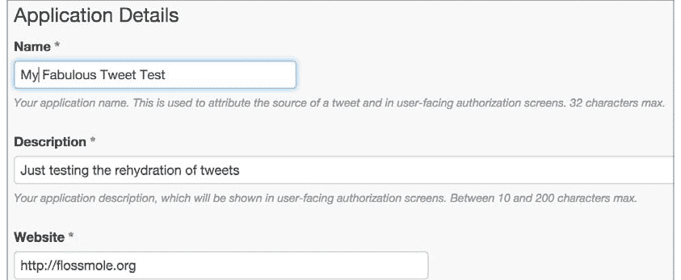
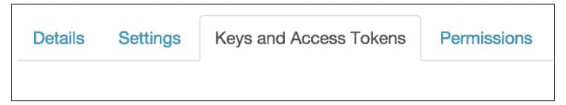
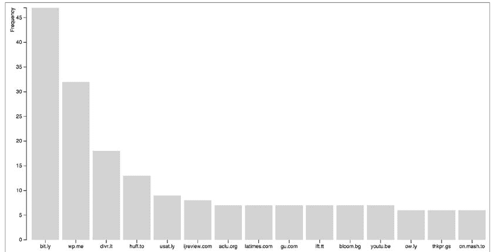

# 第10章：Twitter 项目

与我们在第 9 章完成的 Stack Overflow 项目一样，我们下一个完整的章节晚宴旨在特别展示我们的数据清理技能，同时仍完成整体数据科学流程的每个阶段。我们之前的项目使用了 Stack Overflow 数据，使用 MySQL 和 PHP 的组合进行清理，并使用 JavaScript D3 进行可视化。在本章中，我们将使用 Twitter 数据，使用 MySQL 和 Python 进行收集和清理，并使用 JavaScript 和 D3 进行可视化。与之前的项目一样，在本项目中，数据科学流程仍然相同：

- 1. 决定我们试图解决的问题类型——为什么需要检查这些数据？
- 2. 收集和存储我们的数据，其中包括下载和提取一组公开可用的推文识别号，然后使用程序重新下载原始推文。此步骤还包括为测试目的创建较小的数据集。
- 3. 通过提取和存储我们需要的部分来清理数据。在此步骤中，我们编写一个快速的 Python 程序来加载数据，提取我们想要的字段，并将它们写入一组小的数据库表。
- 4. 分析数据。我们是否需要对数据执行任何计算？是否应该编写一些聚合函数来计数或汇总数据？我们是否需要以某种方式转换数据？
- 5. 在可能的情况下提供数据的可视化。
- 6. 解决我们设法调查的问题。我们的流程有效吗？我们成功了吗？


与之前的项目一样，大部分工作将集中在收集、存储和清理任务上。在本项目中，我们会注意到我们多次存储数据的不同版本，首先作为文本文件，然后作为已水合的 JSON 文件，然后作为 MySQL 数据库。这些不同格式中的每一种都源于不同的收集或清理过程，并为下一个过程提供输入。这样一来，我们开始看到收集、存储和清理步骤可以是**迭代的**——相互反馈——而不仅仅是线性的。

## 第一步 – 针对推文档案提出一个问题

Twitter 是一个流行的 **microblogging** 平台，被全球数百万人用来分享他们的想法或就时事进行交流。由于 Twitter 在发布和阅读方面相对易于访问，尤其是在移动设备上，它已成为在公共事件期间分享信息的重要平台，例如政治危机和抗议活动，或追踪某个议题在公众意识中出现的轨迹。保存的推文成为一种时间胶囊，为事件发生时的公众情绪提供了丰富的洞察。被冻结在时间中，推文本身不受记忆 lapses 或公众舆论随后逆转的影响。学者和媒体专家可以收集和研究这些专题的 **tweet archives**，以尝试了解当时公众舆论是什么样的，或信息是如何传播的，甚至是事件中发生了什么、何时发生以及为什么。

现在很多人开始公开他们的推文集合。一些现在可供公开下载的推文档案包括：

- 与 2014 年 8 月 10 日至 8 月 27 日美国密苏里州弗格森事件后抗议和动荡相关的推文。这些可在 https://archive.org/details/ferguson-tweet-ids 获取。
- 2011 年阿拉伯之春期间来自多个国家的推文，包括利比亚、巴林、埃及等。这些可在 http://dfreelon.org/2012/02/11/arab-spring-twitter-data-now-available-sort-of/ 获取。
- 在 2014 年 5 月至 6 月期间提及 **#YesAllWomen** 标签和相关标签 **#NotAllMen** 的推文。这些可在 http://digital.library.unt.edu/ark:/67531/metadc304853/ 获取。

在下一步中，我们需要选择其中一个进行下载并开始使用。由于弗格森推文是这三个示例数据集中最新的也是最完整的，我围绕它设计了本章的其余部分。然而，无论你使用哪一组数据集，这里的概念和基本流程都适用。

本章中我们想要提出的基本问题相当简单：当人们推文谈论弗格森时，他们最常推文提及哪些互联网域名？与第 9 章《Stack Overflow 项目》中的问题集相比，这是一个非常简单的问题，但这里的数据收集过程有所不同，因此一个简单的问题足以激发我们的数据科学晚宴。

## 第二步 – 收集数据

与我们在第 7 章《RDBMS 清理技术》中研究的少量情感推文档案不同，像上面提到的这些更新的推文档案不再包含推文本身的实际文本。Twitter 的服务条款（ToS）自 2014 年起已更改，分发他人的推文现在违反了该条款。

相反，在更新的推文档案中你会发现的实际上只是推文识别（ID）号码。使用这些号码，我们必须逐一收集实际的推文。届时，我们可以自行存储和分析这些推文。请注意，在此过程的任何阶段或之后，我们不能重新分发推文文本或其元数据，只能重新分发推文识别号码。


> 即使这对想要收集推文的研究人员来说很不方便，Twitter 更改其 ToS 的 stated reason 是为了尊重原始发布推文的人的版权概念。这在删除推文方面尤其重要。如果推文已被复制并在整个网络上重新分发，并由第三方存储在数据文件中，则推文实际上无法被删除。通过要求研究人员只复制推文 ID，Twitter 试图保护用户删除其自身内容的能力。对已删除推文 ID 的请求将不会返回结果。

### 下载并解压弗格森文件

弗格森相关的推文在互联网档案馆作为一组已归档的压缩文本文件提供。将浏览器指向 https://archive.org/details/ferguson-tweet-ids 并下载 147 MB 的 ZIP 文件。

我们可以按如下方式提取文件：

```
unzip ferguson-tweet-ids.zip
```

ls 命令显示创建了一个名为 ferguson-tweet-ids 的目录，并且该目录内还有两个压缩文件：ferguson-indictment-tweet-ids.zip 和 ferguson-tweet-ids.zip。我们实际上只需要解压其中一个即可完成本项目，因此我选择了这个：

```
unzip ferguson-tweet-ids.zip
```

解压此文件会显示多个清单文本文件以及一个 data 文件夹。data 文件夹内有一个 gzipped 文件。按如下方式解压：

```
gunzip ids.txt.gz
```

这会生成一个名为 ids.txt 的文件。这正是我们要找的文件。让我们探索一下这个文件。

要查看文件的大小，我们可以运行 wc 命令。如下所示从命令行运行时，wc 会按顺序显示文件中的行数、单词数和字符数：

```
megan$ wc ids.txt
  13238863 13238863 251538397 ids.txt
```

第一个数字表示 ids.txt 文件中的行数，略高于 1300 万。接下来，我们可以用 head 命令查看文件内部：

```
megan$ head ids.txt
501064188211765249
501064196642340864
501064197632167936
501064196931330049
501064198005481472
501064198009655296
501064198059597824
501064198513000450
501064180468682752
501064199142117378
```

head 命令显示文件的前十行，以便我们可以看到每一行都由一个 18 位的推文 ID 组成。

### 创建文件的测试版本

在此阶段，我们将创建一个小型测试文件，供本项目剩余部分使用。我们这样做的原因与我们在第 9 章《Stack Overflow 项目》中使用测试表的原因相同。因为原始文件极大，我们希望在出错时使用数据子集。我们还希望能够在不花费太多时间完成每个步骤的情况下测试我们的代码。

与之前的练习不同，在这种情况下，我们选择测试数据行是否随机可能并不重要。只需查看我们之前运行的 head 命令的结果，我们就可以看到这些行并不是真正按从低到高的顺序排列的。事实上，我们没有任何关于原始行集顺序的信息。因此，让我们直接获取前 1,000 个推文 ID 并保存到文件中。这将成为我们的测试集：

```
head -1000 ids.txt > ids_1000.txt
```

### 水合推文 ID

我们现在将使用这 1,000 个推文 ID 的测试集来测试我们根据识别号码收集原始推文的流程。此过程称为水合推文。为此，我们将使用一个方便的 Python 工具 twarc，该工具由 Ed Summers 编写，他也是归档所有弗格森推文的同一人。它通过获取推文 ID 列表并逐一从 Twitter API 获取每个原始推文来工作。要使用 Twitter API 做任何事情，我们必须先设置好 Twitter 开发者账户。让我们先创建我们的 Twitter 账户，然后我们可以安装 twarc 并使用它。

### 设置 Twitter 开发者账户

要设置 Twitter 开发者账户，请前往 https://apps.twitter.com 并使用你的 Twitter 账户登录。如果你还没有 Twitter 账户，你需要创建一个才能完成接下来的步骤。


登录 Twitter 账号后，在 http://apps.twitter.com 页面，点击 **创建新应用**。填写创建应用所需的详细信息（为其命名，例如 My Tweet Test；简短描述；以及一个 URL，无需永久）。我的已填写应用创建表单在此供您参考：



Twitter 的“创建新应用”表单，已用示例数据填写

点击表示您同意开发者协议的复选框，您将被返回到列出所有 Twitter 应用的屏幕，您的新应用位于列表顶部。

接下来，要使用此应用，我们需要获取使其正常工作所需的一些关键信息。点击您刚刚创建的应用，您将在下一屏幕顶部看到四个标签。我们感兴趣的是写着 **密钥和访问令牌** 的那个。它看起来像这样：



您新创建的 Twitter 应用中的标签界面。

此屏幕上有许多数字和秘密代码，但有四项需要特别注意：

- CONSUMER_KEY
- CONSUMER_SECRET
- ACCESS_TOKEN
- ACCESS_TOKEN_SECRET

无论您进行何种 Twitter API 编程，至少目前，您始终需要这四项相同的项目。这无论您使用 twarc 还是其他工具都适用。这些凭据是 Twitter 用于验证您的身份并确保您拥有查看所请求内容的访问权限的方式。


> 这些 API 凭据也是 Twitter 限制您发送请求的数量以及请求速度的方式。twarc 工具代表我们处理所有这些，因此我们不必太担心超出速率限制。有关 Twitter 速率限制的更多信息，请查看其开发者文档 at https://dev.twitter.com/rest/public/rate-limiting。

## 安装 twarc

现在我们已访问到 Twitter 凭据，可以安装 twarc。

twarc 下载页面在 GitHub 上可用，地址为 https://github.com/edsu/twarc。该页面上有关于如何使用该工具以及有哪些选项的文档。

要在您的 Canopy Python 环境中安装 twarc，启动 Canopy，然后从 Tools 菜单中选择 Canopy Command Prompt。

在命令提示符中，输入：

```
pip install twarc
```

此命令将安装 twarc 并使其可作为命令行程序调用，或从您自己的 Python 程序中调用。

## 运行 twarc

现在我们可以使用命令行中的 twarc 来水合我们之前创建的 ids_1000.txt 文件。此命令行非常长，因为我们必须传入在 Twitter 网站上之前创建的四个长秘密令牌。为了避免出错，我使用文本编辑器 Text Wrangler 先创建命令行，然后再将其粘贴到我的命令提示符中。您的最终命令行将如下所示，只是凡是写着 abcd 的地方，您应改为填写相应的秘密令牌或密钥：

```
twarc.py --consumer_key abcd --consumer_secret abcd --access_token abcd --access_token_secret abcd --hydrate ids_1000.txt > tweets_1000.json
```

请注意，此命令行将把输出重定向到名为 tweets_1000.json 的 JSON 文件中。该文件内部包含我们之前仅有 ID 的每个推文的 JSON 表示。让我们检查新文件的长度：

```
wc tweets_1000.json
```

wc 实用程序显示我的文件长 894 行，这表明有些推文无法找到（因为我最初的数据集中有 1,000 条推文）。如果在撰写本文之后推文已被删除，您文件可能更小。

接下来，我们也可以查看文件内部：

```
less tweets_1000.json
```

我们也可以在文本编辑器中打开它进行查看。

JSON 文件中的每一行代表一条推文，其格式如下例所示。然而，此示例推文并非来自 Ferguson 数据集，因为我没有分发这些推文的权利。相反，我使用了在第 2 章 Fundamentals – Formats, Types, and Encodings 中为我们讨论 UTF-8 编码而创建的推文之一。由于此推文是为本书专门创建的，我拥有内容所有权，因此可以在不违反 Twitter 的 ToS 的情况下向您展示 JSON 格式。以下是我的推文在 Twitter 网页界面中的样子：


推文示例，如在 Twitter 网页界面中所示。

以下是 twarc 水合后该推文的 JSON 表示形式。我在每个 JSON 元素之间添加了换行符，以便更轻松地查看每条推文可用的属性：

```
{ "contributors": null, "truncated": false, "text": "Another test. Ég elska gögn. #datacleaning", "in_reply_to_status_id": null, "id": 542486101047275520, "favorite_count": 0, "retweeted": false, "coordinates": null, "entities": { "symbols": [], "user_mentions": [], "hashtags": [ {"indices": [29, 42], "text": "datacleaning"} ], "urls": [] }, "in_reply_to_screen_name": null, "id_str": "542486101047275520", "retweet_count": 0, "in_reply_to_user_id": null, "favorited": false, "user": }
```

```
{"follow_request_sent": false,
"profile_use_background_image": false,
"profile_text_color": "333333",
"default_profile_image": false,
"id": 986601,
"profile_background_image_url_https": "https://pbs.twimg.com/profile_
background_images/772436819/b7f7b083e42c9150529fb13971a52528.png",
"verified": false,
"profile_location": null,
"profile_image_url_https": "https://pbs.twimg.com/profile_
images/3677035734/d8853be8c304729610991194846c49ba_normal.jpeg",
"profile_sidebar_fill_color": "F6F6F6",
"entities":
{"url":
{"urls":
[{"url": "http://t.co/dBQNKhR6jY",
"indices": [0, 22],
"expanded_url": "http://about.me/megansquire",
"display_url": "about.me/megansquire"}]},
"description": {"urls": []}},
"followers_count": 138,
"profile_sidebar_border_color": "FFFFFF",
"id_str": "986601",
"profile_background_color": "000000",
"listed_count": 6,
"is_translation_enabled": false,
"utc_offset": -14400,
"statuses_count": 376,
"description": "Open source data hound. Leader of the FLOSSmole
project. Professor of Computing Sciences at Elon University.",
"friends_count": 82,
"location": "Elon, NC",
"profile_link_color": "038543",
"profile_image_url": "http://pbs.twimg.com/profile_images/3677035734/
d8853be8c304729610991194846c49ba_normal.jpeg",
"following": false,
"geo_enabled": false,
"profile_banner_url": "https://pbs.twimg.com/profile_
banners/986601/1368894408",
"profile_background_image_url": "http://pbs.twimg.com/profile_
background_images/772436819/b7f7b083e42c9150529fb13971a52528.png",
"name": "megan squire",
"lang": "en",
"profile_background_tile": false,
```

```
"favourites_count": 64,
"screen_name": "MeganSquire0",
"notifications": false,
"url": "http://t.co/dBQNKhR6jY",
"created_at": "Mon Mar 12 05:01:55 +0000 2007",
"contributors_enabled": false,
"time_zone": "Eastern Time (US & Canada)",
"protected": false,
"default_profile": false,
"is_translator": false},
"geo": null,
"in_reply_to_user_id_str": null,
"lang": "is",
"created_at": "Wed Dec 10 01:09:00 +0000 2014",
"in_reply_to_status_id_str": null,
"place": null}
```

不仅每个 JSON 对象包含推文本身的事实，例如文本、发送日期和时间，它还包含发布推文的人的丰富信息。

> 水合过程会产生关于单个推文的大量信息——而这是一个总共包含 13 million 条推文的数据集。请在准备在 本章末尾水合整个 Ferguson 数据集时牢记这一点。

## 第三步 – 数据清洗

在这一点上，我们准备开始清理 JSON 文件，提取我们希望保存在长期存储中的每条推文的详细信息。

## 创建数据库表

由于我们的动机问题只询问 URL，我们实际上只需要提取这些 URL，以及推文 ID。然而，为了练习清洗，并让我们能够将此练习与我们在第 7 章 RDBMS Cleaning Techniques 中使用 sentiment140 数据集所做的工作进行比较，让我们按如下方式设计一组小型数据库表：

- 一个 tweet 表，仅保存有关推文的信息
- 一个 hashtag 表，保存有关哪些推文引用了哪些 hashtag 的信息


-   一个 `URL` 表，用于保存哪些推文引用了哪些 URL 的信息
-   一个 `mentions` 表，用于保存哪些推文提及了哪些用户的信息

这与我们在 *第7章，RDBMS 清理技术* 中设计的结构类似，只是当时我们必须从推文文本中自行解析出 hashtags 和 URLs 以及用户提及的列表。twarc 工具确实在我们本章完成此项目时为我们节省了一些工作。

创建我们四个表的 CREATE 语句如下：

```
CREATE TABLE IF NOT EXISTS ferguson_tweets (
  tid bigint(20) NOT NULL,
  ttext varchar(200) DEFAULT NULL,
  tcreated_at varchar(50) DEFAULT NULL,
  tuser bigint(20) DEFAULT NULL,
  PRIMARY KEY (tid)
) ENGINE=MyISAM DEFAULT CHARSET=utf8mb4;

CREATE TABLE IF NOT EXISTS ferguson_tweets_hashtags (
  tid bigint(20) NOT NULL,
  ttag varchar(200) NOT NULL,
  PRIMARY KEY (tid, ttag)
) ENGINE=MyISAM DEFAULT CHARSET=utf8;

CREATE TABLE IF NOT EXISTS ferguson_tweets_mentions (
  tid bigint(20) NOT NULL,
  tuserid bigint(20) NOT NULL,
  tscreen varchar(100) DEFAULT NULL,
  tname varchar(100) DEFAULT NULL,
  PRIMARY KEY (tid,tuserid)
) ENGINE=MyISAM DEFAULT CHARSET=utf8;

CREATE TABLE IF NOT EXISTS ferguson_tweets_urls (
  tid bigint(20) NOT NULL,
  turl varchar(200) NOT NULL,
  texpanded varchar(255) DEFAULT NULL,
  tdisplay varchar(200) DEFAULT NULL,
  PRIMARY KEY (tid,turl)
) ENGINE=MyISAM DEFAULT CHARSET=utf8;
```

关于 tweets 表需要注意的一点是，它是用 **utf8mb4** 排序规则创建的。这是因为推文本身可能包含 UTF-8 范围内非常高的字符。事实上，这些推文中的某些字符所需的空间超过了原生 MySQL UTF-8 字符集可以容纳的 3 字节限制。因此，我们设计主推文表以 MySQL 的 utf8mb4 排序规则保存数据，该排序规则包含在 MySQL 5.5 或更高版本中。如果你使用的是更旧的 MySQL 版本，或者由于其他原因无法访问 utf8mb4 排序规则，你可以使用 MySQL 旧的 UTF-8-general 排序规则，但请注意你可能会在某个表情符号处产生编码错误。如果你确实遇到此错误，MySQL 在尝试 INSERT 记录时可能会给出关于 Error 1366 和 *不正确字符串值* 的消息。

现在每个表都已创建，我们可以开始选择并加载数据。

## 在 Python 中填充新表

以下的 Python 脚本将加载 JSON 文件，从我们感兴趣的字段中提取值，并填充前面描述的四个表。关于此脚本还有一些额外的、重要的说明，我现在将逐一介绍。

此脚本确实需要安装 MySQLdb Python 模块。作为 Canopy Python 用户，这些模块可以通过包管理器轻松安装。只需在包管理器中搜索 MySQLdb 并点击安装：

```
#jsonTweetCleaner.py
import json
import MySQLdb

# Open database connection
db = MySQLdb.connect(host="localhost",\
    user="username", \
    passwd="password", \
    db="ferguson", \
    use_unicode=True, \
    charset="utf8")
cursor = db.cursor()
cursor.execute('SET NAMES utf8mb4')
cursor.execute('SET CHARACTER SET utf8mb4')
cursor.execute('SET character_set_connection=utf8mb4')
```

```
# open the file full of json-encoded tweets
with open('tweets_1000.json') as f:
    for line in f:
        # read each tweet into a dictionary
        tweetdict = json.loads(line)

        # access each tweet and write it to our db table
        tid     = int(tweetdict['id'])
        ttext   = tweetdict['text']
        uttext  = ttext.encode('utf8')
        tcreated_at = tweetdict['created_at']
        tuser   = int(tweetdict['user']['id'])

        try:
            cursor.execute(u"INSERT INTO ferguson_tweets(tid,
            ttext, tcreated_at, tuser) VALUES (%s, %s, %s, %s)", \
            (tid,uttext,tcreated_at,tuser))
            db.commit() # with MySQLdb you must commit each change
        except MySQLdb.Error as error:
            print(error)
            db.rollback()

        # access each hashtag mentioned in tweet
        hashdict = tweetdict['entities']['hashtags']
        for hash in hashdict:
            ttag = hash['text']
            try:
                cursor.execute(u"INSERT IGNORE INTO
                ferguson_tweets_hashtags(tid, ttag) VALUES (%s, %s)",(tid,ttag))
                db.commit()
            except MySQLdb.Error as error:
                print(error)
                db.rollback()

        # access each URL mentioned in tweet
        urldict = tweetdict['entities']['urls']
        for url in urldict:
            turl      = url['url']
            texpanded = url['expanded_url']
            tdisplay  = url['display_url']

            try:
                cursor.execute(u"INSERT IGNORE INTO ferguson_tweets_urls(tid, turl, texpanded, tdisplay) VALUES (%s, %s, %s, %s)", (tid,turl,texpanded,tdisplay))
                db.commit()
            except MySQLdb.Error as error:
                print(error)
                db.rollback()

        # access each user mentioned in tweet
        userdict = tweetdict['entities']['user_mentions']
        for mention in userdict:
            tuserid = mention['id']
            tscreen = mention['screen_name']
            tname   = mention['name']

            try:
                cursor.execute(u"INSERT IGNORE INTO
    ferguson_tweets_mentions(tid, tuserid, tscreen, tname)
    VALUES (%s, %s, %s, %s)", (tid,tuserid,tscreen,tname))
                db.commit()
            except MySQLdb.Error as error:
                print(error)
                db.rollback()
    # disconnect from server
    db.close()
```

有关推文 JSON 表示中提供的每个字段的更多信息，Twitter API 文档非常有帮助。关于 Users、Entities 和 Entities in Tweets 的部分在规划从 JSON 推文中提取哪些字段时特别具有指导意义。你可以从 https://dev.twitter.com/overview/api/ 开始阅读文档。

运行此脚本后，四个表将被数据填充。在我的 MySQL 实例上，运行上述脚本处理我的 ids_1000.txt 文件后，tweets 表中有 893 行；hashtags 表中有 1,048 行；user mentions 表中有 896 行；URLs 表中有 371 行。如果这里或那里行数较少，请检查是否因为推文已被删除。

## 第四步 – 简单数据分析

假设我们想了解 Ferguson 数据集中链接最多的网页域名是什么。我们可以通过提取 ferguson_tweets_urls 表中 tdisplay 列存储的 URL 的域名部分来回答这个问题。就我们的目的而言，我们将把第一个斜杠 (/) 之前的所有内容视为 URL 的有趣部分。

以下 SQL 查询给出了域名以及引用该域名的帖子数量：

```
SELECT left(tdisplay,locate('/',tdisplay)-1) as url,
    count(tid) as num
    FROM ferguson_tweets_urls
    GROUP BY 1 ORDER BY 2 DESC;
```

此查询的结果是一个数据集，看起来类似于以下内容（在 1,000 行样本集上运行）：

| url | num |
|---|---|
| bit.ly | 47 |
| wp.me | 32 |
| dlvr.it | 18 |
| huff.to | 13 |
| usat.ly | 9 |
| ijreview.com | 8 |
| latimes.com | 7 |
| gu.com | 7 |
| ift.tt | 7 |

该数据集的这段摘录仅显示了前几行，但我们已经可以看到一些更受欢迎的结果是 URL 缩短服务，例如 bit.ly。我们还可以看到，仅通过使用 display 列而不是主 URL 列，我们就能移除所有由 Twitter 自身缩短器 t.co 创建的缩短 URL。

在下一节中，我们可以使用这些计数构建条形图，方式与我们在第 9 章 Stack Overflow 项目中构建简单图的方式类似。

## 第五步 – 可视化数据

要构建一个小型的 D3 启用图，我们可以遵循我们在第 9 章 Stack Overflow 项目中使用的相同流程，在该流程中我们制作了一个查询数据库的 PHP 脚本，然后我们的 JavaScript 将结果用作条形图的实时输入。或者，我们也可以用 Python 生成一个 CSV 文件，让 D3 从这些结果生成其图表。由于我们在上一章已经使用过 PHP 方法，这里让我们使用 CSV 文件方法，仅为增加多样性。这也是在本章继续使用 Python 的一个好借口，因为这已经是我们一直在使用的语言。


下面的脚本连接到数据库，筛选出使用最多的前 15 个 URL 及其计数，并将整个内容写入 CSV 文件：

```
import csv
import MySQLdb

# Open database connection
db = MySQLdb.connect(host="localhost",
    user="username",
    passwd="password",
    db="ferguson",
    use_unicode=True,
    charset="utf8")
cursor = db.cursor()

cursor.execute('SELECT left(tdisplay, LOCATE(\'\/\', tdisplay)-1) as url, COUNT(tid) as num
    FROM ferguson_tweets_urls
    GROUP BY 1 ORDER BY 2 DESC LIMIT 15')

with open('fergusonURLcounts.tsv', 'wb') as fout:
    writer = csv.writer(fout)
    writer.writerow([ i[0] for i in cursor.description ])
    writer.writerows(cursor.fetchall())
```

一旦我们有了这个 CSV 文件，我们就可以将其输入到标准的 D3 条形图模板中，只是为了看看它是什么样子。以下内容可以命名为 buildBarGraph.html 或类似名称：


> 请确保你的本地文件夹中有 D3 库，就像你在前几章中所做的那样，同时还有你刚刚创建的 CSV 文件。

```
<!DOCTYPE html>
<meta charset="utf-8">
<!--
this code is modeled on mbostock's
"Let's Make a Bar Chart" D3 tutorial
available at http://bl.ocks.org/mbostock/3885304
My modifications:
* formatting for space
* colors
* y axis label moved
* changed variable names to match our data
* loads data via CSV rather than TSV file
-->
<style>
.bar {fill: lightgrey;}
.bar:hover {fill: lightblue;}
.axis {font: 10px sans-serif;}
.axis path, .axis line {
  fill: none;
  stroke: #000;
  shape-rendering: crispEdges;
}
.x.axis path {display: none;}
</style>
<body>
<script src="d3.min.js"></script>
<script>

var margin = {top: 20, right: 20, bottom: 30, left: 40},
    width = 960 - margin.left - margin.right,
    height = 500 - margin.top - margin.bottom;

var x = d3.scale.ordinal()
    .rangeRoundBands([0, width], .1);

var y = d3.scale.linear()
    .range([height, 0]);

var xAxis = d3.svg.axis()
    .scale(x)
    .orient("bottom");

var yAxis = d3.svg.axis()
    .scale(y)
    .orient("left");

var svg = d3.select("body").append("svg")
    .attr("width", width + margin.left + margin.right)
    .attr("height", height + margin.top + margin.bottom)
  .append("g")
    .attr("transform", "translate(" + margin.left + "," + margin.top +
")");

d3.csv("fergusonURLcounts.csv", type, function(error, data) {
    x.domain(data.map(function(d) { return d.url; }));
    y.domain([0, d3.max(data, function(d) { return d.num; })]);

    svg.append("g")
        .attr("class", "x axis")
        .attr("transform", "translate(0," + height + ")")
        .call(xAxis);

    svg.append("g")
        .attr("class", "y axis")
        .call(yAxis)
        .append("text")
        .attr("transform", "rotate(-90)")
        .attr("y", 6)
        .attr("dy", "-3em")
        .style("text-anchor", "end")
        .text("Frequency");

    svg.selectAll(".bar")
        .data(data)
        .enter().append("rect")
        .attr("class", "bar")
        .attr("x", function(d) { return x(d.url) ; })
        .attr("width", x.rangeBand())
        .attr("y", function(d) { return y(d.num); })
        .attr("height", function(d) { return height - y(d.num); });
});

function type(d) {
    d.num = +d.num;
    return d;
}

</script>
</body>
</html>
```

生成的条形图看起来像这里所示的那样。再次提醒，我们使用的是测试数据集，因此数字相当小：



使用我们的 CSV 文件在 D3 中绘制的简单条形图。

## 第六步 – 问题解决

由于数据可视化并不是本书的主要目的，我们并不特别关心本节中图表的复杂程度，足以说明在 Ferguson 数据集中，除了指向最多的 URL 之外，还有许多更有趣的模式有待发现。现在你已经知道如何轻松下载和清理这个庞大的数据集，也许你可以发挥想象力来发现其中的一些模式。请记住，当你向你的崇拜者公布研究成果时，你不得发布推文本身或其元数据。但如果你问题的需要，可以发布推文 ID，或其子集。

## 将此过程移至完整（非测试）表

就像在 *第 9 章，Stack Overflow 项目* 中一样，我们创建了测试表，以便在压力较小的环境中开发项目，并使用可管理的推文数量进行收集。当你准备收集完整的推文列表时，请做好花费一些时间来完成这项工作的准备。Twitter 的速率限制将会生效，twarc 的运行时间会很长。Ed Summers 在这篇博文中指出，运行 Ferguson 推文大约需要一周时间：http://inkdroid.org/journal/2014/11/18/on-forgetting/。当然，如果你小心谨慎，你只需要运行一次。

你可以做的一件事来加快水合推文 ID 的时间是与他人组队。你可以将推文 ID 文件分成两半，每人处理自己的推文部分。在数据清理过程中，请确保你将两者都 INSERT 到同一个最终数据库表中。

以下是我们将遵循的步骤，以更改项目以收集完整的推文集，而不是 1,000 条推文的样本：

- 1. 按如下方式清空 `ferguson_tweets`、`ferguson_tweets_hashtags`、`ferguson_tweets_mentions` 和 `ferguson_tweets_urls` 表：
```sql
TRUNCATE TABLE ferguson_tweets;
TRUNCATE TABLE ferguson_tweets_hashtags;
TRUNCATE TABLE ferguson_tweets_mentions;
TRUNCATE TABLE ferguson_tweets_urls;
```
- 2. 按如下方式在完整的 `ids.txt` 文件而不是 `ids_1000.txt` 文件上运行 twarc：
```bash
twarc.py --consumer_key abcd --consumer_secret abcd --access_token abcd --access_token_secret abcd --hydrate ids.txt > tweets.json
```
- 3. 重新运行 `jsonTweetCleaner.py` Python 脚本。

此时，你将拥有一个清理干净的数据库，里面充满了推文、 hashtags、提及和 URL，准备好进行分析和可视化。由于现在每个表中的行数多得多，请注意，具体取决于你运行的查询类型，每一步可视化步骤的运行时间可能会更长。

## 总结

在这个项目中，我们学习了如何根据推文的识别号码重建推文列表。首先，我们找到了符合 Twitter 最新 ToS 的高质量归档推文数据。我们学习了如何将其拆分为足够小的集合以用于测试目的。然后，我们学习了如何使用 Twitter API 和 twarc 命令行工具将每条推文水合为其完整的 JSON 表示形式。接下来，我们学习了如何在 Python 中提取 JSON 实体的部分内容，将字段保存到 MySQL 数据库中的新表集中。然后我们运行了一些简单的查询来统计最常见的 URL，并使用 D3 绘制了条形图。

在这本书中，我们学习了如何执行各种数据清理任务，从简单到复杂。我们使用了各种语言、工具和技术来完成工作，在此过程中，我希望你能够完善现有的技能，同时学习许多新技能。

此时，我们的最终晚宴已经结束，你现在准备好在设备齐全——而且非常干净——的数据科学厨房中开始自己的清理项目了。你应该从哪里开始？

- 你喜欢比赛和奖品吗？Kaggle 在其网站 http://kaggle.com 上定期举办数据分析竞赛。你可以单独工作，也可以作为团队的一部分。许多团队需要干净的数据，所以这是一个绝佳的参与方式。
- 如果你更倾向于公共服务类型的人，我建议你试试 School of Data？他们的网站是 http://schoolofdata.org，他们举办课程和 Data Expeditions，来自世界各地的专家和业余爱好者聚集在一起，使用数据解决现实世界的问题。
- 为了扩展你的数据清理实践，我强烈建议你亲自动手尝试一些众多公开可用的数据集。KDnuggets 在这里有一个不错的列表，包括一些列表的列表：http://www.kdnuggets.com/datasets/。


- 你喜欢 *第 9 章，Stack Overflow 项目* 中的 Stack Overflow 示例吗？可访问 `http://meta.stackexchange.com` 的 *Meta* Stack Exchange 是一个专门用于讨论 StackExchange 网站运作方式的网站。用户讨论了数百个关于如何查询 Stack Overflow 数据以及对所发现内容该如何处理的绝妙想法。或者，你也可以随时为 Stack Overflow 本身上与数据清理相关的庞大问题库做出贡献。最后，还有几个与数据清理相关的 Stack Exchange 网站。其中一个有用的网站是 Open Data Stack Exchange，可访问 `http://opendata.stackexchange.com`。
- Twitter 数据现在非常流行。如果你喜欢处理 Twitter 数据，可以考虑将我们的 *第 10 章，Twitter 项目* 项目提升到下一个层次，通过针对其中一个公开可用的推文集合提出并回答自己的问题。或者，如何收集和整理一套属于你自己的新推文 ID 呢？如果你在某个感兴趣的话题上建立了干净的推文 ID 集合，你可以分发它们，研究人员和其他数据科学家会非常感激。

祝你在数据清理冒险中好运，并 *bon appetit*！

## 索引

### 符号
- **7-Zip 软件**
  网址 193
- **& 字符**
  清理 158

### A
- **异常** 155
- **美国信息交换标准代码 (ASCII)** 50
- **应用程序编程接口 (API)** 14, 175
- **归档文件**
  关于 24
  tar 25
- **互联网研究者协会 (AOIR)** 184

### B
- **BeautifulSoup**
  关于 115
  文件，实验用查找 115
  文件，实验用保存 115
  文件，查看 116
  安装 115
  Python 程序用于，
  提取数据 115, 116
- **BigQuery Google 群组**
  网址 122
- **二进制文件**
  关于 14
  与文本文件对比 14

### C
- **字符编码**
  关于 50, 51
  示例 51-56
- **Chrome Scraper**
  关于 117
  数据，从网站收集 117-119
  最终清理，在数据列上 120
  Scraper Chrome 扩展，安装 117
- **干净数据包**
  准备 174-176
- **清理方案，Adobe Systems** 146-148
- **清理方案，复制**
  关于 137
  复制的数据，粘贴到文本编辑器 139
  数据，复制出来 138
  PDF 文件，使用 137
  较小版本，文件创建 140
- **清理方案，pdfMiner**
  关于 141
  安装 141
  文本，从 PDF 文件提取 141-143
- **清理方案，Tabula**
  关于 143
  数据清理 146
  数据，复制出来 145
  下载 144
  运行 144
  用于，提取数据 145
- **CMS**
  关于 183
  数据，获取 183
  数据，使用 183
  文档 183
  项目 183
- **列模式**
  关于 70
  限制 70
- **逗号分隔值 (CSV)** 17
- **压缩文件**
  关于 25
  创建 26
- **压缩**
  关于 24
  因素 29
  选项 28
  经验法则 29
  使用 28
  使用 bzip2 27
  使用 gzip 27
  使用 zip 27
- **concatenate() 函数** 64
- **内容管理系统。参见 CMS**
- **内容** 115
- **转换，电子表格到 JSON**
  关于 82
  正确 URL，创建 83-85
  Google 电子表格，发布到 Web 83
- **知识共享 (CC) 许可证**
  关于 185
  网址 185
- **csvkit**
  关于 92
  用于，将 CSV 转换为 JSON 92

### D
- **D3 画廊**
  网址 95
- **数据**
  异常，清理 155, 156
  异常，检测 155, 156
  CMS 183
  数据模型 181, 182
  图表 181, 182
  记录文档 177
  文件头 179-181
  黑客马拉松 187, 188
  导入，到 MySQL 153, 154
  列表，数据集 186, 187
  Open Data，在 Stack Exchange 上 187
  公开 186
  README 文件 177-179
  表，创建 157, 158
  可视化 209-212, 230-234
- **数据分析**
  关于 203, 229, 230
  热门粘贴网站，查找 204, 205
  热门粘贴网站，在答案中 205-207
  热门粘贴网站，在问题中 205-207
- **数据库导入**
  清理 152, 153
- **数据库管理系统 (DBMS)** 30
- **数据库表**
  hashtag 表 225
  mentions 表 226
  tweet 表 225
  URL 表 226
- **数据清理**
  关于 198, 225
  代码，提取 202, 203
  数据库表，创建 225-227
  环境 5
  入门示例 6-12
  新表，创建 199
  新表，填充 200-203
  新表，在 Python 中填充 227-229
  工具和技术 5
  URL，提取 200-202
- **数据清理，从网络论坛**
  提取代码 131-133
  程序输出 130, 131
  程序状态 130
- **数据清理任务**
  执行 102
- **数据收集**
  定义 217
  Ferguson 文件，下载 217, 218
  Ferguson 文件，提取 217, 218
  测试版本，文件创建 219
  tweet ID，补水 219
- **数据许可** 184
- **数据丢失**
  风险因素 36
- **数据科学**
  关于 1
  视角 2
  流程 3, 4
- **数据集** 22
- **数据类型**
  关于 29, 30
  blobs 36
  booleans 36
  在...之间转换 36
  数据丢失 36
  日期和时间 33, 34
  数值数据 30
  sets/enums 36
  字符串 35
- **日期**
  清理 161, 162
  datetime 161
- **小数点 (scale)** 30
- **分隔格式**
  关于 17
  字符，转义 20
  HTML 格式 23, 24
  不可见字符，观察 18
  JSON 格式 20, 21
  值，封闭以捕获
  异常字符 19, 20
- **分隔符模型** 108, 109
- **分隔符** 17, 108
- **文档 wiki。参见 CMS**
- **DocuSign** 126

### E
- **元素** 108
- **空值**
  关于 48
  空白 49
- **编码** 29
- **Enron**
  关于 6
  参考链接 6
- **Enron 电子邮件语料库**
  参考链接 6
- **实体关系图 (ERD)**
  关于 181
  创建 182
- **示例项目**
  关于 75
  数据分析 78
  数据清理 76
  数据，从 Google
  Groups 电子邮件清理 122
  数据，从网络论坛清理 126
  数据收集 75
  数据，定义 76
  数据，下载 76
  数据，从电子邮件提取 121
  数据，从 Google Group
  消息提取 123-125
  数据，从网络论坛提取 121
  Google Group 消息，收集 122
  HTML，收集 128
  HTML，解析 128
  行，转换 77, 78
  问题，陈述 75
  项目背景 121
  相关行，提取 76
  电子表格，使用 76
  文本编辑器，使用 77
  URL，从 RSS 提取 128
- **示例项目，数据转换**
  关于 93
  D3 图表，构建 99-101
  数据，转换为 Pajek 文件
  格式 101-103
  Facebook 数据，下载为 GDF 93
  Facebook 社交网络，调查 93
  GDF，转换为 JSON 95-98
  GDF 文件格式，在文本编辑器中 94
  简单网络指标，
  计算 104, 105

### F
- **假阳性** 159
- **Ferguson 推文**
  网址 235
- **基于文件操作** 37
- **文件扩展名**
  网址 15
- **文件格式**
  关于 13
  分隔格式 17
  文本文件，与二进制文件对比 14
  用于，文本文件 17
- **文件头** 179-181
- **文件**
  在 Linux 上 15, 16
  在 OSX 上 15, 16
  在 Windows 上 16
  打开 14, 15
  读取 14, 15
  解压缩 26
  未知文件，打开 15
- **查找-替换组合** 72
- **强制选项** 28
- **完整的推文集**
  收集 235
- **完整表**
  测试表，移动到 213, 214

### G
- **GDF 文件**
  转换为 Pajek 格式 102
- **GitHub**
  用于，分发数据 176, 177
- **Google 群组消息**
  收集 122
  提取代码 125
  程序输出 126
- **Google 电子表格**
  转换为 JSON 表示 82
  键 83
  列表 83
  表 83
  网址 83
- **图形描述格式 (GDF)** 93
- **Gzip** 29

### H
- **黑客马拉松** 187, 188
- **hashtags**
  关于 162
  提取 166
- **标题行** 17
- **标题** 123
- **帮助指南，GitHub** 176
- **HTML 格式** 23, 24
- **HTML 页面结构**
  定义 108
  分隔符模型 108, 109
  树结构模型 109, 110
- **补水** 219

### I
- **机构审查委员会 (IRB)** 184
- **交互式粘贴** 190
- **无效用户提及** 165
- **IRC 聊天**
  网址 60
- **迭代** 216
- **iTunes API**
  网址 22

### J
- **JSON**
  实验 22
- **JSON 格式** 20, 21

### L
- **通用语** 81
- **链接腐烂** 190
- **LOAD XML 语法**
  网址 194
- **日志**
  维护 172
- **日志，用于数据清理**
  关于 4
  示例 4
- **查找表**
  清理 169-171
  创建 170

### M
- **元集合** 186
- **元数据** 123
- **movielens 数据集**
  网址 53
- **MySQL 文档**
  网址 51
- **神秘字符**
  清理 158-160

### N
- **名称-值对** 22
- **netvizz 应用**
  网址 93
- **networkx** 81, 101
- **新表**
  创建 163
- **节点** 109
- **null**
  关于 49
  定义 46
  空值 48
  使用 49, 50
  零 47
- **数值数据**
  关于 30
  整数 30
  非数值数据，定义 32
  带小数点数字 30, 31

### O
- **ODbL** 186
- **在线正则表达式测试器**
  使用 73
- **开放数据库许可。参见 ODbL**
- **开放数据公地**
  关于 186
  网址 186
- **开放数据手册**
  网址 186
- **开放数据，在 Stack Exchange 上**
  关于 187
  网址 187
- **开放知识基金会 (OKF)** 186
- **选项，用于分发数据**
  关于 174
  API 175, 176
  压缩纯文本 174
  压缩 SQL 文件 174
  实时数据库访问 175
- **选项，用于异常字符** 19

### P
- **Pajek 文件格式**
  特性 102
- **父级** 109
- **Pastebin**
  网址 190
- **粘贴网站** 190
- **PDF 文件**
  清理 136
- **pdfMiner**
  关于 135
  网址 141
- **PHP**
  用于，转换 87
  用于，将 CSV 转换为 JSON 90
  用于，将 JSON 转换为 CSV 89
  用于，将 SQL 转换为 CSV 88, 89
  用于，将 SQL 转换为 JSON 87
- **phpMyAdmin 工具** 86
- **便携式文档格式 (PDF)** 136
- **问题解决** 212-234
- **Python**
  关于 115
  用于，转换 90
  用于，将 CSV 转换为 JSON 91
  用于，将 JSON 转换为 CSV 92
- **Python 和正则表达式**
  关于 110
  文件，查看 113, 114
  HTML 解析，限制 114
  Python 程序，编写 112, 113
  提取多项内容 111, 112
  Web 文件，查找用于实验 111
  Web 文件，保存用于实验 111
- **Python 正则表达式测试器**
  网址 114

### R
- **RAR** 29
- **速率限制，Twitter**
  网址 221
- **README 文件** 177-179
- **简易信息聚合 (RSS)**
  关于 127
  网址 127

record-oriented files 17
regular expression (regex)
  关于 71
  网址 73
  使用 126
regular expression symbols
  ^ 72
  * 72
  \ 72
  + 72
  $ 72
  \r 72
  \s 72
  \w 72
Relational Database Management Systems (RDBMS) 151
rewriting process
  网址 57
S
Scraper
  关于 117
  网址 117
semi-structured data 20
Sentiment140 dataset
  关于 152
  下载 152
  检查 152
Sentiment140 project
  网址 152
smart quote 158
Social Network Analysis (SNA) 104
spreadsheet
  关于 59
  CSV，创建自 66
  用于生成 SQL 66-68
spreadsheet, for data cleaning
  关于 60
  字符串，连接 64
  字符串，拆分 64
  在 Excel 中文本到列 60-63
SQL-based manipulation 37
Stack Exchange
  网址 192

Stack Overflow
  关于 189-191
  网址 73, 83, 114, 199
Stack Overflow data
  收集 192
  数据转储，下载 192
  数据，加载 193-195
  文件，解压缩 193
  MySQL 表，创建 193-195
  存储 192
  测试表，构建 195-198
storage engine
  网址 157
strategies, for conversion
  关于 37
  基于文件的操作 37
  基于 SQL 的操作 37
  类型转换，在文件级别 42
  类型转换，在 SQL 级别 37
string functions
  网址 39
strings 35
strings, concatenating
  条件格式，用于查找异常值 64, 65
  电子表格数据，导入到 MySQL 66
  异常值，查找 65
T
Tab Separated Values (TSV) 17, 94
Tabula 135, 143
tags 108
Tape ARchive (TAR) files 25
tar 25
terms and licenses, data
  设置 184
terms, data
  数据的适当用途 185
  引用 184
  联系 185
  Creative Commons (CC) 许可 185
  ODbL 186
  隐私 184
  使用 184

Terms of Service (ToS) 217
Terms of Use (ToU) 184
test tables
  创建 235
  移动，到完整表 213, 214
text editor
  关于 59
  更改大小写 68, 69
  列模式 70
  重复项，处理 73, 74
  查找和替换 70-72
  处理包含行的 74
  文本排序 73, 74
  文本调整 68, 69
  用于数据清洗 68
  清除乱码 69
text files
  关于 14
  格式 17
  类型 17
  与二进制文件对比 14
text sorting 73, 74
text tweaking 68, 69
Text Wrangler
  网址 68
thumb rules 29
tool-based conversions
  关于 82
  电子表格到 CSV 82
  电子表格到 JSON 82
  SQL 到 CSV，使用 phpMyAdmin 85, 86
  SQL 到 JSON，使用 phpMyAdmin 85, 86
tree structure model 109, 110
trim() function 63
true positives 159
twarc
  关于 219
  安装 221
  运行 222-225
  网址 221
tweet archives
  关于 216
  提问 216
tweet IDs
  补全 219
  twarc，安装 221
  twarc，运行 222-225
Twitter developer account, setting up 219-221
tweets
  网址 216
Twitter account
  网址 220
Twitter authentication
  网址 55
Twitter developer account
  设置 219-221
  网址 219
type conversion, at file level
  关于 42
  示例 42-45
type conversion, at SQL level
  关于 37
  示例 37-41
U
Unicode 50
updating 28
URL pattern matching routine
  网址 168
URLs
  关于 162
  提取 167-169
user mentions
  关于 162
  提取 164-166
UTF-8 50
V
valid user mentions 164
version control systems 5
Vi
  使用 18
W
weather data
  网址 23
Z
Zip 29

## [PACKT] PUBLISHING
感谢您购买
Clean Data

## 关于 Packt Publishing

Packt，发音为'packed'，于2004年4月出版了其第一本书，*Mastering phpMyAdmin for Effective MySQL Management*，随后继续专注于出版针对特定技术和解决方案的高度聚焦的书籍。

我们的书籍和出版物分享了您同行 IT 专业人士在适应和定制当今系统、应用程序和框架方面的经验。我们的解决方案型书籍为您提供了定制正在使用的软件和技术的知识和能力，以完成工作。Packt 的书籍比您过去看到的 IT 书籍更具体、更少泛泛而谈。我们的独特商业模式使我们能够为您提供更集中的信息，让您了解更多需要知道的内容，而减少不需要的内容。

Packt 是一家现代而独特的出版公司，专注于为开发者、管理员和新手社区生产优质的前沿书籍。
如需更多信息，请访问我们的网站 www.packtpub.com。

## 为 Packt 撰稿

我们欢迎所有有兴趣撰稿的人的咨询。书稿提案请发送至 author@packtpub.com。如果您的书稿想法仍处于早期阶段，并且您希望在撰写正式书稿提案之前先进行讨论，请联系我们；我们的签约编辑会与您联系。

我们不仅寻找已出版的作者；如果您拥有强大的技术技能但没有写作经验，我们经验丰富的编辑可以帮助您发展写作事业，或为您提供专业知识的额外回报。


## 实用数据科学食谱

ISBN: 978-1-78398-024-6      平装: 396页

89 个动手实践的食谱，帮助您完成 R 和 Python 中的实际数据科学项目

- 1. 了解数据科学管道并使用它来获取、清洗、分析和可视化数据。
- 2. 在多个项目的背景下理解数据科学的关键概念。
- 3. 通过逐步的代码示例扩展您的数值编程技能，并了解 R 和 Python 的强大功能。


## 实用数据分析

ISBN: 978-1-78328-099-5      平装: 360页

通过在开源工具中开发的动手项目转换、建模和可视化您的数据

- 1. 探索以各种创新方式分析您的数据并将其转化为洞察的方法。
- 2. 学习使用 D3.js 可视化工具进行探索性数据分析。
- 3. 了解如何处理图表和社会数据分析。
- 4. 了解如何执行高级查询技术并在 MongoDB 上运行 MapReduce。

## [PACKT] PUBLISHING


## 数据可视化：一个成功的设计流程

ISBN: 978-1-84969-346-2      平装: 206页

一种结构化的设计方法，使您具备知识，能够高效有效地成功完成数据可视化挑战

- 1. 一种便携、多功能且灵活的数据可视化设计方法，将帮助您驾驭通往成功的复杂路径。
- 2. 解释创建可视化的许多不同原因，并确定导致截然不同设计选项的关键参数。


## Python 数据分析

ISBN: 978-1-78355-335-8      平装: 348页

学习如何使用流行的开源 Python 模块应用强大的数据分析技术

- 1. 学习如何使用 Python 查找、操作和分析数据。
- 2. 使用干净高效的 Python 代码执行高级、高性能的线性代数和数学计算。
- 3. 一本易于遵循的指南，包含在现实世界数据分析项目中经常使用的真实示例。

