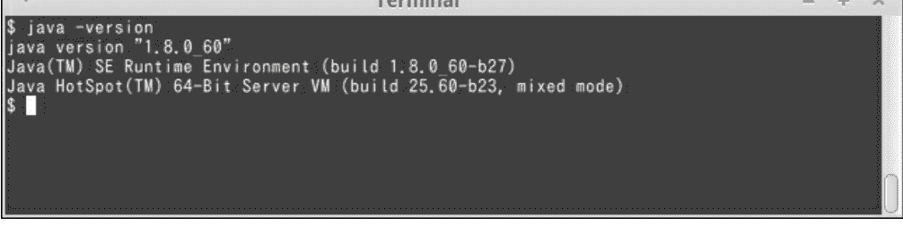
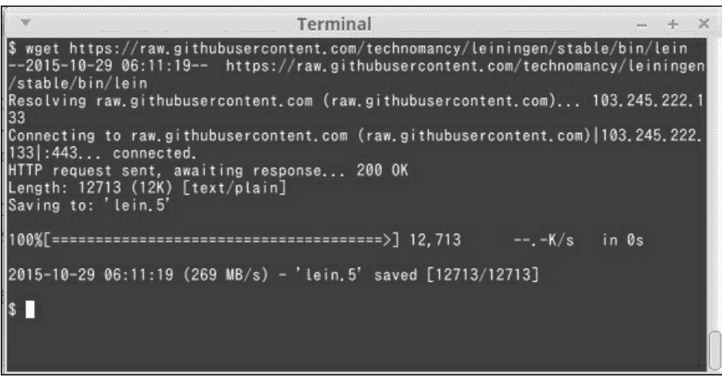
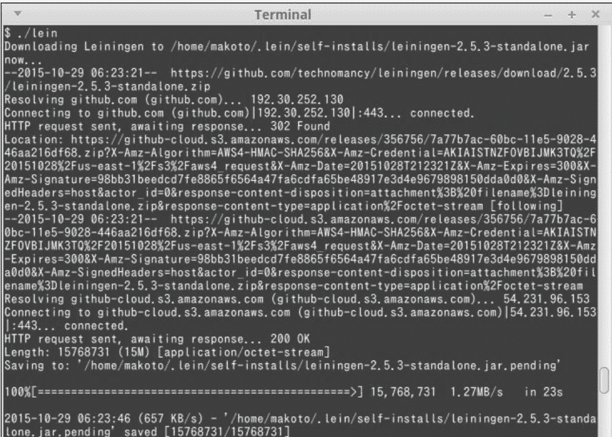
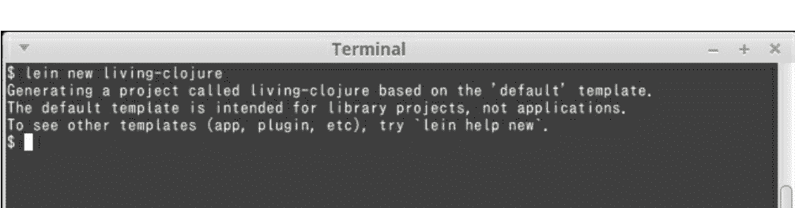
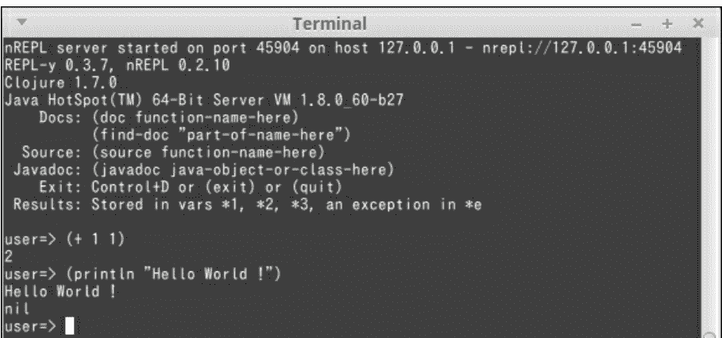
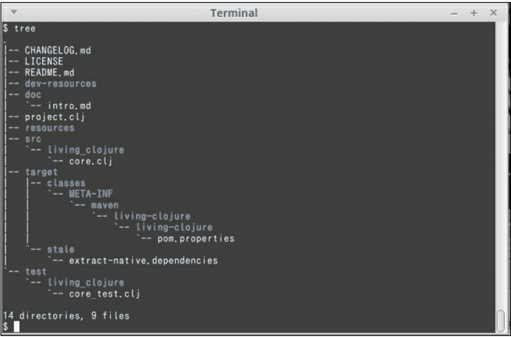
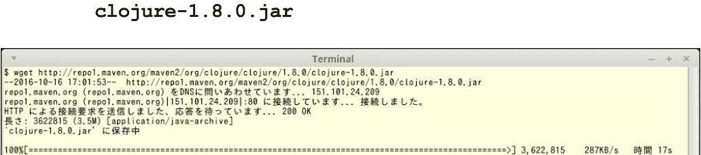

# 第 1 章 使用 Clojure 进行实时编程

在本章中，我们将涵盖以下主题：

- REPL 启动！
- 使用原始数据类型
- 使用 var 的绑定、条件、循环和错误处理
- 使用和定义函数
- 使用第三方库
- 使用命名空间

### 引言

Clojure 是 Lisp 和 Java 的结合。Clojure 允许你快速解决想要解决的问题并保持代码简单。一旦你学会 Clojure，使用它会非常有趣！Clojure 提供了以下出色的功能：

- Clojure 是 Lisp 的一种方言，支持函数式编程风格
- 它运行在 **Java 虚拟机 (JVM)** 上，可以无缝使用 Java 的资源
- 它还支持不可变性和并发编程

在本章中，我们将回顾如何设置 Clojure REPL 环境以及 Clojure 的基本结构，包括原始数据类型、编程流程控制和函数。然后我们将介绍如何使用第三方库和命名空间。

让我们带你进入 Clojure 的精彩世界；我们将从 *REPL up!* 开始

## REPL up!

REPL 是 Clojure 的解释器，它是 **Read Evaluate Print Loop** 的缩写。与 Python 或 Ruby 等其他解释型语言不同，Clojure REPL 在读取表达式后会自动编译成 Java 的字节码。然后，REPL 评估表达式并返回表达式的结果。REPL 的这种动态编译特性使得 Clojure 代码的执行速度与执行预编译代码一样快。

### 准备工作

在设置 Clojure 环境之前，**Java 开发工具包 (JDK)** 是必要的。JDK 版本应为 1.6 或更高版本。在整本书中，我们将使用 JDK 1.8 来开发和测试代码。

输入 `java -version` 后，命令行结果将如下所示：



### 如何操作...

Leiningen 是 Clojure 的标准构建工具。它简化了 Clojure 开发，包括设置项目、编译和测试代码，以及为部署创建库。

使用 Leiningen 设置 Clojure 环境非常容易。在你可以在 REPL 中享受 Clojure 之前，只需要几个步骤！

以下是我们需要执行以运行 Clojure REPL 的步骤：

- 1. 从 http://leiningen.org/ 下载并设置 Leiningen。
- 2. 下载 lein 脚本（或在 Windows 上为 lein.bat）。



- 3. 将其放在你的 $PATH 中，使你的 shell 可以找到它（例如 ~/bin）：
    $ mv lein ~/bin

- 4. 设置为可执行：
    $ chmod a+x ~/bin/lein

5. 运行 lein，它将下载自安装包：



6. 创建一个新项目并进入其中。使用 Leiningen，你可以从项目模板创建项目。此示例创建一个名为 living-clojure 的项目：

```
$ lein new living-clojure
```



7. 运行 REPL 并将 Clojure 代码放入其中：



### 它是如何工作的...

这里有一个非常简单的代码来演示 REPL 的工作原理。此代码只是使用 read、eval 和 println 函数无限循环：

```
user=> (defn simple-repl []
  #_=>   (try
  #_=>     (while true
  #_=>       (println (eval (read)))
  #_=>     )
  #_=>     (catch Exception e (println "exited.."))
  #_=>   )
  #_=> )
#'user/simple-repl
user=> (simple-repl)
(+ 1 1)
2
(defn hello [s] (println "Hello world " s))
#'user/hello
(hello "Makoto")
Hello world  Makoto
nil
exited..
nil
user=>
```

你可以通过输入 ^D（Ctrl + D）退出 simple-repl。

### 还有更多...

Leiningen 是 Clojure 开发人员的非常强大的工具。lein new living-clojure 命令会生成以下目录结构：



让我们挑选 project.clj，它定义了项目：

```
(defproject living-clojure "0.1.0-SNAPSHOT"
  :description "FIXME: write description"
  :url "http://example.com/FIXME"
  :license {:name "Eclipse Public License"
            :url "http://www.eclipse.org/legal/epl-v10.html"}
  :dependencies [[org.clojure/clojure "1.8.0"]])
```

在 project.clj 中，:dependencies 部分声明了项目使用的库。

Leiningen 内部使用 Maven 来解决库的依赖关系。

然而，在 project.clj 中声明库比在 Maven 的 pom.xml 文件中做要简单得多。

要为你的项目使用其他库，将它们添加到依赖部分。我们将在后面的配方中回顾如何做到这一点。在前面的 project.clj 文件中，名为 org.clojure/clojure 的 Clojure 库被声明并自动下载到 maven 目录。这就是为什么你不需要显式下载和设置 Clojure 库的原因。

没有 Leiningen，你必须以更原生方式进行。以下是步骤：

- 1. 下载 clojure-1.8.0.jar。
- 2. 使用 wget 下载 clojure-1.8.0.jar：

```
$ wget
http://repo1.maven.org/maven2/org/clojure/clojure/1.8.0/clojure-1.8.0.jar
```



- 3. 运行 Clojure 并测试 Clojure 代码：

```
$ java -jar clojure-1.8.0.jar
Clojure 1.8.0
user=> (+ 1 1)
2
```

REPL 支持命令行编辑功能，就像 Linux bash shell 一样，但前面的方式不支持。另一个区别是 REPL 在 project.clj 中解决库依赖问题，但使用原生方式，你可以自己解决它们。

### 另请参阅

请参阅以下相关网站：

- TryClojure 是一个基于浏览器的 Clojure 工具，提供 REPL 环境。你不需要设置自己的环境：http://www.tryclj.com/
- REPL 和 main 入口点 解释了有关 REPL 的更多细节：http://clojure.org/repl_and_main
- 请参阅 Leiningen 网页：http://leiningen.org/
- 如果你是 emacs 用户，使用 CIDER 和 Clojure-mode。你可能会非常喜欢 CIDER：http://clojure-doc.org/articles/tutorials/emacs.html
- 如果你是 vi 用户，尝试 fireplace 插件：https://github.com/tpope/vim-fireplace
- 如果你喜欢 IntelliJ/Idea，尝试使用 cursive：https://cursiveclojure.com/
- 如果你是一个传统的 Eclipse 用户，使用 Counterclockwise：http://doc.ccw-ide.org/documentation.html
- Light table 很酷。值得一试：http://lighttable.com/

## 使用原始数据类型

在本配方中，我们将回顾 Clojure 支持的原始数据类型以及操作这些类型的一些函数。在这里，我们将回顾以下内容：

- 使用数字
- 使用字符串和字符
- 使用布尔值和 nil
- 使用关键字和符号

### 准备工作

你只需要如前一配方所述的 REPL，且不需要额外的库。启动 REPL，以便你可以在本配方中立即查看原始类型的示例代码。

### 如何操作...

让我们从 Clojure 数据类型中的数字开始。

### 使用数字

+ 函数返回数字的总和。你可以指定任意数量的数字作为参数：

```
(+ 1 2)
;;=> 3
(+ 1 2 3)
;;=> 6
(+ 1.2 3.5)
;;=> 4.7
```

- 函数减去数字。如果只提供一个参数，它返回数字的负值：

```
(- 3 2)
;;=> 1
(- 1 2 3)
;;=> -4
(- 1)
;;=> -1
```

* 函数返回数字的乘积：

```
(* 5 2)
;;=> 10
(* 1 2 3 4 5)
;;=> 120
```

/ 函数返回分子除以所有分母的结果。对 Clojure 初学者来说令人惊讶的是，如果分子不能被分母整除，它会返回一个简单的分数。你可以通过 class 函数检查类的名称。

在以下示例中，10 除以 3 返回 10/3 而不是 3.3333333...

```
(/ 10 5)
;;=> 2
(/ 10 3)
;;=> 10/3
```

要获得小数点后的数值，请通过 float 或 double 函数转换结果：

```
(float (/ 10 3))
;;=> 3.3333333
(double (/ 10 3))
;;=> 3.333333333333333
```

quot 函数返回分子除以分母的商，小数点被抑制。rem 返回分子除以分母的余数：

```
(quot 10 3)
;;=> 3
(rem 10 3)
;;=> 1
```

Clojure 支持大数，它们是 Java 的 BigDecimal。


bigdec 函数将任意数字转换为 BigDecimal。后缀 M 表示 BigDecimal。虽然它可以表示非常大的数字，但它无法表示循环小数并会引发错误：

```
(bigdec (/ 10 2))
;;=> 5M
(bigdec (/ 10 3))
;; ArithmeticException Non-terminating decimal expansion; no exact representable decimal result. ;;
java.math.BigDecimal.divide (BigDecimal.java:1690)
```

Clojure 还提供大整数 clojure.lang.BigInt。它等价于 Java 的 java.math.BigInteger：

```
(= (bigint 10) 10N)
;;=> true
```

## 使用字符串和字符

Clojure 字符串是 Java 的 String(java.lang.String)，用双引号 (") 括起来：

```
"Hello world ! "
;;=> "Hello world ! "
```

Clojure 与 Java 具有良好的互操作性，很容易从 Clojure 调用 Java 的成员方法。在以下示例中，代码调用了 Java String 类中的 concat 方法：

```
(.concat "Hello " "world !")
;;=> "Hello world !"
```

以下语法是从 Clojure 调用 Java 成员方法的方式：

```
(.method-name object arg1 arg2 ...)
```

第一个参数是点 (.) 前缀后跟方法名，然后是对象及其参数。

等价的 Java 代码如下：

```
String str = "Hello ".concat("world !");
```

str 函数类似于 concat 方法，但它可以接受任意数量的参数：

```
(str "Hello " "world !" " Clojure")
;;=> "Hello world ! Clojure"
```

要检查字符串的长度，请使用 length 方法或 count 函数：

```
(.length "Hello world !")
;;=> 13
```

clojure.string 是用于操作字符串的内置 Clojure 库。这里，我们展示 clojure.string 中的一些函数：

```
(clojure.string/blank? "   ")
;;=> true
(clojure.string/trim "  Hello ")
;;=> "Hello"
(clojure.string/upper-case "clojure")
;;=> "CLOJURE"
(clojure.string/capitalize "clojure")
;;=> "Clojure"
(clojure.string/lower-case "REPL")
;;=> "repl"
```

让我们进入 Clojure 字符类型。Clojure 中的字符是 java.lang.Character，以反斜杠 (\) 为前缀：

```
\a
;;=> \a
```

int 函数获取字符的整数值。同时，char 从字符获取整数值：

```
(int \a)
;;=> 97
(char 97)
;;=> \a
```

seq 函数从字符串返回字符序列，str 从字符生成字符串：

```
(seq "Hello world!")
;;=> (\H \e \l \l \o \space \w \o \r \l \d \!)
(str \C \l \o \j \u \r \e)
;;=> "Clojure"
```

## 使用布尔值和 nil

Clojure 的布尔值是 java.lang.Boolean，其值是 true 和 false：

```
true
;;=> true
false
;;=> false
(= 1 1)
;;=> true
(= 1 2)
;;=> false
(= "Hello" "Hello")
;;=> true
(= "Hello" "hello")
;;=> false
```

not 函数如果表达式在逻辑上为假则返回 true。否则返回 false：

```
(not true)
;;=> false
(not false)
;;=> true
(not= 1 2)
;;=> true
(not true)
;;=> false
```

true? 函数如果表达式为 true 则返回 true；否则返回 false。false? 函数如果表达式为 true 则返回 false；否则返回 true：

```
(true? (= 1 1))
;;=> true
(false? (= 1 1))
;;=> false
```

nil 函数表示无，或值的缺失。Clojure 中的 nil 函数几乎等价于 Java 中的 null 函数。nil 在 Clojure 条件中在逻辑上为假。nil 通常用作返回值以表示假：

```
(if nil true false)
;;=> false
```

nil 是用于表示空序列的返回值：

```
(seq [])
;;=> nil
```

当映射集合查找时找不到给定键，默认返回 nil：

```
(get {:a 1 :b 2} :c)
;;=> nil
```

## 使用符号和关键字

def 函数将全局符号绑定到其值。下一个示例显示 def 将 pi 符号绑定到值 (3.14159265359)：

```
(def pi 3.14159265359)
;;=> #'user/pi
pi
;;=> 3.14159265359
pi-not-bind
;;=> CompilerException java.lang.RuntimeException: Unable to resolve symbol:
;;     pi-not-bind in this context, compiling: (/tmp/form-init1426260352520034213.clj:1:7266)
```

关键字与符号类似，但关键字求值时返回自身：

```
:key1
;;=> :key1
```

关键字用于标识事物，因此它们经常在 Clojure 的映射中使用：

```
(def person {:name "John McCarthy" :country "USA"})
;;=>#'living-clojure.core/person
```

## 它是如何工作的...

Clojure 原始数据类型大多是 Java 类，但某些数据类型是 Clojure 自有类。

对于数字，Clojure 的整数是 `java.lang.Long`，浮点数是 `java.lang.Double`。`bigInt` 和比率分别是 `clojure.lang.BigInt` 和 `clojure.lang.Ratio`：

```
(class 1)
;;=> java.lang.Long
(class 1.0)
;;=> java.lang.Double
(class (float 1.0))
;;=> java.lang.Float
(class 5.5M)
;;=> java.math.BigDecimal
(class 1N)
;;=> clojure.lang.BigInt
(class (/ 10 3))
;;=> clojure.lang.Ratio
```

Clojure 的字符串和字符分别是 `java.lang.String` 和 `java.lang.Character`：

```
(class "Hello world ! ")
;;=> java.lang.String
(class \a)
;;=> java.lang.Character
```

Clojure 的布尔值是 `java.lang.Boolean`：

```
(class true)
;;=> java.lang.Boolean
(class false)
;;=> java.lang.Boolean
```

Clojure 的关键字和符号是 Clojure 自有类：

```
(class :key)
;;=> clojure.lang.Keyword
(class (quote a))
;;=> clojure.lang.Symbol
(class nil)
;;=> nil
```

## 还有更多...

Clojure 支持十六进制和八进制表示法：

```
0xff
;;=> 255
0400
;;=> 256
```

Clojure 还支持灵活的数字基数。你可以用 2 到 36 的基数指定任意基数：

```
2r11111
;;=> 31
16rff
;;=> 255
8r11000
;;=> 4608
7r111
;;=>57
```

有一些特别命名的字符字面量，如下所示：

- \space
- \tab
- \newline
- \return
- \formfeed
- \backspace

Unicode 字符在 Clojure 中由 \uNNNN 表示，如 Java 一样：

```
\u0031\u0032\u0061\u0062
;;=> \1
;;=> \2
;;=> \a
;;=> \b
```

Clojure 中的函数也是符号并绑定到其函数定义。下一个示例显示 + 的值：

```
+
;;=> #object[clojure.core$_PLUS_ 0x3c2ace8a "clojure.core$_PLUS_@3c2ace8a"]
```

要求值符号并返回自身，请使用 quote：

```
(quote pi-not-bind)
;;=> pi-not-bind
```

要在 Clojure 中使用数学库，请尝试 clojure.math.numeric-tower。以下是步骤：

- 1. 将以下依赖项添加到 project.clj 中：
  [org.clojure/math.numeric-tower "0.0.4"]
- 2. 你可以在库中使用 expt 和 sqrt：
  (require '[clojure.math.numeric-tower :as math])
  (math/expt 2 10)
  ;;=> 1024
  (math/sqrt 10)
  ;;=> 3.1622776601683795

## 使用 vars、条件、循环和错误处理的绑定

在本教程中，我们将回顾与 vars 和值、条件、迭代和循环相关的 Clojure 编程控制结构。我们将使用以下特殊形式、宏和函数：

- `def` 和 `let`
- `if` 和 `if-not`
- `when` 和 `when-not`
- `case` 和 `cond`
- `do` 和 `dotimes`
- `loop` 和 `recur`
- `try... catch... throw`

## 准备工作

你只需要 REPL，如本章第一个教程所述，且不需要额外库。启动 REPL，以便你可以在本教程中立即测试示例代码。

## 如何操作...

让我们从如何使用 `def` 和 `let` 绑定 vars 开始。

### def 和 let

`def` 是一个特殊形式，在其命名空间中将符号绑定到全局作用域。`def` 需要 var 和值：

```
(def var val)
```

此示例将 x 绑定到 100：

```
(def x 100)
;;=> 100
```

而 let 在其局部作用域中绑定符号。你可以在 let 子句中放置多个表达式。let 评估它们并返回最后一个表达式：

```
(let [var-1 val-1 var-2 val-2 ...]
    expr-1
    expr-2
    ....
)
```

在此示例中，let 将 x 绑定到 3，y 绑定到 2。然后，它连续评估两个表达式并返回第二个表达式：

```
(let [x 3 y 2]
    (println "x = " x ", y = " y)
    (* x y)
)
;;=> x =  3 , y =  2
;;=> 6
```

### if 和 if-not

if 接受三个参数；第三个参数（else-expression）是可选的：

```
(if condition then-expression else-expression)
```

在下一个示例中，代码返回数字的绝对值：

```
(let [x 10]
    (if (> x 0) x (- x))
)
;;=> 10
(let [x -10]
    (if (> x 0) x (- x))
)
;;=> 10
```

如果没有第三个参数且测试结果为假，则返回 nil：

```
(let [x -10]
    (if (> x 0) x))
;;=> nil


if-not 与 if 相反。如果测试失败则返回 then-expression：

```
(if-not condition then-expression else-expression)
```

下面的示例应返回 false：

```
(if-not true true false)
;;=> false
```

### when 和 when-not

when 函数与 if 类似，但如果条件求值为 true，则会评估一个或多个表达式；否则为 false：

```
(when condition expr-1 expr-2 ...)
```

第一个表达式打印出 x = 10 并返回 100。第二个只返回 nil：

```
(let [x 10]
  (when (> x 0)
    (println "x = " x)
    (* x x)))
;;=> x = 10
;;=> 100
(let [x -10]
  (when (> x 0)
    (println "x = " x)
    (* x x)))
;;=> nil
```

when-not 是 when 的相反：

```
(when-not condition expr-1 expr-2 expr-3 ...)
```

下面的代码使用 when-not 并与前面的函数做同样的事情：

```
(let [x 10]
  (when-not (<= x 0)
    (println "x = " x)
    (* x x)))
;;=> x = 10
;;=> 100
(let [x -10]
  (when-not (<= x 0)
    (println "x = " x)
    (* x x)))
;;=> nil
```

### case 和 cond

case 测试是否存在匹配的值。如果有，case 会评估对应的表达式。如果没有匹配的值，则返回 otherwise-value。如果未指定 otherwise-value，则返回 nil：

```
(case condition
  value1  expr-1
  value2  expr-2
  otherwise-value
)
```

在第一个表达式中，条件匹配值 2 并返回 "two"。第二个表达式返回字符串 "otherwise"：

```
(let [x 2]
  (case x
    1 "one"
    2 "two"
    3 "three"
    "otherwise"
    ))
;;=> "two"
(let [x 4]
  (case x
    1 "one"
    2 "two"
    3 "three"
    "otherwise"
    ))
;;=> "otherwise"
```

cond 是一个宏，与 case 类似。cond 在 Lisp 语言中被大量使用。cond 比 case 更灵活。

cond 接受一组条件/表达式对并评估每个条件。如果其中一个条件为真，cond 会评估对应的表达式并返回它。否则，它会返回 :else 的表达式：

```
(cond
  condition-1 expr-1
  condition-2 expr-2
  ...
  :else expr-else
)
```

下面的示例代码与前面的代码作用相同：

```
(let [x 10]
  (cond
    (= x 1) "one"
    (= x 2) "two"
    (= x 3) "three"
    :else "otherwise"
  )
)
```

### do 和 dotimes

do 按顺序评估表达式并返回最后一个：

```
(do expr-1 expr-2 ...)
```

在下面的示例中，do 评估第一个表达式并打印 x = 10，然后评估第二个并返回 11：

```
(def x 10)
;;=> #'living-clojure.core/x
(do
  (println "x = " x)
  (+ x 1))
;;=> x = 10
;;=> 11
```

dotimes 在 var 从 0 增加到 (number-exp - 1) 时重复表达式：

```
(dotimes [var number-exp]
  expression
)
```

此示例打印 x 的平方，其中 x 为 0 到 4：

```
(dotimes [x 5]
  (println "square : " (* x x)))
;;=> square :  0
;;=> square :  1
;;=> square :  4
;;=> square :  9
;;=> square :  16
```

### loop 和 recur

有时你可能想要编写一个带条件的循环程序。由于 Clojure 是不可变语言，你不能像 Java 等命令式语言那样改变循环计数器。

在这种情况下使用 loop 和 recur 的组合。它们的形式如下：

```
(loop [var-1 val-1 var-2 val-2 ...]
  expr-1
  expr-2
  ...
)
(recur expr-1 expr-2 ...)
```

下面的非常简单的示例展示了 loop 和 recur 的工作原理。在 loop 中，x 被设置为 1 并增加，直到它小于 5：

```
(loop [x 1]
  (when (< x 5)
    (println "x = " x)
    (recur (inc x))
  ) )
;;=> x =  1
;;=> x =  2
;;=> x =  3
;;=> x =  4
;;=> nil
```

下面的示例使用 loop 和 recur 计算 1 到 10 的和：

```
(loop [x 1 ret 0]
  (if (> x 10)
    ret
    (recur (inc x) (+ ret x))
  )
)
;;=> 55
```

### try... catch... throw

Clojure 使用借自 Java 的错误处理程序：

```
(try exp-1 exp-2 ...
  (catch class-of-exception var exception)
  (finally finally-expr)
)
```

在 try 内部，有一个或多个表达式。finally 是可选的。下面的示例引发异常并在 catch 中返回生成的字符串：

```
(try
  (println "Let's test try ... catch ... finally")
    (nth "Clojure" 7)
  (catch Exception e
    (str "exception occurred: " (.getMessage e)))
  (finally (println "test finished"))
)
;;=> Let's test try ... catch ... finally
;;=> test finished
;;=> "exception occurred: String index out of range: 7"
```

### How it works...

Clojure 的词法作用域隐藏了 vars 内部绑定中 vars 的外部绑定。下面的示例展示了嵌套 let 的作用域。内部 let 将 x 绑定到 10 并将 y 绑定到 10。因此，内部 println 打印 100。类似地，外部 let 将 x 绑定到 3 并将 y 绑定到 2。因此，它打印 6：

```
(let [x 3 y 2]
  (let [x 10 y 10]
    (println "inside : " (* x y))
  )
  (println "outside : " (* x y))
)
;;=> inside :  100
;;=> outside :  6
;;=> nil
```

同样，var 的局部绑定隐藏了 var 的全局绑定：

```
(def x 1)
;;=> #'living-clojure/x
;;=> 1
(println "global x = " x)
;;=> global x =  1
(let [x 10] (println "local x = " x))
;;=> local x =  10
(println "global x = " x)
;;=> global x =  1
```

when 是一个使用 if 特殊形式的宏。你可以使用 macroexpand 看到 when 的定义方式：

```
(macroexpand
  '(when (> x 0)
    (println "x = " x)
    (* x x)))
;;=> (if (> x 0) (do (println "x = " x) (* x x)))
```

if-not 也是使用 if 的宏：

```
(macroexpand '(if-not true true false))
;;=> (if (clojure.core/not true) true false)
```

## 使用和定义函数

在本教程中，我们将回顾 Clojure 的函数定义：

- 定义简单函数
- 定义可变参数函数
- 定义多 arity 函数
- 定义使用关键字指定参数的函数
- 定义带有前置条件和后置条件的函数

### Getting ready

你只需要 REPL，如本章第一个教程所述，且不需要额外的库。启动 REPL，以便你可以在本教程中立即测试示例代码。

### How to do it...

在这里，我们将学习如何使用 Clojure 定义函数。让我们从一个返回 `Hello world` 的简单函数开始：

### 定义简单函数

让我们从最小的函数定义开始。以下是 `defn` 的最小语法：

```
(defn function-name [arg1 arg2 ...]
  expr-1
  expr-2
  ...
  expr-n
)
```

`defn` 是一个特殊形式。第一个参数是函数名，后跟一个或多个参数的向量，然后是一个或多个表达式。最后一个表达式返回给调用者。

在这里，我们定义一个非常简单的函数。`hello` 函数返回一个 `Hello world` 字符串：

```
(defn hello [s]
  (str "Hello world " s " !"))
;;=> #'living-clojure.core/hello
(hello "Nico")
;;=> "Hello world Nico !"
(hello "Makoto")
;;=> "Hello world Makoto !"
```

下面的示例定义一个简单的加法函数：

```
(defn simple-adder [x y]
  (+ x y)
)
;;=> #'living-clojure.core/simple-adder
(simple-adder 2 3)
;;=> 5
```

### 定义可变参数函数

可变参数函数允许可变数量的参数。下面的示例定义另一个加法器。它可能有任意数量的参数：

```
(defn advanced-adder [x & rest]
  (apply + (conj rest x))
)
;;=> #'living-clojure.core/advanced-adder
(advanced-adder 1 2 3 4 5)
;;=> 15
```

### 定义多 arity 函数

在这里，我们将介绍多 arity 函数。下面的函数使用同一个 defn 定义单参数函数和多参数函数：

```
(defn multi-arity-hello
  ([] (hello "you"))
  ([name] (str "Hello World " name " !")))
;;=> #'living-clojure.core/multi-arity-hello
(multi-arity-hello)
;;=> "Hello World you !"
(multi-arity-hello "Nico")
;;=> "Hello World Nico !"
```

### 定义使用关键字指定参数的函数

有时指定关键字是有用的，因为不需要记住参数的顺序。

下面的示例展示了如何定义这样的函数。选项为 :product-name、:price 和 :description。:or 表达式在键中的任何值被省略时提供默认值：

```
(defn make-product-1
  [serial &
    {:keys [product-name price description]
     :or {product-name "" price nil description "no description !"}
     }
  ]
  {:serial-no serial :product-name product-name
   :price price :description description})
;;=> #'living-clojure.core/make-product-1
```

```
(defn make-product-2
  [serial &
    {:keys [product-name price description]
     :or {:product-name "" :description "no description !"}
     }
  ]
  {:serial-no serial :product-name product-name
   :price price :description description})
;;=> #'living-clojure.core/make-product-2
```

```
(make-product-1 "0000-0011")
;;=> {:serial-no "0000-0011", :product-name "", :price nil,
:description "no description !"}
(make-product-2 "0000-0011")
;;=> {:serial-no "0000-0011", :product-name nil, :price nil,
:description nil}
```

### 定义带有前置条件和后置条件的函数

Clojure 可以定义带有前置条件和后置条件的函数。在


以下定义，`:pre` 检查一个参数是否为正数。`:post` 检查结果是否小于 10：

```
(require '[clojure.math.numeric-tower :as math])
;;=> nil
(math/sqrt -10)
;;=> NaN
(defn pre-and-post-sqrt [x]
  {:pre  [(pos? x)]
   :post [(< % 10)]}
  (math/sqrt x))
;;=> #'living-clojure.core/pre-and-post-sqrt
(pre-and-post-sqrt 10)
;;=> 3.1622776601683795
(pre-and-post-sqrt -10)
;;=> AssertionError Assert failed: (pos? x)  user/pre-and-post-sqrt (form-init2377591389478394456.clj:1)
(pre-and-post-sqrt 120)
AssertionError Assert failed: (< % 10)  user/pre-and-post-sqrt (form-init2377591389478394456.clj:1)
```

此外，在本配方中，我们将展示一个更复杂的函数。`make-triangle` 函数使用字符打印一个三角形。如果该函数不带 `:char` 参数调用，它会打印由星号组成的三角形。如果它带 `:char` 参数调用，它会打印由 `:char` 指定的字符组成的三角形：

```
(defn make-triangle
  [no & {:keys [char] :or {char "*"}}]
  (loop [x 1]
    (when (<= x no)
      (dotimes
        [n (- no x)] (print " "))
      (dotimes
        [n
         (if (= x 1)
           1
           (dec (* x 2)))]
        (print char))
      (print "\n")
      (recur (inc x))
      )
    )
```

```
(make-triangle 5)
;;=>       *
;;=>     ***
;;=>   *****
;;=>  *******
;;=> *********
;;=> nil
(make-triangle 6 :char "x"))
;;=>       x
;;=>     xxx
;;=>   xxxxx
;;=>  xxxxxxx
;;=> xxxxxxxxx
;;=> xxxxxxxxxxx
```

## 如何运作...

我们已经回顾了如何定义函数以及如何使用它们。回顾完上一节后，你应该理解它们的工作原理。

使用 `defn` 定义函数与使用 `fn` 将 var 绑定到函数相同，如下所示：

```
(defn pow-py-defn [x] (* x x))
;;=> #'living-clojure/pow-py-defn
(def pow-by-def (fn [x] (* x x)))
;;=> #'living-clojure/pow-by-def
(pow-py-defn 10)
;;=> 100
(pow-by-def 10)
;;=> 100
```

## 还有更多...

`clojure.repl` 有一些可与其他函数一起使用的有用函数。要获取特定命名空间中的符号，请使用 `clojure.repl/dir`：

```
(require 'clojure.string)
;;=> nil
(clojure.repl/dir clojure.string)
;;=> blank?
;;=> capitalize
```

```
; ;=> escape
; ;=> join
; ;=> lower-case
; ;=> re-quote-replacement
; ;=> replace
; ;=> replace-first
; ;=> reverse
; ;=> split
; ;=> split-lines
; ;=> trim
; ;=> trim-newline
; ;=> triml
; ;=> trimr
; ;=> upper-case
; ;=> nil
```

要获取函数的文档，请使用 clojure.repl/doc：

```
(clojure.repl/doc clojure.string/trim)
-----------------------------
; ;=> clojure.string/trim
; ;=> ([s])
; ;=>   Removes whitespace from both ends of string.
; ;=> nil
```

要获取包含特定字符串的符号，请使用 clojure.repl/apropos：

```
(clojure.repl/apropos "defn")
; ;=> (clojure.core/defn
; ;=>  clojure.core/defn-
; ;=>  deps.compliment.v0v2v4.compliment.sources.local-bindings/defn-like-forms
; ;=>
deps.compliment.v0v2v4.deps.defprecated.v0v1v2.defprecated.core/defn)
```

## 使用第三方库

所以，你找到了别人的代码想要使用，并且正在尝试将其用于你的项目，太好了！这正是本配方要讲的内容。有几种方法可以让代码更接近你。

## 准备工作

本配方将介绍如何将打包为 JAR 文件的依赖项添加到项目中以及如何引用它们，以及如何从 Clojure 代码中使用它们。我们将从下载文件并手动启动 Clojure REPL 开始，到使用依赖管理工具。最后，我们还将介绍如何在运行时添加新依赖项，以便无需重启实时编程环境。

## 如何操作...

本配方中的每个小节都展示了如何在不同场景下以不同方式添加依赖项。

## 手动将 JAR 文件添加到类路径

假设我们找到了以下库 clj-tuples，并希望将其添加到 REPL 会话中。大多数 Clojure 的 JAR 都可在 mvnrepository.com 或 clojars.org 上获得。

clj-tuples 在 clojars 上，由于 clojars 是一个常规的 Maven 仓库，我们可以直接通过文件导航。下载并保存它 (https://clojars.org/repo/ruiyun/tools.timer/1.0.1/tools.timer-1.0.1.jar)，现在让我们启动一个 Clojure REPL：

```
java -cp .:clj-tuple-0.2.2.jar:clojure-1.8.0-beta1.jar
clojure.main
```

让我们快速使用我们新的库代码玩玩...mmmm，元组：

```
user=> (use 'ruiyun.tools.timer)
; nil
user=> (run-task!
#(println "Say hello every 5 seconds.") :period 5000);
#object[java.util.Timer 0x45a4b042 "java.util.Timer@45a4b042"]
user=> Say hello every 5 seconds.
    user=> (cancel! *1)
```

太棒了！

## 使用 Leiningen 和 project.clj 文件

那样很有趣，但也许你有不止一个人的代码想要“偷”，而且你刚刚注意到其中一些被偷的代码也偷了别人的代码……你该怎么办？

Leiningen 是一个命令行工具，除其他功能外，还会帮助你维护被偷的代码。本配方不会介绍如何安装 Leiningen，因为到处都有相关文档，所以我们只想确保此时你有最新版本：

```
NicolassMacBook:chapter01 niko$ lein version

Leiningen 2.5.1 on Java 1.8.0_45 Java HotSpot(TM) 64-Bit Server VM
```

为了让 Leiningen 理解我们的需求，大多数时候，我们会给它一个 project.clj 文件，其 DSL 看起来大多像一个巨大的 Clojure map。如果我们想导入与之前相同的依赖项，我们会这样写：

```
(defproject chapter01 "0.1.0"
  :dependencies
  [[org.clojure/clojure "1.8.0-beta1"]
   [clj-tuple "0.2.2"]])
```

在其根部，声明对第三方库的依赖是通过这种迷你 DSL 完成的，其中一个包含名称和版本的二元素向量：

```
[name "version"]
```

所以这里：

```
[clj-tuple "0.2.2"]
```

依赖项以 Clojure 向量的形式声明在项目 map 中，其键为 `:dependencies`。我们现在可以访问数十亿个质量因作者而异的库，但无论如何，这就完成了。Leiningen 默认使用 `clojars`，因此无需定义仓库定义。之前相同的代码仍然有效：

```
(use 'clj-tuple)
```

## 查看依赖项

使用 `project.clj` 文件，我们可以直接看到代码所依赖的内容，特别是代码所依赖的事物的版本。`clj-tuple` 的 `project.clj` 文件位于 https://github.com/Ruiyun/tools.timer/blob/master/project.clj，我们感兴趣的部分如下：

```
(defproject clj-tuple "0.2.2"
:description "Efficient small collections."
:dependencies []
...)
```

这意味着 `clj-tuples` 不依赖任何其他内容，并且是一个行为良好的自包含库。

这显然并非总是如此，而且顺便说一下我们可以再看另一个名为 `puget` 的库。

Puget 定义了以下依赖项：

```
:dependencies
  [[fipp "0.6.2"]
   [mvxcvi/arrangement "1.0.0"]
   [org.clojure/clojure "1.8.0"]]
```

但好消息是我们不需要自己编写所有这些依赖项行。Leiningen 会正确拉取传递依赖项，因此我们的 `project.clj` 文件现在看起来像这样：

```
(defproject chapter01 "0.1.0"
  :dependencies [
    [org.clojure/clojure "1.8.0-beta1"]
    [clj-tuple "0.2.2"]
    [mvxcvi/puget "0.9.1"]])
```

第一次启动新 REPL 时，我们会注意到所有依赖项都在下载中：

```
NicolassMacBook:chapter01 niko$ lein repl
Retrieving mvxcvi/puget/0.9.1/puget-0.9.1.pom from clojars
Retrieving fipp/fipp/0.6.2/fipp-0.6.2.pom from clojars
Retrieving org/clojure/core.rrb-vector/0.0.11/core.rrb-vector-0.0.11.pom from central
Retrieving mvxcvi/arrangement/1.0.0/arrangement-1.0.0.pom from clojars
Retrieving org/clojure/core.rrb-vector/0.0.11/core.rrb-vector-0.0.11.jar from central
Retrieving fipp/fipp/0.6.2/fipp-0.6.2.jar from clojars
Retrieving mvxcvi/arrangement/1.0.0/arrangement-1.0.0.jar from clojars
Retrieving mvxcvi/puget/0.9.1/puget-0.9.1.jar from clojars
```

这只适用于第一次。第二次发生时没有额外消息，你现在可以自己检查库是否存在，并且你会得到预期的彩色输出，但在本书中没有：

```
user=> (require '[puget.printer :as puget])
nil
user=> (puget/pprint #{'x :a :z 3 1.0})
#{1.0 3 :a :z x}
nil
user=> (puget/cprint #{'x :a :z 3 1.0})
#{1.0 3 :a :z x}
```

## 一次性

有时只想尝试一下，并使用一次性 REPL 来尝试新依赖项，这时我们可以使用名为 try 的 Leiningen 插件。

Leiningen 的插件可以通过位于此处的名为 profiles.clj 的文件全局安装在你的机器上：


# $HOME/.lein/profiles.clj

该文件是一个包含用户自定义设置的简单映射；在这里，我们只是想添加一个插件，因此将其添加到向量中：

```
{:user {:plugins [ [lein-try "0.4.3"] ]}}
```

就这样。从你电脑上的任何位置，你现在都可以尝试依赖项。为了让事情变得新颖，我们将查看一个名为 env 的新有用的依赖项，它使检索环境设置变得容易。

这是 Leiningen 对 env 的常规定义，并且以下代码将用于 project.clj 中，如前所述：

```
[adzerk/env "0.2.0"]
```

在这里，我们只需输入以下内容：

```
lein try adzerk/env
```

我们可以看到依赖项在本地逐步到来（前提是你有互联网连接）：

```
Retrieving adzerk/env/0.2.0/env-0.2.0.pom from clojars
Retrieving adzerk/env/0.2.0/env-0.2.0.jar from clojars
```

我们现在可以使用 require 宏：

```
(require '[adzerk.env :as env])
```

并尝试它。env 返回通过 Java 或 Shell 可用的所有 env 变量：

```
user=> (env/env)
; ...
```

如果你有机会在 project.clj 所在的位置运行上述命令，则项目的依赖项也可用，因此我们可以组合依赖项：

```
user=> (require '[puget.printer :as puget])
```

```
user=> (puget/cprint (env/env))
{"Apple_PubSub_Socket_Render"
"/private/tmp/com.apple.launchd.jI7P2DRL6X/Render",
"HOME" "/Users/niko",
"JAVA_ARCH" "x86_64",
"JAVA_CMD" "java",
"JAVA_MAIN_CLASS_3927" "clojure.main",
"JVM_OPTS" "",
...
```

Voila！现在我们将一个临时依赖项与我们主项目的依赖项结合起来了。

## 运行时新依赖项

到目前为止，我们已经看到了如何离线添加依赖项，因为我们需要停止 REPL 才能使新依赖项得到正确处理。现在我们将看到如何即时添加依赖项。

我们现在要查看的依赖项名为 pomegranate，它正是这样做的，即时添加依赖项。

与我们之前添加 Leiningen 插件的方式相同，我们将通过向同一个 profiles.clj 文件添加依赖项来向我们的运行时添加全局依赖项：

```
{:user
  {:dependencies
   [[com.cemerick/pomegranate "0.3.0"]] }}
```

这些依赖项将准备好通过你所有的 Leiningen 基于的项目加载，因此请注意不要添加太多。加载一个新的 REPL 后，我们现在可以加载 pomegranate，而我们唯一需要的方法很愉快地命名为 add-dependencies：

```
(require '[cemerick.pomegranate :refer [add-dependencies]])
```

新需要的函数接受一个坐标向量，使用我们迄今为止看到的相同模式，以及一个存储库映射，其中键为名称，值为指向类似 Maven 的存储库的 URL：

```
(add-dependencies
    :coordinates '[[active-quickcheck "0.3.0"]]
    :repositories {"clojars"
"http://clojars.org/repo"})
```

第一次调用时，依赖项及其所有底层组件将被下载并准备使用。我们以 `active-quickcheck` 作为示例，这是一个可以根据给定谓词生成随机测试的库。该库仍需要在当前命名空间中 require：

```
(use 'active.quickcheck)
```

```
; sample dependency test, we will not go in the details here
(quickcheck (property [a integer
                  b integer]
                (= (+ a b) (+ b a))))
```

因此，我们基本上已经看到了将依赖项添加到 Clojure 环境的所有不同方法，无论是通过：

- Direct JAR file
- Leiningen's `project.clj`
- Leiningen's `profiles.clj`
- Leiningen's `try` plugin
- Using `pomegranate`

## 使用命名空间

Clojure 通过命名空间组织代码，或代码的小单元。每个命名空间包含一组定义函数。其中一个反复出现的问题是弄清楚如何布局你的命名空间，以及如何组织不同的命名空间，使它们以干净的方式相互关联。这就是本食谱将要介绍的内容。

### Getting ready

本食谱除了运行 REPL 外不需要任何特殊安装步骤。此外，建议保持 Clojure 命名空间页面打开，以便我们可以快速参考它。

### How to do it...

我们将逐步介绍创建 Clojure 命名空间、引用其他命名空间的代码以及按需加载和重新加载命名空间的步骤。最后，我们将简要介绍如何正确组织这些命名空间的几个概念。

### Creating a new namespace

我们在这里首先查看命名空间是如何创建的。在 REPL 中工作时，对命名空间进行更改或创建命名空间主要归结为使用 clojure.core 中的 in-ns 函数：

```
(in-ns 'hello)
```

下次我们使用 def 定义一个 var 时，我们会看到它绑定到该命名空间：

```
hello=> (in-ns 'hello)
#object[clojure.lang.Namespace 0x3b5fad2d "hello"]
hello=> (def a 1)
#'hello/a
```

很好。现在，由于该函数也解析为 var，我们可以在我们的命名空间中定义该函数。我们现在需要给出 fn 的完整路径来定义定义，因此是 clojure.core/fn：

```
hello=> (def b (clojure.core/fn[c] (clojure.core/inc c)))
#'hello/b
hello=> (b 2)
3
```

### Inspecting namespaces

命名空间是常规对象，因此在 JVM 上我们可以非常容易地看到它们的内部结构。find-ns 告诉我们对象是什么，然后在 JVM 上我们从命名空间对象调用 .getMappings：

```
(find-ns 'hello)
; #object[clojure.lang.Namespace 0x3b5fad2d "hello"]
(.getMappings *1)
....
```

命名空间在 JVM 上该类的静态字段中静态列出并保留，因此我们可以稍后引用它们。

虽然 in-ns 帮助我们定义命名空间，但我们实际上会使用一个更高级别的函数命名为 ns：

```
helloagain=> (ns helloagain)
nil
helloagain=>
```

如果你想去看看，ns 实际上为我们做了很多事情。可以使用的两个主要关键字是 imports 和 refers。

### Adding functions with :import and :refer

:import 将类从托管虚拟机导入（目前为 JVM、JavascriptVM 和 .NET VM）。例如，在 Java 中，我们想直接使用原始的 Random Java 对象，我们将在命名空间中以以下方式导入它：

```
(ns helloagain (:import [java.util Random]))
(Random.)
; #object[java.util.Random 0x6337c201
```

```
"java.util.Random@6337c201"]
```

我们也可以使用 ns-imports 检查每个命名空间中定义的导入：

```
(ns-imports 'helloagain)
;...
```

默认情况下，Clojure 会为我们做一些工作，以确保基本 Java 对象已在每个新命名空间中可用。

与我们可以导入 Java 对象的方式相同，我们可以继续在当前命名空间中 require 其他 Clojure 命名空间。这是通过命名空间定义中的 :require 关键字完成的：

```
helloagain=>  (ns helloagain (:require [clojure.string :refer :all]))
WARNING: reverse already refers to: #'clojure.core/reverse in namespace: helloagain, being replaced by:
#'clojure.string/reverse
WARNING: replace already refers to: #'clojure.core/replace in namespace: helloagain, being replaced by:
#'clojure.string/replace
nil
helloagain=> (reverse "helloagain")
"niagaolleh"
```

新引用的函数可以使用 ns-refers 查看：

```
(ns-refers 'helloagain)
; ... (somewhere clojure.string ...)
```

### Loading namespaces from files

现在，实际上，ns 调用大多位于每个文件的顶部。假设我们想保留现在在这个 helloagain 命名空间中的代码；我们将创建一个 helloagain.clj 文件并复制以下内容：

```
(ns helloagain
  (:import [java.util Random])
  (:require [clojure.string :refer :all]))
```

```
(println
  (clojure.string/reverse (str (.getName *ns*))))

(println (Random.))
```

命名空间以及因此文件可以通过 require 加载。为了使它工作，我们需要验证我们的类路径，所以让我们回顾一下我们之前启动 REPL 的方式：

```
java -cp .:clojure-1.8.0-beta1.jar clojure.main
```

. 使当前文件夹中的文件在类路径上可用，因此 require 可以遍历定义的类路径并找到我们刚刚定义的 helloagain.clj 文件：

```
user=> (require 'helloagain)
niagaolleh
nil
user=>
```

你会注意到在命令行调用 require 时代码会被执行。' 是必需的，因为 helloagain 不应被求值，而是作为符号保留。

### Reloading namespaces

现在，这里有点更复杂。我们想向 helloagain 命名空间添加一个函数：

```
(defn only-one []
  (println "only one"))
```

我们想在不同的用户命名空间中使用此函数，因此我们可以再次调用 ns 宏来执行此操作，或者我们也可以直接使用 require。假设我们已将上述函数添加到我们的文件名中；只需调用 require 应该就足够了：

```
user=> (require 'helloagain)
nil
user=> (helloagain/only-one)
CompilerException java.lang.RuntimeException: No such var: helloagain/only-one, compiling:(NO_SOURCE_PATH:4:2)
```


organization if the data handled is straightforward and simple.

Possibly the most interesting motivation to separate namespaces is the public API method.

## There's more...

In the previous section, we saw that having a namespace for the public API of your library is important, so the following will describe, with the potemkin library as an example, how to extract just what you need from your code to present the API you want to present:

```
tools.namespace, potemkin
```

## Namespace for public API

potemkin has a very interesting method, named import-vars, that allows something like a copy/paste of a function from a different namespace to a current one. If we remember the previous recipe, we can simply try the potemkin dependency as follows:

```
lein try potemkin "0.4.1"
```

Then we can select on-demand functions and clean up our public-facing namespace:

```
user=> (require 'potemkin)
(potemkin/import-vars [clojure.string reverse])
(user/reverse "hello")
```

This makes selecting functions for our namespace clean, without any code, mostly documentation.

This also makes a case for versioning our namespace, in case some breaking changes are introduced but there is no need to make a completely new version of your code.

## tools.namespace

Now, we saw just a few moments ago that we can force :reload on a namespace, but things get complicated when namespaces depend on each other, and you are not sure which one was reloaded and which one was not. This is where tools.namespace makes it easier for you to track all this for you. Let us start a REPL and try this out:

```
lein try org.clojure/tools.namespace "0.2.11"
```

As per the doc, the refresh function will scan all the directories on the classpath for Clojure source files, read their ns declarations, build a graph of their dependencies, and load them in dependency order. (You can change the directories it scans with set-refresh-dirs.)

So, at the REPL, the function we mostly need from tools.namespace is refresh:

```
(require '[clojure.tools.namespace.repl :refer [refresh]])
```

Now, supposing our file helloagain.clj is in the src folder so, src/helloagain.clj, and lein can find and load the file with require:

```
(require '[helloagain :refer :all])
user=> (only-one)
only one
```

We will quickly add a new function to our file:

```
(defn only-two []
  (println "only two"))
```

And call refresh to make sure we have the latest code:

```
user=> (refresh)
; :reloading (helloagain)
user> (helloagain/only-two)
; only two
```

And that is all. We have pulled the latest from our namespace code, and the required namespaces will be reloaded as needed.

## What's next?

In this chapter, we have seen how to create namespaces and how to inspect them. We also looked at how to organize those namespaces, and how to make sure we always have the code we want at the place we want. We remembered that a public API is a key point for creating namespaces as well as organizing code into functional modules.

The next step is to look at the workflow for reloading a full application that has dependent components. Those components will require a workflow to manage their state and the now famous component library has been established as the way to go.

Maybe this could also be part of a future Clojure version, in which the need to break namespaces into something smaller than files will be handled.
