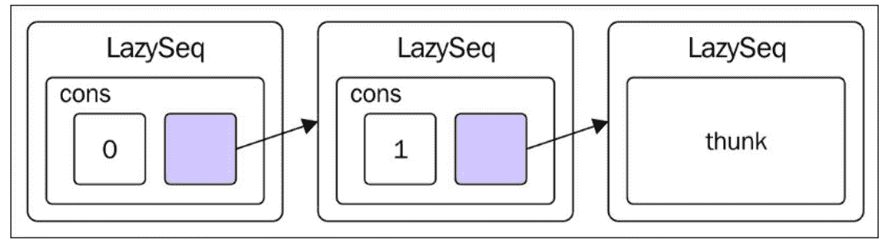

# Chapter 2. Interacting with Collections

In this chapter, we will cover the following topics:

- Clojure collections and their basic functions
- Accessing and updating elements from collections
- Filtering elements from collections
- Transforming and sorting collections
- Merging and splitting collections
- How to become lazy

### Introduction

Clojure belongs to the Lisp language family, and Lisp can handle collections in a very cool and efficient way. Clojure inherits rich and cool sets from Lisp. In this chapter, we will show basic and advanced recipes for manipulating collections.

Another advantage of manipulating collections in Clojure is to guarantee immutability. In the case of large or concurrent applications, mutability causes unintended behaviors resulting in serious bugs.

After reading this chapter, you'll be able to write Clojure code to handle collections with a lot of fun.

## Clojure collections and their basic functions

There are four collection types in Clojure:

- Lists
- Vectors
- Maps
- Sets

In this recipe, we will describe what these types are and some basic functions for them.

### Getting ready

You only need REPL described in the recipe *Repl up!* in Chapter 1, *Live Programming with Clojure*, and no additional libraries. Start REPL so that you can review the sample code in this recipe.

### How to do it...

We will learn collection types in Clojure including lists, vectors, maps, and sets. We will learn how to create them and use basic functions for them.

### Lists

Lists are commonly used in Lisp. Clojure also supports the list data type. Lists are internally implemented as a linked list. To create a list, begin with quote (') and then enclose elements with (). If you want to create an empty list, use ' (), or (list):

```
'("A Study in Scarlet"
"The Sign of the Four"
"The Hound of the Baskervilles"
"The Valley of Fear")
;;=> ("A Study in Scarlet" "The Sign of the Four" "The Hound of the Baskervilles" "The Valley of Fear")
```

```
' ()
;;=> ()
(list)
;;=> ()
```

There are three basic functions, car, cdr, and cons, to manipulate lists in traditional Lisp. Instead of them, Clojure uses first, rest, and conj. Let's see how they work:

- first takes the head element from a list:
  
  (first '(1 2 3 4 5))
  ;;=> 1
  (first '())
  ;;=> nil
  (first nil)
  ;;=> nil

- The first of an empty list or nil returns nil.

- rest returns a list after the first element:
  
  (rest '(1 2 3 4 5))
  ;;=> (2 3 4 5)
  (rest '())
  ;;=> ()
  (rest nil)
  ;;=> ()

- The rest of an empty list or nil returns an empty list.

- conj adds elements at the beginning:
  
  (conj '(2 3 4 5) 1)
  ;;=> (1 2 3 4 5)

- conj is a variadic function and can take multiple elements as its arguments:
  
  ```clj
  (conj '("d" "e" "f") "c" "b" "a")
  ;;=> ("a" "b" "c" "d" "e" "f")
  ```

### Vectors

A vector also represents a sequence of elements, like list, but it supports efficient access to its elements by index.

To create a vector, enclose its elements with []. To create an empty vector, use [] or (vector):

```
["A Study in Scarlet"
"The Sign of the Four"
"The Hound of the Baskervilles"
"The Valley of Fear"]
;;=> ["A Study in Scarlet" "The Sign of the Four" "The Hound of the Baskervilles" "The Valley of Fear"]
[]
;;=> []
(vector)
;;=> []
```

We can use first, rest, and conj with vectors. Let's begin with first and rest:

```
(first [1 2 3 4 5])
;;=> 1
(first [])
;;=> nil
(rest [1 2 3 4 5])
;;=> (2 3 4 5)
```

The rest of the vector looks like a returning list, but it is not list. It is ChunkedSeq:

```
(class (rest [1 2 3 4 5]))
;;=> clojure.lang.PersistentVector$ChunkedSeq
```

To add elements to a vector, use the conj function. conj appends elements to the vector:

```
(conj [1 2 3 4] 5)
;;=> [1 2 3 4 5]
```

### Maps

Maps are associative lists, and they can be accessed efficiently with keys and return their values.

To create a map, enclose key-value pairs with {}:

```
{:name "Arthur Ignatius Conan Doyle"
:born "22-May-1859"
:died "7-July-1930"
:occupation ["novelist" "short story writer" "poet" "physician"]
:nationality "scotish"
:citizenship "United Kingdom"
:genre ["Detective fiction", "fantasy", "science fiction", "historical novels", "non-fiction"]
:notable-works ["Stories of Sherlock Holmes" "The Lost World"]
:spouse ["Louisa Hawkins" "Jean Leckie"]
:no-of-children 5
}
;;=> {:genre ["Detective fiction" "fantasy" "science fiction" "historical novels" "non-fiction"], :occupation ["novelist" "short story writer" "poet" "physician"], :name "Arthur Ignatius Conan Doyle", :no-of-children 5, :nationality "scotish", :died "7-July-1930", :spouse ["Louisa Hawkins" "Jean Leckie"], :notable-works ["Stories of Sherlock Holmes" "The Lost World"], :citizenship "United Kingdom", :born "22-May-1859"}
```

To create an empty map, use {} or (hash-map):

```
{}
;;=> {}
(hash-map)
;;=> {}
```

We can use first, rest, and conj for maps, just as for lists or vectors:

```
(first {:a 1, :b 2, :c 3 :d 4 :e 5})
;;=> [:a 1]
(rest {:a 1, :b 2, :c 3 :d 4 :e 5})
;;=> ([:b 2] [:c 3] [:d 4] [:e 5])
(conj {:a 1, :b 2, :c 3 :d 4 } [:e 5])
;;=> {:a 1, :b 2, :c 3, :d 4, :e 5}
(conj {:a 1, :b 2, :c 3 :d 4 } [:d 5] [:e 6])
;;=> {:a 1, :b 2, :c 3, :d 5, :e 6}
(conj {:a 1, :b 2, :c 3 :d 4 } [:d 5])
;;=> {:a 1, :b 2, :c 3, :d 5}
```

Maps are often used as dictionaries. get, dissoc, and assoc are more commonly used with maps.


get 通过键查找映射条目并返回其值。如果 get 在集合中找不到该键，则返回 nil。

如果在这种情况下你不想得到 nil，请在键不存在时指定想要的值：

```
(get {:a 1, :b 2, :c 3 :d 4 :e 5} :c)
;;=> 3
(get {:a 1, :b 2, :c 3 :d 4 :e 5} :f)
;;=> nil
(get {:a 1, :b 2, :c 3 :d 4 :e 5} :f :not-found)
;;=> :not-found
```

assoc 向映射添加键值对。如果映射中已存在键值对，则替换该值：

```
(assoc {:a 1, :b 2, :c 3 :d 4} :e 5)
;;=> {:a 1, :b 2, :c 3, :d 4, :e 5}
(assoc {:a 1, :b 2, :c 3 :d 4} :c 5)
;;=> {:a 1, :b 2, :c 5, :d 4}
```

assoc 可以使用多个键值对作为其参数：

```
(assoc {:a 1, :b 2, :c 3 :d 4} :e 5 :f 6)
;;=> {:a 1, :b 2, :c 3, :d 4, :e 5, :f 6}
```

dissoc 从映射中移除键值对：

```
(dissoc {:a 1, :b 2, :c 3 :d 4} :c)
;;=> {:a 1, :b 2, :d 4}
(dissoc {:a 1, :b 2, :c 3 :d 4} :c)
;;=> {:a 1, :b 2, :d 4}
(dissoc {:a 1, :b 2, :c 3 :d 4} :e)
;;=> {:a 1, :b 2, :c 3, :d 4}
```

## Sets

集合维护其元素的唯一性。要创建集合，以哈希 (#) 开头，然后用 {} 括住元素。如果要创建空集合，使用 #{} 或 (hash-set)：

```
#{"apple" "orange" "banana" "peach" "strawberry"}
;;=> #{"peach" "apple" "banana" "orange" "strawberry"}
```

```
#{}
;;=> #{}
(hash-set)
```

我们可以使用 `first`、`rest` 和 `conj` 处理集合。集合不会保持你输入数据的顺序，因此 `first` 或 `rest` 的结果可能与你预期不同：

```
(first #{:a :b :c :d :e})
;;=> :e
(rest #{:a :b :c :d :e})
;;=> (:c :b :d :a)
(conj #{:a :b :c :d} :e)
;;=> #{:e :c :b :d :a}
(conj #{:a :b :c :d :e} :e)
;;=> #{:e :c :b :d :a}
```

`contains?` 函数检查元素是否存在于集合中，而 `disj` 则从集合中消除该元素：

```
(contains? #{:a :b :c :d :e} :c)
;;=> true
(contains? #{:a :b :c :d :e} :f)
;;=> false
(disj #{:a :b :c :d :e} :c)
;;=> #{:e :b :d :a}
(disj #{:a :b :c :d :e} :c :d)
;;=> #{:e :b :a}
```

## How it works...

Clojure 中的所有集合类型都是持久的且不可变的。持久数据结构在被修改时会保留其自身之前的版本。Clojure 对集合的修改版本有高效的实现，因此它不会简单地复制整个数据结构，而是共享原始数据。

## Clojure collections

所有集合类型都实现了 `clojure.lang.Seqable` 接口，其 `seq` 方法返回 `clojure.lang.ISeq`。`ISeq` 具有 `cons`、`first`、`more` 和 `next` 函数：

```
public interface Seqable {
    ISeq seq();
}
```

```
public interface ISeq extends IPersistentCollection {
    Object first();
    ISeq next();
    ISeq more();
    ISeq cons(Object o);
}
```

ISeq 实现了 IPersistentCollection，它具有 count、cons、empty 和 equiv：

```
public interface IPersistentCollection
    extends Seqable {
    int count();
    IPersistentCollection cons(Object o);
    IPersistentCollection empty();
    boolean equiv(Object o);
}
```

## Differences between lists and vectors

列表和集合表示元素序列，但存在一些差异：

- 列表是 `clojure.lang.PersistentList`，向量是 `clojure.lang.PersistentVector`。
- 列表以链表实现。向量使用树结构实现，每个节点有 32 个元素。
- 向量对索引访问高效。列表的索引访问为 O(n)，而向量的索引访问为 O(log32(n))。
- 这就是为什么，使用 `conj` 时，列表和向量的结果顺序不同。`conj` 将元素放在列表开头，但将元素放在向量末尾：

```
(conj '(2 3 4 5) 1)
;;=> (1 2 3 4 5)
(conj [1 2 3 4] 5)
;;=> [1 2 3 4 5]
```

以下代码测试列表和向量的索引访问。此测试测量对包含 100 万个元素的集合中最后一个元素的访问。测试循环 100 次。访问列表需要半秒，但访问向量仅需 0.1 毫秒：

```
(let [n 1000000 iter 100
      l (into () (repeat n "a"))
      v (into [] (repeat n "a"))
      ]
  (time (dotimes [_ iter] (nth l (dec n) )))
  (time (dotimes [_ iter] (nth v (dec n) )))
)
"Elapsed time: 532.623841 msecs"
"Elapsed time: 0.167739 msecs"
```

反转向量的顺序比反转列表的顺序更快：

```
(do
  (time (reverse (into '() (range 100000))))
  (time (reverse (into [] (range 100000))))
  nil
)
"Elapsed time: 60.67435 msecs"
"Elapsed time: 26.431954 msecs"
nil
```

原因在于 clojure.lang.PersistentVector 实现了 clojure.lang.Reversible，但 clojure.lang.PersistentList 没有。

## Clojure is immutable

由于 Clojure 集合的函数是不可变的，因此它不会修改原始集合。这与 Python 或 Ruby 不同。在以下 Python 代码中，insert 修改了原始列表：

```
l = [2, 3, 4, 5]
l.insert(0, 1)
l
#[1, 2, 3, 4, 5]
```

下面的 Ruby 代码也修改了原始列表：

```
$ irb
irb(main):001:0> letters = Array.new([2,3,4])
=> [2, 3, 4]
irb(main):002:0> letters.insert(0, 1)
```

```
=> [1, 2, 3, 4]
```

但 Clojure 不会更改原始数据：

```
(def l '(2 3 4 5))
#'collection.core/l
(conj '(2 3 4 5) 1)
;;=> (1 2 3 4 5)
l
;;=> (2 3 4 5)
```

使用不可变数据可确保在从其他函数调用返回后参数保持未修改。另一方面，调用函数会导致参数被意外修改，从而导致难以找到的错误。

## There's more...

在这里，我们将向你展示一些操作集合的技术。

## Converting collections between different types

into 在集合中转换类型。以下代码在向量和列表之间转换：

```
(into [] '(1 2 3 4 5))
;;=> [1 2 3 4 5]
(into '() [1 2 3 4 5])
;;=> (5 4 3 2 1)
```

在以下代码中，into 在映射和向量之间转换：

```
(into {} [[:a 1][:b 2] [:c 3][:d 4][:e 5]])
;;=> {:a 1, :b 2, :c 3, :d 4, :e 5}
(into [] {:a 1 :b 2 :c 3 :d 4 :e 5})
;;=> [[:a 1] [:b 2] [:c 3] [:d 4] [:e 5]]
```

最后，这个 into 在集合和向量之间转换：

```
(into [] #{:a :b :c :d :e})
;;=> [:e :c :b :d :a]
(into #{} [:a :b :c :d :e])
;;=> #{:e :c :b :d :a}
```

## Using distinct

distinct 类似于使用集合的 `into`。它消除重复元素：

```
(distinct ["apple" "orange" "melon" "grape" "orange" "pinapple"])
;;=> ("apple" "orange" "melon" "grape" "pinapple")
(into #{} ["apple" "orange" "melon" "grape" "orange" "pinapple"])
;;=> #{"apple" "pinapple" "orange" "grape" "melon"}
```

与 `set` 不同，使用 `distinct` 不会更改数据类型。

## Accessing and updating elements from collections

在本教程中，我们将教你如何访问集合中的元素并更新元素。

## Getting ready

你只需要 REPL，如第 1 章《使用 Clojure 进行实时编程》中的教程所述，且不需要额外的库。启动 REPL，以便你可以查看本教程中的示例代码。

## How to do it...

让我们从访问集合开始。

## Accessing collections using the nth function

nth 从集合中获取第 n 个元素。nth 的第二个参数从 0 开始，如果第二个参数大于元素数量减 1，则抛出异常：

```
(nth [1 2 3 4 5] 1)
;;=> 2
(nth '("a" "b" "c" "d" "e") 3)
;;=> "d"
(nth [1 2 3] 3)
;;=> IndexOutOfBoundsException
clojure.lang.PersistentVector.arrayFor
(PersistentVector.java:153)
```

如果你想避免此类异常，请使用第三个参数作为返回值：

```
(nth [1 2 3] 3 nil)
;;=> nil
```

请注意，nth 不适用于映射和集合。

## Accessing maps or sets using get

get 使用键访问映射和集合，如果映射或集合中存在对应的键，则返回其值。如果映射或集合中没有相同的键，则返回 nil 或第三个参数：

```
(get {:a 1 :b 2 :c 3 :d 4 :e 5} :c)
;;=> 3
(get {:a 1 :b 2 :c 3 :d 4 :e 5} :f)
;;=> nil
(get {:a 1 :b 2 :c 3 :d 4 :e 5} :f :not-found)
;;=> :not-found

(get #{:a :b :c} :c)
;;=> :c
(get #{:a :b :c} :d)
;;=> nil
(get #{:a :b :c} :d :not-found)
;;=> :not-found
```

## Maps, sets, and keywords are functions to access collections

将映射或集合用作第一个参数是惯用的 Clojure 方法。以下代码与使用 get 相同：

```
;;=> :not-found
```

使用关键字也是 Clojure 惯用的。这与 get 相同：

```
(:c {:a 1 :b 2 :c 3 :d 4 :e 5})
;;=> 3
(:f {:a 1 :b 2 :c 3 :d 4 :e 5})
;;=> nil
(:f {:a 1 :b 2 :c 3 :d 4 :e 5} :not-found)
;;=> :not-found
```

get 对于映射，如果键存在于元素中，则返回该键。如果没有匹配的键，则返回 nil：

```
(get #{:banana :apple :strawberry :orange :melon} :orange)
;;=> :orange
```


(get #{:banana :apple :strawberry :orange :melon} :grape)
;;=> nil
(get #{:banana :apple :strawberry :orange :melon} :grape :not-found)
;;=> :not-found

我们可以使用集合或关键字作为第一个参数，但在这个集合中有一个第三个参数：

```
(#{:banana :apple :strawberry :orange :melon} :orange)
;;=> :orange
(#{:banana :apple :strawberry :orange :melon} :grape)
;;=> nil
(:orange #{:banana :apple :strawberry :orange :melon})
;;=> :orange
(:grape #{:banana :apple :strawberry :orange :melon})
;;=> nil
```

## 使用 second、next、ffirst 和 nfirst 访问集合

second 从集合中返回第二个元素：

```
(second [1 2 3 4 5])
;;=> 2
(second '())
;;=> nil
```

next 的行为几乎与 rest 相同，但当结果为空时 next 返回 nil：

```
(next [1])
;;=> nil
(rest [1])
;;=> ()
```

ffirst 返回第一个元素的第一个元素：

```
(ffirst [[1 2 3] 4 [3 5 6]])
;;=> 1
(ffirst {:a 1 :b 2})
;;=> :a
```

这等价于以下代码：

```
(first (first [[1 2 3] 4 [3 5 6]]))
```

```
;;=> 1
(first (first {:a 1 :b 2}))
;;=> :a
```

nfirst 返回第一个元素的下一个元素：

```
(nfirst [[1 2] [3 4][5 6]])
;;=> (2)
(nfirst {:a 1 :b 2})
;;=> (1)
```

## 使用 update 更新集合

update 使用第三个元素指定的函数更新匹配的值：

```
(update {:a 1 :b 2 :c 3} :a inc)
;;=> {:a 2, :b 2, :c 3}
```

## 它是如何工作的...

映射、集合和向量实现了 clojure.lang.IFn。Clojure 函数如 + 实现了 IFn。这就是映射和集合可以作为函数的原因。ifn? 测试参数是否实现了 clojure.lang.IFn：

```
(ifn? +)
;;=> true
(ifn? [])
;;=> true
(ifn? {})
;;=> true
(ifn? #{})
;;=> true
(ifn? :a)
;;=> true
(ifn? '())
;;=> false
(ifn? 1)
;;=> false
```

向量和映射是函数，但列表和整数不是函数。

## 还有更多...

在这里，我们将教你一些用于访问和更新集合的有用函数。

## 使用 get 获取向量

与映射和集合一样，get 也适用于向量：

```
(get ["a" "b" "c" "d" "e"] 3)
;;=> "d"
(get ["a" "b" "c" "d" "e"] 5)
;;=> nil
(get ["a" "b" "c" "d" "e"] 5 :not-found)
;;=> :not-found
```

向量也是函数：

```
(["a" "b" "c" "d" "e"] 3)
;;=> "d"
(["a" "b" "c" "d" "e"] 5)
;;=> IndexOutOfBoundsException
clojure.lang.PersistentVector.arrayFor
(PersistentVector.java:153)
```

使用 get 获取列表始终返回 nil。不要那样做：

```
(get '(1 2 3) 1)
;;=> nil
```

## 使用集合作为映射的键

与 Java、Python 和 Ruby 不同，Clojure 可以使用集合类型作为键。下一个映射类型使用映射作为键，并使用映射键查找值：

```
(def location
  {{:x 1 :y 1} "Nico" {:x 1 :y 2} "John" {:x 2 :y 1} "Makoto"
   {:x 2 :y 2} "Tony"}
)
;;=> #'chapter03.core/location
(location {:x 2 :y 2})
;;=> "Tony"
```

当键是空间维度时，这很有用。

## 使用 get-in

get-in 将给定的键与集合关联起来，并在向量中返回匹配元素的值。get-in 将第一个参数作为集合，第二个参数通常是多个键的向量，您想要查找这些键。我们将回到 Conan-Doyle 的传记，看看 get-in 是如何工作的：

```
(def biography-of-conan-doyle
  {:name "Arthur Ignatius Conan Doyle"
   :born "22-May-1859"
   :died "7-July-1930"
   :occupation ["novelist" "short story writer" "poet" "physician"]
   :nationality "scottish"
   :citizenship "United Kingdom"
   :genre ["Detective fiction", "fantasy", "science fiction", "historical novels", "non-fiction"]
   :notable-works ["Stories of Sherlock Holmes" "The Lost World"]
   :spouse ["Louisa Hawkins" "Jean Leckie"]
   :no-of-children 5
   })
(get-in biography-of-conan-doyle [:genre 2])
;;=> "science fiction"
```

在前面的示例中，get-in 的第二个参数是 [:genre 2]。get-in 在 biography-of-conan-doyle 的 var 中查找 :genre 并找到如下值：

```
["Detective fiction" "fantasy" "science fiction" "historical novels" "non-fiction"]
```

然后它查找向量中的第三个元素并返回 "science fiction"。以下代码是等价代码，返回相同结果：

```
(get (get biography-of-conan-doyle :genre) 2)
;;=> "science fiction"
```

## 使用 assoc-in

assoc-in 与 get-in 类似。它返回一个用第三个参数替换匹配值的集合。如果没有匹配的键，assoc-in 会在新位置插入新值：

```
(assoc-in {:a {:b 1 :c 2} :d 3} [:a :c] 1)
;;=> {:a {:b 1, :c 1}, :d 3}
(assoc-in {:a {:b 1 :c 2} :d 3} [:a :d] 1)
;;=> {:a {:b 1, :c 2, :d 1}, :d 3}
```

## 使用 update-in

update-in 与 get-in 类似，但它只更新现有数据。它还不同之处在于 update-in 的第三个参数是一个函数。

在下一个示例中，第一个 update-in 表达式递增匹配的值。第二个表达式使用 constantly 函数设置常量值 10：

```
(update-in {:a {:b 1 :c 2} :d 3} [:a :c] inc)
;;=> {:a {:b 1, :c 3}, :d 3}
(update-in {:a {:b 1 :c 2} :d 3} [:a :c] (constantly 10))
;;=> {:a {:b 1, :c 10}, :d 3}
```

## 从集合中过滤元素

本节快速展示如何选择 Clojure 序列中的某些元素。

## 准备工作

食谱的前几个部分不需要任何特殊准备，但最后一部分需要在您的 project.clj 文件中添加 core.async 库（或您使用的任何其他依赖管理）：

```
:dependencies [
  [org.clojure/clojure "1.8.0"]
  [org.clojure/core.async "0.2.371"]]
```

## 如何操作...

有四个主要函数用于过滤元素：
- filter
- keep 和 keep-indexed
- remove
- take 和 take-while

让我们通过几个简单的示例。

## 过滤三的倍数

以下代码过滤三的倍数：

```
(filter
  #(= 0 (rem % 3))
  (range 1 10))
; (3 6 9)
```

## 过滤映射的项目

这会过滤映射中的键，该映射在这里用作函数：

```
(filter
  {:b 2 :c 3}
  [:a :b])
; (:b)
```

## 过滤非 nil 值

这会过滤非 nil 值：

```
(filter #(not (nil? %))
  '(nil 1 2 3))
```

## 从序列中移除奇数值

这里，我们生成五个小于 100 的随机偶整数。remove 确实会移除所有奇数元素：

```
(take 5
      (remove
        odd?
        (repeatedly #(rand-int 100))))
; (56 54 86 62 52)
```

## 使用 keep

keep 首先对集合的每个项目应用一个函数，然后保留所有非 nil 值：

```
(keep
even?
(range 10 20))
; (true false true false true false true false true false)
```

## 使用 keep-indexed

keep-indexed 与 keep 类似，但允许您对索引和项目本身同时设置条件。在以下示例中，我们在索引为偶数时保留项目，然后返回项目并进行轻微转换。就像 keep 一样，keep-indexed 只保留作为第一个参数传递的函数中的非 nil 值：

```
(defn mien [ index item ]
  (if (even? index)
    (inc item)
    nil)
)
```

```
(keep-indexed
  mien
  (range 10 20))
```

## 还有更多...

过滤是一个非常有用的 Clojure 函数，可以在许多不同的编码情况下使用。

## 过滤作为转换器

`filter` 函数在没有参数给出时也可以用作转换器。我们将在下一章看到这一点，但这里是快速回顾如何使用此功能。

在以下示例中，`filter` 和 `map` 都用于创建转换器：

```
(transduce
  (filter even?)  conj (range 5))
; [0 2 4]
```

```
(transduce
  (map inc)
  conj
  (range 5))
```

## 使用 core.async 过滤

从最近开始，`filter` 函数可以直接与 `core.async` 库的通道一起使用。这使得在流级别直接应用过滤变得非常有趣。这也是通过转换器完成的，如下所示。

我们需要该库：

```
(require '[clojure.core.async :as async])
```

我们创建通道以及如何过滤通过其中的奇数值：


```
(def c (async/chan 1 (filter odd?)))
; We put an infinite lazy sequence on the channel
(async/onto-chan c (range))
; We then retrieve values ...
(async/<!! c) ; => 1
(async/<!! c) ; => 3
(async/<!! c) ; => 5
```

按计划，只有奇数值从通道中弹出。干得好！现在就看你来想象这些 transducers 的新用途了。在本节中，我们看到了如何使用一组函数从序列和惰性序列中过滤元素。我们还预览了这些通用过滤函数如何用作 transducers，甚至 Clojure 的 core.async 通道。我们将在接下来的章节中再次回顾这些概念！

## 转换和排序集合

在本节中，我们将回顾获取排序的不同方式。关于排序 Clojure 集合，你想知道的一切都将在本配方中。

像往常一样，Clojure 提供了在通用情况下使用相同函数的实用方法，以便将排序细化到特定需求。

在几乎所有情况下，排序后的集合都是输入的新实例，但我们也会查看使用 Clojure/Java 互操作时的边界情况，此时集合可能会保留内部状态以保持感知。

## 准备工作

本节不使用任何外部库，因此你只需启动 REPL 即可准备就绪。

## 如何操作...

为了很好地掌握如何使用不同的排序方法，我们将首先介绍最重要的函数，然后在下一小节中查看底层函数。

## 使用内置 sort

内置的 sort 易于掌握和使用。与通常的 Clojure 函数一样，应用排序时会创建一个新集合。

让我们看看如何用简单代码对数字、字符和字符串进行排序：

```
(sort [2 10 3 4 7])
; (2 3 4 7 10)
```

```
(sort ["a" "b" "e" "d" ])
; ("a" "b" "d" "e")
```

你可能认为我记录了示例或输入了内容，所以让我们也尝试在随机生成的集合上进行。我们首先生成一个随机十整数列表：

```
(def to-sort
  (take 10
    (repeatedly
      #(rand-int 1000))))
```

```
(sort to-sort)
; (4 6 221 233 272 332 441 474 535 927)
```

没有任何参数时，sort 函数使用默认的 compare 函数。我们可以使用自己选择的函数：

```
(sort > [2 10 3 4 7])
; (10 7 4 3 2)
```

```
(sort < [2 10 3 4 7])
; (2 3 4 7 10)
```

正如你所期望的，sort 也适用于不同类型的集合：

```
(sort < '(10 3 2 9))
; (2 3 9 10)
(sort < #{10 3 2 9})
; (2 3 9 10)
```

让我们添加一点随机性，以确保我们没有被欺骗：

```
(sort
  <
    (repeatedly 5
      #(rand-int 1000)))
; (61 198 402 536 973)
```

## 迁移到 sort-by

sort-by 函数与 sort 非常相似，但用于比较的函数只接受一个参数。如果我们想按字符串长度排序，可以直接使用 count 函数：

```
(sort-by
```

```
count
["this is the first string"
"this is the second string"
"another one"])
; ("another one" "this is the first string" "this is the second string")
```

如果我们想按字符 "a" 的第一个索引对字符串排序，这也同样适用：

```
(sort-by
#(clojure.string/index-of % "a")
["ca" "bba" "al"])
; ("al" "ca" "bba")
```

## 使用 sorted-set

sorted-set 创建了一种略有不同的内部数据结构，即 PersistentTreeSet，我们稍后会更详细地看到它。现在，让我们说我们从一个将保持排序的结构开始，即使在向其中添加新项目后也保持排序：

```
; pass the values to sort directly to
; the sorted-set function
(sorted-set 2 1 3)
; #{1 2 3}
```

```
; call sorted-set on an existing set
; will return a new sorted set.
(apply sorted-set #{2 1 3})
; #{1 2 3}
```

```
; you can transform a sequence to a sorted set as well:
(apply sorted-set '(1 3 2 7 6 ))
; #{1 2 3 6 7}
```

当然，我们也可以像使用 sort 一样指定用于排序的函数：

```
(apply
sorted-set-by
>
#{2 1 3})
; #{3 2 1}
```

sorted-set 的非常频繁的用法是与 into 组合使用。into 将数据结构转换，取输入的所有元素，转换为给定类型的另一个结构。你还记得 into 函数的基本用法，如下所示：

```
(into [] (range 5))
; [0 1 2 3 4]
(into {} [[:a :b] [:c :d]])
; {:a :b, :c :d}
```

因此，使用 sorted-set 创建新的树并通过 into 添加元素非常合适且符合鸟类友好原则：

```
(into (sorted-set) [3 2 9])
; #{2 3 9}
```

最后，正如其名称所示，sorted-set 返回一个集合。这意味着结果集合中不会有重复值：

```
#{1 2 2 3}
; java.lang.IllegalArgumentException: Duplicate key: 2
```

## 使用排序集合子集

clojure.core 中的两个函数是 sorted-set 的绝佳扩展；它们是 subseq 和 rsubseq，用于，如你所发现的那样，从排序集合中创建子序列或反向子序列。两个函数都需要一个排序集合，并且会受益于内部数据结构极快的特性。

例如，假设我们想在一个随机列表中找到大于 500 的元素，我确信你也想这样做。我们使用 sorted-set 调用创建排序集合，然后将其作为参数传递给 subseq，连同测试 < 和键 500：

```
(subseq
  (apply sorted-set
    (take 10
      (repeatedly
        #(rand-int 1000))))
  > 500)
; (537 598 817 818 953 965)
```

rsubseq 以类似的方式工作，但返回结果子集合的反向版本：

```
(rsubseq
  (apply sorted-set
    (take 10
      (repeatedly
        #(rand-int 1000))))
  > 500)
; (917 878 820 715 641 544)
```

## 排序 Clojure map

排序并不局限于一维集合；我们可以，也应该，对 Clojure map 进行排序。

我们将首先注意到，对常规 sort 的调用会按键排序：

```
(sort {:c 2 :b 3})
; ([ :b 3] [:c 2])
```

sort-by 将把我们提升到下一个层次，能够按所需键排序。由于关键字是函数，我们可以使用它们来进行排序（提示，我们很快就会详细介绍）：

```
(sort-by
  :price
  >
  [{:price 10 :product :apple}
   {:price 30 :product :tomato}
   {:price 5 :product :peanuts}])
```

在你意识到之前，我们将回忆 Clojure 函数 juxt，它可以创建两个函数的组合。对单个条目 map 调用 juxt 将返回一个包含对同一结构、这里是 map 调用 fn1、fn2 的结果的向量：

```
((juxt :price :quantity)
  {:price 10 :quantity 2})
; [10 2]
```

结果乍一看可能令人惊讶，但当你仔细查看时，

我们对 map 调用了 :price，得到了 10，然后对 map 调用了 :quantity，得到了 2。

这个 juxt 组合可用于再次通过 sort-by 排序：

```
(sort-by
  (juxt :price :quantity)
  [{:price 10 :quantity 2}
   {:price 10 :quantity 1}
   {:price 5 :quantity 10}])

; ({:price 5, :quantity 10}
  {:price 10, :quantity 1}
  {:price 10, :quantity 2})
```

由于记录也像 map 一样表现，我确信你会在将前面的 sort-by 应用于记录时玩得很开心：

```
(defrecord Person [first-name])
(sort-by
        :first-name
  [(->Person "nico")
   (->Person "Makoto")
   (->Person "Princess Peach")])

; (#chapter02.sorting.Person{:first-name "Makoto"}
  #chapter02.sorting.Person{:first-name "Princess Peach"}
  #chapter02.sorting.Person{:first-name "nico"})
```

## 排序 map 结构

sorted-map 是与 sorted-set 等价的排序数据结构。我们可以用非常相似的方式使用这两个函数，并且在这里的首选方式是与 into 结合使用，将常规 map 转换为排序 map 数据结构。

sorted-map 的默认 compare 行为是按键排序：

```
(sorted-map :a 2 :b 3)
; {:a 2, :b 3}

(into (sorted-map) {:a 2 :b 3})
; {:a 2, :b 3}
```

```
(into (sorted-map) {2 :b 3 :a})
; {2 :b, 3 :a}
```

要定义我们自己的比较器，我们将使用 `sorted-map-by`，它接受比较器作为第一个参数。在这里，我们看到如何基于值对条目进行排序：

```
(let [to-sort {:a 3 :b 5 :c 7 :d 2 :e 10 :f 1}]
  (into
    (sorted-map-by
      #(compare
          (get to-sort %1)
          (get to-sort %2)))
    to-sort))
; {:f 1, :d 2, :a 3, :b 5, :c 7, :e 10}
```

## 你排序好了吗？

`sorted-map` 和 `sorted-set` 是排序集合的示例。它们实际上是作为 Java 数据结构实现的，并实现了 `Sorted` 接口。要知道一个集合是否已排序，我们参考 `sorted?` 方法，它将结果委托给数据结构是否实现 `Sorted` 接口的简单事实。这是 Clojure 的 sorted 片段代码：

```
(instance? clojure.lang.Sorted coll)
```

因此，你可以对 map 进行排序并检查它是否确实已排序：

```
(sorted?
  (sorted-map :a 2 :b 3))
; true
```

正如我们所见，排序集合可作为 `subseq` 和 `rsubseq` 的参数使用。

请注意，仅因为一个集合看起来已排序，并不意味着 `sorted?` 会返回 true：

```
(sorted? [1 2 3])
; false
```


## How it works...

我们到目前为止一直保守着这个秘密，但没错，Clojure 中的函数都实现了名为 AFunction 的抽象类。（至少在 JVM 上是这样...）：

```
public abstract class AFunction extends AFn implements IObj,
Comparator, Fn, Serializable {
..
}
```

正如我们所见，AFunction 实现了 Java 接口 java.util.Comparator，而简单来说，这意味着任何 Clojure 函数都可以直接用作比较器。

让我们再次在行动中看到它：

```
(sort
#(< %1 %2)
[1 2 3 0 -1])
(-1 0 1 2 3)
```

如果我们想保持原样，或将其反转，我们始终可以返回 true 或 false：

```
(sort
(fn[_ _] true)
[1 2 3 0 -1])
; (-1 0 3 2 1)
```

```
(sort
(fn[_ _] false)
[1 2 3 0 -1])
; (1 2 3 0 -1)
```

任何函数 AFunction 的 compare 函数 simply 通过用两个项目调用自身来检查返回值：

```
public int compare(Object o1, Object o2){
    Object o = invoke(o1, o2);
    if(o instanceof Boolean)
    {
```

```
if(RT.booleanCast(o))
    return -1;
  return RT.booleanCast(invoke(o2,o1))? 1 : 0;
}
Number n = (Number) o;
return n.intValue();
}
```

因此，如果函数返回一个 Boolean 且该 Boolean 为 true，我们就认为第一个对象更小。然后我们比较反向调用的 Boolean 值以确定值是否相等。

最后，如果我们不在 Boolean 域中，我们使用数值进行比较：

```
(sort
  (fn[_ _] -1)
  [1 2 3 0 -1])
; (-1 0 3 2 1)
```

Clojure sort 在 JVM 上最终依赖于 JVM 自身的 sort 实现，这是一种修改过的归并排序算法。

关于 JVM 上的排序还有更多需要解释的内容，但我们现在就此搁置，因为它超出了本食谱的范围。

无论如何，Clojure 中的 sort 应该与 Java 集合上的 sort 一样快。

## There's more...

排序本身就是一项有趣的运动，我们可以遍历各种算法。在这里，我们将重点关注如何在日常任务中使用排序。

## Sorting lines of a file

在这个小示例中，我们将学习如何对从文件读取的文本行进行排序。以下示例将把整个文件加载到内存中，因此可能不适合大多数大文件，但我们可以看到如何直接应用我们所学到的关于排序的知识来组织文件中的行：

```
; we will make use of the threading operator
(->
    ; read the full file from memory
    (slurp "project.clj")
    ; split lines
    clojure.string/split-lines
    ; here we go. our custom sort, comparing line length with count
    (sort #(compare (count %1) (count %2)))
    ; join each element of the previous sequence with end of line character
    (clojure.string/join "\n")
    ; put the result in a new file
    (spit "target/buffer.out"))
```

在本食谱中，我们看到了如何通过调用 sort 和 sort-by 对数据结构进行排序，以及比较集合中项目的其他方法。我们还看到了如何创建和保持一个集合有序。最后，我们看到了如何将排序知识应用于现实世界案例，例如读取和解析文件。

## Merging and splitting collections

有时，你可能想将多个集合合并成一个集合，或将一个集合拆分为多个集合。让我们看看这些情况。

## Getting ready

你只需要 REPL，见第 1 章 *Live Programming with Clojure* 中 *Repl up!* 食谱所述的 [Chapter 1](Chapter 1)，并且不需要任何额外的库。启动 REPL，你就可以在本食谱中查看示例代码。

## How to do it...

让我们看看如何合并和拆分集合。

## Using merge and merge-with for merging

`merge` 函数将多个映射合并为单个映射。如果参数中映射之间有相同的键，后面的条目会覆盖前面的条目：

```
(merge {:a 1 :b 2 :c 3} {:c 4 :d 5 :e 6})
;;=> {:a 1, :b 2, :c 4, :d 5, :e 6}
(merge {:a 1 :b 2 :c 3} {:c 4 :d 5 :e 6} {:c 7 :f 4 :g 6})
;;=> {:a 1, :b 2, :c 7, :d 5, :e 6, :f 4, :g 6}
```

`merge-with` 函数更令人惊叹：

```
(def nicos-fruits
  {:apple 10 :melon 15 :orange 2 :pear 12}
)
;;=> #'collection.core/nicos-fruits

(def makotos-fruits
  {:apple 10 :orange 2 :lemon 8 :lime 9}
)
#'collection.core/makotos-fruits
(merge-with + nicos-fruits makotos-fruits)
;;=> {:apple 20, :melon 15, :orange 4, :pear 12, :lemon 8,
:lime 9}
```

让我们定义一个汇总水果映射的函数：

```
(defn summarize [& fruits]
  (apply merge-with + fruits))
;;=> #'collection.core/summarize
(summarize nicos-fruits makotos-fruits)
;;=> {:apple 20, :melon 15, :orange 4, :pear 12, :lemon 8,
:lime 9}
```

## The zipmap merges keys and values for maps

zipmap 函数从键列表和值列表创建映射：

```
(zipmap [:a :b :c :d :e] [1 2 3 4 5])
;;=> {:a 1, :b 2, :c 3, :d 4, :e 5}
```

## Using interleave

interleave 函数交错其参数集合：

```
(apply assoc {} (interleave [:a :b :c :d :e] [1 2 3 4 5]))
;;=> {:a 1, :b 2, :c 3, :d 4, :e 5}
```

## Using split-at and split-with to split collections

split-at 函数按位置拆分集合。split-with 函数用条件函数拆分集合：

```
(split-at 5 (range 10))
;;=> [(0 1 2 3 4) (5 6 7 8 9)]
(split-with (partial > 5) (range 10))
;;=> [(0 1 2 3 4) (5 6 7 8 9)]
```

## How it works...

interleave 函数返回一个惰性序列；我们可以定义以下函数：

```
(defn make-random-vars [n]
  (apply assoc {}
    (take (* n 2)
      (interleave (map #(keyword (str "x" (inc %)))
      (range))))
```

```
(repeatedly #(float (rand 100)))
)
)
(make-random-vars 5)
;;=> {:x1 72.97348, :x2 38.836014, :x3 96.239944, :x4 95.13157, :x5 81.230804}
(make-random-vars 10)
;;=> {:x9 85.312256, :x10 27.16199, :x4 10.890139, :x6 33.993263, :x7 61.26995, :x3 96.727, :x1 34.886852, :x8 60.126255, :x5 87.26598, :x2 30.690058}
```

## There's more...

我们将在这里教你更多技巧。

## Using group-by to split collections

group-by 函数按函数参数分组。以下代码按公司对人员进行分组：

```
(group-by :company
'([{:name "John" :company "facebook"}
{:name "Tony" :company "twttter"}
{:name "Andy" :company "google"}
{:name "Sally" :company "twttter"}
{:name "Peter" :company "google"}
{:name "Sara" :company "facebook"}
{:name "Linda" :company "twttter"}
)
)
;;=> {"facebook"
[{:name "John", :company "facebook"}
{:name "Sara", :company "facebook"}],
"twttter"
[{:name "Tony", :company "twttter"}
{:name "Sally", :company "twttter"}
{:name "Linda", :company "twttter"}],
"google"
[{:name "Andy", :company "google"}
{:name "Peter", :company "google"}]}
```

## Using the filter function to split collections

下一个示例演示了使用 filter 函数拆分集合。split-into-two 函数根据元素是奇数还是偶数将集合拆分为两个集合。split-into-three 函数通过取出元素的余数将集合拆分为三个集合：

```
(defn split-into-two [col]
  (list (filter odd? col)
        (filter even? col)
        )
)
;;=> #'chapter03.core/split-into-two
(split-into-two (range 12))
;;=> ((1 3 5 7 9 11) (0 2 4 6 8 10))
(defn split-into-three [col]
  (list (filter #(= (rem % 3) 0) col)
        (filter #(= (rem % 3) 1) col)
        (filter #(= (rem % 3) 2) col)
        )
)
;;=> #'chapter03.core/split-into-three
(split-into-three (range 12))
;;=> ((0 3 6 9) (1 4 7 10) (2 5 8 11))
```

## How to become lazy

正如你可能知道的，懒惰是一个简单的概念。它是指只做最低限度的必要工作，或将工作推迟到最后一刻。这是 conscious choice，因此必须谨慎应用。

Clojure 作为编程语言令人愉快的原因之一是它使懒惰变得容易；或者，用简单的计算术语来说，它只在需要时评估最少需要的内容。没有多余的东西。

那么，你为什么要懒惰，或者换句话说，构建惰性序列呢？显然，为了避免不必要的计算。一个例子是，比如说，如果你有一个数学公式或一个重复的函数定义一个元素列表，而你只想使用其中一些元素。这就是你想要编写惰性序列的时候，而不是在前期评估列表的所有元素，而只在运行时访问和使用的那些元素。

在本食谱中，我们将首先了解如何在 Clojure 中使用惰性序列，以及如何创建自己的惰性序列。

## Getting ready

对于本节，我们只需要一个正在运行的 REPL。为了准备懒惰，我们可以看看 lazy-seq 宏的源代码，这是我们可以创建惰性集合的方式：

```
(defmacro lazy-seq
  [& body]
  (list 'new 'clojure.lang.LazySeq (list* '^{:once true} fn* []
body)))
```

在不深入细节的情况下，我们可以看到 Clojure 代码将调用委托给 Java 对象 LazySeq，https://github.com/clojure/clojure/blob/master/src/jvm/clojure/lang/LazySeq 从单个函数定义而来。


The object itself holds a reference to the first object and to the next function call. The main implemented interface is ISeq. See https://github.com/clojure/clojure/blob/master/src/jvm/clojure/lang/ISeq.j for more details.

## How to do it...

We will progressively see how laziness is put into action, then see how to create our own lazy sequences.

## The iterate function

The iterate function is a simple way to get into lazy sequences. iterate builds a lazy sequence from a function and a starting value. For example, here we build an infinite sequence of integers, starting from zero, adding one at each iteration:

```
(iterate inc 0)
; (0 1 2 3 4 ....
; note the above will hang your REPL, if you don't use
; (set! *print-length* 50)
; to set the max number of items to print from collections.
```

This applies a function, inc, to the first element, 0, which gives 1. 1 is then the new seed of the sequence, and the realized sequence is made up of (0 1). At the next step, we apply inc to the new seed, 1, which gives 2, which is appended to the realized portion of the sequence to give (0 1 2) and the new seed is 2, and so on. The sequence produced will be as follows:

```
((inc 0) (inc (inc 0)) (inc (inc (inc 0))) ...
; (1 (inc 1) (inc (inc 1) ...)
; (1 2 (inc 2))
; and so on
```

We also compute (or we use the term realize), only when needed. Thus, from the full lazy-seq of iterate here, we only take the first five elements:

```
(take 5 (iterate inc 0))
(0 1 2 3 4)
```

## Realized?

To partner with lazy sequences, we have the realized? function, which tells us whether a sequence or subsequence has been evaluated or not. Take the following example, which takes the first five elements of the previous lazy sequence:

```
(def a (take 5 (iterate inc 0)))
; '#a
(realized? a)
; false
(println a)
; console shows: (0 1 2 3 4)
(realized? a)
; true
```

We see that a has the possibility to be computed, but has not been evaluated until we actually refer to its value through the println function. realized? is very useful for checking whether a sequence has been fully computed or not.

## Random sequences with repeatedly

Now, let's say we want to build a sequence of random integers. We similarly use another lazy sequence, producing a function named repeatedly. This function always calls to the same function, and does not depend on a current or previous seed:

```
(repeatedly #(rand-int 10))
; (5 7 2 10 9 2 10 9 8 10 5 0 7 7 10 ...)
```

## Using the macro lazy-seq

To build a more generic lazy sequence, we can use the macro lazy-seq.

From the Clojure lazy page, lazy-seq takes a body of expressions that returns an ISeq or nil, and yields a seqable object that will invoke the body only the first time seq is called, and will cache the result and return it on all subsequent seq calls.

With this in mind, we can re-implement our random int to generate lazy sequences, as follows:

```
(defn rand-seq []
  (lazy-seq
    (cons
      (rand)
      (rand-seq))))
```

As we have seen before, we realize the first element using (rand) and then call upon ourselves again through the same method name (rand-seq).

## How it works...

In Clojure, the lazy-seq macro is implemented directly in Java. There are three key elements in this implementation:

- A head, or a seed, which is the top value of a sequence
- The sequence of realized or computed values
- The information necessary (a function, for example) to compute the other elements of the sequence

Let's see how lazy-seq can be represented with a small diagram:



A Thunk is enough information for the other elements to be computed.

Note, lazy sequences are evaluated in chunks of around 30 elements, 32 to be precise, so some values are computed ahead of their actual need because this is usually more efficient that making function calls one by one.

Look at the following example:

```
(take 10 (cycle [1 2 3]))
```

Even though we are only accessing the first 10 values, the first 32 will be computed, to improve efficiency.

In `rand-seq`, we do not get stack overflows from `lazy-seq` calls because the realized part of the sequence is being cached, and only the next elements contain information on how to get computed.

## There's more...

Lazy sequences is one of the core key concepts of this book. In this short section, we will see other ways to write lazy sequences, as well as forcing sequences to not be lazy and be realized as soon as possible.

## Other lazy-seq-producing functions

We have seen two functions, `iterate` and `repeatedly`, and the more generic `lazy-seq` macro to generate lazy sequences in a generic way. As much as possible, Clojure sequences are lazy.

For example, the following table shows a list of lazy sequence-producing functions:

| Name | Usage | Example |
|---|---|---|
| `cycle` | Cycles through a sequence or vector and generates an infinite sequence | `(cycle [1 2 3])` |
| `repeat` | Produces an infinite sequence of the same element | `(repeat 1)` |
| `iterate` | As we have seen, produces an infinite sequence of x, (f x) (f (f x)) | `(iterate inc 0)` |
| `range` | Produces an infinite lazy sequence from a starting point | `(range 10)` |
| interleave | Produces a lazy-sequence made of one item of col1, then one item of col2, and so on | (interleave (cycle [:a :b]) (range)) |

Functions in `clojure.core` generate lazy sequences as well. See the following functions:

- `map`
- `filter`
- `remove`
- `take, take-while`
- `drop, drop-last, drop-while`

## Force evaluation with doall

With all this laziness going around, you might wonder how to force evaluation of the lazy sequence ahead of it being accessed. We use a function named `doall`. `doall` forces the realization of all the elements in the lazy sequence. We can check this by calling `realized?` on the sequences, as shown here:

```
(def a
  (take 100 (map inc (cycle [1 2 3]))))
(realized? a)
; false

(def b
  (doall
    (take 100 (map inc (cycle [1 2 3])))))
(realized? b)
; true
```

## Lazy evaluation with files

File reading is a good example of where you should be careful when using lazy sequences, and where it is actually important to pay attention to the order in which the Clojure code is executed. Take this example:

```
(def c  (with-open [rdr (clojure.java.io/reader "project.clj")]
          (interleave (line-seq rdr) (cycle "\n"))))
```

Nothing suspicious at first; you open a file and then use a function named line-seq, which you know produces a lazy sequence of each line of the opened file. interleave then appends an end-of-line character between lines.

So, with all confidence, you rush to the following:

```
(println c)
; and ...
; java.io.IOException: Stream closed
```

What has just happened? The with-open call actually also wraps a close stream call so that by the time the call returns c, the stream has already been closed. Eventually, println asks for the sequence to be realized, but with the stream being closed, things are going wonky.

A quick way to go around the problem is to simply force the execution:

```
(def e (with-open [rdr (clojure.java.io/reader "project.clj")] (apply str (interleave (line-seq rdr) (cycle "\n")))))
```

```
; (def e (with-open [rdr (clojure.java.io/reader "project.clj")] ; (doall (interleave (line-seq rdr) (cycle "\n"))) ))) (println e)
```

This shows that functions that have side effects, such as requiring a state and access to data that is not shown in the code, need to be cautiously used with lazy-seq.

Apart from this particular example, lazy-seq is full steam ahead for efficiency.

## The map function and calling rest

If you remember the map function, you would remember that map, in its simplest form, produces a lazy sequence of a function applied to every element of another sequence:

```
(map inc (range))
```

```
; (1 2 3 4 5 6 7 8 9 10 11 12 13 14 15 16 17 ...)
```

map-s gives a nice template to show how to build a lazy sequence using lazy-seq, cons, and rest:

```
(defn map-2
  ([f coll]
    (lazy-seq
      (when-let [s (seq coll)]
        (cons (f (first s)) (map-2 f (rest s)))))))

(map-2 inc (range 0 100))
```

We make use of the following:

- The `lazy-seq` macro, to evaluate the sequence in chunks.
- `cons` concatenates two elements.
- It realizes the first element of the sequence using `first`.
- It calls to itself to keep evaluating the rest of the sequence. `rest` here acts more or less as a pointer to what needs to remain evaluated.

Voila. We have seen how to get our laziness to a new level. No more excuses to not go out and have a great time.


