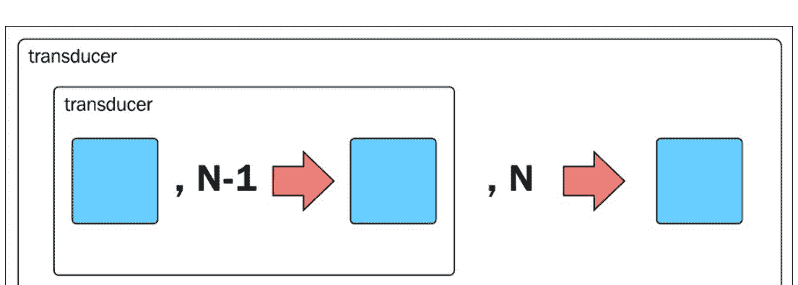

# 第 3 章. Clojure 进阶

在本章中，我们将涵盖以下主题：

- 使用解构技术
- 使用函数式编程风格
- 使用线程宏
- 定义简单宏
- 定义更高级的宏
- 使用协议
- 定义多方法
- 给初学者的转导
- Clojure 中的逻辑编程

## 引言

本章面向 Clojure 程序员，帮助他们迈向下一步，包含高级概念和技术，包括解构、函数式编程和宏。Clojure 的宏非常强烈地继承自 Lisp。你将学习如何使用协议和多方法在 Clojure 中实现多态。最后，你将深入探索转导和逻辑编程，进入 Clojure 的精彩世界！

## 使用解构技术

解构可以在 `defn` 和 `let` 中使用。这种技术提供了灵活的方式来为函数体或 `let` 表达式提取值。虽然解构对于 Clojure 初学者和其他语言的程序员来说看起来有点不寻常，但它对于从参数的结构化数据和绑定值中提取所需值非常有效。

### 准备工作

本配方使用 `math.numeric-tower` 和 `core.match` 函数，因此将 `project.clj` 文件中的 `:dependency` 更改如下并重新启动 REPL，准备就绪：

```
:dependencies
[[org.clojure/clojure "1.8.0"]
[org.clojure/math.numeric-tower "0.0.4"]
[org.clojure/core.match "0.3.0-alpha4"]
]
```

### 如何操作...

这里，让我们学习如何进行顺序解构和映射解构。

### 顺序解构

顺序解构用于从序列集合中提取所需元素。在以下代码中，变量 `x`、`y`、`z` 绑定到 `1`、`2`、`3`：

```
(let [[x y z] [1 2 3]]
  [x y z]
)
;;=> [1 2 3]
```

同样，`x`、`y` 和 `z` 绑定到 `1`、`2` 和 `3`，而 `a`、`b` 和 `c` 绑定到 "a"、"b" 和 "c"：

```
(let [[x y z] [1 2 3] [a b c] ["a" "b" "c"]]
[x y z a b c]
)
;;=> [1 2 3 "a" "b" "c"]
```

可变参数功能接受我们在第 1 章《使用 Clojure 进行实时编程》中已经见过的可变数量的参数。在以下示例中，z 绑定到 (3 4)：

```
(let [[x y & z] [1 2 3 4]]
  [x y z]
)
;;=> [1 2 (3 4)]
```

下划线 (_) 明确表示未使用的参数：

```
(let [[x _ z] [1 2 3]]
  [x z]
)
;;=> [1 3]
```

### 使用映射解构

映射解构从映射中提取所需值。在以下示例中，x、y 和 z 绑定到 1、2 和 3：

```
(let
  [{x :x y :y z :z} {:x 1 :y 2 :z 3}]
  [x y z])
;;=> [1 2 3]
```

前面的表达式看起来有点冗长。有一种更简单、更简洁的映射解构表达式，如下所示：

```
(let
  [{:keys [x y z]} {:x 1 :y 2 :z 3}]
  [x y z])
;;=> [1 2 3]
```

如果映射的键是字符串或符号，则使用 :strs 或 :syms 代替：

```
(let
  [{:strs [x y z]} {"x" 1 "y" 2 "z" 3}]
  [x y z])
;;=> [1 2 3]
```

```
(let
  [{:syms [x y z]} {'x 1 'y 2  'z  3}]
  [x y z])
;;=> [1 2 3]
```

如果您想指定默认值，请使用 :or 关键字并指定默认值。在以下示例中，映射中未指定 :y 和 :z 的值，因此 y 和 z 绑定到默认值：

```
(let
  [{:keys [x y z] :or {x 0 y 0 z 0}}
    {:x 1}
  ]
  [x y z])
;;=> [1 0 0]
```

使用 :as 关键字，后续变量绑定到映射本身。在以下示例中，all 绑定到 {:x 1 :a 2 :b 3}：

```
(let
  [{:keys [x y z] :or {x 0 y 0 z 0} :as all} {:x 1 :a 2 :b 3}
  ]
  [x y z all])
;;=> [1 0 0 {:x 1,  :a 2,  :b 3}]
```

以下映射解构代码从嵌套映射中提取值：

```
(let
  [{x :x y :y {a :a b :b} :z}
    {:x 1 :y 2 :z {:a 3 :b 4}}
  ]
  [x y a b])
;;=> [1 2 3 4]
```

以下代码使用嵌套映射解构的简写风格：

```
(let
  [{:keys [x y] {:keys [a b]} :z}
    {:x 1 :y 2 :z {:a 3 :b 4}}
  ]
  [x y a b])
;;=> [1 2 3 4]
```

### 它是如何工作的...

正确使用解构技术可以使函数定义更简单。让我们比较两个版本的函数定义——一个使用序列解构，一个不使用它：

```
(defn func1 [[x y z]]
  (+ x y z)
)
;;=> #'chapter03.destucturing/func1
(func2 [1 2 3])
;;=> 6
(defn func2 [col]
  (+ (first col) (second col) (nth col 2))
)
;;=> #'chapter03.destucturing/func2
(func2 [1 2 3])
;;=> 6
```

使用映射解构与不使用它的比较类似：

```
(defn func3 [{:keys [x y z]}]
  (+ x y z)
)
;;=> #'chapter03.destucturing/func3
(func3 {:x 1 :y 2 :z 3})
;;=> 6
(defn func4 [col]
  (+ (:x col) (:y col) (:z col))
)
;;=> #'chapter03.destucturing/func4
(func4 {:x 1 :y 2 :z 3})
;;=> 6
```

### 还有更多...

让我们学习更多关于字符串解构和 core.match 的高级技术。

### 字符串的顺序解构

顺序解构可用于字符串以从字符串中挑选字符。以下代码获取第一个、第三个和第五个字符并返回包含这些字符的向量：

```
(let [[a _ b _ c ] "Clojure"]
  [a b c])
;;=> [\C \o \u]
```

以下代码从字符串中消除前三个字符：

```
(let [[_ _ _ & x] "Clojure"]
  (apply str x))
;;=> "jure"
```

### 使用 core.match 进行条件解构

core.match 是 Clojure 的模式匹配库。core.match 执行条件解构。

首先，要在 clojure.core.match 中使用 match 函数，请执行以下操作：

```
(require '[clojure.core.match :refer [match]])
;;=> nil
```

core.match 是一个强大的模式匹配库。以下示例展示了典型的顺序模式匹配。在以下代码中，[x y z] 匹配 [false true true]，因此被求值为 3：

```
(let [x false y true z true]
  (match [x y z]
    [false false false] 1
    [false false true]  2
    [false true true]   3
    :else 5))
;;=> 3
```

以下代码是映射模式匹配示例。给定的映射匹配第三个模式 {:a a :b b}，并且 b 绑定到 2：

```
(let [x {:a 3 :b 2 :c 1}]
  (match [x]
    [{:a 1 :b b}]  {:b1 b}
[({:a 3 :b a} :only [:a :b])] {:a2 a}
[ {:a a :b b}] {:a3 b}
:else nil)
;;=> {:a3 2}
```

在前面的示例中，我们使用 :only 修饰符。它匹配给定映射的键为 :a 和 :b。下一段代码是一个使用 core.match 计算两点之间二维或三维距离的函数。函数参数的元素数量应恰好为两个或三个，否则您会收到错误：

```
(require '[clojure.math.numeric-tower :as math])
(defn distance [x y]
  (match [x y]
    [[x1 y1][x2 y2]]
      (math/sqrt
        (+ (math/expt (- x2 x1) 2) (math/expt (- y2 y1) 2)))
    [[x1 y1 z1][x2 y2 z2]]
      (+ (math/expt (- x2 x1) 2) (math/expt (- y2 y1) 2) (math/expt (- z2 z1) 2))
      :else :error
    )
)
;;=> #'chapter03.destucturing/distance
(distance [0 0] [1 1])
;;=> 1.4142135623730951
(distance [0 0 0] [1 1 1])
;;=> 3
(distance [0 0 0] [1 1 1 1])
:error
```

```
; ;=> (0 5 10 15 20 25 30 35 40 45)
```

map 对集合的迭代次数限制为元素数量最少的集合。

在以下代码中，第三个集合中的参数数量最少，并返回包含 10 个元素的集合：

```
(map + (range) (range) (range 10) (range) (range))
; ;=> (0 5 10 15 20 25 30 35 40 45)
```

### reduce

reduce 函数将二元运算应用于集合。它将函数应用于前两个元素，然后将函数应用于结果和下一个元素，直到没有元素可供归约：

```
(reduce + [1 2 3 4 5])
; ;=> 15
```

前面的表达式计算如下：

```
(+ (+ (+ (+ 1 2) 3) 4) 5)
```

### apply

apply 函数接受可变参数函数作为第一个参数并将其应用于集合。以下代码将 + 应用于 1、2、3、4 和 5：

```
(apply + [1 2 3 4 5])
; ;=> 15
```

因此，前面的结果与 (+ 1 2 3 4 5) 相同。apply 函数可以在最终序列集合之前接受任意数量的参数：

```
(apply + 1 2 3 [4 5])
; ;=> 15
```

以下代码使用元素为字符串的集合：


```
(apply str ["Clojure" " " "programming" " " "cookbook"])
;;=> "Clojure programming cookbook"
```

The preceding is the same as (str "Clojure" " " "programming" " " "cookbook").

## Using anonymous functions

Here, we will learn about anonymous functions in Clojure.

## Anonymous functions using fn

Clojure can define anonymous functions used in arguments in functions or variable assignments using let or def. The fn function defines anonymous functions. The following code defines a simple anonymous function x + 2 for the map function:

```
(map (fn [x] (+ x 2)) [1 2 3 4 5])
;;=> (3 4 5 6 7)
```

The equivalent code using the defn is as follows:

```
(defn add2 [x]
  (+ x 2)
)
;;=> #'chapter03.functional/add2
(map add2 [1 2 3 4 5])
;;=> (3 4 5 6 7)
```

The defn is a macro using the def and fn special forms. So, function defined by the defn is equivalent to function by the def and fn. The following code is using def and fn to define x + 2:

```
(def my-add2 (fn [x] (+ x 2)))
;;=> #'chapter03.functional/my-add2
(my-add2 3)
;;=> 5
```

The fn? function examines whether a symbol is defined by the fn:

```
(fn? add2)
;;=> true
(fn? my-add2)
;;=> true
```

The fn function can take variadic arguments as follows:

```
((fn [x y & rest] (apply * x y rest)) 1 2 3 4 5)
;;=> 120
```

## Using function literals to define anonymous functions

Clojure has a syntax sugar to define anonymous functions more straightforward:

```
(map #(+ % 2) [1 2 3 4 5])
;;=> (3 4 5 6 7)
```

To define function literals, we have a preceding # and then the body of the function. The % binds to a value. If there is more than one argument, %, %2, %3, and so on are used as follows:

```
(#(+ % %2 %3) 1 2 3)
;;=> 6
```

## Functions returning functions

Here, we will demonstrate functions returning functions as their returns.

## constantly

The constantly function returns a function that returns a constant value. In the following code, (constantly 0) returns the function that always returns zero:

```
(map (constantly 0) [1 2 3 4 5])
;;=> (0 0 0 0 0)
```

## complement

The complement function takes a function as an argument and returns a function that returns the complement of the given function. The following code returns true if an argument is empty and returns false otherwise:

```
(def not-empty?
(complement empty?)
;;=> #'chapter03.functional/not-empty?
(not-empty? [])
;;=> false
(not-empty? [1 2 3])
;;=> true
```

The following expression generates a set that contains random values smaller than 30:

```
(set (take 15 (repeatedly #(rand-int 30))))
;;=> #{7 20 4 21 29 28 25 3 2 14 18 8}
```

Therefore, the following code will be always true:

```
(defn larger-than-15? [n] (> n 15))
;;=> #'chapter03.functional/larger-than-15?
(let [x (set (take 15 (repeatedly #(rand-int 100))))]
  (= x
    (set (clojure.set/union
      (filter larger-than-15? x)
      (filter (complement larger-than-15?) x)
    ))
  ))
;;=> true
```

## partial

Since some Clojure functions accept functions with a single argument, partial is useful to make a function that always returns a unary function.

The following example extracts elements larger than 10 from a vector using partial:

```
(filter (partial < 10) [1 21 34 12 2])
;;=> (21 34 12)
```

The following is the equivalent code using a function literal:

```
(filter #(< 10 %) [1 21 34 12 2])
;;=> (21 34 12)
```

## comp

The `comp` composes a function from functions given as arguments.

The expression `(comp f2 f1)` applies f1 to arguments and then applies f2 to the results of f1. The `comp` applies functions from right to left. The following code increments the number and then negates it:

```
(map (comp - inc) [ 1 2 3 4 5])
;;=> (-2 -3 -4 -5 -6)
```

## every-pred and some-fn

The `every-pred` function returns a function to test whether all predicates are true.

In the following code, `every-pred` returns a function that checks whether all tests for all arguments are passed or not:

```
2 < x < 12
x is odd number
```

There are two variations to be evaluated, `true` or `false`:

```
((every-pred odd? #(< % 12) # (> % 2)) 3 5 7)
;;=> true
```

```
((every-pred odd? #(< % 12) # (> % 2)) 1 2 3)
;;=> false
```

Using `filter`, it tests each element of the sequence:

```
(filter (every-pred odd? #(< % 12) # (> % 2)) [1 2 3 4 5])
;;=> (3 5)
```

In the following code, the `some-fn` function returns true if at least one of a given predicates returns true for any arguments.

In the following code, the first expression is evaluated to be true and the second expression to be false:

```
((some-fn even? # (= % 10) # (= % 1)) 11 10 1)
;;=> true
((some-fn even? #(= % 10) #(= % 1)) 3 5 7)
;;=> false
```

Using filter checks each element in a sequence:

```
(filter (some-fn even? #(= % 10) #(= % 1)) [11 10 1 2 3])
;;=> (10 1 2)
```

## How it works...

We will explain how Clojure functions are first-class functions. We will also explain pure functions' characteristics.

## Clojure functions are first-class functions

The first-class function can provide a high-level abstraction of code. High-level abstraction using first-class functions makes code compact and good perspective. It also increases productivity and extensibility compared to imperative languages such as Java.

Let's review how Clojure functions are first-class functions:

- Functions can be arguments of functions. Functions such as map, reduce, and filter take a function as the first argument.
- Functions can be returns of functions. The functions comp and partial return a function.
- Functions can be anonymous. Anonymous functions can be defined using fn or function literals.
- Functions can be assigned to variables or in data structures. def and fn can assign functions to variables.

## Pure functions

The characteristics of pure functions are as follows:

- Referential transparency: The function always returns the same result with the same arguments.
- No side effects: The function doesn't cause any side effects.

Mathematical functions are pure functions. The + is a pure function, but

the rand is not a pure function because it is not the same return value with the same argument:

```
(+ 1 2 3)
;;=> 6
(+ 1 2 3)
;;=> 6
(+ 1 2 3)
;;=> 6
```

```
(rand 10)
;;=> 1.4931178951826118
(rand 10)
;;=> 1.40702455780493
(rand 10)
;;=> 7.135082921360361
```

Pure functions provide us testability and avoid unintended behaviors causing problems. Clojure is not entirely a pure functional language, but it provides ways to minimize side effects, and functions have referential transparency.

## There's more...

We will describe some related topics here.

## reduce and apply

In some cases, both reduce and apply can be used. Let's measure their performance:

```
(time (reduce + (range 10000000)))
;;=> "Elapsed time: 386.814518 msecs"
;;=> 4999995000000
(time (apply + (range 10000000)))
;;=> "Elapsed time: 392.471789 msecs"
;;=> 4999995000000
```

Performances are almost the same. The reason is that their implementations are similar.

## loop and recur

Clojure runs on JVM and does not have the tail recursion optimization, which transforms a recursive call to a jump instruction. The following code fails with stack overflow when the argument is very large:

```
(defn factorial [n]
  (if (= n 1) 1 (* n (factorial (dec n))))
)
;;=> #'chapter03.functional/factorial
(time (factorial 200000N))
;;=> StackOverflowError  clojure.lang.Numbers.toBigInt
(Numbers.java:252)
```

Using loop and recur avoids the preceding problem and works fine:

```
(defn factorial-recur [n]
  (loop [c n ret 1]
    (if (< c 2)
      ret
      (recur (dec c) (* ret c))
    )))
;;=>#'chapter03.functional/factorial-recur
(factorial-recur 20000N)
;;=> 181920632023034513482...
```

## Using threading macros

Threading macros are the cherry on the pie of your Clojure code. We use them all the time, and for one very simple reason: they make your code more readable. We can think of threading macros as a way to directly see how the data flows through our well-crafted functions.

Threading macros, as the name suggests, are macros. The code you write is being rearranged before being compiled and evaluated.

In this short section, we will see how to use the two threading macros, -> and ->>, so that you can use and abuse them while having some Clojure fun.

This will also be used as a bridge to learn how to write our own macros in the following two recipes.

Finally, we will also see how this is used in context for a full-fledged Apache Spark integration.

## Getting ready

For this recipe, nothing but a plain Clojure REPL is needed.

## How to do it...

In this short section, we will review the main threading macros of the Clojure language.

## Introducing the -> macro

In pseudo-code, we can use the -> macro as seen in the following, create something, and make it flow through a set of functions:

```
(-> something
  (function1)
  (function2)
  ...
```


所以，假设我们想要给一个随机整数加 1。要做到这一点，我们会写如下代码：

```
(->
  (rand-int 10)
  (+ 1))
; 5
```

`rand-int` 函数给我们一个介于 0 和 10 之间的新整数，范围是左闭右开。在前面的代码中，如果该整数是 4，那么我们将这个 4 作为下一个函数的第一个参数调用，该函数是 `(+ 1)`。

所以，`(+ 1)` 实际上变成了 `(+ 4 1)`。

如果我们想把最终结果做成一个字符串，我们只需再加一行使用最著名的 `str` 函数，如下所示：

```
(->
  2
  (+ 1)
  (str))
; "3"
```

当函数只有一个参数时，可以避免使用括号：

```
(->
  2
  (+ 1)
  str)
; "3"
```

## 介绍 ->> 宏

`->` 宏的搭档是 `->>` 宏，它同样将函数调用一个接一个地串联起来，但与将前一个函数的结果作为第一个参数应用不同，它是作为最后一个参数使用。

在下面的代码中，值 2 被作为 `minus` 函数的第二个参数传递：

```
(->> 2
```

```
(- 1))
; -1
```

你可以通过与之前的宏进行比较立即看到区别：

```
(-> 2
    (- 1))
; 1
```

一些常见的 Clojure 函数特别适合这个第二个宏，尤其是 `map`：

```
(->> [1 2 3]
    (map inc))
; (2 3 4)
```

`into` 函数是另一个非常合适的函数，可以在链的末尾轻松地再次转换为向量：

```
(->> [1 2 3]
    (map inc)
    (into []))
; [2 3 4]
```

## 介绍 cond-> 和 cond->> 宏

现在我们已经看到了两个线程宏的基础，我们可以用另外两个非常有用的宏 `cond->` 和 `cond->>` 来构建和扩展它们。

首先让我们快速回顾一下如何使用 `cond`，它接受一组条件并返回第一个匹配测试的值：

```
(let [speed 110]
    (cond
        (>= speed 130) "Too fast for love"
        (>= speed 100) "How many miles to babylon ..."
        (>= speed 80) "Your grand ma is calling"
        (>= speed 50) "City center"
        :else "Falling asleep"))
```

`cond->` 宏的工作方式与匹配子句类似，但它不会在第一次匹配后停止，而会一直持续到条件结束：

```
(let [speed 110 count 0]
    (cond-> count
      (>= speed 130) inc
      (>= speed 100) inc
      (>= speed 80) inc
      (>= speed 50) inc
    ))
; number of matches
; 3
```

正如你在前面的代码中注意到的那样，每一行上的 `inc` 函数都会对每个匹配的语句使用 `count` 的当前值应用。

类似地，`cond->>` 做的事情类似，但对于每个匹配语句的函数，其行为就像 `->>`：

```
(let [speed 110 count 0]
    (cond->> count
      (>= speed 130) inc
      (>= speed 100) inc
      (>= speed 80) inc
      (>= speed 50) inc
    ))
; 3
```

它返回相同的结果，但在你想要将一组函数应用于集合时就会变得有趣。

假设我们想要计算一组速度记录的平均速度。我们首先定义一个简单的平均函数：

```
(def average (fn [coll]
  (/ (reduce + coll) (count coll))))
```

然后我们的计算方法将使用 `cond->>`，如下所示：

```
(defn compute
  [speeds {:keys [apply-fn limit-to]}]
    (cond->> speeds
```

```
limit-to (take limit-to)
apply-fn average
))
```

我们的 `compute` 函数接受一个速度记录集合和一个参数映射。请注意，第二个参数使用了一种很好的方式来解构映射并直接通过其键名访问映射的值。

我们的第一次调用将计算整个集合的平均速度：

```
(compute
  [110 90 150 10]
  {:apply-fn average})
;  90
```

第二次运行将很好地计算前两个的平均值：

```
(compute
  [110 90 150 10]
    {:apply-fn average :limit-to 2})
; 100
```

我们可以用 `compute max` 或 `min` 替换 `:apply-fn`，但由于你仍然打开了 REPL，你可以把它作为练习来做。

## 介绍 some-> 和 some->>

`some->` 和 `some->>` 宏继续构建我们对这些线程宏的了解。它们主要用于将一系列步骤应用于映射。

例如，假设我们想要检查映射到 `:speed` 键的集合的大小：

```
(some-> {:speed [50 90]}
      :speed
      count
)
; 2
```

`some->` 应用第一个函数；在这里，这是关键字。记住吗？是的，当然，关键字是函数。关键字调用没有返回 nil，所以 some-> 继续线程化并继续到 `count` 函数，该函数返回 2。还要注意 some-> 有助于防止 nil 值，因为一旦调用的函数返回 nil，线程就会停止。

类似地，我们可以用 `some->>` 线程化 `->>` 并应用一个映射函数：

```
(some->> {:speed [50 90]}
  :speed
  (map inc)
  average
)
; 71
```

一个更长的 `some->>` 线程化示例可以包括对 `take` 和 `filter` 的调用：

```
(some->> {:speed [50 90 100]}
  :speed
  (take 2)
  (map inc)
  (filter (fn[x] (> x 60)))
  average
)
; 91
```

再次强调，正如前面所说，这对于呈现非常可读的代码非常好。你知道每个步骤在做什么——它将数据从一个步骤传递到另一个步骤。

甜的，不是吗？

## 它是如何工作的...

那么这些宏的内部发生了什么？令人惊讶的是，没什么；宏只是重新排列每个函数调用。看看当我们使用 `macroexpand-1` 来显示 `->` 宏生成的代码时会发生什么：

```
(macroexpand-1
```

```
`(-> 2
    (+ 1)
    (+ 2)))
; (clojure.core/+ (clojure.core/+ 2 1) 2)
```

同样，对于 `->>` 宏，生成的代码看起来像是一个简单的代码重组，其中第一个函数调用是最内部的调用，然后我们在其周围构建越来越漂亮的括号：

```
(macroexpand-1
  `(->> 5
        (- 1)
        (- 2)))
; (clojure.core/- 2 (clojure.core/- 1 5))
```

正如我们在介绍 `some->` 时看到的那样，nil 保护在展开求和宏时变得非常明显：

```
(macroexpand-1 '  (some-> {:speed [50 90]}
    :speed
    ))
; (clojure.core/let [G__12916 {:speed [50 90]}] (if
(clojure.core/nil? G__12916) nil (clojure.core/-> G__12916
:speed)))
```

它的工作原理很容易掌握，但我 pretty sure 你在这个阶段可以跳过一些自动生成的函数名，所以让我们看看更多！

## 还有更多...

我们实际上把其中一个线程宏留到了最后，因为从历史上看，它稍后才被添加，而且它在某种程度上结合了 `->` 和 `->>` 的方式。

## 介绍 as->

`as->` 与其他宏的主要区别在于它是唯一一个可以随意放置线程参数的宏。`->` 将值作为第一个参数传递，`->>` 作为最后一个参数，而 `as->` 通过巧妙但非常简单的名称绑定实现了两者。

回到你的速度集合示例，我们将输入映射绑定到变量名 `s`，然后将该 `s` 通过不同的函数传递：

```
(as-> {:speed [50 70 100]} s
  (get s :speed)
  (take 2 s)
  (average s)
)
; 60
```

请注意，这正是使 `as->` 脱颖而出的部分，我们可以指定 `s` 在每个函数调用中出现的位置。

所以，`s` 是 `get` 的第一个参数，但该 `get` 函数的结果随后作为下一个函数 `take` 等的最后一个参数传递。

另一个简单的例子，我们像 Clojure 极客一样 `conj`、`map` 和 `into`：

```
(as-> [1 2 3] $
  (conj $ 5)
  (map inc $)
  (into [] $)
)
; [2 3 4 6]
```

突破极限，构建不可能的事。

## Flambo 预览

我们将在后面的食谱中再次讨论它，但让我们快速看看 flambo，这是一种编写 Apache Spark 作业的 Clojure 友好方式。就像早期的 Hadoop 一样，Spark 旨在让大型计算任务变得轻松，而通过 Clojure 变得更加简单。flambo 在几乎所有地方都使用线程。

以下是如何在 flambo 中创建简单的字符计数作业的方法：

```
(ns com.fire.kingdom.flambit
  (:require [flambo.api :as f]))
  (->
    (f/text-file sc "data.txt")
```


;sc 这里指的是 spark context，也就是对 spark 的引用
  (f/map (f/fn [s] (count s)))
  (f/reduce (f/fn [x y] (+ x y))))

你看这有多短小精悍。我们不会详细探讨 Flambo API，所以让我们把前面这段出色的代码翻译成标准的 Clojure。我们想要做词频统计，因此我们构建两个辅助函数，一个用于将文本拆分为单词，另一个用于计算频率：

```
(defn split-words [text]
  "split text into a list of words"
  (re-seq #"\w+" text))
```

```
(defn calculate-frequencies [words]
  "convert list of words to a word-frequency hash"
  (reduce (fn [words word] (assoc words word (inc (get words word 0))))
    {}
    words))
```

线程宏现在派上用场了，我们可以用前面看到的内容将这一切串联起来：

```
(->
  (slurp "LICENSE")
  (split-words)
  (count))
; 1711 ... as far as the current license file goes ;)
```

即使在纯粹简单的 Clojure 代码中，我们也看到了它的使用方式。slurp 调用将文本读入字符串，然后将其拆分为单词，最后，我们通过简单的 count 调用计算单词数量。

Flambo 使用完全相同的线程语法，使得编写分布式作业变得非常容易。

在本教程中，我们介绍了不同的 Clojure 线程宏，并看到了它们如何将初始和移动的数据结构通过一组函数传递，有时带有测试条件。

最后，我们还快速举例说明了这在真实世界应用中的使用方式，即 spark 计算。

## 定义简单的宏

宏在 Clojure 中允许你通过简单的但非常 Clojure 风格的 defmacro 构造来重新定义处理流程并生成代码。

本节将指导我们编写一些这些构建块并阅读来自 Clojure 原始代码的宏代码。

## 准备工作

Macro-biotics 和一勺勺子就是本教程所需的一切。不需要其他农业产品。

## 如何做...

关于编写简单 Clojure 宏的一切知识都在本节中。继续编写那些简单的宏，直到它终于有意义为止。

## 你的第一个宏

好了，这里就是。你的第一个宏在这里：

```
(defmacro my-very-first-macro []
  (list println "FIRST"))
```

好吧，这对一个值得描述的东西来说有点太快了介绍；是时候让你跟上进度了。

首先，defmacro 例程需要一个名称和一些参数。你看，我们给它命名为 my-very-first-macro，并且有点贪心，没有任何参数。

现在来看宏本身的主体。一个宏应该返回一个列表。为什么是列表？记住在 Clojure 中，数据即代码。返回的列表将是 Clojure 编译器会展开或预编译成的代码。

这里我们有：

```
(list println "FIRST")
```

在 REPL 中输入时，该列表会展开为以下内容：

```
; (#object[clojure.core$println 0xe1e81f5
"clojure.core$println@e1e81f5"] "FIRST")
```

基本上，你有一个由两个元素组成的列表：一个函数和一个字符串。这个列表已准备好被编译，然后可以像通常的 Clojure 代码一样求值。

要对列表求值，我们可以使用 eval 函数来求值 Clojure 代码：

```
(eval (list println "FIRST"))
; nil, but "FIRST" is printed in the console ..
```

对吧，所以我们现在明白宏是生成 Clojure 代码的，而这是一个列表：

```
(my-very-first-macro)
; nil, but "FIRST" is printed in the console ..
```

我们认为自己在编写 (my-very-first-macro)，但生成的代码实际上是以下内容：

```
(println "FIRST")
; yes, this is a list!
```

## 你的第二个宏

第二个宏将在第一个宏的基础上构建，简单地在宏定义中使用参数。

我们的第二个宏将是一个将输入乘以三的宏。为此，我们希望用 defmacro 编写它，返回一个由 *、3 和输入组成的列表。

试试看：

```
(defmacro x3 [ arg ]
  (list * 3 arg ))
```

要使用它，我们像使用常规代码一样使用 `eval`，如下所示：

```
(x3 2)
```

```
; 6
```

我们理解生成的代码是一个由三个元素组成的列表：

```
(* 3 arg)
```

对宏的调用会生成代码然后对其求值：

```
; 6
```

宏允许你在某些以前从未想过的方式上演进语言。你可以重现控制流并使事物以完全新的方式表现。很棒，但让我们退后几步，看看幕后发生了什么。

## 它是如何工作的...

我们在之前的线程宏教程中已经看到，我们可以使用 `macroexpand-1` 来查看宏实际展开为什么。

这里我们将 `macroexpand` 应用于我们编写的第一个宏 `my-very-first-macro`：

```
(macroexpand-1 '(my-very-first-macro))
```

我们得到了宏生成的代码：

```
(#object[clojure.core$println 0xe1e81f5 "clojure.core$println@e1e81f5"] "FIRST")
```

感觉非常熟悉，对吧？应该是的，这是我们在编写以下内容时详细看到的代码：

```
(list println "FIRST")
; ...
```

现在，我们的第二个宏不应感觉太不同，查看实际被编译的代码也不会带来太多惊喜：

```
(macroexpand-1 '(x3 2))
; (clojure.core/* 3 2)
```

为了明确，以下所有内容都是等价的：

```
; evaluate the macro directly
(x3 2)
; 6
```

```
; eval the non compiled version of the macro.
(eval (quote (x3 2)))
; 6
```

```
; same with the quote version
(eval '(x3 2))
; 6
```

```
; eval the code generated by the macro
(eval (macroexpand-1 '(x3 2)))
; 6
```

所以，现在这一切都说得通了！我们理解了生成和求值 Clojure 代码之间的两个阶段。记住代码即数据，但代码通过宏可以生成更多数据，也就是代码。

我们称之为语言的同像性，因为程序的内部表示是一种数据结构，语言本身可以理解。

## 还有更多...

> "Be careful--with quotations, you can damn anything."
> 
> --Andre Malraux

有时你想要使用其当前结构而不是其值内容来操作或返回形式。这就是 quote 派上用场的地方。

## 使用引号

Quote，或 '，是 eval 的友好兄弟。它告诉编译器不要对它后面的代码求值，而是以其当前形式返回数据。

让我们用一个简短的例子看看它是如何工作的：

```
(quote (* 3 3))
; (* 3 3)
```

```
(str '(* 3 3))
; "(clojure.core/* 3 3)"
```

quote 告诉编译器按原样返回数据结构 (* 3 3)，而不是对其求值。因此，我们编写 (* 3 3)，我们得到 (* 3 3)，而不是其求值形式，在本例中为 9*。

这在宏的情况下非常有用，因为我们确实想要生成一个未求值的代码列表形式。

那么，一个棘手的问题是：这两个宏定义有什么区别？看看以下内容：

```
(defmacro hello2a[]
  ' (+ 1 1))

(defmacro hello2b[]
  (+ 1 1))
```

正如我们所见，一个有引号，另一个没有，但如果我们对它们各自使用 eval，我们确实会得到相同的结果，对吧？让我们看看：

```
(hello2a)
; 2
(hello2b)
; 2
```

这是怎么回事？所以，我们记得可以使用 macroexpand-1 来查看每个宏生成的代码。让我们不要等到圣诞节再试试：

```
(macroexpand-1 '(hello2a))
; (+ 1 1)

(macroexpand-1 '(hello2b))
; 2
```

没错。生成的代码非常不同。第一个宏调用返回一个由三个元素组成的列表 +、1 和 1，而第二个宏只是返回一个整数 2。对这两个形式中的每一个使用 eval 确实会返回相同的结果，但它们的原始形式完全不同。

我们几乎就完成了。最后一件事！我们之前看到过可以用参数编写宏，我们可以快速用引号写成如下形式：

```
(defmacro hello2c [arg]
  '(+ 1 arg))
```

容易！现在看看以下内容：

```
(hello2c 3)
; clojure.lang.Compiler$CompilerException:
java.lang.RuntimeException: Unable to resolve symbol: arg in
this context,
```

发生了什么？嗯。让我们再深入一点：

```
(macroexpand-1 '(hello2c 3))
; (+ 1 arg)
```

生成的形式是 (+ 1 arg)。但等等。我们没有在任何地方定义 arg，所以这不能工作。我们想要生成代码，其值为 arg，而不是 arg 本身。arg 在生成代码的上下文中有意义，但一旦代码生成后，arg 就不再指向任何相关内容。

在这种情况下，我们使用另一种引号：反引号。反引号为我们提供了给定形式的模板化版本，我们可以对其应用自定义。


它用一个例子更有意义，所以让我们来做：

```
(defmacro hello2d [arg]
  `(+ 1 ~arg))
```

我们现在引入了两个不同的字符：反引号，或 ~，以及反引号拼接，或 ~@。把反引号和反引号拼接想象成复制粘贴，你可以在生成的代码中直接插入表单。因此在前面的代码中，生成的代码应该展开为 arg 的实际值，而不是简单地是 arg 字符串：

```
(macroexpand-1 '(hello2d 3))
; (clojure.core/+ 1 3)
```

哇！这样感觉好多了，不是吗。让我们确认一下它是否能被正确求值：

```
(hello2d 3)
; 4
```

最后，反引号拼接对于列表、映射等是有意义的，但复制/粘贴的想法保持不变。一个复制并粘贴列表原样，而另一个则逐个将表单复制到模板中：

```
(defmacro hello2e [& body ]
  `(apply str ~body))
```

```
(defmacro hello2f [& body ]
  `(apply str ~@body))
```

```
(macroexpand-1 '(hello2e "1" "2" "3"))
; (clojure.core/apply clojure.core/str ("1" "2" "3"))
```

```
(macroexpand-1 '(hello2f  "1" "2" "3"))
; (clojure.core/apply clojure.core/str "1" "2" "3")
```

## 到处都是宏

在本教程中，我们看到了如何创建我们第一个宏，并继续掌握编译代码是什么以及它在代码生命周期中何时发生。我们看到 Clojure 是一种同构语言，

意味着其内部结构和其表示是相同的，并且我们将这种同构特性与宏概念联系在了一起。

## 定义更高级的宏

当我们开始思考本书的结构时，一切似乎都很有道理去谈论简单宏和高级宏。现在，到了这个主题，作者不得不承认这已经不再那么清楚了。那么，当我们谈论高级宏时，我们指的是什么呢？我们曾试图询问 Canon，但他们没有给我们一个合适的答案。

因此，在本教程中，我们将断言，高级宏是指生成一种会改变结果代码求值流程的表单的宏。在上一节关于简单宏的教程中，宏是，嗯，简单的，因为生成的表单始终相同。本教程将展示始终生成相同代码的宏，或控制流变得稍微复杂一些的宏。当然，目标是能够轻松地在你的代码中编写方便的宏。

### 准备工作

虽然本教程没有特定的准备工作，但让我们看看当我们有一个宏来指导我们时 clojure.core 的情况：

```
(defmacro when
  "Evaluates test. If logical true, evaluates body in an implicit do."
  {:added "1.0"}
  [test & body]
  (list 'if test (cons 'do body)))
```

根据我们所学的内容，我们可以用反引号字符以稍微更简洁的形式重写它：

```
(defmacro my-when
  [test & body]
  `(if ~test (do ~@body)))
```

生成的代码符合计划：

```
(macroexpand-1
  '(my-when (odd? (rand-int 2))
```

```
(println "hello")))
; (if (odd? (rand-int 2)) (do (println "hello")))
```

好。现在我们对高级宏感兴趣的是生成更高级的代码。因此，沿着这个例子，我们将编写一个随机生成代码的宏。

以下代码中的宏不再以 test 作为输入参数，而是只接受一个 body。我们只是移动了一些代码，但请看！反引号符号不再位于宏体的开头，它现在嵌套在 if 语句内部。

记住宏体需要返回一个 Clojure 表单。以下代码中的宏将随机返回传递的 body 列表包装在 do 中，或一个空列表：

```
(defmacro random-when
  [& body]
  (if (odd? (rand-int 2))
    `(do ~@body)
    (list)
    ))
```

在 REPL 中多次尝试以下操作，你会看到生成的代码并不总是相同：

```
(macroexpand-1
  '(random-when
     (println "Hello")))
; ()
; OR
; (do (println "Hello"))
```

这是一个非常愚蠢的例子，但它应该打开你的思维，让你去探索更高级宏的新思路和冒险！

### 如何做...

我们将看两个小例子，看看一些稍微高级的宏如何能促进你的开发人员生活，让你晚上喝的那杯酒更容易理解。

### 跟踪代码何时开始

第一个示例将是一个为我们生成事物的宏，`init` 被调用的时间，以及一个告诉我们系统运行了多久的函数。

该宏使用了两次对 `def` 的调用——一次用于简单值，另一次用于函数：

```
(defmacro track-init[]
  `(do
    (def init (System/currentTimeMillis))
    (def up (fn [] (- (System/currentTimeMillis) init))))
  )
```

对 Java 平台 `System` 类的调用有点令人难以承受，但基本上我们只是想访问当前时间。按如下方式展开生成的代码：

```
(macroexpand-1
  '(track-init))
```

我们看到看起来像标准的 Clojure，定义了一个值和一个函数：

```
(do
  (def my-very-first-macro/init
    (java.lang.System/currentTimeMillis))
  (def my-very-first-macro/up
    (clojure.core/fn []
      (clojure.core/-
        (java.lang.System/currentTimeMillis)
        my-very-first-macro/init))))
```

只是你没有编写这段代码，你最初唯一写的是对 `track-init` 宏的调用：

```
(track-init)
```

现在，在命名空间中调用了宏，因此在同一命名空间中我们有 `init` 和 `(up)` ：

```
init
; 1449641148783

(up)
; 596928
```

这种为你生成代码的宏在开发期间非常有帮助，所以要小心，这种宏也可能在各处留下一些 def 后的符号！

### 使用宏记录消息

在第二个示例中，我们将简单地看一个愚蠢的日志宏，当日志级别足够时给出输出消息，而如果不够则不输出。嗯。是的。我怀念那些 20 个日志框架统治其中任何一个的时代。（但那是历史。）

因此，以下定义了一个顶级日志级别，可以自动从文件中加载，但我把这留给读者。我们还定义了 log 宏，只有当日志级别设置为 DEBUG 时才输出代码：

```
(def LOG_LEVEL "INFO")

(defmacro log [msg]
  (if (= LOG_LEVEL "DEBUG")
    `(println ~msg)))
```

在这种情况下，当我们使用以下语句调用宏时：

```
(log "hello3")
; ...
```

你猜对了。控制台中什么也没有打印。现在，假设我们再次 def 日志级别，（嗯……这不是推荐的做法，但请在这里忍耐一下我们）：

```
(def LOG_LEVEL "DEBUG")
```

再次调用 log 宏时，消息会在控制台中显示：

```
(log "hello3")
; .. hello3 in the console
```

我们将让读者像往常一样使用 macroexpand-1 检查每种情况下生成的代码：

```
(macroexpand-1
  ' (log "hello3"))
; (println "hello3")
```

### 它是如何工作的...

我想我们已经看到了很多关于在玩宏时底层过程是什么的内容。让我们看一下在互联网上随处可见的宏之一，用于创建一个看起来像循环的迭代语言。

loop 宏的代码只比你到目前为止看到的稍微困难一点。注意宏的返回表单是一个列表，通过反引号，并且 body 步骤被包装在 do 中：

```
(defmacro my-for-loop [ [sym init check change] & steps]
  `(loop [~sym ~init value# nil]
     (if ~check
       (let [new-value# (do ~@steps)]
         (recur ~change new-value#))
       value#)))
```

你可能注意到的一个新东西是这里和那里的 # 符号，例如 new-value#。# 符号表示你希望为变量或函数获取一个生成的、限定名称：

```
gensym is the longer version of this #.
(gensym "hello")
; hello6075
```

如果我们不使用 gensym 或 #，我们将尝试获取 new-value 的值，该值在宏代码生成时未定义，因此会抛出错误。

要生成自己的循环，你将按定义调用宏，使用四个参数和一个主体：

```
(my-for-loop
  [ i 0 (< i 10) (inc i) ]
```


```
(println
  (str "- " (rand-int i)))
; this is the part where you look at the console
```

稍微清理一下后，生成的代码看起来如下，主要是简单的循环，但我们承认之前的代码更易读：

```
(loop [i 0 value nil]
  (if (< i 10)
    (let [new-value
          (do (println (str "- " (rand-int i))))]
      (recur (inc i) new-value))
    value))
```

编写自己的宏的好方法实际上是先写出你希望宏生成的代码是什么样的，然后再倒推回 defmacro 练习。

Voila!

## There's more...

还有更多内容，但就宏而言并不多。宏很快，所以在你能使用时一定要使用它们。

为了以我最喜欢的例子结束，我们将快速看一下 clojure.test 中的 deftest 宏。

## deftest

去掉所有样板代码后，deftest 宏看起来是这样的。你必须承认你对宏特定的语法不再感到惊讶了，对吧？

```
(defmacro deftest
  [name & body]
  (when *load-tests*
    `(def ~(vary-meta name assoc :test `(fn [] ~@body))
       (fn [] (test-var (var ~name))))))
```

令人惊讶的是，`deftest` 宏实际做的唯一事情就是通过 `def` 创建函数，只是附加了一些元数据。新函数只是在当前命名空间中定义。

然后，要运行测试，`run-tests` 函数实际上会查找那些具有正确元数据的宏定义函数，然后执行它们。

作为快速提醒，要从 REPL 创建和运行测试，我们只需调用 `deftest`：

```
(require '[clojure.test :refer :all])

(deftest my-test []
  (is (= 1 1)))

(run-tests)

;macro.clj:
;Testing my-very-first-macro
;macro.clj:
;Ran 1 tests containing 1 assertions.
;macro.clj:
;0 failures, 0 errors.
```

希望这能给你带来创建宏的新思路以及如何将其置于上下文中！

## Using protocols

协议在不同数据类型之间提供多态性。定义协议实际上就是定义 Java 的接口。我们可以为 Clojure 的记录和类型定义协议。也可以为 Java 类定义协议。

## Getting ready

本节不使用任何外部库，所以你只需启动一个 REPL 即可准备就绪。

## How to do it...

让我们先定义记录和类型，然后再查看如何定义和使用协议。

## Defining a record

这里，我们将定义一个作者的记录。我们在第 2 章《与集合交互》中已使用映射表达了作者 Sir Conan Doyle：

```
{:name "Arthur Ignatius Conan Doyle"
  :born "22-May-1859"
  :died "7-July-1930"
  :occupation ["novelist" "short story writer" "poet" "physician"]
  :nationality "scottish"
  :citizenship "United Kingdom"
  :genre ["Detective fiction", "fantasy", "science fiction", "historical novels", "non-fiction"]
  :notable-works ["Stories of Sherlock Holmes" "The Lost World"]
  :spouse ["Louisa Hawkins" "Jean Leckie"]
  :no-of-children 5
}
```

现在我们将使用记录定义前面的映射。要定义记录，使用 defrecord 并指定记录名称及其属性作为字段。这里我们定义了 Author 记录，它有 10 个字段：

```
(defrecord Author
  [name
   born
   died
   occupation
   nationality
   citizenship
   genre
   notable-works
   spouse
   no-of-children
   ])
;;=> chapter03.protocols.Author
```

然后，让我们使用 Author 记录定义 Conan Doyle。要定义它，使用 ->Author 然后枚举字段的值：

```
(def doyle
  (->Author
    "Arthur Ignatius Conan Doyle"
    "22-May-1859"
    "7-July-1930"
    ["novelist" "short story writer" "poet" "physician"]
    "scottish"
    "United Kingdom"
    ["Detective fiction", "fantasy", "science fiction", "historical novels", "non-fiction"]
    ["Stories of Sherlock Holmes" "The Lost World"]
    ["Louisa Hawkins" "Jean Leckie"]
    5
    ))
;;=> #'chapter03.protocols/doyle
```

创建 Author 记录的另一种方法是使用 map->Author：

```
(def christie
  (map->Author {
    :name
    "Agatha Mary Clarissa Miller"
    :born
    "15-September-1890"
    :died
    "12-January-1976"
    :occupation
    ["novelist" "short story writer" "playwright"
```

```
"poetnovelist"]
:nationality
"england"
:citizenship
"United Kingdom"
:genre
["murder mystery" "thriller" "crime fiction" "detective" "romance"]
:notable-works
["Murder on the Orient Express"
"The Murder of Roger Ackroyd"
"Death on the Nile"
"The Murder at the Vicarage"
"Partners In Crime"
"The ABC Murders"
"And Then There Were None"
"The Mousetrap"]
:spouse
["Archibald Christie" "Sir Max Mallowan"]
:no-of-children
1
}
)
)
;;=> #'chapter03.protocols/christie
```

要访问字段，使用关键字如 :name 或 :genre：

```
(:name doyle)
;;=> "Arthur Ignatius Conan Doyle"
(:name christie)
;;=> "Agatha Mary Clarissa Miller"
(:genre doyle)
;;=> ["Detective fiction" "fantasy" "science fiction" "historical novels" "non-fiction"]
(:genre christie)
;;=>["murder mystery" "thriller" "crime fiction" "detective" "romance"]
```

## Defining a type

Clojure 的类型是 Java 类，但它们的功能比记录少。
要定义类型，使用 deftype：

```
(deftype Point [x y])
```

```
; ;=> chapter03.protocols.Point
```

要创建类型的实例，使用 Java 互操作的构造函数。
要访问类型实例的字段，使用 Java 互操作：

```
(def pos1 (Point. 1 2))
; ;=> #'chapter03.protocols/pos1
(.x pos1)
; ;=> 1
(.y pos1)
; ;=> 2
```

## Defining a protocol

现在，让我们定义一个协议并使用它。首先，定义 Point 记录：

```
(defrecord Point [x y])
; ;=> chapter03.protocols.Point
```

以下代码定义了 IPoint 协议。它具有 move 和 distance 函数。协议是 Java 接口，它们的函数是 Java 方法：

```
(defprotocol IPoint
  "A simple protocol for flying"
  (move [self delta])
  (distance [self])
)
; ;=> IPoint
```

然后，使用 _extend-protocol 定义实现：

```
(require '[clojure.math.numeric-tower :as math])
; ;=> nil
(extend-protocol IPoint
  Point
  (move [self delta]
    (->Point
      (+ (.x self) (delta 0))
      (+ (.y self) (delta 1))))
  (distance [self]
    (math/sqrt
      (+ 
        (* (.x self) (.x self))
```

```
(* (.-y self) (.-y self)))
)))
;; ;=> nil

(def pos1 (Point. 1 2))
;; ;=> #'chapter03.protocols/pos1
[(.-x pos1) (.-y pos1)]
;; ;=> [1 2]
(distance pos1)
;; ;=> 2.23606797749979
(def pos2 (move pos1 [1 2]))
;; ;=> #'chapter03.protocols/pos2
[(.-x pos2) (.-y pos2)]
;; ;=> [2 4]
(distance pos2)
;; ;=> 4.47213595499958
```

现在我们将使用 type 定义三维点 Point3D。
与 Point 的区别在于 Point3D 不是记录：

```
(deftype Point3D [x y z]
  IPoint
    (move [self delta]
      (Point3D.
        (+ (.-x self) (delta 0)) (+ (.-y self) (delta 1)) (+ (.-z self) (delta 2))))
    (distance [self]
      (math/sqrt
        (+
          (* (.-x self) (.-x self))
          (* (.-y self) (.-y self))
          (* (.-z self) (.-z self))))))
;; ;=> chapter03.protocols.Point3D
(def pos3 (Point3D. 1 2 3))
;; ;=> #'chapter03.protocols/pos3
[(.-x pos3) (.-y pos3) (.-z pos3)]
;; ;=> [1 2 3]
(def pos4 (move pos3 [1 1 1]))
;; ;=> #'chapter03.protocols/pos4
[(.-x pos4) (.-y pos4) (.-z pos4)]
;; ;=> [2 3 4]
(distance pos4)
;; ;=> 5.385164807134504
```

## How it works...

这里，我们将学习记录和类型是如何实现的，以及它们有何不同。

## Records and types are Java classes

Clojure 的记录是 Java 类。在 Author 的例子中，定义的 Author 是一个 Java 类。->Author 和 map->Author 是工厂类，而 doyle 和 christie 是该类的实例：

```
(class Author)
;;=> java.lang.Class
(class Point)
;;=> java.lang.Class
```

我们可以使用 java-inter-op 的字段访问器，我们将在后面的章节中深入描述：

```
(.-occupation christie)
;;=> ["novelist" "short story writer" "playwright" "poetnovelist"]
(.-x (Point. 10 2))
;;=> 10
```

defrecord 和 deftype 为其元素生成访问器。因此，我们也可以将它们用于记录和类型：

```
( .y (Point. 10 2))
;;=> 2
(.nationality doyle)
;;=> "scottish"
```

访问记录或类型的字段比通过哈希搜索访问值更快，对于性能敏感的情况最好使用记录或类型。

## Differentiating between records and types

记录和类型之间存在一些差异。记录提供比类型更多的功能。类型除了带有字段的构造函数外没有其他功能。

defrecord 提供持久映射的完整实现，


包括基于值的相等性和 hashCode。

Record 实现了大量 Clojure 接口，而 type 仅实现了 clojure.lang.IType：

```
(supers Author)
;;=> #{clojure.lang.IKeywordLookup clojure.lang.ILookup clojure.lang.Seqable java.lang.Object java.lang.Iterable clojure.lang.IMeta clojure.lang.IHashEq clojure.lang.IPersistentMap clojure.lang.Counted java.io.Serializable java.util.Map clojure.lang.IPersistentCollection clojure.lang.Obj clojure.lang.Associative clojure.lang.IRecord}
(supers Point3D)
;;=> #{java.lang.Object clojure.lang.IType}
(def x (Point. 1 1))
;;=> #'chapter03.protocols/x
(def y (Point. 1 1))
;;=> #'chapter03.protocols/y
(= x y)
;;=> true
```

Record 支持基于值的相等性和 hashCode。请看以下代码：

```
(defrecord PointRecord [x y])
;;=> chapter03.protocols.PointRecord
(= (PointRecord. 10 5)
   (PointRecord. 10 5)
   )
;;=> true
(deftype PointType [x y])
;;=> chapter03.protocols.PointType
(= (PointType. 10 5)
   (PointType. 10 5)
   )
;;=> false
```

Records 是不可变且持久的。Clojure 的 record 实现了 clojure.lang.IPersistentMap，我们可以使用 map 的函数来访问 records。types 的字段可以是可变的。我们将在本 recipe 的后面展示一种技术。

## There's more...

这里，我们将展示一个可变的协议和 type 来可变地更新这些字段。

## Defining a mutable protocol and type

这里，我们将展示一个可变的 type 来可变地更新一个字段。我们使用 `IEditPoint` 协议并定义了四个方法。`setX` 和 `setY` 执行破坏性更新：

```
(defprotocol IEditPoint
  (getX [this])
  (setX! [this val])
  (getY [this])
  (setY! [this val])
)
;;=> IEditPoint
```

然后我们将定义 `MutablePoint` type 并实现四个方法。关键字 `^:volatile-mutable` 定义了可变变量。`set!` 执行破坏性更新：

```
(deftype MutablePoint [^:volatile-mutable x ^:volatile-mutable y]
  IEditPoint
  (getX [this] (. this x))
  (setX! [this val] (set! x val))
  (getY [this] (. this y))
  (setY! [this val] (set! y val))
)
;;=> chapter03.protocols.MutablePoint
```

现在我们将测试可变更新如何工作。`mutable-point` 的初始值是 `(5, 3)`。我们将把它更改为 `(10, 1)`：

```
(def mutable-point (MutablePoint. 5 3))
;;=> #'chapter03.protocols/mutable-point
(.getX mutable-point)
;;=> 5
(.getY mutable-point)
;;=> 3
(.setX! mutable-point 10)
```

```
;;=> 10
(.setY! mutable-point 1)
;;=> 1
(.getX mutable-point)
;;=> 10
(.getY mutable-point)
;;=> 1
```

## Defining multimethods

定义 multimethods 是实现多态的另一种方式。multimethod 具有用于多态的强大分派机制。让我们看看它是如何工作的。

### Getting ready

你需要在 `project.clj` 文件中添加 `math.numeric-tower` 以运行示例（或你正在使用的任何其他依赖管理）：

```
:dependencies
  [[org.clojure/clojure "1.8.0"]
   [org.clojure/math.numeric-tower "0.0.4"]
   ]
```

### How to do it...

让我们看看如何定义和使用 multimethods。

### Defining a multimethod

`defmulti` 创建新的 multimethods，而 `defmethod` 创建并实现与分派值关联的 multimethod 的新方法。

以下代码展示了 `defmulti` 计算形状体积的示例。第一个参数是 multimethod 的名称，第二个参数是分派函数：

```
(defmulti volume :shape)
;;=> nil
```

现在我们将为立方体定义一个计算方法：

```
(defmethod volume :cube [shape]
  (* (:length shape) (:length shape) (:length shape))
)
;;=> #multifn[volume 0x4f6134c8]
(volume {:shape :cube :length 10})
```

```
;;=> 1000
```

然后我们将为长方体定义一个方法。它计算立方容量：

```
(defmethod volume :rectangular-parallelepiped [shape]
  (* (:length shape) (:width shape) (:height shape))
)
;;=> #multifn[volume 0x3695e4a4]
(volume {:shape :rectangular-parallelepiped :length 2 :width 3
:height 4})
;;=> 24
```

我们将定义另一个形状球。计算为 4 / 3 (Pi 半径 **3)：

```
(defmethod volume :ball [shape]
  (/ (* (. Math PI) (:radius shape) (:radius shape) (:radius shape)) 4.0) 3.0)
)
;;=> #multifn[volume 0x3695e4a4]
(volume {:shape :ball :radius 2})
;;=> 33.510321638291124
```

### How it works...

Multimethods 通过作为第一个参数指定的函数进行分派。在前面的示例中，:shape 是一个用于分派的函数。

当表达式 (volume {:shape :cube :length 10}) 被调用时，:shape 函数按如下方式应用：

```
(:shape {:shape :cube :length 10})
;;=> :cube
```

然后调用以下方法。

```
(defmethod volume :cube [shape]
  (* (:length shape) (:length shape) (:length shape))
)
;;=> #multifn[volume 0x4f6134c8]
```

## There's more...

如果没有为 multimethods 指定预期的参数，就会引发错误，如下所示：

```
(volume {:shape :cone :length 10 :height 20})
IllegalArgumentException No method in multimethod 'volume' for dispatch value: :cone  clojure.lang.MultiFn.getFn
(MultiFn.java:156)
```

如果你不想看到这样的消息，使用 defmethod 并使用 :default 如下：

```
(defmethod volume :default [shape] nil)
;;;=> #multifn[volume 0x4f6134c8]
(volume {:shape :cone :length 10 :height 20})
;;;=> nil
```

## Transducers for dummies

说实话，第一次 transducers 被提出时，就像 Rich Hickey，Clojure 的创建者提出的几件事一样，感觉它超前于时代。仅仅理解概念就很困难，更不用说使用它们了。

在本 recipe 中，我们将慢慢查看如何使用 transduce 调用，从最基本的步骤到一些更实用的示例。

我们还将介绍在使用 transducers 时使用的不同术语。最后，我们还将看到如何使用 core.async 将并行性应用于 transducers。

所以放松一下，拿点咖啡，让我们准备好。

### Getting ready

如果你记得 into 函数，你会记得它将一个集合的所有元素取出并放入另一个集合。你通常会这样做，因为集合类型不同或你想要一个排序后的集合。

所以，要将一个 range 生成的序列转成向量，你会使用 into：

```
(into []
  (range 10))
; [0 1 2 3 4 5 6 7 8 9]
```

到目前为止没有什么复杂；into 的第一个参数是目标集合，而第二个是输入。

现在，into 有一个带三个参数的第二个版本，其中第二个参数是 transducer。让我们从源集合中添加一些元素，但只选择奇数元素插入到目标向量中。

我们会这样写：

```
(into []
    (filter odd?)
    (range 10))
; [1 3 5 7 9]
```

这里的 (filter odd?) 是一个 transducer 函数。

记住 filter 通常接受两个参数，一个条件和一个集合：

```
(filter odd? [1 2 3])
; (1 3)
```

在 (filter odd?) 中，我们在不带集合参数的情况下调用 filter，其效果是返回的不是结果，而是一个函数，它也是一个 reducer。

使用 transducer 并验证其输出的一种直接方法是使用 sequence 函数，它会惰性地创建一个序列，通过转换/ transducer 遍历：

```
(sequence (filter odd?) [1 2 3])
; (1 3)
```

这与之前的 into 示例非常相似，只是 into 不是惰性的，而是直接减少或计算其结果：

```
(class
    (sequence (filter odd?) [1 2 3]))
; clojure.lang.LazySeq
```

```
(class
    (into []
        (filter odd?)
        (range 10)))
; clojure.lang.PersistentVector
```

好吧，现在我们或多或少知道 transducer 是什么，让我们看看如何在没有压力的情况下执行 transducing 操作。

### How to do it...

`transduce` 与 `reduce` 类似，但我们将使用额外的 transducers。`transduce` 通过 transducer 将集合转成另一个集合，然后将结果规约为 reducing 函数。

以下是 `reduce` 和 `transduce` 两个函数，放在一起以比较它们的使用，其中 + 作为 reducing 函数，`(range 5)` 作为输入集合：

```
(reduce +
    (range 5))
; 10
```

```
(transduce
  (filter odd?)
  +
  (range 5))
; 4
```

transduce 调用的结果确实与对原始集合应用 filter 后对 reduce 的调用非常相似：

```
(reduce
  +
  (filter odd? (range 5)))
; 4
```

除了...是的，现在是时候看看它在内部是如何工作的了。

### How it works...

Transducers 起初并不容易掌握，所以我们将花一些时间看看它们由什么组成，然后逐步开始编写自己的 transducers。

### Composable functions

Transducers 首先是可组合的函数。所以，组合一个


transducer 与另一个 transducer 组合会返回一个新的 transducer。最无用的 transducer 之一就是先对元素执行 `inc` 然后应用 `dec`。Transducer 的组合可以通过 `comp` 来完成：

```
(sequence
  (comp
    (map inc)
    (map dec))
    [1 2 3 4])
; (1 2 3 4)
```

哇！太棒了！在这个精彩的配方中，读者还可以学习如何编写字面上一无所做的代码。

我们可以看到，这里使用的 resulting transducer 应用了两个转换，一个接一个，并且只是碰巧，它们相互抵消了。

## 插入元素

Transducer 也可以在处理过程中创建新元素。`interpose` 函数有一个 transducer 版本，可以用来在 resulting 序列中插入生成的元素：

```
(sequence
  (comp
    (map inc)
    (interpose 1)
  )
  [1 2 3 4])
; (2 1 3 1 4 1 5)
```

因此，我们也看到 resulting 集合的元素数量可能与原始集合非常不同，并且元素可以在 transducer 管道中被添加或删除。

让我们看看如何从头开始编写一个通过处理来删除元素的 transducer。

## 编写自己的 transducers

那么，transducer 的签名是什么？或者更准确地说，我们如何在 Clojure 代码中编写它？

transduce 操作可以被视为逐元素处理的管道。因此，要定义一个 transducer，我们需要以下内容：

- 在任何新值添加到管道之前的一个 init 步骤
- 处理管道中一个元素的 step 步骤
- 完成处理的 last 步骤

同样，transducer 是一个在 reduce 上下文中理解的函数，因此 reducing 函数将在该函数的创建中作为参数。

现在，考虑到所有这些并提取原始 Clojure filter 函数的重要部分，我们得到以下函数：

```
(defn my-transfilter [rf]
  (fn
    ; init step
    ([] (rf))

    ; step
    ([result input]
     (if (odd? input)
       (rf result input)
       result))

    ; last step
    ([result] (rf result))
  ))
```

前面的代码示例涉及相当多的内容，但没有什么令人惊讶的，考虑到我们到目前为止所做的工作。

我们的 transducer 是一个简单的奇数过滤管道。管道的第一步和最后一步直接委托调用 reducing 函数，而主要的处理步骤则做额外的部分，即过滤并将 resulting 函数应用于新来的元素，或者简单地不做任何处理并返回 transducing 管道的现有结果。

如果我们尝试说明这一点，我们可以得到以下内容：



在前面的图中，红色箭头是应用 reducing 函数于结果，蓝色，以及来自管道的新值 N-1 和 N 的结果。

有没有办法停止管道并要求结束管道处理，你可能会问？是的，当然...

## 短路

如果你记得，reduce 可以用 reduced 来短路。这告诉处理在那里停止并避免不必要的计算。以下示例在大于 5 的值被添加到 reducing 管道时停止处理并结束：

```
(reduce

(fn [result new-value]
(if (< 5 new-value)
(reduced result)
(+ result new-value)))

(range 10))
; 15
```

顺便说一下，这等价于以下内容：

```
(+ 5 (+ 4 (+ 3 (+ 2 (+ 1 (+))))))
```

我们可以在编写 transducer 时重用同一种想法，因此一个稍微修改过的并且有点傻的版本可以如下所示：

```
(defn my-transfilter [rf]
  (fn
    ; init
    ([] (rf))
    ; step
    ([result input]
      (reduced 1))
    ; last
    ([result] (rf result))
  ))

(transduce
  my-transfilter
  +
  [ 1 3 8 7])
; 1
```

处理在第一次真正的管道处理时停止，并短路所有处理以简单地返回 1。这使你可以轻松地从 transducer 的定义中定义一种在特定条件下结束管道处理的方式。

很 neat，对吧？

## 还有更多...

呼。迄今为止，这已经是一段相当长的 transducing 之旅，不是吗？但还有一个模式即将到来。由于 transducers 完全不了解上下文，我们可以轻松地将其使用与 core.async 并行化。让我们快速看看如何！

## 使用 core.async 的 Transducers

为了使用 core.async，我们将像之前一样，将依赖项添加到 project.clj 文件中：

```
:dependencies [
    ...
    [org.clojure/core.async "0.2.385"]
]
```

然后，重新启动 REPL 并开始通过调用 require 将所需的功能添加到当前命名空间：

```
(require '[clojure.core.async :refer (chan buffer pipeline put! take!)])
```

接下来是法国课程的精髓，使用 apply-transducer 函数，它将使用 core.async 的 pipeline 函数在 in channel 和 out channel 之间创建粘合。Pipeline 还需要一个 thread-count 参数以及 transducer 函数。其余的现在就很直观了：

```
(defn apply-transducer
  [in xf]
  (let [
    out (chan 8)
    thread-count 2
    ]
  (pipeline thread-count out xf in)
  out))
```

有了这个在我们行囊中，我们可以按如下方式定义 core.async in 和 out channels：

```
(def in (chan))
(def out (apply-transducer in (filter odd?)))
```

现在，把一些值放入前面定义的 channel 中：

```
(put! in 3)
(take! out (fn [x] (println x)))
; 3 in the console

(put! in 4)
(take! out (fn [x] (println x)))
; nothing printed ... the element has been filtered.
```

这种技术对于处理实时流处理非常有用，例如，对来自物联网设备如 Raspberry PI 的互联网进行实时加密或解密！在进行监控时，这也可以用来删除无关值或过于嘈杂的值，避免过多的输出。

## 总结

这是一段漫长的旅程，但现在我们有了。我们从对 transducers 几乎一无所知，到看到它们如何被创建和组合，以及它们如何通过类似管道的东西处理数据，最后，我们看到了 `core.async` 中一个专门定义的 `pipeline` 函数，它可以帮助我们将 transducing 技术应用于实时流处理。

定义一个 transducer，现在重播这个配方一次并将其 reduce 成一杯好咖啡。

on core.logic 本身：

```
[org.clojure/core.logic "0.8.10"]
```

为了检查一切是否设置正确，我们可以复制并粘贴我们的第一个逻辑程序，如下所示：

```
(ns chapter03.logic
(:use [clojure.core.logic])
(:require [clojure.core.logic.fd :as fd]))

(run* [q]
    (== q 1))
; (1)
```

两个 Clojure 导入，我们的第一个目标！！！找到 q 的所有值等于 1。无需计算机或书籍来找到答案。让我们看看这里使用的措辞：

- run* 告诉逻辑引擎找到所有值。
- q 是目标。逻辑程序中可能存在中间目标，但我们只关心 q，它在这里被称为 logic var，或 lvar。
- (== q 1) 是约束。这表示找到所有等于 1 的值。

我们的第一次 baby steps；还有更多即将到来。

## 了解 “o” 词汇

出于超出范围的原因，core.logic 使用函数命名。除了命名之外，它们的用法实际上非常简单，所以让我们回顾一下主要内容。我们将快速浏览它们，所以请确保你在 REPL 中输入它们并尝试一下，以熟悉语言。

## conso: 检查向量关联

这里我们寻找一个项目列表 q，使得 q 是 1 连接到项目列表 (2 3) 的结果：

```
(run* [q]
```

```
(conso 1 [2 3] q)
; ((1 2 3))
```

请注意，这是一个结果，并且该结果是 (1 2 3)。

## resto: 检查向量的其余部分

这里我们寻找一个 var，使得这个 var 等于向量 [1 2 3 4] 的其余部分：

```
(run* [q]
  (resto [1 2 3 4] q))
; ((2 3 4))
```

请注意，这是一个结果，并且该结果是 (2 3 4)。

## membero

继续。我们想要找到一个值 q，使得 7 是 [1 3 8 q] 的成员：

```
(run* [q]
  (membero 7 [1 3 8 q]))
; (7)
```

当然，我们可以在寻找结果时有多个语句。假设我们想要找到 q 使得 q 是 [1 2 3] 的成员并且也是 [2 3 4] 的成员。这基本上是向量交集：

```
(run* [q]
  (membero q [1 2 3])
  (membero q [2 3 4]))
; (2 3)
```

这给出了两个解：q 可以是 2 或 3。

语句当然可以混合。假设我们想要找到 [1 2 3] 的成员且不为 2：

```
(run* [q]
  (!= q 2)
  (membero q [1 2 3]))
; (1 3)
```


如这里所示，1 和 3 都是有效的解。

## appendo: 追加列表

看看我们如何寻找 q，使得两个已知列表的拼接结果为 q，或已知列表与 q 的拼接返回一个已知列表：

```
(run* [q] (appendo [1 2] [3 4] q))
; ((1 2 3 4))
(run* [q] (appendo [1 2] q [1 2 3 4]))
; ((3 4))
```

注意，每次只有一个解，而且每次它都是一个列表。

## conde

逻辑函数 conde 不以 o 结尾，但它非常有用。它像 OR 一样工作。看看我们如何检查 q 是 1 还是 2：

```
(run* [q]
    (conde
      [(== q 1)]
      [(== q 2)]))
; (1 2)
```

## matche

Matche 完成了你的所有模式匹配魔法。在这个例子中，我们想要对一个包含五个元素的数组 [1 2 3 4 5] 进行模式匹配。我们想要找到 q，使得它类似于 [1 q]，其中 a 是任意值，q 表示一个子数组，并且 [1 * q] 等于 [1 2 3 4 5]。下划线是一个通配符，而点号表示其后的是、或应该是、一个子数组：

```
(run* [q]
  (fresh [a]
    (== a [1 2 3 4 5])
    (matche [a]
      ([ [1 _ . q ]]))))
; ((3 4 5))
```

数组的第 2 项被通配符省略；唯一可能的

## 仅查找一个结果

回到前面的例子，而不是查找所有可能的答案，我们可能只想找一个。在这种情况下，我们使用 run 的一个略有不同的版本，不是 run**，而是 run 1*：

```
(run 1 [q]
    (conde
      [(== q 2)]
      [(== q 3)]))
; (2)
```

1 确实是我们想要查找的答案数量。

## 成熟的逻辑

逻辑能力随着年龄和对 fd 命名空间的使用而增加。

## 值范围

我们可以通过 fd/in、fd/domain 和 fd/interval 为答案定义一系列约束。

以下搜索 q，使得 q 是 1、2、3、4、5 中的一个且 q*q = r，r 在 1 到 10 之间。这在以下示例中显示：

```
(run* [q]
    (fresh [r]
      (fd/in q (fd/domain 1 2 3 4 5))
      (fd/in r (fd/interval 1 10))
      (fd/* q q r)))
; (1 2 3)
```

domain 是一个值列表，interval 是一个 Clojure 范围，in 定义了所属关系。fd/ 然后执行逻辑 __ 操作。

在下面，我们使用 fd/eq 来定义相等性，但应用的概念是相同的：

```
(run 1 [q]
  (fresh [a b]
```

```
(fd/in a (fd/interval 0 10000))
(fd/eq (= 4 (* a a)))
(== q a))
; (2)
```

注意 membero 也可以以类似的方式使用，因此要使用 membero 标记范围约束，你将使用常规的 Clojure 代码，如下所示：

```
(run* [q]
  (fresh [r]
    (fd/in q (fd/domain 1 2 3 4 5))
    (membero r (range 1 10))
    (fd/* q q r)))
```

好吧，我们已经看到了相当多的内容！再来一口龙舌兰，然后让我们继续生成一些有趣的数据！

## 如何做...

现在我们已经喝够了龙舌兰，并且看到了 core.logic 的许多构建块，我们准备把一些代码组合起来并能够生成数据。我们将从一些简单的例子开始，逐步构建，所以请务必在 REPL 中自己尝试所有内容。

## 生成数据

所以，我们想要生成一组向量 [a b] 的数据，使得 a 和 b 在 0 到 10 之间，并且 a - b = 2。根据我们之前看到的内容，这变成：

```
(run* [q]
      (fresh [a b]
        (fd/in a b (fd/interval 0 10))
        (fd/eq (= 2 (- a b)))
        (== q [a b])))
; ([2 0] [3 1] [4 2] [5 3] [6 4] [7 5] [8 6] [9 7] [10 8])
```

注意，我们生成了所有可能的排列，这非常酷！

另一个结合了早期技术的版本；我们想要找到所有可能的排列，使得 a 在 0 到 5 之间并且 q 使得 q 是 a 和 [2 3] 的拼接。这很容易使用我们已知的知识完成：

```
(run* [q]
    (fresh [a]
        (fd/in a (fd/interval 0 5))
        (conso a [2 3] q)))
; ((0 2 3) (1 2 3) (2 2 3) (3 2 3) (4 2 3) (5 2 3))
```

## 使用更多逻辑变量生成更多数据

在 core.logic 中查找多个值只需查找不止一个 q。让我们称它们为 c1 c2 c3 并对其施加一些约束。c1、c2 和 c3 都在 1 到 20 的区间内，并且 c3 为 5 且 c2 - c1 = c3。有相当多的解，所以我们将限制为五个可能的解：

```
(run 5 [c1 c2 c3]
    (fd/in c1 c2 c3 (fd/interval 1 20))
    (fd/eq
        (= (- c2 c1) c3)
        (= c3 5)))
; ([1 6 5] [2 7 5] [3 8 5] [4 9 5] [5 10 5])
```

我们现在明白，可以使用越来越多的逻辑来生成数据。再加上一点逻辑，我们就可以确保只生成不同的元组：

```
(run 5 [c1 c2 c3]
    (fd/in c1 c2 c3 (fd/interval 1 20))
    (fd/distinct [c1 c2 c3])
    (fd/eq
        (= (- c2 c1) c3)
        (= c3 5)))
; ([1 6 5] [2 7 5] [3 8 5] [4 9 5] [6 11 5])
```

## 使用项目

退一步说，既然你已经在 REPL 中自己尝试了一些东西，你可能已经注意到这不起作用：

```
(run* [c1 c2 c3]
    (fd/in c1 c2 c3 (fd/interval 1 20))
    (== (+ c1 c3) 5))
; clojure.core.logic.LVar cannot be cast to java.lang.Number
```

这是因为 c1 和 c3 是逻辑变量，我们要求它们与整数进行比较。当从 fd/eq 指令内部调用时，如之前所做，这不会出现。如果你想在 fd/eq 外部执行此操作，可以使用 project 来强制逻辑变量转换为其值：

```
(run* [a b c]
    (fd/in a b c (fd/interval 0 3))
    (fd/distinct [a b c])
    (project [a]
      (== 2 a)))
; ([2 0 1] [2 1 0] [2 0 3] [2 3 0] [2 1 3] [2 3 1])
```

## 它是如何工作的...

core.logic 的作者 David Nolen 进行了出色的详细编程，以确保这种逻辑编程实现的性能出色。

在测试用例中，我们实际上找到了对 Oz 中的有限域约束编程的引用。教程 (http://zeus.inf.ucv.cl/~jrubio/docs/2010-2/ICI%20662/Material/FiniteDomainProgramming.pdf)，相关代码如下：

```
(run* [c1 c2 c3 c4 c5 c6 c7 c8 c9 :as vs]
    (everyg #(fd/in % (fd/interval 1 9)) vs)
    (fd/distinct vs)
    (fd/eq
      (= (- c4 c6) c7)
      (= (* c1 c2 c3) (+ c8 c9))
      (< (+ c2 c3 c6) c8)
      (< c9 c8)))
```

```
(project [vs]
  (everyg
    (fn [[v n]] (fd/!= v n) )
    (map
      vector
      vs
      (range 1 10))))
```

这实际上是我受到启发的代码。我希望它对读者产生同样的影响！我们已经看到了准备此所需几乎所有关键字，但让我们一步一步地讲解。

我们正在查看逻辑变量的向量，标记为 c1...c9，并且我们将进一步引用此向量为 vs：

```
(run* [c1 c2 c3 c4 c5 c6 c7 c8 c9 :as vs]
```

第一个约束是集合中的每个逻辑变量都在 1 到 9 的区间内。在这里，everyg 将相同的约束应用于 vs 向量的所有 lvar：

```
(everyg
  #(fd/in % (fd/interval 1 9))
  vs)
```

我们希望确保所有 lvar 都不同；我们之前见过这个 fd/distinct：

```
(fd/distinct vs)
```

现在我们有一组要应用的关系约束，我们使用 fd/eq 来实现：

```
(fd/eq
  (= (- c4 c6) c7)
  (= (* c1 c2 c3) (+ c8 c9))
  (< (+ c2 c3 c6) c8)
  (< c9 c8))
```

在最后一部分之前，关于 Clojure map 的一个被遗忘用法的快速提醒：map 可以使用超过两个参数。是的，确实如此。在这种情况下，map 的第一个参数函数接收多个输入。map 然后将一步一步调用，直到 2...n 参数之一用完元素：

```
(map # (hash-map %1 %2)
    (take 5 (range 0 10))
    (range 1 10))

; ({0 1} {1 2} {2 3} {3 4} {4 5})
```

## OK！

最后一部分相当令人不知所措但非常有趣。我们想要对每个 lvar 的值施加约束。这是通过 project 来处理值，并通过 everyg 来对变量向量应用约束来完成的：

```
(project [vs]
    (everyg
        (fn [[v n]] (fd/!= v n))
        (map
            vector
            vs
            (range 1 10))))
```

考虑到所有元素，我们意识到这意味着我们想要确保每个逻辑变量的值不等于其位置。所以 c1 不能取值为 1，c2 不能取值为 2，以此类推。

运行前面的代码很容易生成，但用其他技术复制起来很复杂。让我们享受一下：

```
;   ([4 3 1 8 9 2 6 7 5])
```

呼！！！又是一次疯狂的旅程！但最后，这段硬核代码现在终于对我们来说可读了。

## 还有更多...


我们想介绍的 core.logic 的最后两个用法是验证我们无法控制的函数的计算结果，以及如何处理外部数据。

## 验证函数的计算结果

我们有一个函数，我们知道其输出，但我们想弄清楚在已知可能输入范围的情况下输入可能是什么。

这是我们在常规 Clojure 代码中想要测试的函数：

```
(defn test-me [ x ]
  (* x x))
```

值的区间如下：

```
(def interval (range 10))
```

现在我们正在寻找可能的取值，使得待测试函数返回 9 或 16，并且对输入施加一些即兴约束。

这里，我们使用 membero 将可能解限制在有限域中，并使用 project 对值进行操作：

```
(run* [c1 c2 c3]

  (membero c1 interval)
  (membero c2 interval)
  (membero c3 interval)

  (fd/eq
    (= (- c2 c1) c3))

  (project [c3]
    (conde
      [(== (test-me c3) 16)]
      [(== (test-me c3) 9)])))
```

```
; ([0 3 3] [0 4 4] [1 4 3] [1 5 4] [2 5 3] [2 6 4] [3 6 3] [3 7 4] [4 7 3] [4 8 4] [5 8 3] [5 9 4] [6 9 3])
```

请注意，这也是生成数据的一种不错的方式。

## 使用外部数据

这里我们将从 CSV 文件加载数据，但它同样可以来自数据库或外部 API。该文件包含以下三行：

```
1,2,3
2,3,5
6,2,2
```

我们可以跳过将 CSV 文件解析为 Clojure 代码的枯燥部分：

```
(use '[clojure.string :only (split)])
(defn parse-rows
  [file]
  (let [rows (split (slurp file) #"\n" )]
    (map (fn[x]
      (map #(Integer/parseInt %)
        (split x #","))) rows)))
```

现在，我们将数据转换为 `core.logic` 可理解的形式的函数将是 `unify`：

```
(defn query [q file]
  (fn [b]
    (to-stream
      (map (fn [result] (unify b q result))
        (parse-rows file)))))
```

请注意 unify 做的与 == 相同，是的，就是我们到目前为止看到的同一个 ==。

在继续之前，请确保 `resources/logic-rows.csv` 文件包含数据，如前所述：

```
1,2,3
2,3,5
6,2,2
```

在准备好自定义数据结构后，我们可以在输入 CSV 文件上运行一些约束并找到 q 的一些实例：

```
(run* [q]
    (fresh [a]
    (query a "resources/logic-rows.csv")
    (conso 1 q a))
; ((2 3))
```

还有人还在吗？太棒了！

因此，我们通过了一次关于逻辑编程和 `core.logic` 的速成课程，然后转向生成数据和阅读一些困难的逻辑代码。我们还看到了如何验证函数，或如何从其输出中找到输入，最后，如何利用外部数据并将其集成到我们的核心逻辑约束集合中。
