# 第 4 章 文件访问与网络

本章将涵盖以下主题：
- 操作文件和目录
- 操作各种格式的文件 - XML、JSON、YAML 和 EDN
- 使用 Clojure HTTP 客户端
- 在 RabbitMQ 中使用队列和主题
- 使用 Kafka
- 使用 MQTT
- 使用流式访问提供高性能
- 使用 Apache Camel 连接一切

## 引言

在本章中，我们将学习文件访问和网络。首先，我们将看看如何操作文件和目录。然后，我们将学习如何读写各种文件格式。之后，我们将学习如何访问诸如 HTTP、AMQP、MQTT、RabbitMQ 和 Kafka 等消息中间件和协议。最后，我们将学习 Apache Camel，这是一个中介框架。

## 操作文件和目录

在本教程中，我们将向您展示如何从文件读取和向文件写入。然后我们将学习如何创建、删除和列出文件和目录。

## 准备工作

本教程不使用任何外部库，因此您可以直接启动 REPL 并准备就绪。由于我们操作文件和目录，请注意不要因疏忽而删除文件或目录，也不要覆盖重要文件的内容。我们将使用 GitHub 上的 Clojure 源代码，因此您需要安装 git 客户端来获取源代码。

## 如何操作...

让我们学习如何读写文件。我们还将学习如何创建和删除文件和目录。然后我们将看到如何列出文件和目录。

## spit 和 slurp

spit 将字符串写入文件，slurp 将文件内容作为字符串读取：

```
(spit "/tmp/hello.txt" "Hello World Nico!" )
;;=> nil
```

带 :append true 选项的 spit 将字符串追加到现有文件：

```
(spit "/tmp/hello.txt" "\nHello World Makoto!" :append true)
;;=> nil
```

以下代码将文件内容读入字符串：

```
(slurp "/tmp/hello.txt")
;;=> "Hello World Nico!\nHello World Makoto!"
```

下一段代码创建一个向量，其元素是文件的字符串行：

```
(-> (slurp "/tmp/hello.txt")
    (clojure.string/split #"\n"))
;;=> ["Hello World Nico!" "Hello World Makoto!"]
```

## 使用 with-open 的 Reader 和 Writer

示例代码统计 /etc/passwd 的行数。clojure.java.io/reader 打开 /etc/passwd 并返回 java.io.BufferedReader。line-seq 将 reader 的文本行作为字符串的惰性序列返回。with-open 在表达式体执行后自动关闭 reader：

```
(with-open [rdr (clojure.java.io/reader "/etc/passwd")]
  (count (line-seq rdr)))
```

下一段代码是使用 with-open 写入文件的示例，在 doseq 执行后关闭 writer：

```
(with-open [w (clojure.java.io/writer "/tmp/test.txt")]
  (doseq [x (range 1 11)]
    (.write w (str "Hello no" x " !\n"))))
(print (slurp "/tmp/test.txt"))
;;=> Hello no1 !
;;=> Hello no2 !
;;=> Hello no3 !
;;=> Hello no4 !
;;=> Hello no5 !
;;=> Hello no6 !
;;=> Hello no7 !
;;=> Hello no8 !
;;=> Hello no9 !
;;=> Hello no10 !
;;=> nil
```

## 创建文件和目录

在以下代码中，clojure.java.io/make-parents 创建 /tmp/foo/test.txt 的父目录 /tmp/foo。然后，spit

## 列出目录中的文件和目录

Java 的 `java.io.File` 类中的 `listFile` 方法列出指定目录下直接的文件和目录：

```
(doseq [x (.listFiles (clojure.java.io/file "."))]
  (if (.isDirectory x) (print "[D] ") (print "[F] "))
  (println (.getPath x))
)
[F] ./CHANGELOG.md
[D] ./images
[F] ./.nrepl-port
[F] ./README.md
[D] ./test
[F] ./project.clj
[F] ./chapter04.md
[D] ./src
[D] ./doc
[D] ./dev-resources
[F] ./.gitignore
[D] ./target
[F] ./.hgignore
[D] ./resources
[F] ./LICENSE
nil
```

Clojure 的 `file-seq` 函数递归列出文件：

```
(doseq [x (file-seq (clojure.java.io/file "."))]
  (if (.isDirectory x) (print "[D] ") (print "[F] "))
  (println (.getPath x))
)
[D] .
[F] ./CHANGELOG.md
[D] ./images
[F] ./images/rabbitmq.png
[F] ./images/kafka-topic.png
[F] ./images/kafka.png
[F] ./images/zookeeper.png
[F] ./.nrepl-port
[F] ./README.md
[D] ./test
[D] ./test/chapter04
[F] ./test/chapter04/core_test.clj
[F] ./project.clj
[F] ./chapter04.md
[D] ./src
[D] ./src/chapter04
[F] ./src/chapter04/kafka.clj
[F] ./src/chapter04/core.clj
[F] ./src/chapter04/files.clj
[F] ./src/chapter04/rabbitmq.clj
```

## 如何工作...

让我们看看 `slurp` 和 `spit` 如何工作，然后再看看 `with-open` 如何工作。

## slurp 和 spit

由于 `slurp` 将整个文件内容读入字符串，如果文件非常大，它会消耗大量内存。同样，由于 `spit` 一次从字符串写入文件，如果目标文件非常大，它会消耗大量内存。在这种情况下，请改用带序列读/序列写的 reader 或 writer。

## with-open 宏

`with-open` 宏使用 `try` 和 `finally`。Reader 或 writer 在 `finally` 子句中通过 `close` 方法关闭。`with-open` 中使用的对象必须具有 `open` 和 `close` 方法。我们可以使用 `macroexpand-1` 如下理解 `with-open` 的工作原理：

```
(macroexpand-1
  '(with-open [rdr (clojure.java.io/reader "/etc/passwd")]
    (count (line-seq rdr))
    ))
;;=> (clojure.core/let
;;=>   [rdr (clojure.java.io/reader "/etc/passwd")]
;;=>   (try
;;=>     (clojure.core/with-open [] (count (line-seq rdr)))
;;=>     (finally (. rdr clojure.core/close))))
```

## 还有更多...

让我们学习如何通过 HTTP 读取网页内容。然后，我们将看一个小型应用程序来检查 Clojure 源文件。


## 读取 HTTP 资源

`slurp`、`spit`、`clojure.java.io/reader` 和 `clojure.java.io/writer` 不仅可用于文件，也可用于 HTTP 和网络套接字。

以下代码从 Clojure 文档站点读取：

```
(slurp "http://clojuredocs.org")
;;=> <!DOCTYPE html>
;;=> <html><head><meta content="width=device-width, maximum-scale=1.0" name="viewport">
;;=> <meta content="yes" name="apple-mobile-web-app-capable">
;;=> .....
;;=> </script></body></html>
```

下一段代码统计网站的字节数。由于 `line-seq` 会消除换行符，我们在字节大小上加 1：

```
(with-open [rdr (clojure.java.io/reader "http://clojuredocs.org")]
  (->> (line-seq rdr)
       (map (fn [s] (inc (count (.getBytes s "UTF-8")))))
       (reduce +)))
;;=> 40261
```

## 检查源代码

现在我们将展示一个稍复杂的示例。在此示例中，我们将列出 Clojure 的源文件名并统计这些文件的行数。

`get-source-files` 返回文件对象序列（`java.io.File`），其文件名具有特定扩展名。`re-matches` 测试文件名是否匹配正则表达式模式。这样的正则表达式由 `re-pattern` 按如下方式生成：

```
(re-pattern (str ".*\\." "clj"))
;;=> #".*\.clj"
(re-matches #".*\.clj" "foo.clj")
;;=> "foo.clj"
(re-matches #".*\.clj" "foo.java")
;;=> nil
```

`get-source-files` 过滤具有特定文件扩展名的文件（默认为 `.clj`）：

```
(defn get-source-files [path & {:keys [ext] :or {ext "clj"}}]
  (let [f (file-seq (clojure.java.io/file path))
        regex (re-pattern (str ".*\\." ext))]
    (->> f
         (filter #(not (.isHidden %)))
         (filter #(.isFile %))
         (filter #(re-matches regex (.getPath %))))))
;;=> #'chapter04.files/get-source-files
```

让我们测试 `get-source-files`：

```
(get-source-files ".")
;;=> (#object[java.io.File 0x5696f6cb "./project.clj"]
;;=>  ...
;;=>  #object[java.io.File 0x4f085b88 "./src/chapter04/rabbitmq.clj"])
```

然后我们将展示 `count-lines` 如何统计给定文件的行数：

```
(defn count-lines [fname]
  (with-open [rdr (clojure.java.io/reader fname)]
    (count (line-seq rdr))))
;;=> #'chapter04.files/count-lines
```

我们按如下方式使用 `count-lines`：

```
(count-lines "./src/chapter04/rabbitmq.clj")
;;=> 32
```

让我们看看 `get-source-lines`，它返回文件路径与其行数配对的向量：

```
(defn get-source-lines [p & {:keys [ext] :or {ext "clj"}}]
  (map
    (fn [x]
      (let [p (.getPath x)]
        [p (count-lines p)]))
    (get-source-files p :ext ext)))
;;=> #'chapter04.files/get-source-lines
```

让我们测试 `get-source-lines`：

```
(get-source-lines ".")
;;=> (["./project.clj" 18] ["./src/chapter04/kafka.clj" 235]
;;=> ...
;;=> ["./src/chapter04/camel.clj" 103]
;;=> ["./src/chapter04/rabbitmq.clj" 296])
```

让我们将前述代码应用于 Clojure 源代码。因此，我们将先使用 `git clone` 从 GitHub 获取 Clojure 源代码：

```
$ git clone https://github.com/clojure/clojure.git
```

然后，我们将提取 Clojure 源文件的文件名并统计这些文件的行数：

```
(get-source-lines "./clojure")
;;=> (["./clojure/test/clojure/test_clojure/pprint.clj" 20]
;;=> ["./clojure/test/clojure/test_clojure/multimethods.clj" 234]
;;=> ["./clojure/test/clojure/test_clojure/macros.clj" 113]
;;=> ["./clojure/test/clojure/test_clojure/data_structures.clj" 1303]
;;=> ....
;;=> ["./clojure/test/clojure/test_clojure/protocols.clj" 676]
;;=> ["./clojure/test/clojure/test_clojure/fn.clj" 55]
;;=> ["./clojure/test/clojure/test_clojure/other_functions.clj" 355]
;;=> ....
```

以下代码统计 Clojure 源代码的总行数：

```
(reduce + (map second (get-source-lines "./clojure")))
;;=> 36584
```

## 操作各种格式的文件 - XML、JSON、YAML 和 EDN

如今有许多格式可用于在不同系统之间交换数据，但其中最重要的一组格式似乎已经稳定了一段时间：XML、JSON、YAML，以及最近的 MessagePack 和 EDN，即 Clojure 记法的子集。

每种格式都有其优势，因此本教程将展示如何通过这些不同格式读取和解析数据，以及何时可能想要使用它们。

### 准备工作

本教程将使用 Clojure 世界的标准库来解析不同的数据格式。这些是我们将在 `project.clj` 文件中需要的完整依赖项集合：

```
[clj-yaml "0.4.0"] ; parse yaml
[cheshire "5.5.0"] ; parse json
[org.clojure/data.xml "0.1.0-beta1"] ; parse xml
[com.cognitect/transit-clj "0.8.285"] ; library for both json and msgpack
[org.clojure/tools.reader "1.0.0-alpha2"] ; EDN in Clojure
[clojure-msgpack "1.1.2"] ; Message pack
[clojurewerkz/balagan "1.0.5"] ; manipulating clojure data structure
[org.clojure/core.async "0.2.374"] ; async ...
```

这实际上变成了依赖项的堆积，因此请确保只写入你自己的项目中实际会使用的依赖项。

### 如何操作...

按顺序，我们将遍历不同的格式并查看一些编解码的往返函数。正如我们将看到的，所有库最终都会将输入格式转换为 Clojure，因此我们可以直接在 Clojure 结构上操作以检索所需的信息。

#### XML

这可能是最著名或最臭名昭著的数据格式。XML 是所展示格式中最冗长的，但它具有在大多数环境中都存在的优势。

解析通过 `data.xml` 库完成：

```
(use 'clojure.data.xml)
```

在这里，我们将访问远程 weather.gov 服务以获取美国的最新天气更新。KSFO 代表旧金山，因为湾区总是阳光明媚：

```
(def input-xml
  (slurp "http://w1.weather.gov/xml/current_obs/KSFO.rss"))
```

```
(def xml
  (parse (java.io.StringReader. input-xml)))
```

XML var 包含解析后的 XML 输入元素的惰性序列。每个解析后的元素看起来都像以下结构：

```
#clojure.data.xml.node.Element{:tag :channel, :attrs {},
:content ...}
```

XML 元素是一组标签、属性和内容。

返回的 Clojure 数据结构直接对应于解析后的 XML，没有额外的冗长，因此现在我们可以使用我们喜爱的线程宏来导航解析后的文档：

```
(->> xml
  (:content)
  first
  (:content)
  (map #(:content %))
  first)
;;=> ("Weather at San Francisco, San Francisco International Airport...")
```

生成 XML 的方式则相反，我们使用 `element` 函数在与之前相同的数据结构中创建元素：

```
(element :friend {"age" 23} "Chris")
;;=> #clojure.data.xml.node.Element{:tag :friend, :attrs {"age" 23}, :content ("Chris")}
```

当然，我们可以构建更复杂的数据结构，每个元素的正文只是 `element` 函数的最后一个参数：

```
(let [tags
      (element :friends {}
        (element :friend {"age" 23} "Chris")
        (element :friend {"age" 32} "Nick")
        (element :friend {"age" 45} "Ray"))]
  (println (indent-str tags)))
```

我们将按以下结构正确输出 XML：

```
<?xml version="1.0" encoding="UTF-8"?>
<friends>
  <friend age="23">Chris</friend>
  <friend age="32">Nick</friend>
  <friend age="45">Ray</friend>
</friends>
```

#### JSON

在 JSON 中，你将使用 Cheshire 库，该库声称是最快的 JSON 解析库。我们想要检索一些天气数据，而可编程的网络希望大量数据以 JSON 编码，因为其简单性。

我们首先在 `cheshire.core` 命名空间上调用 `require`：

```
(require '[cheshire.core :refer :all])
```

然后从 `api.openweathermap.org` 端点 slurp 一些网络数据：

```
(def url
  "http://api.openweathermap.org/data/2.5/box/city?bbox=12,32,15,37,10&cluster=yes&appid=9220dd1ac43dcaf7091d8c07a8a46efb")
(def slurped
  (slurp url))
```

最后，我们再次使用线程宏来访问想要的数据。`parse-string` 是 Cheshire 将 JSON 数据转换为 Clojure 数据结构的函数：

```
(-> slurped
  parse-string
  (get "list"))
;;=> [{"id" 2208791, "name" "Yafran", "coord" {"lon" 12 ...
```

看起来明天会是晴天！

现在将 Clojure 数据结构转换为 JSON 数据结构则使用 Cheshire 的 `generate-string` 函数：

```
(generate-string {:friends {:friend "nico" :age 15}})
;;=> "{\"friends\":{\"friend\":\"nico\",\"age\":15}}"
```

Cheshire 库的优点是直接支持 SMILE 数据格式，即 JSON 格式的二进制版本：

```
(generate-smile {:friends {:friend "nico" :age 15}})
;;=> #object["[B" 0x41708227 "[B@41708227"]
```

不太人性化可读，但相当紧凑。对 SMILE 生成的字节数据进行往返，我们可以按如下方式取回数据：

```
(parse-smile
  (generate-smile {:friends {:friend "nico" :age 15}}))
;;=> {"friends" {"friend" "nico", "age" 15}}
```

一些值得记住的选项，漂亮打印可用于生成人类可读的 JSON：

```
(println
  (generate-string {:friends {:friend "nico" :age 15}} :pretty true))
```


```
(generate-string {:friends {:friend "nico" :age 15}} {:pretty true})
```

调用 `generate-string` 并传入 `{:pretty true}` 参数会返回一个格式良好且可读的 JSON 文档：

```
{
  "friends" : {
    "friend" : "nico",
    "age" : 15
  }
}
```

此外，在生成 JSON 文档时，可用一个函数参数来按需修改键名，最常见的是在 Clojure 关键字和普通字符串之间转换。这里我们简单地将所有键名转为大写：

```
(parse-string
  "{\"friends\":{\"friend\":\"nico\",\"age\":15}}"
  (fn [k] (keyword (.toUpperCase k))))
; {:FRIENDS {:FRIEND "nico", :AGE 15}}
```

JSON 在 API 世界中相当普遍，能够使用它从远程服务解析数据总是非常有用的。JSON 在需要人类可读时也很合适，这样可以使你的 API 非常明确且易于理解。要连接外部的其他系统，JSON 似乎是一个受欢迎的事实标准选择。

## YAML 不是一种标记语言

到目前为止，你可能会注意到大多数数据格式在 Clojure 中以类似的方式工作。基本上，你将一个通用的 Clojure 数据结构交给生成器或解析器，并在所需格式之间来回转换。

让我们快速看看如何使用包装器 clj-yaml 从 Clojure 生成 YAML，而 YAML 并不是一种标记语言。

首先，让我们引入命名空间：

```
(require '[clj-yaml.core :as yaml])
```

然后将一个通用的 Clojure 数据结构传递给 `generate-string` 函数：

```
(yaml/generate-string
  [{:name "John", :age 33}
   {:name "Nick", :age 27}])
```

相当直接地，该函数返回以下内容：

```
- {name: John, age: 33}
- {name: Nick, age: 27}
```

`parse-string` 函数允许我们将一些 YAML 文本转换为 Clojure 数据结构：

```
(yaml/parse-string "
- {name: John, age: 33}
- name: Nick
  age: 27
")
```

这会给你一个熟悉的元素序列：

```
({:name "John", :age 33} {:name "Nick", :age 27})
```

YAML 在 DevOps 配置世界中非常有用，并且能够从 Clojure 解析这些文件并进行一些初步检查。

## MessagePack，Clojure 库

MessagePack 被描述为像 JSON，但更轻更小。它实际上是一种二进制序列化格式，速度快且体积小令人印象深刻。Clojure 库本身没有第三方依赖。

我们首先引入 `msgpack.core` 命名空间：

```
(ns chapter04.somemsgpack
  (:require [msgpack.core :as msg])
  (:require msgpack.clojure-extensions))
```

我们现在可以使用 `pack` 和 `unpack` 方法在 Clojure 数据结构与字节之间转换。让我们先把我们的朋友 Nick 变成字节：

```
(msg/pack
  {:friends {:friend "Nick" :age 15}})
; #<byte[] [B@60280b2e>
```

现在让我们通过一个简单的 pack/unpack 往返示例，将我们的朋友从字节形式中解放出来：

```
(msg/unpack
  (msg/pack
    {:friends {:friend "Nick" :age 15}}))
; {:friends {:friend "Nick" :age 15}}
```

这个 MessagePack 库也可以顺畅地与流一起使用，以读取非常大的二进制文件。我们将使用 Java 类 DataInputStream 和 DataOutputStream 来处理大流，并看到我们可以用 pack-stream 和 unpack-stream 函数使用这些流。

我们首先导入必要的 Java 类和 io 命名空间：

```
(use 'clojure.java.io)
(import
  '(java.io.DataOutputStream)
  '(java.io.DataInputStream))
```

现在我们可以将我们朋友列表的内容写入名为 pack.dat 的文件：

```
(with-open [o (output-stream "pack.dat")]
  (let [data-output (java.io.DataOutputStream. o)]
    (msg/pack-stream
      {:friends {:friend "Nick" :age 15}} data-output)))
```

作为快速提醒，通过使用 with-open，我们确保在处理完毕后流被正确关闭。

现在恢复我们的朋友列表到 Clojure，我们可以使用 unpack-stream 函数：

```
(with-open [i (input-stream "pack.dat")]
```
```
(let [data-input (java.io.DataInputStream. i)]
    (msg/unpack-stream data-input))
; {:friends {:friend "Nick" :age 15}}
```

这实际上意味着非常大的 Clojure 数据结构可以以这种方式保存，而不会使用太多内存。另一个特性是允许你使用自己的自定义编码器，例如对你可能已定义的 Clojure 记录进行编码。自定义编码器可在 macros 命名空间中使用：

```
(require '[msgpack.macros :refer [extend-msgpack]])
```

现在让我们定义一个记录 Friend，它有一个属性 name：

```
(defrecord Friend [name])
```

我们将告诉 msgpack 这个特殊的 Friend 结构将使用 name 属性的字节等价物进行编码。同样，要从字节中检索 Friend 记录，我们将字节值传递给 ->Friend 函数：

```
(extend-msgpack
  Friend
  100
  [p] (.getBytes (:name p))
  [bytes] (->Friend (String. bytes)))
```

我们现在可以对我们的朋友 Nick 进行往返：

```
(msg/unpack
  (msg/pack
    [(->Friend "Nick") 5 "test"]))
; (#chapter04.somemsgpack.Friend{:name "Nick"} 5 "test")
```

MessagePack 是数据序列化领域的新成员之一，但它确实越来越受到关注。Redis 对 MessagePack 有原生支持，使得该格式从 Clojure 调度作业到其他系统变得非常有吸引力。

现在我们已经相当广泛地学习了如何在不同序列化格式之间转换，那么让我们看看如何通过查询实际转换 Clojure 数据结构。

## 如何工作...

所以，现在我们可以在 Clojure 生态系统中转换各种数据，我们将使用另一个技巧来修改这些结构。

通常 Clojure 偏爱使用 zippers 在数据结构中上下导航。现在 balagan 是一个库，它帮助你通过路径式查询系统导航和修改结构：

立即，让我们将其引入到我们的运行命名空间中：

```
(require '[clojurewerkz.balagan.core :as b])
```

现在假设我们的朋友 Nick 仍然想和我们一起玩，我们将把他带回来并添加一些信息。这看起来像是一个简单但不算太简单的 Clojure map：

```
(def friend
  {:name "Nick"
   :birth {:year 1985 :place "Japan"}
   :nickname "nickthegreat"})
```

现在，假设我们想检索我们的朋友 Nick 出生的年份。我们将构造一个向量来描述获取它的路径。我们将在这里使用 select 函数：

```
(b/select friend
        [:birth :year])
; (1985)
```

这相当直接。现在，为了更有趣，我们实际上可以在 :* 路径指令中通配符使用。因此，用通配符替换 :birth 会得到以下结果：

```
(b/select friend
        [:* :year])
; (1985)
```

这也很棒。

作为一个附加功能，如果你使用这些数据结构来进行配置，balagan 实际上可以通过使用 with-paths 函数基于选择器触发函数：

```
(b/with-paths
  friend
  [:birth]  (fn [value path]
    (println "I am born in " (value :place))))
```

前面的函数将在控制台打印以下内容：

```
I am born in Japan
```

with-paths 也支持多个路径：

```
(b/with-paths
  friend
  [:name]
    (fn [value _]
      (println "My name is " value)))
  [:birth]
    (fn [value path]
      (println "I am born in " (value :place))))
```

虽然分派调用也很不错，但我们的主要目标实际上是更新这些数据结构。这是通过调用 balagan 函数 update 以完全相同的方式完成的。该函数接收一个数据结构、一系列向量化路径，以及每个路径的值或函数。

在最简单的形式中，我们可能只想添加一个新字段来确认我们的朋友是一个很酷的小伙子：

```
(b/update friend
  [] (b/add-field :nice-friend true) )
; {:name "Nick", :birth {:year 1985, :place "Japan"}, :nickname "nickthegreat", :nice-friend true}
```

请注意，遵循纯 Clojure 传统，返回的是一个新数据结构，原数据不会被触及。

如果你刚刚意识到你把出生日期弄错了，你可能想更新它。这是通过直接设置值而不是使用


## add-field function:

```
(b/update friend
  [:birth :year] 1986)
; {:name "Nick", :birth {:year 1986, :place "Japan"}, :nickname "nickthegreat"}
```

每个路径指令如果定义了函数，就会将数据结构作为输入传递给它，因此你可以进行数据相关的计算。例如，要添加一个年龄字段，我们将使用 mk-path 函数和一个执行简单算术的匿名函数：

```
(b/update friend
  (b/mk-path [:age]) #(- 2016 (-> % :birth :year)))
; {:name "Nick", :birth {:year 1985, :place "Japan"}, :nickname "nickthegreat", :age 31}
```

删除字段也很容易，同样使用 path 和关联的函数：

```
(b/update friend
  [] (b/remove-field :nickname))
; {:name "Nick", :birth {:year 1985, :place "Japan"}}
```

而且，正如你所注意到的，这也适用于稍微复杂一点的路径：

```
(b/update friend
  [:birth] (b/remove-field :place))
; {:name "Nick", :birth {:year 1985}, :nickname "nickthegreat"}
```

就这样！循环已闭合。我们可以按格式解析数据，更新它，并随意将其转换为另一种格式。

## There's more...

还有一件事……在这个配方中我们尚未做的是从 Clojure 转换为 Clojure。

## Extensible Data Notation

可扩展数据表示法，简称 EDN，是 Clojure 语言的一个子集，有助于将 Clojure 数据结构作为标准文本传输。Datomic，Cognitect 的函数式数据库，正在使用 EDN 将数据从其存储传输到客户端。你也可以使用 EDN 在 ClojureScript 客户端和 Clojure 服务器之间发送数据，使你的基础设施的每个部分都使用 Clojure。

来自 `clojure.core` 的标准 `read-string` 函数工作良好：

```
(read-string
  "{:friends [{:friend {:name \"Nick\" :age 23}}]}")
; {:friends [{:friend {:name \"Nick\" :age 23}}]}
```

但也有一个 `tools.reader` 可用于 Clojure 和 ClojureScript 两者，可以将文本读取为 Clojure 数据结构：

```
(require '[clojure.tools.reader.edn :as edn])

(edn/read-string
"{:friends [{:friend {:name \"Nick\" :age 33}}]}")
; {:friends [{:friend {:name \"Nick\", :age 23}}]}
```

往返也很简单：

```
(edn/read-string
  (str
    {:friends [{:friend {:name \"Nick\" :age 23}}]}))
; {:friends [{:friend {:name \"Nick\", :age 23}}]}
```

请注意，这也适用于 Clojure 记录。如果我们通过记录定义朋友列表：

```
(defrecord Friend [name])
(def friends
  [(Friend. "Nico")
   (Friend. "Makoto")
   (Friend. "Nick")])
```

我们可以确认类型即使在往返后仍然保持：

```
(pr-str friends)
(read-string (pr-str friends))
```

```
(def read-friends (read-string (pr-str friends)))
(type (first read-friends))
(first read-friends)
```

同样，记录类型即使通过文件往返后也保持不变：

```
(spit "target/text.txt" (pr-str friends))
(read-string (slurp "target/text.txt"))
```

Voila！现在你对 Clojure 数据结构和文件格式再也没有秘密了。

## Making use of Clojure HTTP client

对于检索简单的 HTTP 请求，当来自 clojure.core 的简单 slurp 函数提供的灵活性不足时，http-kit 是一个首选库。虽然 http-kit 既是服务器也是客户端，但本配方只会查看客户端方面。

### Getting ready

将 http-kit 库包含到我们的项目中现在相对简单。让我们在 project.clj 文件中添加以下行：

```
[http-kit "2.1.18"]
```

### How to do it...

一个简单的请求来检索天气数据，正如我们在解析 JSON 部分之前所见，通过调用 http-kit 的 get 函数就可以非常简单地完成。该函数默认返回一个 promise，这意味着调用将在后台运行，并在尝试通过调用 deref 或 @ 获取结果时阻塞。

让我们快速设置命名空间和从 openweathermap API 端点检索天气数据的目标 URL：

```
(ns chapter04.somehttp1
  (:require [org.httpkit.client :as http]))

(def url
  (str
"http://api.openweathermap.org/data/2.5/box/city?"
"bbox=12,32,15,37,10"
"&"
"cluster=yes"
"&"
"appid=2de143494c0b295cca9337e1e96b00e0"))
```

使用 http-kit 进行 get 请求是通过 get 函数直接完成的：

```
(http/get url)
```

现在，来自 get 的返回 var 不是结果，而是结果的 promise。这意味着要同步获取 http get 的结果，我们实际上需要调用前面带 @ 的请求：

```
@(http/get url)
```

此请求实际上将被发出，主线程将阻塞直到你得到答案或超时。

请求返回的映射取决于成功或错误：

```
{:opts ... :status ... :headers.... :body ...}
{:opts ... :error ...}
```

| :opts | 这些是发送的 HTTP 请求的详细信息 |
| :status | 这是 HTTP 状态 |
| :headers | 这些是 HTTP 头 |
| :body | 这是响应的内容 |
| :error | 这是错误消息，仅在请求失败时出现 |

通常，你会希望在键上进行解构，以便轻松处理响应的不同部分：

```
(let [{:keys [status headers body error] :as resp} @(http/get url)]
  (println status))
; 200
```

检索 body 的内容与此类似，所以继续在你喜欢的网站上尝试几次。http-kit 支持整个 HTTP 请求类型集以及发送这些请求的完整选项集。

### How it works...

除了发送请求时的默认参数之外，一个隐藏的宝藏是能够通过 keepalive 参数的设置重用底层 TCP 连接：

```
(time
  (let [resp @(http/get url {:keepalive 60000})]
    (println (:opts resp))))
```

连续调用两次相同的代码将产生显著的速度提升，因为我们第二次不需要打开另一个 TCP 连接。自己看看吧！

```
; first time
; "Elapsed time: 514.686061 msecs"
; second time
; "Elapsed time: 77.74604 msecs"
```

get 函数及其更通用的 request 实现支持广泛的选项；主要选项显示在以下片段中：

```
(http/request
{:url ... ; the url to send the request to
:method :get              ; :post :put :head or other
:user-agent "User-Agent string"
:oauth-token "your-token"
:headers {"X-header" "value" "ApiToken" "123"}
:query-params {"param1" "foo, bar"} ; those are added to the URL
:form-params {"param2" "foo, bar"} ; those parameters are send in the body of the request
:body (json/encode {"key" "value"}) ; you can set your serialization strategy, here json
:basic-auth ["user" "pass"] ; add your basic credentials here
:keepalive 3000             ; As we have seen, allow to reuse the TCP connection
:timeout 1000               ; set the reading timeout
:insecure? true ; Need to contact a server with an untrusted SSL cert?
```

```
:multipart [] ; files to upload, see below
:max-redirects 10 ; Max number of redirects to follow
:follow-redirects false ; do we allow being redirected ? no !
})
```

通过 request 函数，你当然可以访问所有不同的 HTTP 请求类型：

```
get,delete,head,
post,put,options,patch,propfind,proppatch,lock,unlock,report,ac
l,copy,move
```

为了轻松查看你的 HTTP 请求内容，你可以使用 requestb.in 之类的服务，它显示给定端点最近 20 次请求的內容。

在服务中注册一个端点并在以下示例中替换 ID。

尝试我们迄今为止所看到的内容，一个简单的请求看起来如下：

```
(let [{:keys [status headers body error] :as resp}
  @(http/get "http://requestb.in/tp6d3jtp"
    {:keepalive 120000 :query-params {:a 1}})]
  (println body))
```

不错！让我们重用同一个服务来上传我们的文件内容。在这种情况下，我们使用映射 request 中的 :multipart 元素来指定文件名、文件内容以及请求正文中的 HTTP 参数名称：

```
(let [{:keys [status headers body error] :as resp}
  @(http/get "http://requestb.in/tp6d3jtp"
    {:multipart [
        {:name "file"
         :content (clojure.java.io/file
"resources/test1.json")
         :filename "test1.json"}]
     :keepalive 120000})]
  (println body))
```


test1.json 的内容如下：

```
[ { "name":"Amy" , "grade1": 35 , "grade2": 41 , "grade3": 53}, { "name":"Bob" , "grade1": 44 , "grade2": 37 , "grade3": 28}, { "name":"Charles" , "grade1": 68, "grade2": 65 , "grade3": 61}, { "name":"David" , "grade1": 72 , "grade2": 78 , "grade3": 81} ]
```

## 还有更多...

为了结束本菜谱，我们将再看一件事：异步请求。是的，让我们用 core.async 来实现它，以展示 Clojure 真正的强大之处。

### async HTTP 和 core.async

http-kit 支持另一种发送请求的方式，即通过使用回调而不是在等待结果调用时阻塞。例如，取之前对 requestb.in 的调用示例，我们有以下内容：

```
(let [{:keys [status headers body error] :as resp} @(http/get "http://requestb.in/tp6d3jtp" {:keepalive 120000 :query-params {:a 1}})] (println body))
```

请求函数支持不同的参数个数和不同的参数数量，最后一个参数提供回调：

```
(http/get ; endpoint "http://requestb.in/tp6d3jtp" ; options {:keepalive 120000 :query-params {:a 1}} ; callback (fn [{:keys [status headers body error opts]}] (println body)))
```

回调将在请求返回时被调用。

我们可以将其连接到 core.async 通道，以便在响应检索到时将响应推送到通道：

```
(ns chapter04.async
  (:require [org.httpkit.client :as http])
  (:require [clojure.core.async :as async]))

(defn async-get [url result]
  (http/get url {:keepalive 60000}
    #(async/go (async/>! result %))))
```

然后我们可以冲过终点线，发送异步 HTTP 请求，将结果管道到通道，然后，最后，从同一通道进行简单的读取：

```
(time
  (let [c (async/chan) res (atom [])]

    ;; send requests
    (doseq [i (range 1 3)]
      (async-get
        (format
          "http://requestb.in/tp6d3jtp?requestnumber=%d" i) c))
    ;; gather results
    (doseq [_ (range 1 3)]
      (swap! res conj (async/<!! c)))
    @res
  ))
```

当然，我们可以做更多处理和编码，但我们将把它作为你的练习。

## 在 RabbitMQ 中使用队列和主题

RabbitMQ 是一个多协议消息代理，也是最受欢迎的代理之一。RabbitMQ 用 Erlang 编写；然而，它为一些主要语言提供了客户端库，如 Java、.NET、Ruby 和 Erlang。在本菜谱中，我们将展示使用 Langohr 的生产者和消费者，它支持 AMQP 0-9-1。

### 准备工作

这里我们将看看如何在项目中设置 RabbitMQ 服务器和 Langohr。

### 安装 RabbitMQ

你需要先安装 RabbitMQ，一个多协议消息代理。我们将使用 RabbitMQ 的 Docker 镜像：

```
$ docker run -d --hostname my-rabbit --name some-rabbit rabbitmq:3
```

以下图片显示了前述命令的输出：

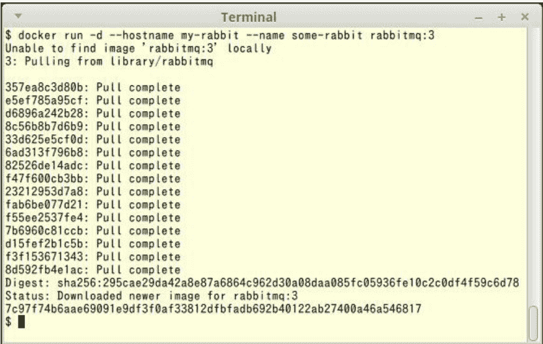

然后，我们将检查 RabbitMQ 的容器是否正在运行，如下所示：

```
$ docker ps
```

如果容器成功启动，我们可以在以下图片中看到输出：

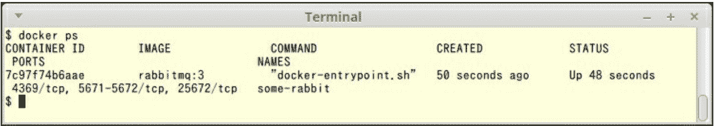

在启动 RabbitMQ 容器后，我们需要知道客户端使用的容器的 IP 地址。为此，我们将发出以下 Docker 命令：

```
$ docker inspect --format '{{ .NetworkSettings.IPAddress }}' some-rabbit
```

```
[langohr.consumers :as consumers]
[langohr.basic      :as basic]
[langohr.exchange   :as exchange]
))
```

我们还需要定义 `*host*` 变量，它是我们在 Docker 容器中检查过的 RabbitMQ 提供服务的 IP 地址：

```
(def *host* "172.17.0.2")
```

### 定义生产者函数

以下是生产消息的函数的代码：

```
(defn simple-producer [qname payload]
  (with-open
    [conn (core/connect {:host *host*})
     ch (channel/open conn)]
    (println "producing message to exchange " qname " payload = " payload)
    (queue/declare ch qname {:exclusive false :auto-delete false})
    (basic/publish
      ch "" qname payload {:content-type "text/plain" :type "message"})))
;;=> #'chapter04.rabbitmq/simple-producer
```

首先，生产者使用 `langohr.core/connect` 连接到 RabbitMQ 服务器。然后它使用 `langohr.channel/open` 打开连接的通道。

之后，生产者通过 `langohr.queue/declare` 声明一个队列，并通过 `langohr.basic/publish` 发布一条消息。

### 定义消息处理器和消费者

我们将定义一个由消费者使用的消息处理器：

```
(defn message-handler
  [ch {:keys [content-type delivery-tag type] :as meta} ^bytes payload]
  (println
    (str "Received a message payload : " (String. payload "UTF-8") " , tag : " delivery-tag)))
;;=> #'chapter04.rabbitmq/message-handler
```

消息处理器有三个参数：通道、元数据和负载。示例消息处理器只是打印元数据和负载。

然后，我们将定义一个消费者。消费者获取连接，打开通道，然后消费生产者发布的消息：`langohr.consumers/subscribe` 用于获取消息：

```
(defn simple-consumer [qname]
  (with-open
    [conn (core/connect {:host *host*})
     ch (channel/open conn)]
    (println (str "simple-consumer is connected with id: "
                  (.getChannelNumber ch)))
    (consumers/subscribe ch qname message-handler {:auto-ack true})))
;;=> #'chapter04.rabbitmq/simple-consumer
```

### 测试生产者和消费者

让我们测试生产者和消费者函数的工作方式。

运行生产者会将消息 "Hello !" 放入 "queue1.cookbook" 队列中：

```
(simple-producer "queue1.cookbook" "Hello !")
;;=> producing message to exchange  queue1.cookbook  payload = Hello !
;;=> nil
```

然后，让我们运行消费者从队列中获取消息。消费者中的消息处理器会打印通道属性和消息负载：

```
(simple-consumer "queue1.cookbook")
;;=> simple-consumer is connected with id: 1
;;=> Received a message payload : Hello ! , tag : 1
;;=> amq.ctag-8hfyoaVHtPAt_qKs1S7Hxg
```

收到消息真是太好了！

### 使用阻塞消费者

在前面的示例中，`simple-consumer` 在使用 `langohr.consumers/subscribe` 消费指定队列中的所有消息后退出。这是一个非阻塞消费者。我们现在将定义一个阻塞消费者，它会永远消费队列中的消息，直到被其他人终止。让我们看看阻塞消费者如下：

```
(defn blocking-consumer [qname]
  (with-open
    [conn (core/connect {:host *host*})
     ch (channel/open conn)]
    (println (str "simple-consumer is connected with id: "
                  (.getChannelNumber ch)))
    (consumers/blocking-subscribe ch qname message-handler
                                  {:auto-ack true})))
;;=> #'chapter04.rabbitmq/blocking-consumer
```

前述阻塞消费者代码与上一节中定义的非阻塞消费者代码类似。我们将使用 `langohr.consumers/blocking-subscribe` 而不是它。当我们运行 `blocking-consumer` 时，我们使用 `future` 在后台线程上运行它：

```
(def f (future (blocking-consumer "queue1.cookbook")))
;;=> Consumer is connected with id: 1
;;=> #'chapter04.rabbitmq/f
```

让我们运行生产者。我们将运行生产者函数三次，这些调用会生成三条消息。因此，`blocking-consumer` 在后台接收三条消息：

```
(simple-producer "queue1.cookbook" "Hello !")
;;=> produced a message =>  Hello !
;;=> nil
;;=> Received a message payload : Hello ! , tag : 1
(simple-producer "queue1.cookbook" "Hello !")
;;=> produced a message =>  Hello !
;;=> nil
;;=> Received a message payload : Hello ! , tag : 2
(simple-producer "queue1.cookbook" "Hello !")
;;=> produced a message =>  Hello !
;;=> nil
;;=> Received a message payload : Hello ! , tag : 3
```

要取消后台线程，请使用 `future-cancel`。

```
(future-cancel f)
;;=> true
```

### 它是如何工作的...

AMQP 代表 Advanced Message Queuing Protocol。它是应用程序和组织之间业务消息的开放标准。RabbitMQ 是一个多协议消息代理，支持 AMQP 0-9-1。

### 连接到代理并打开通道

在前面的示例中，`simple-producer` 和 `simple-consumer` 连接到代理并打开通道：

```
(with-open
  [conn (core/connect {:host *host*})
   ch (channel/open conn)]
  ...)
```

`langohr.core/connect` 连接到代理，`langohr.channel/open` 打开用于发布和订阅的通道。

`langohr.core/connect` 可以使用映射结构指定附加参数：

```
(core/connect {:host *host* :port 5672 :username "guest"
               :password "guest" :vhost "/"})
```

`langohr.channel/open` 接受可选的通道号参数来按数字标识通道：

```
(channel/open conn 1)
```

### 生产者如何工作


让我们逐步查看代码来学习生产者是如何工作的。

## 声明队列

连接到代理并打开通道后，生产者声明一个交换机以发布消息。

`langohr.queue/declare` 声明要使用的队列并将其与通道关联：

```
(queue/declare ch qname {:durable false :exclusive false :auto-delete false})
```

强制参数是通道和队列名称。附加参数为以下队列属性：

- `:durable true`：这会创建一个持久队列，使队列及其中的消息在代理重启事件后仍然存活
- `:exclusive true`：这会创建一个独占队列，只能由当前连接访问，并在连接关闭时被删除
- `:auto-delete true`：应用程序结束后删除该队列

## 生产消息

生产者向交换机生产消息。`langohr.basic/publish` 将消息发布到交换机。参数为通道、交换机类型、路由键、有效载荷和可选属性。在前面的示例中，使用了默认交换机类型(="")：

```
(basic/publish
  ch "" key payload {:content-type "text/plain" :type "message"})
```

## 消费者如何工作

下图以交换机和队列为例进行说明：

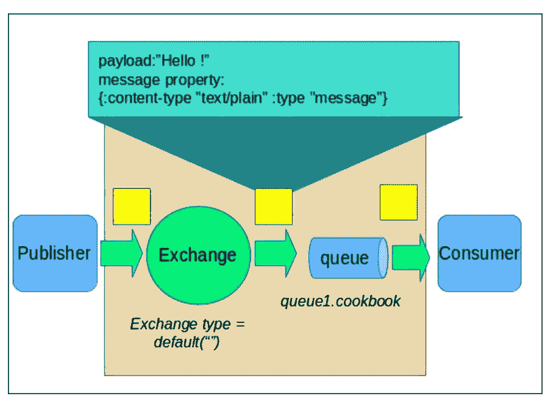

## 消费消息

连接到代理并打开通道后，消费者从队列订阅消息：

```
(consumers/subscribe ch qname message-handler {:auto-ack true})
```

消息处理程序是在消息到达时调用的函数。如果 :auto-ack 为 true，代理会保留消息直到消费者确认消息。如果 :auto-ack 为 false，代理在将消息发送给消费者时就会移除该消息。

## 定义消息处理程序

消息处理程序是消费者接收消息时使用的函数。消息处理程序有两个参数。第一个参数是消息的元数据。第二个参数是消息的有效载荷。由于有效载荷是字节数组，我们将其转换为字符串：

```
(defn message-handler
  [ch {:keys [content-type delivery-tag type] :as meta} ^bytes
payload]
    (println
      (str "Received a message payload : " (String. payload "UTF-8") " , tag : " delivery-tag))
```

## 还有更多...

接下来，我们将解释更多交换机类型，例如扇出交换机和主题交换机。

## 使用扇出交换机

扇出交换机一次将消息分发到多个队列。我们将定义 `fanout-producer` 和 `fanout-consumer`。`langohr.exchange/fanout` 为生产者和消费者指定扇出交换机类型：

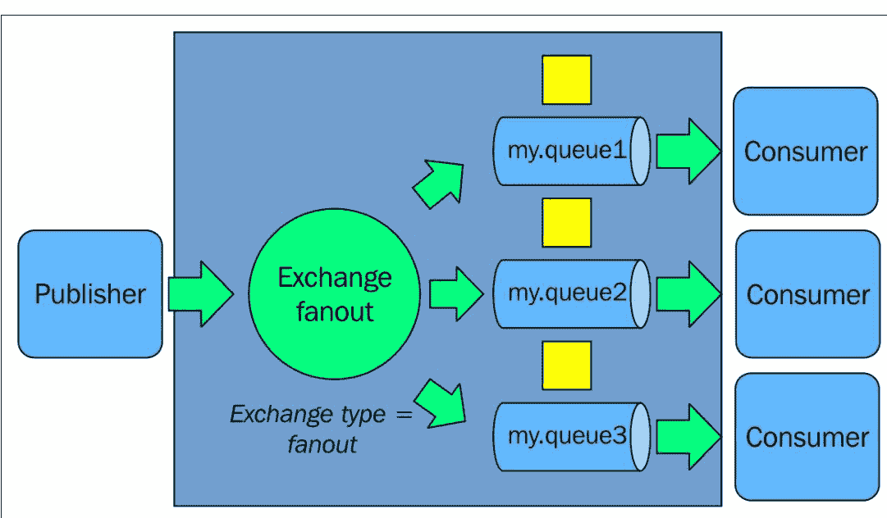

## fanout-producer

这里我们将定义 `fanout-producer`。`langohr.exchange/declare` 声明交换机为扇出类型

```
(def f2 (future (fanout-consumer "fanout.exchange" "my.queue2" :num 2)))
;;=> starting consumer ...
;;=> #'chapter04.rabbitmq/f2
(def f3 (future (fanout-consumer "fanout.exchange" "my.queue3" :num 3)))
;;=> starting consumer ...
;;=> #'chapter04.rabbitmq/f3
```

## 测试扇出消费者

然后，`fanout-publisher` 发布一条消息；三个消费者接收生产者发布的消息：

```
(fanout-producer "fanout.exchange" "hello world !")
;;=> producing message to exchange  my.exchange  payload = hello world !
;;=>  [1-1] hello world !
;;=>  [2-1] hello world !
;;=>  [3-1] hello world !
;;=> nil
```

最后，我们将清理后台线程：

```
(for [x [f1 f2 f3]]
  (future-cancel x))
;;=> [true true true]
```

## 使用主题交换机

扇出交换机一次将消息分发到多个队列。我们将定义 `topic-publisher` 和 `topic-consumer`。主题交换机通过路由键模式路由消息：

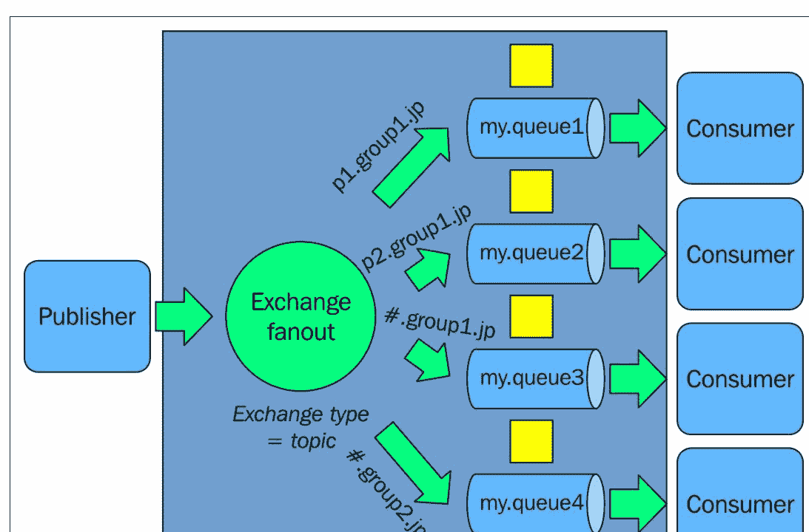

## Topic-publisher

我们将按如下方式展示 topic-producer：

```
(defn topic-producer [ex key payload]
  (with-open
    [conn (core/connect {:host *host*})]
    ch (channel/open conn)]
    (println "producing message to exchange " ex "/" key "
    payload = " payload)
    (exchange/declare ch ex "topic" {:durable false :auto-delete false})
    (basic/publish ch ex key payload)
    )
  )
;;=> #'chapter04.rabbitmq/topic-publisher
```

`langohr.exchange/declare` 声明交换机为主题交换机类型。然后，`langohr.basic/publish` 使用路由键向交换机发布消息。

## Topic-consumer

`topic-consumer` 如下：

```
(defn topic-consumer [ex topic qname & {:keys [num] :or {num 1}}]
  (let [handler
        (fn [ch {:keys [delivery-tag]} payload]
          (println (format " [%d-%d] %s" (.getChannelNumber ch) delivery-tag (String. payload "UTF-8"))))]
    (with-open [conn (core/connect)
                ch (channel/open conn num)]
      (println "starting consumer ...")
      (queue/declare ch qname {:durable false :auto-delete false})
      (exchange/declare ch ex "topic" {:durable false :auto-delete false})
      (queue/bind ch qname ex {:routing-key topic})
      (consumers/blocking-subscribe ch qname handler {:auto-ack true}))))
;;=> #'chapter04.rabbitmq/topic-consumer
```

前面的代码是 `topic-consumer`。`langohr.exchange/declare` 声明交换机为主题交换机类型。然后，`langohr.queue/declare` 声明一个消费者队列，而 `langohr.queue/bind` 绑定交换机和队列。

## 运行主题消费者

我们将运行四个主题消费者，每个消费者接受不同的路由键模式，如下所示：

| 线程号 | 路由键模式 | 队列名称 |
|---|---|---|
| 1 | p1.group1.jp | my.queue1 |
| 2 | p2.group1.jp | my.queue2 |
| 3 | #.group1.jp | my.queue3 |
|  | #.group2.jp | my.queue4 |

每个主题消费者的路由键模式与消息中的路由键匹配，并将消息分发到消费者的队列。字符 # 匹配任意数量的字符。

我们使用 future 并发运行四个消费者：

```
(def f1 (future (topic-consumer "topic.exchange1" "p1.group1.jp" "my.queue1" :num 1)))
;;=> starting consumer ...
;;=> #'chapter04.rabbitmq/f1
(def f2 (future (topic-consumer "topic.exchange1" "p2.group1.jp" "my.queue2" :num 2)))
;;=> starting consumer ...
;;=> #'chapter04.rabbitmq/f2
(def f3 (future (topic-consumer "topic.exchange1" "#.group1.jp" "my.queue3" :num 3)))
;;=> starting consumer ...
;;=> #'chapter04.rabbitmq/f3
(def f4 (future (topic-consumer "topic.exchange1" "#.group2.jp" "my.queue4" :num 4)))
;;=> starting consumer ...
;;=> #'chapter04.rabbitmq/f4
```

## 测试主题消费者

我们将通过发布消息来测试主题消费者。在以下情况下，消息的路由键为 p1.group1.jp。因此，它匹配 p1.group1.jp 和 #.group1.jp：

```
(topic-producer "topic.exchange1" "p1.group1.jp" "hello p1.group1.jp")
;;=> producing message to exchange topic.exchange1 / p1.group1.jp payload = hello p1.group1.jp
;;=> [3-1] hello p1.group1.jp
;;=> [1-1] hello p1.group1.jp
```

同样，路由键 p2.group1.jp 匹配 p2.group1.jp 和 #.group1.jp，因为 # 是通配符：

```
(topic-producer "topic.exchange1" "p2.group1.jp" "hello p2.group1.jp 1")
;;=> producing message to exchange  topic.exchange1 / p2.group1.jp  payload = hello p2.group1.jp 1
;;=> [3-2] hello p2.group1.jp 1
;;=> [2-2] hello p2.group1.jp 1
```

路由键 p3.group1.jp 仅匹配 #.group1.jp：

```
(topic-producer "topic.exchange1" "p3.group1.jp" "hello p3.group1.jp 1")
;;=> producing message to exchange topic.exchange1 / p3.group1.jp  payload = hello p1.group2.jp 1
;;=> [3-3] hello p3.group1.jp 1
```

路由键 p4.group2.jp 仅匹配 #.group2.jp：

```
(topic-producer "topic.exchange1" "p4.group2.jp" "hello p1.group2.jp 1")
;;=> producing message to exchange  topic.exchange1 / p4.group2.jp  payload = hello p1.group2.jp 1
;;=> [4-2] hello p1.group2.jp 1
```

最后，我们将停止线程：

```
(for [x [f1 f2 f3 f4]]
  (future-cancel x))
;;=> [true true true true]
```

## 另请参阅

要了解 AMQP 概念，请参阅 https://www.rabbitmq.com/tutorials/amqp-concepts.html 。

AMQP 0.9.1 参考指南可在 https://www.rabbitmq.com/amqp-0-9-1-reference.html 找到。

有关 AMQP 主页，请参阅 http://www.amqp.org/ 。


## 使用 Kafka

Apache Kafka 是一个由 LinkedIn 开发的快速、可扩展、持久且分布式的消息系统。我们将使用 clj-kafka 使用 Kafka。它是一个 Clojure 包装器。

## 准备工作

我们需要为本教程安装 Kafka。Kafka 的安装步骤如下。

## 下载 Kafka 0.8.2.2

首先，使用 wget 命令下载 Kafka 0.8.2.2：

```
$ wget
http://ftp.kddilabs.jp/infosystems/apache/kafka/0.8.2.2/kafka_2.11-0.8.2.2.tgz
```

然后，从下载的 TAR 文件中提取 Kafka 文件：

```
$ tar xzvf kafka_2.11-0.8.2.2.tgz
```

## 启动 ZooKeeper 和 Kafka 服务器

进入 Kafka 目录并运行 ZooKeeper 和 Kafka 服务器：

```
$ cd kafka_2.11-0.8.2.2
$ bin/zookeeper-server-start.sh config/zookeeper.properties
```

前述的 ZooKeeper 启动命令将显示以下输出：

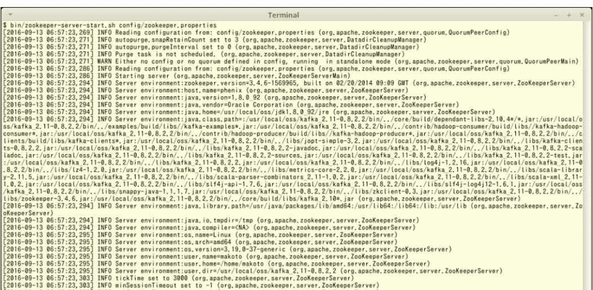

然后，我们将启动 kafka-server：

```
$ bin/kafka-server-start.sh config/server.properties
```

前述命令将显示以下输出：

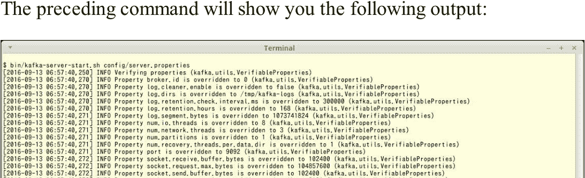

## 创建主题

创建主题名称 test：

```
$ bin/kafka-topics.sh --create --zookeeper localhost:2181 --replication-factor 1 --partitions 1 --topic test
```

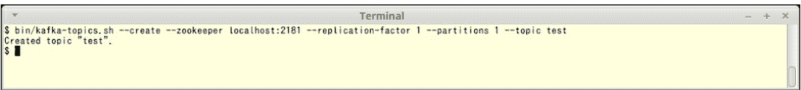

检查是否存在：

```
$ bin/kafka-topics.sh --zookeeper localhost:2181 --list
```

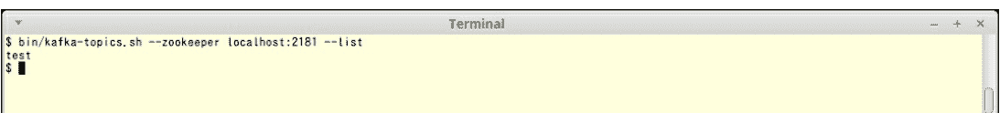

## 运行控制台消费者

运行控制台消费者以检查 Clojure 生产者是否工作：

```
$ bin/kafka-console-consumer.sh --zookeeper localhost:2181 --topic test
```

## 使用 clj-kafka

在本教程中，我们将使用 clj-kafka，它是用于 Kafka 的 Clojure 库：

```
(defproject chapter04 "0.1.0"
:dependencies [[org.clojure/clojure "1.8.0"]
                [clj-kafka "0.3.4"]])
```

## 如何操作...

让我们学习如何将消息发布到 Kafka 主题以及如何从主题消费消息。

## 声明命名空间并加载 Clojure 库

首先，我们将声明本教程使用的命名空间和库：

```
(ns chapter04.kafka
  (:require
    [clj-kafka.producer :as p]
    [clj-kafka.core :as core]
    [clj-kafka.consumer.zk :as zk]
    [clj-kafka.new.producer :as new]
    [clj-kafka.consumer.simple :as simple]
    [clj-kafka.admin :as admin]
    ))
;;=> nil
```

## 生产消息

按如下方式将生产者配置的参数定义为映射：

```
(def producer-config
  {"metadata.broker.list" "localhost:9092"
   "serializer.class" "kafka.serializer.DefaultEncoder"
   "partitioner.class" "kafka.producer.DefaultPartitioner"}
  )
;;=> #'chapter04.kafka/producer-config
```

我们将使用 clj-kafka.producer/send-message 生产四条消息。以下代码将字符串发送到 test 主题：

```
(p/send-message (p/producer producer-config)
  (p/message "test" (.getBytes "Hi hello !")))
;;=> nil
(p/send-message (p/producer producer-config)
  (p/message "test" (.getBytes "Hi hello !")))
;;=> nil
(p/send-message (p/producer producer-config)
  (p/message "test" (.getBytes "Hi hello !")))
;;=> nil
(p/send-message (p/producer producer-config)
  (p/message "test" (.getBytes "Hi hello !")))
;;=> nil
```

## 消费消息

现在，让我们看看如何从主题消费消息。以下代码定义了消费者的配置：

```
(def consumer-config {
"zookeeper.connect" "localhost:2181"
"group.id" "test-consumer-group1"
"auto.offset.reset" "smallest"
"zookeeper.connection.timeout.ms" "5000"
"consumer.timeout.ms" "5000"
"auto.commit.enable" "true"
})
;;=> #'chapter04.kafka/consumer-config
```

然后，消费者从 test 主题读取两条消息：

```
(def x (core/with-resource [c (zk/consumer consumer-config)]
zk/shutdown
(doall (take 1 (zk/messages c "test")))
))
;;=> #'chapter04.kafka/x
```

前述代码返回 clj_kafka.core.KafkaMessage 的惰性序列，其有效负载可以通过 value 访问如下：

```
(-> (first x)
:value
(String. "UTF-8")
)
;;=> "Hi hello !"
```

## 如何工作...

现在，我们将看看 Kafka 生产者和消费者如何工作。

## 生产消息

生产者使用 clj-kafka.producer/send-message 以及生产者对象和消息来生产消息。

send-message 的第一个参数是生产者对象。要创建

| zookeeper.connect | "" | Zookeeper 连接字符串，格式为 hostname:port。 |
| group.id | "" | 唯一标识此消费者所属的消费者进程组的字符串。 |
| auto.offset.reset | largest | 当 ZooKeeper 中没有初始偏移或偏移超出范围时要执行的操作：smallest - 自动将偏移重置为最小偏移 largest - 自动将偏移重置为最大偏移 其他 - 向消费者抛出异常 |
| zookeeper.connection.timeout.ms | 6000 | 客户端在建立与 ZooKeeper 的连接时等待的最大时间。 |
| consumer.timeout.ms | -1 | 如果在指定间隔后没有可供消费的消息，则向消费者抛出超时异常。 |
| auto.commit.enable | true | 如果为 true，则定期向 ZooKeeper 提交消费者已获取的消息的偏移。此已提交的偏移将在进程失败时用作新消费者开始的位置。 |

clj-kafka.consumer.zk/messages 返回 clj_kafka.core.KafkaMessage 的惰性序列。KafkaMessage 定义如下：

```
(defrecord KafkaMessage [topic offset partition key value])
```

clj-kafka.core/with-resource 是一个宏，接受以下三个参数：

- binding: 这是消费者连接的绑定
- close function: 函数退出时调用
- body: 这是函数体

由于 ZooKeeper 会记住每个具有相同 group ID 的消费者所在的偏移，因此使用相同 group ID 消费主题会按如下方式递增其偏移：

```
(core/with-resource [c (zk/consumer consumer-config)]
    zk/shutdown
    (doall (take 1 (zk/messages c "test"))))
;;=> (#clj_kafka.core.KafkaMessage{:topic "test", :offset 1,
:partition 0, :key nil, :value #object[["B" 0x2076f724 "
[B@2076f724"]]})
(core/with-resource [c (zk/consumer consumer-config)]
    zk/shutdown
    (doall (take 1 (zk/messages c "test"))))
;;=> (#clj_kafka.core.KafkaMessage{:topic "test", :offset 2,
:partition 0, :key nil, :value #object[["B" 0x4d0d3a0b "
[B@4d0d3a0b"]]})
(core/with-resource [c (zk/consumer consumer-config)]
    zk/shutdown
    (doall (take 1 (zk/messages c "test"))))
;;=> (#clj_kafka.core.KafkaMessage{:topic "test", :offset 3,
:partition 0, :key nil, :value #object[["B" 0x125f8cd0 "
[B@125f8cd0"]]})
```

## 还有更多...

在这里，我们将学习如何创建一个新主题。

## 创建新主题

以下代码创建一个名为 "test-topic" 的新主题：

```
(with-open [zk (admin/zk-client "127.0.0.1:2181")]
    (let [topic "test-topic"]
      (if-not (admin/topic-exists? zk topic)
        (admin/create-topic zk topic
                            {:partitions 1
                             :replication-factor 1
                             :config {"cleanup.policy"
                                      "compact"}})))
)
;;=> nil
```

## 另请参阅

有关 Apache Kafka 主页，请参阅 [http://kafka.apache.org/](http://kafka.apache.org/) 。

有关 Kafka 快速入门指南，请参阅 [http://kafka.apache.org/documentation.html#quickstart](http://kafka.apache.org/documentation.html#quickstart) 。

## 使用 MQTT

正如人们所说，**物联网 (IoT)** 正在带来第三次工业革命。设备将越来越多地相互通信以实时共享信息，而将这些设备连接起来的低功耗、安全协议的需求比以往任何时候都更大。

什么是 MQTT？它是一种 OASIS 批准的标准，机器对机器超轻量级传输协议，用于发布和订阅活动。

MQTT 客户端始终连接到所谓的 MQTT broker，而不是彼此。

MQTT 协议本身基于 TCP/IP 构建，MQTT 客户端和 MQTT broker 都需要 TCP/IP 堆栈。

MQTT 专门为物联网设计，适用于各种场景，例如：

- 临时社交网络
- 需要对从正在接受治疗的患者收集的实时数据进行即时分析的医院
- 通过在偏远和农村地区如海边或山区使用传感器进行环境监测
- 汽车内部监控，以实时收集和发送有关汽车不同部件的信息
- 分布在赌场各处的赌博机，但必须定期与中央服务器通信
- 收银员通过慢速网络发送交易信息并接收价格更新

正如您所见，MQTT 协议是为低内存和低处理能力设备以及受限的网络环境而设计的。

## 准备工作


我们需要做一些准备工作来使用这个配方，因此我们将安装代理，安装一个 UI 用于在机器上可视化检查消息，最后配置我们的 Clojure 环境以便准备好与所有这些组件通信。

## 安装 MQTT 代理

为了准备尝试并了解协议的感觉，我们需要一个小型代理，即一个组件，它将根据主题接收和广播消息。

虽然有几个代理可用，但我们建议你使用 Mosquitto。它有易于安装的安装程序，或者你也可以轻松地从源代码编译它。在 Macintosh 上，以下命令应该可以为你完成：

```
brew install mosquitto
```

当然，还有 Linux 软件包和 Windows 安装程序也可用。安装后，只需从命令行使用以下命令简单启动代理：

```
mosquitto
```

并观察类似以下内容：

```
1452329996: Using default config.
1452329996: Opening ipv4 listen socket on port 1883.
1452329996: Opening ipv6 listen socket on port 1883.
```

在我们开始发送任何消息之前，让我们也安装一个辅助图形客户端。

## MQTT 图形客户端

同样有相当多的客户端可用，因此请确保你选择一个适合你的。但在这里我们将推荐名为 MQTT-spy 的客户端，它是一个基于 Java 的客户端，不会碍事，并让我们看到通过代理的不同消息。

下载是一个 JAR 文件，启动文件要么是简单的双击，要么再次从命令行：

```
java -jar mqtt-client/mqtt-spy-0.4.0-beta-b4-jar-with-dependencies.jar
```

这将显示以下欢迎屏幕：

### mqtt-spy

File Configuration Connections Window Help

Control panel niko_175752046@127.0.0.1

# No configuration file found.

Click here display all available options for resolving missing configuration file.

# You have 1 connection configured.

Click here to edit your connections or on the relevant button to open, connect, reconnect or disconnect.

Disconnect from niko175752046@127.0.0.1

# Living on the edge!

You're on an experimental beta release - 0.4.0 beta (build 4)

# Your mqtt-spy made 4 connections to MQTT brokers in 3 days.

Finding mqtt-spy useful? See how you can make mqtt-spy even better

http://github.com/kamilfb/mqtt-spy/wiki/Getting-involved :)

点击第一个或第二个框将为你创建一组默认连接，或直接连接到我们之前启动的本地代理：

完成后，连接屏幕应类似于以下内容，这就是我们将看到消息流经的地方：


## 发送我们的第一条 MQTT 消息

为了让它更有趣一些，我们将从命令行发送一条消息并在 MQTT spy 界面上看到它。

在前面的 UI 中，让我们订阅一个主题，我们将其命名为 topic/hello。这是通过按以下屏幕截图所示输入主题来完成的：


我们现在可以按下 Subscribe 按钮并准备就绪：


现在让我们从命令行发送我们的消息。从命令行来看，实际上有两个有用的脚本：

- mosquitto_pub
- mosquitto_sub

它们都使用类似的一组参数，因此也很容易在不同的连接设置上尝试发送消息。

要发布消息，我们将使用 mosquitto_pub 脚本并告诉它连接到 localhost，然后指示主题，最后是消息：

```
mosquitto_pub -h localhost -t topic/hello -m "one more cup of coffee?"
```

按 Enter 后，我们的 MQTT spy 屏幕应该已经收到消息，如以下屏幕截图所示：

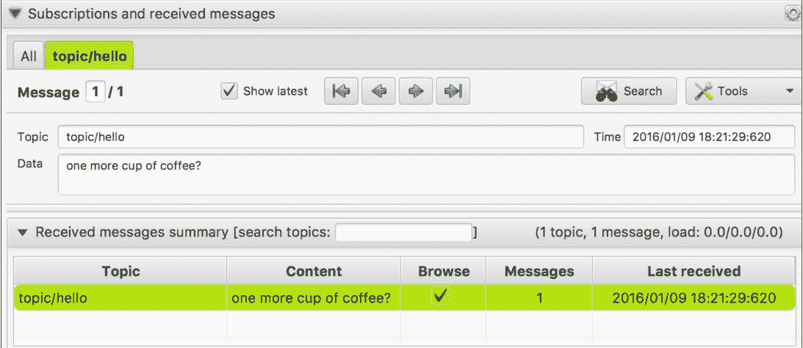

不错。使用 MQTT 发送消息不仅容易，订阅不同主题并调试消息也很容易。

但虽然在笔记本电脑或家庭电脑上运行图形客户端可能很容易，但嵌入式设备通常资源有限，内存占用低，大多数情况下没有这个机会，所以我们将使用之前介绍的另一个 MQTT 命令来订阅消息，mosquitto_sub。

该命令的工作方式与 pub 版本相同，只是我们不设置消息参数：

```
mosquitto_sub -h localhost -t topic/hello
```

脚本启动但目前没有输出，但让我们再次发送相同的消息以多要一杯咖啡，因为服务员第一次没有收到：

```
Nicolass-MacBook:chapter04 niko$ mosquitto_sub -h localhost -t topic/hello
one more cup of coffee?
```

现在你可以看到我们的运行 sub 命令已正确检索到消息。你也可以看到 MQTT spy 窗口显示了第二条消息。

## 获取一些 Clojure

最后，我们只需将一个小的 MQTT 库添加到我们的 project.clj 中即可从 Clojure 端做好准备：

```
[clojurewerkz/machine_head "1.0.0-beta9"]
```

Et voila！现在让我们玩得开心吧。

## 如何操作...

在本配方中，我们将看到如何从 Clojure 发布和订阅消息。machine_head 库是经典的，而且以下代码对我们大多数人来说看起来会非常合理：

```
(ns chapter04.mqtt-pub
  (:require [clojurewerkz.machine-head.client :as mh]))

(let [id (mh/generate-id)
      c  (mh/connect "tcp://127.0.0.1:1883" id)]
  (mh/publish c "topic/hello" "hello from Clojure!")
  (mh/disconnect c))
```

我们首先使用 mh 前缀要求库，为连接准备一个 ID，并通过常规套接字在 tcp 协议上连接。

然后我们发送一条消息，方式与我们在命令行上所做的几乎相同，在连接参数之上是一个主题和一条消息。

如 MQTT spy UI 所见，topic/hello 主题上的消息显示如下：


订阅方面看起来也不会太可怕，以下小片段向我们展示了如何订阅主题并对通过 topic/hello 的消息做出反应。

我们在这里也展示了如何保持：

```
; start with regular Clojure import and require directive
(ns chapter04.mqtt
  (:require [clojurewerkz.machine-head.client :as mh]))

; set up the connection
(def id (mh/generate-id))
(def c  (mh/connect "tcp://127.0.0.1:1883" id))

; set up a ref to keep track of the number of messages
(def i  (ref 0))

; define a callback on the topic/hello topic
```

```
(def s  (mh/subscribe c {"topic/hello" 0}
    (fn [^String topic meta ^bytes payload]
      (println "--> " (String. payload))
      (dosync (alter i inc))))
```

此时，你可以使用 mosquitto_pub 命令行或 MQTT spy UI 向 MQTT 主题发送几条消息。Clojure 代码将接收你的消息并根据我们定义的处理器在控制台中显示它们：

```
chapter04 0.1.0-SNAPSHOT[stdout]:     ->  one more cup of
coffee?
chapter04 0.1.0-SNAPSHOT[stdout]:     ->  one more cup of
coffee?
```

我们也可以确认收到的消息数量：

```
(println "messages count " @i)
; mqtt.clj:      messages count  2
```

最后，要关闭 MQTT 连接，你在 mqtt 连接变量上调用 disconnect：

```
(mh/disconnect c)
```

## 它是如何工作的...

在现实生活中，它的工作方式需要你走到你的 IoT 房间，拿起你的 Arduino 板，并进行一些 Arduino 编程。

本节假设你之前做过一些 Arduino 编程，这意味着一些简单的 C 编程。

Arduino 的 MQTT 库有一些不错且简单的示例来让你快速运行，因此我们将快速浏览最简单的示例。

以下代码片段将你带到与命令行、UI 和 Clojure 代码相同的水平：

```
// Arduino imports for serial communication, ethernet and MQTT.
#include <SPI.h>
#include <Ethernet.h>
```

```
#include <PubSubClient.h>

// network settings
byte mac[]  = { 0xDE, 0xED, 0xBA, 0xFE, 0xFE, 0xED };
IPAddress ip(172, 16, 0, 100);
IPAddress server(172, 16, 0, 2);

// callback that will receive the MQTT messages
void callback(char* topic, byte* payload, unsigned int length)
{
    // handle message code
}

// ethernet et mqtt clients
EthernetClient ethClient;
PubSubClient client(server, 1883, callback, ethClient);

// standard arduino setup function
void setup()
{
    Ethernet.begin(mac, ip);
    if (client.connect("arduinoClient")) {
        client.publish("arduino/out","hello world");
        client.subscribe("arduino/in");
    }
}
// standard arduino loop function.
void loop()
{
    client.loop();
}
```

你现在可以很好地想象 Arduino 板如何将测量结果发送到代理，例如温度或风力，而 Clojure 代码可以直接对来自板本身的消息做出反应。

你也可以看到 Clojure 代码如何订阅来自不同设备的测量结果，然后向另一组板发送命令。

一个非常简单但不错的例子是，从 Arduino 板获取声音测量，然后改变房间灯光的强度


直接来自对话的强度。

Reverbly，我们可以监控来自互联网的在线地震测量，并在地震发生时通过 MQTT 向一组 Arduino 设备分发警报或预防措施。

## 还有更多...

虽然 Arduino 可能是物联网最著名的平台，但 Raspberry Pi 无疑拥有令人印象深刻的硬件，使其成为自身代理也具有吸引力。

在这里，我们不会通过一个示例来设置 Raspberry Pi 板本身，但我们将快速查看如何在 VirtualBox 中模拟事物，以便了解该板如何被编程和部署。

我们包含了一个 torrent 文件来检索 Raspberry Pi 操作系统的完整镜像。请注意，虽然在虚拟机中运行，并且连接的传感器在物理上不存在，但操作系统本身的行为与在真实板上运行时完全相同。

首先，让我们获取 ova 文件，它是通过给定 torrent 文件的 VirtualBox 镜像。aria2c 是一个流行的命令行 torrent 客户端，但你当然可以自由使用你喜欢的客户端：

```
aria2c RaspberryPi.VirtualBox/RaspberryPi.ova.torrent
```

RaspberryPi.ova 现在已在你的本地机器上。双击它将导入 VirtualBox。为了我们的测试目的，我们将更改网络设置，使其使用主机设置连接到互联网，如以下屏幕截图所示：

我们只需要确保使用 **Bridged Adapter**。

Raspberry 镜像现在已准备好启动，所以让我们点击 **Start**，几秒钟后，Raspberry 就运行了！


使用登录名 rpi/password 我们可以进入 Raspberry 模拟系统。

首先让我们通过编辑 /etc/network/interfaces 文件来修复网络设置，该文件告诉 Raspberry 如何连接到互联网：

```
# The primary network interface
auto correct
iface eth1 inet dhcp
```

像常规的 Debian/Ubuntu 系统一样，我们将添加一个包仓库：

```
apt-get install python-software-properties
apt-add-repository ppa:mosquitto-dev/mosquitto-ppa
apt-get update
```

然后我们就可以使用标准的 apt-get 命令轻松获取 mosquitto 软件：

```
apt-get install mosquitto mosquitto-clients
```

因此，我们回到了本菜谱的准备阶段，在那里我们将启动命令行。我们将首先在 Raspberry Pi 上启动 mosquitto broker：

```
mosquitto
```

然后假设你的模拟 Raspberry Pi IP 地址是 192.168.100.103，Clojure 代码只需稍作更改，使用新的 IP：

```
(ns chapter04.mqtt-pub
  (:require [clojurewerkz.machine-head.client :as mh]))

(let [id (mh/generate-id)
      c  (mh/connect "tcp://192.168.100.103:1883" id)]
  (mh/publish c "topic/hello" "hello from Clojure!")
  (mh/disconnect c))
```

## 流式访问以提供高性能

本菜谱将介绍如何解析和写入大量数据。由于 XML 可能是数据格式中最冗长的，我们将简要介绍如何生成大量垃圾数据，然后如何以内存高效的方式处理这些数据。

## 准备工作

`data.xml` 库是我们在这里的首选库，所以如果尚未添加，请将其添加到 `project.clj` 中：

```
[org.clojure/data.xml "0.1.0-beta1"]
```

我们还将使用 JVM 中可用的核心 Java 流式和压缩函数。我们知道只需在当前命名空间中导入它们即可访问主机函数，因此这里无需更多准备。

## 如何操作...

就这样。让我们向文件系统倾倒大量数据。我们将创建一个 XML 元素。

## 流式输出

我们通过引入 XML 和写入流的正确命名空间来准备：

```
(use 'clojure.data.xml)
(use '[clojure.java.io :only [writer output-stream]])
```

现在，我们可以生成 XML 元素并直接将其写入文本文件。这是通过在文件上打开一个 `write` 然后发出 XML 来完成的：

```
(with-open [o (writer "data-set-1.xml")]
  (doseq [i (range 1 10)]
    (.write o (str (element :friend {"age" "23"} (str "Friend" i))))
    (.write o "\n")))
```

请注意，这也可以通过基本的 pmap 调用并行完成。虽然数据顺序在某种程度上丢失了，但数据生成的速度要快得多：

```
(with-open [o (writer "test_1.xml")]
  (doall
    (pmap
      #(.write o
        (str
          (element :friend
            {"age" "23"}
            (str "Friend" %)) "\n"))
      (range 1 10))))
```

请注意，在这种情况下，我们需要使用 doall 来强制在 with-open 的作用域退出之前执行，否则我们将得到一个流已关闭异常。

虽然这会生成一个每行一个 XML 的大文件，但一个适当的 XML 文件看起来如下：

```
(with-open [o (writer "test_2.xml")]
(.write o "<friends>\n")
(doseq [i (range 1 10)]
  (.write o
    (str
      (element :friend
        {"age" "23"}
        (str "Friend" i))
      "\n"))))
(.write o "</friends>\n"))
```

现在将范围值增加到大约 10,000,000 以获得一个不错的 500 MB 数据文件。你也可以注意到内存使用并没有增加太多，保持相对稳定。

让我们现在分析数据！

## 流式输入

```
(use '[clojure.java.io :only [reader input-stream]])

(with-open [in (reader (input-stream "test_2.xml"))]
  (doall
    (filter
      #(= "Friend3" (first (:content %)))
      (:content (clojure.data.xml/parse in)))))

; (#clojure.data.xml.node.Element{:tag :friend, :attrs {:age "23"}, :content ("Friend3")})
```

同样，我们需要再次调用 doall 以确保在文件仍然打开时进行处理。文件有多大似乎对内存消耗影响不大，我们正在通过 data.xml parse 方法直接流式传输文件，该方法返回 XML 元素的惰性序列。

## 使用 line-seq 进行流式传输

在按行处理是可能的情况下，我们可以使用 line-seq 函数，它将构建一个惰性序列。

当我们生成示例数据文件时，我们有一个不太像 XML 的文件；它每行一个 XML 元素：

```
(with-open [in (reader (input-stream "test_1.xml"))]
  (doall

    (filter
      #(= "Friend1"
        (first (:content (parse
          (java.io.StringReader. %)))))

    (line-seq in))))
```

在这种情况下，line-seq 一次从缓冲读取器读取一行，并且处理是惰性的，意味着一次一个元素。

## 它是如何工作的...

现在流式传输可以通过通常使用 core.async 变得更好。在此阶段，你应该已经习惯处理通道，所以让我们快速浏览一下我们将使用的命名空间设置和两个 core async 通道：

```
(use 'clojure.data.xml)
(use '[clojure.java.io :only [writer reader input-stream output-stream]])
(require '[clojure.core.async :as async])

(def in-chan (async/chan))
(def out-chan (async/chan))
```

现在，结果线程，即将显示数据的线程，将简单地打印来自 out 通道的数据。这转换为 core.async 线程如下：

```
(async/thread
  (while true
    (let [data (async/<!! out-chan)]
      (println data))))
```

我们将使用第二个线程来解析和过滤来自输入通道的数据。我们在上一节中看到的解析，代码保持不变。我们只是以类似的方式将其包装到一个 core.async 线程中：

```
(async/thread
  (while true
    (let [data (async/<!! in-chan)]
      (if (= "Friend1" (first (:content (parse (java.io.StringReader. data)))))
        (async/>!! out-chan data)))))
```

在从输入通道读取后，如果数据匹配，我们将把它放到 out 通道，即前一个线程应该从中读取的通道。

最后，我们重用 pmap 和 line-seq 来进行简单的读取

```
(with-open [in (reader (input-stream "test_1.xml"))]
  (doall


```
(pmap
#(async/>!! in-chan %)
(line-seq in)))
```

假设 test_0.xml 文件内容如下：

```
<friend age="23">Friend1</friend>
<friend age="23">Friend4</friend>
...
```

那么使用 core-async 读取的输出就简单地按一个接一个的流进行，如下图所示：

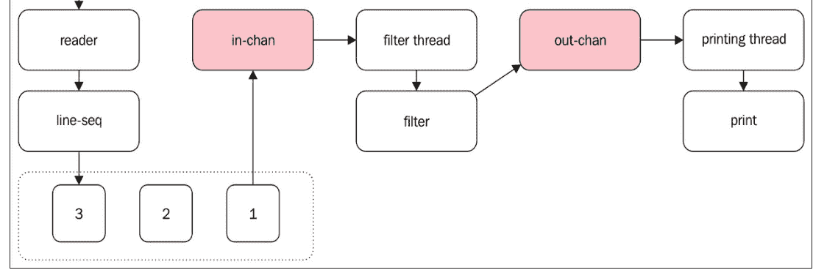

## 还有更多...

相同的数据解析和处理技术也可以应用于 reducers：

```
(require '[clojure.core.reducers :as r])
(use 'clojure.data.xml)
(use '[clojure.java.io :only [writer reader input-stream output-stream]])
```

```
(with-open [in (reader (input-stream "test_1.xml"))]
(into []
(r/filter
```

```
(fn[x]
  (= "Friend1"
  (first (:content (parse
  (java.io.StringReader. x))))))
(line-seq in)))
```

这有在内存中加载比所需更多数据的缺点，但处理起来更容易阅读且简洁。

如果在处理数据时要执行多个操作，还可以加入 transducers。我们把这留给读者的好奇心！

## 使用 Apache Camel 连接一切

Apache Camel 是一个基于规则的路由和中介引擎，它使用 API 或声明式 Java 领域特定语言来配置路由和中介规则，提供企业集成模式。

## 准备工作

在本配方中，我们将使用 Java Camel 库。因此，你需要在 project.clj 中添加 org.apache.camel/camel-core：

```
(defproject chapter04 "0.1.0"
:dependencies [[org.clojure/clojure "1.8.0"]
                [org.apache.camel/camel-core "2.16.1"]]
```

## 如何操作...

在这里，我们将学习从 Clojure 使用 Camel 的基本用法。

## 导入 Camel 类

以下代码导入我们将使用的 Camel 类：

```
(ns chapter04.camel
  (:import [org.apache.camel.impl DefaultCamelContext]
           [org.apache.camel.builder RouteBuilder]
           [org.apache.camel.main Main]
           [org.apache.camel Exchange]
           [org.apache.camel Processor]))
```

## 使用 Clojure 搭乘你的第一次 Camel 之旅

让我们编写一段简单的 Camel 代码，将文件从一个目录移动到另一个目录。以下代码将文件从 /tmp/in 移动到 /tmp/out：

```
(def ctx
```

```
(let [context (DefaultCamelContext.)]
  (.addRoutes context (proxy [RouteBuilder] []
    (configure [] (.. this
      (from
"file:/tmp/in?noop=false")
      (to
"file:/tmp/out")))))
  context
  ))
#'chapter04.camel/ctx
```

启动上下文：

```
(.start ctx)
;;=> nil
```

然后在 /tmp/in 下创建一个文件：

```
$ echo hello Makoto ! > /tmp/in/makoto.txt
```

Camel 代码检查 /tmp/in 并移动到 /tmp/out：

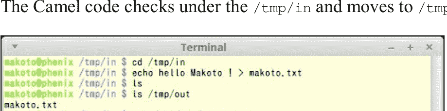

让我们按如下方式停止 Camel：

```
(.stop ctx)
;;=> nil
```

## 使用 Camel 编写更符合 Clojure 习惯的代码

与以下 Java 代码相比，前面的代码更简单：

```
public class FileToFile {
    public static void main(String args[]) throws Exception {
        CamelContext context = new DefaultCamelContext();
```

```
context.addRoutes(new RouteBuilder() {
    public void configure() {
        from("file:/tmp/in?noop=false")
            .to("file:/tmp/out");
    }
});
context.start();
}
```

使用宏可以使应用程序代码更简单。我们将定义一个实现 org.apache.camel.builder RouteBuilder 的辅助函数和一个宏：

```
(defn create-builder [builder]
  (proxy [RouteBuilder] [] (configure [] (builder this))))
;;=> #'chapter04.camel/create-builder
(defmacro add-routes [ctx & body]
  `(.addRoutes ~ctx (create-builder (fn [~'this] (.. ~'this ~@body)))))
;;=>#'chapter04.camel/add-routes
```

使用宏，代码要简单得多，路由定义也易于理解：

```
(defn file-to-file []
  (let [context (DefaultCamelContext.)]
    (add-routes context
      (from "file:/tmp/in?noop=false")
      (to "file:/tmp/out")
      )
    context
  ))
;;=> #'chapter04.camel/file-to-file
```

我们可以使用 .start 和 .stop 分别启动和停止路由器：

```
(def ctx (file-to-file))
;;=> #'chapter04.camel/ctx
(.start ctx)
;;=> nil
(.stop ctx)
;;=> nil
```

## 它是如何工作的...

前面的代码使用了文件端点。我们将展示端点的主要参数如下：

| 名称 | 默认值 | 描述 |
|---|---|---|
| noop | false | 如果为 true，则文件不会以任何方式移动或删除。此选项适用于只读数据或 ETL 类型需求。 |
| append | true | 写入时，我们是追加到文件末尾还是替换它？ |
| consumer.delay | 500 | 下一次轮询文件/目录前的毫秒数。 |

## 还有更多...

让我们定义一个非常简单的处理器，在文件端点之间转换消息。要编写处理器，我们必须在 org.apache.camel Processor 类中实现 process 方法。我们将使用 Clojure proxy 函数来实现此方法。我们的简单处理器回显入站字符串，并在其上添加字符串 "Hello " 并发送到出站：

```
(defn get-payload-as-string [ex]
  (-> ex .getIn (.getBody (class ""))))
;;=> #'chapter04.camel/get-payload-as-string
(def simple-processor
  (proxy [Processor] []
    (process [exchange]
      (let [payload
            (get-payload-as-string exchange)]
        (println payload)
        (-> exchange .getOut (.setBody (str "Hello " payload)))))))
#'chapter04.camel/processor
```

因此，让我们使用处理器定义一个新的上下文：

```
(defn file-to-file-with-processor []
```

```
(let [context (DefaultCamelContext.)]
  (add-routes context
    (from "file:/tmp/in?noop=false")
    (process simple-processor)
    (to "file:/tmp/out"))
  context))
;;=> #'chapter04.camel/processor
```

以下代码运行 Camel：

```
(def ctx (file-to-file-with-processor))
;;=> #'chapter04.camel/ctx
(.start ctx)
;;=> nil
```

让我们运行以下命令：

```
$ echo Makoto > /tmp/in/makoto.txt
$ echo Nico > /tmp/in/nico.txt
```

回显字符串显示在你的控制台上，文件内容被转换，如以下屏幕截图所示：

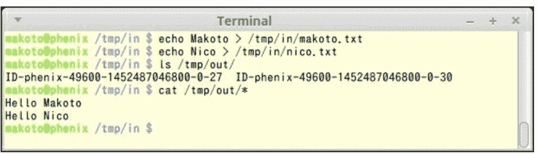

## 另请参阅

你可以在 http://camel.apache.org/ 查看 Apache Camel 主页。
